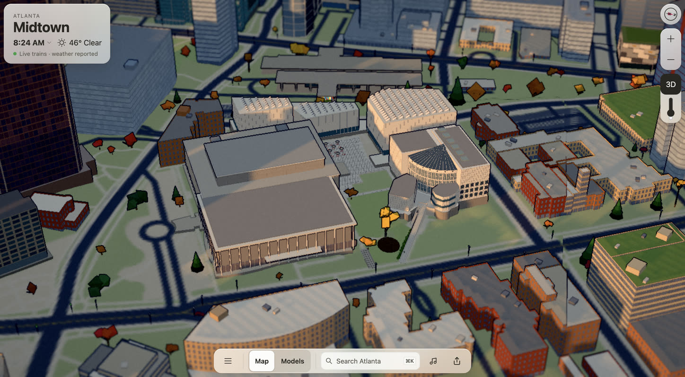

# Sim Atlanta

A miniature Atlanta you can watch. Follow a MARTA train through downtown, watch traffic
cross the Connector, or drift north to Midtown and the High Museum. The City view draws
Atlanta as a low-poly tabletop diorama. Switch to Map to follow rail lines across the region.

**[Explore Sim Atlanta](https://atlanta.solomon.io)** · Free, no ads, no tracking.
This is an independent project with no affiliation with MARTA, Amtrak or the City of Atlanta.



Drag to orbit the city, or use WASD to move and Q/E to rotate. Select a train or bus
to see where its position came from.

## How true is it?

MARTA provides recent positions for trains and buses. The Atlanta Streetcar and Amtrak
Crescent follow published timetables. Freight movements are illustrative, road traffic
follows typical hourly patterns, and Open-Meteo supplies Atlanta weather.

Each label describes a particular detail. A freight line can have a **reported** daily
train count even though the train you see on it has an **illustrative** position.

| Label | What it means |
|---|---|
| **Live** | MARTA recently reported the position of this train or bus. |
| **Scheduled** | The published timetable puts the train here at this time. |
| **Reported** | A source published the figure or condition, such as daily freight volume or weather. |
| **Inferred** | The app estimated a value, such as a position between two live fixes. |
| **Illustrative** | The model supplies a visual detail, such as the individual cars on a road. |

When you change the clock or speed up time, transit follows the timetable. See the
[data model](docs/data-model.md) for the sources and rules behind each label.

## Build your own simulation

What would your commute look like if a MARTA train ran along the BeltLine? How would
your walk to the station feel if the parking lot beside it became apartments with shops
on the ground floor?

Fork the repo and start with one change to a place you know. For the imagined MARTA
route, sketch the track, choose a couple of stops, and give the train a sample timetable.
For the development, model one block and bring the camera down to sidewalk level to see
how the new frontage meets the station entrance. Label your additions as imagined so
someone exploring your fork can tell what exists today.

The local setup below gives you the Atlanta scene to work from. For the longer-term idea
of building a board around a station or street corner in another city, see
[Build a neighborhood from a fork](docs/future-features.md#build-a-neighborhood-from-a-fork).

## Run locally

From the repository root, install the dependencies and build the map and City data.
You’ll need pnpm, Rust, Python 3 and Chrome. The web build uses headless Chrome to render
share images. Set `CHROME` to the executable path if it’s outside the standard macOS location.

```sh
pnpm install
python3 -m venv .venv
.venv/bin/pip install duckdb rasterio pyproj scipy pillow
pnpm data
pnpm build
```

Run `pnpm dev:worker` in one terminal and `pnpm dev` in another. Open
[localhost:5173](http://localhost:5173). Vite forwards API calls to the Worker on port 8787.
Building after `pnpm data` makes the bus route index available to the local Worker.

### Enable live MARTA rail

Local rail uses the timetable until you configure a key. Buses use MARTA’s keyless feed.
Request a free rail key from [MARTA’s developer portal](https://www.itsmarta.com/app-developer-resources.aspx)
and add this line to `worker/.dev.vars` (gitignored).

```dotenv
MARTA_API_KEY=your-key
```

The Worker keeps the key on the server and caches rail responses for 10 seconds. For the
maintainer’s 1Password setup, `pnpm secrets:local` writes the same file. The Map view
requests bus positions at most once every 30 seconds while visible at the real clock.
The Worker caches bus snapshots for 30 seconds per edge location.

### Explore the views

| View | How to open it |
|---|---|
| City | `/` opens the 2.8 × 6.8 km board from downtown to Brookwood. Use `?board=square` for downtown through King Memorial or `?board=downtown` for downtown alone. |
| Map | `/?view=map` opens the regional map. Add `#zoom/lat/lon` to set the camera. |
| East Portal | Run `pnpm data:vignette`, then open `/vignette.html`. Try `?weather=rain` or `?speed=600`. |
| Terrain preview | Open `/terrain-preview.html?at=cut` locally to inspect the downtown ground. See [terrain measurements and camera stops](docs/downtown-ground.md). |

In City or Map, use `?t=2026-11-20T14:00:00-05:00` to pin the clock or `?speed=30` to
speed it up. Phones open City on the low graphics tier. Use `?q=high` or `?q=low` to
choose a tier yourself.

### Find your way around the code

- [pipeline/](pipeline/) downloads open data and builds the static files for Map and City.
  Run `pnpm data:city` to refresh City alone or `pnpm data:midtown` to add missing
  Midtown rows to an older checkout.
- [web/](web/) contains the Three.js city and MapLibre map. The browser computes
  scheduled train positions from the timetables.
- [worker/](worker/) serves the built site and proxies live data. The browser uses the
  Worker’s MARTA feeds to place vehicles and animate them between updates.

Run `pnpm test` for the Rust, pipeline, web and Worker checks. See the
[project guide](AGENTS.md) for visual checks and performance tests.

## Where the data comes from

| Source | Used for | Terms |
|---|---|---|
| [MARTA](https://www.itsmarta.com/app-developer-resources.aspx) GTFS and realtime rail and bus APIs | Timetables and live positions | MARTA developer terms; realtime rail needs a free key |
| Amtrak GTFS | Amtrak Crescent timetable | Public feed |
| [OpenStreetMap](https://www.openstreetmap.org/copyright) via [OpenFreeMap](https://openfreemap.org) / [OpenMapTiles](https://openmaptiles.org) | Basemap, streets, rail lines | ODbL |
| [Overture Maps](https://overturemaps.org) | Building footprints and heights, roads, land use | CDLA Permissive 2.0 / ODbL |
| FRA crossing inventory, BTS/FRA North American Rail Network | Rail lines and crossings | US public domain |
| FHWA HPMS and TMAS | Usual road traffic by hour | US public domain |
| [Open-Meteo](https://open-meteo.com) | Current weather | CC BY 4.0 |
| City of Atlanta & Georgia Tech 2023 tree canopy study; Meta & WRI 1 m canopy height (CC BY 4.0) | Trees | As published |
| City of Atlanta | Neighbourhood names | Open data |

The full credits are in the app under Menu › About & credits.

## Deploy to Cloudflare

The public site runs on Cloudflare’s free tier. Its Worker is named `railwatch`, with the
custom domain configured in [worker/wrangler.toml](worker/wrangler.toml). For your own
deployment, set the Worker name, custom domain and `account_id` to your own Cloudflare values,
then authenticate.

```sh
(cd worker && pnpm exec wrangler login)
(cd worker && pnpm exec wrangler secret put MARTA_API_KEY)  # optional live rail
```

To keep the optional East Portal art map at `/artmap.html`, copy the Studio’s complete
`web/public/art/` bake before deploying. Deploying without it removes any previously
published art map. See the [art factory instructions](pipeline/scripts/art/README.md).

From the repo root, stage the City and East Portal data, then build and deploy together.

```sh
pnpm data
pnpm data:vignette
pnpm run deploy
```

Use the full `pnpm run deploy` command because pnpm also has a built-in `deploy` command.
The deploy script builds the site, including share images in `web/dist/previews/` and
crawler-readable pages in `web/dist/s/`, then publishes the assets and Worker together.

## Licence

The [MIT licence](LICENSE) covers the code. The radio music and cover art in
`web/public/music/` are excluded and reserved from reuse. Map and open data retain
their own licences, listed in the app under **About & credits**.
