# Build log

A running record of how this was built, kept so it can become a blog post later. It
captures the decisions, the numbers, and the mistakes, and it explains why things changed.
Newest entries go at the bottom. Screenshots live in `docs/log/`.

---

## 2026-11-20: Where the idea came from

As a kid I'd drive around town with my dad trying to guess where we might catch a train.
The idea is to give someone else that experience: something like Flightradar24 for trains,
with a model railroad you can zoom into. A parent opens it on a Saturday and asks, "Where
nearby might we see a train, and what should we look for?"

Constraints: free for visitors, no paid data feeds, modest hosting. It must always be clear
what is **live**, what is **scheduled**, and what is **illustrative**.

## Data reality check (same day)

The first brainstorm considered Denver, because its transit agency (RTD) publishes live
vehicle positions under a license that allows redistribution. I checked the feed directly:

- 54 rail vehicles were reporting, all with a trip, a heading and a timestamp.
- 44 of the 54 moved more than 50 m in 90 seconds.

Atlanta is home, though, so we switched. What Atlanta actually offers:

| Rail | Source | What we can honestly show |
|---|---|---|
| MARTA subway | Rail REST API (free key) | Live |
| Atlanta Streetcar | Timetable only (absent from both live feeds) | Scheduled |
| Amtrak Crescent | Static GTFS, no realtime feed | Scheduled |
| Freight (NS, CSX) | FRA crossing inventory: railroad-reported trains/day | Reported average |

There is **no free live freight data in the US.** That single fact shapes the whole project.

The busiest reported crossings in metro Atlanta: Sawtell Ave in south Atlanta (51 trains a
day), Mableton/Austell (43) and Gainesville (44). Metro Denver's busiest freight crossing
reports only 28.

## Four truth tiers

Every fact on the map carries one of these labels: `live`, `scheduled`, `reported`,
`inferred` or `illustrative`. The label is stored per attribute, not per train. A train's
position can be live while its car count is illustrative. Later research showed the Swiss
geOps live maps use nearly the same ladder (planned → delay-adjusted → GPS), which was
reassuring.

## Stack: fast and nearly free

- **Rust** for an offline pipeline that turns the big public datasets into small static files.
- **TypeScript + Vite + MapLibre GL** for the map, on **OpenFreeMap** tiles (no API key).
- **One Cloudflare Worker** for anything that needs a secret.

Speed comes from small payloads and from the browser animating trains on the GPU, not from
the choice of language. Scheduled trains are computed *in the browser* from the
timetables, so they cost zero server requests.

The core data-model choice: **a train's position is "metres along a path", not a lat/lon.**
That makes smooth animation and on-track rendering easy. It also gives the future diorama
a natural coordinate system.

## The pipeline, by the numbers

- MARTA: 5,341 rail and streetcar trips collapse into 29 stopping patterns.
- Amtrak: the Crescent only, with 35 trips.
- Freight: 5,043 track segments from the North American Rail Network and 6,041 open public crossings.
- Total output: about 1.2 MB gzipped.

Gotchas worth writing about:

- MARTA's GTFS pads times with spaces (`" 8:17:00"`), and GTFS allows times like `25:30:00`.
- The crossing data says `CSX` where the rail network says `CSXT`. Every other railroad code matched.
- **I misread the rail network's `NET` codes.** I guessed `T` meant transit. The official
  list says `T` is a *rail-trail*, and `Z` is transit/museum.
- **Main-line counts were leaking into yards.** Traffic was "inferred" outward from crossings
  along the same railroad's track. Busy main-line numbers spread onto yards and industrial
  spurs: about 1,800 such segments inherited 40–50 trains a day. Restricting inference to
  main line and passing sidings cut the inferred segments from 3,040 to 1,007.
- A sanity check that looked like a bug: only 24 MARTA trains were scheduled at 2 pm on a
  Friday. That's right. Midday headways are about 15 minutes and trips run 9–46 minutes end to end.
- Four Crescents on the map at once is also right. The trip takes about 30 hours, so
  yesterday's and today's trains overlap in both directions.

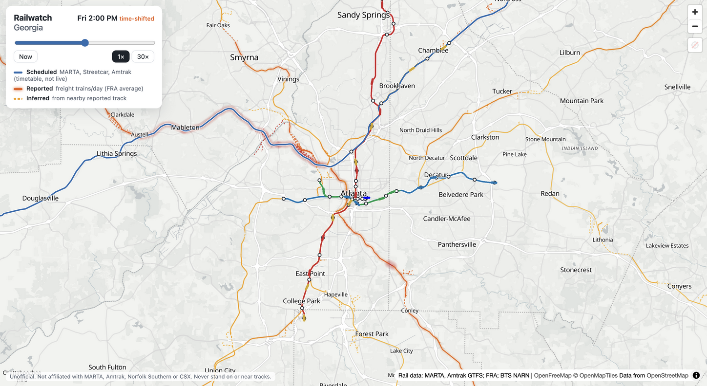

## UI lessons

- Trains drawn in their line's colour vanish into the line. They needed a dark halo and a soft shadow.
- Bridges and underpasses drawn as white dots looked exactly like stations. Grade-separated
  crossings became small grey dots; street-level crossings, the ones you can watch from, stay prominent.
- MapLibre doesn't hit-test symbols drawn with `icon-ignore-placement`, so taps on trains
  did nothing. The fix was to find the nearest train in screen space ourselves.

## Colour has to mean the same thing everywhere

MARTA's Red/Gold/Blue/Green look great. But colour-by-agency doesn't scale: New York has
dozens of route colours, and freight railroads have none. The new rule:

- **Colour = kind of service:** city rail blue, intercity violet, freight rust. Freight
  width and glow scale with trains per day.
- **Style = how we know:** a solid train is live, an outlined train is scheduled.
- Agency colours appear as an accent only: in cards, and as a tint once you zoom into a city.

## Live MARTA

The MARTA rail API returns one row per *(train, upcoming station)* prediction, with a
latitude/longitude on each row. The open question was whether those are real GPS positions
or just station coordinates. Three snapshots 25 s apart answered it:

- Half the trains were 400–900 m from any station.
- 17 of 24 moved between snapshots, at up to about 1 km in 43 s (~55 mph).

So they're real positions, updated every 30–60 s. The Worker groups rows per train and
caches the result for 10 s. The browser snaps each fix onto the line: all 27 trains landed
within 55 m, most within 15 m. It then glides each train toward its latest fix over 8 s.

The key lives in 1Password. Locally it's written to a gitignored `.dev.vars`; in production
it's a Worker secret. It never appears in a response or a log, and I checked.

Two small bugs:
- The "don't poll more than every 5 s" guard started at `0`, which blocked the first poll during the page's first 5 seconds.
- Vite doesn't restart when you *create* a config file, so the API proxy silently served `index.html`.

## Can we know where freight trains are?

No free source gives positions or individual schedules. What *does* exist, enough to
simulate plausible trains honestly:

- **EIA-923 fuel receipts:** Plant Scherer gets about 4.7M tons a year of Wyoming coal and
  Plant Bowen about 4.8M tons from the Midwest and Appalachia, all by rail. That's roughly
  one loaded coal train a day into each plant, plus the empty one going back.
- **STB Public Use Waybill Sample:** the commodity and car-type mix between regions.
- **Norfolk Southern intermodal schedules:** cut-off and pickup times at Inman and Austell (Whitaker).
- **Ports:** Savannah's Mason Mega Rail handles about 42 trains a week; Brunswick autos run 5–10 a week.
- **STB weekly data:** average train speeds by type. **AAR:** a median Class I train of about 5,300 ft.

No public project turns crossing counts into a synthetic timetable, so that part would be
new ground. The idea: fixed flows first (coal, ports, intermodal), then split each segment's
remaining count by the waybill mix, using a published random seed so every viewer sees the same "day".

## Change of direction: an art project

Mini Tokyo 3D (a timetable-driven 3D Tokyo, open source) is the closest thing to the original
vision. Two visual references:

1. **Isometric pixel city** (yadongxie.com). Google Photorealistic 3D Tiles are rendered
   orthographically, then an image model (Qwen-Image + a style LoRA) redraws each 512 m tile
   as pixel art. That takes about 1.5–2 GPU-hours per 16k×10k block, and the result is
   served as a ~320 MB Deep Zoom pyramid. Cars, birds, trees and water are animated in
   overlays. It's gorgeous, but it's frozen in time, and it depends on Google tiles with restrictive terms.
2. **A low-poly, ink-outlined 3D train scene** with time-of-day ("blue hour") and a cab HUD
   ("54 s early", speed against the limit).

Decision: build a **real-time** low-poly 3D Atlanta from open data. Pixel art becomes a
*render style* of the same scene (render at low resolution, upscale with nearest-neighbour,
limit the palette) instead of an offline AI pipeline. Time of day follows the real sun, and
weather could too.

Scope: start at downtown (Five Points and the Gulch, where all four MARTA lines, the
streetcar, buses and freight meet). Grow toward the I-285 perimeter.

## Building heights: Atlanta is unusually well mapped

Before committing to a 3D skyline, I needed to know how many Atlanta buildings actually
have a height. I queried Overture Maps (release 2026-11-18) with DuckDB straight from its
public S3 bucket, using a bounding box around I-285. The download took 94 s and produced
a 60 MB parquet file. (The OpenStreetMap query service was unreachable, but Overture
carries OSM buildings and records the source of each.)

| Area | Buildings | Have a height | Large (>1,000 m²) with height or floors |
|---|---|---|---|
| Downtown 2×2 km (Five Points) | 822 | 78% (91% incl. floor counts) | 93% |
| Midtown core | 1,680 | 90% | 99% |
| I-285 box | 381,680 | 82% | 91% |

- 95% of the buildings come from OpenStreetMap. The rest are Microsoft's ML footprints,
  which come with a height. Esri adds a few dozen.
- **The heights look measured, not defaulted.** 97% are fractional (e.g. 5.3 m, 5.1 m), and
  small houses spread smoothly around 5–6 m. That points to a LiDAR-derived import, not a
  "one floor = 3 m" guess.
- Spot check: the tallest values match the real skyline: Bank of America Plaza (312 m),
  Truist/SunTrust Plaza (265 m), One Atlantic Center (250 m), and 191 Peachtree (235 m).
- Roof shapes are almost never tagged (0.9%). Roofs will have to be procedural: flat for
  large buildings, pitched for houses, chosen by footprint size.
- Mind the license: OSM-derived buildings are ODbL, which requires attribution and share-alike
  for the derived database.

Scale check: 381k buildings is a lot for a browser, but it's fine if they're split into tiles,
merged per tile and streamed by distance. The detailed downtown slice is only 822 buildings.

## Rail levels: tunnels and viaducts are in the open data

GTFS route shapes are flat 2D lines, so a 3D scene can't tell from them where MARTA runs
underground. Overture's transportation theme can, through its rail flags. In the downtown box
it has 59 rail segments:

- **12 subway tunnel segments** at level −1 or −3. (At Five Points itself the two lines sit
  on −1 and −2; see below.)
- **4 subway bridge segments** at level 3.
- Standard-gauge track flagged `is_freight`, tram (streetcar) track, and abandoned or
  disused spurs.

Plan: match GTFS path distance ranges to these segments to get a vertical profile for each
path, so trains dive into portals and ride the viaducts at the right places.

## A second opinion: Codex (gpt-6.2-astra)

Before building the 3D slice, I asked OpenAI's Codex CLI (`gpt-6.2-astra`, high reasoning,
read-only on the repo) for an independent plan. One gotcha: `codex exec` waits for stdin when
it isn't attached to a terminal, so it hung until rerun with `< /dev/null`.

Its main points:

- A Three.js scene inside the existing Vite app, opened from an "Explore in 3D" button.
  Orthographic camera with a fixed tilt and bounded pan and zoom, which suits a diorama and a
  later pixel mode. MapLibre stays as the regional map.
- **One transit model for both views:** pull the clock and the live-vs-scheduled selection
  out of `main.ts`, and give 3D a path sampler keyed by `(pathId, s)`.
- **Coordinates:** project to UTM 16N offline, subtract a Five Points origin, and emit local
  metres. Rust bakes one `.glb` for downtown plus a JSON manifest.
- **The first test isn't the skyline.** It's "watch a train enter Five Points and understand
  which level it's on." It flagged Five Points' stacked platforms as the riskiest geometry.
- **Free-tier maths:** every poll invokes the Worker even when its cache answers. Polling
  every 60 s, 100k requests/day covers about 69 continuously open tabs. Our 15 s poll covers
  about 17.
- **Honesty details:** a live fix that can't be snapped to track should show in 2D but not as
  an on-track 3D model. Freshness should follow the observation time, not the fetch time.

## 3D slice, step 1: do the route shapes line up with the subway data?

This was the riskiest assumption in the 3D plan. Train positions live on GTFS route shapes;
tunnel and viaduct levels live on Overture's rail segments. If the two didn't line up, the
level matching would pick the wrong track at Five Points, where two subway corridors cross on
different levels.

The matching rule:
- `class = subway` segments only. Freight track runs alongside and has no level.
- Within 15 m.
- Bearing within 30° of the route, so the crossing corridor is never picked.
- The level read *at that point* along the segment. Some Overture segments carry ten or more
  `between` ranges, e.g. `-3` for 0–16%, `1` for 17–20%, and so on.

Result: **every downtown sample on every MARTA path matched (100%), with a median offset of
about 1 m.** At Five Points itself, the east–west line (Blue/Green) is on level −1 and the
north–south line (Red/Gold) is on level −2 below it. I first wrote this the wrong way round
from a quick read of the spans, and caught it only when the 3D depth tint looked "wrong". The
east–west line reaches level −3 elsewhere downtown. The elevated runs are a ~770 m viaduct on
the east–west line **east** of downtown (toward King Memorial) and a ~810 m one on the
north–south line to the **southwest** (toward West End). I first wrote "a viaduct over the
Gulch", which was wrong; a review caught it. The hand-written fallback table wasn't needed.

One cleanup: short 70–130 m gaps between tunnel ranges come back as "level 0, no flags",
which would pop trains to the surface between tunnels. Gaps of 150 m or less between two
underground spans take the shallower depth.

Overture levels are stacking order, not depth, so heights are schematic:
−1 → −10 m, −2 → −16 m, −3 → −22 m, any bridge → +7 m.

## 3D slice, step 2: a miniature downtown that runs live

The downtown diorama is now a Three.js view inside the same app. It loads only when you
press "Explore downtown in 3D" (or open `?view=3d`), as a separate ~124 KB gzipped chunk.

**Data.** `pipeline/scripts/extract_overture.py` pulls downtown from Overture's S3 bucket with
DuckDB: 2,280 buildings, 73 rail segments and 7,940 road segments in under a minute. A new
`railprep scene` command (Rust) bakes:

- **Buildings:** footprints triangulated with `earcutr` (holes kept), then extruded.
  1,871 heights are measured, 165 come from floor counts × 3.5 m, and 211 fall back to 6 m.
- **Roads and static freight/streetcar track:** flat ribbons.
- **An elevation profile per MARTA path:** one value every 10 m (schematic).
- **Size:** 960 KB gzipped in total, assuming the host compresses `.bin` files (not verified until deploy). Footways and service alleys were dropped first; they
  were 1.7 MB of road geometry that adds nothing at diorama scale.

**Rendering.**
- An orthographic camera with a fixed 38° tilt, rotatable in 90° steps.
- About 10 draw calls and ~137k triangles. The CPU side of each frame takes well under a
  millisecond on a laptop. GPU time and real phones are not measured yet.
- Trains are two `InstancedMesh`es of boxes, one for surface cars and one for cars underground.
- Each car is placed by sampling the train's path at `s − i·(carLength + gap)`, so a six-car
  train bends round curves and dips into a portal one car at a time.
- Underground track and cars draw in a translucent "cutaway" pass with no depth test, tinted
  darker the deeper they are.

**Things that went wrong on the way**, all visible in the first screenshot:

1. **Hollow buildings.** Overture rings come in both windings, so back-face culling removed
   roofs and walls at random. The fix was a double-sided material.
2. **Track that vanished.** Ribbon winding depends on travel direction, so half the MARTA
   track faced downward and was culled from above. Same fix.
3. **Invisible trains.** A real MARTA car is 3 m wide, about 3 px at this zoom. Like Mini
   Tokyo 3D, trains are now drawn up to 3× wide/tall when zoomed out and true size up close.
   Length stays true, because length is what positions the cars.
4. **I had the Five Points levels backwards.** The depth tint showed the east–west line
   *above* the north–south line, the opposite of what I'd written in this log. The data
   was right (east–west −1, north–south −2) and my reading was wrong.
5. **Taps that did nothing,** for two reasons. A synthetic pointer made `setPointerCapture`
   throw before the tap start was recorded. And `InstancedMesh` raycasting culls against a
   cached bounding sphere computed when there were zero cars, so it needs recomputing every
   time the trains move.

**The headline test passed.** At 4:32 pm on a Friday, live Blue Line train #108 was "arriving"
at Five Points on the east–west level. A Red/Gold train crossed on the deeper level below it.
Tapping the train opened its live card ("reported 26 s ago by MARTA").

Also in this step:
- The live feed now polls every 30 s: one open tab uses ~2,900 of the free tier's 100k
  Worker requests a day.
- Trains expire by when MARTA *observed* them, and the Worker reports a missing observation
  time as `null` instead of quietly substituting the fetch time.
- Live fixes that can't be snapped to track are left out of the 3D view.

**Review fixes before calling it done:**
- **Trains popped up at the scene edges.** Profiles end at the scene boundary and returned 0
  beyond it, while cars draw a little past the edge. Profiles now hold their end value.
- **A level-0 "tunnel" is a covered cut at street level,** not a −6 m dip, so it's at grade.
- **A ~120 m "bridge" between two tunnels on Red/Gold** (a span over something inside the cut)
  would have surfaced trains for a block. Short positive spans between tunnels now stay
  underground at the shallower depth.
- **Removed the disclaimer footer** at Sam's request; it added noise. "Unofficial" now leads
  the small attribution line instead.

Known limitations in this slice:
- Scheduled vs live, and tunnel depth, are both shown as lightness, and there's no key in 3D yet.
- No nose taper on lead cars.
- Underground trains draw on top of towers by design (the cutaway). A fade near the
  selected train is an option if it reads as confusing.

## 2026-11-20 · Finding the look: colour isn't style

**First attempt: six "looks" on the same scene** (`?look=` / the `L` key in 3D): architect's
model, golden hour, night with procedural lit windows, toy town, pixel and the baseline.
Screenshots in `docs/log/looks/`. Sam's verdict: *these are colour treatments, not artwork.*
Correct. The references (the isometric pixel city, the low-poly train video) are made of
**detail and form**: modelled trains, trees, curbs, rooftop clutter, a ground with depth.
Recolouring grey boxes can't get there. (The looks code stays, since shadows and night
windows will be useful.)

**Second attempt: one small block, modelled properly.** Instead of styling all of downtown,
pick one 850 × 500 m patch and give it real detail: the **MARTA east portal** by Georgia
State, where the east–west line climbs out of its tunnel beside the freight main and
crosses the Downtown Connector on a viaduct.

- `pipeline/scripts/vignette.py` crops the Overture extract to the patch (64 buildings,
  streets with overpass flags, freight and subway track) → `vignette.json` (66 KB).
- `web/vignette.html` + `src/vignette/` build everything in the browser:
  - **A diorama board**: heightfield top, the cut edges showing topsoil → **Georgia red clay**
    → rock, on a walnut plinth.
  - **The Downtown Connector sunk into a trench** (it really runs below street level here);
    overpass streets keep their level and get concrete fascias.
  - **MARTA**: ballast, concrete ties, rails, third rail; an open cut with a portal
    headwall; a box-girder viaduct on piers over the highway. Elevations come from the same
    baked profile the main 3D view uses (−10 m → +7 m).
  - **Freight**: wooden ties, rusty rails, through-girder bridges over the trench.
  - **Buildings**: brick / stone / glass by height, with storefront glass at street level,
    punched, ribbon or curtain-wall windows (shader), parapets, rooftop HVAC and stair
    penthouses, white, gravel and green roofs.
  - **~1,500 trees** along streets and through open ground. It's November, so some oaks
    and maples are turning.
  - **A MARTA train after the CQ400**: stainless body, window band, line-colour stripe, and
    cab ends whose destination sign and light bar glow in the line colour (from the art
    backlog).
  - **Traffic**: instanced cars looping along lanes of the real streets and the Connector.
  - **Studio lighting**: soft shadows, GTAO ambient occlusion, a narrow-FOV camera and a
    **tilt-shift blur**. That last one does most of the "miniature" work.

Trains and traffic here run on an illustrative loop; this is a look study, not live data.

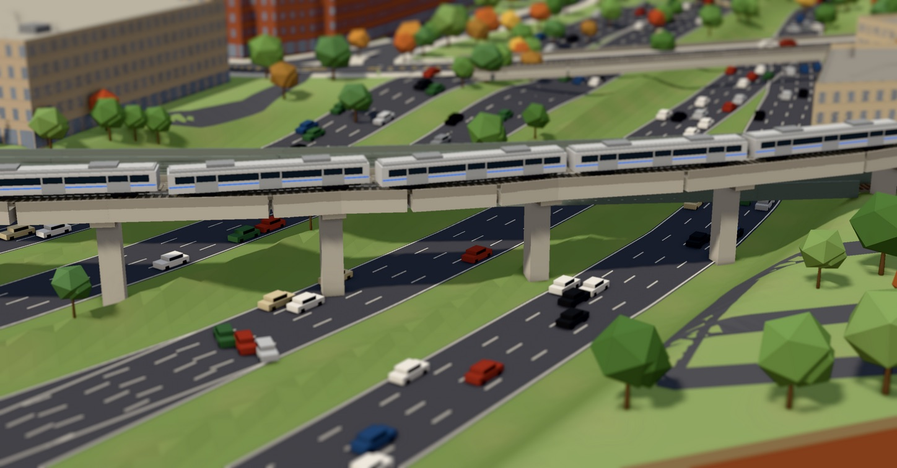

**Lessons:** a small patch you can afford to detail beats a big one you can only colour.
Most of the miniature feel came from three cheap things: tilt-shift, trees and visible cut
edges on the board.

## 2026-11-20 · Atlanta's clock: real traffic, sun and seasons

**Traffic from free federal data** (`pipeline/scripts/vignette_traffic.py` → `traffic.json`):
- **How busy each road is:** FHWA's national road inventory (HPMS) gives daily volume,
  truck volume, lanes and speed limit per segment. The Connector here carries 307k–372k
  vehicles a day on 12–13 lanes, about 9% of them trucks; Boulevard has 17,300 and Auburn
  Ave 4,400. 80 of 159 drivable runs matched by distance and bearing; the rest (alleys,
  service roads) get class defaults.
- **The shape of the day:** FHWA's 2023 hourly counts from Georgia station 000009, on the
  Connector just north of the board. On weekdays, 5.8% of the day's traffic passes in the
  7 am hour and 1.0% in the 3 am hour. Weekends are nearly as busy, just later.
- **The model:** vehicles per lane per hour = daily volume × the hour's share ÷ directions
  ÷ lanes; a curve slows traffic as a lane nears capacity; how many cars are on the lane =
  flow ÷ speed. Cars hold evenly spread slots and switch on or off only as they leave the
  board, so traffic thickens without popping. Trucks appear in proportion to each road's
  truck share. Labelled "typical for this hour", not live.
- **Caveat:** counts flatten when the Connector jams, because a jam lowers throughput.
  Live speeds from Georgia 511 (key pending) would show the real crawl.

**Sun and seasons:**
- Sun position is computed from the date, time and Atlanta's latitude. It drives the light
  colour, shadows and sky: golden at 4:55 pm in November, blue hour after 5:30.
- At night: lit windows (about a third of offices, most shopfronts), street lamps with
  pools of light, glowing head and tail lights, and lit MARTA windows.
- **Trees by date:** about a quarter evergreen (loblolly pines as stacked cones, magnolias).
  The rest turn by species (maple red, sweetgum burgundy, oak russet, poplar gold), each
  on its own few-week schedule, drop their leaves to bare branches by mid-December, and
  leaf out light green in early April.

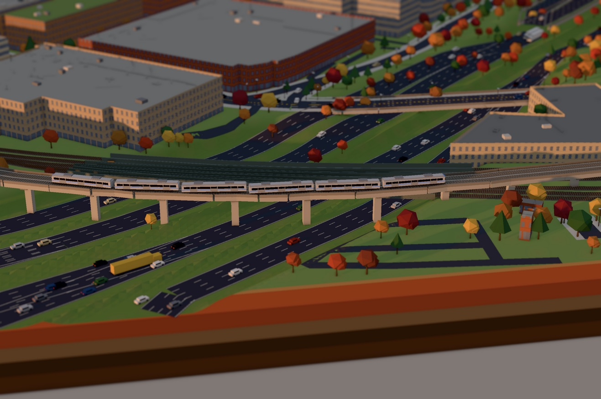

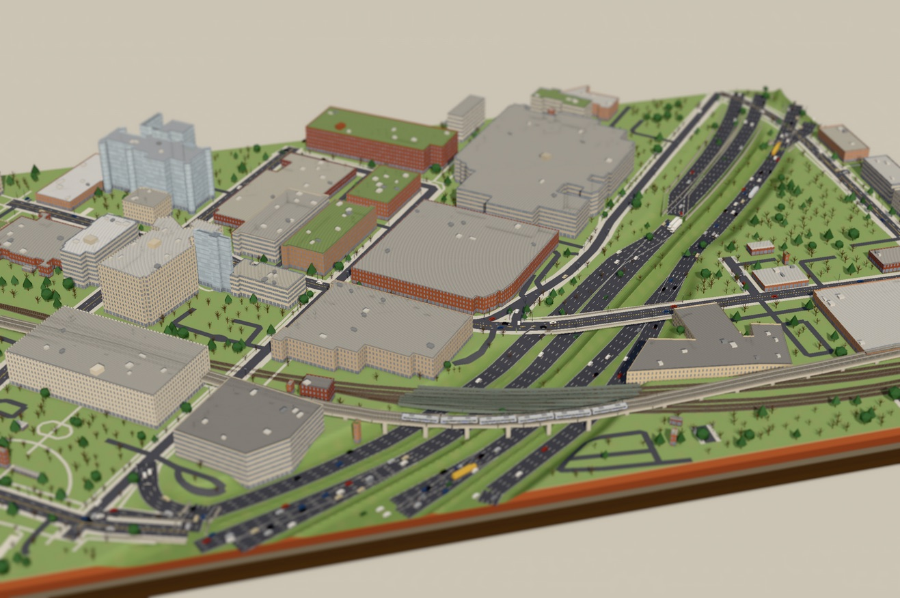

Not yet: live weather (Open-Meteo, so it needs no key). The published artifact can't call
outside services, so live weather will only work in the real app; the artifact would need a
weather picker.

## 2026-11-20 · Weather, real trees, smoother trains

- **Wobbly trains fixed.** The GTFS route shape is rounded to about 1 m with uneven point
  spacing, so cars twitched at every vertex. The alignment is now resampled every 2 m and
  smoothed (±24 m moving average, twice), elevation too. The largest heading change is now
  0.11° per half-metre of travel, and the largest height change 5 cm.
- **Weather** from Open-Meteo (free, no key): WMO code, cloud cover, rain, visibility and
  temperature, refreshed every 10 minutes. Clouds flatten the sun and soften shadows; rain
  draws shader-animated streaks (one draw call) and darkens wet surfaces; fog is relative to
  camera distance so the far side fades and the foreground stays crisp; storms flash.
  The published artifact can't call outside services, so it has a weather picker instead.
- **Real trees** from the Meta + WRI 1 m canopy height map (CC BY 4.0),
  `pipeline/scripts/vignette_trees.py`: crowns as local maxima ≥ 4 m tall, at least 5 m
  apart, with crown radius from the surrounding canopy area; roofs masked out. This patch
  has only **76 trees and about 4% canopy**: it really is highway, campus and parking. The
  imagery is probably about 2018, and small street trees are likely under-counted.

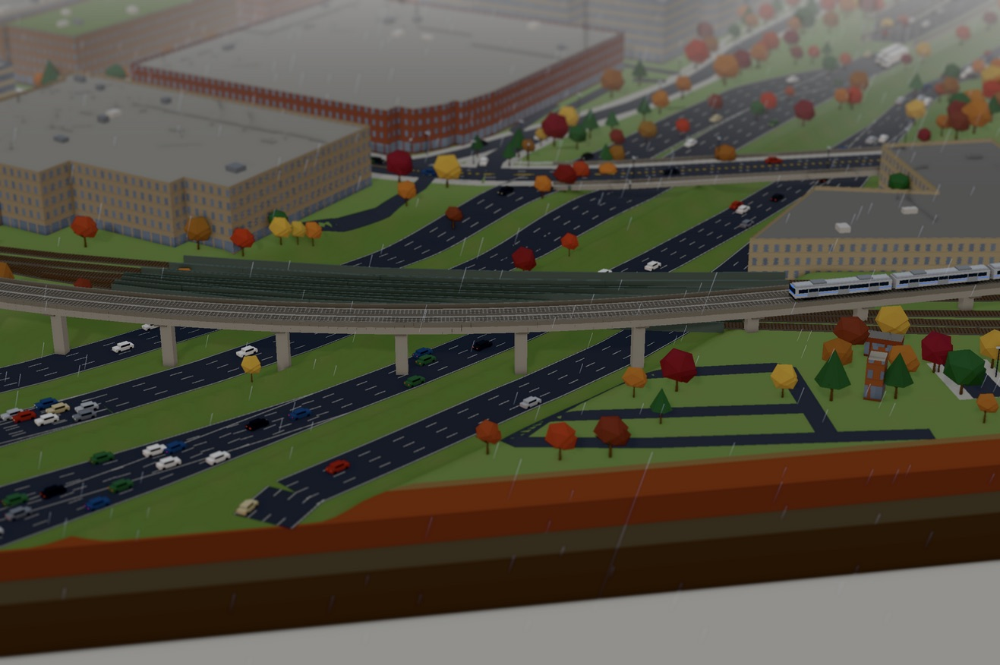

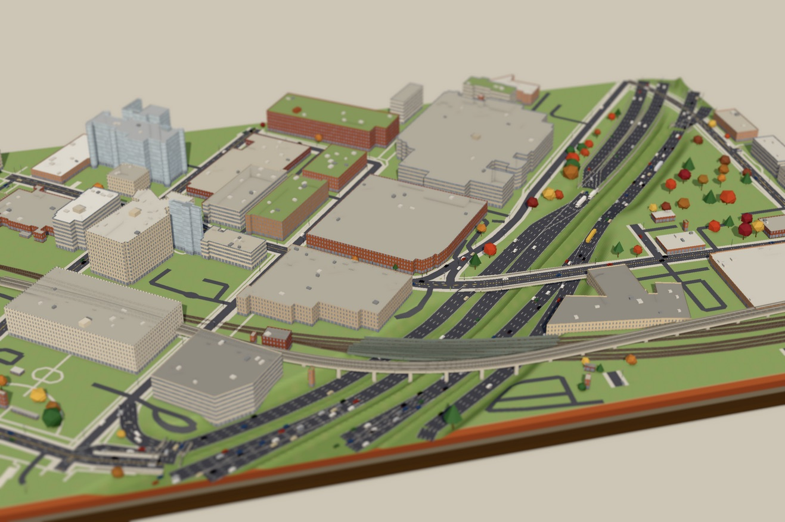

**Next truth gap:** the ground. Everything not a building or road is drawn as grass, but
downtown is mostly parking lots and plazas. Overture's land use and land cover layers (or
OSM `amenity=parking` / `landuse`) would fix that.

## 2026-11-20 · The ground is mostly parking

Everything that wasn't a building or a road used to be lawn. Overture's base theme knows
better: in this block there are **18 mapped parking lots**, 7 plazas, 5 sports pitches,
2 construction sites, **130 crosswalks** and **10 traffic signals**. Downtown-wide, the
infrastructure layer has 164 parking areas covering about 380,000 m².

- Lots are drawn as asphalt with **stalls laid out by rule** (2.6 × 5.4 m stalls either
  side of 6.5 m aisles, along the lot's longest edge) and filled with parked cars.
- **Occupancy follows a rule of thumb** for downtown commuter lots (illustrative): nearly
  full in weekday working hours, about a third in the evening, a few overnight, about
  half on weekend afternoons.
- **Unmapped lots are inferred:** Overture labels 220 service roads downtown as
  `parking_aisle`. Where an aisle isn't inside a mapped lot, stalls are paved and striped
  along both sides of it.
- Plazas get paving, pitches turf with touchlines, construction sites dirt, and every
  mapped crossing gets zebra stripes laid across the road it sits on.

## 2026-11-20 · Cars that drive the street network, and better models

**Traffic is now a simulation on the real streets** instead of cars looping along each road:
- **The network:** Overture road runs join into a graph at shared vertices. In this block
  that's 68 intersections, 110 directed road edges and 28 board-edge entries, with 8 of
  the 10 mapped traffic signals matched to an intersection.
- **How many:** vehicles enter at the board edges at the hourly rate the federal counts
  give for that road.
- **Where they go:** at each intersection a vehicle picks an outgoing road weighted by that
  road's volume, with a mild preference for going straight. Nobody can know a given car's
  turn, but the mix matches the real volumes.
- **How they move:** the Intelligent Driver Model keeps gaps and speeds; turns curve along
  Bézier paths; vehicles stop on red and amber (signal timing is a guess, 84 s cycles);
  merging vehicles yield to whoever is closer to the merge.
- **Result:** about 55 vehicles flowing at 52 mph at 3 am, about 250 at 27–32 mph at 1 pm,
  and stop-and-go at 17–22 mph in the 8 am peak, which is what the Connector actually does.

**Bugs with lessons:**
- **Ramps matched the main line's HPMS record** because they run side by side, so they
  poured a whole highway's traffic into every merge. Ramps now get one lane and ramp-scale
  volume.
- **Some main-line segments matched ramp records instead**, so one direction of the
  Connector was nearly empty. Main-line segments under 150k a day fall back to the
  Connector's median.
- **Lane-index mapping** sent the ramp into the busiest left lane. Vehicles now continue
  into the geometrically nearest lane, or the emptier of the two nearest at a merge.
- **Turn paths capped speed even on straight-through joins**, making a bottleneck at the
  peak flow. Only real turns slow down now.

**Vehicle kit:** each model is a side profile extruded across its width, so hoods,
windscreens and roofs slope: sedans, hatchbacks, SUVs, pickups (with beds), vans, box
trucks, and **articulated semis** whose trailers swing behind the tractor through turns.
Trucks follow each road's truck share. Parked cars use the same kit.

**Train:** a CQ400-style car with a rounded roof, a raked cab and big windscreen,
individual windows between three door pairs a side, bogie side frames and axle boxes,
underfloor equipment, roof HVAC pods and gangway bellows. The line-colour light bar and
destination sign still glow.

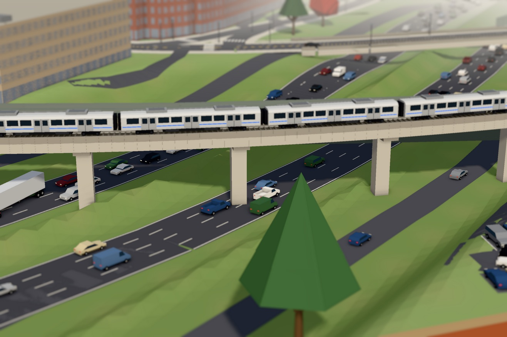
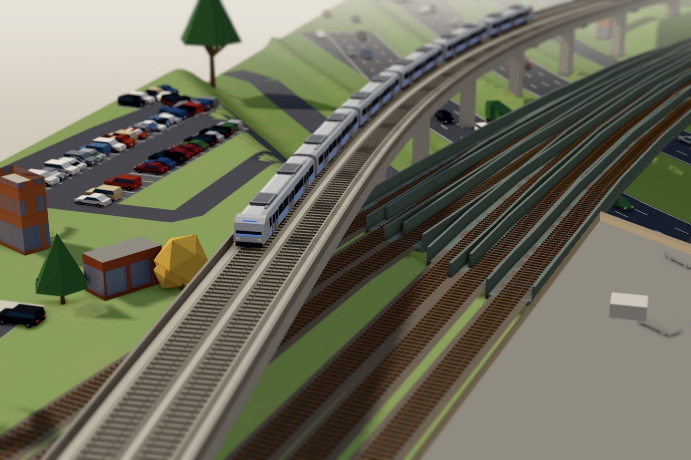

## 2026-11-20 · Sam's feedback pass: lanes, turns, night, focus

Sam's notes after driving around: cars "drive in the middle of the lanes", are "a little
jumpy in intersections", night needs "more realistic lighting", and the tilt-shift blur is
"a little strong… hard to see what I'm trying to look at".

- **Lanes:** the painted dashes came from a road-class rule while the cars' lanes came from
  HPMS lane counts, so cars sat on the dashes. The traffic model now draws the dashes
  between its own lanes.
- **Turns:** a car's heading came from one point on its path, and a car straddling a lane
  and a turn path snapped onto the turn. Cars are now placed by their front and rear axles,
  looked up across the previous path segment too, so the body pivots through the turn.
- **Night:** the lamps' additive white discs are replaced by a baked **light map**: warm
  (~3000 K) pools from every street lamp and a faint shopfront spill, added to the ground,
  street and lot materials in proportion to darkness. The Connector gets high-mast lights
  every 50 m. Headlight beams lie on the road ahead of moving cars. Bloom (night only)
  makes lamps, windows and headlights glow; window brightness varies per window.
- **Tilt-shift:** three.js's shader ramps blur linearly from one focus line. A custom pass
  keeps a sharp band (±16% of the screen) and ramps softly to the edges, at a lower default
  strength. Double-click glides the camera's focus to that spot.
- A side note on GPU hashing: `fract(sin(dot(p, k)) * 43758.5)` with world coordinates in
  the hundreds turns into noise, which showed up as speckled walls. Hash the window cell
  index instead.

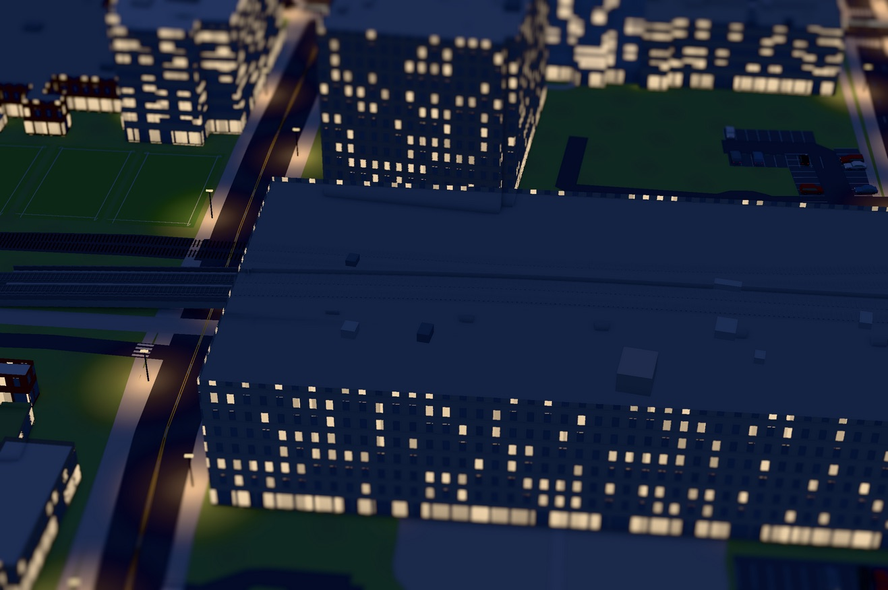

## 2026-11-20 — Live MARTA buses reach the map

At 7:28 p.m. Eastern, MARTA sent 163 bus positions in 13,319 bytes. Every
vehicle had an observation time and matched one of the 81 published bus routes,
but one fix was already over three minutes old and only 98 included speed.
The teal dots use the GPS coordinates directly. Tapping a bus shows its route
and the age of its position. Moving the clock away from the present clears them.

Repeating the source and observation time on each attribute turned those 13 KB
into 73,327 bytes of JSON. Sending the source once and the timestamp once per
bus brought the same snapshot down to 19,528 bytes. Local decoding and
normalization averaged 0.33 ms over 100 runs. The static short-name lookup is
1,081 bytes. Two consecutive local Worker requests with different query strings
returned the identical cached snapshot.

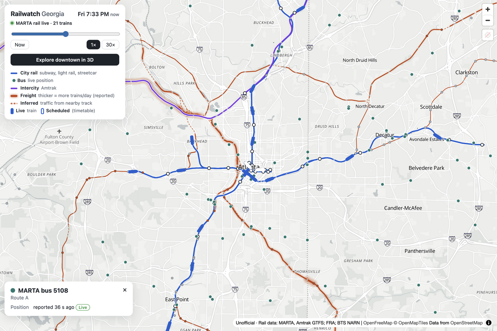

## 2026-11-20 · Painting the East Portal without moving the track

The viaduct over the Downtown Connector gave us a registration test. A six-car train has to round the curve on the rails, while a box truck underneath it disappears behind the deck. We baked the East Portal three ways through one orthographic camera. In the comparison, the roofs, the road crossing and the red-clay edge occupy the same pixels in every column. The Three.js column uses the scene's materials and lights with the comparison camera. The [ordinary vignette screenshot](log/art/studio-baseline.jpg) shows its regular perspective and tilt-shift.

The Studio rebuilt 64 buildings, 384 road runs, 13 rail runs and 76 canopy trees. At 0.25 m per image-plane pixel, the 850 × 500 m board needs a 4,352 × 2,560 canvas at this angle. The static GLB weighed 47.3 MB. Blender 5.3 took **3 minutes 12 seconds** with 12 Cycles samples on Metal. A warm sun casts the viaduct's shadow into the trench. A fine ink edge, derived from depth and surface normals, separates its concrete from the road below. Simple window panes stand in for the browser's facade shader. All 32 colours fit into a 623 KB full-resolution PNG.

The first SDXL redraw took **9.06 seconds** for a 1,024 px crop. At denoise 0.38, the model turned lane dashes into dark blocks and added what looks like a canopy to a low building. At 0.54, part of the highway started to look like another railway. We baked the board at **0.26**, with Pixel Art XL at 0.85, guidance 5.5 and 28 requested Euler steps. The foliage gained uneven edges and the bridge kept its curve. Individual lane dashes and parking stalls still softened. This is an **illustrative** base. At full scale, 11.9% of pixels inside the board changed by at least 32 levels in one RGB channel. The geometry mask preserved every pixel outside the board. [First redraw](log/art/first-redraw.jpg)

The full run took **54.29 seconds** on the M5 Ultra. Its 18 overlapping windows took a median **2.69 seconds** each after model load. We blended them across a nominal 256 px overlap and cut each base into 69 tiles across five zoom levels. The Blender pyramid weighs 0.94 MB and the SDXL pyramid 8.02 MB. They share a 1.04 MB surface-height PNG and five sprite models with 32 headings apiece, each rendered by day and by night. The viewer clips individual sprite pixels against the surface height. A truck can pass beneath the same bridge that carries the train without asking a server to draw either.

The experiment leaves an art decision. At a distance the two baked boards read almost alike. Up close, the redraw softens the geometry fastest exactly where a railway map needs precision. Keeping the aligned Blender base in the viewer makes that trade easy to inspect. [Factory settings, licences and build instructions](../pipeline/scripts/art/README.md)

## 2026-11-20 · Ink, lighter bridges and the first real buses

After the art spike (PR #5), Sam compared full-resolution crops and preferred the live 3D
over both the Blender illustration and the SDXL redraw, which invented a red freight train
out of the board's clay edge. So the lessons go back into the 3D:

- **Ink outlines**, "outline once, after compositing": one screen-space pass reads the scene's
  depth and colour, draws silhouettes where depth jumps (using a second difference, so smooth
  slopes like roofs and lawns stay clean) and creases where colour steps, and fades with
  distance. On by default; `?ink=0` or `__v.setInk(false)` turns it off. One gotcha:
  EffectComposer gives each ping-pong target its own cloned depth texture, so the pass must
  read the *current read buffer's* depth, or every other frame uses stale depth.
- **Freight bridges** over the Connector were tall solid girder walls on each of the parallel
  tracks, which merged into one dark slab. They're now a slim deck with a girder underneath
  and a low railing, so you can see the individual tracks cross.
- **Real MARTA buses** from `/api/marta/bus` (PR #2's Worker endpoint): fixes on the board
  are snapped to the nearest street within 25 m, turned to the street direction nearest the
  reported bearing, kept in the right-hand lane, and glide between 30-second reports. They
  show only when the clock is the real present, and the readout says how many are live and
  how fresh they are. On the first try: 3 buses (routes 20, 42, 55) near Decatur St.

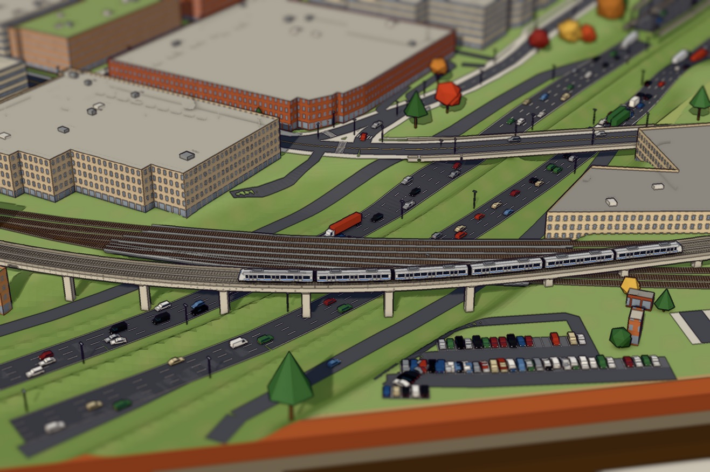

**Same day, Sam's next notes:** the headlights "look backwards" and cars "just go through
that bus".
- The headlight-beam texture was flipped one time too many, so the beam was brightest at its
  far end. Now it starts bright at the bumper and fades ahead.
- Live buses are now **obstacles** for the simulation: cars on the same lane brake and queue
  behind them. On multi-lane roads, a held-up car **changes lanes** when the next lane has a
  safe gap (a simple MOBIL-style rule), sliding across over about two seconds instead of
  jumping.
- Review catch: a bus snapped to the Decatur St bridge was drawn below the deck. Buses on
  overpasses now keep the bridge height, like the rest of the traffic.

**Speckled, shimmering windows** (Sam, with a screenshot): the facade shader worked out each
wall's direction from screen-space derivatives of world position. At city-scale coordinates
(hundreds of metres) those derivatives are noisy, so neighbouring pixels disagreed about
which window they were in, and whether it was lit. That gave salt-and-pepper speckle that
shimmered as the camera moved, by day as well as night. Fixes: use the wall's real per-face
normal, swap the `sin`-based hash for a precision-safe one (Dave Hoskins' `hash12`), and fade
the window pattern to its average where windows get smaller than about 2 px.

## 2026-11-20 · Adapting to a reference: a low-poly ravine railway

Sam found a much closer reference: a real-time low-poly railway through an autumn ravine
(a train-driving toy with its own Hour, Ink, Flora and Forest panels). Stills, pulled
from the video with ffmpeg because I can't watch video directly, show what gives it its look:
- **Foliage as clusters of small faceted leaf clumps,** each tinted slightly differently,
  plus tall tiered conifers. Our trees were one or two big gem-like blobs.
- **Thin dark ink, mostly on silhouettes**, not inside shapes.
- **Punchy light**: warm sun, cool blue-grey shade, saturated colour.
- **Film grain** over everything, so it never looks digitally clean.
- A perspective chase camera with a painted sky (parked for later: Sam wants more pieces
  in place before the ride-along camera).

What changed:
- **Trees:** each deciduous canopy is now ten dodecahedron clumps on a rounded crown,
  lighter on top and darker underneath, with per-clump hue, saturation and lightness
  jitter. Leaf drop removes clumps one by one. Loblolly pines have four narrowing tiers.
- **Ink:** silhouettes only, with colour creases at a fifth of the weight, a darker ink and
  1 px lines.
- **Grade and grain pass** (last, in display space): +12% contrast, +14% saturation, cool
  shadows and warm highlights, a soft vignette, and fine animated grain that's stronger in
  shadow. `?grade=0` turns it off.

## 2026-11-21 · Modelling the CQ400 from photos

MARTA's new Stadler CQ400s start rolling out next year, so the diorama skips the old fleet
and models only the new train. The method: a **model lab** (`/models.html`) that shows the
model large in studio light, switches line colour, lead, tail or coupled lighting, and day
or night, and can lay a reference photo over the view. Sam critiqued it round by round from
photos; I adjusted the code. No Blender; the model is built in TypeScript
(`web/src/vignette/cq400.ts`).

What the photos taught, in roughly the order Sam caught it:
- **Matte grey, not champagne.** It only looks warm in sun.
- **The front is one dark mask** framed by grey that wraps the corners. The line colour is a
  **flush light**, not a raised rail: down both mask edges and in to a V under the
  windscreen, thicker toward the point. Simplified to one shield windscreen (no end door).
- **The nose is a straight rake,** upright at the bottom, not a rounded bullet. Its grey
  side panel has a triangular window, then one rectangular cab window, then the first door.
- **Bumpers are flush grey corners with vents,** not stuck-on boxes. The coupler is dark,
  since the "red" in photos is the tail sign reflecting.
- **Tail lights:** a red bar where the wordmark sits (we show no logos, only light), small
  red lights at the ends of the destination display and red under each corner cluster.
- **The livery:** short blue, yellow and orange chevrons on the nose side, then **every car**
  carries blue, yellow and orange from the end facing the cab, all slanting the same way.
- **Smooth roof:** only slight bumps over the roof equipment.

Bugs with lessons:
- **Floating features:** the mask was a flat fill between outline points while the lights
  sat on the curved surface, so they floated off it. The nose is now one continuous surface
  `z = F(x, y)`, and every feature is placed on that same function.
- **Ragged seams:** the nose surface wasn't sampled at the body section's chamfer heights,
  so its edge stepped across them. Sampling now includes those exact heights.
- **The chevron's notch at the point:** the two halves of its path never shared the centre
  point (one half was appended backwards). It's now one mitred ribbon, with each quad's
  winding fixed to face forward.

Consists: CQ400s run as fixed 4-car sets with open gangways. Green Line trains are drawn as one
set (4 cars) and Blue Line as two (8), with the inner cabs dark. MARTA's live feed doesn't say
which fleet a train is or how long it is, so lengths are typical for the line.

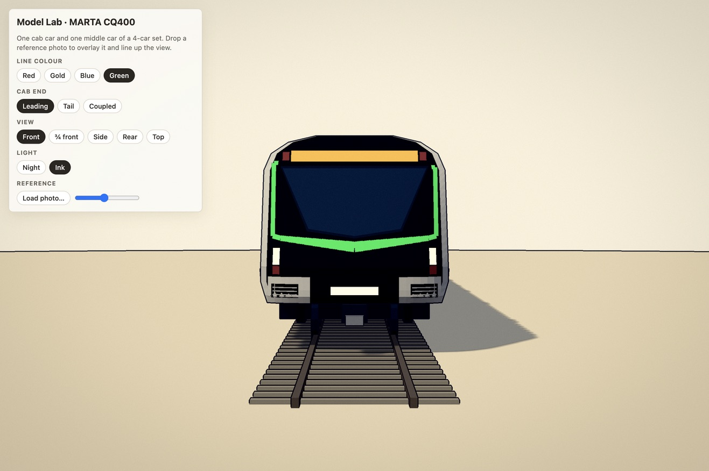

## 2026-11-21 · The MARTA bus, built to spec

The first bus was eyeballed from photos, and it showed: the wheels weren't even round. So the
second pass started from numbers instead. New Flyer publishes the Xcelsior 40-foot's
dimensions and a side elevation in its brochure: 12.24 m over the body (12.50 m over
bumpers), 2.6 m wide, 3.38 m over the CNG roof tanks, a 7.2 m wheelbase and 305/70R22.5
tyres (about 1 m across). Those set the body, the axle positions and the overhangs (about
2.2 m at the front and 2.9 m at the back). Photos then filled in what the drawing doesn't say.

- **Wheels:** arches are cut into the extruded side profile, so they are actually round.
  Tyres are an open tread band with ring sidewalls, so a dished steel rim with a dark hub can
  sit inside them. Duals at the rear.
- **The window line came from photos, not the drawing.** The brochure suggested a 1.42 m
  belt. In photos of MARTA's buses the windows are one continuous dark band, roughly
  1.2–2.3 m off the ground, which leaves the tall white strip that carries the livery.
- **Livery:** white, with three blue slashes that run up over the roof edge onto the CNG
  housing. The third flows into a long blue line, with yellow and orange dashes beneath it,
  their ends cut at the same angle. The giant slanted "marta" lettering at the rear becomes
  a plain light-grey band, darker where it crosses the glass. No wordmark, no fleet numbers.

Bugs with lessons:
- **A stray half-drum hid half of each wheel.** The wheel-well lining was a half-cylinder
  rotated the wrong way, so it filled the back half of the arch instead of the top, and its
  end caps covered the wheel. Now it's an open half-tube along the arch roof.
- **Decals under panels:** the side panels are thin 2 cm boxes, so their outer faces sit
  1 cm proud of their nominal offset. The grey band was drawn "above" the grille and the
  glass but actually sat under both, until its offset accounted for the box thickness.
- **Stripes that bent at the roof edge:** leaning the slashes by distance along the surface
  made them kink horizontally across the flat roof strip. Leaning them by true height keeps
  each slash a straight band when seen from the side.
- **Fine stripes all over the roof** were shadow acne: the model lab's sun had no shadow
  bias. The diorama already had one.

The live MARTA buses in the diorama now use this model. They were the only users of the old
generic bus, which is gone.

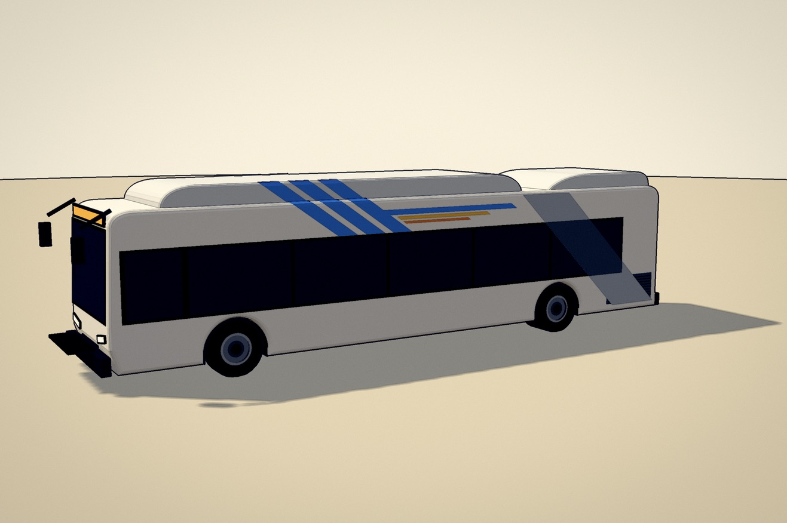

## 2026-11-21 · One shell over Map and City

Until today the site was three products that didn't know about each other: a grey dashboard
over a 2D map, a grey 3D downtown behind a button, and the East Portal diorama on its own
page. The direction now is "just a little model of Atlanta": City first, Map one tap away, and
both working back from the diorama's look.

- **Glass instead of panels.** The dashboard panel is gone. What's left is a status widget
  (neighbourhood, temperature with a weather icon, condition, date and time, and a live dot),
  a menu button and a Map · City switch. All three are frosted glass with a Liquid Glass-style
  lit edge: the rim is bright at two corners and fades between. On cream paper a white rim
  vanishes, so a 0.5 px dark hairline sits outside it to make the highlight read.
- **The glass picked up colour.** With `saturate(1.7)` in the backdrop filter, an orange
  freight line under the widget turned the whole card peach on the phone. 1.15 keeps the glass
  neutral.
- **The basemap is recoloured, not replaced.** OpenFreeMap's positron style is fetched at load
  and repainted to the diorama palette (cream land, sage parks, soft water, thin brown roads),
  so tile and glyph URLs stay current. Rail lines get a thin ink outline, as in the diorama.
- **The streetcar was pure #0000FF** in MARTA's GTFS. Next to the Blue Line (#0075B2) it read
  as a different hue entirely; it's now a softer cornflower, #5a86d6.
- **Neighbourhoods:** 248 City of Atlanta neighbourhood polygons (315 KB) name the place under
  the middle of the view; outside the city it says "Metro Atlanta" or "Georgia".
- **Weather now goes through the worker.** On the A16 the direct call to Open-Meteo timed out
  and the diorama said "live weather unavailable here". `/api/weather` makes one upstream call
  per edge location every 10 minutes, whoever's asking.
- **Keyboard:** WASD and the arrows move the camera in both views, `M`/`C` switch, `+`/`−`
  zoom. A key tap always nudges, because the first frame now counts from the key press (in a
  throttled tab that painted twice a second, the first frame's zero-length step was the only
  one).
- Phosphor icons (MIT), imported as raw SVG so only the 14 used ship. The system font, no web
  font. The time slider and 1×/30× are hidden, not deleted: `?controls=1`.

On the A16 in portrait, the Map runs at 58 fps with the glass over it. City is still the old
grey 3D until the diorama-style downtown replaces it.

## 2026-11-21 · Weather and time of day on the Map

Time of day and weather aren't modes; a rainy dusk is both. So there's one atmosphere state
(sun elevation and azimuth from the clock, cloud/rain/snow/fog from Open-Meteo) and the Map
reads it in layers:

- **Time of day** blends the basemap continuously between four keyframe palettes by sun
  elevation (night −12°, dusk −4°, golden +3°, day +14°), in linear RGB with smoothstep, so
  there are no hard switches. A WebGL sky layer adds a warm wash on the sun's side and soft
  shade opposite; at 8 AM it sits bottom-right, at 4 PM bottom-left. At night: cool moonlight
  and a warm glow over downtown.
- **Weather** transforms whatever time of day gives. Cloud greys and flattens it (capped, so
  cloud + rain + fog can't stack into mud: Atlanta is overcast a lot, and that has to look
  pleasant), with cloud shadows anchored to the ground. Rain is fine slanted streaks plus a
  cool, wet tint; snow is drifting flakes and a paler ground.
- **Fog was the lesson.** As a colour wash it just made the map look faded. What reads as fog
  is the diorama's trick: a real blur toward the edges with a cloudy haze in it, and a sharp
  centre. That's a `backdrop-filter` layer over the map with a radial mask.
- Every effect is drawn above the basemap's fills and below our rail, stations and labels, and
  Atlanta's weather fades out as you zoom out to the state or pan away from the metro.
- After dusk the glass goes dark, like an OS night mode, and truth-tier chips get lifted
  colours for contrast.

**On the A16** the first cut cost almost half the frame rate: 58 → 34 fps on an ordinary
overcast day. Two fixes got it back above where it started. The shader only computes noise when
there's cloud or fog to draw (3 octaves, not 4). And the map's pixel ratio is capped at 2: the
phone reports 2.81, which meant 1.97× as many pixels for no visible gain. Clear day 74 fps,
overcast 65, rain with fog 40. Clouds don't drift on phones, to avoid constant repaints.

`?tune` is the playground: a Live switch, a time slider and cloud/rain/snow/fog sliders that
combine freely, plus the palette presets and pickers.

## 2026-11-21 · Downtown fits on the table

City now opens far enough back to read the Gulch, Five Points and the Peachtree Center
skyline together. The southwest camera moved from 3,000 to 5,500 scene metres; tilt-shift
strength dropped from 1.6 to 0.65 so the towers stay legible. Four Overture streetcar runs
now have embedded rails, and the city's buildings and streets stop cleanly at the walnut
board. A high-DPI bug had been making the canvas twice as large as its CSS container,
showing only its upper-left quarter; explicitly sizing both fixed that crop.

The surprise was startup, not polygons. A timed desktop load spent **33,481 ms** on ground
placement out of **35,984 ms** of construction. Parking stalls checked every building;
crosswalks checked every street. A conservative 64 m spatial grid now narrows those searches,
while the exact intersection tests still make the decisions. A fresh low-tier run built in
**730 ms** (ground 363 ms, streets 162 ms, rail 139 ms); high-tier runs under concurrent
browser/build load ranged around **2.4–2.7 s**. Those are CPU construction measurements,
not first-paint times or phone results. The broad-phase tests compare exact hits against
brute-force searches, including negative coordinates and cell boundaries.

The loading plate reports each build stage and yields between stages, so returning to Map
cancels the load. A held data request followed by Map left **zero canvases** behind; a forced
404 returned to Map with the recovery note. Switching views preserved the target at
**−84.392033, 33.756238**. The clock and neighbourhood widget now update independently of
remote basemap tiles. City has snow flurries as well as rain, and fog softens the edges.

The old `scene3d` renderer is gone. Shared rail profiles remain in `scene.json`; builds omit
its three unused binary meshes, saving **3.2 MB** of deployed static assets. No data rebuild
is needed for this refinement if the M2a City JSON already exists; a web rebuild is required.
A fresh checkout still needs the data commands. East Portal was checked in Orca after the
shared-world changes and still renders its viaduct, train and traffic.

Performance is deliberately **not signed off**. Orca's desktop animation callbacks were
throttled to about 1–2 fps, even with the City renderer disposed; that is not a useful GPU
benchmark. Sam asked us to leave the Galaxy A16 untouched. The ≥30 fps low-tier phone gate,
City as the default, and M2b motion remain pending. The baked western MARTA profiles also
stay below the daylight threshold by Dome/GWCC; the handoff's expected open track there
needs a source/profile audit, not guessed surface rails.

Claude's first review caught the fresh-checkout deployment hole: `pnpm data` did not build
City's new JSON. It now includes `data:city`, and the README calls out both fresh and existing
checkout instructions. The portal-at-board-edge concern did not reproduce in either supplied
board: all threshold crossings were inside the board (east x≈376–379, z≈289–291; south
x≈−373…−366, z≈554–564). It remains a possible case if future board bounds cut a shallow ramp.
Final warm high-tier construction also measured 704 ms; the slower 2.4–2.7 s runs above were
under concurrent load. The full suite passes: 16 Rust, 23 web and 5 Worker tests.

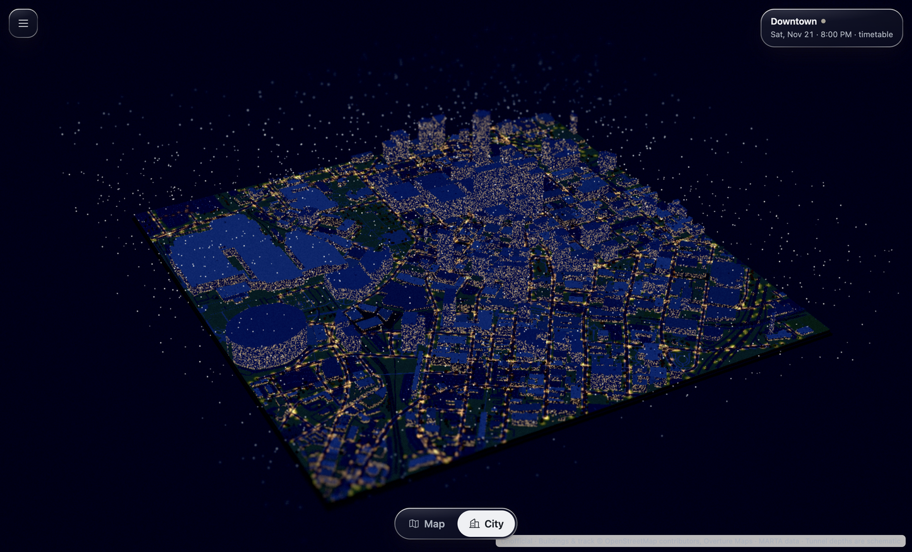

The final desktop check resolved the throttling: selecting the tab was insufficient; the
worktree itself had to be foregrounded. With one City tab at **1446×876 CSS pixels**, five-second
animation-frame samples measured **18.1 fps high** (render DPR 2, 63 draw calls, 2,795,709
triangles across all passes) and **32.4 fps low** (render DPR 1, 32 draw calls, 1,268,831
triangles). These are desktop results only; high-tier rendering still needs optimization,
and the A16 gate remains pending. Claude's second and final review reported no new findings.

## 2026-11-21 · Keep your bearings

Sam's first navigation check exposed a sign mismatch: the shell describes a content drag,
while City's camera API describes camera movement. The adapter now reverses that offset,
so A/D move left/right and W/S move forward/back relative to the viewing direction. A second
surprise was that a quick key tap could finish between animation frames and move nothing.
Each fresh press now nudges immediately, then held keys continue at the existing speed.
Keyboard movement also cancels any place-search glide.

Map and City now exchange their centre, clockwise bearing and horizontal ground scale in
CSS pixels. Map stays flat; City remembers its tilt. The conversion uses MapLibre's actual
Mercator scale at the current latitude, so a high-DPI canvas does not change the framing.
City still clamps to its downtown coverage and camera-distance limits. This makes the
remaining perspective change easier to read without adding a transition animation yet.

In Orca at high quality, the opening view survived a round-trip at **28°**, **2.44085 m/px**,
and target **(−40, −260) m**, with sub-millimetre numerical drift. Two more round-trips at
**−70° and 118°**, zoom **16**, retained their centre and a custom **40°** City tilt. All
**24** WASD/arrow direction checks passed across four quarter-turn headings, and an actual
Orca A keypress moved the camera left. A Map view outside downtown clamped to the northwest
board corner and showed the coverage note. The full suite passes **48 tests** (16 Rust,
27 web, 5 Worker), including four comparisons against MapLibre's own Mercator conversion;
the production build passes. This follow-up needs a web rebuild, with no new data bake.

Navigation follow-up review (Claude, one round): no findings.

## 2026-11-21 · Rotation cadence and rendering are separate

Sam noticed Q/E felt choppy even after the direction fix. Held rotation was still driven
by OS keyboard repeat, applying a 3° jump each time. It now shares the WASD animation-frame
loop at 60°/s, with a 1° immediate tap and a 50 ms frame-delta cap. Auto-repeat adds no extra
step; opposing keys cancel, and releasing either resumes the other. Releasing the last key
or leaving the window stops the motion.

At Sam's closer camera pose, two six-second foreground Orca samples on high tier measured
**22.5 and 24.8 fps**, with **34 ms median** intervals and **83/67 ms p95** intervals. The
viewport was 1446×876 at DPR 2, with 63 draw calls and 2,795,709 triangles across all passes.
A separate system snapshot showed 66% CPU idle. These observations confirm uneven frame
delivery, but do not isolate GPU time, browser overhead or competing system work. No render
quality change was made, and the small difference between samples is not an optimization gain.

The Orca held-key check delivered 31 updates and 57.5° over about one second. Taps, repeat
suppression, keyup, blur, opposite keys, typing guards and simultaneous pan/turn all passed.
The original camera pose and high tier were restored. All 48 tests and the production build
pass. This change needs a web rebuild, with no data bake or server changes.

Held-rotation review (Claude, one round): no findings.

## 2026-11-21 · Merge readiness

Integrated main's project rename and deploy-command fix. The sole conflict was the README
deploy paragraph: it now retains City's data requirements and uses `pnpm run deploy`.
The combined branch passes all 48 tests, the production build and an Orca high-tier render
check. Claude's focused integration review found no issues. City remains optional; the A16
gate still controls making it the default and starting M2b.

## 2026-11-21 · Softer shading costs fewer pixels

On this Mac, City draws a 1446×876 Orca viewport into a 2892×1752 canvas. The soft
contact shadows around buildings also covered all five million pixels. Turning just
that effect off briefly took the opening view from 23.5 to 37.4 fps. Keeping it on and
rendering it at 1446×876 leaves the ink, façades and final image at display resolution.

At the same opening pose on high tier, alternating the two shading resolutions gave
22.3–23.5 fps before and 31.9–33.7 fps after. The 95th-percentile frame interval fell
from 83–84 ms to about 50 ms. These were 4.4-second foreground Orca samples on the
Nov 21 afternoon timetable. The scene still drew 63 calls and 2.80 million triangles.

Holding E for three seconds from the closer downtown pose gave a smaller gain. Two
samples at each resolution measured 20.1–22.3 fps before and 24.4–26.6 fps after.
The 95th-percentile interval stayed around 84 ms, so some turns still hitch. The
browser resize check confirmed a 2256-pixel canvas with 1128-pixel contact shading
at the narrower width. This is a desktop measurement. Shipping needs a web rebuild.

## 2026-11-21 · Drawing the turn we just asked for

City and the keyboard both had animation-frame callbacks. During a close-up turn the
renderer usually ran first, so it drew the previous camera angle. In a 4.5-second held-E
sample in Orca, the camera update waited a median **16.5 ms**, and **82.3 ms at the
95th percentile**, before the renderer submitted a draw with that angle.

City now advances the held keys before drawing. Both callbacks use the browser's frame
timestamp, so the second one sees zero elapsed time. At the same close-up pose on high
tier (1446×876, DPR 2), the update-to-draw delay measured **0.1 ms median and 0.2 ms
at the 95th percentile**. These measurements end at draw submission. The 95th-percentile
interval between frames was still **83 ms**. In a separate held turn, JavaScript spent
1.7 ms at the 95th percentile submitting the scene, and the WebGL GPU timer measured
19.3 ms at the 95th percentile. Neither measures the browser's final presentation.
In two alternating pairs of 3.2-second turns, even drawing just the final fullscreen
triangle gave 84 ms at the 95th percentile, against 83–84 ms for the full scene.
A separate 5.5-second run in the same focused Orca tab, drawing a moving square on
a plain 2D canvas, measured 35.8 fps and a 49.5 ms 95th-percentile interval.

Rain revealed a second cost. The weather timer could repaint the covered 2D Map about
30 times a second. City now suspends that timer, and Map picks up the latest weather on
return. Orca checks covered direct entry, switching, cancellation and failed loading.
The high-tier check also covered quick taps, repeat, opposing keys, simultaneous pan
and rotation, and release on blur. This change ships with a web rebuild.

## 2026-11-21 · The first half-minute on the Galaxy A16

The A16 can sustain the low-tier opening, but the first two visits fell just short of
30 fps. We ran the shipped City build (`1586558`) on a physical Galaxy A16 5G
(SM-S166V, Android 16) in mobile Chrome, in portrait with the real clock and overcast
Atlanta weather. At the untouched opening camera, a 384×692 CSS viewport used a
384×692 drawing buffer. The phone's device pixel ratio was 2.8125.

The phone loaded the release assets over USB from a local server. A page timing probe
waited for the City loading plate to clear and a further 4.5 seconds, then counted
animation-frame intervals in three consecutive eight-second windows. Combined fps is
total frames divided by elapsed time. The page stayed visible and focused throughout
the samples. These are browser frame callbacks; readiness includes loading from the
local server and cannot predict a public-network download time.

| Configuration, in test order | Window 1 (fps) | Window 2 | Window 3 | Combined fps |
| --- | ---: | ---: | ---: | ---: |
| Shipped 2048 px shadows, first visit | 25.00 | 29.37 | 32.62 | 29.00 |
| Shipped 2048 px shadows, second visit | 25.12 | 29.58 | 33.86 | 29.53 |
| Diagnostic, shadows off | 38.37 | 44.00 | 44.37 | 42.25 |
| Shipped 2048 px shadows, warm reload | 28.13 | 36.02 | 37.34 | 33.83 |
| Diagnostic, 1024 px shadows | 34.87 | 35.37 | 38.00 | 36.08 |
| Diagnostic, 1024 px shadows, fresh origin | 32.28 | 35.27 | 34.75 | 34.10 |
| Shipped 2048 px shadows, fresh origin | 28.84 | 34.25 | 34.23 | 32.43 |

The warm production reload reached **37.60 fps** over a further uninterrupted 24 seconds,
with a 55.6 ms 95th-percentile interval. On the first visit, scene construction took
2.44 seconds, including 1.28 seconds for ground, and the first ready frame arrived at
6.64 seconds. Startup and sustained rendering tell different stories on this phone.

Halving the shadow-map dimensions preserved visible building shadows. To check the
order effect, we returned the phone to Home and repeated the comparison with the
1024 px variant first. Each page used a fresh browser origin to avoid reusing the
previous origin's asset cache. Chrome and the phone were already warm.
The 1024 px setting cleared 30 fps in all six measured windows across its two visits.
Both diagnostic changes were confined to the local test server.

[Shipped opening](log/ui/2026-11-21-city-a16-low.png) · [1024 px shadow comparison](log/ui/2026-11-21-city-a16-shadow-1024.png)

City now uses the tested 1024 px shadow map on low tier. The six A16 samples ranged
from 32.28 to 38.00 fps, clearing the 30 fps gate for the static opening. This change
ships with a web rebuild.

## 2026-11-21 — A Blue Line train through Five Points

At 2:10:35 p.m. on the Friday timetable, an eastbound Blue Line train is in daylight in
the Gulch. At 2:11 it reaches Five Points underground. Twenty-five seconds later its cars
are visible again in the open cut between Peachtree and Pryor. We replayed the same trip
in Orca on high quality, combining the City motion branch with the rail accuracy agent’s
two corrected cuts. The building on the south side of the Gulch hides most of the
western cut from a low angle. Looking back from the north makes the passage legible.

The Map and City read the same train positions. In City each car takes the direction and
height of the rendered track beneath it. A car stays in the scene until both ends have
passed under cover, so the front can disappear while the tail is still in daylight.
The timetable and live feed both use illustrative car counts and the CQ400-style model.
In Orca the real clock supplied 19 live heavy-rail positions across the system. Scrubbing
ten minutes back switched the City source to scheduled positions, and Now restored live
positions. The first check happened to have no cars in daylight on the downtown board.

Marlin’s ground-grid sample near the east cut was 311.15 m above NAVD88, compared with
319.52 m fifty metres north and 319.09 m fifty metres south. That supports a depression
there. It does not measure a railhead or the cover underneath Five Points. The trains
use the same schematic profile as the rendered rails.

On the Galaxy A16, the production build with motion and the previously shipped profiles
averaged 34.0 fps as the train moved east from Georgia State. With the two cuts included,
the Five Points replay at 2× averaged 31.9 fps (33.8, 33.3 and 28.8 across three
eight-second windows). The Georgia State run at 1× averaged 35.9 fps (36.1, 36.2 and
35.4). Both combined runs used a foreground 384 × 692 low-tier canvas at the opening
camera pose, with 4.5 seconds to warm up after the board appeared.

A repeat of the cut replay with temporary timing probes averaged 33.2 fps. Across the
three windows, looking up positions took at most 1.2 ms at the 95th percentile and placing
the cars took at most 0.7 ms. Between zero and eight cars were eligible to draw.

## 2026-11-21 · Where MARTA actually sees the sky downtown

The City handoff expected MARTA track to surface "by the Dome/GWCC". It doesn't. Before I
changed any geometry, I checked each stretch of the Blue/Green line from Vine City to Georgia
State against three primary sources: OSM way tags and edit history, USGS NAIP imagery
(2023-10-08, 0.6 m, public domain) and Vantor WorldView-2 imagery (2026-02-02, 0.5 m,
leaf-off) through Esri.

- **SEC District (Dome/GWCC) is covered.** MARTA's roof-replacement page says the station
  "sits underneath the Centennial Olympic Park Drive bridge overpass", and debris from the
  bridge was falling onto the station's own roof. The open slot you can see beside it in the
  imagery holds the Norfolk Southern freight tracks. MARTA tunnels under them at OSM layer −3.
- **The Gulch trench is open.** Just west of Five Points, OSM has left two short ways (111 m and
  141 m) without a tunnel tag since 2019. The leaf-off 2026 image shows a walled trench with a
  footbridge across it, and its ends sit within a few metres of the OSM ways.
- **So is a cut east of Five Points.** It runs beside a car park between Peachtree St and Pryor St,
  and the rails are visible in both images.
- **Vine City's open cut is real but off the board.** It sits at x ≈ −1,300 to −1,140 m, and
  the board's edge is at −1,000.

Two bugs had buried both open cuts. The first was in the profile builder. It fills untagged
gaps of 150 m or less between tunnels, a rule I wrote on day one because most gaps are mapping
seams. These two weren't. Even unfilled, its 150 m moving average blends a short gap with the
deep tunnels on either side, so its depth comes out of the smoothing, not the survey. The fix is an explicit `VERIFIED_OPEN` table
in `scene.rs`. It is keyed by the OSM ways' geometry, not by feed-generated path ids, and it pins
those samples at a schematic −4 m before and after the cleanup. Regenerating `scene.json` without
the change reproduced the old file byte for byte. With it, 249 samples are pinned, and 529
samples changed on 12 Blue/Green paths. All of them sit in or next to the two cuts, where the
ramps were re-smoothed. Nothing else moved, East Portal's ramp included.

The second bug was in City. Its flat board had never carved the ground for MARTA, so the first
render showed two portal headwalls with lawn between them. The board now leaves a slot over
every below-grade open stretch: 1 m sub-cells merged into row runs near a cut, then a concrete
floor and wall-top coping. The ground mesh grows from 60,000 to 64,914 vertices, and in Node the
board stage takes about 20–30 ms more (16–36 ms without cuts, 40–56 ms with them). Browser timings swung between 90 and 320 ms
from run to run, so I'm not quoting them.

A contract test runs the real `alignment()` smoothing and the portal threshold on every
Blue/Green path. It requires exactly these open runs near Five Points, each ending within 25 m of
the surveyed ends. With the fix the ends land 7–23 m away, and the old profiles fail the test.

What surprised me: the honest answer to "where's the open track by the Dome?" was "the trench
you'd walk past in the Gulch", and the evidence that settled it was the bare February trees, not
the leafy 2023 summer image. Centennial Yards plans to deck over the Gulch, so this entry carries
a re-check date.

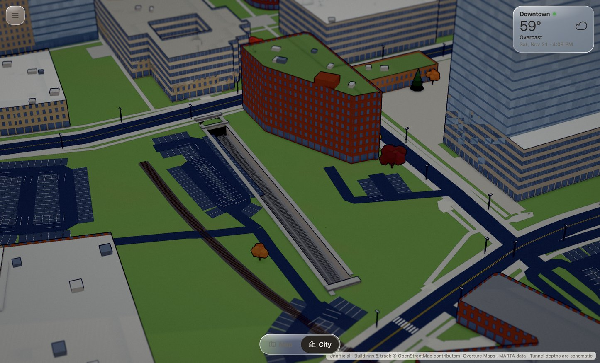
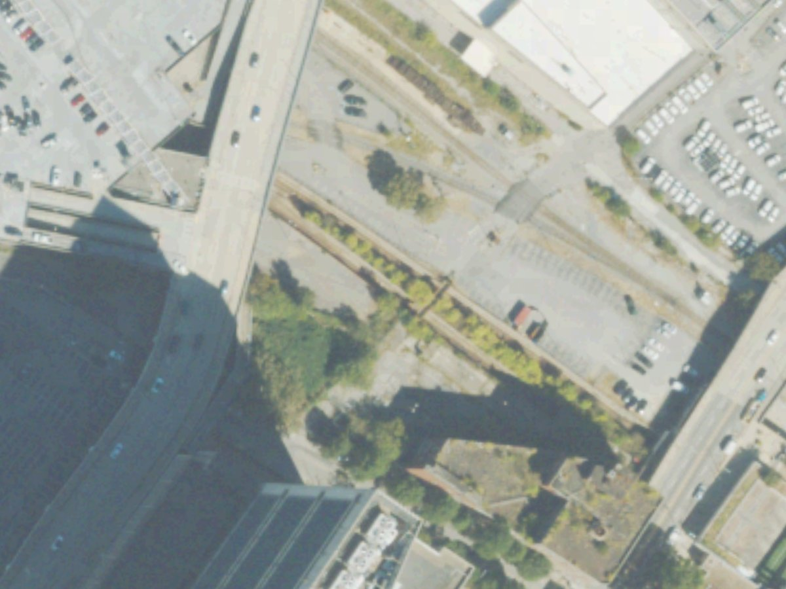

Sam also asked whether City should have an underground view, since tunnels hide most trains.
It's in the art backlog's Cutaway section. Deploying this needs `pnpm data:scene` (or
`pnpm data`) and a web rebuild.
## 2026-11-21 — What the ground can tell us at Five Points

The ground on the Blue/Green alignment about 200 m east of Five Points sits roughly eight metres below both sides of the corridor. A 5 m grid keeps that depression in a downtown board that takes 122.4 KiB gzipped, including its vertical reference. The surprise came farther east. Follow those heights across the Downtown Connector and the train would descend toward the freeway because the public bare-earth DEM removes bridge decks. At Five Points the grid gives us 323.8 m NAVD88 at the scene origin, while the station's stacked tracks remain a separate measurement. The pipeline prototype includes 18 GTFS ground checks and a 101-point test across the cut. [Terrain findings and reproduction](downtown-ground.md) · [Ground map and sections](log/2026-11-21-downtown-ground.png)

## 2026-11-21 — A static terrain pass before the trains

A camera at street-block scale makes the east cut easier to read than the skyline view. Two-metre contours climb both banks, about eight metres above the sampled alignment. Across the Connector, the same drawing follows the freeway floor at 303.9 m NAVD88 and climbs to 314.1 m on the eastern bank. We can now orbit either section in the desktop terrain preview, then bring the City buildings and trees back for context. The JavaScript decoder matches all 54 centre and flank readings in the pipeline CSV. The City data build copies the checked terrain assets without downloading the 318 MB source tile. [East cut in Orca](log/ui/2026-11-21-ground-preview-cut.jpg) · [Connector in Orca](log/ui/2026-11-21-ground-preview-connector.jpg)

## 2026-11-21 — A train stays level over the Downtown Connector

In the local terrain preview, the Blue Line crosses a freeway floor that sits about
10 m below the east bank. The 5 m USGS ground grid shapes the freeway and sets the
foot of each schematic pier. For this study we anchored the structural model once at
the east bank (314.1 m NAVD88), then used City's existing rail profile 7 m above that
anchor. The mapped order puts MARTA above the street and freight bridges. Their
clearances, the railhead elevation and the pier locations remain schematic.

[Replay the crossing on the local City server](http://localhost:5317/terrain-preview.html?at=crossing).
It opens on a scheduled Blue train at 2:12:49 p.m. Eastern on November 20. Replay
covers 28 seconds around that moment. The first render tipped the cars toward the sky:
the cars were aiming at a world-space target computed in track-local coordinates.
After the fix, the Orca replay measured zero pitch on the level span as the cars
crossed the freeway. A regression test translates the train group down 9.7 m and
checks the cab still points horizontally east.

The Galaxy A16 averaged 54.4 fps across three foreground eight-second windows during
the replay (54.0, 54.1 and 55.1 fps, 384 × 692 CSS pixels, render DPR 2). This is a
standalone crossing scene. Full City with its weather and post-processing needs a
separate measurement when the terrain reaches that renderer.

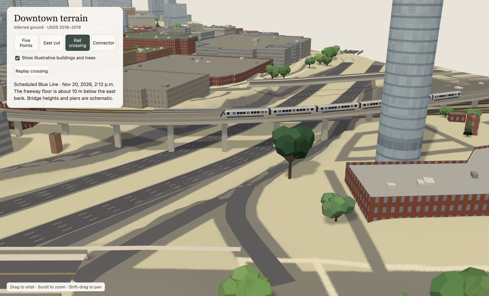

## 2026-11-21 — Ground through Georgia State, measured on the triangles

We sampled the eastbound Blue Line at 184 locations from Five Points through Georgia State and onto the Connector crossing. Over the 55 path metres between the west approach and freeway floor, the native 1 m DEM drops from 312.01 to 303.76 m NAVD88 (8.25 m). The 5 m grid interpolates 312.02 to 303.86 m (8.16 m). On the actual terrain triangles, both low and high detail give 312.05 to 303.77 m (8.28 m). Trees now use those same triangles and a street painted across a bank follows the slope. Rail beds and bridge decks still need structural heights.

Before clipping any rail slots, low detail used 98,390 vertices and 195,700 triangles on top of the board, versus 160,801 and 320,000 at high detail. Position, normal, UV and index buffers were 5,496,880 and 8,985,632 bytes respectively. The ground texture was 2048² versus 4096², with the same 122.4 KiB gzipped terrain payload. The two isolated desktop Orca views each went from 63 allocated geometries and one texture to zero after a season/night/wet change, disposal and an empty-scene draw. Control owns measurement with the open slots, trains and full City renderer. [Low detail in Orca](log/ui/2026-11-21-georgia-state-low.jpg) · [High detail in Orca](log/ui/2026-11-21-georgia-state-high.jpg) · [Section, costs and City interface](georgia-state-ground.md)

### 2026-11-21 — Putting freight across the Connector

The first freight span crosses the western freeway carriageway at 304.1 m of bare-earth elevation. The schematic deck passes overhead at 312.3 m. The surprising part was the length of the bridge. Overture marks only 10.8% of one railway feature as a bridge. Applying the flag to the whole railway lifted its approach too. Splitting the original way before cropping gives us six freight spans here, with the freeway still visible below. Downtown's transport adds two colour-pass draws and one more with directional shadows. The steep banks still show where a ground endpoint is a poor proxy for a surveyed abutment. [Connector](log/ui/2026-11-21-transport-connector.jpg) · [Embedded streetcar rails](log/ui/2026-11-21-transport-streetcar.jpg) · [Measurements and City attachment](terrain-transport.md)

## 2026-11-21 — Road, freight and Blue Line in the same crossing replay

At 2:12:49 p.m. Eastern on November 20, the scheduled eastbound Blue Line crosses the Downtown Connector. The replay now uses the same terrain triangles for the scenery and the lower surface transport. Overture's bridge limits split the elevated sections from their ground approaches. This replaces the earlier study's single bank height for every lower bridge. At one western carriageway, the ground reads 304.08 m NAVD88 and the model places the freight deck at 312.30 m. The scheduled train crosses on a separate MARTA structure about 25 m away in plan. The deck heights are illustrative. [Combined crossing in Orca](log/ui/2026-11-21-connector-scoped-crossing.jpg)

## 2026-11-21 · Cover is not depth: a rail contract for terrain

Real ground is coming to City: USGS 1 m bare earth, baked by the terrain agent. With it, a single
height number per 10 m of track stops being enough. The track's cover (sky, a street, a station
roof, a building) and its height relative to the ground are separate facts. Our old profile
blended them: deeper than −5.5 m meant "tunnel".

**Georgia State was the first fixture, and the old notes were wrong.** I had written that its
two untagged gaps "stay filled as tunnel". In fact the profile ramps from −10 m at the
Washington St portal to +7 m by −84.3859, so a flat-board renderer would draw the line climbing
through the platform canopies and straight through the Floyd "Twin Towers". Imagery from
2022-09-27 (Esri, 15 cm), 2023 (NAIP) and 2026-02-02 (WV02), together with OSM, gives four
honest stretches, eastbound:

- about 62 m open at grade beside the CSX/NS tracks;
- 73 m under the side-platform canopies (roofed, not a tunnel). The tracks between the two
  canopy roofs may be partly visible from above; none of the three images resolves it;
- 131 m under the Floyd Building (OSM `tunnel=building_passage`);
- then open, elevated structure, continuous into the layer-3 viaduct over the Connector. The
  second "gap" was only a seam between OSM ways.

**The contract.** `scene.json` gains an optional `rail` key and keeps `profiles` byte-identical.
Each path carries sorted, half-open spans in path metres, each with:

- cover: `open`, `covered` or `roofed`;
- form;
- a height base: local ground + rel, or hung from identified anchors;
- `height: schematic`;
- an evidence id with sources and edge precision.

Gaps mean unknown, so the old profile still applies there. The bake projects 6 lon/lat fixtures
onto all 12 Blue/Green paths in both directions. Span lengths agree within 15 m across paths, and
the westbound order is the exact reverse of the eastbound.

**A seam the coordinating agent caught.** Bedding the Floyd Building span on local ground while
hanging the viaduct from the east face + 7 m would make a car jump up to 7 m at the seam. The
canopy, building and viaduct spans now share one anchor chain:

- canopy west end, +0 m;
- station east face, +7 m;
- Connector east bank, +7 m.

A contract test samples ±1 cm either side of every seam with a synthetic ground surface, in both
directions. It measured a 2.65 m step with the old layout and passes with the chain. The 7 m
clearance remains a placeholder: no public record gives the MARTA deck height over the
freeway.

**What's still uncertain, with sources.** Edges are ±10–15 m along the path. They come from:

- OSM ways 702258813/816 (the tunnel ends at the Washington St bridge, 9245544);
- 78090747/742 (open, `level=2`);
- 539937961/962 (platforms);
- 702258821/822 (`building_passage`);
- 905944412–415 and 78090750/78380741 (structure and viaduct).

The imagery checks were Esri World Imagery 15 cm (Vantor, 2022-09-27) and WV02 (2026-02-02),
viewed only, and USGS NAIP `m_3308413_se_16_060_20231008` (2023-10-08, public domain, in
`docs/log/rail/`). In NAIP, tall-building lean hides the track under the towers, so the
building-cover edges rest on OSM and the 2026 imagery. Platform level relative to the bare-earth
surface inside the Floyd Building is unknown: the bed ramps from 0 to +7 m across the station
schematically. The deck clearance over the Connector is unknown; I checked FHWA NBI Georgia
2024/2025 and GDOT's public GIS.

The integrated City release uses both `pnpm data:scene` and `pnpm data:city` (or the full
`pnpm data`), followed by a web build and Worker deployment.

## 2026-11-21 — The frame we saved before changing Georgia State

Freeze Friday, November 20 at 2:12:29 p.m. Eastern. The timetable puts the centre of an eastbound Blue Line train at 8,108 m along its route, about eight metres beyond the Floyd building’s east face. Map gives us the train’s position. Switch to City without moving the camera target and the question changes. Which cars should a person above the station actually see? The baseline City frame uses the flat board and the old elevation profile. In the 2023 aerial photograph, you can follow the open approach up to the white station canopies, then lose the tracks under the building. How much of the track between those canopies is visible remains uncertain.

[Map at the scheduled passage](log/ui/2026-11-21-georgia-state-map.jpg) · [City before the rail-cover change](log/ui/2026-11-21-georgia-state-before-cover.jpg) · [2023 USGS aerial photograph](log/rail/2026-11-21-naip-2023-georgia-state.jpg)

To recreate the pair, [open the paused Map](http://localhost:5317/?q=high&t=2026-11-20T14%3A12%3A29-05%3A00&speed=0#17.8/33.7497/-84.38526/-22), then select City. Both captures face 22° west of north. City tilts 57° and the view is centred on the building’s east face. The scheduled time and the camera are fixed for a later comparison with the terrain and rail-cover renderer.

Farther east, review caught another place where the ground could mislead us. Eleven road or pedestrian bridge runs meet the edge of the board. At one motorway ramp, the board cuts across the span where the ground lies 7.58 m below the support inside the scene. Making that crop point a support bent the deck down toward the freeway. The model now carries the in-board support height to the edge. [Ramp after the fix](log/ui/2026-11-21-transport-edge.jpg)

Two photographs by Bill Mahan for the *Atlanta Journal-Constitution* put a train back into the Georgia State reference material. On October 7, 1979 he photographed a train crossing the Downtown Connector on the east approach. On October 31 he photographed a train passing through the station with the skyline behind it. Georgia State University Library holds both prints. They document the railway in its opening year. Sam identified the dusk frame from @city_surreal as another angle looking into Georgia State Station. The illuminated entrance and the line of warm windows along the train give us a reference for how the approach reads after sunset. [October 7 approach photograph](https://dlg.usg.edu/record/gsu_planatl_10448) · [October 31 station photograph](https://dlg.usg.edu/record/gsu_planatl_10513)

Sam also shared *Waning Winter* by @br3nn3nfoto, taken during a rare Atlanta snowfall. The Georgia Capitol dome puts the sweeping rail curve in context. A red steel girder crosses below the MARTA deck, and the highway is visible beneath both. Snow picks out the edges of the deck and the curve of the car roofs. That makes the frame a useful check on the winter scene and on how the three levels read from a distance. The station is outside the frame. The two photographer-credited screenshots are kept with the local source references under `data/raw/photo-references/`.

Looking along the Downtown Connector in *Fast Lanes* by @4cn.shon, the order is easy to see. MARTA crosses at the top of the frame, two CSX locomotives occupy the red girder bridge below, and traffic fills several lanes beneath both trains. Sam pointed out that our preview reads as two skinny roads. We put the roadway footprint and traffic behaviour into the M2b traffic pass. The highway-level photograph gives us a repeatable visual comparison for that work. Local reference: `data/raw/photo-references/connector-fast-lanes.png`.

Rail Accuracy checked the photograph against the mapped bridges. OpenStreetMap assigns layer 1 to the Atlanta Terminal Subdivision freight crossing and layer 3 to the MARTA viaduct above it. These layer numbers describe the order of the decks. Their clearances remain unmeasured. [Freight bridge](https://www.openstreetmap.org/way/539939597) · [MARTA viaduct](https://www.openstreetmap.org/way/78090750)

For the post, the October 7 archive title identifies the Connector crossing. The catalog coordinates point to Georgia at large, and the clipping text on the back concerns energy policy. The October 31 print has a caption on the back that explicitly names Georgia State Station. Both records credit Bill Mahan and carry the rights label *In Copyright – Educational Use Permitted*. [October 7 catalog record](https://dlg.usg.edu/record/gsu_planatl_10448) · [October 31 catalog record](https://dlg.usg.edu/record/gsu_planatl_10513)

### 2026-11-21 — One set of downtown buildings, from daylight to dusk

Downtown's foundations span 39 whole-metre elevations. Each elevation used to require its own facade mesh and rooftop-equipment batch. Building the walls and roofs at their individual foundations brings those 78 batches down to two. Every wall still carries the elevation of its own ground floor, so the illuminated windows and shopfronts start at the right height on a slope.

In an Orca desktop view of the whole low-detail board, terrain, buildings and trees fell from 79 colour-pass draws and 508,434 submitted triangles to eight draws and 461,457 triangles at the same camera and season. Low detail keeps up to three rooftop units and three leaf clumps per canopy. The 195,700 ground triangles still resolve the 8.28 m descent into the Connector. Road markings, crossings, striped parking lots and mapped parks and facilities use the existing 2048² ground texture. In the integrated City dusk view, the street lights warm that same pavement beneath the lit facades. These counts cover the terrain and scenery layer. City's lights, transport, shadows and post-processing have their own costs. [Full City at noon](log/ui/2026-11-21-terrain-city-day.jpg) · [Full City at dusk](log/ui/2026-11-21-terrain-city-night.jpg)

At street-block range the first zebra stripes blended together on the low-detail texture. One texel covers 0.98 m. Giving stripe width and spacing a minimum in texels separated the crossing marks while keeping the same board memory and draw count. Parking dividers still soften at grazing angles. [Low-detail street markings near Five Points](log/ui/2026-11-21-terrain-city-paint.jpg)

## 2026-11-21 — The train disappears under the Floyd building

At 2:12:10 p.m. Eastern on November 20, the flat-board City renderer placed six cars beside Georgia State’s platform. In the same scheduled passage on the measured board, all six are under cover. At 2:12:29 four cars are visible as the train emerges at the Floyd building’s east face. Twenty seconds later all six are on the Connector viaduct. We held the Map centre, zoom, bearing, City tilt and timetable instant from the earlier photograph comparison. In Orca we also checked the train in the open Five Points east cut and followed it across the lower bridges. The shapes of the hills come from the USGS grid. The track-bed height through the station and over the freeway remains schematic.

[Flat-board station passage](log/ui/2026-11-21-georgia-state-before-cover.jpg) · [Same passage on terrain](log/ui/2026-11-21-georgia-state-after-cover.jpg) · [East cut](log/ui/2026-11-21-city-terrain-east-cut.jpg) · [Connector crossing](log/ui/2026-11-21-city-terrain-connector.jpg)

On the Galaxy A16 the low-tier production build drew the opening view at **51.26 fps** over three consecutive eight-second foreground windows (49.43, 52.37 and 51.98 fps). The board, rail, lights and surface transport took 1.13 seconds to construct. The ready frame appeared 3.44 seconds after navigation on local USB. The viewport and draw buffer were 384 × 692. The timetable ran at normal speed from 2:11:58 p.m. The flat-board fallback still opened when we tested with an older manifest, and current City and East Portal both rendered in Orca. [A16 opening frame](log/ui/2026-11-21-city-terrain-a16.jpg)

## 2026-11-21 — Reading a locomotive number from the highway

The clue in Sam’s Georgia State crossing photo was the four digits under the cab window. Number 7257 identifies a CM44AC, rebuilt from GE AC4400CW number 381. The long hood has room for a side walkway. Its flared radiator, low yellow nose and two three-axle trucks give the locomotive a different outline from a passenger car, even from above. The scale study pairs it with a ribbed boxcar. The boxcar and its paint are illustrative. [Photographs of 7257](https://rrpicturearchives.net/modelthumbs.aspx?Page=51&id=CSX&mid=1546) · [Wabtec on the CSX rebuilds](https://www.wabteccorp.com/newsroom/press-releases/wabtec-and-csx-extend-deal-to-modernize-over-200-locomotives) · [Model lab screenshot](log/ui/2026-11-21-cm44ac-model-lab.jpg)

The three lab selectors now name the vehicle you’re looking at. The bus is the 40-foot CNG variant, New Flyer Xcelsior XN40, with tanks on the roof and a 12.50 m length over the bumpers. The passenger train is the Stadler CQ400. Each selection has a shareable model-specific URL. [New Flyer dimensions](https://www.newflyer.com/site-content/uploads/2021/01/Xcelsior_CNG_Brochure.pdf) · [MARTA’s CQ400](https://itsmarta.com/newCQ400railcars.aspx)

### 2026-11-21 — How wide is the Connector beneath Georgia State?

City gives each side of the Downtown Connector a 14 m strip. On the county aerial, the striped lanes alone take about 24–25 m in each direction on both sides of the rail crossing. South of the MARTA deck, two northbound feeder lanes join a five-lane mainline. Treating both as painted centreline ribbons makes them overlap just where the traffic model needs distinct lanes. GDOT's nearest mainline record gives 253,000 vehicles a day in 2024 and a calculated 237,000 in 2025, counted across both directions. The dated aerial sections, ramp records and separate source of the lane count give M2b a way to check its lane geometry before animating traffic. [Two aerial cross-sections](log/2026-11-21-connector-footprint.png) · [Measurements and traffic records](connector-road-footprint.md)

## 2026-11-21 — A boxcar found the freeway floor

At 2:12:49 p.m. Eastern in our November 20 replay, two illustrative freight locomotives pass beneath the scheduled Blue Line. In the first render, a boxcar tipped nose-down at the Connector. At the two ends of the mapped freight bridge, the bare-earth grid read 308.8 and 306.9 m NAVD88. Along the intact track on either bank it read about 314 m. A still image of the empty track had let that mistake slip by. [First crossing](log/ui/2026-11-21-freight-bank-before.jpg) · [Same instant with the corrected grade](log/ui/2026-11-21-freight-bank-after.jpg)

The City model now follows that grade across three rail-over-road crossings. The same rendered track carries both trucks of each locomotive and boxcar. Four Overture source segments trace 2,634 m of the Atlanta Terminal main, from the east edge through the Gulch to the north edge. The clock drives an illustrative loop of two locomotives and five boxcars. Its timing, consist and structural heights are schematic. At the Five Points east cut, a conflict with the MARTA terrain opening leaves too little supported freight track to animate.

With moving freight, the Galaxy A16 opening view averaged **51.32 fps** across three eight-second windows on low quality (52.67, 52.62 and 48.68 fps) at 384 × 692. The two highway carriageways still look narrow in these screenshots. The separate roadway study measures what to change. [Connector cross-sections](connector-road-footprint.md)

Checking the two decks from the highway side turned up one more collision. Two of the regularly spaced MARTA support columns crossed the freight loading envelope near the east board edge. We tested column positions against the mapped lower tracks and moved or skipped conflicting supports. In the rendered model, rays from the locomotive roof to the deck above now measure 1.07–1.16 m at ten points across the crossing. These are model clearances. [Locomotive under the MARTA deck](log/ui/2026-11-21-freight-under-marta.jpg)

## 2026-11-21 · The freight line that runs under Five Points

For an illustrative freight train in City, I traced one continuous freight route through the
board, starting from the bridges over the Downtown Connector by Georgia State. It's the CSXT
Atlanta Terminal Subdivision. It enters from Hulsey Yard and crosses the Connector. It shares the
Five Points east cut with MARTA, then dives under Five Points. It surfaces in the Gulch and leaves
at the north edge beside Norfolk Southern.

The shipped bake already holds it as four Overture segments. They join end to end, giving 2,630 m
with no gaps. Railroads report train counts at a dozen grade-separated FRA crossings along it, and
those land on the route in order: 6 trains a day east of Georgia State, 13 under downtown, 14 at
Ivan Allen Blvd. They are averages for different stretches, not one number for the route.

What surprised me is how much of it is hidden: four covered stretches add up to 736 m. A
branch that looked important on the map, the Circle Connection through the Gulch, has no
reported traffic at all. Its count is inferred.

The cover for this route comes from OSM and Overture tunnel tags. Unlike MARTA's cuts, I haven't
checked it against imagery yet.

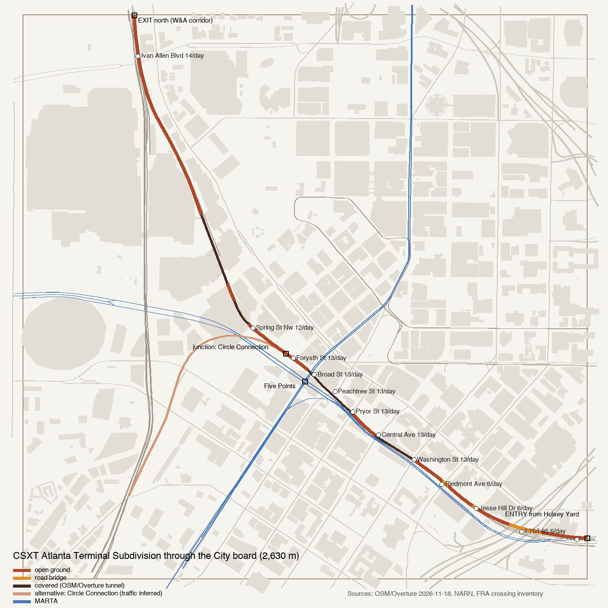

## 2026-11-21 — Seven lanes under the Georgia State approach

The aerial put about 24–25 m between the inside and outside stripes of each carriageway. City had allowed 14 m for each mainline. We painted the two measured sections 153 m apart, joined their edges under the bridges and tapered the pavement back into the mapped roads over 60 m at each end. Seven inferred lane centres per direction now give the pavement markings and future traffic a common set of coordinates. The two northbound feeder lanes peel away from the through lanes at the south end of the comparison. [Aerial and lane evidence](connector-road-footprint.md) · [Before](log/ui/2026-11-21-connector-before.jpg) · [After at the same instant](log/ui/2026-11-21-connector-after.jpg)

From above, the crossing looked ready. From 2.2 m above the northbound pavement, the new stripes ran straight into a MARTA bridge column. We checked the footprint of each schematic support against the travel lanes and found six street lights still standing on the old shoulders inside the new roadway. Keeping the old 26 m spacing would have left 103 m between piers. Searching along the deck found two clear sites, including the median, and reduced the longest of those three spans to about 42 m. These are distances in the model. This view records the geometry before the traffic animation. [South taper and feeder](log/ui/2026-11-21-connector-south-taper.jpg) · [View from the highway](log/ui/2026-11-21-connector-road-view.jpg)

The low-quality opening view on a physical Galaxy A16 averaged **50.18 fps** across three consecutive eight-second foreground windows (52.42, 48.25 and 49.86 fps) at 384 × 692. Both quality tiers use the same lane coordinates, painted into the existing ground texture when City opens.

## 2026-11-21 · Live buses in City

City now shows real MARTA buses, only at the real present and tagged `live`. They come from the
same 30 s cached feed the Map uses, through one shared `LiveBuses`. A new heartbeat runs outside
MapLibre's readiness, so City gets buses even when basemap tiles never load. It polls no more
often than before (once per 30 s; a fake-timer test checks this).

A sample of the live feed this evening explains the design:

- **Few buses are on the board.** Only 3–7 of about 150 fresh fixes fell inside it. Each new report
  is snapped once, through a spatial index; reports that can't be snapped (off the board, or away
  from a bus street) are cached by id and report time. That stops the frame loop re-snapping about
  144 rejected fixes every frame.
- **The first index accepted no fixes.** It used only the scoped terrain intervals. Ordinary
  at-grade streets come from `vd.roads`, and adding them accepted all three on-board fixes in
  Control's sample: route 49 on Courtland St NE at 18.0 m, route 20 on Decatur St SE at 2.7 m, and
  route A on MLK Jr Dr SW at 1.8 m. A test on the shipped data now fails without them.
- **Heights:** buses stand on the drawn surface. At-grade streets are painted onto the terrain,
  and street bridges use transport's exact tread sampler. An analytic deck I wrote first was off
  by up to 0.73 m at twisted abutments.
- **Crossings:** where a street passes under a bridge, the reported bearing picks the right level.
- **Glides:** a bus glides only along the same street, for under 150 m. A report that turned a
  corner is placed on its new street, never driven through a block.
- **Car traffic:** illustrative cars can ask `occupies()` to keep clear of buses, level by level.

In Orca at 7:55 pm in a drizzle, bus 4691 sat in its right-hand lane at a downtown intersection,
at 60 fps on the high tier.

Control's device and Orca gate ran on the PR build (5b16705):

- **Galaxy A16**, standalone bus build at the real present in drizzle: an average of 52.46 fps over
  three 8-second foreground windows (52.80, 52.42, 52.17) at 384 × 692.
- **Direct City entry in Orca:** one initial bus request, and two real buses drawn.
- **Timetable (time-shifted) City:** zero bus requests and zero buses.
- **Final street-glide fix (7670caf)**, on the A16 in drizzle: an average of 50.76 fps.

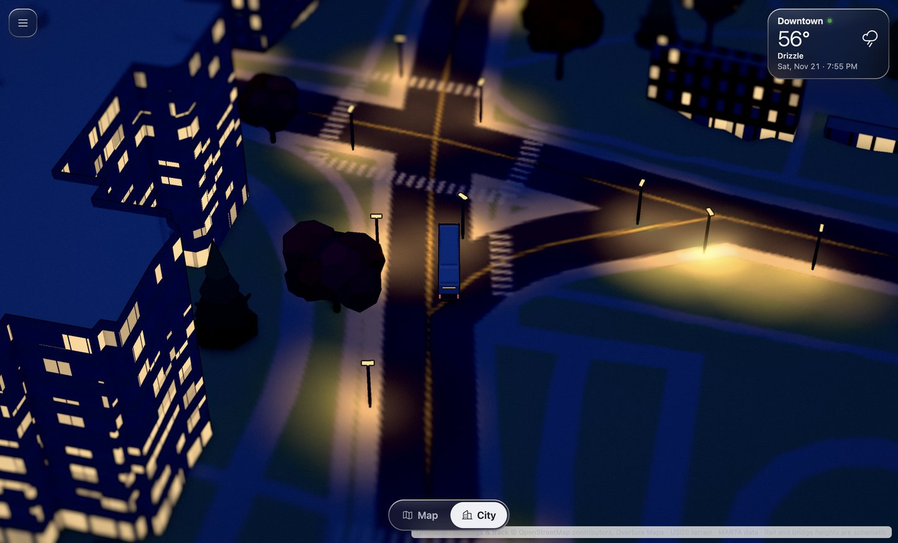

### 2026-11-21 — Four tracks between Pryor and Central

The freight track east of Five Points had almost disappeared in City. Near the middle of the opening, the passenger track drawn from the timetable geometry sits about 1.8 m from the mapped CSX centre. The two mapped centrelines are 5.4 m apart. Plotting all four ways also corrected the name of the block: Pryor Street to Shirley Clarke Franklin Boulevard, called Central Avenue in the bridge records. The Interline goes under cover about 10 m earlier than freight at the eastern end. A local four-track study recovered 102 m of drawable freight tread using the same City camera and clock. Its common bed is illustrative. The lidar resolves two banks around a trench but puts the CSX trace on a slope, where even a three-metre sideways shift changes the ground sample substantially. [Current City](log/rail/2026-11-21-east-trench-current.jpg) · [Mapped-track study](log/rail/2026-11-21-east-trench-mapped.jpg) · [Measurements and source dates](five-points-east-trench.md)

### 2026-11-21 — Cars follow the stripes below Georgia State

At 2:12:49 p.m. on the replay clock, the same scheduled Blue Line train and illustrative freight consist pass above both views of the Connector. The traffic prototype placed 92 illustrative road vehicles across the high-detail board and 40 on low. Five seconds later the vehicles had travelled about 90 m along their own lanes. The northbound feeder supplies the two outside positions at the crossing. The southbound option lane can continue or take I‑20. At the northern edge, one clipped tunnel way starts 43 m inside the board in the older road extract. Its scoped ground interval supplies the missing approach to the edge. A car can now disappear through that tunnel and resume on the same road without jumping to the neighbouring ramp. [High-detail crossing](log/ui/2026-11-21-connector-traffic-high-49.jpg) · [Five seconds later](log/ui/2026-11-21-connector-traffic-high-54.jpg) · [Low-detail crossing](log/ui/2026-11-21-connector-traffic-low-49.jpg) · [Traffic sources and integration](connector-traffic.md)

At road level, the same replay shows all three layers moving through the Georgia State crossing. The Blue Line is on the upper deck, freight is below it, and opposing streams of cars pass underneath. The measured road edges anchor the lane positions. The model uses the 2025 GDOT estimate of 237,000 vehicles a day across both directions, a typical hourly pattern from a different Atlanta counter and an illustrative speed of 18 m/s. At this instant City draws 92 road vehicles across the full high-tier board and 40 on low. The first A16 run with traffic and freight, before adding live buses, averaged **51.86 fps** at 384 × 692. [From the northbound lanes](log/ui/2026-11-21-connector-traffic-road-view.jpg) · [Traffic assumptions](connector-traffic.md)

The bridge approaches exposed a second problem. An arithmetic reconstruction of the road surface missed the rendered pavement by more than half a metre at 12 of 668 sample points. The worst error was 73 cm. One banked end of a deck twists relative to the other. The renderer divides that surface along a diagonal, and a vehicle using a different interpolation can visibly float. Buses and cars can now sample their own road's two rendered triangles. A vertical ray at each of the 668 points agreed to within a millimetre.

With live buses and illustrative traffic together, a real-time City opening in drizzle averaged **51.36 fps** on the A16 (51.50, 51.92 and 50.67 fps). The phone screenshot exposed a problem with the legend after dusk. Pale lettering on the daytime attribution panel was almost invisible, and the first-visit gesture hint sat on top of it. The attribution now uses the night palette and clears the hint. [A16 in drizzle](log/ui/2026-11-21-connector-traffic-a16.jpg)

### 2026-11-21 — The trains pick a side at Five Points

The ten scheduled Blue and Green shapes through the east cut trace almost the same line. The mapped route memberships put the five eastbound shapes on the southern rail and the five westbound shapes on the northern passenger rail. In the same-camera study a five-car test train could enter and leave either mouth with two full cars and half the middle car showing. Taking away one shape’s cut observation also took away the reconstructed bed. The supported freight tread fell from 106.23 m to 4.01 m and the locomotive stayed out of view. [Scheduled passenger](log/rail/2026-11-21-mapped-timetable.jpg) · [Illustrative freight](log/rail/2026-11-21-mapped-freight.jpg) · [Evidence and integration](five-points-east-trench.md#integration-and-verification)

The combined City build passed 133 tests. On the Galaxy A16 at 384 × 692 the same low-tier opening averaged **51.11 fps** in the daytime replay and **51.47 fps** at the real present in drizzle. Each run measured three eight-second foreground windows with the passenger, freight and Connector layers enabled. Regenerating the scene manifest changed two evidence strings naming the bridges. All 12 rail paths retained their geometry. [Passenger train between the two road bridges in City](log/ui/2026-11-21-five-points-mapped-city.jpg)

### 2026-11-21 — Cars on the downtown street grid

The first arterial bake matched 155 of 233 candidate road segments to FHWA’s 2024 highway inventory. Sixteen corridors passed the name, direction and geometry checks, including 21 drawn bridge runs. The renderer found 31 directed paths. It joins runs at unambiguous continuations and fades a trip at an interior endpoint where the evidence stops.

At 2:12:49 p.m. the high tier drew 42 arterial vehicles alongside 92 on the Connector. Low drew 17 and 40 respectively. At Decatur Street a white car approaches the bridge while the two freeway streams pass below it. Sampling 698 lane points on 34 primary and secondary bridge sections matched the deck triangles at every point. The hourly pattern comes from a separate freeway counter. Each car and its timing are illustrative. [Decatur Street bridge](log/ui/2026-11-21-decatur-arterial-bridge.jpg) · [Downtown streets](log/ui/2026-11-21-arterial-streets.jpg) · [Source and direction checks](arterials.md)

On the Galaxy A16 the combined opening averaged **52.29 fps** in daytime replay and **51.80 fps** at the real present in drizzle. Both runs used low tier at 384 × 692 and measured three eight-second foreground windows.

### 2026-11-21 — Tapping the train above the highway

At Georgia State, one tap on the upper viaduct opened the scheduled Blue Line to Indian Creek. A tap on the lower viaduct opened the illustrative freight loop. Both were visible at the same replay instant. The selector follows the drawn length of each car and trims it at the same portal planes as the renderer. The 24-pixel margin uses CSS pixels, so the phone’s lower render resolution keeps the same touch target. In the live scene, Route 55 bus 2360 showed the age of its MARTA report and identified the New Flyer Xcelsior XN40 body as illustrative. [Scheduled Blue Line](log/ui/2026-11-21-city-train-card.jpg) · [Live Route 49 bus on a later check](log/ui/2026-11-21-city-bus-card.jpg)

On the A16 the first card was readable over pale pavement but lost contrast against the freight deck in shadow. The card now uses the same light or dark surface as the attribution. The 44 × 44 px close control and view switch stayed accessible at 384 × 692 and 360 × 560. With arterial traffic and picking together, the low-tier opening averaged 47.39 fps over three foreground windows in live drizzle. [Blue Line card on the Galaxy A16](log/ui/2026-11-21-city-train-card-a16.jpg)

At 9:52 p.m. the Blue Line crossed the same viaduct with its windows lit. In the open card, the blue schedule label identifies the timetable and the violet model label identifies the illustrative consist. [Night crossing and train card](log/ui/2026-11-21-city-train-card-night.jpg)

## 2026-11-22 · Georgia State against Sam's three photographs

I put City's Georgia State beside three Instagram frames Sam found: @city_surreal's dusk approach,
@br3nn3nfoto's *Waning Winter* and @4cn.shon's *Fast Lanes*. I matched each with a pinned clock
and camera. The track plan, cover and three-level stack hold up:

- Freight runs 7.8–10 m above the Connector's floor, and MARTA 4.0–6.7 m above the freight.
- Freight and MARTA cross on separate parallel bridges 15–25 m apart. *Fast Lanes* only looks
  stacked because a telephoto lens compresses the distance.
- A moment of doubt about the westbound train's track turned out to be a trick of the oblique
  camera. Overheads confirm right-hand running, and a test now pins it.

Two things are wrong, and both are structures:

- **The Floyd building, the station's "Twin Towers", is drawn as a 25 m block.** The state calls
  it a 20-storey building. No published height in metres turned up, so any metre figure would be
  an estimate.
- **The station itself is missing.** The canopies aren't drawn, and the track under them is hidden.

The study recommends modelling those before refining track heights. Details:
[georgia-state-station-study.md](georgia-state-station-study.md)

### 2026-11-22 — City gets the front door

The downtown scene used to wait for the regional basemap style before it could show its loading message. City now paints that message first and creates the MapLibre map when someone opens Map. A bookmarked map coordinate still opens the regional view. Switching a 134° camera into Map and back kept its bearing, centre and 0.30 metres per pixel in Orca.

On the Galaxy A16, a fresh-origin visit to the previous build first painted text at 1.90 seconds and showed the city at 5.38 seconds. Two fresh origins on the new production build painted text at 0.78 and 0.38 seconds and showed the city at 4.92 and 2.85 seconds. These were local USB-served runs at the real clock in overcast weather. The new build averaged 52.00 and 50.80 fps across three eight-second foreground windows per visit. [Phone opening](log/ui/2026-11-22-city-default-a16.jpg) · [Desktop opening](log/ui/2026-11-22-city-default-desktop.jpg)

Using Wi-Fi on the A16, a screen recording of a returning visit to the public root showed downtown about 3.5 seconds after navigation.

Disabling only the City graphics context brought up the interactive regional map. Disabling both renderers revealed a shared dependency: MapLibre also needs WebGL. The fallback now draws the published MARTA rail shapes directly and labels seven stations. In Orca the labels cleared one another on both a 1446 × 876 desktop and a 360 × 560 phone viewport. Cancelling during either the timetable download or scene construction kept Map active after the late data arrived. [Rail overview with both graphics contexts unavailable](log/ui/2026-11-22-city-webgl-fallback.jpg)

### 2026-11-22 — Riding a Blue Line train from above

At 2:11:25 on the Friday timetable, a six-car eastbound Blue Line train fills the cut east of Five Points. Selecting it in the follow preview keeps the same trip in frame for the ride to Georgia State. At 2:12:02 the roof hides the whole consist. The card says “Under cover” while the streets move past, and by 2:12:32 the train has reappeared on the viaduct. In reduced motion the viewer decides when to recenter. [East cut](log/ui/2026-11-22-follow-east-cut.jpg) · [Under cover](log/ui/2026-11-22-follow-covered.jpg) · [Back in daylight](log/ui/2026-11-22-follow-viaduct.jpg) · [Replay the trip](blue-line-follow.md)

### 2026-11-22 — Making room for replay in portrait

At 384 × 692, tapping the middle of Now in a paused replay opened Map. The view switch intercepted all nine points we checked on Now and the left side of 1×. At 360 × 560, the icon-only switch still caught the edge of Now and part of the time slider. In the optional playback view, the switch now sits beside the time panel with an 8 px gap. Both groups stay within reach while following the night train. On a Galaxy A16, a rider could tap the Blue Line train, choose Follow train, then tap 1× to start the replay. [Galaxy A16](log/ui/2026-11-22-portrait-replay-a16.jpg) · [City at 384 × 692 in Orca](log/ui/2026-11-22-portrait-replay.jpg) · [Map at 360 × 560 in Orca](log/ui/2026-11-22-portrait-replay-map.jpg)

### 2026-11-22 — The roof that moved the station

Georgia State's platforms run under the 20-storey Floyd Building, so the station model needs the
building's openings to be in the right place. In imagery, the station's east end had looked like
a roof edge. Overlaying OSM on NAIP 2023 showed the error: the towers lean 10–25 m in aerial
photos, and their bases sit exactly on the OSM outline. Covered track had been running 10 m past
the building's real SE face.

The cover edges now come from the surveyed faces:
- 69 m open approach;
- 71 m under the canopies;
- 116 m under the building, down from 131 m.

A test walks all ten East Line paths in both directions and checks that each change of cover
lands within 1 m of the surveyed line.

The survey also found a lateral offset: the GTFS line runs 2.3 m north of the real track centre
through the station. That is half a track spacing, enough for a car to clip a platform. City will
ease its drawn line onto the surveyed axis inside the station. OSM also draws the platform edges
0.7 m from the rails, closer than half a car's width, so only the outer walls are taken from it.
[Survey](georgia-state-geometry.md)

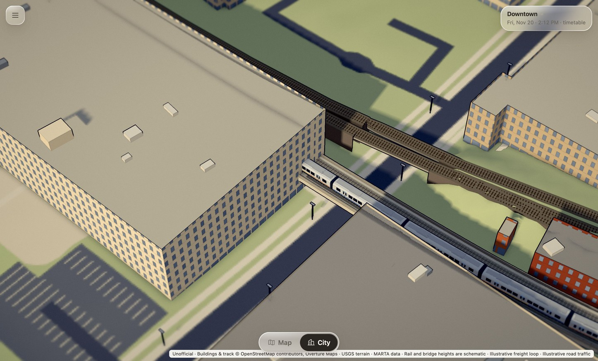

### 2026-11-22 — The pair of towers above Georgia State

From the plaza, the Floyd Building has three window bays across the face of each tower. From the street corner, eight bays turn along the side. Both towers rise from the same low roof, with about 53 m of sky between them. In the old City frame, a single 25.2 m block occupied the whole footprint. In the integrated City preview, the train enters an 18 m model opening at the northeast edge of the base and passes beneath both towers. The twenty storeys are documented. The 78.4 m height is an unverified map tag, and the soffit is schematic. [Plaza before](log/ui/floyd/plaza-before.jpg) · [Plaza after](log/ui/floyd/plaza-after.jpg) · [Dusk approach](log/ui/floyd/dusk-after.jpg) · [Photographs, dimensions and camera comparisons](floyd-towers.md)

### 2026-11-22 — A train can enter Georgia State

In the old dusk view, six Blue Line cars headed for what looked like a solid office wall. A photograph taken on the platform gave us three details the aerial view couldn’t supply. The floor is red-brown brick, the boarding edge is pale, and recessed lights punctuate a low ceiling. From the opposite angle in Sam’s dusk photo, the same station reads as a warm rectangle above the viaduct. [Platform photograph by Gman197002](https://commons.wikimedia.org/wiki/File:MARTA_Georgia_State_Station.JPG) · [Before](log/ui/georgia-state-study/2026-11-22-gss-dusk-approach.jpg) · [After](log/ui/georgia-state-station/dusk-approach.jpg)

We brought the City track about two metres sideways onto the mapped passage and kept the timetable distances on their original vertices. That lets the train run along the brick platform, pass between the jambs and disappear behind the lit entrance bays. The opening uses the same track bed and ceiling height as the towers. The 12-metre view into each end and the lighting are artistic estimates. [Daylight arrival](log/ui/georgia-state-station/day-platform.jpg) · [Dusk entrance](log/ui/georgia-state-station/dusk-entrance.jpg)

On the physical Galaxy A16, the default low-tier opening averaged 51 fps. A moving dusk arrival averaged 60 fps in the closer station view, compared with 67 fps at the same camera on the previous release. Each measurement combines three foreground eight-second samples. [A16 at the station](log/ui/georgia-state-station/a16-dusk.jpg)

### 2026-11-22: Four tracks, two islands, and a timetable that won't say which track

Avondale is the second test case for the shared platform model. It has two island platforms and
four tracks:
- the Blue Line's two main tracks outside;
- two centre tracks between the islands, which lead to the yard.

The timetable says which platform a train calls at, since each island has its own GTFS stop id.
It never says which of that island's two tracks the train uses.

So the fixture keeps three things apart:
- the physical edges (tracks facing platforms);
- the scheduled platform;
- the track, which is a candidate set with a "usually the main" that is only inferred.

The Green Line turnbacks that OSM still maps on the centre tracks are absent from the current
feed and from MARTA's station page. They are kept as reported history, not as service.
[Layout and sources](avondale-layout.md)

### 2026-11-22 — Daylight on a night train

Sam wanted to see detail in a dark station while watching the same arrival. The place and weather widget now opens a scene preview with separate lighting and weather choices. A paused 8:41 pm Atlanta timetable frame stays at 8:41 pm while the user switches on daylight. The view keeps the same train positions. The widget labels the preview, and the report below it still describes the observed Atlanta weather when the clock is live. We checked City and Map, returning to automatic conditions and fitting the panel inside a 360 × 640 phone frame. [Night view](log/ui/scene-conditions/dusk.jpg) · [Same moment in daylight](log/ui/scene-conditions/daylight.jpg) · [Lighting chooser on the Galaxy A16](log/ui/scene-conditions/a16-lighting.jpg)

### 2026-11-22 — Which side faces the platform?

An eastbound Blue train at Georgia State has its south platform on the right. At Avondale the timetable can name the south island but still leave the door side open. From the main track the island is on the left. From the centre track it is on the right. City now models one physical slab with a boarding edge for each track it serves. At Georgia State the refactor reproduced all 2,664 triangles of the brick platforms, canopies, lit entrances and fittings. The timetable puts the eastbound train at the stop at 14:12:00 and gives it zero seconds of dwell. [Georgia State in Orca](log/ui/2026-11-22-platform-primitive.jpg) · [Platform model and schedule semantics](data-model.md#station-platforms-and-boarding-edges)

### 2026-11-22 — The stadium was in the data and missing from the scene

The downtown bake contains a Mercedes-Benz Stadium footprint about 300 m across. The camera showed an empty field. Its westernmost point is 5.5 m outside the terrain board, and the generic building renderer skips a foundation when even one sample falls outside. That changes the stadium modeling job. First give the part on the board a valid foundation, then add the eight roof petals. The Capitol and Westin are the first two skyline studies. [Stadium before](log/ui/downtown-landmarks/stadium-before.jpg) · [Six landmarks, references and camera notes](art-backlog.md#downtown-landmarks-from-the-train)

### 2026-11-22 — More room for downtown

City’s long source note crossed the whole bottom of the scene. We moved it into a 44 px info button in the lower-right corner. OpenStreetMap also gets a linked credit while downtown loads. The panel reads the mounted scene to say whether its terrain is measured and which traffic is illustrative. At 360 × 640, the button and open note both fit above the optional replay controls. [City at rest](log/ui/city-info/closed.jpg) · [Credits expanded](log/ui/city-info/open.jpg)

## 2026-11-22 — Finding the Westin inside its block

The old skyline gave all 125 metres of the Westin's hotel block the same 220-metre roof. The surprise was that the missing circle was already mapped separately. Its 39-metre glass drum sits on the west end of the seven-story podium, with a second, much smaller circle for the exterior elevator. Portman's park and oblique photographs showed where to put the dark Sun Dial band and where to let the neighbouring skyline break up the glass. The replacement takes two meshes. From the Gulch you can see the towers that the old slab hid. [Skyline before](log/ui/westin/gulch-before.jpg) · [Skyline after](log/ui/westin/gulch-after.jpg) · [Close night view](log/ui/westin/night-after.jpg) · [Source notes and camera poses](westin-peachtree-plaza.md)

### 2026-11-22 — What the Westin’s glass was reflecting

Sam spotted a second skyline stuck to the lower half of the hotel. We had copied a neighbouring tower’s reflection from a photograph into the window texture. The panes now share one silver finish, and the scene sun and camera supply the highlight. A broadcaster’s rooftop visit gave us a 113 ft mast to add above the Sun Dial. A night photo supplied the other detail we had missed in daylight, a row of amber-white lights around the crown. The mast shares the trim mesh and the lights share the window material, so the hotel still draws in two meshes. [Daylight](log/ui/westin/glass-day.jpg) · [The same view at night](log/ui/westin/glass-night.jpg) · [Reference notes](westin-peachtree-plaza.md)

### 2026-11-22 — Glass you can see by moving around it

The first silver finish on the Westin caught the sun, but next to the masonry towers it still looked like the same material. We kept the panes uniform and gave them something to reflect. A 128 × 64 panorama of nearby mapped walls takes 32 KiB before mipmaps. Orbit the hotel at the same afternoon time and the pale sky and darker rooflines slide across the shaft. At night the reflection cools and dims beneath the lit windows. The hotel still uses two meshes. [Before](log/ui/westin/glass-day.jpg) · [Same daylight camera](log/ui/westin/reflection-day.jpg) · [Around the corner](log/ui/westin/reflection-orbit.jpg)

### 2026-11-22 — Five metres hid a stadium

One corner of Mercedes-Benz Stadium extended 5.48 m beyond our terrain board. Losing the ground under that corner made the whole 300 m footprint disappear. Cutting the apron at the board produced a 46.78 m west face that we could bed into the measured ground. From across the Gulch the glass now sits between the silver folds of the shell. From above, the eight pale roof petals occupy only the middle of the much larger fixed roof. Each has its own overlap and cushion direction. [Gulch before](log/ui/stadium/gulch-before.jpg) · [Gulch after](log/ui/stadium/gulch-after.jpg) · [Roof and sources](mercedes-benz-stadium.md)

### 2026-11-22 — One curtain wall, three tints

We held the hotel, sunlight and camera fixed and changed one material colour. Silver, blue and bronze all picked up the same rooflines, while the adjacent masonry kept its own colour. The Westin uses silver. Future apartment towers can use the same glass with their own window spacing and interior lights. [Three matched Orca views](log/ui/westin/glass-tints.jpg)

### 2026-11-22 — The stadium looked long from above

Sam spotted an oblong roof in the City view. We checked its east–west span against its north–south span in Fulton County’s aerial. The ratio was about 1.12 in the photograph and 1.13 in the model. The part we had missed was the turn in the eave between each pair of main corners. Tracing those turns and the eight curved petals preserved the scale of the block. From the Gulch, the east glass now sits behind the silver folds, with a recessed entrance beneath it. [Roof in Orca](log/ui/stadium/refined-roof.jpg) · [East window](log/ui/stadium/refined-window.jpg) · [County aerial and architect’s photographs](mercedes-benz-stadium.md)

Sam also chose the public name **Sim Atlanta**. The city menu, About page and browser titles now use it.

### 2026-11-22 — Thirteen exhibit spaces under one map outline

The Congress Center appears in the bake as one 597 m footprint with one height. The floor plans put twelve numbered exhibit halls and the BC connector inside it, all within our board. From the tracks, the easiest way to read the campus is through its gaps. The railway passes between A and B and under their southern lobby; a 10,827 m² loading court runs between B and C. The new roof tiers follow the two original courtyard holes. Building C’s mapped footprint clears the west edge of the miniature by 10.9 m. [Across the tracks before](log/ui/congress-center/tracks-before.jpg) · [After](log/ui/congress-center/tracks-after.jpg) · [Daylight cameras and sources](georgia-world-congress-center.md)

### 2026-11-22: The gold dome, by the numbers

The Georgia State Capitol had been a 29 m beige extrusion. Seen from a Blue Line train, it was the
one downtown landmark that should catch the light, and it didn't.

The Historic American Buildings Survey drew the building in 1995–96: 52 public-domain sheets at
1:128. The dome section puts the top of Miss Freedom's torch at 259'-7" (79.1 m) above the lowest
grade, and the dome crown at 195'-9" (59.7 m).

One small trap: the height labels sit in the sheet's margin, not beside the features they mark.
Scaling the drawing put every label on a distinct feature. The 10.1 m rise from spring to crown
then matched a hemisphere almost exactly the size of the gold dome OSM had already mapped (19.8 m).

The model was placed from the footprint, not from aerial photos:
- the crossing of the cross plan lands 0.6 m from OSM's dome part, while the dome in the aerial
  imagery sits 15 m away;
- the portico faces Washington St, and a test fails if it's flipped;
- about 3,500 triangles in all.

At dusk the gilding is floodlit.

### 2026-11-22: A track bed fighting the floor

Sam saw the track bed under the Model Lab's CQ400 flicker at the default three-quarter view and
while orbiting. The ballast was a box whose top face sat exactly at y = 0, the same plane as the
ground disc, so the two surfaces z-fought for every pixel:
- the grey bed tore into stripes;
- the ink pass, which finds edges in the depth buffer, drew broken dashes along the sleepers.

Over four frames, nudging the camera 0.02° each time, 1,200 to 37,000 track-bed pixels changed
between consecutive frames. After the fix, about 120 did.

The fix moves the ballast top to 3 cm above the ground, still 2 cm below the sleepers, and sinks
its bottom below the ground. A test now fails if any track face lies within 2 cm of the ground
plane.

### 2026-11-22 — Walking to Georgia State

At 2:12:45 on the Friday timetable, two jacketed walkers pass one another on a sidewalk near Georgia State. Across town a helmeted rider pedals past a walker on the Westside Beltline Connector. The bake has nine pieces bearing that trail name, including a 242 m bridge. Three complete ground sections support seven illustrative walkers and seven cyclists. From the 390 px City opening, 103 visible walkers fit in a single draw. Zooming in reveals swinging arms, backpacks, handlebars and wheels. [Georgia State, the trail and the opening camera](log/ui/street-life/README.md)

### 2026-11-22 — Street figures on the inspection bench

The cyclists on the Westside Beltline Connector were only a few pixels tall in the opening view. Sam wanted to see what he was looking at. The Model Lab now holds the same cyclist and walker still while their limbs move through a full cycle. A test compares the lab model’s geometry, colours and local transforms with the City batches at four poses. On desktop, a fixed library separates the three vehicles from the two people and leaves the full canvas free for orbiting. At 390 × 844, the model stays visible above the controls while a grouped picker replaces the list. [Cyclist at quarter cycle](log/ui/model-lab/cyclist-library.jpg) · [Phone layout](log/ui/model-lab/cyclist-phone.jpg)

### 2026-11-22 — Whose backpack is that?

Pause the Model Lab walker mid-stride and select **Next look**. A mustard jacket and green daypack give way to a blue jacket with bare shoulders. On the cyclist, the same change trades an orange frame for a green one. Both figures keep their pose and camera. The Lab remembers a separate look for each figure while you switch between them. [Walker](log/ui/street-looks/walker-0.jpg) · [Next walker look](log/ui/street-looks/walker-1.jpg) · [Cyclist](log/ui/street-looks/cyclist-0.jpg) · [Next cyclist look](log/ui/street-looks/cyclist-1.jpg)

City assigns each illustrative traveller a stable choice from the same 64 looks. Skin, jacket, trousers, pack presence, pack colour and bicycle paint have independent draws. At 2:12:45 p.m. on the Friday timetable, four of the seven Westside Connector cyclists carried a bag and four frame colours appeared. At the 390 px opening, 103 distant walkers still took one draw and 4,120 triangles. A 1,536-byte colour texture lets a batch wear many outfits. The Lab and City share that palette and the models. A web rebuild and deployment pick up the change with the existing downtown bake. [Georgia State sidewalks](log/ui/street-looks/sidewalk.jpg) · [Connector trail](log/ui/street-looks/trail.jpg) · [Opening view](log/ui/street-looks/opening.jpg)

### 2026-11-22 — Grass beside a Connector cyclist

A local photograph of the Westside Beltline Connector showed long stretches of short turf between tufts. Our first attempt at the 36 m verge near Mangum Street looked like a row of dark pegs. Fourteen clumps in uneven groups read better beside a passing cyclist. Their feet stay on the ground while the tips bend up to 8.6 cm. On low quality the close view costs one draw and 181 triangles. From the matched overhead camera the grass costs zero draws. The study stays on this one ground section for inspection. [Before and after, motion and the trail photograph](log/ui/trail-planting/README.md)

### 2026-11-22 — Give the Connector its sidewalk

At walking height the first Mangum study put the cyclist beside what looked like one broad street. Looking back at Mangum in April 2026 Street View showed a planted strip with a curb ramp through it at each crossing. A north-up aerial put the concrete at about 2.9–3.3 m wide. City had used 2 m for the path and 11 m for each half of the boulevard. The revised 3.2 m concrete walk has transverse joints and the grass sits between the walk and traffic. Both sets of crosswalks still meet the trail. All 218 low-quality and 330 high-quality figures keep the same routes and poses. [Walking-height and overview comparisons with local photos](log/ui/trail-planting/path/README.md)

### 2026-11-22 — Two different drops at Mangum

With the little grass models gone, the pale sidewalk and green curb strip still separate the people from traffic. The ground north of the trail falls 4.0 m over 90 m toward the parking lot. Looking east along Ivan Allen reveals a different problem. The model follows bare earth down nearly 6 m in the last 10 m before its existing bridge deck, while an April 2026 photograph shows a smooth road onto the span. We kept the bridge geometry pending better height evidence. [Numbered City view, ground samples and west landing photograph](log/ui/mangum-ground/README.md)

### 2026-11-22 — Grady above the curve

From across the Connector, Grady used to look about as tall as its parking deck. Its 165 × 202 m footprint was right, but one 20.7 m extrusion hid the shape of the hospital. The lidar told the story in three steps. Both sets of wards reach roughly 376 m NAVD88, the inner setbacks reach 381 m, and the E-wing penthouse reaches 391 m. The ground underneath is around 304 m. From Jesse Hill, the street wall has a different rhythm again, with two roof pads above its pale facade and a curved glass lobby at the Gilmer end. Correll and the parking deck still have their own outlines. [Connector before](log/ui/downtown-landmarks/grady-before.jpg) · [Connector daylight](log/ui/grady/connector-day.jpg) · [Jesse Hill at dusk](log/ui/grady/jesse-dusk.jpg) · [Sources, dimensions and cameras](grady.md)

### 2026-11-22 — Two crowns beside the Westin

At the normal City opening, downtown’s second distinctive roof fits into about fourteen pixels between its crown centers. The old 191 Peachtree extrusion raised a whole block, entrance included, to 234.7 m. Mapped building parts place two square roof structures 39.5 m apart over a much narrower, recessed shaft. From the north, the granite piers lead up to two little open lanterns. At dusk a warm wash catches the stone and leaves the arched gaps dark. [Matched opening, daylight and dusk with the architectural photographs](log/ui/peachtree-191/README.md)

### 2026-11-22 — Which side of the stack?

The Corey Tower was already on the board. Its base clears the southern edge by 68.5 m, but City drew its whole 91.4 m height as a round office block. Lidar puts the shaft radius near 5.3 m at the foot and about 4 m at the rim. There’s one bright face. The sign company calls its 25 × 80 ft display north-facing. In the returns, the two edges point the panel about 40° east of north, straight into the curve. The Georgia State tracks swing from nearly edge-on west of the stack to a clear view of the letters on the eastern approach. Cross to the south and the tall white shaft is blank. [Connector daylight](log/ui/corey-tower/connector-day.jpg) · [Eastern tracks at dusk](log/ui/corey-tower/east-rail-dusk.jpg) · [Reverse view](log/ui/corey-tower/reverse-day.jpg) · [Photo references, dimensions and camera positions](corey-tower.md)

### 2026-11-22: A platform to check the train against

The Model Lab can now stop the CQ400 at an island or at two side platforms. Both layouts are built
from the same platform primitive City uses, at the car's own floor height, with a pale zone on the
platform beside each of the train's six door pairs.

The edge sits 75 mm from the car side, just inside the federal 3-inch level-boarding limit for
rapid rail. The panel reports the gap and the step, so a change to the car model that pushed a
door off its zone, or the body into the platform, would show at a glance. Tests fail on the same
conditions.

The layouts are illustrative. Only the 4.86 m side-platform track spacing comes from a surveyed
station (Georgia State). [Notes](model-lab-platforms.md)

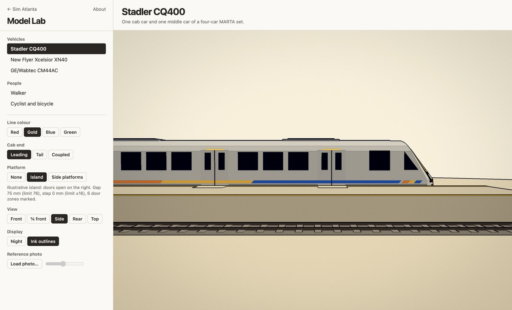

### 2026-11-22 — Two garages on Decatur Street

From the Connector, the broad roof beside Grady belongs to Butler. The deck across Decatur, next to the Georgia State rail approach, is Pete Hackney. At street level, Hackney’s lighter concrete piers frame five rows of dark openings. Across the street, Butler has wider-spaced floor bands and a storefront on Jesse Hill. Look down from the tracks and two ramp slots cut through Hackney’s roof while Butler’s pale parking surface stretches almost a block. The first deck models added 17,480 submitted triangles at the City opening and held at 141 draws. [Labeled view from the board edge](log/ui/parking-decks/edge-key.jpg) · [On Decatur before](log/ui/parking-decks/decatur-before.jpg) · [On Decatur after](log/ui/parking-decks/decatur-after.jpg) · [Photographs, measurements and cameras](parking-decks.md)

### 2026-11-22 — A roof to stand on

The first cars on Butler looked half-buried from across the Connector. At roof level the reason was visible. The body floated 13 cm above the pavement, and the whole car stood only 1.06 m tall. The parking decks now use the moving sedan’s 32 cm sill and 1.42 m roof. A flat patch on each of four tires meets the concrete. Step outside Butler’s 1.10 m parapet and the wheels disappear behind it while the upper glass still shows. All 174 parked cars fit in the existing building draw. With the finished decks, the City opening submits 2.26% more triangles than the two original extrusions and stays at 141 draws. [Old stance](log/ui/parking-decks/cars-close-before.jpg) · [Same aisle with tires](log/ui/parking-decks/cars-close-after.jpg) · [From outside the parapet](log/ui/parking-decks/cars-parapet-after.jpg) · [Connector view](log/ui/parking-decks/connector-after.jpg)

### 2026-11-22 — The arena roof turns across the block

From the station, the old State Farm Arena looked like an extension of The CTR. The aerial showed why the buildings should read differently. The arena’s silver roof runs diagonally across its 156 m footprint, leaving pale lower roofs at the corners. The model gives it the shallow curved span, a glazed station-side elevation and the structural ATLANTA letters. Across the plaza, a row of deep windows breaks up the masonry. The heights between the mapped base and roof are estimates from exterior photographs. [Matched City views and sources](log/ui/state-farm-arena/README.md)

### 2026-11-22 — What fits in a phone opening?

At 2:12:45 p.m. on the Friday timetable, a MARTA train rounds the curve southeast of Georgia State. In the downtown overview I can pick out the skyline and the edge of the board, but I lose the train. At 0.60 metres per pixel the light car roofs stand out on the outside curve. At 2:20 p.m. the track is empty. It still leads the eye from the Connector to the station beneath the Floyd towers, with a parking deck alongside it. I’d try this camera for a railway-first portrait opening. Sam is choosing between the two views. [During the scheduled passage](log/ui/phone-opening/passing.jpg) · [Between trains](log/ui/phone-opening/between.jpg)

Both pairs were captured in Orca at 390 × 844 CSS pixels on the low tier, on the build with the Butler and Pete Hackney decks. The November 20, 2026 clock is paused at the same local time within each pair. The overview uses the ordinary opening at (−40, −260), bearing 28°, tilt 57°, 2.53 metres per pixel. The station camera uses (467, 407), bearing 289°, tilt 72°. These are desktop browser captures at phone dimensions.

### 2026-11-22 — Looking through Breuer’s concrete

At Atlanta Central Library the revealing detail was a patch of sky high in the Forsyth Street wall. It belongs to the fifth-floor terrace. The mapped 60.5 m street face gave us a scale for the renovation photograph, and the state survey explained the two upper floors that recede behind the big concrete facade. The model opens the slot into the terrace, recesses the glass at the entrance and adds the rooflight visible from above. The library reads best from Margaret Mitchell Square, where the nearby towers leave the front in view. [Two sides of the library, sources and estimates](log/ui/central-library/README.md)

### 2026-11-22 — Two sides of Piedmont Avenue

Stand at the Grady parking deck on Armstrong and you see metal screens two floors tall behind the concrete piers. Cross to Georgia State’s M Deck and the floor edges make long pale slots around a glazed corner. The roof returns put the Grady parking surface about 28 m above its low edge and M’s about 22 m. City had the taller garage on the opposite side. The aerial shows Piedmont busy and M mostly empty. We put 26 parked sedans on one and six on the other. Together they add 0.53% to the opening’s submitted triangles and keep its 141 draws. [Across Piedmont before](log/ui/campus-decks/piedmont-before.jpg) · [Across Piedmont after](log/ui/campus-decks/piedmont-after.jpg) · [Street photographs, lidar elevations and cameras](campus-decks.md)

### 2026-11-22 — Three roofs share one entrance on Gilmer

Georgia State gives drivers one address for S, K and N. A look down from Jesse Hill finds three separate steel frames. On S the two sides of the parking roof slope away from each other. On K and N the high point is in the middle, where a driver can look down into the lower ramps on opposite corners. In the lidar those drops measure about 2.6 and 2.7 m. At roof level on N, the tires follow the grade while the next row of cars rises into view. Sixteen parked cars and three steel frames add 0.60% to the City opening’s submitted triangles at the same 145 draws. [Three roofs before](log/ui/gsu-steel-decks/roofs-before.jpg) · [After](log/ui/gsu-steel-decks/roofs-after.jpg) · [From a sloping aisle](log/ui/gsu-steel-decks/slope.jpg) · [Photographs, lidar and City cameras](gsu-steel-decks.md)

### 2026-11-22 — The steps above Truist Plaza

The old extrusion carried the entrance arms to the roof. Portman’s photographs put them at the plaza, below a square glass shaft whose projecting office bays end at different heights. The Council’s measurements separate the 264.3 m architectural top from the 275 m tip. At dusk the model picks out the lips of the stepped glass crown. [Matched City openings, both approaches and source photographs](log/ui/truist-plaza/README.md)

### 2026-11-22 — Four missing pieces of the Georgia-Pacific skyline

The bake put a 50 m block at 133 Peachtree and a 207 m sliver against its north wall. The stepped tower was hiding in four mapped upper building parts. Across one row of lidar samples its terraces rise from 386 to 430 to 474 m above sea level, then reach a narrow shoulder below the main roof at 530 m. From the southeast the pink granite steps read across the window rows. Swing around to the east and the dark slots between the blades come into view. The north footprint survives as a low volume whose precise roof height is still uncertain. [Matched City cameras, source photos and repeatable lidar probes](log/ui/georgia-pacific/README.md)

### 2026-11-22 — Two ends of the Flatiron

From Luckie Street the Flatiron is one window wide. From Woodruff Park you can follow five projecting stacks of windows along Peachtree to the glass that wraps around Poplar. Both ends were already in the City footprint, down to the 4.37 m face at the tip. The old horizontal office bands made them hard to tell apart. The new model picks out the two-story entrance and the heavy cornice below the two-story cap. The measured roof sits about 44 m above the low sidewalk. At night the street lamps pick out the base, as they do in the park’s 2017 photograph. [Woodruff Park before](log/ui/flatiron/facade-before.jpg) · [After](log/ui/flatiron/facade-after.jpg) · [Same camera after dark](log/ui/flatiron/woodruff-night-after.jpg) · [Street photographs, measurements and cameras](log/ui/flatiron/README.md)

### 2026-11-22 — Light on the Georgia-Pacific terraces

From the Jackson Street Bridge the Georgia-Pacific Tower reads as two broad white faces with a dark grille between them. Our first night model showed six amber lines. Sam’s dusk photograph put the brightest patches at the terrace edges, where the light begins its climb up the stone. The revised model brings back the grille’s horizontal bars and gives the short crown its own pool of light. At full night the opening adds 2,656 submitted triangles on the existing draw calls. [Jackson Street photograph beside both models](log/ui/georgia-pacific/uplighting/reference-and-model.jpg) · [Day, dusk and full-night comparisons](log/ui/georgia-pacific/uplighting/README.md)

### 2026-11-22 — Where the Flatiron catches the light

The shadow across the Flatiron’s upper stories runs straight across five projecting window bays. Two stories higher, the parapet follows each bay out and back. That difference was easy to miss in our first model. A park photograph and Sam’s street details also showed how much pale stone sits between the paired sashes. The revised model sets the glass about 20 cm behind the jambs, a depth estimated from those photographs. From across Peachtree, morning sun catches the round entrance columns a full metre in front of the dark glazing. The park frame gains 1.70% in submitted triangles at the same 65 draws. [Photograph and matched City views](log/ui/flatiron-relief/comparison.jpg) · [Street detail](log/ui/flatiron-relief/street-revised.jpg) · [Sources, dimensions and night comparison](log/ui/flatiron-relief/README.md)

### 2026-11-22: Measuring the viaduct instead of guessing it

The first extension east of the board runs 512 m along the MARTA viaduct to King Memorial. We had
no published deck heights, so the plan was to draw ground only and leave the guideway as an
unknown.

Then the USGS lidar turned out to be the same April 2019 flight as our terrain model: its ground
returns match the bare-earth grid to a 1 cm median. Its returns off the top of the structure give
the guideway itself, in 5 m steps:
- 316 m beside the Floyd Building;
- 15.5 m above the Downtown Connector's lanes;
- a 325.5 m crest over the CSX yard;
- under King Memorial's roof, where the lidar can't see the deck and the study says so.

The measurement also showed our old 7 m placeholder running up to 3.9 m low east of the Connector.

The new ground strip shares the downtown grid's edge column node for node. It costs 9.9 KB
gzipped, against 1.44 MB for all of downtown.
[Study](king-memorial-corridor.md)

### 2026-11-22 — Six shop doors across from Woodruff Park

Five narrow footprints on Peachtree contain six street elevations. The giveaway is at Poplar, where the white shop turns the corner but its neighbor’s four red arches stop at a higher, darker cornice. A 2025 leasing plan puts two doors inside that single baked lot. Down the row, a shop with two tall arches faces the same park as a shop with a black canvas awning and two broad bands of glass. The model gives all six recessed glass in the existing building draw. At the daylight opening that adds 5,972 submitted triangles, about 0.27%. [Full block before and after](log/ui/woodruff-shopfronts/row-day.jpg) · [Wider park view](log/ui/woodruff-shopfronts/district-day.jpg) · [Night, sources and camera settings](log/ui/woodruff-shopfronts/README.md)

### 2026-11-22 — The narrow tower on Forsyth

The Healey parcel already had the right sixteen stories. City had given them to the low roofs behind the tower, too. The Forsyth edge measures 62.56 m long, but the tall slab runs only about 19 m back from the street. Its roof sits around 385.2 m above sea level. The rotunda roof behind it sits around 332.9 m. With that space open again, the Woodruff Park view picks out the narrow masonry tower, ten paired bays and the lift house with two stacks rising between the lower buildings. From below, the stonework continues above the straight window heads in a row of shallow carved arches. Small brackets cast separate shadows beneath the larger coping. [Photographs and matched cornice views](log/ui/healey/cornice-comparison.jpg) · [Photograph and matched models](log/ui/healey/comparison.jpg) · [Street views, point-cloud measurements and night comparison](log/ui/healey/README.md)

### 2026-11-22 — A second piece of Atlanta’s board

East of the Connector the old walnut edge cut across Decatur Street. The opt-in King Memorial board opens 360 m of that wall and carries the street onto another 800 m of measured ground. All 73 edge heights agree, even on the low-detail mesh. Downtown visitors fetched zero east data files at opening on either tier. Crossing the edge fetched 86,963 bytes of static terrain and neighborhood context. South of the station, the 2019 survey predates Marchon. An October 2023 aerial and November 2025 street photograph place five stories of apartments and street-level shops on the former parking lot. Two separate OSM ways had to be joined to recover the main building outline. [Before](log/ui/king-memorial-board/before.jpg) · [After](log/ui/king-memorial-board/after.jpg) · [Marchon aerial and City comparison](log/ui/king-memorial-board/marchon-comparison.jpg) · [Evidence, limits and cameras](log/ui/king-memorial-board/README.md)

### 2026-11-22: Replacing the 7 m placeholder with the measured viaduct

City had hung the viaduct east of Georgia State from a guess: 7 m above the ground at the station
face and at the Connector's east bank, then flat beyond. The lidar profile showed the guess was
nearly right at the station, 0.8 m low over the Connector, and 3.9 m low by the board edge, where
the real structure keeps climbing over the CSX yard.

Eight measured anchors now replace the guess, and they fit the 5 m lidar profile within 0.25 m.
They carry absolute NAVD88 heights rather than "metres above the ground here", because the ground
under a viaduct can drop 10 m in a few metres across the Connector.

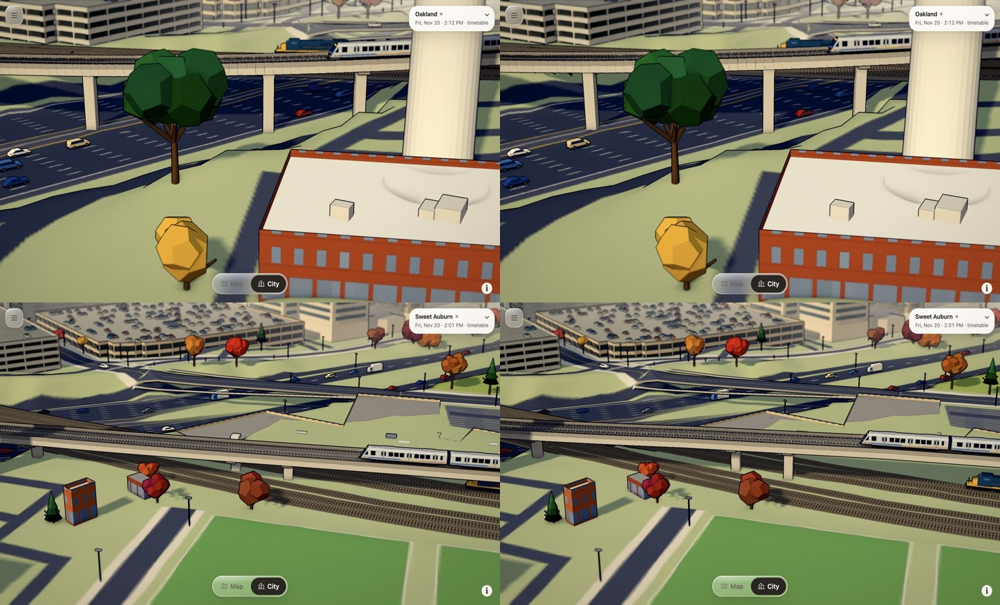

### 2026-11-22 — Around the corner at Marchon

From Grant Street, Marchon reads as apartments over shops. Around the corner on Oakland Avenue, the nearest four-story wing meets the sidewalk with paired windows in dark masonry. The March 2025 street photograph gave City a second ground-floor treatment for the same building family. Three mapped apartment masses now share one facade layout, with palette, balcony spacing and ground-floor use chosen for each elevation. The five-story courtyard block and both four-story wings keep their recorded floor counts. City can reuse this style for identified four-to-six-story apartments and add another when a nearby example calls for one. In the matched desktop view, City gained 13,856 triangles and stayed at 67 draw calls. [Matched Oakland view before](log/ui/king-memorial-board/oakland-before.jpg) · [After](log/ui/king-memorial-board/oakland-after.jpg) · [Street photograph, courtyard evidence and camera](log/ui/king-memorial-board/README.md#marchon-from-oakland-avenue)

### 2026-11-22 — Parked cars on the Marchon roof

The rail-side rectangle at Marchon had picked up the same rooftop equipment as the apartments next door. The October 2023 aerial shows parking stripes and a driving aisle there. The turquoise shape farther south is a roughly 115 m² pool with a short bend at one end. City now shows seven illustrative cars on the garage and the traced waterline in its own courtyard. The completed-building obliques hide the deck behind the residential wrap, so the parking surface gets a schematic 3 m lift to 11 m above its foundation. The tires, stripes and parapet take their elevation from that same surface. [Matched rail-side before](log/ui/king-memorial-board/parking-before.jpg) · [After](log/ui/king-memorial-board/parking-after.jpg) · [Overhead](log/ui/king-memorial-board/parking-overhead.jpg) · [Aerial and height evidence](log/ui/king-memorial-board/README.md#garage-roof-and-courtyard-pool)

### 2026-11-22 — One tower above Five Points

Two Peachtree had a twin in City. Across a 63.4 m shared edge, the 2018 laser survey drops from a 484 m roof elevation to two station-side roofs at 328 and 330 m. What looked like a second skyscraper in the bake was a few metres of building above Broad Street. The 1966 tower now rises alone, with its silver ribs, dark mechanical belt and a recessed rooftop plant court. The neighboring seven-story building at 14 Marietta keeps its own footprint. The daylight opening gained four draw calls. [Matched opening and station comparison](log/ui/two-peachtree/comparison.jpg) · [Measured heights, dated photographs and night views](log/ui/two-peachtree/README.md)

### 2026-11-22 — A square of Sweet Auburn

The ground north of King Memorial extends for 800 m through Edgewood and Auburn avenues to Irwin Street. At its southwest corner three separate bakes meet at 305.4 m NAVD88. Keeping each of the 321 distinct shared samples on both rendering tiers let the walnut edge open in two directions. The King strip can still stand on its own. The second preview brings in 179 building footprints and 693 road and path runs for 56,809 compressed bytes of data on approach. From Hilliard, the March 2025 photographs explain the change in building type along Edgewood: shop windows at the street, a brick loft conversion behind them. [Seam and corner views](log/ui/sweet-auburn/joins.jpg) · [Street-eye view](log/ui/sweet-auburn/edgewood-street-eye.jpg) · [Aerial, photographs and integration notes](log/ui/sweet-auburn/README.md)

### 2026-11-22 — The two faces of Centennial Tower

From the Gulch, 101 Marietta looks like a flat-roofed glass tower with a silver V folded into its face. The other long wall has a second V, and the two spans differ by nearly 13 m. The 2018 lidar puts the roof deck at 457.8 m NAVD88, about 135 m above the sidewalk. That brought the 164 m generic tower down into the surrounding skyline. A night photograph from Centennial Olympic Park supplied the warm red fins and pale roof edge. The daylight opening gained six draw calls and 16,232 triangles. [Opening and Gulch comparison](log/ui/centennial-tower/comparison.jpg) · [Park and rail views, night photographs and survey notes](log/ui/centennial-tower/README.md)

### 2026-11-22: The first train to leave the board

At 2:01:01 p.m. on the Friday timetable, the 1:50 Blue Line train to Indian Creek crosses x = 1000,
the edge City had stopped at since the first downtown diorama. It keeps going on the measured
viaduct, past the Hulsey yard tracks, and stops under King Memorial's canopy at 2:02.

Only the roof under the canopy is measured; the deck and platform heights there are estimated, and
the study says so. The follow camera stays with the train across the seam.

### 2026-11-22 · Three porches on Irwin Street

Sweet Auburn had 32 mapped house footprints. Three on the south side of Irwin Street shared a raised porch, but the November 2024 street photographs showed three different rooflines. One porch fits beneath a gable with a small paired attic window, another sits under a broad shed roof, and the third has a hipped roof and a low red dormer. We matched their order and spacing to the October 2023 aerial before replacing their 8 m fallback envelopes. The middle lot explained a visual error on the first pass. Its street edge reaches 2.07 m above the level City uses for the building foundation, enough to bury part of a porch drawn from the rear grade. The final porch clears the drawn ground on both terrain quality settings. The opt-in block now has three readable fronts and twelve inspectable elevations. Side and rear openings remain illustrative. [Matched street and City views](log/ui/irwin-houses/comparison.jpg) · [Elevation sheet](log/ui/irwin-houses/elevations.jpg) · [Sources and footprint register](log/ui/irwin-houses/README.md)

### 2026-11-22 — The mast over Civic Center

On the northbound trip toward Civic Center, Twelve Centennial Park reads as stacked balconies. From the North Avenue bridge, the narrow mast stands out against Truist. The 2018 survey put the broad apartment roof at 429.2 m NAVD88, the pointed crown at 445.1 m and the east strip of podium at just 314.6 m. One 150 m extrusion had lifted all three surfaces together. City now draws the individual balcony bows and keeps the adjoining hotel separate. [Opening and Ivan Allen comparison](log/ui/twelve-centennial/comparison.jpg) · [Civic Center, night photographs and measured elevations](log/ui/twelve-centennial/README.md)

### 2026-11-22 — Looking up from Woodruff Park

The baked height at 100 Peachtree was already within about a metre of the laser survey. What gave the tower away from the park was the shape of its frame. Deep horizontal girders cross the dark glass, the columns continue past the recessed lobby, and the crown carries two 174-foot displays facing opposite streets. The historic Equitable letters appear in the earlier park photograph. The new model uses the blue Georgia’s Own treatment documented after the 2018–19 sign installation. A fixed pattern of illuminated offices and a shared sign texture add eight draw calls at the daylight opening. [Opening and park-level comparison](log/ui/100-peachtree/comparison.jpg) · [Survey, sources and night views](log/ui/100-peachtree/README.md)

### 2026-11-22 · Recovering a tower on Auburn Avenue

At 375 Auburn Avenue a missing height had turned a fourteen-story apartment tower into an 8 m block. The April 2019 lidar held 1,940 building-class returns inside the footprint. Their median put the main roof at 343.05 m NAVD88, with two distinct rooftop masses another 3.07 m and 5.69 m above it. From the street the surprise was how little glass shows on the end facing Auburn. A narrow stack of windows cuts a broad pale wall. Walking east brings the long grid of concrete and apartment windows into view. The two City terrain meshes now place both roof wings at the measured elevation and leave the entrance court open. [City and street comparison](log/ui/wheat-street-towers/comparison.jpg) · [Photographs and measurements](log/ui/wheat-street-towers/README.md)

## 2026-11-22 — The missing hotel behind Marquis One and Two

The downtown map gave the Marriott Marquis a three-story footprint. Its ballroom roof was present, but the guest-room tower was missing from the skyline. The 2018 lidar resolves an 85 × 32 m upper roof at 466.9 m NAVD88. Close to the podium the hotel swells another 18–19 m on each broad side to enclose the atrium. Look in from Courtland to see that curve, then around to Baker to see the long run of pale concrete fins. The two office towers still frame the separate entrance terrace. [Daylight before](log/ui/marriott-marquis/courtland-day-before.jpg) · [Daylight after](log/ui/marriott-marquis/courtland-day-after.jpg) · [Baker at dusk](log/ui/marriott-marquis/baker-dusk-after.jpg) · [Photographs, dimensions and camera settings](log/ui/marriott-marquis/)

## 2026-11-22 — 34 Peachtree from Woodruff Park

The aluminum spandrels on the former National Bank of Georgia tower catch more light than its windows. From Woodruff Park they make a stack of blue-gray bands. Around the Walton corner a single bronze-gray strip interrupts them from the lobby to the crown. The surprise is on top. The pale crown hides a roughly 7 m-deep equipment well at the street corner, while the surveyed penthouse rises another 10 m on the southwest half. [Woodruff daylight before](log/ui/34-peachtree/woodruff-day-before.jpg) · [Daylight after](log/ui/34-peachtree/woodruff-day-after.jpg) · [Walton at dusk](log/ui/34-peachtree/walton-dusk-after.jpg) · [Photo references, measurements and cameras](log/ui/34-peachtree/)

## 2026-11-22 — The parking deck that borrowed a skyscraper’s height

The eight-level garage against the south wall of 191 Peachtree was rendering as a 198.3 m glass tower. Of 2,593 USGS lidar returns in its footprint, the median was 351.2 m NAVD88. All 216 returns above 370 m fell within a 2.4 m strip next to the tower. The City foundation sits at 319.6 m, so the replacement puts the parking surface 31.6 m above it. Two distinct structures now read against one another in the skyline. The aerial shows short rows of parked cars on the open roof and the approach from the east shows a pale screen of vertical openings. The shared garage model draws both in the existing building batch. The number of parked cars, rooftop housing dimensions and bay spacing are illustrative. The source footprint and the tower retain their own identities. [Day before](log/ui/191-garage/day-before.jpg) · [Day after](log/ui/191-garage/day-after.jpg) · [Night before](log/ui/191-garage/night-before.jpg) · [Night after](log/ui/191-garage/night-after.jpg) · [Aerial](https://server.arcgisonline.com/ArcGIS/rest/services/World_Imagery/MapServer/export?bbox=-9393942.6551,3996373.4201,-9393782.6551,3996513.4201&bboxSR=3857&imageSR=3857&size=850,740&format=jpg&f=image) · [Street approach](https://www.google.com/maps/@?api=1&map_action=pano&viewpoint=33.7585765,-84.3859105&heading=280.12&pitch=8&fov=88) · [USGS 2018 Georgia point cloud](https://s3-us-west-2.amazonaws.com/usgs-lidar-public/GA_Statewide_B2_2018/ept.json)

### 2026-11-22 — Two church silhouettes on Auburn Avenue

From Auburn and Jackson, Ebenezer's paired brick towers and projecting neon sign identify the historic sanctuary long before its name is legible. At the other end of the Sweet Auburn board, Big Bethel's spire reaches 336.84 m NAVD88 in the 2019 lidar. All five returns in the tip sample fell outside the building class. A building-only pass would have lost the very part of the church you can see from blocks away. The two facades now follow their photographed street elevations. After dark, the pale Ebenezer sign picks out the entrance and Big Bethel's blue lettering sits above its warmly lit stone tower. The intensity and hours are illustrative. [Before and after](log/ui/sweet-auburn-churches/comparison.jpg) · [Day and night](log/ui/sweet-auburn-churches/night.jpg) · [Sources, survey and camera poses](log/ui/sweet-auburn-churches/README.md)

### 2026-11-22 — Four office towers, two rooflines

Look across the Peachtree Center promenade and the concrete fins line up, but the roofs step in different directions. North and South put their taller slabs along the courtyard. Harris and International put theirs between two lower wings. In 37,179 returns from the 2018 laser survey, the raised rims of the first pair reach about 417.7 m NAVD88 and the second pair reaches 431.5 m. Even the floor counts tell two stories. The district survey gives North and South 27 stories apiece, while the lender describes two 24-story office buildings and accounts for part of their ground floors in the mall. City now fits the panel rhythm to each pair and lets the survey set its silhouette. [Daylight before](log/ui/peachtree-center/promenade-day-before.jpg) · [Daylight after](log/ui/peachtree-center/promenade-day-after.jpg) · [Full night](log/ui/peachtree-center/baker-night-after.jpg) · [Photographs, footprint register and camera settings](log/ui/peachtree-center/README.md)

## 2026-11-22 — Polaris rises over the Hyatt again

One 8 m map extrusion had swallowed three generations of hotel buildings. The 2018 lidar separates the original Hyatt’s balcony wings from the rectangular International Tower and the bronze Radius drum. Above the central skylights the returns trace a 27.6 m saucer. Its blue dome reaches 417.2 m NAVD88, nearly 23 m above the atrium roof. From Baker Street it clears the surrounding roofs just far enough for its blue rings to show up at night. [Daylight before](log/ui/hyatt-polaris/baker-day-before.jpg) · [Daylight after](log/ui/hyatt-polaris/baker-day-after.jpg) · [Polaris at night](log/ui/hyatt-polaris/baker-night-after.jpg) · [Reference photographs, dimensions and cameras](log/ui/hyatt-polaris/)

## 2026-11-22 — Two roofs at the head of Woodruff Park

From the streetcar tracks, the Candler Building’s pale marble shaft ends in a row of arches and a deep, bracketed cornice. From the park, the narrow light court between its wings is almost as distinctive. The map had filled much of that view with a 65.4 m extrusion for the two-story building next door. Its median roof return is just 10 m above the street. The March 2025 photograph gives that shop a name at the curb, Rising Roll at 113 Peachtree, and three green-framed openings below its five upper windows. [Park before](log/ui/candler-hotel/park-day-before.jpg) · [Park after](log/ui/candler-hotel/park-day-after.jpg) · [Night](log/ui/candler-hotel/park-night-after.jpg) · [Photographs, independent measurements and cameras](log/ui/candler-hotel/)

### 2026-11-22 — Recovering the Odd Fellows tower at Bell Street

City had drawn the Odd Fellows office tower and its auditorium as a single low silhouette on Auburn Avenue. The surprise was in the names. The footprint labelled “Odd Fellows Hall” contains the six-story tower at Bell Street. Its Auburn-side roof measures 320.02 m NAVD88, over 17 m above the old City roof. Walk west and the storefront roof falls to 304.07 m, with the auditorium ridge tucked nearly 6 m higher behind it. The two mapped outlines now carry those roof changes and their own street fronts, from the tower's terracotta diamonds to the auditorium's projecting awning. [Before and after](log/ui/odd-fellows/comparison.jpg) · [At night](log/ui/odd-fellows/night.jpg) · [Measurements and photographs](log/ui/odd-fellows/README.md)

### 2026-11-22 — The leaning glass wall at Georgia Power

At the eastern edge of the board, a 100.2 m extrusion stood where Georgia Power’s low annex belongs. Its neighbor, the 24-story headquarters, had inherited the 11.7 m height of its curved base. The 2018 laser survey separated the three roofs at 301.7, 306.1 and 395.0 m NAVD88. The step on the south face came from a different source. Each floor projects 15 inches beyond the one below it, shading the glass. In City you can now look along the silver tubes from the southwest, then turn the corner to see the flat glass, low annex and brick section at the edge of the board. [Daylight before](log/ui/georgia-power/south-day-before.jpg) · [Daylight after](log/ui/georgia-power/south-day-after.jpg) · [Full night](log/ui/georgia-power/south-night-after.jpg) · [Survey, photographs and cameras](log/ui/georgia-power/README.md)

## November 22, 2026 — An evening walking from Five Points to Auburn Avenue

[Open the evening gallery](log/ui/evening-build/index.html) to revisit 16 locations and groups of buildings. At 191 Peachtree the parking garage had borrowed the height of its neighbor. At Georgia Power the error ran both ways. The source gave the big curved footprint only 11.7 metres of height and assigned 100.2 metres to the small east annex. The lidar separated the office roof, podium and annex at 395.0, 306.1 and 301.7 m NAVD88. Putting the tall mass back in the correct place changed the skyline before any glass was drawn. Around the Peachtree Center promenade the opposite lesson held. The four offices really do share one panel system, and their two mirrored plans give them different silhouettes.

East of downtown, a scheduled train can now carry the camera into King Memorial without a manual pan. The timetable gives the train the same arrival and departure time, so the captured sequence shows it reach the platform and continue. The station lamps, porch-front houses on Irwin and two Auburn Avenue church signs make different parts of the same journey legible at night and at street level. The extended board remains a preview. [King Memorial approach, stop and departure](log/ui/king-memorial/city-station-approach-stop-depart.jpg) · [Auburn Avenue at night](log/ui/sweet-auburn-churches/night.jpg)

## 2026-11-22 — Above the old Terminal Station tracks

On the Russell Building’s rail side, the office windows cross each floor in long rows. At night they pick out the tower against the parkway lights. On the opposite side, a curved white pavilion sits below those bands, only about 15 m above the plaza. Both sat inside one 116.7 m extrusion. The 14,991 lidar returns separated the pavilion roof near 339 m NAVD88 from the tower roof at 426.5 m and its recessed end terraces at 421.8 m. [From the tracks](log/ui/russell-building/tracks-day-after.jpg) · [Plaza side at dusk](log/ui/russell-building/spring-dusk-after.jpg) · [Reference photographs and cameras](log/ui/russell-building/)

### 2026-11-22 — Three hotel wings above Courtland Street

The old City model gave the low buildings beside Hilton Atlanta a 64 m wall. From Courtland Street it hid the point where the hotel’s three wings meet. In the 2018 lidar, the wings share a roof at 395.6 m NAVD88, the central roof reaches 411.8 m and the lowest eastern deck sits at 306.8 m. At night the concrete end wall catches light from the street while scattered rooms pick out the guest floors. Farther north, a different measurement settled a boundary question. Peachtree Summit extends 31.04 m past the current board. Its complete model awaits the north cap. [Courtland before](log/ui/hilton-atlanta/courtland-day-before.jpg) · [After](log/ui/hilton-atlanta/courtland-day-after.jpg) · [Full night](log/ui/hilton-atlanta/courtland-night-after.jpg) · [Footprints, photographs, heights and cameras](log/ui/hilton-atlanta/README.md)

## 2026-11-22 — The concrete ribbons at 40 Marietta

From the Forsyth sidewalk, the rounded floor bands of Five Points Plaza turn the corner and run straight into the columns. From above, the back of the building looks almost blank. A 1967 photograph shows the rear spine rising beside the inset roof, leaving a pale strip all around the main block. The 2,700 lidar returns put that strip at about 387.8 m NAVD88 and the inset roof at 392.3 m. Six pentagonal columns carry the frame around the recessed glass, a detail the old 72.8 m extrusion lost when seen from the square. [From Marietta](log/ui/five-points-plaza/marietta-day-after.jpg) · [Forsyth sidewalk at dusk](log/ui/five-points-plaza/corner-dusk-after.jpg) · [Photographs, dimensions and City cameras](log/ui/five-points-plaza/)

### 2026-11-22 — The rotunda above the museum entrance

From the Centennial Park sidewalk, the opening cut in the College Football Hall of Fame looks almost square. Step to one side and a different shape appears around it. The copper skin swells outward and turns back toward the field hall, leaving the forked concrete support visible below. The original City footprint stood 24 m high everywhere. The 2018 lidar separates the field roof near 330 m NAVD88 from the higher copper rim near 337 m. After sunset, the long strip of translucent glass and the name above the entrance are the easiest parts to pick out. [Before and after](log/ui/football-hall/comparison.jpg) · [Photographs, measurements and cameras](log/ui/football-hall/)

### 2026-11-22 — Where the tower ends on Baker Street

At 270 Peachtree, one baked height carried a 97-metre office building all the way across its attached garage. The lidar puts the garage roof near 328 metres NAVD88 and the tower roof near 405. Bringing the garage down opens the view of the pale, deep-set window bays from Baker. Next door at 260, the glass climbs almost continuously from the lobby lintel to the roof, another 24 metres higher. [Reference photographs and matched City views](log/ui/peachtree-offices/README.md)

### 2026-11-23 — Daylight between the Hurt Building wings

The round entrance is the first thing you see coming from Woodruff Park. From Hurt Park you can see something the old solid wedge hid completely: sky between two wings. At the inner end, the court drops more than 60 metres below the office roof. The model now follows that cut, the stepped lower roofs and the shallow dome over the western doors. [Street photographs, roof survey and matched City views](log/ui/hurt-building/README.md)

### 2026-11-22 — The steps between the arena and The Center

The former CNN Center looked like one tall wall from the Gulch. On the arena side the roof actually climbs in roughly 4.6 m steps. Inside the same footprint, 30,187 lidar returns pick out the office roofs at 375.4 m NAVD88 and the dark atrium roof at 382.6 m. From the opposite corner the steps disappear behind the offices, but the clerestory glass still catches the light above them. [Before and after](log/ui/the-center/comparison.jpg) · [Photographs, dimensions and City cameras](log/ui/the-center/)

### 2026-11-22 — A missing hotel above the fountain

City gave the Omni’s entire footprint a height of nine metres. From Centennial Olympic Park that erased the 27-story north tower. Its park-side guest wing rises above a low convention podium, with separate roof levels at 402.1, 407.4 and 409.2 m NAVD88. One small piece of the footprint needed the opposite treatment. The narrow strip across Marietta is a glazed bridge, and a view under it should still reach the other side of the street. [Before and after](log/ui/omni-atlanta/comparison.jpg) · [Survey, exterior photographs and cameras](log/ui/omni-atlanta/)

### 2026-11-22 — Counting bridges above Ted Turner Drive

From a map, the narrow shapes between the Gift and Merchandise marts look like separate walkways at one height. Looking north from the street tells a different story. One alignment has roof returns near 347, 357, 367 and 388 metres NAVD88. City now lets you see beneath all four. Across the road the Gift Mart's west wing drops 28.3 metres, while the Apparel Mart's fan-shaped skylight rises above a much quieter precast facade. [Photographs, measurements and three matched City views](log/ui/americasmart/README.md)

### 2026-11-22 — The three-metre ledge at 250 Piedmont

Altitude’s roof ends before its mapped footprint does. Along Piedmont, the 2018 laser returns fall from 387.85 m NAVD88 on the apartment slab to 306.8 m on a strip roughly 3.4 m wide. In the street photograph that strip is the lip of the low deck. From the Baker corner you can see the red-brown panels on the narrow end and the long pale grid turning south. At night, the building’s name lights up on both sides of the corner. [Baker before](log/ui/altitude-apartments/baker-day-before.jpg) · [After](log/ui/altitude-apartments/baker-day-after.jpg) · [Full night](log/ui/altitude-apartments/baker-night-after.jpg) · [Measurements, photographs and camera settings](log/ui/altitude-apartments/README.md)

## 2026-11-22 — Four buildings across Forsyth

The Sam Nunn tower looks like three frames of glass from across the Gulch. Walk around to the other end and the frames turn into two pale blades. The bake gave the rest of the campus a single 22.4 m extrusion, though the 2018 survey puts the Rich’s roof at 351.3 m NAVD88, the Forsyth bridge at 356.2 m and the glass mid-rise at 364.9 m. Separating them opened the street underneath the bridge and gave the old store its punched windows back. [Across the Gulch](log/ui/sam-nunn/gulch-day-after.jpg) · [Forsyth at dusk](log/ui/sam-nunn/forsyth-dusk-after.jpg) · [Photographs, heights and matched cameras](log/ui/sam-nunn/)

## November 22, 2026 — The last sixty metres south of King Memorial

King Memorial and Sweet Auburn brought the board to 2.8 km wide. Its northeast corner still needed 780 metres of ground, while just 60 metres were missing south of King. Filling those gaps and taking 400 metres at each end makes a square without losing a street already on the board. North adds about 157 KiB gzipped and south adds 96 KiB. The 401 heights across the old northern edge match exactly. Near the Connector, the street data tells a different story: the new map records a second carriageway 61 metres along the seam from the one named in both sources. The preview keeps that detail visible for the road artist. [Footprint diagram](log/ui/square-board/bounds.png) · [Before and after](log/ui/square-board/overview.jpg) · [Samples, sources and how to open the preview](log/ui/square-board/README.md)

### 2026-11-22 · Following a lane from Georgia State toward Midtown

Georgia State’s original 153 m strip had seven positions on each side. Following one northbound lane past the rail bridges showed where a blanket freeway width broke down. A separate entrance makes eight near Decatur. At Piedmont the managed lane leaves on the left. At Freedom an entrance brings six lanes back to seven. On the opposite carriageway at Edgewood, the HOV re-entry and a later right entrance occupy different sides of the road. The survey now has 88 additional transects and the cars follow the same stripes as the pavement. With the two east boards attached, that covers 2.19 km northbound and 2.29 km southbound before counting ramps. [Daylight driving view](log/ui/connector-corridor/driving-high.jpg) · [Northern approach](log/ui/connector-corridor/overview-high.jpg) · [Georgia State overview](log/ui/connector-corridor/georgia-state-high.jpg)

The surprise at Auburn Avenue was vertical. The old model put the southbound freeway almost level with the street. The lidar finds its deck about ten metres above the bare earth. Under the girders at Edgewood, the westbound left-turn pocket stays on the street and the illustrative cars cross above it. [Auburn in daylight](log/ui/connector-corridor/auburn-overview-day-high.jpg) · [Same view at night](log/ui/connector-corridor/auburn-overview-night-high.jpg) · [Lane measurements and sources](connector-traffic.md)

### 2026-11-22 — Following the Connector beneath Civic Center

With all seven boards attached, a car can follow the Connector for about 3.75 km in either direction. At Civic Center, the first overview showed a hill rising through the freeway. The lidar put the overhead structure at about 307.5 m NAVD88 and the exposed mainlines on either side at 293–296 m. Interpolating the lower grade between those openings keeps the upper street separate and lets traffic pass beneath it. The closed Capitol Gateway section farther south still hides vehicles until they emerge. [Northern survey](connector-north-survey.md) · [High detail](log/ui/connector-corridor/square-north-high.jpg) · [Low detail](log/ui/connector-corridor/square-north-low.jpg)

At I-20, a gap in the first square-board frame followed an internal map boundary right across a continuous bridge. The eastbound tread there is 311.1 m NAVD88 while the DEM below it is about 294 m. Measuring the upper roadway separately kept it continuous and preserved the curved ramp on its own lower deck. [Before](log/ui/connector-corridor/square-south-before.jpg) · [After at high detail](log/ui/connector-corridor/square-south-high.jpg) · [After at low detail](log/ui/connector-corridor/square-south-low.jpg) · [Southern survey](connector-south-survey.md)

### 2026-11-22 — A train on the square board

The seven pieces of the 2.8 km square now fit under the live City camera. Pan from Five Points toward the northern or southern edge and the next two terrain tiles arrive together. At King Memorial the 14:02 scheduled Blue train sits under the platform canopy with the downtown skyline still on the same board. One deliberately missing south tile left five areas open, including the station. A retry filled the gap without reopening City. The downtown opening made seven scene requests, and the complete square took 26. [Matched desktop overview](log/ui/city-square/board.jpg) · [King Memorial at 14:02](log/ui/city-square/station.jpg) · [Opening the preview](log/ui/square-board/README.md#orbit-the-square-in-city)

### 2026-11-23 — The roof behind the William-Oliver facade

From Five Points the William-Oliver reads as two uninterrupted walls of paired windows and pale brick. Its roof tells another story. Behind the street fronts, the lidar falls from about 379 to 327 metres NAVD88. One narrow bay rises through the low rear court and the rooftop pavilion reaches 387 metres. The returns above 430 metres belong to 34 Peachtree next door. [Photographs, roof measurements and matched City views](log/ui/william-oliver/README.md)

### 2026-11-23 — Two skylines at Atlanta City Hall

From Trinity Avenue, the foreground roof belongs to the 1989 annex. The bake had lifted it to the same height as the Gothic tower on Mitchell. In the 2018 lidar, the atrium ridges reach about 337 m NAVD88 and the 1930 crown reaches 376 m. Restoring that 39 m difference makes the glazed ridges visible from above and the marble porch legible from the sidewalk. At night an amber-and-cream wash follows the tall piers seen in the city’s lighting photograph. [Sources and matched City views](log/ui/atlanta-city-hall/README.md)

### 2026-11-23 — Six columns on Pryor Street

The courthouse looked like one 52.8 m building in the bake. It took two street corners to understand the footprint. The 1914 Slaton facade has six stone columns rising five stories above a banded base. Around the corner, the Justice Center Tower has reflective glass and pale end piers. Lidar picked out the historic U-shaped high roof and two narrow links across the gap to the modern tower. The 25.1 m Carnes building keeps its own footprint alongside them. [Photographs, roof elevations and matched City views](log/ui/fulton-courthouse/README.md)

### 2026-11-23 — The second roof at 25 Park Place

From Woodruff Park, the former Trust Company tower reads as a white grid. Turn toward Edgewood and its narrow end rises behind a three-floor pavilion. One 115 m extrusion had erased that view. The lidar put the tower rim at about 433 m NAVD88 and the pavilion terrace at 332 m. Restoring the 101 m step also exposed the space between the deep lobby piers. In the night photograph the warm light catches the projecting stone fins, leaving much of the glass dark. [Photographs, measurements and matched City views](log/ui/park-place-tower/README.md)

### 2026-11-23 — The two atriums at 55 Park Place

The broad western face used to read as one banded block. A photograph taken after the office lights came on showed what the bands had hidden. Two glazed halls sit one above the other between matching three-bay wings. The roof above them climbs in four steps of about four metres apiece. Across the same footprint, the eastern service block rises another six metres above the office roof. From Auburn, its mostly blank wall gives the building a different profile. [Reference photographs, elevations and matched City views](log/ui/55-park-place/README.md)

### 2026-11-23 — The last four metres of 55 Marietta

The 1955 opening photograph gives the former Fulton National Bank a height of 295 feet. City already had the height within a tenth of a metre. What was missing from Five Points was the step across its long face. In 7,773 lidar returns the two roofs separate by about 8.5 m, and the upper one stops roughly 4 m short of Forsyth. From street level that leaves a thin strip of lower roof beyond the last tall window band. From above, the same strip distinguishes the end of the tower from the neighboring block.

The period bank advertisement shows four red neon signs. Current photographs show a plain crown above the ribbons of glass, so the signs belong to the archive view. Today’s scene leaves a few windows lit after dark. [Photographs, measurements and nine matched City views](log/ui/55-marietta/README.md) · [Daylight and dusk comparison](log/ui/55-marietta/comparison.jpg)

### 2026-11-23 — Below the twin crowns on Ellis Street

In the hotel’s own dusk photograph, two brightly lit crowns rise over The Ritz-Carlton, Atlanta. Both belong to the office tower behind it. The hotel ends at a much lower flat roof. Inside its footprint, 4,017 lidar returns put the main roof at about 397 m NAVD88, roughly 68 m above Peachtree. The previous City block stood 94 m tall.

The hotel is easiest to recognize from the corner. Its window bands fold toward the street, the dining terrace projects over the Peachtree sidewalk and the Ellis driveway disappears underneath the guest rooms. At night the occupied rooms and entrance sign carry the light. [Reference photographs, roof measurements and camera positions](log/ui/ritz-carlton-atlanta/README.md) · [Matched daylight, dusk and night](log/ui/ritz-carlton-atlanta/comparison.jpg)

### 2026-11-23 — One footprint, three heights on Auburn Avenue

Southern Bell’s 1961 photographs show a limestone building with stepped shoulders. By the 1978 National Register survey, a narrow tower stood over its southwest corner. Both views explain what the old 78 m City block hid. The limestone roof is only about 66 m above the west sidewalk. The mast reaches roughly 127 m above it, while most of the thin eastern wing stands only a few metres above the lower ground there.

At street level the building gives its height back gradually: the middle steps away from the two limestone wings, down to a two-story corbelled entrance on Peachtree Center Avenue. From the railway the blue-white roundel is a more useful clue. It appears below 191 Peachtree’s twin crowns in a published dusk train photograph. [Source photographs, terrain comparison and City cameras](log/ui/southern-bell/README.md) · [Matched before and after](log/ui/southern-bell/comparison.jpg)

### 2026-11-23 — Three gables at Rhodes-Haverty

From the Peachtree sidewalk, four pairs of windows rise between projecting brick piers and end in four arches. Walk around the 1929 tower and the same gable appears on Williams and Forsyth. The roof behind those gables is flat. Its 392.1 m lidar elevation puts it about 68 m above the Peachtree side and nearly 70 m above Forsyth. A smaller roof at the north end rises another 4.6 m. [Landmark photographs and roof study](log/ui/rhodes-haverty/README.md)

The biggest change to the night view came from a shop next door. The bake gave it a height of 73.6 m. The street photograph shows a single blue storefront, and the lidar puts its roof about 5 m above the sidewalk. Bringing it down to that height uncovered Rhodes-Haverty’s north wall, where the operator documents a 30.43 × 11.71 m illuminated print. From Margaret Mitchell Square the sign now appears beneath the lit roof trim, with Hillyer Trust still in the foreground. [Daylight, sidewalk, dusk and night comparison](log/ui/rhodes-haverty/comparison.jpg)

### 2026-11-23 — Nine floors behind the Commerce Building’s grilles

Approach 34 Broad Street from Five Points and the pale corner looks almost blank until you reach the row of offices high above the sidewalk. The 1960 Commerce Building put nine levels of parking behind that wall. From Marietta Street you see seven tall grilles. Turn onto Broad and three grilles mark the garage entrance, leaving room for a metal relief above the blue shop canopy. The same arrangement appears in a Lane Brothers photograph taken the month the building opened. [Street photographs and matched City approaches](log/ui/commerce-building/README.md)

The 2,532 sampled lidar returns put the main roof at 383.2 m NAVD88 and the rooftop drum at 389.6 m, about 69 m above the sidewalk. Commerce’s main roof stands about 22 m above the main roof of W. D. Grant next door on Broad. Across the street, the upper volumes of the Robinson College building reach nearly the same elevation as Commerce. That difference is easy to miss from the sidewalk. [Daylight, dusk and night comparison](log/ui/commerce-building/comparison.jpg)

### 2026-11-23 — Seven bays on the sidewalk, twenty-one over Hurt Park

At 100 Edgewood Avenue, the window grid changes scale just above the sidewalk. Georgia State’s photograph shows 21 narrow bays across the office floors and only seven openings at the entrance. From Hurt Park, the piers frame the stair and recessed lobby. The top row of glass is nearly twice as tall as the rows below. An October 2016 nighttime panorama from the southwest corner picks out a handful of lit offices behind the trees. [Day and night references and matched street views](log/ui/100-edgewood/README.md)

From above, the lidar reveals an unexpected drop inside the roof. The western equipment well sits about 1.5 m below the 376.3 m roof deck. Two fans rise from it behind a narrow screen. Right alongside, a 381.8 m housing carries three low ridged covers. The parking deck north of the building has its own roof near 325.8 m, more than 50 m below the main office roof. [Park approach, entrance and rooftop comparison](log/ui/100-edgewood/comparison.jpg)

### 2026-11-23 — A roof court behind the M at Five Points

At 20 Marietta, the cream M sign hangs where shoppers coming up Broad first meet the dark condominium tower. The named footprint looked like a simple 62.7 m extrusion. In 2,139 lidar returns the street wing rose to 386 m NAVD88, but one rear corner stopped at 342 m. A single roof would have filled 44 vertical metres of open space. City now follows that cutout, the higher equipment shelf, and the turn from the shorter Marietta storefront to the longer Broad Street face. [Street photographs, roof measurements and matched City views](log/ui/metropolitan/README.md) · [Day, dusk and night comparison](log/ui/metropolitan/comparison.jpg)

### 2026-11-23 — The tower that belonged to the next roof

At Five Points an unnamed 72.7 m extrusion stood between two historic buildings. From across Marietta the photographs showed a low shopfront. Of 104 laser returns in a narrow strip along the shared Metropolitan wall, 87 were above 375 m NAVD88. Moving the sample inside the footprint dropped the median to 332.3 m, about 13 m above the sidewalk. The correction restores the view over the shops while keeping the higher rear service roof and the three neighboring footprints separate. [Street photographs, survey and Five Points comparisons](log/ui/marietta-backdrop/README.md)

### 2026-11-23 — Two courtyards at different heights

The two One12 Courtland footprints looked like a pair of flat extrusions. The architect’s photographs explained why the lidar gave three roof levels. An older eight-story building surrounds a court at street grade, while the sixteen-story Courtland tower steps back around a pool on the garage roof. That terrace sits near 333.6 m NAVD88, nearly 30 m below the taller roof. City now follows the five folded canopies along Dobbs, the louvered garage entrance, the Courtland corner and the string lights over the pool. [Architect’s photographs, lidar measurements and matched City views](log/ui/one12-courtland/README.md)

### 2026-11-23 — The narrow office slab above the old Citizens Trust lobby

From Auburn Avenue the pale fins at 75 Piedmont carry the eye up to the university lettering. At the front door, the same building reads as a low portico set back from the sidewalk. The former bank’s footprint spans about 51 × 74 m, but the tall slab uses only 19 × 68 m of it. The 2018 lidar puts the main roof 51–52 m above Piedmont and the east podium about 42 m below that roof. Modeling the two heights separately opens the view from Dobbs toward J Deck. [Street photographs, measurements and 15 matched City views](log/ui/citizens-trust/README.md) · [Comparison sheet](log/ui/citizens-trust/comparison.jpg)

### 2026-11-23 — Following four glass gables across the Government Center

The landmark at 141 Pryor looks different from each street. MLK Jr. Drive has a nearly 97 m office ridge. Pryor has a small signed portico and a plaza beneath four much larger glass gables. Only two of those glass ridges continue all the way to the Peachtree side. In 23,462 lidar returns across the two named footprints, the tower peaked near 366 m NAVD88 while the smallest roof group reached only 327.5 m. Giving each wing its own height opens up the view from Mitchell to the lettered bridge and the courthouse across Pryor. [Street photographs, lidar and eight matched City cameras](log/ui/fulton-government-center/README.md) · [Day, dusk and night comparison](log/ui/fulton-government-center/comparison.jpg)

### 2026-11-23 — Five tracks across the Castleberry Hill seam

The north and south additions met downtown at exactly the same ground height. In Castleberry Hill, five freight tracks still ended on a ruler-straight line in grass. The south-band map already had every continuation. Three Griffin District tracks and two Atlanta South District tracks meet the downtown endpoints to the centimetre and run another 343–381 m before leaving the board. Drawing those five centerlines adds 370 compressed bytes to the south section. All 2,011 ground comparisons across the square's eleven shared edges matched. [Before and after in City](log/ui/square-board/freight-seam.jpg) · [Seam measurements and rebuild instructions](log/ui/square-board/README.md#castleberry-hill-freight-crossing)

### 2026-11-23 — The trees between the low roofs

The apartment blocks around Renaissance Way looked bare from the skyline camera. In a 280 m square of the City’s 2023 canopy map, crowns cover 38.4% of that block. An equally sized sample around Grant and Woodward covers 23.8%, mostly in smaller pockets around houses. Those differences now show up across the expanded board. The bake places 3,225 inferred crowns on high detail, with a 1,578-crown subset on low. The six existing neighborhood requests cost another 21,030 compressed bytes together. [Skyline before and after](log/ui/expanded-canopy/skyline.jpg) · [Aerial comparisons, coverage and rendering cost](log/ui/expanded-canopy/README.md)

### 2026-11-23 — Counting the leaves from Old Fourth Ward

On the Studio skyline camera, changing each deciduous leaf clump from 36 triangles to eight took 1.44 million triangles out of a high-detail frame. The apartment blocks still have a belt of trees. At low detail the saving was smaller, about 132,000 triangles, and the individual crowns along the cemetery paths looked more pointed. The sleeping display made even a seven-second timing window misleading, so we also timed the GPU work for City’s render passes directly. [Matched Studio views and timings](log/ui/expanded-canopy/README.md#mac-studio-results)

### 2026-11-23 — Two bows at Georgia Aquarium

The 2018 lidar puts the Luckie Street hall at about 331 m NAVD88, but part of the current aquarium footprint looked like bare plaza. The building changed in between surveys. In 2020 a lower blue bow wrapped the old glass lantern, bringing the entrance and a silver wave wall out toward Pemberton Place. The 2024 county aerial locates that new edge and the large painted fish on the older roof. City now follows both bows, the window and portholes on Luckie, and the screen turning the Baker corner. The L-shaped parking deck still occupies its own footprint. [Photographs, 64,028 lidar returns and matched City views](log/ui/georgia-aquarium/README.md) · [Day, dusk and night comparison](log/ui/georgia-aquarium/comparison.jpg)

## 2026-11-23 — The first letter on the Georgia Aquarium entrance

At sidewalk height the G in “Georgia Aquarium” straddled the fold between the curved blue entrance wall and its Baker Street return. The angle from above had hidden the distortion. We moved the name inward, aligned its lettering to 19 consecutive facade panels and reduced the gap between the letters and the cladding from 34 cm to 4 cm. The same Orca sidewalk view now shows blue on both sides of the G. We also checked it from across the plaza and after dark. [Matched sidewalk views](log/ui/georgia-aquarium/entrance-wordmark.jpg)

### 2026-11-23 — A bottle across Pemberton Place

Looking north from Baker Street, you can now read the plaza from both ends of the frame. The aquarium's blue bow is on the left. On the right, the museum's glass tower carries a green bottle through a silver canopy. The 2018 lidar picks out its rectangular cap at 329.1 m NAVD88 and the downward sweep of the canopy toward Baker. From the other side of the block the landmark almost disappears behind its brick service wall. One detail changed between references. The reflecting pool in the designer's night photograph had become lawn and a curved walk by the county's 2024 aerial. [Both landmarks from Baker](log/ui/world-of-coca-cola/both-day-after.webp) · [Night from the plaza](log/ui/world-of-coca-cola/pemberton-night-after.webp) · [Photographs, survey and matched City views](log/ui/world-of-coca-cola/README.md)

### 2026-11-23 — Across North Avenue

The first Midtown row adds 800 metres of City north of the old square. Peachtree Street crosses the join at x = 591.09 m on both sides. All 19 other named street crossings match too. The surprise came below the streets. Downtown's elevation raster runs out diagonally partway through this row, leaving 48,018 of its 90,321 nodes empty. The neighboring USGS tile fills them, and all 561 nodes against the existing board still match to the decimetre. The new section includes the Fox Theatre and Bank of America Plaza footprints. [North Avenue camera](log/ui/midtown-board/north-avenue.jpg) · [Measured route to Brookwood](midtown-board.md)

### 2026-11-23 — From North Avenue to the Peachtree Station approach

Four more 800 m rows carry the City board through Midtown and past the Amtrak stop. All 82 named street crossings match across the four new joins. The ground at the low end of the station row is 239.9 m NAVD88, almost 84 m below Five Points. The downtown tabletop would have poked through Brookwood. Lowering the base for this view to 234 m keeps the original street relief all the way north. At the depot, the generic building and Peachtree Street bridge each have their own handle for the rail model to replace. [Station camera](log/ui/midtown-board/station-ground.jpg) · [Downtown to Brookwood](log/ui/midtown-board/brookwood-overview.jpg)

### 2026-11-23 — The glass block above Centennial Olympic Park

From the park lawn, 250 Williams looks like a single mirror. From the curb you can see through the notch in its lower edge, past the balcony rail to a second wall of glass. The roof has a similar trick of perspective. Its four corners sit roughly 4.4 m below the main field, and two crossing skylights lift the center almost 9 m above it. The bake still calls the block the American Cancer Society Center. Current property listings use 250 Williams, and the Society lists a different Atlanta address. City now shows the lower corners, park balcony and sheltered Williams frontage on the original 14,418 m² footprint. [Photographs and measured roof sections](log/ui/250-williams/README.md)

From the Williams Street drop-off, the canopy hides most of the glass above. At full night its ceiling and round columns pick up a little light from the entrance, while short runs of office windows glow much higher on the block. We gave the sheltered concrete its own dimmer wash so the columns remain legible against those windows. The seven cameras follow the same November afternoon from 13:45 through dusk at 17:22 to full night at 20:30. [Williams Street at night](log/ui/250-williams/williams-night-after.webp) · [All 21 before-and-after pairs](log/ui/250-williams/comparison.jpg)

### 2026-11-23 — Closing the air gaps beside Decatur Street

In the Georgia State overview you could see the freeway between the Decatur Street roadway and its sidewalks. Four source ways describe the street and walking routes, but the county aerial shows one 22 m bridge. Its ends are skewed, so the two sidewalk curbs meet the bank at different places. Rebuilding the shared deck from its outline and the 2019 lidar also resolved the same gap on MLK, Peachtree, Ted Turner and Capitol. The nearby independent footbridge keeps its own tread. [Before](log/ui/connector-bridge-sidewalks/decatur-before.jpg) · [After](log/ui/connector-bridge-sidewalks/decatur-after.jpg) · [Sources and other crossings](connector-bridge-sidewalks.md)

### 2026-11-23 — Where a bridge meets bare earth

At Ted Turner Drive, the ground grid beside one sidewalk drops roughly 10 m below the surveyed deck corner. Sampling the ground again just inside the span bent the sidewalk toward the freeway. The five bridges now take their approach heights at the abutments. A check against the staged City geometry found seven road pieces and twelve sidewalk pieces across three boards, including both halves of Peachtree. [Ted Turner in daylight](log/ui/connector-bridge-sidewalks/ted-turner-day.jpg) · [Capitol at the south edge](log/ui/connector-bridge-sidewalks/capitol-day.jpg)

### 2026-11-23 · Two Midtown buildings, three street views

The first Midtown row caught Bank of America Plaza and the Fox Theatre in full. The Bank occupies just 1,961 m² at its feet. The Fox takes up 6,104 m², more than three times the area, and its two most recognizable entrances face different streets. The mapped one-story tag tells almost nothing about the fly tower, Ponce dome or Peachtree minarets. We built those silhouettes from exterior photographs on the surveyed perimeter and checked them at 11:30 a.m. and 11:30 p.m. From across the intersection, the surrounding towers hide much of the low theatre. A second camera looking along Peachtree catches the vertical FOX letters and the readerboard. [Source inventory and three matched camera pairs](midtown-landmarks.md) · [Daylight Plaza](log/ui/midtown-landmarks/plaza-day.jpg) · [Fox marquee at night](log/ui/midtown-landmarks/marquee-night.jpg)

### 2026-11-23 · Where the Plaza's steel crown meets the roof

A square lattice base cut across the recesses in the tower and made the roof look as if it extended inside the cage. The revised rim follows the same 20-corner plan as the roof beneath it. Short supports leave 3.75 m between the coping and rim, enough to see the joint from a lower angle. The daylight close-up also revealed that the wide office faces have continuous strips of dark glass, while the small square windows belong on the outer piers. Daylight and full-night views now show the same rose steelwork and faceted 26.6 m obelisk under two lighting conditions. All intermediate heights are estimated from photographs. [Daylight roof joint](log/ui/midtown-landmarks/plaza-crown-day.jpg) · [Full-night roof joint](log/ui/midtown-landmarks/plaza-crown-night.jpg) · [Matched skyline views and camera positions](midtown-landmarks.md)
### 2026-11-23 — King Memorial stands on its columns again

City had drawn King Memorial station as one solid block. It extruded the OSM station outline, 184 m long, from the ground to the platforms. That outline also contains the busway and the kiss-ride drive. Sam's photos and a December 2025 Street View panorama under the Decatur St canopy show the opposite: parked cars and a drive loop under the platforms, round column bents with deep caps, and only two enclosed pieces. One is a glazed street-level lobby at the subway entrance. The other is a beige mass with a dark ribbon window band, lifted about 6.5 m clear of the street. City now draws just those two pieces, plus a crosshead under each open column row so the deck visibly rests on something. Opening the street level also exposed two smaller errors. A stair's top landing parapet blocked half its bridge to the platform, and on the slope the lamp pools were half-buried and showed as half-moons. No night photograph of the undercroft exists, so every light there is marked illustrative. [Day and night, before and after, from matched low and oblique cameras](log/ui/king-memorial/open-under-before-after.jpg)

### 2026-11-23 · The eight little domes on 191 Peachtree

From the skyline I had read each crown as a single shallow dome. In the close photograph the highest points are actually stone balls. Four smaller pale hemispheres sit a stage lower on each crown, framing two arched windows on each face. We rebuilt those shoulders and kept the mapped 234.7 m tip height. The same photograph explained why the office floors looked too busy. Four vertically grouped bays carry several floors of glass between slender piers, while the central recess has plain stacks of square windows. A pair of 216 × 552 textures handles the entire shaft, keeping the landmark at three meshes. [Daylight, full night, skyline and saved cameras](log/ui/peachtree-191/README.md)

The mapped roof-part centres put four inner footing corners past the notches in the office shaft. We moved the west crown 2.7 m west and the east crown 2.5 m east, and brought the corner pavilions 1.05 m closer to their own centreline. The 6 m footings now span 29.5 m across each wing. A raycast checks every crown vertex against the roof below. [Sam’s daylight angle](log/ui/peachtree-191/polish-day.jpg) · [Opposite notch](log/ui/peachtree-191/footings-reverse.jpg)

### 2026-11-23 · Brookwood, from the street down to the Crescent

The island at Peachtree Station stretches 368 metres southwest of the waiting room. We joined 1,311 metres of Norfolk Southern Main 1 through the station and traced the second main, Steel Lead and siding separately. The one-metre lidar surface steps up roughly eight metres beneath the depot, then drops some twelve metres under the railway bridge to the southwest. Anchoring the rails on open ground at either side keeps the train at platform level through both crossings. At 08:50 the timetable puts the southbound Crescent beside the island. At 23:10 the locomotive is at the other end. The car count and berth are modeled. [Survey and camera](brookwood-rail.md) · [Day](log/ui/brookwood/station-day.jpg) · [Night](log/ui/brookwood/station-night.jpg)

## 2026-11-23 — Seven lanes at the Midtown edge

The Williams Street exit starts just 1.8 metres beyond the square. A car approaching from Midtown had seven mapped lanes available, yet the model began its trip at the fork. One archived 326.30 m road connected that approach to six continuing lanes and the two-lane exit. The count works because the sixth lane offers both movements. We also found the northbound route already in the model, running beneath a generic road texture. Both carriageways now carry their painted lanes through the tile edge, and the bridge models can look up a cross-section by metres of travel from Georgia State. [Route evidence, grade and matched gallery](connector-traffic.md#midtown-boundary-at-williams-street)

## 2026-11-23 — Carrying the sidewalk across the Connector

At the end of Peachtree Street’s bridge, the bare-earth grid put one corner about 10.5 metres below the surveyed deck. What looked like a sag in the span came from blending the bridge down to that corner. The road and its two sidewalks now hold their grade to the abutment, then meet the bank on the land side. We checked the rendered seam in 51 places across 17 abutments, including the Capitol approach where a connecting ramp descends beside the through-freeway. [Peachtree before](log/ui/connector-junctions/peachtree-before.jpg) · [After](log/ui/connector-junctions/peachtree-after.jpg)

Baker and Piedmont share a single 9,113-square-metre deck. Its 14,961 accepted lidar returns gave us the slope. The aerial and street-level photograph supplied the two slip lanes and the scale of the black-and-white diamonds on the Quilt Tradition plaza. The second screenshot turned out to be the other Folk Art Park intersection at Courtland and Ralph McGill. Both structures now follow their mapped outlines, with the Connector visible underneath. [Baker overhead](log/ui/connector-junctions/baker-overhead.jpg) · [Quilt Tradition](log/ui/connector-junctions/quilt.jpg) · [Courtland](log/ui/connector-junctions/courtland-after.jpg) · [Sources and cameras](connector-junctions.md)
### November 23, 2026 — The hump in the yellow bridge

The yellow 17th Street Bridge fits inside Midtown with just 27 metres to spare at the closest sidewalk corner. Seen from the Connector it looks almost level, but the lidar puts the middle more than four metres above either end. Thirty-seven sections follow that rise across the freeway. At street scale the two walks tell different stories. A pale canopy curls over benches along the south edge, while the north promenade has open sky and a line of planters. [Survey and matched City views](seventeenth-street.md) · [Daylight broadside](log/ui/seventeenth-street/skyline-day.jpg) · [Full night](log/ui/seventeenth-street/skyline-night.jpg)

### 2026-11-23 · Driving beneath Folk Art Park

At driver height the Baker overpass looked like a wall. The two lower carriageways and both ramps had disappeared, and the terrain came within 3.24 m of the upper road at one northbound sample. The fix used 24 pairs of exposed pavement windows across seven crossings to infer the lower grade between the portals. An 18 m model vehicle also found a sidewalk ribbon hanging into Courtland and terrain intruding into the Decatur ramps. It now clears the structures in 1,779 lane poses on each terrain tier.

At night, two rows of fixtures pick out the underside of the wider decks and cast short pools across the lane markings. Up top, the first 40 m of Baker’s west approach once reached a 29.8% centre-line grade. The new curve peaks at 6.3% there. [Baker night drives and daylight profile](log/ui/underpasses/baker.jpg) · [All seven crossings, profiles and sources](connector-underpasses.md)

## November 23, 2026 — Where the exits meet 17th Street

Two dark strips seemed to end in the middle of the yellow bridge. They were drawn to the correct routing nodes, but an aerial showed a single concrete turning surface at each node. The two ramp openings measure 18.37 and 18.77 metres along the bridge edge. Following the east ramp back from that edge exposed a second problem. At a split in the road data, the deck sits 11 metres above the bare-earth grid. The new ramp sections carry the measured grade through that split and the adjacent tile. Drivers arriving at either end now see two left arrows and one right arrow before the sidewalk crossing. [Both abutments](log/ui/seventeenth-street/ramp-joints-overview-day.jpg) · [West arrival](log/ui/seventeenth-street/west-ramp-day.jpg) · [East arrival](log/ui/seventeenth-street/east-ramp-day.jpg)

## November 23, 2026 — Tracing eight experiments into the City

Eight November 21–22 experiments looked stranded in Git. All eight could be traced into the City running at `81e715f`. The road-deck sampler arrived with the live bus work in #27, complete with a test that puts two bridges beside one another and checks which tread a vehicle can sample. The measured Connector lanes and moving traffic shipped in #28, the four Five Points tracks in #29, and the arterial lane data and street traffic in #30. The Capitol’s two entrances and highlighted gold dome shipped in #53. Even the terrain prototype’s last adjustment, widening the crossing marks enough to resolve them on the low-detail texture, was already present in #20.

The release smoke check matched all 90 public assets to production. At the same downtown opening camera, City showed timetable service at both pinned times. [Downtown at 2 p.m.](log/ui/integration-sweep/production-day.jpg) · [Downtown at 11:30 p.m.](log/ui/integration-sweep/production-night.jpg)

### 2026-11-23 — Opening City on the full square

Seven pieces make a 2.8 km square around Five Points. At the opening camera the curve of the Downtown Connector runs nearly the length of the board. Zoom in at Castleberry Hill and five freight tracks cross the southern join. We also tried taking away King Memorial’s ground grid. Downtown and both outer bands still opened, and one retry brought the station and Sweet Auburn back without resetting the scene. [Day and night views, cameras and clamp checks](log/ui/square-board/README.md#default-board-candidate-november-23)

The MacBook Air measured the production bundles in a focused Orca tab at 1438 × 726 CSS pixels and DPR 2. Each row used a cold navigation, two seconds of settling and three consecutive two-second frame-rate windows. The square used a localhost proxy. The downtown baseline used the LAN IP. Through localhost, baseline first-ready times were 4,018–5,805 ms and its frame windows did not complete.

| Detail and clock | Downtown ready (ms) | Downtown fps windows | Square first ready (ms) | All seven ready (ms) | Square fps windows |
|---|---:|---|---:|---:|---|
| High, day | 5935 | 20.5 / 22.6 / 25.0 | 4999 | 6395 | 26.5 / 18.5 / 27.5 |
| High, night | 3868 | 4.0 / 1.7 / 1.7 | 5162 | 6276 | 19.5 / 15.4 / 18.0 |
| Low, day | 5417 | 32.5 / 40 / 49 | 18838 | 19827 | 53.5 / 30.7 / 19.5 |
| Low, night | 5770 | 60 / 60 / 60 | 5071 | 6446 | 3.2 / 6.6 / 3.8 |

Three square openings finished in 6.28–6.45 seconds. Low daylight took 19.83 seconds with a slow cold fetch. Frame rates varied under concurrent Orca and agent work. The measurements do not establish a sustained 30 fps. Sam approved shipping with performance verification and the physical phone check deferred.

Use HTTPS or a localhost proxy for smoke testing. On plain HTTP at a LAN IP, the browser withholds Web Crypto’s SHA-256 digest. Area verification then fails and City displays the available downtown board. Production uses HTTPS.

### November 23, 2026 — Walking the rectangle from Five Points to Brookwood

We photographed all 12 City areas from the same cameras at noon and 11 p.m. The five northern rows already contained 4,629 building pieces, yet just three had bespoke replacements and none had trees. The abrupt change at North Avenue survived a check of every shared ground edge. All 16 joins matched at 2.5 m intervals. The more revealing height problems lay inside the blocks. At Arts Center, one corner of the generic station roof sat 3.3 m below the uphill ground. The inventory gives the five detail teams matched views and a camera for each elevation measurement. [Upper Midtown in daylight](log/rectangle-detail/midtown-upper-day.jpg) · [Same camera at night](log/rectangle-detail/midtown-upper-night.jpg) · [Rectangle detail plan](rectangle-detail-plan.md)

## 2026-11-23 — One board from Five Points to Brookwood

City opens on 19.04 km². The camera looks at (400, −2300), bearing 15°, tilt 35°. Twelve areas mount on open, in connected sections. The north edge lies 636 m beyond the Amtrak stop. The header follows the camera’s mapped neighborhood. Square and downtown remain available by URL. [Previous and new opening, day and night](log/ui/city-rectangle/opening.jpg)

On the Studio desktop, Chrome at 1280 × 753, DPR 1, loaded a production build over localhost with the browser cache disabled. Each entry below is one cold navigation, in seconds from navigation to the first usable City and to all twelve areas mounted. The progressive study initially fetched zero northern row contexts. We then clicked “Show full board” after a 500 ms observation pause. Its second number includes that pause and polling latency. First-ready times were close enough to choose eager loading for the whole-board opening. Physical iPhone/A16 checks are deferred.

| Detail | All rows on open, first / full | Progressive, first / full after request |
|---|---:|---:|
| High | 0.72 / 1.95 | 0.71 / 2.47 |
| Low | 0.73 / 1.85 | 0.69 / 2.38 |

The 5 m grid at Five Points is 323.8 m NAVD88. The inferred rail bed at Brookwood is about 264.5 m, a fall of about 59 m. The four DEM corner heights clockwise from southwest are 320.6, 264.6, 273.8 and 313.5 m. Each outer wall runs from the rendered terrain to one plinth at 234 m. The lowest ground node is 239.9 m. USGS 3DEP supplies the bare-earth observations. Resampling to decimetres, triangle interiors and the local Brookwood rail cut are inferred. [3DEP manifest](../pipeline/prototypes/square-board/brookwood-station/ground.json) · [Brookwood rail survey](brookwood-rail.md)

The table gives the **maximum absolute height difference for each shared edge**. We sampled every 5 m, including both endpoints, and required exact agreement of the encoded elevations. The high/low terrain regression also compares rendered edges every 2.5 m to four decimal places. The Brookwood test repeats the 5 m check after the track cut.

| Edges (each independently sampled) | Samples per edge | Max difference on each |
|---|---:|---:|
| Downtown to King Memorial / Sweet Auburn / north band / north corner / south band / south corner | 73 / 161 / 401 / 157 / 401 / 13 | 0.0 m |
| King Memorial to Sweet Auburn / south corner | 161 / 161 | 0.0 m |
| Sweet Auburn to north corner | 161 | 0.0 m |
| North band to north corner, south band to south corner | 161 each | 0.0 m |
| North band → Midtown south → Midtown central → Midtown upper → Brookwood south → station | 561 per join | 0.0 m |

At 08:50 and 23:10 Eastern on November 23 we inspected the row joins, north end, station and scheduled Crescent at both quality settings. The platform marker and consist remain inferred and illustrative respectively. Panning beyond all four corners stopped at the mounted perimeter. Blocking central Midtown’s elevation file stopped a station jump at z = −2500. Restoring the file and choosing “Show full board” recovered all twelve areas and the overview. [High seams](log/ui/city-rectangle/seams-high.jpg) · [Low seams](log/ui/city-rectangle/seams-low.jpg) · [Station at both tiers](log/ui/city-rectangle/brookwood.jpg)

The old endpoint chord put the Kendeda Canopy Walk 4.18 m below terrain and a campus footway 2.59 m below. Generic bridge treads now sample the terrain across their width and length. Mapped surface crossings without a measured deck use inferred clearance allowances of 2.5 m over a path, 5 m over a roadway and 7 m over rail, plus room for the fascia. Surveyed decks retain their own profiles. At 17th Street the measured lidar profile crests near 280.5 m NAVD88. The modeled underside clears the sampled lower carriageway by over 12 m. Peachtree’s recorded 10.05 m clearance applies to the highway. Clearance over the station rails remains inferred. The five-row tread regression sampled 1,215 rendered road centerline points per tier at 5 m intervals with zero intersections. [Decks, approaches and four corners](log/ui/city-rectangle/elevation.jpg) · [17th Street survey](seventeenth-street.md)

The archived OSM extracts contribute 24 surface rail runs. Mapped tunnels stay hidden, and the station retains its hand-built track. The generic rows use DEM-based foundations and tree placement. The inventory identified 59 buried generic roofs on slopes. The coordinator assigned these to parks after the board merge, with the named Connector decks and MARTA portals also following in detail PRs. All 52 public data files match the 794cbcb release byte-for-byte. Production needs only a web rebuild using that data. On an older checkout missing the five Midtown row directories, run `pnpm data:midtown` before `pnpm build`. The 6,615-byte rail fixture ships in the web bundle. Visitors fetch static assets.

Cross-review identified a short unsurveyed span where propagating a clearance all the way to the bank could raise the abutment. The approach now returns to each bank. A 36 m regression span checks both endpoints and 5 m of clear roadway beneath the crossing. [Square and downtown bridges at both tiers](log/ui/city-rectangle/square-bridges.jpg)

A second review pointed out a distinction in the mapped street geometry. A side path ends on the campus bridge at (−933.90, −2643.57). The bridge now meets the path at that shared vertex. A regression uses the archived campus geometry to keep the junction at the approach height.
## November 23, 2026 — From 10th Street to the lake

Midtown's five rows had 11.2 km² of terrain and zero tree crowns. Atlanta's 2023 canopy classification and the Meta/WRI height map now supply 14,293 inferred crowns, with 5,897 in low detail. The classified fraction nearly doubles from North Avenue to Brookwood station, from 19.9% to 37.4%. Oak Hill finally has a lawn between the trees. The first daylight pass put a tree in Lake Clara Meer, where leaf cover extended past the bank. Using the mapped waterline as a crown exclusion keeps the lake open through both rows. Plazas and lawns are painted on the same 3DEP triangles that support the trunks. Publishing requires staging the Midtown data and rebuilding the web bundle. [Matched park and plaza views, sources and cameras](log/ui/midtown-landscape/README.md)

## November 23, 2026 — The uphill side of a roof

At Sage Parking in the Botanical Garden, the 3DEP grid varies from 271.9 to 287.2 m NAVD88 under one mapped footprint. An 8 m generic mass started at the downhill foundation, leaving the hillside above the roof. The rectangle audit found 59 northern footprints with at least 25 cm of burial at ring vertices. Sampling the perimeter against the terrain triangles, plus every ground node inside each footprint, produced 78 building IDs at risk, including a 40 cm allowance for the low-detail mesh. The fitted buildings keep the downhill footing and their existing height above an inferred finished floor. Parts clipped by a row boundary share one floor. The two-tier regression inspects rendered roof triangles across the five rows. [Sage Parking and Arts Center, day and night](log/ui/midtown-foundations/README.md)

### 2026-11-23 — North Avenue comes above ground

The low concrete building at North Avenue hides a surprisingly long roof. Its diagonal ends span almost 59 m north to south, enough for two rows of six skylights. The plaza now follows the row's 3DEP triangles past four planters to the performance stage. One block north, the three mapped entrances to Tower Square needed separate ground samples. Their nearby DEM nodes differ by almost five metres. We checked the same camera in daylight and full night at both City quality settings. [Sources, estimates and matched views](midtown-marta.md) · [Daylight](log/ui/midtown-marta/north-avenue-high-day.jpg) · [Night](log/ui/midtown-marta/north-avenue-high-night.jpg)

### 2026-11-23 — Midtown's missing pavilion

Two stair houses survived the row extraction, but the 66 × 43 m station between 10th Street and Peachtree Place disappeared. Its mapped outline was tagged as a transit station. We recovered that outline and the two paved plazas from the archived extract. The new open pavilion exposes the coffer ends above the street and keeps the concrete piers separate from the glazed entrance. Nearby ground nodes sit within 0.7 m of each other. [Station notes](midtown-marta.md#midtown-station) · [Daylight](log/ui/midtown-marta/midtown-high-day.jpg) · [Night](log/ui/midtown-marta/midtown-high-night.jpg)

### 2026-11-23 — Share a City camera by URL

A five-number camera link can open the same ground target, bearing, tilt and distance on a production build. The museum test jumped nearly four kilometres north of Five Points and retained its 421 m orbit distance as the Midtown terrain arrived. A malformed camera still opened the Williams preset, and an off-board target stopped at the edge of the loaded terrain. Requires a web rebuild. [Low-tier camera-link check](log/ui/city-camera-query.jpg)

### 2026-11-23 — The Crescent at Peachtree Station

At 08:50 the red cab cheeks of a Charger lead the southbound Crescent away from the depot. At 23:10 the northbound has its headlights at the other end of the island. The same nine vehicles occupy 224.59 m of Main 1 in both views. The timetable supplies the position, the berth is inferred, and the equipment is illustrative. Atlanta sightings turned up a detail that changed the silhouette of the last car. The baggage-dorm has a row of crew-room windows at one end. At night those rooms can stay lit behind the sleepers, with two red markers on the end wall. [Equipment, measurements and dated photographs](crescent-stock.md)

The lab now has eight individual equipment studies and a full formation. Brookwood reuses seven shapes and one material for the train. Its 8,232 triangles take at most nine draws in the main pass, including the windows and lamps. Each body follows the grade and heading between its own truck centres. The following views use localhost, a stopped clock on November 23, and the same City camera at x −176 m, z −4,963 m, bearing −45°, tilt 65°, distance 338 m. This stock change needs only a web rebuild with `pnpm build` against the staged rectangle data.

| Gallery | High quality | Low quality |
|---|---|---|
| Model Lab | [Day](log/crescent/lab-high-day.jpg) · [Night](log/crescent/lab-high-night.jpg) | [Day](log/crescent/lab-low-day.jpg) · [Night](log/crescent/lab-low-night.jpg) |
| Brookwood | [08:50 southbound](log/crescent/brookwood-high-day.jpg) · [23:10 northbound](log/crescent/brookwood-high-night.jpg) | [08:50 southbound](log/crescent/brookwood-low-day.jpg) · [23:10 northbound](log/crescent/brookwood-low-night.jpg) |

### 2026-11-23 — The High and Memorial Arts Building

Across Sifly Piazza, Meier's atrium and Piano's rows of daylight scoops now read as two different buildings. Their roofs share one 126-vertex map outline. Walking its perimeter on the 3DEP grid revealed 7.8 m of relief, enough to expose a basement on the service side. Both museum wings rise from the piazza grade while the foundation drops to the hillside. Across the square, the Memorial Arts Building's illuminated lobby sits behind the tall Peachtree piers. Uses the existing Midtown tile and requires a web rebuild. [Daylight, full night, camera and survey](arts-campus.md)

### 2026-11-23 — One Atlantic Center, West Peachtree at 14th

One Atlantic Center fits a 250 m tower on a footprint barely 52 m across. Its upper Midtown ground samples span only 1.5 m, but its skyline depends on the last 49 m above the shaft. The owner's night photograph shows a dark copper face between illuminated ridges. City now draws those ridges, the collar, pinnacles and finial separately. The shaft follows the mapped footprint down to the local 3DEP grade. [Photographs, dimensions and matched City views on both tiers](midtown-skyline.md#one-atlantic-center)

### 2026-11-23 — Arts Center's two street levels

At Arts Center the lower bus loop and the east entrance look like a single low station on a plan. The nearest ground nodes around its main footprint span 7.2 m. Building the roof from the low end had buried it by 3.3 m at the east entrance. The model now brings a mezzanine out to the plaza, with separate pier lengths down to bus level. A ray through the audited point clears the ground by more than three metres on both terrain meshes. [Sources and elevations](midtown-marta.md#arts-center) · [Daylight](log/ui/midtown-marta/arts-center-high-day.jpg) · [Night](log/ui/midtown-marta/arts-center-high-night.jpg)

### 2026-11-23 — Two Promenade addresses

A 2001 letterhead settled which building was Promenade I. The 36.2 m office at 1200 Peachtree now has its stepped plaza entrance and canopy. Next door, the 211 m tower at 1230 rises through five setbacks to a pale lantern. The low building crosses 9.2 m of terrain relief, nearly twice the variation around the tower. Both foundations now reach the lowest sampled edge. [Promenade evidence and day/night views](midtown-skyline.md#promenade-i-and-ii)

### 2026-11-23 — A gap in the Symphony Tower crown

The 126 m outline at 1180 Peachtree contains both a lower curved wing and a narrower office tower. The architect's 120-foot veil dimension accounts for more than a sixth of the 200 m height. Two bowed glass screens now rise above an exposed flat roof, with separately batched luminous panels and visible truss members between them. The night photograph makes the opening between the screens as legible as the glass. [Architect's photographs, dimensions and four City captures](midtown-skyline.md#1180-peachtree)

### 2026-11-23 — From North Avenue to the Flats

The west stand at Bobby Dodd climbs a 17.7 m grade difference. One generic roof had disappeared 5.65 m into the hillside. Its replacement has two seating decks above the field with a press box at the high side. Across the campus path, the 40-vertex Evans Administration Building now carries the four illuminated TECH signs under a slate spire. [Terrain readings, references and eight City views](tech-campus.md)

## 2026-11-23 — The shadow beyond the west edge

At 08:50 Eastern the Midtown skyline appeared a second time outside the west edge. The studio table was receiving the directional shadow map, leaving dark shapes detached from the buildings that cast them. Turning off shadow reception on the table cleared the silhouettes while retaining shadows on the terrain and plinth. The new canopy also had three sampled pixels of foliage beyond the plinth. Scenery now clips to the four outer edges of the mosaic, allowing crowns to cross interior row joins. The clip follows the rows that have actually mounted, so with the northmost row missing it closes at z = −4900 instead of −5700, and no crowns hang over the table. [Production and corrected morning camera](log/ui/city-perimeter/morning.jpg)

The browser regression renders the full scene from overhead and compares the exterior to the table alone. At 2 m per pixel, the 200 m band around all four edges had 26,737 affected pixels in the original shadow comparison. The staged detail batch returned zero at both tiers. With Chrome and the staged Midtown data present, the test runs under `pnpm test`. The production review camera is `/?view=city&q=high&t=2026-11-23T08:50:00-05:00&speed=0`. This renderer change requires a web rebuild. The accompanying canopy release also requires `pnpm data:midtown`.

### 2026-11-23 — Lifting the Kendeda Canopy Walk out of the hill

The Botanical Garden's canopy walk crosses the seam between two Midtown rows, and City had buried it about 4 m under the hillside as a generic footbridge. USGS 3DEP returned 721 lidar points along the mapped walk but no classified bridge-deck points. The deck appeared instead as a continuous band that descends 6.3 m through the trees, between the canopy above and the bare earth below. I picked the band out of the cross-sections by eye, and the returns confirm a continuous surface along it, so the deck profile is inferred rather than measured. Two published numbers check the pick: the drawn walk is 178.9 m long against the Garden's 600 ft (182.9 m), and it peaks 11.4 m above the ground against "nearly 40 feet". The two row halves now meet on the seam to within 0.1 mm. The surprise was that the walk carries no permanent lights at all. At night it is a dark ribbon among trunks that the Garden wraps in lights each winter. [References, truth tiers and matched day and night views at both tiers](log/ui/kendeda-walk/README.md)

### 2026-11-23 — Two generations of the Georgian Terrace

A single 19-storey extrusion had hidden the original scale of the hotel across from the Fox. Inside the archived source, two building-part ways trace the ten-storey street wing and the 19-storey addition, down to their shared curve. City follows those boundaries and uses the taller glass cylinder to mark the joint. The lowest and highest bare-earth perimeter samples differ by 5.0 m. [Hotel evidence and matched City views](midtown-skyline.md#the-georgian-terrace)

The surprise came from the parts list. Two parts became fifteen once I searched by geometry (any `building:part` whose centroid falls inside the parent) rather than by neighbouring way ids. A newer, finer mapping overlaps the older one, and seven of the fifteen define distinct masses. What looked like an open courtyard on Peachtree is a mapped two-storey infill. Three "rooms" turned out to be canopies on posts over drives. The terrain was the second lesson: the Peachtree sidewalk is 2.5 m above the site-centre grade, so every fixed ground-floor height buried the terrace. The landmark builders now receive a local ground sampler, and the Georgian Terrace seats its deck on the highest Peachtree sample. [Podium view](log/ui/midtown-skyline/terrace-podium-high-day.jpg)

### 2026-11-23 — Two street levels at the Crescent Apartments

The ground beneath Margaret Mitchell House falls almost 3 m from the lawn toward Crescent Avenue. The Peachtree porch meets the high lawn while two separate balconies step up the Crescent elevation. The bay beneath the half-timbered gable and the brick chimney are visible above both. [Eight City views, survey and exterior photographs](margaret-mitchell-house.md)

### 2026-11-23 — Red and Gold come up for air at Brookwood

Between Arts Center and the board's north edge the North Line is visible for only 560 m. It leaves its tunnel in a walled cut beside the Brookwood interchange. The 3DEP grid shows 10 m of earth over the tunnel 20 m behind the mouth, which is why no train should appear south of it. City now runs Red and Gold consists along both mapped mains with each train's own tier and identity, and clips every car at a concrete portal face. The assignment of direction to track is inferred. The portal is illustrative, because the only imagery we could find was aerial. Requires a web rebuild only. [Portal notes and four City views](midtown-marta.md#north-line-portal-and-open-guideway) · [Daylight](log/ui/midtown-marta/north-line-high-day.jpg) · [Night](log/ui/midtown-marta/north-line-low-night.jpg)

### 2026-11-23 — Following the Connector through the Brookwood split

At Peachtree Street the interstate ramp appeared to climb toward the depot. Lidar returns from the open pavement on either side put it at about 260.5 m NAVD88. The road deck overhead measured 273.2 m. Restoring the lower grade there and under the Brookwood flyovers corrected 145 ground nodes. Another surprise came from the nine-lane southbound merge. An I‑75 driver who kept exactly the same lane through Midtown always reached an exit. A single illustrative lane change now carries through traffic all the way downtown. Both branches connect to the existing traffic graph through 103 additional mapped ways. Review caught one seam a test could not: the 25.6 m 10th Street deck kept its full width to the end of each approach, then dropped to an 11 m street. Each approach now tapers along its own lidar blend weight. [Survey and matched renders](midtown-connector.md) · [10th Street before](log/ui/midtown-connector/tenth-before-day.jpg) · [after](log/ui/midtown-connector/tenth-high-day.jpg) · [Brookwood by day](log/ui/midtown-connector/split-high-day.jpg) · [Brookwood at night](log/ui/midtown-connector/split-high-night.jpg)

### 2026-11-23 — A painted fan house on Peachtree Walk

The building City drew as a two-storey office with rows of windows is in fact a windowless MARTA concrete box over the North Line tunnel. Since 2024 it has been one of Midtown's loudest walls. Recolouring the generic box would not have read as the mural, so each painted face now carries its own canvas of hard-edged arcs, discs, triangles and crescents. The canvases use eleven colours sampled by eye from two daytime photographs. The 5.5 m shaft mapped at its south-east corner turned out to be the low striped box in the foreground of the Midtown Alliance photograph. The 3DEP corners differ by 2.0 m, so the parapet stays level and the footings follow the low corner. No night photograph of the finished mural turned up. At night only the small wall packs glow. Requires a web rebuild only. [Sources, estimates and four City views](midtown-marta.md#electric-saturation-fan-house) · [Daylight](log/ui/midtown-marta/electric-saturation-high-day.jpg) · [Night](log/ui/midtown-marta/electric-saturation-high-night.jpg)

### 2026-11-23 — Nothing below ground, anywhere in the rectangle

The elevation inventory listed 8 legacy downtown roofs below the 3DEP surface. Rendering all 12 boards at both quality tiers found 12 genuine cases, and the worst was a small downtown structure sunk 4.82 m into a slope. The first probe flagged far more: porches, steps, a courtyard parking court and the intermediate slabs of parking decks all draw as flat surfaces. Attributing each flat triangle to the footprint under its centroid, and keeping only that footprint's highest surface, separated roofs from finish details. King and Sweet Auburn turned out clean. The fix extends the Midtown floor-datum bake to downtown and the north band, then moves its registration into the one terrain constructor every board shares. With that line removed, the test lists every buried roof by board and id. [Sites, grades, cameras and 44 day and night captures](log/ui/rectangle-roofs/README.md)

### 2026-11-23 — One Atlantic and 191 Peachtree share their stone

Two Johnson/Burgee towers stand 3.1 km apart on Peachtree, and City had drawn them in different languages. One Atlantic had dark blue glass strips, and 191 had a granite atlas with grouped, light-framed windows. Side-by-side photographs show one vocabulary: flamed granite ashlar, light mullion grids and glass grouped over several floors between granite bands. Only the colour, the band module and the crowns differ. The atlas and the ashlar shader moved out of the 191 module into a shared `johnson-burgee.ts`. One Atlantic now wears the same atlas in pink granite, banded every third floor. To prove the refactor left 191 alone, I hashed its geometry, both 216 × 552 textures, its shader source and its night response before and after. The hashes match. The surprise was colour: the pink granite looked brick-red under the City grade at full strength, and ashlar joints at 191's 13% read as brick. One Atlantic uses a paler tone and 8% joints. [Close facade](log/ui/midtown-skyline/one-atlantic-facade-high-day.jpg) · [Notes and sources](midtown-skyline.md#shared-johnsonburgee-facade-2026-11-23)

### 2026-11-23 — Neon on North Avenue

City drew the Varsity as a flat beige box. The rebuild works from Jules Gray's façade grammar: a 28.7 m cream tile front with a wavy maroon parapet, a porthole, and a marquee under a 15 m tapered blade. Each side wall carries 34 accordion panels, every one with a maroon triangle at top and bottom. Across the service lane, a 44 m curb-service canopy follows a 2 m fall in the lot, and the highway "V" faces the Connector. The surprise came from the aerial: the canopy runs parallel to the building, not out toward the street. At night a second emissive mesh lights the red neon apart from the warm storefront, so one building carries two light colours. [Sources, estimates and eight City views](varsity.md)

### 2026-11-23 — A garden wall is not a building

The tallest downhill wall left by the roof fix belonged to a "building" 1.44 m tall, on a footprint with 6.3 m of 3DEP relief. Zoom-20 aerials show a planted terrace behind a retaining wall along the sidewalk, which explains the Overture height. Structures shorter than a door now tuck their uphill side into the slope, with the roof flush with the high ground, so the wall drops from 7.7 m to 6.3 m. The roof test still holds everywhere. No flat-roofed box can be shorter than the slope it sits on, though. The honest next step is to draw this footprint as landscape. [Aerials, rule and before/after views](log/ui/small-structure-floors/README.md)

### 2026-11-23 — The Norcross mains reach the edge of the board

Brookwood's railway used to stop being a model 575 m west and 410 m east of the station. The mapped track continued as thin generic ribbons, and the change of style showed as a step at each seam. Now both mains and the siding carry the same ballast, ties and rails to the edge of the board. That adds 2.3 km of track, with 30 grade anchors from 3DEP bare earth. The surprise was how little structure was needed. No mapped bridge or tunnel crosses either continuation, and the line climbs only about 1.3% toward the west edge. The work turned out to be ground contact. A 5 m grid can leave a flat ballast ribbon floating over a dip, so dips under the track are filled as well as high ground trimmed. The rendered ground now stays 0.11–0.28 m below bed at every 2 m sample on both tiers. [Corridor survey](brookwood-rail.md#corridor-to-the-board-edges) · [West by day](log/ui/brookwood-corridor/west-high-day.jpg) · [Seam before](log/ui/brookwood-corridor/seam-west-before.jpg) · [after](log/ui/brookwood-corridor/seam-west-high-day.jpg)

### 2026-11-23 — Promenade's crown turns cool white

Sam looked at Promenade II at night and spotted what the model had wrong: the stepped crown is drawn in cool white neon, not lamplight. White lines trace every setback corner and frame the faces between them. The lantern and spire glow the same colour, while the offices below stay warm. The fix is a fourth mesh on the landmark. It is unlit, hidden by day, and holds 0.9 m bands on five setbacks, 0.5 m bars on 32 corner fins, and the lantern and spire faces. My first pass used 0.4 m bands, which disappeared completely at the skyline camera's 0.85 m per pixel. A line on a miniature has to be at least a pixel wide. [Close crown at night](log/ui/midtown-skyline/promenade-crown-high-night.jpg)

### 2026-11-23 — The concrete frame at Tower Square

From across the block the 206 m tower reads as rows of dark slots. From the foot of the building the concrete returns extend beyond the glazing and catch new violet and blue light. City now draws the recessed windows and their projecting slab edges on all four banks above the local 304.5 m grade. [Tower Square sources and City views](midtown-skyline.md#tower-square)

### 2026-11-23 — Letting the map say "this is a garden"

Overture marked a 48 × 14 m footprint downtown as a 1.44 m building. The aerials show a retaining wall along the sidewalk, with 6 m of planted slope falling away behind it. City now keeps a short curated list of footprints like this, each with its evidence. For each one it draws a wall and a planted bed draped on the 3DEP surface, in place of the box. A sweep of all 12 boards found no other structure shorter than half its own grade relief, so the list starts with one entry. Before adding entries, it needs an aerial check, not a bigger search. [Mechanism, evidence and day and night views](log/ui/landscape-curation/README.md)

### 2026-11-23 — Grass through the North Line

The Connector agent spotted terrain poking through the North Line north of Brookwood. A tread-versus-terrain sweep, every metre at nine offsets across both mains, found 1,605 breakthroughs, up to 0.71 m. The cause was geometric rather than a bad height. The 3DEP crest the tracks ride is narrower than the 4.2 m tread, and a two-vertex cross-section can only see its edges. MARTA ground sections now level onto the highest rendered ground across their width, and new ballast faces close the raised sides. The first fix lifted the bed right up to each bridge abutment, which would have put a step in the track, so the lift now fades out over 6 m before every in-board end. The sweep finds no breakthrough away from those fades, and at most 0.19 m inside them. Requires a web rebuild only. [Numbers and views](midtown-marta.md#north-line-bed-between-the-portal-and-the-north-edge) · [Daylight](log/ui/midtown-marta/north-bed-high-day.jpg)

### 2026-11-23 — A freight that waits for the Crescent

The Crescent now crosses the whole board on the joined Main 1, and an illustrative Norfolk Southern freight shares the corridor on Main 2. The coordinator set one rule: the freight must never seem to contest the Crescent's berth. A train two tracks over is no real conflict, but at model scale it reads like one. The first version decided once per 20-minute slot, when the slot opened, so a passage could finish smoothly. The browser check and the review then found three ways around it. Before the timetable loads, the train list is empty, so a slot could open "clear" a second before the Crescent appeared. Scrubbing back within a slot reused a stale decision. And a slow device could time out the wait. The final rule is stateless: no freight is visible anywhere on the corridor while a scheduled Crescent is on it. At most twice a day a passage under way disappears when the Crescent enters at an edge, and that is the price of never seeming to contest the berth. [Trains across the corridor](brookwood-rail.md#trains-across-the-corridor) · [Crescent on the west stretch](log/ui/brookwood-corridor/d-crescent-high.jpg) · [Freight past the island](log/ui/brookwood-corridor/d-freight-high.jpg)

### 2026-11-23 — Three vents with no photographs

The North Line breathes through four mapped shafts in Midtown, and not one of them has a findable street-level photograph. Aerial imagery had to do the work. The one-storey fan house off 12th Street shows three round fans in a band along its north edge and a lighter annex on its south step. The row data had dropped it entirely, so City showed an empty lot. A dark low box against the Nine15 garage had been drawn as a generic building. The 5th Street shaft is a flush grate that casts no shadow. The fourth is now inside the Ascent Midtown podium, by its architects' account, so City leaves it out. All three new forms are marked illustrative in the notes. Requires a web rebuild only. [Evidence and views](midtown-marta.md#corridor-vents-from-aerial-evidence) · [Fan house](log/ui/midtown-marta/fan-house-high-day.jpg)

### 2026-11-23 — A ginkgo, and a lab for every tree that follows

Every crown in City has been the same faceted clump tree. Ginkgo comes first because it is Atlanta's showiest November tree. It is also the first species the lab builds from size classes instead of one fixed mesh. Each species takes sapling, young, mature or specimen; a height, spread and trunk calliper from sourced ranges; a seed; and a season driven by the clock's date. The generic tree now sits beside it as the baseline, and it set the budget: 196 triangles per tree at high detail and 156 at low, counted from the meshes City really builds. A ginkgo costs 179–191 and 81. The surprise was the evidence for timing. Articles put Atlanta's peak "into early November", but dated photographs show the High Museum's tree full gold on 27 November 2017 and Carter Center trees still dropping their last leaves on 8 December 2016. The model keeps the trees butter-yellow through 27 November, drops them in three days and leaves a gold carpet into mid-December. OpenStreetMap tags no ginkgos among 1,421 trees and woods on the board. Inventories from the City, Georgia Tech and Trees Atlanta list 338. One of them is the High Museum tree: Atlanta's champion ginkgo, measured at 27.5 m in 2012. Lab changes need only a web rebuild. [All sizes on 23 November](log/ui/tree-species/lab-ginkgo-nov23.jpg) · [Summer](log/ui/tree-species/lab-ginkgo-summer.jpg) · [The drop](log/ui/tree-species/lab-ginkgo-drop.jpg) · [Winter](log/ui/tree-species/lab-ginkgo-winter.jpg) · [Night](log/ui/tree-species/lab-ginkgo-night.jpg) · [Low detail](log/ui/tree-species/lab-ginkgo-low.jpg) · [Generic baseline](log/ui/tree-species/lab-generic-summer.jpg) · [Species notes](tree-species.md)

### 2026-11-23 — Meier's grid and the ramp that pointed the wrong way

Sam's review flagged the High as plain white boxes with a thin grey strip for a ramp. The panel joints were the easy half: a 1.5 m enamel module on every Meier volume. Placing the ramp took more work. The old model aimed it north-east, but OSM maps it as a footway running diagonally to Peachtree, 48 m long. A mapped stair at its head drops about 6 m back to the lawn, which fixes the entry terrace height without a survey. The atrium now reads as a white frame with glass between, not a blue-grey drum. Finding the ginkgo for the tree agent produced a lesson: leaf-off aerials show bare trees mostly as shadows. My first trunk sat at the shadow's root, 4–5 m off. Trees Atlanta's champion register settled it at 27.5 m tall. [Sources, estimates and City views](arts-campus.md)

### 2026-11-23 — A gazebo that was standing in the lake

At Lake Clara Meer, City had drawn the restored gazebo as an 8 m brick box rising out of the water, beside a generic footbridge. The park's own 2002 dock wasn't there at all. 3DEP's hydro-flattened lake gives a measured water surface, 267.4 m NAVD88, at both quality tiers. That fixes the bottom of everything, while the rest comes from photographs. The bridge is now granite, with an arch near each end, square piers, black rails and amber acorn lamps on the approaches. The white-columned gazebo sits on its round platform and glows warm at dusk, as in the photos. The Dockside pier has its four stone posts. No published dimensions exist for any of it, so every height above the water is labelled as an estimate. [References, tiers and day and night views](log/ui/clara-meer/README.md)

### 2026-11-23 — Granite at the park gates

Piedmont Park's two Piedmont Avenue entrances now stand at their OSM gate nodes. At 14th Street, tall rough-granite piers with stepped pyramid caps frame black iron leaves, and low walls sweep out to smaller end piers. At 12th Street, shorter slab-capped piers carry the cut-out PIEDMONT PARK beam, with acorn lamps just inside. Nobody seems to have photographed either gate at night, so the only lights drawn are the documented path lamps. Every dimension is an estimate scaled from the people in the photographs. [References, estimates and day and night views](log/ui/piedmont-gates/README.md)

### 2026-11-23 — Paving Sifly Piazza, minus the lawn

The piazza had been one beige slab. It now has 1.5 × 3 m white concrete slabs with dark joints, café tables along the Memorial and a curb round the lawn. The surprise was the lawn itself. The old slab covered a 330 m² grass plot that OSM maps and the aerial shows tan with dormant turf. The model had paved over it. A mapped stair also leaves the piazza northward and drops 3 m. 3DEP confirms the fall, although the skybridge overhead hides most of the stair. [Sources and City views](arts-campus.md)

### 2026-11-23 — Turning on Midtown's street lights

From above at 10 pm, Midtown looked like downtown with the streets switched off. Its towers already glowed as brightly, but the roads between them were the same blue as the ground. The fix borrowed downtown's own street lights, the same lamps and baked warm pools, with two limits. Street lamps go only on the nine arterials, and pedestrian lamps go only where OSM says a path is lit. That second rule found 404 lit paths, mostly on the Tech campus, and none in Piedmont Park, so the park stays dark, as it should. The 1,712 lamps cost 8 draw calls, and baking them takes 4–6 ms per row. Review moved a few: out of landmark footprints, off the carriageway when a lit sidewalk ran beside it, and back from the row seams, where one row's pool would otherwise stop in a straight line. [Midtown at night](midtown-night.md) · [Before and after](log/ui/midtown-night/compare-wide-night.jpg)

### 2026-11-23 — Atlanta's champion ginkgo turns gold on the Peachtree lawn

The first named tree in City is the High Museum's ginkgo, the city's champion. Trees Atlanta's champion record supplies the trunk position, 1.1 m from an untagged OpenStreetMap tree and on the lawn south of the entry ramp, not in the piazza. The record's size was harder to use. In 2012 the tree measured 27.5 m tall and 26.2 m across. Photographs suggested 17 m by 15 m, and the canopy height map had independently drawn a 17 m crown, 15 m across, 2.8 m from the trunk. Sam split the difference at 20 m by 18 m, marked `inferred`. The tree takes the forked form its photographs show, and the calliper follows its spread to 1.03 m. It replaces the two canopy-map crowns it stands in. Every other generic tree keeps its colour because the skip happens after each crown's seed is drawn. This one tree costs three draws: limbs, leaves and carpet. It goes gold on 15 November, drops its leaves from 28 November and is bare by mid-December. It needs only a web rebuild. [Before and after, captioned](log/ui/tree-species/city-ginkgo-review.jpg) · [Close, 23 Nov](log/ui/tree-species/city-ginkgo-nov23-high.jpg) · [Context](log/ui/tree-species/city-ginkgo-context-day.jpg) · [Night](log/ui/tree-species/city-ginkgo-night-high.jpg) · [Low detail](log/ui/tree-species/city-ginkgo-nov23-low.jpg) · [Summer](log/ui/tree-species/city-ginkgo-summer-high.jpg)

### 2026-11-23 — A truth-tier note that ran under the clock

At Brookwood station two area notes combine into one pill: "Scheduled Crescent · Inferred berth · Illustrative consist & freight · Inferred MARTA track". At 999 px wide the pill ran under the clock card, so its last tier words were hidden, and the light glass let "Inferred berth" fade over the dark road. The pill now measures itself against the menu button and the status card. When it doesn't fit between them, it drops below the top row and wraps, and denser glass keeps every word readable by day and night. Checked at 1440, 999, 768 and 390 px. [999 px before and after](log/ui/area-note/compare-999.jpg) · [Phone](log/ui/area-note/compare-390.jpg)

### 2026-11-23 — A cornice for the Georgian Terrace

The 1911 hotel had the right massing and none of its manners. Its street photographs show a limestone base, a belt cornice, a string course under the top storey, and a deep crowning cornice on modillions that wraps the round corner bay. These are bands under a metre deep, but together they make the wing read as a 1911 building and the 1991 addition as a modern one. The old bands scaled the plan about its centroid, so walls facing into the notches got no cornice at all. The new ones offset each wall along its own normal with mitred corners. [Before and after](log/ui/midtown-skyline/terrace-ornament-compare-day.jpg)

### 2026-11-23 — The back of the house

Sam's review called out the Woodruff's blank stage house and fly tower. The only usable photograph shows the piazza side: precast fins at a steady bay, high slot windows and a plain fly tower above. City now carries that skin round the back, with two louvred screens on the roof. The surprise was how little coverage a performing-arts center's service side gets. I found no photo of the loading dock, and the theatre's technical-specifications PDF is gone. The dock and signage stay out until someone finds a reference. [Sources, gaps and City views](arts-campus.md) · [Before and after](log/ui/culture-review/README.md)

### 2026-11-23 — Turning 3,349 office boxes into houses

Ansley Park, Home Park and the Midtown side streets had been drawn as office parks: flat roofs, parapets and storefront glass on every footprint. City now treats every small house footprint in the rectangle the same way, with no hand placement: 3,349 footprints, from 77 in the north band to 794 in Brookwood south. OSM tags only 116 roof shapes and 115 wall materials. The rest come from the footprint itself. Long rectangles gable, squares turn pyramidal and irregular plans hip, with every eave edge rising to the nearest point on the ridge. Lowering the walls to the eave buried three hillside houses in the roof test, which is how I learned the pass has to run against the rendered ground, not the raw DEM. [Before and after views, per-row counts and tiers](log/ui/residential/README.md)

### 2026-11-23 — One profile for the North Line

A track built from road-style strips takes its height wherever the terrain grid happens to sample. Near Brookwood that meant the North Line dipped 4 m at the foot of each bridge, because 3DEP nodes fell on the abutment walls. The span over I-85 also undulated with every ramp beneath it. City now draws the line from one designed profile from the portal to the north edge, shared by both tracks. It rides the ground crest on the embankment and stays at least 6.9 m above the ground under each span. A 3.5% grade-limited envelope joins the two, and trains read their height from the same numbers. Getting a 1 m zigzag out of the second track took two attempts. The tracks' bridge ends are staggered, so projecting onto the kinked centreline made the height flip at every joint. Mapping each metre of the second track to the matching distance along the first removed it. Requires a web rebuild only. [Before and after over the Connector](log/ui/midtown-marta/guideway-connector-before-after.jpg) · [Notes](midtown-marta.md#north-line-guideway-and-spans)

### 2026-11-23 — A hole at the front door

From above, Sam spotted a dark void exactly where the High's ramp arrives. The notch between the atrium drum and the two entry volumes lies just outside the mapped footprint. City had dropped it to the bare-earth lawn, 6 m below the entry level. A deck at entry level now fills it. The lesson: a model can be right in every elevation photo and still have a hole that only a top-down view reveals. [Before and after](log/ui/culture-review/README.md)

### 2026-11-23 — Moving Atlanta's champion ginkgo six metres

The champion record placed the High Museum's ginkgo by Peachtree Street. Sam saw it there and knew it was wrong. Two Street View panoramas, from the Peachtree sidewalk in December 2025 and from a café terrace in September 2024, settled it. Each was calibrated on Rodin's *The Shade* and then sighted on the forked grey trunk. Their sight lines cross 5.7 m west-southwest of the record point, 6 m from where a little lawn path dead-ends. The surprise was the calibration: both panoramas read 7–11° short of the sculpture's true bearing, which at 22 m would have moved the tree another 4 m. Street View from November 2019 shows the same upright, forked tree. The position is now `inferred`, citing both panoramas. The ramp-clearance test still passes. The orange crown south of the tree stays, because the panoramas show a real oak beside the steps. Only the web needs a rebuild. [Before and after, top-down and from Peachtree](log/ui/tree-species/city-ginkgo-position.jpg) · [Lawn landscaping notes](arts-campus.md#the-ginkgo-lawn-on-peachtree-street-view)

### 2026-11-23 — The towers that were only parts

Upper Midtown was missing several high-rises. ICON Midtown stood two storeys tall over its Whole Foods. The Mayfair Renaissance was a one-storey garage, and 1280 West's twin 37-storey towers were a five-storey block. OpenStreetMap had all of them. It just recorded them as `building:part` ways inside a low parent outline, and the extractor skipped any way without a `building` tag. Teaching it to read parts redrew 254 outlines from their parts and added 11 standalone parts across nine boards. 56 buildings moved by more than 10 m. The first attempt also turned up two lessons about OSM. When a parent's level count describes only its podium, dividing its height by its levels gave Southern Company Gas a 1,008 m tower. And when a single entrance part decided the podium height, Lilli Midtown dropped from 86 m to 3 m. The fixes: scale the tallest part to the parent's reported height, and let only substantial parts cap the remainder. The roof-under-terrain test used to look at each footprint's highest roof, so a buried podium could hide beside its tower. It now checks every part. [Before and after](log/ui/part-towers/README.md)

### 2026-11-23 — Tier notes that follow the trains

The "Inferred MARTA track" note used to appear only when the camera's target sat within 60 m of the North Line guideway. A wider view could show a North Line train with no note at all. The North Line and Brookwood notes now also appear whenever any of their cars is inside the camera frustum, on the kept side of its clip planes, so a train still behind the portal doesn't count. One surprise: the wide Brookwood split camera I first proposed for the test doesn't frame the guideway at all through City's narrow 22° lens. [Before and after](log/ui/area-note/compare-north-line-note.jpg)

### 2026-11-23 — Piers that find the gores

A 235 m concrete box girder carries the North Line over six carriageways at Brookwood. The only two photographs of it show plain single-column piers standing in the gores. City now places piers by searching each span for footprints clear of every rendered lane and mapped road, preferring the longest reach under 45 m. With nothing but lane geometry to go on, it put three piers under Bridge A within a few metres of the gores the photographs suggest: 114, 156 and 206 m against roughly 119–129, 159–169 and 204–219 m. A fourth went at 270 m. Pipe railings, cast abutment walls and one small deck lamp complete the spans. Requires a web rebuild only. [From the photo's angle, before and after](log/ui/midtown-marta/spans-i85-before-after.jpg)

### 2026-11-23 — A garden kit in one draw call

The lawns around landmarks were flat green paint. City now has a small kit of landscape pieces: flower beds with curbs and seasonal colour, clipped hedges, shrub rows, retaining edges, seat walls, stair runs and stepped terraces. They share one vertex-coloured mesh, so a whole garden is a single draw. The demo garden on a 2.4 m bank costs 1,912 triangles at high and 1,184 at low. Two things came from the first consumers before anything shipped. The High Museum team needed stairs between surveyed landings (290.4 m to 296.4 m), not just between whatever ground lay at each end. The ginkgo's Street View survey showed a raised mulch mound. [The API, triangle counts and lab views](log/ui/landscape-primitives/README.md)

### 2026-11-23 — Downtown's parts come from Overture

Downtown's generic buildings come from Overture, not straight from OpenStreetMap, and Overture keeps building parts in a separate `building_part` table linked by `building_id`. The downtown box holds 581 parts under 123 parents, 71 of them on the staged board. The surprise was how many of the worst cases had already been fixed by hand. Georgia-Pacific was drawn 50 m tall against 212 m of mapped parts, and the Marriott Marquis 20 m against 169 m. But those, and the Hyatt, Omni, Sam Nunn, Georgia Power, Floyd and Grady, are all custom landmarks that replace their footprint. The generic buildings that change most are Peachtree Towers (31 m to 83 m) and The Mix (22 m to 86 m). Overture parts sometimes carry no height at all. Copying the parent's height into them would have stacked a second 212 m tower beside Georgia-Pacific's real one, so a data-less part inherits the parent's height only when no other part already reports it. [Downtown before and after](log/ui/part-towers/README.md#downtown-overture)

### 2026-11-23 — Three agents, one lawn

The High's Peachtree lawn shows how the studio now splits work. The tree agent placed the champion ginkgo from Street View and wrote up what grows round it. The parks agent shipped reusable primitives for beds, hedges and stairs. This change composes them: a mulch mound under the ginkgo, shrubs along the ramp and the granite Peachtree steps, in one 1-draw mesh. Ownership turned out to be the subtle part. The oak beside the steps is a generic canopy crown and the lamp belongs to the street-light layer, so drawing either again here would double it. [Before and after](log/ui/culture-review/README.md)

### 2026-11-23 — The ginkgo goes where the path ends

The second move was smaller than it should have been. I had triangulated the High Museum ginkgo from two Street View panoramas. Sam, who knows the lawn, saw it still crowding the ramp and pointed to where the little lawn path dead-ends. Re-measuring explained the gap. The Peachtree panorama, measured against Rodin's *The Shade* in the same frame, agrees with Sam to within about 2 m. The second panorama's "trunk" belongs to a glossy-leaved tree by the café, probably a magnolia. The trunk now stands 1.2 m past the path end, 14 m from the ramp centreline. The nearest leaves are 2.6 m outside the ramp in plan and at least 9.5 m up. The lesson: one panorama calibrated on a landmark is a check. Two panoramas that each might be sighting a different tree are not a triangulation. Web rebuild only. [Before, after and the Street View check](log/ui/tree-species/city-ginkgo-path-end.jpg)

### 2026-11-23 — The Charger gets its real face

Sam's review of the Crescent said the locomotive's front was missing its detail and its stripes looked wrong. Checking it against dated Crescent photos found three errors in the model itself. Its truck centres were 14.0 m; the Siemens data sheet gives 12.44. The cab door sat 4.4 m behind the nose instead of 2.5. The white side stripe ran from just behind the cab, about 5 m ahead of its real position. The new ALC-42 wears Phase VII, the scheme on about 93% of the fleet, including #359 leading train 20 at Gilbert, Virginia, in May 2025. It has a black windscreen band with two panes, a centre post and parked wipers, blank number boards, twin LED headlights, lamp "eyes" with ditch lights, and a red cab cap edged by a white arc that runs over the cab door to the roof. Sam's "#1405" turned out to be a frame from a promotional render, since no Amtrak unit carries that number. Phase VI still leads some Crescents (#305 in Atlanta, May 2025), so the lab keeps it as a variant. The Charger costs 1,610 triangles, and the nine-unit train rises from 8,232 to 8,622. It still uses one material. Only a web rebuild is needed. [Front: photo, before, after](log/crescent/charger/charger-front.jpg) · [Three-quarter](log/crescent/charger/charger-side.jpg) · [Elevation, both schemes](log/crescent/charger/charger-elevation.jpg) · [Night](log/crescent/charger/charger-night.jpg) · [Livery notes](crescent-stock.md#charger-liveries)
### 2026-11-23 — A2c, step 1: four glass places

Sam approved the A2c interface today, and step 1 is now behind `?ui=next`. It puts every control in one of four fixed places, each 8 px from the edges. The subject card sits top-left with the place, the time and a confidence line. The app bar sits bottom-left with Menu · Map · City · Models. The camera column sits bottom-right with the compass and zoom, and the detail panel sits on the right. "Sim Atlanta" no longer appears on screen. The confidence line follows one tested rule: it reads Live only at the real present with the MARTA feed up. A shifted clock reads "Timetable · illustrative sky · Now", and Now is a button that also strips `?t` from the URL so a reload stays live. The OpenStreetMap credit is now a 12 px line with a halo instead of a MapLibre box. It fades after 5 s on screen, and City's loading plate doesn't count toward that, or on the first pan. After that it lives in the menu. The hint now matches the view: on Map it says "Drag to move · scroll to zoom", not the City "WASD" line. The surprise came in the Orca browser. Any emulated viewport taller than the window, about 776 px, captured a duplicated strip at the bottom, so desktop checks ran at 1440×760. The old UI is unchanged without the flag. [City before and after](log/ui/a2c/step1-city-compare.jpg) · [Phone](log/ui/a2c/step1-phone-compare.jpg) · [Board vs build, Map](log/ui/a2c/step1-board-map.jpg) · [Board vs build, night](log/ui/a2c/step1-board-night.jpg)

### 2026-11-23 — Houses that stop looking like offices

Pitched roofs weren't enough: under them, every house still wore an office facade, a regular grid of small windows on flat paint. Street View of Ansley Park's Westminster Drive and Home Park's State Street set the brief. City's houses now have clapboard, brick, cedar-shingle and stucco walls with a masonry foundation band, paired double-hung windows in white trim, some with shutters, and a front door facing the street on a stoop or porch. Ansley defaults to two storeys and Home Park's small bungalows to one. Long footprints that read as barns get side gables, and the tall gables facing the street get dormers. All of it adds about 100 triangles a house, with no extra draws. [Before and after views, references and the budget](log/ui/residential-v2/README.md)

### 2026-11-23 — Cars north of North Avenue

Downtown's arterials had traffic and Midtown's had none. Midtown now reuses downtown's engine and its HPMS rules, so the two read alike: 204 Midtown road pieces matched to federal traffic counts. Two surprises came from HPMS naming. Peachtree's records are filed under "ALPHARETTA HIGHWAY;PEACHTREE STREET", and Spring Street's under "9SO", so a matcher that read only the first name lost almost half of each. The fix reads every listed name and trusts a route ID only when it names a single street. That rule correctly refuses SR 9's "Roswell Road", which spans three Midtown streets. [Before and after](log/ui/midtown-traffic/compare-peachtree-traffic.jpg)

### 2026-11-23 — Four ways to draw a ginkgo

The faceted clump that suits an oak makes a ginkgo look like balloons on sticks. Ginkgo foliage runs along the limbs in upswept sprays. The lab now lays the same sprays along one shared limb skeleton and dresses them four ways: faceted sleeves, three-triangle fan chips on spur shoots, alpha-cut leaf cards, and storybook flame facets. The surprise was the ink pass. With the outlines switched off, the leaf cards make the leafiest crown of the four. With them on, every cutout leaf gets its own black edge and the gold turns to soot. Sleeves and flames cost 185 triangles a tree and cards 145, all under the generic tree's 196. Fan chips cost 1,265 up close but swap to sleeves beyond 60 m, so 300 distant trees cost the same as sleeves. Sam picks before anything reaches City. Lab only, web rebuild. [Sapling](log/ui/tree-species/variants-sapling.jpg) · [Young](log/ui/tree-species/variants-young.jpg) · [Mature](log/ui/tree-species/variants-mature.jpg) · [Specimen](log/ui/tree-species/variants-specimen.jpg)
### 2026-11-23 — A2c: the Map keeps its credit

Sam overrode the brief on one point from step 1. On the 2D Map, the "© OpenStreetMap contributors · OpenMapTiles" line now stays put and never fades. City still fades it after the first move or 5 s, and switching back to Map brings it back at once. Both names now link to their sources. At night the line uses the night secondary ink with a dark halo, because the day halo turned into a pale smudge on the dark basemap. [Map, day and night](log/ui/a2c/credit-map-persistent.jpg)

### 2026-11-23 — A tunnel you cannot see through

Sam's note was blunt: you could see the hillside straight through the North Line portal. The 2026-11-23 hood was a roof on two walls with a dark panel 6.7 m back, and from above it read as a canopy. The fix is a headwall set into the slope, its height taken from the rendered ground behind the mouth, with wing walls down the cut. Earth now closes over the box, and the tube runs 60 m into the hill, fading to black over its first 18 m. Trains are now clipped 5 m inside the mouth, so they enter the dark before they disappear. Two crown lamps and a faint warm glow just inside mark it at night; with no photograph to go on, both are illustrative. The earth cap first z-fought with the terrain in zig-zag stripes. Drawing only the parts that stand 0.2 m clear of the ground cured it. Requires a web rebuild only. [Before and after](log/ui/midtown-marta/portal-mouth-before-after.jpg)
### 2026-11-23 — A2c, step 3: Time & weather in the subject card

Under `?ui=next`, tapping the time now grows the subject card into Time & weather; on a phone it opens as a bottom sheet. The panel has a date button and a slider marked −12 h · Now · +12 h, filled from Now to the chosen time. Speed offers Pause, 1× and 30×, and Weather offers Auto, Clear, Rain, Fog and Storm, followed by a quiet Back to now. A link can open at another speed, such as `?speed=600`, and that speed then shows as the selected segment. When you drag the slider on a phone, the sheet shrinks to just the time and the slider, pinned under your finger, so the city stays visible. A tap doesn't collapse it. The card also stopped saying "Midtown" over the whole 15 km board: once the view is more than 6 km across, it reads "Metro Atlanta". An illustrative sky now names its condition ("Clear") without a temperature. At the present, a failed weather fetch shows no condition at all, never a guessed "Clear" in the observed slot. Review caught the surprise: the first date picker added 24-hour days, so jumping across a DST change, or from 11:30 PM, landed on the wrong day. It now keeps the Atlanta wall-clock time. [Board vs build](log/ui/a2c/step3-board-time.jpg) · [Phone](log/ui/a2c/step3-phone-time.jpg) · [Metro Atlanta](log/ui/a2c/step3-metro.jpg)

### 2026-11-23 — The napkin holder curves in

1180 Peachtree's crown is the one Midtown shape people name, and we had it backwards. Our two glass fins flared outward. Seen end-on in the owner's aerial, the real veils lean about 7.8 m in toward each other over their 36.6 m, leaving the tips about 15 m apart over a 30 m-wide roof. The fix needed more segments than a flat billboard: 8 rows by 10 columns per veil is enough for the curve to read at both quality tiers. The first pass used 20 by 10 and drowned the crown in black ink, because every mullion drew its own outline. The tower body lost its random tile shades for one curtain-wall texture. The wing gained the roof garden Sam remembered: an oval lawn around a white pavilion, 68 m up. [Crown before and after](log/ui/midtown-skyline/napkin-crown-compare-day.jpg)

### 2026-11-23 — Why the Crescent's cars aren't the same height

Sam's second note was that the cars looked like different heights and should match. They shouldn't. Amfleet II stands 12 ft 8 in and Viewliner 14 ft, and a June 2026 photograph of train 20 at Elizabeth shows the same 0.41 m step where the coaches meet the diner. What does line up on the real train is everything below the roof. The lower window rows share 2.48–3.10 m, and the red sill lines run along the foot of the fluting at about 1.45 m. The model had both wrong. The Amfleet's red stripe ran *under* a navy band that sat too high, when Phase VI puts red/white/red pinstripes *above* a blue band that runs 0.4 m below the windows. The sill line sat 0.4 m too high on a side that tucked in too early. The Viewliners wore thin red and blue lines with silver between, a stand-in for Phase IIIB's three equal red, white and blue bands. Repaints made it a mix. Two of the three coaches on train 20 on 24 May 2025 were already Phase VII, so the formation now runs two Phase VII coaches and one Phase VI, and the lab gains a Phase VII coach. The nine-unit train rises from 8,622 to 8,914 triangles, with no new draws. Only a web rebuild is needed. [Roof step: photo and labelled lab](log/crescent/cars/roof-step.jpg) · [Full consist](log/crescent/cars/consist.jpg) · [Side elevation](log/crescent/cars/consist-side.jpg) · [Notes](crescent-stock.md#car-liveries-and-the-roof-step)

### 2026-11-23 — Piers that miss the lanes

Sam noticed that the Midtown bridges over the Connector floated: no deck from the survey had a single support. The North Line spans had just gained piers with a footprint test that avoids every rendered lane, road and railway, so the street and freeway decks now share it. At first it found no room at all on North Avenue or 10th Street. The culprit was the mapped freeway centreline, which the test widened to a generic 14 m road and so buried the 5 m median. The rendered lanes already describe the freeway exactly, so the centreline was dropped from the obstacle list, and both bridges now stand on a median pier. Requires a web rebuild only. [10th Street before and after](log/ui/midtown-piers/compare-10th-street.jpg)

### 2026-11-23 — The hill was inside the tunnel

The first portal fix added a headwall and a dark tube, and Sam still saw green in the mouth. He also preferred the old twin hoods. The green was never sky behind the hood. A 5 m terrain grid blends the hillside over the tunnel into the cut floor, so the ground mesh climbed about a metre inside the tube. No amount of interior geometry can hide terrain that sits in front of it. The fix cuts a 10 m opening in the terrain under the hood, down to just below the rail. The twin hoods return as a closed, double-sided tube that fades to black. The crown lamps stay. Requires a web rebuild only. [Before and after, cropped](log/ui/midtown-marta/portal-hoods-oblique-before-after.jpg)

### 2026-11-23 — An Airo coach for a train that isn't coming to Atlanta (yet)

Sam's photos of the new Airo trainset showed dark-blue cars with lighter blue panels between white diagonal swooshes. They prompted the whole Crescent review, but Airo doesn't run on the Crescent. Its routes are corridor services from the Northeast Regional to the Cascades. So the Airo coach got its own lab entry instead of a place in the train. The envelope comes from the Siemens data sheet: 25.9 m long and 4.44 m over the HVAC, slightly taller than a Viewliner. The scheme came from Amtrak's promotional renders, and the surprise was its logic. The midnight blue isn't the body colour; it marks the door zones at each end. Two white diagonals that lean the same way hand over to lighter blue panels above and below one continuous window strip, and at night that strip glows as a single ribbon. No free photograph of an east-coast Airo car exists yet, so the renders stay out of the repository and the Seattle Cascades delivery checks proportions. Lab only, so only a web rebuild is needed. [Lab views](log/crescent/airo/airo-lab.jpg) · [Proportions](log/crescent/airo/airo-proportions.jpg)

### 2026-11-23 — Ink that leaves the gold alone

The leaf cards Sam liked lost their colour to the ink pass. That pass outlines any depth jump, and every cut-out leaf is a depth jump against the sky behind it. The fix borrows a spare channel. Foliage now writes a small code into the colour buffer's alpha, which every opaque surface sets to 1, and the ink pass reads it. Between two foliage pixels it draws nothing. At a foliage edge it draws only if the outside stays clear 4 and 8 pixels further out, so a gap between leaves no longer counts as a silhouette. Warm ochre replaces near-black ink on the crown. Buildings take the old code path untouched. The guardrails held. In a 20-tree grove with the camera standing among the trunks, cards draw 3,000 triangles in 4 calls. The fan-tip hybrid draws 5,400 on its 8 nearest trees, and no fans at all on the low tier. Leaf overdraw fell from 3.0 layers per covered pixel for the clump ginkgo to 1.5 for cards. The first measurement had undercounted green crowns, which a self-review caught. City's ink skips the foliage test entirely until a marked species arrives. Lab only, web rebuild. [Compare sheet](log/ui/tree-species/variants-c-family.jpg)

### 2026-11-23 — Pocket nature

The first garden kit was honest about its cost but not much to look at: diamond flowers, brown mulch, conical shrubs and flat green. The flowers are now blade tufts with blooms on top, in drifts of two or three colours. Beds are dark, crumbly and mounded behind a spade-cut edge. Shrubs are rounded, leafy masses, and hedges have soft tops. A new set of ground covers (mown turf, meadow, worn earth, mulch, pine straw and leaf litter) shares one shader, so a garden is still two draws. The bug that surprised me: a 32 m turf patch's outline fill was one flat triangle across a 2.4 m bank, hiding a seat wall under a floating lawn. Every patch now drapes its own triangulation. [Before and after at the same lab camera, both tiers, and the High lawn](log/ui/garden-polish/README.md)

### 2026-11-23 — Follow anything that moves, and say when it is underground

Follow used to be a Blue Line prototype behind `?follow=1`, and it ended at the downtown edge even on the 2.8 × 6.8 km board. It is now on by default (`?follow=0` turns it off) for every MARTA rail line, the scheduled Crescent and live MARTA buses. It runs to the edge of whatever rows have mounted. The hard part was Red and Gold under Midtown: City draws no train there, and "no car drawn" is not evidence of a tunnel, since a train is equally undrawn when its row is still loading. The archived OSM extracts settled it. Twenty North Line ways tagged `tunnel=yes` run from z −1300 to the Brookwood portal at z −5140, and the follow card says "Underground · mapped tunnel" only within 20 m of them. Over the open north-band bridge it says "out of view" instead. Downtown Red and Gold also stay "out of view", because the baked downtown rail cover only covers Blue and Green and there is no downtown OSM extract yet.

Two bugs only showed up in the browser. A stationary train lost the camera when a Midtown row finished loading and recentred on the remembered link point. Follow had compared against its own last focus instead of the real camera target. A review link also picked a downtown train, because the nearest Red train's row had not mounted yet. Links now choose within the full board and wait up to 20 s for that row. Live checks went through production's cached `/api` endpoints, not a local key, and covered a live Red train at North Avenue and bus 3733 downtown. Night live remains unchecked. After #226 moved the portal clip 5 m inside the mouth, a car now counts as drawn while any of its length is on the kept side of its clip planes. The card therefore switches at the exact moment the last car vanishes: southbound Gold 46740 at 13:14 flipped when its source position was 73 m inside the mouth, which is half a consist plus the 5 m vanish depth. [Review sheets](log/ui/follow/README.md)
### 2026-11-23 — A2c, step 4: one detail panel, and tiers only where they count

Under `?ui=next`, the right side of the screen is now a single detail panel. On a phone it becomes a bottom sheet, and the app bar steps aside. The panel holds the selected train, the Key, or About & credits, and it is only as tall as its content. About fills the height above the camera column and scrolls inside. The newer content replaces the older one, and a back row ("‹ To Doraville", or "‹ Key") returns to it. Escape steps back the same way. The panel adopts the page's existing card, so Follow keeps working without changes. Sam's new tier rule (#231) arrived midway through, so the step changed course. The corner now says only Live or Timetable, and "illustrative sky" is gone. Away from the present the sky is an icon, with no words. Brookwood and North Line tier notes stay off screen, while load failures still show. Every selected train, bus and freight train shows a chip on each fact instead: next stop Live, cars Illustrative, and a scheduled position marked "Timetable; delays not shown". The lesson came from a near-miss. A squash-and-reset onto a main that had moved quietly reverted another agent's overpass piers, and only the code review caught it. The branch is now rebuilt from a patch of the UI files alone. [Train card vs board](log/ui/a2c/step4-board-train.jpg) · [Key with back row](log/ui/a2c/step4-board-key.jpg) · [About](log/ui/a2c/step4-board-about.jpg) · [Phone sheet](log/ui/a2c/step4-phone.jpg)

### 2026-11-23 — The Biltmore gets its letters back

The 1924 Biltmore had been drawn as a 65 m blue glass box. It is now brick on a limestone base with the Georgian Terrace's cornice kit, which moved into a shared module so other historic buildings can use it. The two WSB masts on its roof, 95 m apart, spell BILTMORE down each side in red neon. The first night render showed a huge black rectangle over the building: the horizontal mast bars were widened along their own length, so their triangles had zero area and NaN normals, and the bloom pass smeared those NaNs into a square. A test now rejects NaN normals. [Before and after](log/ui/midtown-skyline/biltmore-front-compare-day.jpg)

### 2026-11-23 — Tiers move from the scene to the cards

Sam's new rule (#231) takes truth-tier words out of the scene. The ambient notes at Brookwood ("Scheduled Crescent · Inferred berth · …") and on the North Line ("Inferred MARTA track") are gone, and the cards carry their content. The Crescent card, in both the current and A2c UIs, gains a "Brookwood berth · inferred berth" row, and any car tapped on the North Line's open cut shows "inferred track". The freight card already said illustrative. Checking the old note's screenshot turned up a mislabel: the consist I had circled as a North Line train was the illustrative freight on Main 2. Tapping it in the browser settled the question, and the caption is corrected. Requires a web rebuild only. [Before and after](log/ui/area-note/compare-tiers-on-cards.jpg)

### 2026-11-23 — 1180's garden and its lit crown

Sam's third note on 1180 Peachtree moved from shape to life. The 68 m garden gained mounded beds, ornamental grasses, a louvred drum and a row of crape myrtles. The trees are stand-ins tagged for the tree lab's species model, which Sam hasn't approved yet. Inside the crown, a white lattice now sits behind the veil glass. At night the crown glows cool white-green and the lattice shows through, which also tamed the earlier blown-out white wedges. A thin light line climbs each veil's curved edge. [Night before and after](log/ui/midtown-skyline/garden2-sam-compare-night.jpg)

### 2026-11-23 — Turning the ground down

The new ground covers were a hit, but Sam found them "almost strenuous to look at". The fix was to measure them: the default lawn's luminance spread was 4 % of its value, and the earth and pine straw ran over 15 %. Now every cover is lighter, in the board ground's own colour family, and the everyday lawn varies by about 1.6 %. Mow stripes moved to a separate "manicured" turf, kept for the few lawns that really are striped. The lesson: ground texture should be felt, not seen. Buildings, trains and trees carry the picture. [Measurements and before/after views](log/ui/ground-calm/README.md)
### 2026-11-23 — A2c, step 2: City moves like a map

Under `?ui=next`, City's camera now behaves like Apple or Google Maps instead of a 3D viewer. Drag pans. Right-drag, or Ctrl-drag, turns and tilts. Scroll and double-click zoom toward the cursor, and in a test double-click took the scale from 167 to 77 mm per pixel. On touch, one finger pans, pinch zooms, two fingers dragged up or down tilt, and twisting two fingers turns the view. A 30° clockwise twist moved the bearing down by exactly 30°, so the map turns with the fingers. OrbitControls already handled most of this: changing its button map and switching on `zoomToCursor` covered the mouse, and its own Ctrl-plus-pan path supplies Ctrl-drag rotation. Only the twist and the double tap needed new code, about 80 lines. Every gesture still runs through City's `manualCamera()`, so any touch ends Follow (#238), as agreed with the Follow agent. The surprise was in testing. A background browser tab draws no frames, and OrbitControls applies input in its frame update, so synthetic drags appeared to do nothing until a screenshot forced a frame. Review then caught a real-device bug that the synthetic test missed: OrbitControls ends its touch state after our tap handler runs, so double-tap now zooms on the next tick. It needs only a web rebuild. [Before and after](log/ui/a2c/step2-gestures.jpg)

### 2026-11-23 — A temple on West Peachtree

The 1941 Academy of Medicine is small, a single tall storey on a raised base, so its generic brick extrusion hid it among the towers. It now reads from above the way it does from the sidewalk: a cream portico, green copper hips, and the lantern with its half-round windows. The mapped outline already traced the portico bump and the rounded rear, so the shared ornament kit and a few hip roofs were enough to bring it back. [Before and after](log/ui/midtown-skyline/academy-compare-day.jpg)

### 2026-11-23 — A2c, step 5: share exactly what you see

Under `?ui=next`, the camera column has a Share button. It opens "Share this view", a small panel beside the column on desktop and a sheet on phones. A **Live** link carries no time, so it opens at the viewer's present. **Freeze this moment** adds `t=…&speed=0` for the moment the panel opened. If the clock is already shifted, Freeze is preselected. City links reuse #166's `cam=x,z,bearing,tilt,distance` format, through a new formatter that round-trips its parser; Map links carry MapLibre's own hash. A link from a moved camera (200, −1500, bearing 25°, tilt 50°, 600 m, 9:30 PM) reopened on exactly those five numbers and the same paused minute. Two review catches were subtle. The frozen time was being re-read at the moment of copying, so at 30× the link drifted about 10 minutes from the time the panel showed. And while City was still loading, Share would have handed out a Map link. Weather choices are not in the link yet. It needs only a web rebuild. [Desktop, phone and column](log/ui/a2c/step5-share.jpg)

### 2026-11-23 — The Woman's Club gets its turrets

The Wimbish House is one of the last Gilded Age mansions on Peachtree, and City had it as a flat two-storey slab, because OSM records a single height for the house and the club's later ballroom wing. The building parts separated them. The 1898 house now rises to its slate hip roof with a turret, a drum bay, twin dormers and the arched loggia, and the wing stays plain behind it. [Before and after](log/ui/midtown-skyline/wimbish-compare-day.jpg)

### 2026-11-23 — The Ponce was there all along

The Ponce de Leon Apartments seemed to be missing from the map until a search for the old name turned up a building mapped as "Ponce Condominium", which keeps the 1913 name in `old_name`. Its curved front, colonnade and the two belvederes across Ponce from the Georgian Terrace now frame the Fox corner from both sides with period buildings. [Before and after](log/ui/midtown-skyline/ponce-compare-day.jpg)

### 2026-11-23 — A2c, step 6: the menu, and Graphics you can change mid-flight

Under `?ui=next`, the menu now matches the approved board. It opens upward from the app bar with no title block, and on phones it is a sheet. It holds Key and About & credits, then Graphics (Auto, High, Low, with the caption "Low draws at standard resolution with simpler shadows, fewer leaves and less rain. Good for older phones"), then "Built by Sam Solomon ↗", X and Instagram, then the map-data credit in small print. The menu button turns into × while it's open. Graphics maps onto City's existing `low` path, which used to be reachable only through `?q=` or a phone check. Choosing Low disposes City and rebuilds it on the low tier at the exact camera: 565, −3965, −101°, 55°, 421 m before and after. The choice is remembered per viewer in browser storage, and a menu choice replaces a `?q=` from the link. The old "About this City view" popover row is gone, because About now explains what is illustrative. It needs only a web rebuild. [Board vs build, and phone](log/ui/a2c/step6-menu.jpg)

### 2026-11-23 — Composing a house front

Sam's verdict on the textured houses was "a dormitory": every wall carried the same evenly spaced windows. A shader can tile a wall, but it can't tell a front from a side. So windows became a few quads per wall, laid out by style. Colonials get a centred door between symmetric pairs, Craftsman houses an off-centre door under a porch beside a ribbon of lights, and Tudors a door beside a steep front gable. Side walls get one or two windows, rears fewer and smaller, and gable ends an attic light. Storeys finally read: eaves sit at 3.2, 6.2 and 9.2 m with a trim belt at each floor. The cost is about 90 triangles a house, still in the existing building draw. [Lab grid, swatch sheet and before/after views](log/ui/residential-v2c/README.md)

### 2026-11-23 — Handing a timetable trip to the live train

MARTA's live rail feed names vehicles (`marta:train:407`), not trips. So when live data replaced the timetable, a followed trip simply vanished, and Follow ended with "trip unavailable". It now hands off to the nearest train of the other tier on the same route, within 60° of its heading and 2.5 km of its last position. Red trains in one direction run about 10 km apart, so that radius absorbs a minute or two of timetable drift without reaching the next train. In a real-clock test with the feed held back 25 s, a southbound timetable trip handed to live #407, 450 m north of it, and skipped a northbound live train only slightly farther away. Because nothing in the feed proves it is the same train, the card says "matched to the nearest live train" with an Inferred chip. [Review sheet](log/ui/follow/live-handoff.jpg)

### 2026-11-23 — Black soil that isn't a hole

Formal beds want freshly composted, almost black soil, and almost black is exactly what reads as a missing triangle from across the board. The new `rich-black` soil keeps a calm crumble up close, uses a slightly lifted set on the low tier, and lifts only the darkest colours toward a dark grey-brown with distance. [Near, far and both tiers](log/ui/rich-black-soil/README.md)

### 2026-11-23 — The streetcar's sweeps, and a car that bends

The Atlanta Streetcar joins the lab as a Siemens S70, built from Siemens's Atlanta data sheet (24.11 m, 2.65 m wide, 3.84 m with the pantograph down) and dated photos from 2016 to 2020. The data-sheet drawing settled what the photos couldn't: three body sections, two long end sections and a short 4.3 m centre section under the pantograph, with all four doors a side in the end sections. The livery took three passes. The first two drew the violet, teal and lime as thin stripes, but in the 2020 broadside they are bold shapes anchored to the mid-section door. Teal drops through the door, a lime wedge tapers from the roof, and three bands fall to the cab's bottom corner. Another agent is bringing streetcars into City, so the car is also exported as three section geometries, each with two pivots on the track, so it can bend round Edgewood and Auburn corners instead of cutting across them. No free photograph from 2021–2026 or at night exists. The relaunch press photo in January 2026 shows the same livery, and night lighting is inferred. It's lab only, so only a web rebuild is needed. [Front three-quarter](log/streetcar/s70-front34.jpg) · [Side](log/streetcar/s70-side.jpg) · [Night](log/streetcar/s70-rear-night.jpg) · [Notes](atlanta-streetcar.md)

### 2026-11-23 — Card tiers that follow the train

Review found two ways #239's card rows could overstate a tier. Every tapped Crescent car claimed the inferred Brookwood berth, even out on a continuation, because the flag was attached to the whole Brookwood model. And both rows were captured once at tap time, so "inferred track" stayed on a North Line card after the train had gone back underground, and never appeared for a link follow. City now reports per train, on every card refresh, whether a car is drawn on the North Line open cut, and whether a Crescent consist is berthed within 3 m of its island berth. Requires a web rebuild only. [Crescent card on the stretch and at the island](log/ui/area-note/compare-crescent-berth-card.jpg)

### 2026-11-23 — Two oaks, and why a tree needs branches before leaves

The willow oak and water oak are Atlanta's two most common oaks, so they are the first species after the ginkgo to reach the model lab. Each comes in three renderings for Sam to choose from.

My first pass filled each species' crown outline with evenly spaced leaf cards. It looked tidy, and every tree looked the same. Sam's ginkgo review put the reason plainly: you recognise a species by how its leaves hang from the branches, not by its colour or outline. The oaks now carry their foliage the way the branches do. Each scaffold limb ends in a rounded mass of small leaf clusters, lit on top and shaded beneath, with sky between the masses. The skeleton is built from those masses, so every limb ends inside one.

**The leaves still fit the budget.** Every option costs 191–193 triangles at high detail and 81–105 at low, against the generic tree's 196/156. The leading option uses the ginkgo's chosen technique: leaf cards with warm, silhouette-only ink, plus leaf tips on the eight nearest trees.

**Leaves fall one at a time.** Each painted leaf in the atlas stores its own drop order in its alpha. A card throws away the leaves above its tree's leaf share, so a crown thins evenly instead of losing whole clumps. That matters for the water oak, which is semi-evergreen this far south. USA-NPN puts its crown at about 37% in December, and the lab shows that thin, see-through crown on 20 December.

**The numbers are real.** Sizes come from NC State, Clemson and UF, from 478 willow oaks and 446 water oaks measured on the Georgia Tech campus, and from Trees Atlanta's champions. One "champion" willow oak is listed at 41.9 m, far above every other record, and is probably an error.

**Some evidence is missing.** Commons has no full-tree photograph of either oak taken in Georgia, so the sheets compare against Mississippi, Arlington and Virginia trees, and the Atlanta calendar is inferred from North Carolina and Alabama phenology. [Willow oak sheet](log/ui/tree-species/options-willow-oak.jpg) · [Water oak sheet](log/ui/tree-species/options-water-oak.jpg) · [All species, 20 Nov](log/ui/tree-species/lineup-oaks-fall.jpg)

### 2026-11-23 — Checking what the Academy is made of

Sam asked whether the Academy of Medicine was stucco, painted brick or stone, and the paperwork didn't say. The National Register nomination lists the metal roof, the cupola, the Tuscan columns and the caduceus, but never the walls. The answer came from zooming a 4592-pixel Wikimedia photograph to a wall in raking light: smooth stucco, no brick coursing anywhere. With that settled, the pass went into the parts people see. The teal roofs became aged copper with seams. The dark arches became sashes with surrounds, muntins and keystones. And the bare lawn became the formal 1941 garden that Georgia Tech's preservation plan says survives: boxwood, a brick walk and black-soil beds. [Close before and after](log/ui/midtown-skyline/academy2-close-compare-day.jpg)

### 2026-11-23 — Beds that are mostly plants

The flower beds looked like dark holes, and the fix wasn't the soil. Real beds are mostly foliage, with the soil showing at the edges. Beds now fill about 80 % with mounded mid-green planting, with bloom clusters in drifts on top. They borrow the tree work's silhouette-only ink, so outlines stop chopping the colour into confetti. On the low tier a bed is a single mounded mass with drift patches. [Before and after, both tiers](log/ui/bed-fill/README.md)

### 2026-11-23 — Streetcar track that reaches King

City's streetcar rails came from OSM tram ways in the downtown vignette, and they ended at the board edge. East of the Connector, Edgewood and Auburn had no track at all. The track now comes from the GTFS shapes the vehicles will run on: three paths merged into one network, laid as two grooved rails on a concrete slab. A contact wire 5.8 m up follows the curves, and curb-side poles with cantilever arms stand about every 32 m wherever the sidewalk is clear of roads, buildings and junctions. One surprise: the Connector is a viaduct over Auburn and Edgewood. The first height lookup took the nearest road and would have lifted the track onto the motorway deck right under it, so motorways no longer count. Requires a web rebuild only. [Edgewood before and after](log/ui/streetcar/track-edgewood-before-after.jpg) · [Notes](streetcar-city.md)
### 2026-11-23 — A2c, step 7: the Model lab becomes the Models view

Under `?ui=next`, Models is now the third segment of the view switch, not a separate page. The lab runs inside the app with the same four places: a model card top-left (name ⌄ to browse, ‹ › through its category, one line, "Vehicles · 1 of 16"), the lab's own controls re-homed in a right-hand Details panel, a browser with search and category chips (All 31, Vehicles 16, People 2, Trees 2, Landscape 9, Houses 2), and reset, zoom and share in the camera column. "Compare with a photo" appears only with `?dev`. It took a seam with the four agents who build lab entries. The lab's markup moved into one shared module, its CSS was scoped under `.lab` (it used to restyle every `body`, `h2` and `fieldset` on the page), and its frame loop now pauses while the view is hidden (#265). Nothing copies the catalogue: the browser reads the lab's own buttons, so the in-app count equals `/models.html`'s 31, and all 31 select with no console errors. City is disposed on the way into Models, so two 3D scenes never run at once. Review caught a framing bug: the lab measured its stage before the app's layout class arrived, so the Crescent opened at landscape scale on phones. It needs only a web rebuild. [Board vs build](log/ui/a2c/step7-board-models.jpg) · [Browser](log/ui/a2c/step7-board-browser.jpg) · [Phone](log/ui/a2c/step7-phone.jpg)

### 2026-11-23 — The streetcar, second pass: a colour the grade kept eating

Sam's review of the S70 called the first pass a bright royal blue with blocky stickers. The real car is a deep, violet-leaning indigo, with long sweeps that read as motion. The colour was the lesson. Our first indigo came out of the grade as pure saturated navy, #000068 with red and green crushed to zero, while the photograph's body sits near #2f3060. A sweep of input colours against a fixed sample on the lit nose found that #5a5694 in renders as #28217b out. The grade is steep enough in dark blues that the input has to be much lighter than the target. The sweeps are now cubic Béziers sampled into 24-segment strips that follow the rounded eave, so they flow from the roof by the mid-section door down to the cab's bottom corner. Glazing became one light band with thin pillars. The nose, eaves, skirt and roof fairings were rounded off. Lab only, so only a web rebuild is needed. [Matched side](log/streetcar/s70-pass2-side.jpg) · [Lab before and after](log/streetcar/s70-pass2-lab.jpg)

### 2026-11-23 — The Fed turns white

City had drawn the Federal Reserve Bank's block at Peachtree and 10th in the generic palette, which landed on red brick: a warehouse where a marble temple of money stands. It is now white ashlar marble, stepping back in tiers to a flat crown, with a two-storey loggia on Peachtree and the salvaged Corinthian columns of the old Fed standing free in the forecourt. [Before and after](log/ui/midtown-skyline/fed-compare-day.jpg)

### 2026-11-23 — A2c, step 8: a radio with nothing on it yet

The app bar under `?ui=next` now ends with a note icon, as on the approved night board. It stays off until tapped, because browsers block autoplay. While playing, it shows pause and the track title. The music doesn't exist yet: the plan is about 10 calm, original SimCity-style tracks, around 30 minutes in all. So the radio runs on a stub playlist of 10 titles totalling 31.7 minutes, and each entry without an audio file advances silently on its own length, keeping its place across a pause. Review's sharpest point was about honesty, not code. A silent player that showed a pause icon and "Peachtree Drift" was claiming music that wasn't there. The stub now reads "Peachtree Drift · no audio yet" and never tells the phone's Media Session it is playing. Adding a track later is one `src` field per entry, a static file with no server work. It needs only a web rebuild. [Board vs build](log/ui/a2c/step8-radio.jpg)

### 2026-11-23 — The streetcar, third pass: daylight, and bands that run parallel

Sam's sunlit shots of the streetcar showed a car much brighter than the overcast 2020 frame we had matched, a vivid blue-violet. The input that reaches it under the grade is #6660d8, which renders near #3329c0. The sweeps had drifted into scattered shapes. In the photos they are two disciplined fans of three parallel bands (lime, teal, violet) on each cab section, mirrored, with the centre section plain. The build lesson was clipping. The first fan squashed its violet band flat into the skirt, because each vertex was clamped into range independently. Clipping each strip segment against the skirt and the window sill as a polygon gives the clean cuts the real vinyl has, and the same clip draws a tinted copy wherever a band crosses the glass. Lab only, so only a web rebuild is needed. [Three-quarter](log/streetcar/s70-pass3-34-1003.jpg) · [Lab before and after](log/streetcar/s70-pass3-lab.jpg)

### 2026-11-23 — Eaves

Sam's note on the houses was "something feels funny", and the single biggest cause was the roof edge. The roofs stopped exactly at the walls, with no overhang and no shadow. Now eaves and rakes overhang by 0.3–0.6 m with a fascia and soffit, so every wall carries a shadow line, the strongest "house" cue there is. The same pass made roofs lighter and front-gabled Craftsman houses, gave windows real size and spacing with sky-toned glass, and added deep porches with columns and steps. Long footprints became period apartments rather than giant houses. [Before and after views, the lab and the budget](log/ui/residential-v2d/README.md)

### 2026-11-23 — Trains under downtown, accounted for

Following a Blue Line train under downtown used to end in a shrug: "Train out of view". The Midtown North Line had OSM tunnel ways, and downtown had nothing. Downtown now has all 60 of its mapped subway ways, classed as tunnel, building passage, bridge or open, and Follow reads the mapped cover of the train's own line. That last detail matters at Five Points, where the north–south and east–west tunnels cross on different levels. The surprise was the unnamed pieces: two platform tracks beside the West Line took its name from the same layer, but three connector tracks a metre above the South Line correctly stayed off it. Requires a web rebuild only. [Before and after](log/ui/follow-downtown/compare-blue-underground.jpg)

### 2026-11-23 — Measuring the Fed instead of guessing

My first Federal Reserve made the long slab the tallest part and stepped it toward a crown. Sam's photographs said the corner tower at Peachtree and 10th rises above everything else. Rather than trade one guess for another, I pulled 160,000 USGS lidar returns over the block. The corner tower's crown sits at 360.2 m NAVD88, 61.9 m above the site, and steps once at 357.2 m. The slab tops out at a 47.5 m cornice with a 53.7 m recessed top floor. Those numbers rebuilt the massing. Then came the entrance Sam asked for: a portico with the eagle column on a granite plaza, lawn terraces down the Peachtree front, and a crown floodlit white at night. [Aerial before and after](log/ui/midtown-skyline/fed2-aerial-compare-day.jpg)

### 2026-11-23 — Pines, poplars, and getting the colour back

Sam picked option A, leaf cards hung on branch masses, for the oaks and for broadleaves in general. He had one complaint: the cards "lose a lot of colour" next to today's low-poly canopy.

**Measuring it.** A new lab call, `__lab.crownStats()`, renders a frame through ink and grade, masks the visible foliage, and averages its luminance and saturation. The willow oak's cards came out 29% darker than the generic tree (0.18 against 0.25) and nearly fully saturated (0.999 against 0.81).

**Most of the darkness was lighting.** Each card was lit by its own flat normal. Three.js also flips the normal on a double-sided card's back face, so half of every card faced away from the sun. Now every card is lit by the crown's outward normal, 80% of the way, so the crown shades like one solid blob and keeps its ragged edge. Turning off self-shadowing on the cards cleared the blotchy interior. The atlas now sets only which leaves exist, and the season sets the colour.

**The saturation was the palette.** Moving the summer greens toward the generic tree's bluer `#5f8f4e` family fixed it. Every broadleaf option A now lands within 4% of the low-poly tree's luminance at both detail levels.

**Two new species.** The loblolly pine carries flat needle tufts at the ends of bare twigs, high on a long clear trunk, over pine straw all year. Its inner needles brown in early November. The tulip poplar is a column of trunk under a narrow oval crown of big square-tipped leaves, gold by mid-October and bare by mid-November. Atlanta's tallest tree on record is a 50.6 m tulip poplar at Bitsy Grant Tennis Center. [Loblolly sheet](log/ui/tree-species/options-loblolly-pine.jpg) · [Tulip poplar sheet](log/ui/tree-species/options-tulip-poplar.jpg) · [All species, 5 Nov](log/ui/tree-species/lineup-fall.jpg)

### 2026-11-23 — Streetcars that bend

The Atlanta Streetcar now runs in City on the published timetable: one three-section Siemens S70 per trip, on the track built from the same GTFS shapes. Placing a rigid 24 m car on a 20 m-radius corner would have cut across the sidewalk. Each car is instead placed the way the real one rides. The short centre section sits between its own axles, and each end section hangs from a joint on it and swings to its power truck. A test holds every joint closed and every truck within 5 cm of the rail through the tightest curve. One check came back empty: MARTA's bus feed, which the worker already caches, has no streetcar positions, so the cars are scheduled and say so on the card. Requires a web rebuild only. [Auburn before and after](log/ui/streetcar/cars-auburn-before-after.jpg)

### 2026-11-23 — Yards without parcels

We have no lot lines, so every yard comes from one fact: which wall of the house faces the nearest street. From there it's rules. A walk runs from each door toward the street, a driveway runs along the side away from the door, and shrubs sit on a pine-straw strip under the front windows. Some houses get a small bed or a clipped hedge near the sidewalk. Anything that would cross another building is dropped. The yards cost about 18 triangles a house on the low tier, and they stay quiet from above, which is the point. [Before and after views](log/ui/yards/README.md)

### 2026-11-23 — Three stripes are enough

The third streetcar pass tried to reproduce every flourish on the car as two fans of curved bands. Sam's verdict was that it read as more complicated than the car, and the brighter body colour was worse than the deep indigo before it. His markup of a side photo reduced the graphic to its gesture: three broad parallel stripes, lime, light cyan and violet, rising across each cab section from the low front to the roof line behind the first door. Straight stripes, each 0.7 m wide, now do exactly that, mirrored at the other end. The detail work moved to the edges. A flat polygon laid over the curved eave came out ragged, so the stripes now stop where the side meets the eave, which reads as the roof line from the side. They also run over the doors, as the vinyl does, and turn into tinted film where they cross the windows. Lab only; web rebuild. [Car 1003 compare](log/streetcar/s70-stripes-1003.jpg) · [Lab before and after](log/streetcar/s70-stripes-lab.jpg)

### 2026-11-23 — The fall-colour pair

**Red maple** is a rounded crown on ascending limbs, scarlet to orange by late October. It reddens a second time in late winter, when its flowers fill the bare crown. The lab draws that red haze with the leaf-thinning machinery the oaks use for leaf drop. In February a red maple's crown is about 16% "in leaf", and every visible leaf is a red flower.

**Sweetgum** colours last and keeps its leaves into December. Its trick is that one tree shows purple, red, orange and yellow at once. Each tree carries two seasonal tones, yellow-orange and purple. Every leaf cluster mixes them in its own proportion, so the colours scatter through the crown with no extra triangles.

Both options A came in within 5% of the generic canopy's brightness. Their summer greens were tuned with `__lab.crownStats()`, the same way as the first two pairs. [Red maple sheet](log/ui/tree-species/options-red-maple.jpg) · [Sweetgum sheet](log/ui/tree-species/options-sweetgum.jpg) · [All species, 15 Nov](log/ui/tree-species/lineup-15nov.jpg)

### 2026-11-23 — Do buildings need textures? A material library, and an honest answer

Sam kept asking whether buildings needed textures. To answer, we first measured what the scene already held. Walking every material in the City found 64 textures, about 464 MB of estimated GPU memory. About 420 MB of that turned out to be terrain ground maps, not buildings. Every landmark facade, sign and lettering together came to about 35 MB, and 15 MB of that was Brookwood station's painted masonry. The building materials now live in one shared library, `web/src/materials/`. It holds 13 surfaces: brick in four bonds and five colours, stucco, limestone, precast, pink and grey granite, curtain glass, aged copper, slate, terracotta, clapboard, shingle, concrete and asphalt roofing. All of them are shader patterns, so they cost 0 texture bytes. Each one keeps the landmark's own colour as its average and fades detail with distance.

The surprise came from the proof sheets. The City camera never orbits closer than 150 m, through a 22° lens, so one pixel covers 6 to 15 cm, and a brick course is 7.5 cm. From the City's orbit, brick texture is mathematically invisible, and the first, calm pass looked identical to flat colour on all four test buildings. A gain study showed what does read: copper streaks and stucco mottle at 2.5× the first strength. At 4× they turned noisy. So copper and stucco were retuned, and brick stays plain in the City on purpose. The scene pass measured 0.5 to 0.95 ms at 1600×1000 on the Studio. The library changed it by less than the ±0.4 ms run-to-run noise, with 0 new texture bytes. A budget test now lists every file in `web/src` that makes a texture, and holds landmarks to 40 MiB. It caught its first undeclared texture, a new leaf atlas, before the branch even merged. Requires a web rebuild only. [Crops, FLAT vs LIBRARY](log/ui/materials/materials-proof-crops.jpg) · [Academy, both tiers, day and night](log/ui/materials/materials-proof-academy.jpg) · [Gain study](log/ui/materials/materials-gain-study.jpg) · [Notes](materials.md)
### 2026-11-23 — A2c, step 9: City arrives as a white model

Under `?ui=next`, opening City no longer shows the "Atlanta, in miniature" plate. The frame appears over paper with "Building the city…" and a grey dot that never says Live. The scene then arrives as a white study model of the exact camera: the real geometry, sun shadows and ink, all in paper white with no colour. Colour fades in over it. Only then do Live, the credit timer and the vehicles start. Three surprises, each measured. First, the brief's one-liner, `RenderPass.overrideMaterial`, didn't hold up. It reaches only the first pass, and against the other passes the frame sometimes came out cropped, so the white material is swapped onto each mesh for those few frames instead. Second, the board's clipping planes culled every mesh under the white material, leaving only ink lines on paper. Third, `compileAsync` sometimes never resolved, so colour now waits at most 2.5 s for it. Moving the render start before the build stages was measured and deferred: the whole build is 0.59 s on this desktop, and buildings come out of the 0.27 s terrain stage, so it waits for Galaxy A16 numbers. Needs only a web rebuild. [White model vs reference](log/ui/a2c/step9-white-model.jpg) · [Loading frame](log/ui/a2c/step9-frame.jpg)

### 2026-11-23 — Material swatches in the model lab

The material library now has its own page in the model lab: Materials > Library swatches. All 18 catalogue materials appear as small gabled blocks, drawn through the same shader City uses, with the high tier on the left and the low tier on the right. That's 2 draws and 0 texture bytes. Close-ups are where the difference shows: brick courses, clapboard laps and slate exist only on the high tier, and the low tier keeps the half-metre structure (ashlar, panels, mullions, copper streaks). A third view copies the City's 22° lens from about 200 m, and there every block fades towards its flat colour, which is the point of the library. One detail mattered: the first swatch roofs were pitched at exactly 45°, right on the shader's wall/roof cutoff, so they now sit at 36°. Requires a web rebuild only. [Swatches, day and night](log/ui/materials/materials-lab-swatches.jpg)

### 2026-11-23 — Red lights

The arterial cars now stop at the city's mapped traffic lights and queue behind each other. The hard part was keeping every car's position a pure function of the clock, so a scrubbed timeline still matches a fresh load. Each trip walks its signals in order, and cars that reach the same red form a queue. Three bugs surfaced along the way. A diagonal street paired with the wrong cross street, so axes are now chosen per intersection. A follower could tail-gate a car that had been released but not yet cleared the line. And the safe delay budget had halved the number of cars on the street, until the cap was applied to expected visible cars rather than to slots. Requires a web rebuild only. [Queue on 10th Street](log/ui/traffic-signals/compare-10th-queue.jpg)
### 2026-11-23 — A2c: All stops, Share on the card, and a camera that makes room

These are the three step-4 items from the approved board, under `?ui=next`. **All stops ›** on a train card opens the stops still ahead, with a back row to the train. For a timetable train each stop shows its scheduled minutes, labelled Scheduled, and the list counts down while it's open. A live MARTA train gets the stop names in timetable order with no times, because the feed predicts only the next stop. **Share** now sits on the card beside Follow, the one dark button. A **new selection moves the camera** so the vehicle lands in the middle of the open area beside the panel. In City a Gold Line train landed 187 px left of centre, against 188 px intended; on a phone the offset allows for the tilt. Review caught the bug a unit test had hidden: live trains name their next stop ("FIVE POINTS STATION") rather than giving its id, so every live train's All stops did nothing until the list matched stations by name. It needs only a web rebuild. [City, card and stops](log/ui/a2c/step4b-panel-extras.jpg)

### 2026-11-23 — The Active Oval gets its fields back

In City, Piedmont Park's Active Oval was four dark-green rectangles. OpenStreetMap tags two of them as softball and two as soccer, but a tag isn't evidence for any hardware. The aerials and ground photos settled it: skinned clay infields, round domed backstops beside the central tree circle, full-size goals, and red-bordered volleyball nets over blue tapes. A parks listing settled the question I most wanted to get right: the fields have no lights. So nothing here glows at night. Home plate comes from the mapped outline, where its two longest edges meet. Every field's foul lines came out square to within five degrees. All the flat detail (clay, sand and chalk) is painted into the ground texture the board already carries, so the low tier gets the infields for nothing. The standing hardware is 1,666 triangles in two draws on high only. Requires a web rebuild only. [Before and after](log/ui/active-oval/README.md)

### 2026-11-23 — Twelve stops, one shelter

Before modelling, we looked at every Atlanta Streetcar stop in Street View, expecting several designs. There is one: a single-slope glass canopy over a raised curb platform with a red tactile edge, a ticket machine, a bench and a backlit map panel. The stops differ in where they stand rather than how they are built. Centennial Olympic Park is a free-standing island, and Dobbs Plaza waits under the Connector beside a sepia mural of old Sweet Auburn. Placing the platforms by road centrelines put one on the wrong side of the track, so the side observed in Street View now decides. Requires a web rebuild only. [All 12 stops, day](log/ui/streetcar/stops-gallery-day.jpg) · [Night](log/ui/streetcar/stops-gallery-night.jpg)
### 2026-11-23 — A2c becomes the interface

Sam decided the A2c interface replaces the old one ("this is the new style moving forward"). After nine steps behind a flag, the flag flips: every visitor now gets the four glass places, the white-model arrival, the Models view and the rest by default. Old `?ui=next` links still work, and share links stop carrying them. `?ui=classic` brings back the previous shell for one release as an escape hatch. In the release after this one, delete it along with `web/src/ui/shell.ts`, its stylesheet and the classic-only markup in `index.html`. It needs only a web rebuild.
### 2026-11-23 — Ground that stays under the stone

Sam kept seeing the lawn poke through the High's granite steps, and terrain through ballast and decks closer in. A new audit (`pnpm audit:ground`, `web/src/terrain/ground-audit.ts`) drives headless Chrome over the full board and samples every upward, ground-hugging triangle on a 0.5 m lattice against the terrain triangles that are actually drawn at that tier. Its first finding changed the plan. Streets, sidewalks, crosswalks and parking on the terrain boards are painted into the ground texture, so they cannot show terrain through them. The real exposure was the geometric layers: freight ballast had 12,555 penetrating samples (worst 121 cm on the Gulch bank), the High's stair treads 188 (28 cm), and curated beds 36 (22 cm). The two tiers agreed within 1%, because every layer samples its own tier's ground, and so the fault lay between samples, not between tiers. There are two fixes, one per kind of surface. Ground-following layers now drape: `terrain/drape.ts` splits each surface triangle along every drawn terrain edge beneath it and raises each piece to at least terrain + lift, so no crease can hide between two samples. Ballast, the new lawn turf and curated beds go through it. Hard surfaces carve instead: `stairRun` returns its footprint, and `GroundSurface.carve` lowers the drawn terrain, never raises it, to a plane one riser under the nosings, with a skirt hidden inside cheek walls that now rise to grade. The surprise was a rebuild bug that took the whole Midtown-upper lawn with it: `computeVertexNormals` quietly reuses a normal buffer of the old length. After the fix, treads, turf and curated beds are at 0 on both tiers. Ballast fell from 12,555 samples to 5,831 (249 sites to 65). The rest sits in three graded cuts where the track runs below its bank on purpose (the Gulch at 98 cm, plus Midtown and the south band), so the drape stops at 25 cm, trains keep their grade, and those banks go to the rail owner for a carve. Street decks (32.7k samples) and bridge approaches (19.2k) follow surveyed profiles, so they went to their owner rather than being draped. The orbit near plane now scales with distance (20 m at 150 m, 1.6 km at 8 km), which cuts depth steps at the full-board view from about 0.4 m to a few millimetres. Web rebuild only; no `pnpm data`. [Steps](log/ground-contact/ground-contact-stairs.jpg) · [Ballast crease](log/ground-contact/ground-contact-crease.jpg) · [Gulch cut](log/ground-contact/ground-contact-ballast.jpg) · [Sidewalk](log/ground-contact/ground-contact-sidewalk.jpg) · [Crosswalk](log/ground-contact/ground-contact-crosswalk.jpg)

### 2026-11-23 — Cars give way to the streetcar

The streetcar shares Edgewood Avenue and Centennial Olympic Park Drive with the illustrative arterial cars, and the two layers never knew about each other, so a car would occasionally drive straight through an S70. Each frame the streetcar now publishes the footprints of the sections it drew, and the car layers (arterial, Connector, Midtown) skip any car whose centre or either bumper comes within the car's 1 m half width of one, as they already did for live buses. A car in the next lane, about 3.3 m away, stays drawn. The surprise was height: the first version ignored it, and the I-75/85 Connector crosses over Edgewood, so a freeway car would have vanished whenever a streetcar passed underneath. The check now ignores streetcars 2.5 m or more above or below the car. Over about 2.5 minutes of a 5× evening in a throttled background tab, 4 sampled frames skipped a car, all on Edgewood. A skip is still a car that vanishes; real queueing behind the streetcar is a later step. Requires a web rebuild only. [Edgewood, BEFORE vs AFTER](log/ui/streetcar-yield/edgewood-yield.jpg)

### 2026-11-23 — Benches that face their paths

OpenStreetMap has 57 pieces of furniture inside Piedmont Park's outline on our two park boards: 24 benches, 18 drinking fountains, 8 bins, 6 grills and a picnic site. Most were traced from imagery, so a bench point often lands on the path it sits beside. Each piece now stands 0.6 m clear of the nearest paving and turns to face it. A test checks that for every point, which is the only reason 57 boxes look placed rather than scattered. The more visible change is the 10th Street entrance at Charles Allen Drive. Street View shows the same rough-granite piers and stepped pyramid caps as 14th Street, so the gate module took a direction into the park and gained a third entrance instead of a copy. Furniture costs 3,284 triangles on the high tier and nothing on low. Requires a web rebuild only. [Before and after](log/ui/piedmont-details/README.md)

### 2026-11-23 — Map to City without a cut

Switching from Map to City used to swap one view for another behind a loading plate. Now it follows Sam's option B. The map tilts in MapLibre to City's angle over about a second while City downloads, with MapLibre's field of view set to City's 22° so the two cameras match. City's buildings arrive in paper white on a transparent background, standing on the tilted map's streets. Then the full coloured scene, ground included, cross-fades over the map in 1.4 s. Nothing zooms. A blend of the two frames shows the City streets and rail registered on the map's, around Five Points and the arena. Two details took the most time. A render target holds linear colour, bottom row first, so the white still needed an sRGB pass and a flip before it looked like paper. And without the board's ground, the buildings read grey until a temporary ambient lift (1.4) brought them to the reference. Going back reverses it: the map takes City's exact view, the colour fades off it, then the map flattens. A second open in the same session skips the white stage. The white model's fade over paper is now 1.2 s ease-in-out, because Sam found 300 ms abrupt. It needs only a web rebuild. [Reference, map, white on map, colour](log/ui/a2c/step9b-map-to-city.jpg)

### 2026-11-23 — A2c on short screens

The first production smoke test caught one thing. At 999×600, while following a train, the detail card cut off the bottom of "Stop following". The card was 18 px taller than its 390 px slot, and the follow status was squeezed into half a column beside Share. Now the card's facts scroll inside it, the status runs full width, and the Follow · Share row stays pinned at the bottom. A sweep at 600 and 700 px tall (Time & weather, menu, About, share) and a phone at 390×640 found nothing else clipped. It needs only a web rebuild. [Before and after](log/ui/a2c/short-viewport.jpg)
### 2026-11-23 — Half the ground for phones

A Galaxy A16 seemed to crash on newer builds. It turned out to be a stale-tab artefact, but chasing it produced a meter worth keeping. `pnpm measure:gpu` wraps WebGL2 uploads in headless Chrome and adds up live texture, renderbuffer and buffer bytes for any build, with no app hooks. At q=low on an A16-sized viewport, main held about 440 MB of estimated GPU memory, 179 MB of it textures. Terrain ground maps were the largest share, about 135 MB painted at 1 m texels. That is three times finer than a screen pixel at the phone's default full-board view, where one pixel covers about 4 m. The low tier now paints 1.4 m texels, with lot stripes and zebra bars kept at their old proportions, and the downtown night light map drops from 2048² to 1024² on low. Low textures fell from 179 MB to 113 MB, and the rectangle's ground maps from 101.7 MB to 50.8 MB, which a test now pins. A self-review caught the meter counting mipmaps twice (three allocates levels with texStorage2D and then calls generateMipmap), which had inflated the first figures by a third. Two cheaper-looking options didn't pan out. 565 and RGB formats have no sized sRGB path in three r180, and freeing each 2D canvas after upload didn't move peak memory. At a 600 m orbit the road edges soften slightly while centrelines stay legible, which is why the coordinator chose 1.4 m texels over 2 m (which would have saved 34 MB more). Web rebuild only. [600 m compare](log/phone/low-ground-maps-600.jpg)

### 2026-11-23 — Houses you can't see in detail don't need it

The phone target is 30 fps on a Galaxy A16, and the default wide view managed 13. The GPU is bound by triangles, and Midtown's houses were 637k of the 4.74M in that view. Each carried its eaves, porch, windows and chimney, which at that distance cover less than a pixel. Now every house also has a far version: the same walls, colours and roof planes, at 16 triangles instead of about 154. City swaps between them in 800 m tiles at 1 km from the camera. That is about where a half-metre eave shrinks to a pixel, so nobody sees the swap. The full house isn't built until a camera first comes near its tile, which matters as much as the triangles: the A16 runs out of memory before it runs out of fill. The default view drops 503k triangles on low and 1.64M on high, and side by side the before and after are indistinguishable. Requires a web rebuild only. [Before and after](log/ui/house-lod/README.md)

### 2026-11-23 — Flowers, tiers, and trees that close at the top

Sam's reviews came in species by species. The fixes went into the shared code, so every tree gained from them.

**Crown tops.** The tulip poplar and sweetgum ended in a bare spike. Their top foliage mass sat off-axis at a random angle, so the leader ran up past it. Every crown now has a crowning tuft centred over the leader, and the leader ends inside it, tapered. Two more of Sam's notes went in at the same time. Cards seen exactly edge-on, which showed as horizontal streaks, now fade out by view angle. Leaves floating outside the silhouette are now pulled back inside the crown outline.

**The loblolly, rebuilt as tiers.** Sam wanted "less dense, more layered": separate needle tufts at the ends of bare limbs, in loose horizontal layers with sky between. Option A now has four tiers spaced evenly in height, eleven tufts on their own visible limbs, and yellow-green sunlit tops over a deeper green. The two closest Commons references are both Georgia lawn pines: Augusta's Eisenhower Tree and the Waycross Moon Tree, grown from a seed that flew around the Moon on Apollo 14.

**Bloom.** The southern magnolia and crape myrtle brought flowers. Small chips on the outer clusters open a few at a time from each species' calendar, and they ignore the leaves, so dogwood bracts will be able to open on bare twigs. A crape myrtle in July is more flower than leaf, and the chips alone barely registered. Mixing the bloom colour into the leaf tone turned the crown brown. What worked was switching the highest-toned leaf clusters wholly to the bloom colour. Each tree's crown then breaks into patches of crimson, pink, white or lavender, with one colour per tree by its seed, at no extra triangles.

**A measuring mistake.** The edge-on fade made every card crown measure 20–30% brighter overnight. That was the measurement, not the trees. The fade ran only in the colour pass, so the crown mask still counted faded cards, and through them the bright background. I had darkened palettes to compensate before the code review caught the mismatch. The fix moves the fade into the shared visibility patch, so the colour pass, the ink mask and the measurement agree.

**A pyramid that isn't a column.** The magnolia's first crown came out as a column. My tiers were spaced by the crown's egg shape, and its upper half is twice as tall as the lower, so the tiers bunched low. Spacing them evenly in height, and letting the masses shrink toward the top, gave the dense pyramid branched to the ground that UF describes. [Magnolia sheet](log/ui/tree-species/options-southern-magnolia.jpg) · [Crape myrtle sheet](log/ui/tree-species/options-crape-myrtle.jpg) · [Loblolly rework](log/ui/tree-species/options-loblolly-pine-tiers.jpg) · [Crown fixes, before and after](log/ui/tree-species/fix-sweetgum-before-after.jpg)

### 2026-11-23 — Cutting the bank back from the freight track

The ground audit from #282 left three places where the drawn terrain still stood over the freight ballast: the Gulch by 98 cm, the south band by 47 cm and midtown-south by 57 cm. The terrain is a 5 m grid and the ballast is 4.2 m wide, so a single bank node beside the track can tilt a whole terrain triangle over the bed. The drape lifts ballast by at most 25 cm, which isn't enough.

The fix grades a cutting. Wherever terrain stands more than 3 cm over a ballast quad, the board is carved with triangles: a bed 5 cm under the ballast, plus side slopes rising at 1:1.5 for 3 m on each side. A skirt closes an edge only where nothing beyond it is carved, so a run of triangles carves one smooth cutting instead of a row of fins. Two things surprised me:
- **Overlap opens slits.** Where tracks run side by side, one track's side slope reached over its neighbour's bed. A terrain face on one side of an edge was split where the face across it wasn't, and lowering opened a slit at that T-junction. Side slopes now give way to anything already carved, and each vertex takes the lowest floor of every yield containing it. A synthetic test sweeps height profiles across two tracks and fails on any step with no skirt.
- **The Gulch was hidden by my own grade gate.** One ballast edge drops 1.1 m onto the foot of the deck wall while the other edge stays level, so the centre-line grade read 29%. The gate now uses the smoother edge.

Results, high tier: penetrating ballast samples fell from 5,831 to 1,222, and every one left is at midtown-south (below). The Gulch and the south band went to zero. Low tier: 12,627 to 2,480. Quads that get a bed are drawn flat instead of draped, so they don't float over the carved ground. That decision needs the whole run, so ballast now draws after its run is complete. My first try at the deferral captured the loop's station variable, which stretched one texel of sleeper texture over every quad. A test now holds each ballast triangle to one station's span. The cost is about 22k terrain triangles at each tier (+1.4% on high, +2.0% on low), and the carve takes 92 ms on downtown, 39 ms on the south band and 30 ms on Brookwood.

Midtown-south is not a cutting. There the ballast drops about 6 m over 6 m of track, where the DEM dips to a road that passes under the tracks. My first cut graded the level track either side of the pit and scarred the bank with pale slopes. Now no quad steeper than 20% is graded, and nothing within 10 m of a quad steeper than 50% is graded either. The site stays a named exception for whoever owns rail structures.

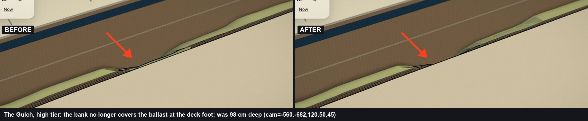
### 2026-11-23 — Measuring City on a $150 phone

The reference phone is a Galaxy A16 (Mali GPU, 411×891 CSS px). Low quality on its default view ran at 12.8 fps against a 30 fps target, and took 20 s to be ready. The first reports said main crashed the tab. That turned out to be the test method: a reused, already-crashed tab with 50 others open. With a fresh Chrome process per run, every build loads. To see where the time goes, City gained an instrument panel (`?perf`, `?perf=run`, docs/perf.md). It also has switches that turn off passes, shadows, pixel ratio or whole categories, so a single build can answer many questions on the phone.

The answers surprised us. With a still camera, post-processing (ink, grade, tilt-shift) and the shadow map barely mattered: turning them off gained 0.2 to 1.6 fps, and a lower pixel ratio gained nothing. A Chrome trace confirmed it is GPU-bound. Swap and queue-submit waits took 3.8 s of every 5 s, while the main thread averaged 19 ms and GC took 151 ms in total. The "hitches" of 120–230 ms were the GPU queue draining, and the p50 of 22.2 ms is exactly two 90 Hz vsyncs. The bill was triangles: the default view draws the whole 12-area board. Hiding one category at a time showed the ground is worth the most (+7 fps), then trees (+4), then landmarks and transport (+3). The cheapest win was inside the trees. Every generic tree carried a bare-branch skeleton of 112 triangles, 0.94M in total. They were drawn under full leaf, inside evergreens, and from 2 km away, where a tree is three pixels across. Tree-species now packs them down to thinning broadleaves (#304, #306), and low drops them beyond 800 m of orbit. On the A16 that took the default view from 12.6 to 18.1 fps (p95 from 222 to 67 ms) and the skyline from 18.4 to 25.7 fps, with no visible change even just past the threshold. Houses by distance (#315) and leaner ground maps (#308) landed alongside, so the default low view now draws 3.33M triangles, down from 4.77M. The ground mesh is next. It needs only a web rebuild. [At the threshold](log/perf/far-trees-threshold.jpg) · [Skyline](log/perf/far-trees-skyline.jpg)

### 2026-11-23 — Shadows that wait for the camera

A still camera hid the next cost. City redrew its shadow map whenever the orbit target moved more than a metre, so dragging the board re-rendered every caster in a ±520 m box on almost every frame. That was 579 of 600 frames in a 10 s pan, each adding 1.8M triangles. On the A16, panning with shadows off ran 6.5 fps faster at the default view and 10.5 fps faster at the skyline. Now, on low, the shadow camera moves on an 80 m grid, at most four times a second, with a little hysteresis so it can't flip at a cell edge. The sun sits over the snapped point, so shadows never slide between redraws. A pan now redraws 38 times instead of 579. Panning the skyline went from 16.0 to 23.4 fps, and the default view from 12.5 to 14.8 fps, level with a still camera. A matched still frame is unchanged. It needs only a web rebuild. [Still camera, before and after](log/perf/shadow-step-static.jpg)

### 2026-11-23 — Gloss for the magnolia, colour for the yards

Sam liked the magnolia's shape but missed its gloss: the way a waxy leaf catches the sky. Three variants test three ways to get it, none adding a triangle. A specular sheen comes from each card's true face normal, so glints scatter card by card and move as the camera does. Baked silver glints sit on a tenth of the sunlit cards. A third variant adds rusty-bronze undersides in the shade. My first sheen had its half vector backwards, so it lit the cards facing away from the sun; the code review caught it. Fixed, all three variants still read at 300 m through ink and grade: the sheen as a pale silvery patch on the sun side, the baked glints as flecks.

The red Japanese maple is Sam's addition from his walk through Ansley Park, where maples are the scarlet accents of every front yard and traffic island. Each tree draws one colourway by its seed: scarlet-crimson for most, Bloodgood burgundy, or orange-red. Twenty in a cluster look like a planted street rather than one tree copied. At 135 triangles it is the cheapest species so far. [Japanese maple sheet](log/ui/tree-species/options-japanese-maple.jpg) · [Magnolia gloss sheet](log/ui/tree-species/options-magnolia-gloss.jpg)

### 2026-11-23 — Auto graphics that notices a slow device

Graphics › Auto used to settle on a tier once, from the screen and pointer type, and never reconsider. Now, when Auto opens City at High, the phone-perf agent's `perf.watchSlow` waits for City to be ready and its areas to go quiet, then samples 10 s of frames. Under 20 fps, City rebuilds at Low at the exact camera (565, −3965, −101°, 55°, 421 m before and after), shows "Switched to lighter graphics" for a few seconds, and the menu reads **Auto (Low)** with High still on offer. The step-down lasts for the session only (sessionStorage), so a better moment can try High again. A manual Graphics choice cancels the watch. Testing it was awkward because a background browser tab draws next to nothing, so the sampler rightly discarded those samples. A dev-only `?slowfps=60` raised the bar instead. It needs only a web rebuild. [Menu after the step-down](log/ui/a2c/auto-low-menu.png)

### 2026-11-23 — A vase and a festival

The American elm and the flowering dogwood are pair 5. The elm is the old street vase: a short trunk forking into erect limbs that arch out like a fountain. The proposal is for City's street mixes to map Atlanta's actual street elms, lacebark elm and zelkova, to it once Sam picks an option; City draws none of it yet.

The dogwood was the harder one. Its identity is a crown of white bracts on bare twigs in early April, the week of the Atlanta Dogwood Festival. On the lab's first pass the leaves were still mostly dropped on that date, so the flower chips sat in an empty crown and barely registered. A dogwood in bloom reads as a white crown, so during bloom the leaf clusters now stay present and turn white, with a little early green between, then go back to leaves as the bracts fall. Its lower branches grow in level layers, drawn as three horizontal tiers of flat masses. [Elm sheet](log/ui/tree-species/options-american-elm.jpg) · [Dogwood sheet](log/ui/tree-species/options-flowering-dogwood.jpg)

### 2026-11-23 — Far ground for wide views

The phone's slow views are the wide ones, and on the A16 hiding the terrain was worth 7 fps there. My first attempt coarsened the low-tier mesh itself. A 20 m merge at the old 0.2 m tolerance saved only 3%, because 3DEP ground is rarely that flat. Looser tolerances saved up to 64% but broke placement other owners rely on, such as ballast seating, deck clearance and roofs above the ground. Phone-perf suggested the better shape: leave the near mesh alone and draw a separate far mesh past 2.5 km. `GroundSurface.farGeometry` is a quadtree of 5–160 m cells, each accepted if every DEM node inside lies within 2 m. It keeps every rim node, so it meets a neighbour's near or far mesh without a crack, and it clips openings like the near mesh. Across the committed boards it is 115k triangles against 1.10M, for 2.9 MB. Drawn triangles fall from 3.76M to 2.76M at the default view and from 3.07M to 2.20M at the skyline, and the two look the same. Placement, the ground audit and every seam keep sampling the near triangles. Web rebuild only. [Default and skyline compare](log/phone/far-ground-far.jpg)

### 2026-11-24 — When emissive means "white"

Sam flagged 1180 Peachtree's crown glowing like a light box in production. Three.js adds emissive light on top of the lit colour, so a near-white emissive at intensity 1.8 is white no matter what the glass looks like, and bloom then spreads it past the silhouette. The architect's own night photograph shows a soft grey-green wash with the steel lattice just a little brighter. A grey-green emissive below 1.0 gets there, and a test now refuses any crown material that could saturate a channel. [Before and after](log/ui/midtown-skyline/napkin-night-aerial-compare-high.jpg)

### 2026-11-23 — Ansley's streets are wide

Sam walked Ansley Park and said the first thing a visitor notices: the streets are unusually wide. City had drawn every one at 7 m, because OpenStreetMap tags them all as plain residential streets with no width. On the satellite view, Peachtree Circle by Winn Park and the two Prados measure 12–13 m curb to curb with parking, and 15th and 17th Streets about 10 m. The side drives really are about 7 m. The widths are a small, inferred table, keyed by street name and limited to Ansley. A test confirms the wider carriageways clear every house wall and mapped tree trunk. It found none in the way, which says how much room these 1900s streets were given. The first attempt missed Peachtree Circle entirely, because it runs just west of the box I had drawn around Ansley for house styles. Requires a web rebuild only. [Before and after](log/ui/ansley-widths/winn-compare.jpg) · [Method](ansley-street-widths.md)

### 2026-11-23 — Gloss is a speck, not a card

Round 1 of the magnolia gloss lit whole leaf cards, and it read as frost: pale blue-grey blotches lifting the crown 30%. The fix came from scale. A card carries a dozen painted leaves, and real gloss is one leaf at a time catching the sun. So the shader now picks single painted leaves by a hash of the leaf's atlas value and a half-metre cell of tree space, then flashes only the picked leaves whose card faces the sun's half vector on the sun side of the crown. At one leaf in six the crown brightens 8% (0.201 to 0.218), not 30%. It costs no draws and no triangles, and night turns it off.

The first try showed nothing at all. A debug pass that painted the pick, side and sun terms as RGB showed that the card normals sit 0.5 to 0.8 from the half vector; the round-1 exponent of 28 had only ever lit the rare card that was nearly a mirror. A broad lobe with a near-binary step made the points visible.

The crown also became a cone: a new `cone` habit option straightens the envelope above its widest point, and the outline clamp and leader follow it. [Sheet](log/ui/tree-species/options-magnolia-gloss-2.jpg).

### 2026-11-23 — The freight line that stopped at the board edge

Sam drew a red line along an empty grass strip past King Memorial: "missing freight tracks." The data had them all along. The NARN arcs for CSX's Atlanta Terminal Subdivision cross the King board, and so do the OSM tracks. The board's context simply baked `rail: []`, and its loader never built surface transport, so downtown's six freight tracks ended in a clean cut at x = 1000.

The fix archives the board's OSM track into a fixture: 11 runs, made up of 2 CSX mains and 7 Hulsey Yard tracks. Those runs meet downtown's six track ends at the edge to the centimetre, and the board draws them with the same ballast and graded cuttings as everywhere else. On the high tier the ground audit finds no ballast under terrain on the board. On the low tier, which has no drape, the worst is 5 cm. The new test is the part I care about most: with the generated data present, every CSX or NS arc inside the board must have drawn track within 12 m. So the next time a board silently drops a railroad, a test will say so, not Sam. Release: web rebuild only; no `pnpm data` change.

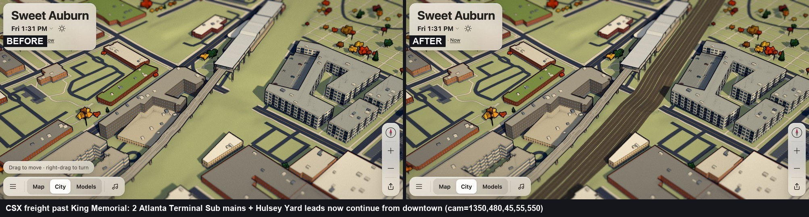

### 2026-11-23 — The loading dock was next door

The Woodruff's "missing" service side was a research gap, not a modelling one. Street View along Arts Center Way found the dock with its sign, "LOADING [DOCK] … use intercom to call dock". It isn't on the Memorial Arts Building at all. It sits in the base of the Piano wing, inside the High's mapped footprint, and serves the whole campus. It also hid twice in City. The podium wall stands on the mapped footprint edge, 3 m in front of the modelled gallery face, so the first dock was drawn behind it. From 15th Street the Memorial shows a different skin from the piazza side: slim ribs about 1.4 m apart over a dark ground loggia. [Panoramas, estimates and gaps](arts-campus.md) · [Before and after](log/ui/culture-review/README.md)

## 2026-11-23 — Classic removal checked for the next release

The retired interface cleanup (#310) is rebased onto `64bc952c`, but stays
unmerged for the release after shipped `bc32b09`. The hidden City button host
stays because the menu and board audit still use it. Cross-model review caught
a subtle leftover: calling `hidePopover()` on that now-plain div throws even
with optional chaining, because the browser still supplies the method. Removing
the call keeps full-board framing free of that exception.

Fresh tests pass: 912 web tests, 5 worker tests and 20 Rust tests (one web test
skipped; pipeline checks skipped without `.venv`). The production build passes.
Performance stays within enforced ceilings: Low 2.324M triangles / 530 calls,
High 13.266M / 1,130 calls; several aspirational targets remain unmet.

Browser checks cover Map, City, Models, full-board framing, and day/night cards.
The 390×640 night card keeps its truth chips and Follow/Share buttons visible.
The day capture has camera `1799.793,-5699.709,-101,55,421`, at
`2026-11-20T14:00:00-05:00`, Low quality; selection reframed the original Five
Points URL toward the train. The night captures use 22:00 on the same date.

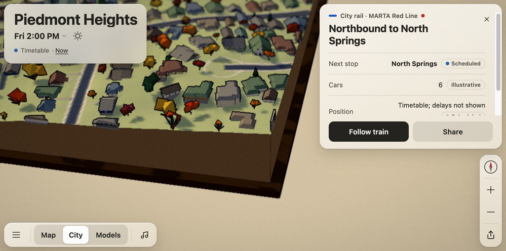
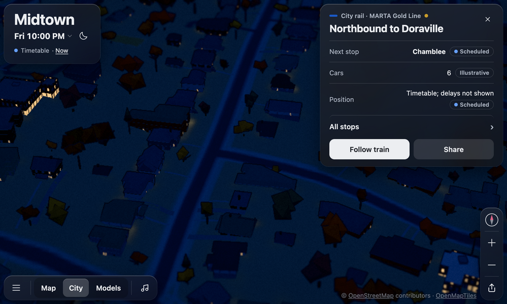
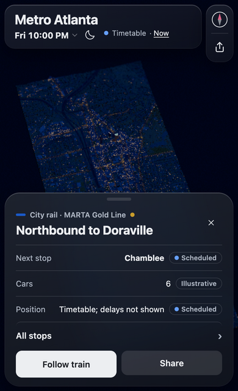
### 2026-11-23 — Dogwood round 2, review draft

The dogwood's floating crown came from two different scales: bloom chips sat more than a cluster radius outside the foliage, and the near leaf tips stayed upright when the crown cards were flattened. The early draft removed those tips, pulled the chips inward, and spent saved geometry on horizontal twigs above a 1.25 m fork; the final pass below removes separate chips entirely. The mature illustrative tree is 6 m tall and 9 m wide. It costs 193 triangles at high detail and 149 at low, including the carpet. Summer eye-level luminance is 0.248. The surprising part was that flattening cluster centres alone never made flat tiers: the crossed cards also needed their vertical extent reduced. [Seasonal review sheet](log/ui/tree-species/options-flowering-dogwood-round-2.jpg). The warm daylight grade and winter twig density remain visual review items.

Sam kept the layered habit and fall colour, but asked for a fuller dome and fewer main limbs. The next pass uses three jointed scaffold limbs above a 45 cm mature trunk, larger overlapping leaf masses, and paired twig forks. It still costs 193 / 149 triangles. White bracts needed daylight-only diffuse fill as well as white paint: their measured saturation fell to 0.018, while the fill switches off at night. The summer crown is 0.236 luminance / 0.842 saturation. The matching camera and Atlanta reference remain on the sheet.

## 2026-11-23 — Four tree species share a City-wide batch

The first City rollout brings Sam's A choices for crape myrtle, loblolly pine,
sweetgum and Japanese maple into the canopy. Ansley keeps its larger specimen
crowns, facing street pairs and planted islands. The roof garden at 1180 Peachtree
now uses the same crape model as the lab. Counting the actual planting loop turned
up eight trees, correcting the handoff's seven.

Batching matters more than the number of board rows: against current main, the low
view adds nine calls and 44,752 triangles; the moving pan adds nine and 46,744.
After bringing in main's far-ground reduction, the default total is 2.379M triangles,
not the earlier 3.397M. Both performance tiers pass. Cross-review also found that
the separate square-board preview removed generic crowns without mounting their
replacements; it now mounts and updates the species batch too.

Phone-perf accepted the bounded winter-limb exception. Sam approved the Ansley
canopy and 1180 garden, and the coordinator authorized merge after the A16 check.
The A16 averaged 22.0 fps at default and 22.7 while panning, versus production's
24.9 and 26.0. The roughly 12% reduction needs attribution: the tested b4993131 did not include
several main changes initially cited in the comparison. The coordinator approved
merge while phone-perf prepares a frozen d1411a9e/b4993131 comparison; release
packaging waits for that result. Full run values are recorded in PR #336.

[1180 before/after](log/ui/tree-species/rollout/1180-day-sheet.jpg) ·
[The Prado before/after](log/ui/tree-species/rollout/prado-day-sheet.jpg) ·
[Winter far-detail comparison](log/ui/tree-species/rollout/winter-sheet.jpg).
The winter species limbs cost 13,974 submitted triangles across three instanced
meshes, with shadows disabled. They preserve the otherwise missing bare silhouettes.

### 2026-11-23 — Arterial cars turn on their incoming green

The illustrative arterial fleet can now turn between permitted directed roads at
mapped signal junctions. Midtown supplies 20 eligible turn courses. A cubic curve
joins the lanes, and each turn keeps the incoming signal phase rather than choosing
one from the curve's tangent. Spring stays southbound and West Peachtree northbound.
The turning courses reuse approach signal heads and the original route endpoints.

Cross-review caught a useful mistake: slowing an entire turn course to 6 m/s made
through cars catch it well before the junction, where overlap suppression hid one
of them. Turns now keep their approach speed and exclude exits differing by more
than 0.1 m/s. They take an illustrative 15% of incoming flow, divided among available
turns, rather than scaling demand by the parent route's length. Separate queues can
still overlap; the existing footprint guard hides conflicting cars. Protected left
phases and shared queues remain future work.

The frozen Spring/10th comparison uses `cam=222,-3075,0,45,110`, high tier,
`t=2026-11-20T19:02:49.250Z&speed=0&dev&mindist=20`. The downtown check is Washington
at Trinity: `cam=122,670,0,45,110`, high tier, `t=2026-11-20T19:01:51Z&speed=0`.
Screenshots are in [arterial-turns](log/ui/arterial-turns/). A clock-seek regression
also removed an hourly-demand cache that retained the first visited time within a
minute. This needs a web rebuild only, with no new data or server work.

The second review also found a signal-location edge case: at 17th Street the turn
stop was 11.95 m beyond the through stop. Turns now stop no later than their through
course, and one ambiguous twin-controller junction is excluded. All 20 remaining
Midtown courses have a shared controller, ordered stops and no second stop within
30 m. [Spring/10th before and after](log/ui/arterial-turns/compare-spring-10th.jpg).
### 2026-11-23 — Arts Center entrance slab clears the plaza

The east wing floor now gives terrain a yield boundary at entry + 0.03 m,
5 cm below its 0.08 m slab top. The earlier audit found 491 intruding samples,
up to 25 cm above the floor; this uses the shared carve mechanism without
raising the station. A separate surprise during verification: the Ansley tree
rollout failure was stale generated Midtown data. Restaging the Midtown rows
made all 10 rollout tests pass.

Matched daylight camera: `445,-3930,250,50,150`, at `2026-11-20T14:00:00-05:00`.
Web rebuild only; no pipeline change.

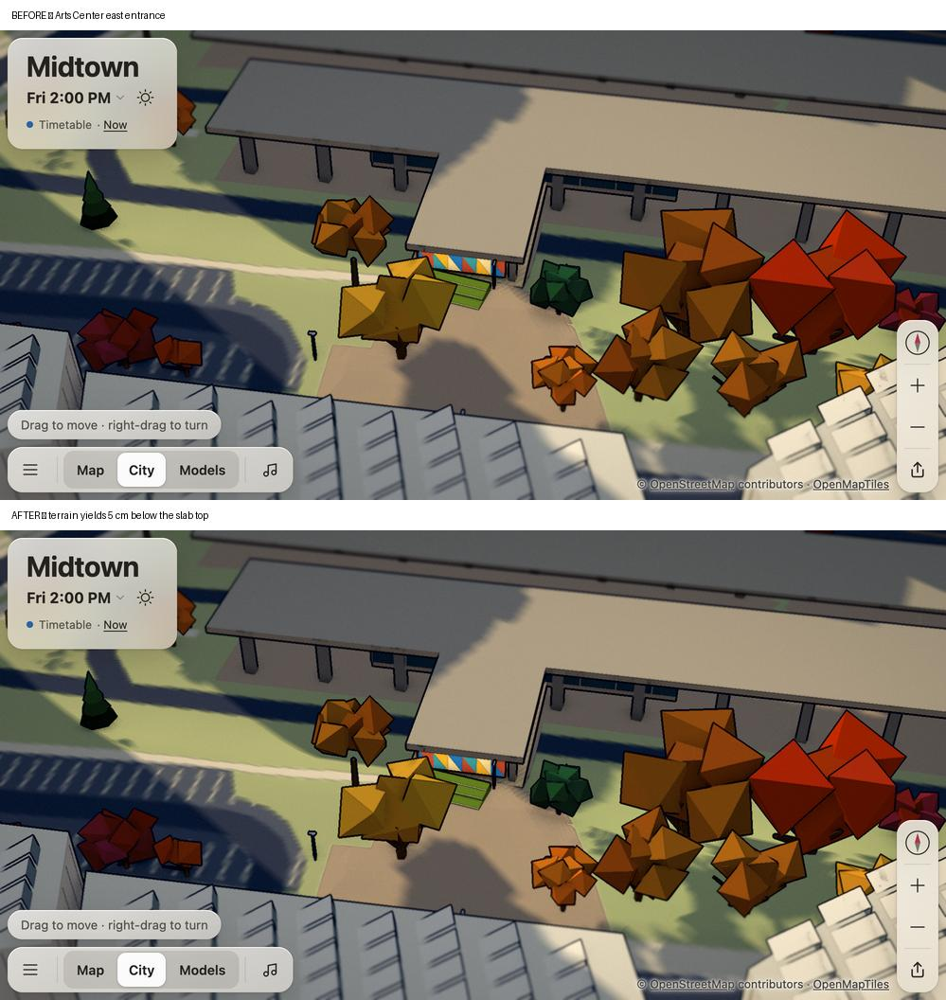

Edge verification at the same camera with lens zoom 2.5: [day](log/2026-11-23-arts-center-edge-day.png)
and [night](log/2026-11-23-arts-center-edge-night.png). The targeted audit at 0.25 m
spacing finds zero penetrations among 11,342 samples on the two slab-top triangles.
Station-wide hits include other paving and must not be mistaken for this slab.
### 2026-11-23 — A GE freight engine, properly

The old freight locomotive was a long box with a yellow nose and an EMD-like cab, which no GE has. The detail pass rebuilds it as the AC4400CW family from published dimensions (22.3 m, 16.15 m truck centres) and dated photos of CSX 69, 7216 and 7232. It now has the CM44AC's raked cab front, roof number boards, stacked headlights and corner ditch lights, a louvred cabinet behind the cab, and the radiator wings overhanging the walkways. The surprise was colour again. The grade turned CSX's blue-grey into navy and the trucks into pure black. Sampling the photos (hood near #415155, running gear a weathered brown-grey) and feeding lighter inputs fixed both. The same body in an NS-like black with white nose stripes now leads the Brookwood passage, and the card names the scheme, still illustrative. 2,608 triangles per locomotive; draws unchanged. Web rebuild only. [Front three-quarter](log/freight/cm44ac-front34.jpg) · [Night](log/freight/cm44ac-night.jpg) · [Notes](freight-stock.md)

### 2026-11-23 — Freight takeover verification

The freight locomotive branch now passes the full test command with Python checks enabled: 20 Rust, 11 Python, 918 web and 5 worker tests. The missing routes contract fixture was an incomplete local data copy. Both City performance ceilings pass (533 low-tier draw calls, 1,136 high). A fresh Claude cross-review found no in-scope issues. The inherited Brookwood camera hid the engines behind the station; moving the frozen clock back 20 seconds exposed them. [Day and night captures with cameras](freight-stock.md#codex-takeover-verification--2026-11-23). Coordinator approval remains pending because the Air pairing token is rejected.

### 2026-11-23 — 1180 crown colour trials

Compared three pale-green emission colours at 92%, 97%, and 100% veil opacity, holding emission strength at 0.82. Six captures use the same Midtown aerial at 23:30 across both quality tiers. The paler panels brighten, but a mottled appearance remains even at full opacity: opacity alone does not recreate the smooth wash in the Kendall/Heaton night photograph. These are review trials, not a selected production change. [Comparison sheet](log/ui/midtown-skyline/napkin-night-colour-trials.jpg).

### 2026-11-23 — The veil needed depth

A controlled render changed only depthWrite to true while retaining the old colour and 88% opacity: the large mottled patches disappeared. The ink pass had been reading depth from objects behind the veil. The new night study writes veil depth, reaches 100% opacity at full night, and applies one procedural emissive wash rising from 72% at the base to 100% at the crest. No texture or geometry was added. Three silver-white colours at 0.82 strength are shown on both tiers in the [smooth-wash sheet](log/ui/midtown-skyline/napkin-night-smooth-steps.jpg); B (#d5dfdc) is provisional pending Sam's choice. The [matched daytime camera](log/ui/midtown-skyline/napkin-smooth-day-high.png) remains at 88% opacity.

Full tests, the 15 skyline tests including the new depth/opacity guard, and performance budgets pass. Cross-review confirmed the depth explanation and flagged daytime near/far veil sorting and oblique edge-light occlusion as plausible risks to check before merge. The earlier colour-only sheet is superseded. This needs a web rebuild on eventual release; nothing is deployed.

### 2026-11-23 — Sam chose the silver-white B wash

Sam selected B: #d5dfdc at 0.82 emission, with the 0.72–1 crest gradient and full-night opacity of 1. Its peak linear emission is about 0.605, so the veil-specific regression ceiling is now 0.61 (the lattice keeps 0.7). Transparent sorting exposed another concrete issue: both veils had the same object origin. Their geometry now has separate x/z origins without changing its world position or height gradient. The edge light draws after the glass but still respects depth. No new geometry, texture, or server work is involved. Release needs only a web rebuild, by the coordinator.

Final captures checked north/south daylight (`713,-3672,0,50,1150` and `713,-3672,180,50,1150`), the oblique night edge (`1268,-3672,90,72,950`), and matched aerial day/night on both tiers (`800,-3710,70,50,1021`). Both veil faces remain present; the light line is visible from the oblique night view. Orca's review tab stopped advancing animation frames, so final evidence uses the repository's headless Chrome/CDP capture setup. Full tests pass (931 web tests, one skipped), and performance ceilings pass on both tiers; high-tier ready time was 4.6 s against a nonblocking 3 s target. [Matched pair, high](log/ui/midtown-skyline/napkin-b-daynight-high.jpg) · [Matched pair, low](log/ui/midtown-skyline/napkin-b-daynight-low.jpg) · [Alternate angles](log/ui/midtown-skyline/napkin-b-angle-checks.jpg).

Final Claude review requested the oblique camera in daylight on both tiers. The [additional captures](log/ui/midtown-skyline/napkin-b-oblique-day.jpg) show both curved faces and end lattices without a missing section at that camera. The visual risk is dismissed for the requested view; no universal claim about arbitrary transparent overlaps is implied. Two review rounds completed; stale documentation and shared-origin/light ordering were addressed, and no blocking findings remain.

### 2026-11-23 — The tree cost was a second drawing of the leaves

The A16 probes recovered about5fps by disabling the species foliage mask, much more
than switching off crown shadows. The mask drew the alpha-tested cards again and
activated extra full-screen ink samples. Removing it everywhere made the nearby
crape crowns visibly darker inside, so low quality now keeps the mask in close views
and unregisters it beyond600m, restoring it below500m. High quality stays unchanged.

The distance is to the orbit target, not each tree. The whole-board phone view was
21,084m away, a surprise after discussion had assumed roughly400m. All962 registered
species instances lose their extra mask draw in that view; the approved420m Prado
and350m terrace views keep it. Tests cover far/near transitions, new areas mounting
while far, and removing/reopening rows without stale mask state. The final frozen
phone default/pan comparison still gates release.

[Why the near mask stays](log/ui/tree-species/mask-clawback/1180-day-sheet.jpg) ·
[Measurement and validation notes](tree-mask-clawback.md).
## 2026-11-23 — Freight joins Follow (initial checks)

The downtown seven-car and Norcross ten-car illustrative consists now carry separate stable ids through picking and the existing Follow control. Their positions update before the camera lookup. Follow uses cars surviving their material clip planes and ends when none remain; it makes no tunnel claim. Both cards retain Illustrative labels.

The easy-to-miss detail was update order: freight previously moved after the camera had already resolved its target. Initial browser checks picked and followed both consists. [Downtown capture](log/ui/follow/freight-downtown.jpg): 2026-11-20 14:12:35 ET, starting camera `900,545,0,35,300`; [Norcross capture](log/ui/follow/freight-norcross.jpg): 14:20:50 ET, starting camera `-790,-4385,0,35,300`. Follow then applies its standard bearing -148°, tilt 26°, distance 300 m.

Validation: 20 Rust, 11 pipeline, 914 web tests (one skipped), five worker tests; production build and both performance tiers passed. Cross-model review found no blocking code issue. Initial captures are retained below; final replay checks and the review sheet are recorded in the completion entry. Web rebuild required; no data rebuild.

## 2026-11-23 — Freight Follow replay checks complete

Both illustrative consists passed day and full-night browser replays. The camera moved with the drawn cars through the downtown sections, then stopped when no cars remained drawn. Norcross followed to the mounted board edge and reported “train left the board” in both runs. Downtown ends with “freight no longer drawn”; it does not invent an underground location or a timetable trip. The selected card and active Follow position remain Illustrative.

[Before Follow / after Follow / exit review sheet](log/ui/follow/freight-review.jpg). These compare interaction states, not two software versions. The browser advanced the pinned clock in 2-second steps, with camera and status samples saved in the four `*-check.json` files alongside the sheet. Cameras at the start of Follow:

| Consist | Pinned time | Camera |
| --- | --- | --- |
| Downtown day | 2026-11-20T14:12:35-05:00 | `921,549,-148,26,300` |
| Downtown night | 2026-11-20T22:12:35-05:00 | `-505,-900,-148,26,300` |
| Norcross day | 2026-11-20T14:21:25-05:00 | `-654,-4519,-148,26,300` |
| Norcross night | 2026-11-20T22:21:25-05:00 | `-654,-4519,-148,26,300` |

Rebased validation: 20 Rust, 11 pipeline, 931 web tests (one skipped), five worker tests; build and type check passed. Perf Low: 2,382,511 triangles / 540 calls; High: 13,783,617 / 1,169, both below ceilings. Claude's second review found no code defect; its remaining visual finding is dismissed by these replays and screenshots. No live-feed night check is claimed: freight has no live feed. Web rebuild only; no data rebuild or worker change.

### 2026-11-23 — Ansley gets more than a colour change

Ansley's house mix now includes two-storey Foursquares with broad white-railed porches, alongside newer limestone and white-brick houses with dark slate roofs and black window frames. The forms follow Sam's neighbourhood observations without copying addresses. The surprising cost was small: across nine boards, the extra house detail is 7,580 triangles on high and 1,037 on low. Balusters and dormers belong to high; low keeps the porch rails. Cross-review caught a 12 × 8 m Foursquare whose dormer could poke through its shallow ridge. Keeping the established 2.7 m minimum rise fixed it, and a geometry test fails when that guard is removed. Painted shingles also needed a geographic guard so adding Ansley colours did not recolour Home Park. Requires a web rebuild, with deployment left to the coordinator. [Day comparison](log/ui/ansley-houses/sam-high-day-compare.jpg) · [Night comparison](log/ui/ansley-houses/sam-high-night-compare.jpg) · [Cameras and measurements](log/ui/ansley-houses/README.md)
### 2026-11-23 — Rhodes Hall's open porch

Rhodes Hall replaces one generic Brookwood South footprint with a granite tower,
rounded bay, steep roof and three open porch arches. The tower reaches an estimated
22.65 m, and a 3.5 m stair uses the shared terrain carve. The night reference was the
surprise: most windows are dark while floodlights pick out the rough tower and porch.
A stone-only shader wash reproduces that distinction without point lights or texture
bytes. Low tier stays within its ceilings at 2.38 million triangles, 543 calls and
432 MB post-GC heap. [Daylight](log/ui/rhodes-hall/high-day.png) ·
[Full night](log/ui/rhodes-hall/high-night.png) · [Sources and estimates](rhodes-hall.md).
### 2026-11-23 — A timetable test outlives its timetable

A fresh Amtrak download broke both Brookwood corridor tests without changing a single path vertex. The new feed began its service calendars on November 22; the tests asked for November 20. Zero trains was the correct answer. A 15 KB recorded fixture now keeps the historical geometry, calendar and timetable together, so the edge-to-edge and freight-yield regressions also run without generated data. The same two checks pass on November 23 with the fresh feed. Regenerating production data will remove the old November 20 Crescent from demo links; it does not require a berth or consist fix. [Investigation and fixture provenance](brookwood-gtfs-regression.md).

### 2026-11-23 — Magnolia A3 selected

Sam picked the dense leaf specks on the dark cone, with a tidier lower edge and whiter gloss. Pulling only the leaf masses upward did not stop their cards and near tips from hanging downward, so both now share a lower-edge shaping step. The subtlety budget mattered most at low detail: fewer, larger cards pushed the first pass to +15% luminance. Reducing low-detail speck density brought A3 to +6.2% over A (0.222 versus 0.209); high detail is +7.9% (0.219 versus 0.203). Geometry remains 193 / 113 triangles. [Matched comparison sheet](log/ui/tree-species/options-magnolia-a3-pick.jpg).

### 2026-11-23 — A car stays behind the streetcar

The previous overlap guard made cars disappear when they met the S70. Three
same-direction downtown arterial courses now replay their illustrative cars against
the streetcar timetable. Cars wait behind its rear with a 2 m bumper gap, then
follow when it moves. Each delayed car checks the traffic light again; it cannot
borrow a green it missed while waiting. Adjacent lanes, crossing roads and bridges
keep the occupancy guard. The streetcar's timetable motion is unchanged.

The awkward part was time. A snapshot clamp can move a car backwards when a tram
enters its lane, and an ordinary frame simulation cannot reproduce a clock seek.
The queue uses half-second checkpoints and interpolates between them. A regression
caught a 3 m backwards jump between fractional frames before that interpolation.
Cross-review caught another trap: caching every frame's fractional timestamp
would evict the replay history after about 40 s. Only grid samples are cached now,
and the cache retains a complete course period, bounded at 7,200 samples. In a
10,800-frame browser probe, updates took 0.3 ms at the median and 0.6 ms at the 99th
percentile. The largest warm frame was 4.3 ms; the initial time jump took 45 ms.

The Edgewood frame uses `cam=588,-65,0,50,100`, high tier,
`t=2026-11-20T17:08:23Z&speed=0&dev&mindist=20`. It shows the car held behind the
streetcar instead of absent. [Queue model and limits](streetcar-traffic-queues.md).
Web rebuild only; no `pnpm data`, new requests or worker change.

[Edgewood BEFORE | AFTER](log/ui/streetcar-queues/edgewood-compare.jpg) ·
[Low-tier night](log/ui/streetcar-queues/edgewood-low-night.jpg).

### 2026-11-23 — Dogwood A approved, wood tucked inside bloom

Sam approved the fuller layered dome and white bloom, with two last changes: no dark sticks above the bracts and finer winter branches. Shorter upper scaffolds now stay inside the crown. Three tapered twigs replace each blunt fork; a pointed three-sided twig costs three triangles, fewer than a two-sided strip with a blunt end. That geometry saving, plus dropping separate bloom chips in favour of the existing white crown wash, keeps the finished model at 195 high / 146 low triangles. [Bloom and winter before/after](log/ui/tree-species/options-dogwood-final-tidy.jpg).

### 2026-11-23 — A buried slab is not a blocked pavement

The ground audit's 83 cm hit at 14th Street and 28 cm hit at the central Midtown footbridge were their buried undersides. Both tops already cleared the ground by 12 cm. Local winding can turn an underside upward, so winding alone cannot identify a walking surface. Transport now marks its slab-bottom triangle offsets for the development audit; production builds allocate no metadata and the geometry stays unchanged. Both-tier browser audits remove those two false alarms while retaining the real 8.8 cm intrusion at the south footbridge (370, −1870). A generated-deck regression reverses underside winding and also checks that 8 cm of ground above the exposed top still fails. The full suite passed 20 Rust, 950 web and 5 worker tests; Python checks skipped without `.venv`. [14th Street top](log/ground-audit/14th-street-top.jpg), daylight camera `125,-3641,30,55,45` with `dev&mindist=20`. The south footbridge remains a separate geometry issue; no surveyed deck height changed.

### 2026-11-23 — Winn Park under the canopy

The western ravine now reads as leaf litter and low planting instead of uninterrupted lawn. A narrow earth walk meets a stone terrace, a bench, a channel edge and a small pond. Ground paint carries the idea on both tiers; high adds just 1,263 triangles, while low adds none. The pond and terrace cut the terrain instead of floating above it. Ground-contact checked 4,149 exposed-face samples and 4,036 water samples without a penetration. The surprise was above the ground: the tree rollout's flat leaf carpets crossed the water like orange lids. Winn already paints its litter, so we agreed with the tree owners to omit only the overlapping discs and leave every tree intact. Requires a web rebuild. [Day comparison](log/ui/winn-park/ravine-high-day-compare.jpg) · [Night comparison](log/ui/winn-park/ravine-high-night-compare.jpg) · [References and checks](winn-park.md)

### 2026-11-23 — SCAD's stepped academic block

SCAD Atlanta's 1600 Peachtree building now follows 17 mapped building parts, from the
northern parking decks to the 23.1 m inferred academic roof. Deep charcoal piers and
recessed windows follow the newer exterior photos; an older night photograph supplies
only the warm lobby lighting, because the building was still pale then. The first render
caught clockwise source rings hiding the facade details inside the walls. Normalizing
the rings fixed that without moving their geometry. The low tier stays within budget at
546 draws and 433 MB post-GC heap. [Day](log/ui/scad-atlanta/high-day.png) ·
[Night](log/ui/scad-atlanta/high-night.png) · [Sources](scad-atlanta.md).

### 2026-11-23 — White oak joins the Model lab

White oak's four illustrative size classes run from a 4.7 × 2.4 m sapling to a 30 × 35.7 m specimen based on the Atlanta champion measurements. Two options compare rounded-lobed leaf cards against faceted clusters, with pale spreading limbs, April leaf-out, wine/russet autumn colour and a small brown early-winter residue. A costs 193 / 81 triangles; C costs 191 / 111. A's summer luminance is 0.255 high and 0.258 low against the generic 0.248. The cored trial was dropped after measuring too bright. A texture-accounting surprise: the existing atlas budget counted pixels, not RGBA bytes. Activating the eighth leaf shape adds one 1.33 MiB atlas; the declared total now correctly includes four bytes per pixel and mipmaps. [Options, references and calendar](log/ui/tree-species/options-white-oak.jpg). Sam selected A because its lobed leaves match the other trees; A is now the lab default. Winter residue remains crown-wide, a documented limit of the shared renderer. City rollout remains separate.

### 2026-11-23 — Freight gets three silhouettes

The lab now has the Evolution-series GE road engine in NS-like and CSX-like paint, an NS-like SD70ACe, and a shorter CSX-like GP38-2. The SD has brow headlights, a broad clipped-corner nose and three radiator fans; the GP has a narrow short hood, four axles and two rear fans. The surprise was a published GP38-2 truck-spacing disagreement: a secondary sheet said 43 ft, while GATX says 34 ft between bolster centres. The model uses GATX. All four are merged vertex-coloured geometry, at 2,708–3,836 triangles each. The new NS inputs needed lifting through the grade so black panels still read; the approved CM44ACs stay unchanged. Lab-only selection for now; City consists are the next freight integration step after the car library. Web rebuild only. [Matched daylight](log/freight/variety/day.jpg) · [Night](log/freight/variety/night.jpg) · [Photo comparison](log/freight/variety/references.jpg) · [Sources and estimates](freight-variety.md).

Cross-review found an unexpected coupling: City's terrain-opening cutoff used the shortest truck spacing in the whole library, so a lab-only switcher lowered it. Computing the cutoff from the actual City consist keeps the 12 m threshold. An 11 m test sliver catches the regression with that one-line fix reverted.

### 2026-11-23 — Navy paint and distinct cooling silhouettes

Sam found the CSX studies too pale. The ES44AH now wears navy with its yellow nose and frame stripe, while the GP38-2 pairs a stronger blue cab with the grey YN2 hood. The GE radiator was still a box despite its underside detail: replacing its outer faces with angled wings makes the shape read from the matched lab camera. The SD instead has a flat-sided radiator and taller, squarer nose. The revised models use 2,684–3,828 triangles. [Day lineup](log/freight/variety/day.jpg) · [Reference comparison](log/freight/variety/references.jpg). Web rebuild only.

### 2026-11-23 — One CSX family in the freight lab

The GP38-2 now shares the ES44AH navy instead of its earlier grey YN2 hood. Mark Levisay’s November 10, 2014 photo of GP38-2 2513 supplies the YN3 colour reference: navy cab and hood, yellow nose and frame stripe. Same geometry, 3,036 triangles; matched day/night sheets were reshot. [Reference comparison](log/freight/variety/references.jpg). Web rebuild only.

### 2026-11-23 — Where a front walk meets the Ansley steps

A level tread can meet the middle of a walk and still miss its corners by 15.6 cm on a cross-slope. We seated both corners and cut the terrain beneath the approach. A neighbouring walk crossed the proposed stairs on one lot, so the shared-frontage check leaves that yard open. The high board now has 33 terraced yards, with 66 matching corners and 4.04 cm minimum sampled walk clearance. Low adds no terraces. [Day and night comparisons](log/ui/ansley-terraces/README.md).

### 2026-11-23 — A final vertex is not another road segment

At 21:00, a streetcar nose could project onto the exact end of a traffic course.
The path returned its final vertex index, but the road-owner array has one entry
per segment: the lookup ran one past its end and stopped City's render loop.
Clamp to the final carrying segment, and return no surface for an absent owner.
The exact 60 m endpoint regression and an arterial update sweep every five minutes
through 24 hours both reproduce the old `undefined.bridge` exception with the fix
removed. Clock seeks are covered too. The repaired 21:00 low-tier view renders
118 calls; this was a path-boundary bug, not missing terrain or nighttime lighting.

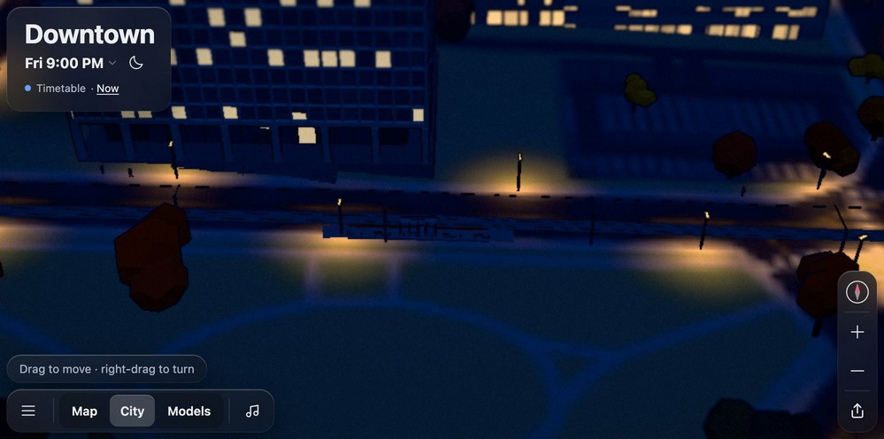
Camera: `cam=588,-65,0,50,180&t=2026-11-20T21:00:00-05:00&speed=0&q=low`.

### 2026-11-23 — Redbud starts with the leaves

After Sam picked white oak A, the next tree is eastern redbud: one explicit Winn Park Street View observation, 4.6% of the recorded Trees Atlanta plantings and 6.1% in street strips and wells. The first lab pass adds heart-shaped A-style cards, four illustrative sizes, a low vase and yellow fall colour. It costs 185 high-tier triangles, with one new 1.33 MiB atlas. The reference revealed the hard part immediately: flowers trace bare wood, while our existing bloom wash makes large pink leaves. That was conspicuous on the first-pass comparison. Web rebuild needed when eventually released; no data or deployment change.

### 2026-11-23 — Redbud blooms along bare wood

The early rendering painted big pink hearts across the crown. Now one tapered card follows each branch or twig, carrying a trail of magenta clusters in a spare part of the leaf atlas. The surprise was how much the extra lateral twigs mattered: even small flowers read as a crown once the bare wood spreads outward. Leaves start after the March bloom. The mature tree costs 193 / 91 triangles at high / low detail, including leaf litter, with summer luminance at 0.236 / 0.259 against the generic tree’s 0.248. Lab study awaiting review. Web rebuild only.

### 2026-11-23 — Redbud gets a wider fork and a denser bloom

At Sam’s review the March tree still read as bare from a distance. Four spreading boughs at high detail and three at low now carry paired cards with the same branch pattern in spring and winter. At eye level the crown mask covers about 64,200 pixels in March, up from about 3,100. At 300 m the big surprise is how little is left on screen: 156 masked pixels at high detail and 94 at low, with pink visible in each. April’s first leaves are reddish-purple and turn green before summer. The tree costs 193 / 138 triangles, with the same heart-shaped summer cards, yellow fall and four sizes. [Eye level, photo reference, 100 m, 300 m and seasons](log/ui/tree-species/options-eastern-redbud.jpg). Web rebuild only.
### 2026-11-23 — A quieter Rhodes Hall tower

Sam wanted the floodlit tower a little less bright. Its stone wash is now 25% lower,
while the porch lighting and dark windows stay as they were. It is a one-coefficient
calibration, with no geometry or texture cost. Matched 21:00 frames use the same
`301,-4675,340,60,160` camera at both tiers.
[High before/after](log/ui/rhodes-tower-dim/compare-high-night.jpg) ·
[Low before/after](log/ui/rhodes-tower-dim/compare-low-night.jpg).

### 2026-11-23 — Two purple buses for the A-Line

The purple bus photographed at the Phase One launch has two axles and a CNG roof pod. The 60-foot electric bought for the line has three axles and a folding joint. The Model Lab now puts the two silhouettes side by side in the vehicle list. Turning the electric trailer through 35° keeps both ends of the silver bellows attached. Its low-detail model uses 1,190 triangles across three meshes. [See the photographs and matched day/night studies](marta-rapid-buses.md#review-views).

### 2026-11-23 — The Midtown South footbridge

A green patch on a 10.25 m footbridge came from the terrain between deck stations. At the original hit, the bank stood 8.8 cm above the pavement. Cutting the terrain inside each tread quad gives the bridge back its continuous walking surface. [Daylight view](log/ground-audit/south-footbridge.jpg), City camera `370,-1870,30,55,45`.

### 2026-11-23 — Use the terrain itself as the roof over North Avenue

From above, the active rail cover used to have a notch on each side of the
railway. The separate roof and the bank were trying to describe the same piece
of ground. We restored the upper formation to the terrain grid and cut out just
the intervals where the lidar sees daylight. The tracks follow that surface
across North Avenue. Marietta's pavement continues across on its own ground triangles. The three
western strips initially read as grass. A muted gravel bed, weeds and a pair
of rusty edge rails on each strip now distinguish the disused crossing from
the active railway. [Close view of the three old bridges](log/north-ave/disused-bridges.jpg),
`cam=-862,-1830,220,50,120`.

Below them, two carriageways, sidewalks and a median run through the whole
213 m cut. Marietta's 4.69 m clearance comes from its bridge inventory. The
4.5 m railway clearance and the night lighting are inferred. On low, the
structure and changed board mesh add 3,478 triangles and one draw with the
existing ground texture. The two height queries at Marietta put a driver on
the appropriate street even where both streets share the same map coordinates.

| Camera | Day | Night |
| --- | --- | --- |
| Overview, `cam=-783,-1860,235,55,350` | [14:00](log/north-ave/shared-overview-day.jpg) | [23:00](log/north-ave/shared-overview-night.jpg) |
| Under Marietta, eye `-762.5,-25.5,-1881.5`, target `-797,-25,-1860`, zoom 0.75, near 0.05 | [14:00](log/north-ave/shared-bore-day.jpg) | [23:00](log/north-ave/shared-bore-night.jpg) |

Both views use 20 November 2026, Eastern time, at low quality. [Same cameras at high quality](log/north-ave/shared-high.jpg).

On the warehouse bank two mapped sidewalks kept going across the surface above
their own tunnel. Following their direction through the cut placed that paint
on the lower level. At the nearby fixed-grade building, all 472 perimeter
samples matched the original ground at both tiers. The production board passed
`pnpm test:perf` at both qualities. [Bank close-ups at low and high](log/north-ave/shared-banks.jpg).

### 2026-11-23 — The paths across The Prado

At The Prado circle the mapped pedestrian ways run across several road legs and the verge in between. The ground painter now follows those ways but clips the white bars to the carriageways. Across two Ansley boards, 33 crossing ways join 83 mapped sidewalk ways. The phone gets the warm paver colour, while the high board carries hex joints and four small yield signs in its existing landscape mesh. [Circle, fork and crossing comparisons](log/ui/ansley-street-edge/README.md).

### 2026-11-23 — Rhodes Hall at 21:00

At a 160 m orbit, the earlier 25% reduction still made the tower read as one lit
block. Two studies put the brightest stone at the 0.5 m base and fade the wash
to zero at 20 m. The porch beam and rounded bay overlap the tower's old lighting
region in plan, so the falloff follows the tower's own masonry vertices.
[Compare both strengths at both quality tiers](log/ui/rhodes-uplight/choice.jpg).

### 2026-11-23 — Rapid bus glazing at night

At the same lab camera, the lit windshield had made the XN40 cab as bright as the passenger compartment. The revised Rapid studies keep the windshield dark and show the amber destination sign above it. Both buses now use the XN40 purple and cooler passenger lighting, with the emission multiplier reduced from 0.6 to 0.4. On the XE60, individual panes sit inside a dark frame. [Compare the matched day and night views](marta-rapid-buses.md#review-views).

### 2026-11-23 — XE60 roof fairings

The photograph of 9001 shows a rounded purple roofline above the windshield. The lab’s exposed grey blocks broke that silhouette. Each section now carries a shallow fairing in the XN40 Rapid purple. The front and rear covers stop 10 cm and 18 cm short of the bellows, respectively, leaving the joint clear at ±35°. The crown height and end tapers are estimates from the street-level photograph. At low detail the covers add 160 triangles, bringing the bus to 1,350 of its 1,500-triangle budget. [Matched straight and bent views with the reference](marta-rapid-buses.md#review-views).

### 2026-11-23 — Callery pear starts with a white March bloom

The first Model Lab study follows the oval Bradford form. Four sizes share an upright grey skeleton, white flowers on fine twig cards, glossy green A cards and late burgundy fall foliage. The first test with detached flower chips left white flecks hanging above bare wood. Reusing the paired redbud twig cards put every cluster back on a branch, using space in the existing oval atlas. At 193 / 138 triangles the mature tree still fits both budgets. [Seasonal and distance sheet](log/ui/tree-species/options-callery-pear.jpg). Lab study only. Web rebuild required for release.

### 2026-11-23 — Callery pear fills out below the fork

The first pear looked like white twigs above a long pole. The larger trees now fork at about 2 m, and a broad teardrop holds both the summer leaf cards and the March flower mass. Separate petal cards made the biggest difference at distance. The 300 m high-detail crown mask grew from 181 to 1,638 pixels, and the white mass reads on the ordinary Lab backdrop. A small late cluster can remain at leaf-out after the large flower cards have fallen. The mature tree costs 195 / 141 triangles, and July Front luminance is 0.242 / 0.250 against the generic canopy’s 0.248. [Side-by-side sheet with distance, winter and summer](log/ui/tree-species/options-callery-pear.jpg).

### 2026-11-23 — Callery pear bloom gets texture and shade

The full white silhouette worked at 300 m, but close up the bloom looked like sheets of cotton. Twenty small crown cards at high detail and thirteen at low now carry clusters of opaque petals, with small openings for the wood. The surprise was how much light contributed to the fluffy look. Restoring the atlas greys and the darker underside brought out detail without sacrificing the distant bloom. Spring and July use the same crown centers, with the lowest foliage around the 2 m fork in the mature tree. The cost is 195 / 135 triangles. [Matched eye-level and distance sheet](log/ui/tree-species/options-callery-pear.jpg).
### 2026-11-23 — A common roof profile for the Rapid buses

The first rounded XE60 covers still looked flatter than the XN40 pod at the same camera. Both models now use the XN40’s 36 cm crown, curved ends and shoulder bevel. A short strip of exposed roof ahead of the XE60 cover makes the front curve visible. The electric bus keeps its 3.30 m roof height and carries one shroud on each side of the joint. Sampling the same curves at low detail brings the XE60 to 1,286 triangles. [XE60 and XN40 at the same scale, day and night](log/rapid-buses/roof-profiles.jpg).

### 2026-11-23 — Three footprints at Tech Square

Coda's 118.9 m tower shares its block with a five-floor computing center and
the retained Crum & Forster building. The archive supplies three separate
footprints. Putting a solid base under the tower would close the 19.2 m arcade,
so the west podium stops short and the soffit spans the opening. A ray from
pedestrian height crosses the passage and a second ray hits the soffit overhead.
[High daylight comparison](log/ui/coda/high-day.jpg) · [High night comparison](log/ui/coda/high-night.jpg).

At the 840 m review camera, the first glass treatment hid the floor grid. The
revision gives the two wings separate upper setbacks and silver mullions around
blue-grey panes. Down at the plaza, a 25.2 m glazed gallery reaches the retained
building and eight suspended globes trace the approach to the lobby.
[Day revision](log/ui/coda/revision-day.jpg) · [Night revision](log/ui/coda/revision-night.jpg).

### 2026-11-24 — The interface, settled after about 110 boards

The first frosted-glass interface put everything in two corners: an app bar at bottom
left with a Map · City · Models switch, and a tall camera column at bottom right. Over one
long design session on a private canvas it went through eight layouts: a title bar, a
dock, a quiet mode that hid the controls, a camera dial, and a version where the Model lab
opened as an overlay. About 110 boards in all.

What stuck was giving each part of the screen one job in every view. The top left is what
you are looking at: the place and time, or the model. The top right is the camera:
compass, zoom, and a 3D button that turns the flat map into the city. The right edge holds
the detail for whatever you selected. A single dock at the bottom centre is the app: menu,
Map | Models, search, radio and share. Tilting had been in the dock for a round and felt
wrong; it moved to the camera group. A back button for the Model lab felt wrong too, and
the fix was to make Models its own page beside Map, so there is nothing to go back from.

An automated critique scored the layout 26 out of 40. Its most useful finding was about
honesty rather than looks. The night boards said "Live" on a clock shifted to 9:30 PM,
and one green dot was vouching for the time, the weather and the trains at once. The
card now names what each tier covers ("Live trains · weather reported"), a shifted clock
reads "Timetable · illustrative sky" with a grey dot (blue already means city rail), and
the train panel splits its live arrival time from its inferred position. The critique
also caught that half the audience had no designs: eight phone boards were missing.

The last fix was framing in the Model lab. Its views were fixed camera positions, so on a
portrait phone the three-quarter view kept the height and lost the width, cutting off the
cab. Views now fit a focus region (the cab end of the leading car on a portrait screen) to
whatever space the panels leave clear.
[City on first visit](log/ui/final-layout/F01-city.jpg) ·
[Models on a wide screen](log/ui/final-layout/F09-models.jpg) ·
[A selected train on a phone](log/ui/final-layout/G02-card.jpg) ·
[Model lab framing before and after](ui-a2c/final/framing-phone-before-after.jpg).

### 2026-11-24 — The dock stays put when the map tilts

Map and City now share one tab. The 3D button and tilt control use the existing white-model arrival. On a 390 × 760 phone, moving Share to the dock leaves just two camera controls over the scene. The desktop and phone captures show the same shifted clock and Midtown camera, `565,-3965,-101,55,421`. [Desktop](log/ui/final-dock/city.jpg) · [Phone](log/ui/final-dock/phone.jpg).

### 2026-11-24 — Fit the cab between the controls

At 390 × 760 the lab fits the leading 35% of the cab car. At 1440 × 900 it fits the two-car train between the catalogue and Details. Both use the same eight box corners and a 12% margin. Returning from Models to the frozen Midtown Low camera took 1.69 s on the Studio, timed from tapping Map to City's completed reveal. [Phone cab](log/ui/final-models/phone.jpg) · [Wide catalogue](log/ui/final-models/wide.jpg).
### 2026-11-23 — The second copy of the bridge

With all 12 areas loaded, three fresh Chrome runs held 571 MB after garbage collection on High. Deck and ballast builders still held their original JavaScript arrays after Three.js copied the same positions, colours and track UVs into mesh attributes. Emptying those scratch arrays once construction finishes brought High to 495 MB and Low to 389 MB. The deck-height queries still read the mesh positions, and the 17th Street Bridge still lights its piers at night. Camera `-28,-4184,12,65,540`. [Day](log/phone/transport-heap-day.jpg) · [Night](log/phone/transport-heap-night.jpg)

### 2026-11-23 — Six more species in Midtown and Ansley

The first 300 replacements include 89 willow oaks, 83 water oaks, 51 southern magnolias, 41 white oaks, 19 flowering dogwoods and 17 American elms. The Beverly Road island has a specimen elm. On November 20 the elm is bare. Its leaf carpet crossed the island curb, so we removed the carpet for this planting at both tiers. At low detail the integrated all-12-area default view adds 8 draw calls and 1,117 submitted triangles. The pan adds 9 calls and 1,701 triangles. Both comparisons use the same 384 × 692 drawing buffer.

[The Prado by day](log/ui/tree-species/round-two/prado-day.jpg) and [at night](log/ui/tree-species/round-two/prado-night.jpg) use camera 1194,-4352,20,50,420. [Beverly by day](log/ui/tree-species/round-two/beverly-day.jpg) and [at night](log/ui/tree-species/round-two/beverly-night.jpg) use 1306,-4827,20,50,160. These are illustrative replacements at the existing canopy positions.

On the Galaxy A16 the default view measured 23.2 fps for the baseline and 23.9 fps for the frozen tranche. Pan runs ranged from 11.9 to 25.6 fps across the three configurations and the harness lost its CDP connection during testing. The coordinator accepted the default result and deferred the pan comparison to the next release candidate.

### 2026-11-23 — Grant Street runs beneath the CSX yard

The bare-earth DEM put eight freight tracks at road level. April 2019 lidar still sees the deck at 313.67 m NAVD88, about six metres above the Grant Street approaches. Restoring the yard formation let us keep the original ballast and sleepers continuous across a single skewed opening. A separate road slab left a visible lip. Painting the asphalt, centreline and sidewalks straight through on the graded terrain removed it. The low and high checks each found continuous ground at 12,561 points, with at least 4.21 m of headroom under the girders. [Matched daylight and night views, camera and survey](king-freight-crossings.md).

### 2026-11-24 — A selection that leaves room for the train

At 390 × 760, the first tap now leaves the dock visible below a compact card with the next stop, its confidence and Follow. More and a swipe reveal the complete selection. Both sizes use the same live-updating card, so expanding it keeps the trip and Follow state. A feed arrival carries its own Live chip while a position drawn between track fixes reads Inferred. [Compact](log/ui/final-selection/compact.jpg) · [Expanded](log/ui/final-selection/expanded.jpg).

### 2026-11-23 — Lacebark elm starts with the bark

The first lacebark elm pairs small, fine leaf cards with long arched boughs and mottled olive, tan and cinnamon bark. The surprise came when pulling back from the trunk: the bark patches stop reading before the overall silhouette does. The shader now fades them out once they are too small on screen. The mature tree costs 194 / 102 triangles with no new texture allocation. July Front luminance is 0.248 / 0.259 against the generic canopy’s 0.248. The first crown is more open and the bark smoother than in the photos. [Seasonal sheet, 100–300 m, and bark comparison](log/ui/tree-species/options-lacebark-elm.jpg). Lab study. Web rebuild only.

### 2026-11-23 — Colour before the whole board

On the Studio with 6× CPU throttling, City reached colour in 6.6 seconds, down from 9.07. The first frame was already on screen for much of the old wait. Building distant neighbourhoods occupied the main thread while the white model needed frames to settle. Starting those neighbourhoods after the reveal lets the player move sooner. On the phone-sized default view, a pan can expose the unfinished edge as the next strips arrive. A direct camera link requests its target immediately. [Daytime pan during the reveal](log/phone/load-reveal-day.jpg)

On the Galaxy A16, two runs per build measured 7.30 and 7.35 seconds from data to ready with staging, versus 9.20 and 9.11 seconds on production. The candidate used a proxy, so the comparison excludes the initial download. Sam approved the staged fill. [Night pan](log/phone/load-reveal-night.jpg) · [Brookwood at night](log/phone/load-reveal-brookwood-night.jpg)

The first Galaxy A16 runs changed the return design. Rebuilding a warm City took 12.8 and 15.2 s there, compared with 16.8 and 15.7 s for the first City build in a fresh document. Models now pauses the completed City's frame loop and keeps its WebGL context. The Studio warm run fell to 0.38 s. The two legs of the device probe share a frozen camera and a warm HTTP cache.

The wide lab now centres the projected silhouette of the train between the panels. The eight box corners are tested in screen space, so the far end no longer leaves a large empty margin. [Desktop](log/ui/final-models/desktop-final.jpg) · [Phone](log/ui/final-models/phone-final.jpg).

The repeated A16 probe returned in 278 ms and 569 ms with City paused. Cold builds took 16.1 s and 10.9 s. Both warm runs met the 1 s target on the 4 GB phone.

### 2026-11-23 — River birch starts with three stems and peeling bark

River birch’s first A study pairs salmon-and-cream stems with an open crown of small green leaf cards. The bark first rendered as broad, regular stripes. Finer broken layers, a raised-looking edge and darker bases on large trees made it read closer to the papery reference. The mature clump uses 190 / 134 triangles with no new texture allocation. July Front luminance is 0.245 / 0.240 against the generic canopy’s 0.248. [Seasonal sheet, bark detail and 100–300 m views](log/ui/tree-species/options-river-birch.jpg). Lab study. Web rebuild only.

### 2026-11-23 — A frame spent twenty minutes in traffic

At 14:00:44.6 in the downtown simulation, one car slot started its next trip.
Its lane then replayed 2,352 half-second steps in one draw. With 64 synthetic
timetable buses on the board, that frame took 56.6 ms in desktop Chrome. The
streetcar queue on main reproduced the same behavior with no buses at all.

A lane now processes up to 64 historical steps per draw during catch-up.
Surviving cars hold position briefly. In three repeats with the 64 timetable
buses, the worst queue frame fell to 6.2 ms and p95 was 0.9 ms. With the
published timetable the worst was 0.5 ms. A regression checks the bound on
every frame and compares the final positions with a fresh seek.

[The Edgewood queue at 12:08](log/ui/streetcar-queues/edgewood-rollover.jpg)

### 2026-11-23 — The cream block on The Prado

A 469 m² footprint was enough to push a 1905 Craftsman past the 450 m² limit for generated houses. Checking the address against the historic district survey and two street views gave us the missing silhouette: a broad side gable, a shingled front porch gable and an open bay over the drive. The gold shape in the foreground turned out to be a tree. [The original view, matched day and night, and the porch](log/ui/145-the-prado/README.md).

### 2026-11-23 — Finding the walls under the Prado roof

The street panorama put the porch posts and the five lower windows in the same frame. Rebuilding from the front grade gave the porch a visible floor and four steps, while one low side gable could span the stepped footprint. Across the twelve boards, 442 large footprints had a residential tag or sat in mapped residential land use. Only 85 qualified for these house finishes, including the Prado itself. [Street elevation, house comparisons and tower control](log/ui/145-the-prado/README.md).

### 2026-11-24 — Radio in the dock

The first radio player followed boards F07 and G13. Sam wanted more of the city to stay visible. The revised player fits the track and two 44 px touch targets in one 64 px row. On the 390 px phone, the card is 374 px wide and sits 12 px above the dock. Silent placeholder tracks read “No audio yet”. [Desktop before](log/ui/final-radio/desktop.jpg) · [After](log/ui/final-radio/desktop-compact.jpg) · [Phone before](log/ui/final-radio/phone.jpg) · [After](log/ui/final-radio/phone-compact.jpg).

### 2026-11-23 — Freight enters the board without a draw for every car

At 14:00 the high-tier board took 1,229 draws. Holding the same camera and advancing the clock 65 seconds pushed it to 1,277, past the 1,250 ceiling. The illustrative freight cars now draw together by shape and clipping material. Each car keeps its own selectable position. Downtown also batches the plain bodies of neighbouring landmarks in 500 m cells. Together those changes brought the same two frames to 1,171 and 1,201 draws with identical submitted triangle counts. A close night view gained 0.75% in submitted triangles as neighbouring shells began sharing a culling bound.

Most of the shader headroom came from the first colour frame. City had precompiled the entire scene for the canvas while the white model was on screen, then drawn through the composer with different render-target and clipping settings. Warming the actual colour frame behind the still brought the later sample from 153 resident programs to 105. The high program ceiling drops to 140. [Downtown at night, camera 400,-650,15,60,1150](log/perf/landmark-batches-night.jpg)

**2026-11-23 — 230 Peachtree.** Across Peachtree Street from the four promenade offices, the original Portman tower has three staggered slabs. The lidar puts the lower roofs at 419 m NAVD88 and the central equipment near 430 m. At the sidewalk the white awning joins two illuminated entrances behind a faceted silver figure. Reusing the promenade's window material kept the replacement to 2,081 extra triangles and three draws in the low-tier comparison. [Day and night from the street and above](log/ui/230-peachtree/README.md)

**2026-11-23 — Davison’s on Peachtree.** The store’s 44.5 m baked height hid a 10 m step behind the main trading floors. The lower addition follows Carnegie Way’s chamfer. On the other side, the brick arches continue around Ellis, with two illuminated marquees on Peachtree. The roof camera gained 1,120 triangles and two draws on low. [Matched street and roof photographs in City](log/ui/200-peachtree/README.md)

### 2026-11-23 · Marquis One

Marquis One's glass sits behind 26 rows of precast spandrels. Crossing continuous strips make the 1.55 m window rhythm legible with geometry that scales with the sum of the rows and columns. From Peachtree Center Avenue, the surprise was how much the deep shadow of the double-height lobby separates the tower from the street. The matched night view keeps the crown dark and lights a sparse set of interior panes. The 12-area City budget held at 90 programs on low and 105 on high. [Camera, photographs and captures](log/ui/marquis-one/README.md)

### 2026-11-23 — One freight vehicle per lab entry

Two of the six freight locomotive studies had a boxcar attached. The Model Lab now centers all six locomotives on the same camera presets and gives the existing 50-foot-class boxcar its own entry. [Before](log/freight/standalone/before.jpg) · [After](log/freight/standalone/after.jpg) · [Car library and consist plan](freight-consists.md).

### 2026-11-23 — A grain hopper and the ninety-first shader

The first car in the freight kit is a three-bay covered grain hopper, sized from Greenbrier's 5,400 ft³ data sheet: 17.88 m over couplers and 3.25 m wide. It shares the boxcar's trucks and costs 660 triangles on phones and 1,000 on desktop. Three of them now follow the NS-like locomotives through Brookwood. The first build passed on desktop but pushed phones to 91 shader programs against a ceiling of 90. The car's geometry wasn't the cause. The WIP had switched the Brookwood train to instancing on phones, and an instanced, clipped Lambert is a different program from a plain one. Separate meshes on low tier brought it back to 90 with 567 draws, and a test now pins that choice. A second test caught the hexagonal phone wheels floating 2.4 cm above the rail because they rested on a flat edge. Turning every freight wheel a quarter-step puts a vertex on the rail. [Lab and City, day and night, both tiers](log/freight/grain-hopper/comparison.jpg)

### 2026-11-23 · Marquis Two, and a crown the lidar found

Marquis Two is the 1988 near-clone of Marquis One. Before modelling it I sampled 10,508 USGS 2018 lidar returns over its roof, and they disagreed with the One that had merged an hour earlier. Each tower's centre bar reaches 427.8–428.0 m NAVD88, but the side bays stop at 418.9 m. One had been drawn flat at the crown height, which left both side bays about 8 m too tall. The narrow-end photographs had shown the step all along. A shared `marquisTower` builder now gives both towers the stepped massing, plus one more window course and a slotted precast crown on the centre bar. Two's north wall gets the survey's "elongated V" of double-width panes as three Vs rising from the lobby. No public photograph of that wall surfaced, so the count is an estimate. The bay layout now merges collinear wall runs, so mapping nodes on the long walls no longer restart the window rhythm. [Peachtree Center Avenue pair](log/ui/marquis-two/pca-day.jpg) · [One before and after](log/ui/marquis-two/one-compare-day.jpg)

### 2026-11-23 — Three paints for one boxcar

The freight kit's boxcar now comes in its original oxide, a sun-bleached brown with darker painted-out patches, and a CSX-family navy. All three share one shape and one material. Each paint is a separate vertex-coloured geometry of 800 triangles, and the patches add 12. The first navy, input `#3f5d84`, rendered as a bright royal blue in the Lab. Halving its saturation to `#34465e` landed on the photo's navy, and on Sam's review a little grime (`#3b4859`) sat it beside the weathered oxide. The faded car went pink when lightened, so bleached rust needed less red, not more white. Downtown now runs three navy cars and two oxide; Brookwood runs three hoppers, three faded cars and two oxide. [Lab and City, day and night](log/freight/boxcar-variants/comparison.jpg)

**2026-11-23 — The Empire Building on Broad.** A 14-floor count had supplied the old extrusion. Roof returns put the buff masonry shaft near 375 m NAVD88, with two courts opening down to 345 and 335 m behind it. The public door sits in the southern arch of the central three. The roof camera gained 2,258 triangles and two draws on low. [Broad Street and the surrounding block by day and night](log/ui/empire-building/README.md)

### 2026-11-23 — Five shader programs back on the phone board

Low held 90 programs after all twelve areas loaded. The same streetcar shelters and arterial vehicles had compiled with four clipping planes downtown and zero on adjoining boards. Using the moving outer perimeter lets both use the same programs and keeps the interior seam open. City also releases the white reveal material once the still owns its pixels. With the 200 and 230 Peachtree buildings included, Low measured 85 programs and 538 draws. The plain downtown landmark bodies now share the same 500 m batches on both tiers. [Sweet Auburn streetcar and shelter, camera 1536,-182,190,48,180](log/perf/low-streetcar-shelter.jpg).

### 2026-11-23 — Lunch at the High

Sifly Piazza already had six café tables and eighteen red chairs. At 13:00 on
Friday, six visitors sit facing their tables while eight walkers cross the
paving, climb the entry ramp and follow the lawn path. The ramp needed its own
height calculation because the deck rises away from the ground beneath it.
At 23:00 the tables and paths are quiet.

Sam couldn't find the tables at his usual 260 m orbit. They sat in the Woodruff
shadow, tucked against a wall. A leaf-on aerial showed where the real café sits:
in a gridded tree grove in the open square, beside four pale squares that turned
out to be open umbrellas. The tables now stand there, twelve in three rows of four,
with warm pale tops and cream umbrellas. No November photograph shows the
umbrellas, so they started furled. At 260 m the furled ones read only as a dark
smudge, so Sam picked them open. Ten visitors sit at lunch. The grove adds about 1,100 triangles
to the existing shell batch, with no new draw or material.
[Before and after](log/ui/high-visitors/compare-lunch.jpg) ·
[café grove close-up](log/ui/high-visitors/tables.jpg) ·
[day and night](log/ui/high-visitors/day-night.jpg) ·
[furled or open umbrellas](log/ui/high-visitors/umbrella-options.jpg).

**2026-11-23 — The Marriott Marquis stops smearing.** Sam asked whether a cream band down the hotel's curved face was texture or reality. It was neither. An ellipse of one-sided stone wedges filled up to 64% of each window mid-bulge, and at 0.3 m per pixel the slivers of glass left over aliased into vertical streaks. Photographs show the real piers splaying symmetrically into V fins that are widest at the terrace and gone about a dozen floors up. Rebuilding the flare that way keeps every bay a centred dark pane. A raycast test samples 168 bay centres on the lower bulge and fails on the old wedges (bay 6, floor 8 hit stone). No new material. [Before and after](log/ui/marriott-marquis/day-before-after.jpg)

### 2026-11-23 — Where North Avenue meets its tunnel

Sam kept seeing a dark band where North Avenue drops under the railway. The paint wasn't causing it. The open ramp at each mouth took its height from the board at only six points across 22.6 m, and the outer two sat on the bank. At the west mouth the lanes rose 1.3 m to meet a bank that had climbed onto the painted road. The east step was 0.3 m. The shadowed faces of those steps were the band. Vehicles followed the same function, so they ran up to 1.38 m away from the drawn pavement.

The fix starts on the board. The site's existing DEM regrade now levels the road for 10 m beyond each mouth and eases back into the terrain by 30 m. The ramp follows the board at 1 m intervals across, then descends to the surveyed floor over 20 m. Its strips keep a fixed vertex count, so neighbouring rows share every vertex, and a 0.4 m apron tucks under the board to close the seam. A new test compares the board and the drawn pavement across both mouths on both tiers. At baseline it found a 1.40 m step, 1.38 m vehicle error and 4.6 m cross-fall. After the fix those are 0.04 m, 0.01 m and 0.05 m.

Markings were the second seam. The board paints one yellow line down each mapped carriageway. At the mouths those lines are 1–1.7 m from the pale dashes the cut drew. The cut now carries the board's own line from mouth to mouth, and the median nose and kerbs grow from zero width over 12 m. The low tier spends 921 more triangles on the underpass, which now totals 4,399 against a 5,000 cap. It adds no shader program; low holds 85 of 90 after rebasing on main.

[West mouth, before and after](log/underpass-road-joins/join-compare-na-west-a-high-14.jpg) · [East mouth](log/underpass-road-joins/join-compare-na-east-a-high-14.jpg) · [West at night](log/underpass-road-joins/join-compare-na-west-a-high-23.jpg)

### 2026-11-23 · 171 Seventeenth at the bridge

From the Connector, the 71 × 36 m office tower reads as three shapes. The stone-framed west wing steps down 9 m from the ribbon-glazed shaft, and the crown rises 8 m above it. In the night photograph the brightest surface was the broad glass crown itself. The City model gives that surface a warm glow and shares its window lighting with the scattered panes below. The skin uses 3,848 triangles across two meshes and keeps the low tier at 90 shader programs. [Matched day and night views](log/ui/171-seventeenth/README.md)

### 2026-11-23 · The garage screen at 903 Peachtree

The 24.4 m base under 903 Peachtree’s glazed shaft contains six parking levels above streetfront retail. In the close-up, the panels read as one large opening framed in aluminum, with staggered bronze and charcoal strips inside it. The screen and eighth-floor terrace give the broad podium a different scale from the apartment floors above. City draws the skin in 4,523 triangles using its two existing landmark materials. [Day, night and close views](log/ui/903-peachtree/README.md)

### 2026-11-23 · 1100 Peachtree and a 200 m tower that was 96 m

The top-40 building-skin survey went through two checks before anyone built from it. First, a throwaway probe in the generic building builder logged every footprint City still draws: 6,171 across 12 areas. That showed three "candidates" were already modelled, including Twelve Downtown, which no name search would have caught. Second, lidar: the April 2019 3DEP returns put the Campanile at 96 m, not the mapped 200. They also confirmed 171 Seventeenth's 89/98/106 m parts, but only after the ground reference moved from "lowest nearby return" to the median of a ring 3 to 20 m around each footprint. On the slope down to the Connector, the old reference added 14 m. Rank 2 turned out to be the unnamed 60-floor outline at West Peachtree and 12th, which is 1072 West Peachtree, topped out in November 2025 and absent from the 2019 point cloud.

The first skin is 1100 Peachtree. It is a notched 47 m square on the diagonal grid: cream stone ribbons, a dark glass slot up each face, a loggia under the cornice and a nine-tread pyramid. Lidar sets the cornice at 409.8 m NAVD88 and the apex at 428.6 m. The first pass read almost black: the photos' reflective glass sits on light sky, so the ribbon colour had to rise to about #6c7f92 and the glass share fall to 44% of each floor. At night only the loggia is lit, as on the owner's dusk cover, and 8% of office panes. The body is 2,300 triangles in one existing material. [Research, cameras and captures](log/ui/1100-peachtree/README.md)

**2026-11-23 — One Coca-Cola Plaza.** The North Avenue tower's eggcrate grid is 13 deep bays a face between solid corner shafts. Drawing it as crossing precast strips over a recessed glass box costs 542 body triangles, where a quad per window would have cost about 2,900. Lidar split the roof into three heights: the deck at 116 m, the penthouse at 122.8 m and the corner shafts at 125 m. Those shafts are what make the silhouette read from the Connector. The red script signs are logos, so the blank band stays blank. [Day, night, crown and lobby captures](log/ui/one-coca-cola-plaza/README.md)

**2026-11-23 — Robinson's pediments step down.** A close SAH photograph showed the Empire Building's arch pediments are three-quarter-width crowns on window and door aedicules, entirely below the springline. The model had stretched them across the full arch and straddled the springline. Moving them 0.9 m down and adding an impost band and rusticated jambs fixed it. The geometry is a few dozen triangles, with the same materials. The close look turned up a bigger gap: the board's base sage shows wherever a building line sits more than 2.5 m beyond the kerb, which a separate ground PR takes on. [Before and after](log/ui/empire-building/arches-day-before-after.jpg)

### 2026-11-23 · The glass spine of 999 Peachtree

Each face of 999 Peachtree has the same design: a full-height blue curtain wall between two pale stone wings that step back at the 54.6 m shoulder. On the first pass, the curtain wall was invisible, because its glass sat 0.35 m behind the tower's own wall. Bringing the glass out to the wall plane and moving the stone wings 0.6 m in front of it fixed the depth without carving the mapped footprint. Faces inside a taller adjoining part are now skipped, and the tower uses only the two existing landmark materials. No full-night photograph was available, so the crown gets no lighting. [Day, night and entrance views](log/ui/999-peachtree/README.md)

### 2026-11-23 · ViewPoint on a 600-triangle budget

ViewPoint is the first skin built to the new per-building ceiling: 600 low-tier triangles for a 36-floor balcony tower. Every pane and railing is out of reach at that budget, so the library surfaces do the fine work. Curtain glass gives the blue wall its mullions and floor lines. A silver variant with a band at every floor turns twelve plain boxes into slatted balcony stacks. Precast panels cover the garage. The geometry is only what reads at the orbit: pilasters, stacks, a stepped Peachtree end and the crown screen. The lidar corrected the map again. The tower roof is at 119.9 m, not the mapped 150 m, and the garage is 36–38 m, not 50 m. Eight 8 m bins trace the crown's 10.3 m sweep toward Peachtree. At night a lit pane spans the pilaster in front of it, so one quad shows as two windows. That halved the cost of a noticeably lit residential tower. [Three-quarter view](log/ui/viewpoint/day.jpg) · [Night](log/ui/viewpoint/night.jpg)

### 2026-11-23 · 77 12th Street drops ten metres

The OSM outline for 77 12th Street tagged the whole 91 × 59 m lot as a 90 m apartment tower, so City drew a solid block twice the size of the real slab. Its three mapped parts and the 2019 lidar tell a different story. The glass slab along 12th Street stands 78.4 m to the roof and 80.8 m to the white parapet. Behind it, a 19.7 m garage carries the pool deck, and a 9.5 m frontage runs along Crescent Avenue. A lidar profile down the slab's length came out flat, which settled a misreading of the photographs: the "lower east wing" is just perspective across a notch in the plan. On the phone tier the skin costs 530 triangles and two draws, with no new shader program. [Before/after, day and night](log/ui/77-twelfth/README.md)

### 2026-11-24 · The Campanile, drawn as it stands

The table listed the Campanile at 200 m. The 2019 lidar says 95.4 m. The bigger question was which Campanile to draw. Dewberry stripped the 1987 BellSouth tower's stone and glass before the 2020 lockdowns, and AJC photos from 19 May 2026 still show a bare frame behind construction fencing, posted as unsafe. City now draws that frame, with 21 open slabs, exposed columns, orange guard rails and the hoist mast, and leaves it dark at night, because nothing shows a lit site. It is the first building on the board modelled to a stated reference date rather than to its finished design. If work restarts, the README says what to change. The frame costs 1,904 triangles, fewer than the glass box it replaces needed to look wrong. [Sources, dimensions and captures](log/ui/campanile/README.md)

**2026-11-23 — Emmi Midtown.** The 2019 lidar shows a 5 m lot where this 31-floor tower now stands, so its height is the survey's 102.3 m estimate. The L footprint splits cleanly. The Spring Street wing takes a 3.0 m mullion module in pale glass, and the 18th Street wing a 2.4 m module in darker glass. That matches the two tones in the distant photograph. The dark panels the architects arranged to echo the building's name became stylised two- and three-floor runs on alternate modules. The first pass put a run in every module, and at 650 m it read as camouflage. At night about a quarter of the units glow, more than the office towers around it. The skin is 796 body and 390 lamp triangles. [Day, night, wide and lobby captures](log/ui/emmi-midtown/README.md)

## 2026-11-23: Midtown Union stands on its columns

Midtown Union's 26-storey office tower at Spring and 17th was a generic striped box. It is now a reflective glass shaft on raking V-shaped columns, with the optical-art garage running along 17th Street under a planted deck. The surprise was the compass. City's z axis points south, so 17th Street lies *north* of the footprint, not south, and that flips which face carries the garage art. Read the photos against the street signs first. The second surprise was grade: the street falls toward West Peachtree, which buried the first storefront band, so each garage face now samples its own ground. The skin is 1,360 triangles and 2 draw calls (lamps included), with no new shader program: low tier 543/600 calls, 85/90 programs.
[Before and after](log/ui/midtown-union/compare.jpg) · [day and night](log/ui/midtown-union/daynight.jpg) · [garage close](log/ui/midtown-union/close.jpg)
### 2026-11-23 — The Four Seasons' pyramid

The 186 m Four Seasons Hotel was a plain extruded box. It now steps back like the
photographs: a rose-granite hotel base to the 19th floor, office and residential
shafts with notched corners, crown tiers, a gold-latticed attic and a grey-green
standing-seam pyramid. It rises 14 m to 190 m, under the 193 m lidar maximum, because a
10 m cap got lost against the tower behind it. A 12-storey glazed arch rises over the 14th Street
porte-cochère. The first draft gave every window on every floor its own quad,
5,679 triangles. One glass strip per bay column, with a stone spandrel at each
floor, gives the same grid in 1,587 triangles, inside the 2,400 allowed for a
landmark. Only the windows lit at night get their own quads, in the lamp mesh.
After 23:00 the hotel floors are the busiest, and the crown floors never light,
so the top doesn't speckle. The attic and corner piers are floodlit, as in the
only full-night photograph I found. [Before and after](log/ui/four-seasons/compare-day.jpg) ·
[night](log/ui/four-seasons/compare-night.jpg) · [crown, day and night](log/ui/four-seasons/day-night.jpg) ·
[sources and estimates](four-seasons.md)

### 2026-11-23 — Every tree a species, for one look

Sam looked at Ansley Park from 150 m and worried that the few converted species trees read as dithered fuzz beside the faceted generic crowns. Before rolling out more species, we wanted to see the whole city converted. `?trees=all-species` keeps every ordinary placement, then gives each remaining canopy crown one of the ten wired species, drawn from its street, yard or park mix and checked against its size. Across the nine canopy rows, species trees rise from 2,513 to 16,715 at high detail and from 1,254 to 7,053 at low. Only 255 crowns fit no species.

The surprise was the cost. Species trees are instanced per look, so draw calls barely moved: low went from 541 to 538, and high from 1,197 to 1,202. Low stayed at 85 shader programs. Triangles carry the bill: Sam's Ansley view goes from 1.25 M to 1.76 M at low and from 5.96 M to 10.36 M at high. The look is the real finding. Up close and from overhead, the converted canopy loses the bold faceted masses and becomes small, speckled crowns. In November and January, every crown also gets a leaf-litter disc. From the far skyline, the converted bands thin out to wisps. [Ansley sheet](log/ui/tree-species/all-species/all-species-ansley.jpg).

### 2026-11-24 — Back to the low-poly canopy

The all-species sheets settled it. At City's orbit, detailed species trees read as speckle beside the faceted clumps, so Sam chose the generic low-poly tree everywhere for now. The species work stays behind `?trees=species`. Each of the 2,513 planned species trees goes back to being a generic crown on the same trunk, at the same size. Ansley's enlarged crowns, its paired street trees and its island planting all stay. 1180 Peachtree's eight terrace crapes now stand on the roof as generic crowns. The High Museum ginkgo stays a faceted species clump. The surprise was how much the species looks cost in draws alone. At Sam's Ansley view, high detail drops from 241 to 159 calls and low from 100 to 69. Low shader programs fall from 85 to 79, under their 80 target for the first time. [Before and after](log/ui/tree-species/generic-default/generic-ansley.jpg).

### 2026-11-23 · An open deck on Pine Street

The garage at 25 Pine Street NE was a brick block with a green roof, an odd thing to see beside the Connector. It is actually a ten-tier concrete deck, and the 2019 lidar puts its roof at 32.4 m. A 2 m raster of the returns found all three stair towers, including the 38.5 m West Peachtree tower that the OSM outline records only as a 3 m bump. Pine Street gets the deep cantilevered spandrels from the corner photograph. The other faces are an open frame with dark decks that glow dimly at night. Because the deck is mostly holes, it is cheap: 204 triangles and two draws on the phone tier. [Before/after, day and night](log/ui/25-pine/README.md)

**2026-11-23 — Half the desktop draw calls came from ambient occlusion.** On the high tier, three.js's `GTAOPass` with no G-buffer re-renders every mesh a second time with a normal-override material, just to get normals and depth for contact shading. That second pass was half the frame: 1,215 draw calls and 13.9 million triangles at the default camera became 631 and 7.1 million once AO read the scene pass's own depth texture and rebuilt normals from it, which suits a flat-shaded scene. Render CPU per frame fell from 4.9 to 2.8 ms on the Studio. The surprise was that the expensive pass was also the ugly one: the blotches on the Coca-Cola USA roof, and smudges on flat roofs and lawns all over Midtown, came from its override normals and vanished with it. Depth-rebuilt normals had one failure of their own. On the paper table far behind the board, hyperbolic depth has no precision left, and the rebuilt normals banded in stripes; a 32-bit float depth buffer did not help, so AO is now clipped to the board's box. [Coca-Cola roof before and after](log/perf-gtao/cocacola-roof-day.jpg) · [Midtown 10th Street, 1:1](log/perf-gtao/midtown-10th-day-crop.jpg) · [Marquis while orbiting](log/perf-gtao/marquis-orbit-strip.jpg)

### 2026-11-23 · 10 10th, taller than its map

The mapped parts said 10 10th was about 46 m tall. The 2019 lidar measures 64.6 m to the main roof, which is 14 storeys at roughly 4.5 m each above a 10.8 m podium. The skin follows the lidar: a brick shaft with punched windows, a silver ribbon bay wrapping the southeast corner over the MARTA plaza, two silver top floors and a penthouse, all in the existing landmark materials. The survey camera looks between two taller neighbours, so the review views come from the plaza side. [Day, night and corner views](log/ui/10-10th/README.md)

### 2026-11-23 · The Atlantic across a board seam

The Atlantic's mapped outline straddles two City rows. The row survey only saw the midtown-upper clip, a 94 × 43 m outline whose lidar p95 was 24.6 m, because that clip is mostly the parking podium. The 176 m tower sits almost entirely in brookwood-south. One module now claims the site in both rows. It moves the seam vertices 3 m out to the tower's real south face, so neither row keeps a generic box. Lidar on 4 m cells drew the crown. The perimeter roof is at 431 m NAVD88, the corners step down through 418 and 405 m, and a ring at 440 m surrounds a lower interior, so the Deco lattice screen is open above a penthouse. A 2016 Commons night photo closed the evidence gap: scattered warm units and floodlit crown fins. An empty lamp mesh on the podium still cost a draw call, so the module hides it, and the skin lands at three low-tier draws and about 2,050 triangles. [Before and after, day](log/ui/the-atlantic/day-before-after.jpg) · [night](log/ui/the-atlantic/night-before-after.jpg)

### 2026-11-23 · 1075 Peachtree's "podium" was 140 m of tower

The mapped outline for 1075 Peachtree breaks the site into seven parts. The tallest, 156.7 m, is the part with a curved north face. North of it, a part the pipeline calls `podium` (18.8 m, inferred) runs out to 12th Street. A 2.5 m raster of the April 2019 lidar disagreed: that "podium" has its roof at 433.1 m NAVD88, about 140 m up, the same as the curved part. The brochure's aerial cover and a Commons photo from 12th Street confirm it: a flat-topped glass block stands in front of the crowned one. The reported 18.8 m podium is really 35 m of precast parking deck. Inside the crowned block the median roof also sits at 433 m, while the 95th percentile reaches 445 m. That makes the thin cantilevered brim an open ring around a lower mechanical roof, not a lid. The louvred band under the brim is lit as one even glow, offices are about 5% lit at 23:30, and the entrance at Peachtree and 12th stays lit. The two tile fragments cost 1,745 low-tier triangles and three meshes, with no new shader program. [Research, lidar table and captures](log/ui/1075-peachtree/README.md)

### 2026-11-23 · Nomia, a tower newer than the lidar

Nomia opened in late 2023, so the 2019 point cloud shows a construction site and the mapped parts guess 111.6 m. The skin uses the reported 33 storeys: a 70 × 20 m slab, rotated 29° off the board axis, in a near-black green frame with full-height glass. It adds stacked end balconies, a lighter amenity floor and a pale penthouse. The first attempt returned nothing, because one of the shell's footprint probes sat 3 m outside the slab's rotated frame. The fixes were moving that probe and a north-facing review camera that put the whole face in shadow. Treated as residential, it keeps about 30% of its units lit at 23:30. [Day, night and close views](log/ui/nomia/README.md)

### 2026-11-23 — Atlanta's newest tallest tower

The unnamed 60-floor outline at West Peachtree and 12th is 1072 West Peachtree,
which topped out in November 2025. The 2019 lidar still shows an empty lot, so
the developer's floor-stack diagram supplies the heights.
- A 36 m base holds nine parking levels and the glazed Commons.
- A 72 m precast office block covers floors 11 to 18.
- The blue-grey glass tower stops at a 219 m roof, a parapet steps up to 223.4 m,
  and the middle of the broad faces reaches the reported 749 ft (228 m).

A full-height balcony slot is recessed into each face. The slots are offset like a
pinwheel, matching the published floor plan. At night the residences light one unit
at a time, and the podium and office roof edges glow. The crown stays dark, as it
was in August 2026. Its announced lighting hasn't appeared yet. The body is 1,950
triangles. [Before and after](log/ui/1072-west-peachtree/compare-day.jpg) ·
[night](log/ui/1072-west-peachtree/compare-night.jpg) ·
[crown](log/ui/1072-west-peachtree/crown-day-night.jpg) ·
[sources](1072-west-peachtree.md)

### 2026-11-23 · Ascent Midtown finds its L

Ascent Midtown had been one generic 82 m block over its whole 103 × 43 m lot. The 2019 lidar shows something else: an L-shaped tower whose roof is at 88.5 m, standing along the north edge and down West Peachtree, over a 20 m podium with a pool deck. Ascent shares that podium with the Hilton Canopy, which is already mapped as its own building. Pairing floors into one pane row on the phone tier kept the skin to 275 triangles and two draws there. [Before/after, day and night](log/ui/ascent-midtown/README.md)

## 2026-11-23: Metropolis, and the lamp that ignored the shade

Metropolis's two 21-storey condominium towers now stand on Peachtree as glass shafts with silver slab edges and stacked corner balconies. Between them, a garage podium carries a pool deck. At 23:30 about a third of the apartment runs are lit, as residential towers should be. The lesson was in the daylight. Lit windows live in a separate lamp mesh, and that mesh didn't receive shadows, so on the shaded west face every future-lit window showed at noon as a pale pane. Turning on shadow receiving for the lamps fixed it with no new shader program. A colour blended in sRGB had also drifted from the linear blend of the wall behind it. Both towers together cost 2,094 triangles and two draws.
[Before and after](log/ui/metropolis/compare.jpg) · [day and night](log/ui/metropolis/daynight.jpg) · [podium close](log/ui/metropolis/close.jpg)

**2026-11-23 — The hospital deck that crosses a seam.** Emory University Hospital Midtown's staff deck is one OSM way, but City's rows cut it at z = −1700, so two areas each load a fragment with the same id. Each row now builds its own physical half: the deck south of the seam and the low wing in one, the rest and the glass stair tower in the other. Both halves share one NAVD88 base, and the fins sit on a 2 m world grid, so the halves meet without a step whichever row mounts first. That matters because the block falls 8 m from West Peachtree to Spring. The white pleated screen became alternating fins 0.75 m proud of the deck edge, and the dusk photograph justified lighting every level as one even plane behind it. The skin is 754 triangles across both rows. [Day, night, seam close-ups at both tiers](log/ui/euhm-staff-deck/README.md)

### 2026-11-23 · The Proscenium's blue crown

The Proscenium's mapped outline has no parts, so its character had to come from the photographs. A pale granite grid with square windows runs up to a crown of five floors of continuous blue ribbon glass, and a narrow glazed slot climbs the middle of each long face to meet it. The faceted Peachtree bay keeps its ribbons for the full height and rises 6 m above the roof to the 104.9 m reported by CTBUH. It's built in one landmark shell with vertex colours only, so the batcher can merge it. [Day, night and Peachtree bay](log/ui/proscenium/README.md)

### 2026-11-23 · 1010 Midtown's ribbons

1010 Midtown is defined by the white balcony ribbon on every floor of its curve toward Peachtree. Drawing one band per floor and per curve facet put the skin at about 3,000 triangles. Merging each slab edge and its rail into a single band, and simplifying the mapped curve to 0.3 m, brought it to about 2,320. On a convex curve, the bands 1.9 m proud of neighbouring facets leave slits where the facets meet, so each band runs 0.6 m past its corners. The flat glass faces carry a white frame grid in front of the night panes. Like the Atlantic, the outline crosses a board seam, and each row draws its own parts. [Before and after](log/ui/1010-midtown/day-before-after.jpg) · [ribbons up close](log/ui/1010-midtown/ribbons-day.jpg)

## 2026-11-24: NCR's sliced tower

The NCR headquarters by the Connector was two generic boxes at floor-count heights of 68 and 43 m. The 2019 lidar measures the roofs at 85.6 and 54.3 m, with plant screens rising to about 95 and 59 m, so the old skyline was short by a quarter. The tower's signature is a sloping glass facet. It is cheap to build as a chamfered corner rather than a leaning wall: one sloped triangle plus two trapezoids that stay in their own face planes. Every floor joint and lit bay then sits on a true plane. The garage base's roof is the sky garden.
[Before and after](log/ui/ncr-hq/compare.jpg) · [day and night](log/ui/ncr-hq/daynight.jpg) · [close views](log/ui/ncr-hq/close.jpg)

**2026-11-24 — 100 Colony Square, registered by its own roof.** The map gave the tower's low northeast part returns at 94.5 m, which reads like a tower standing on a podium. Plotting only the returns more than 88 m above ground answered it: they form a clean 45° square about 1.5 m wider than the mapped shaft, so the "tall" returns in the low part are the tower's own edge. The model draws that square, the 89.3 m main roof and the 96.3 m core from the histogram, and leaves the low parts at their mapped 8.7 m. The punched grid is 16 piers and 21 spandrels a face over a recessed glass box: 456 body triangles for about 1,300 windows. [Captures and evidence](log/ui/100-colony-square/README.md)

### 2026-11-24 · 1105 West Peachtree's blue exoskeleton

City drew the whole 1105 West Peachtree block as one 129 m box: the Google office tower, the Epicurean hotel, a condominium and the parking podium. The skin keeps the mapped parts. The 31-storey tower gets green glass and a 125 m silver steel exoskeleton on its south and north faces. The frame stands 1.4 m off the glass, with two X-braced bays either side of the narrow recess the OSM outline already traced, and eight belt modules. The hotel and condominium stand on the lawn-topped deck. Lidar could not help, because the April 2019 survey shows an empty lot, so the heights come from the published 410 ft frame and floor counts. The first test found a missing podium. The deck part is the one polygon in the block with holes, and the shared helper pattern of skipping multi-ring parts had silently dropped it. A SKYDB photo from an ordinary August 2026 weeknight shows the frame lit solid cobalt. That became the night state, in a second lit material that shares the lamp program, while the programmable event colours stay unmodelled. The block costs about 2,380 triangles and three meshes. [Before and after, day and night](log/ui/1105-west-peachtree/compare-south.jpg)

### 2026-11-24 · Amli Arts Center in its white frames

Amli Arts Center was a generic block filling an L-shaped lot at 15th and Spring. The lidar splits the lot cleanly: a 29-storey tower along 15th Street with its roof at 89.9 m, and a 19.7 m precast garage running up Spring Street with the pool deck on top. The returns climb to 96.5 m over the roof, and the aerial photograph explains why. The thick white frames around the dark glass rise past the roof into an open crown. On the phone tier the tower costs 416 triangles and two draws. [Before/after, day and night](log/ui/amli-arts-center/README.md)
### 2026-11-24 · Lit windows ride the wall's draw by day

On the A16, hiding buildings alone took the default view from 26 to 41 fps, and an inventory of every building draw found why: 333 draws for 992k triangles, with 138 of them lit-window and lamp meshes averaging 450 triangles each. Merging them is awkward because every landmark lights its windows in its own colour and strength, so a plain merge per 500 m cell left 65 meshes alone. The fix was to notice that by day all those lamps look exactly like their walls. The batcher now probes each landmark's own night switch at night 1, 0.5 and 0, bakes constant material colours into the vertex colours, and lays each cell's meshes into one buffer sorted by look. By day the whole cell draws as one range; at night the same buffer is drawn as one range per distinct look, so nothing is stored twice. Far house tiles got the same treatment in 3×3 blocks. At the default view, low-tier calls fell from 558 to 414 and high from 605 to 462, with the same triangles, programs and heap. The surprise was the heap: the first version cost 49 MB, because the `sync()` closure kept the batcher's bookkeeping map alive, and that map held every original geometry. [Default view, high, before and after](log/perf-buildings/01-default-day-high.jpg) · [Four Seasons and 1100 Peachtree at night](log/perf-buildings/03-four-seasons-1100-night.jpg)

### 2026-11-24 · Hanover Midtown and a podium with holes

The first render of Hanover Midtown was the generic box, because the mapped podium part carried four rings: an outer ring plus courtyard holes under the tower. The skin's guard expected exactly one. Using the outer ring fixed it. The L-shaped tower is blue-green glass with white fins about every 8.5 m. The amenity deck on the 25 m podium has a pool, lawn and cabanas, which at the review orbit say "apartment tower" more clearly than any facade detail. Night follows the property's pool-deck photograph, with a third of the units lit. [Day, night and pool deck](log/ui/hanover-midtown/README.md)

### 2026-11-24 · Loews and the hotel next door

Loews Atlanta's mapped height of 79.9 m looked low for a 2010 tower, but the lidar agrees. The roof is at 405 m NAVD88 over a 295 m street, with the Peachtree half rising to 411.5 m and the west wing stopping at 369 m. A tall tan block pressed against the hotel's east side looked like a bug until hiding the hotel showed it standing alone: it is 1075 Peachtree's garage, modelled the day before. Room panes on faces buried against the wing or the retail pieces would never be seen, so they are skipped. That saved enough triangles to light about a third of the rooms. [Before and after](log/ui/loews-atlanta/day-before-after.jpg) · [night](log/ui/loews-atlanta/night-before-after.jpg)

### 2026-11-24 · Sora at Spring Quarter, part by part

Sora's five mapped parts happen to line up with its five materials. The main shaft and north block are blue-green glass in a white frame, the dark blade climbs from the base, and the west wing is white with punched windows. The podium is cream. Faces buried in a taller neighbouring part are skipped, and two balcony stacks run up the shaft's east corners. The historic chapel next door stays its own building, so at the review orbit the old gables and the new tower read as two things. [Day, night and podium views](log/ui/sora/README.md)

### 2026-11-24 — Square on 5th's fins and curve

Square on 5th, Georgia Tech's 25-storey student tower on Spring Street, was a
generic box at its mapped 98 m. The 2019 lidar puts the roof at 88 m, 10% lower.
The tower now has brick end bays of punched windows. On the straight north face,
four concrete fins run past the roof to carry an open roof frame. The curved south
face is teal glass with white slab edges. The body is 671 triangles. I found no
night photograph, so the lit share of rooms is an estimate.
[South face, before and after](log/ui/square-on-5th/compare-south.jpg) ·
[north face](log/ui/square-on-5th/compare-north.jpg) · [sources](square-on-5th.md)

### 2026-11-24 · The glass was the frame rate

On the M5 Air, City ran at 44 fps with its UI and 59 without, and the 3D scene wasn't the difference. Chrome traces showed why. With any CSS `backdrop-filter` over the WebGL canvas, the display compositor ran two full-screen render passes every frame and blurred the canvas behind each panel. Without one, it ran none and handed the canvas straight to macOS as a CALayer overlay. The dock, place card and camera buttons cover 7.5% of the desktop screen, but the cost scales with the whole screen. On a Galaxy A16 the blur put 26.9 ms per frame on Android's compositor GPU thread. Without it, 3.9 ms.

On Low, the panels now drop the blur and use a denser tint, and long-text sheets go denser still so roofs don't show behind running text. The A16 went from 25.8 to about 31.5 fps (p95 89 to 56–67 ms), within 2 fps of no UI at all. The rest of the gap appears only while the camera turns. The compass needle rotated by rewriting an SVG attribute every frame, which repainted and re-rastered it. It now turns on its own compositor layer, with 0 paints per frame where there were 0.5. High keeps the frosted look, which City's final pass will draw itself ("in-canvas glass"). A second surprise was the Android trace: the canvas is never promoted to an overlay on that phone, even with no DOM at all, so no layout change could ever have bought that back. [390 px before and after](log/ui/low-flat-glass/phone-dock-card.jpg)

### 2026-11-24 — The trees that never culled

On the A16, hiding every tree bought six frames a second. The first culprit was invisible. Every pine and every bare crown kept its unused leaf clumps as zero-scaled instances. That still cost the GPU work, and it dragged each canopy mesh's bounding sphere toward the scene origin, 2.3 km from one Brookwood row's trees, so those meshes were never culled. Dropping those slots cut 88k triangles from the phone's default view at no visible cost. Two more changes followed, both on the low tier only. Past 800 m, each area now draws its trees as two instanced meshes: two faceted clumps and a trunk per broadleaf, coloured exactly like the near trees. Close in, trees are batched in 400 m cells, so only the cells on screen draw. Pines keep their pointed tiers as two stacked cones. At the default view, trees fall from 47 draws and 575k triangles to 35 and 252k. At Sam's Ansley view, they fall from 534k triangles to 87k. [Sheets](log/ui/tree-species/far-form/far-a900-closeup.jpg).
