# Build log

A running record of how this was built, kept so it can become a blog post later. It
captures the decisions, the numbers, and the mistakes, and it explains why things changed.
Newest entries go at the bottom. Screenshots live in `docs/log/`.

---

## 2026-11-20: Where the idea came from

As a kid I'd drive around town with my dad trying to guess where we might catch a train.
The idea is to give someone else that experience: something like Flightradar24 for trains,
with a model railroad you can zoom into. A parent opens it on a Saturday and asks, "Where
nearby might we see a train, and what should we look for?"

Constraints: free for visitors, no paid data feeds, modest hosting. It must always be clear
what is **live**, what is **scheduled**, and what is **illustrative**.

## Data reality check (same day)

The first brainstorm considered Denver, because its transit agency (RTD) publishes live
vehicle positions under a license that allows redistribution. I checked the feed directly:

- 54 rail vehicles were reporting, all with a trip, a heading and a timestamp.
- 44 of the 54 moved more than 50 m in 90 seconds.

Atlanta is home, though, so we switched. What Atlanta actually offers:

| Rail | Source | What we can honestly show |
|---|---|---|
| MARTA subway | Rail REST API (free key) | Live |
| Atlanta Streetcar | Timetable only (absent from both live feeds) | Scheduled |
| Amtrak Crescent | Static GTFS, no realtime feed | Scheduled |
| Freight (NS, CSX) | FRA crossing inventory: railroad-reported trains/day | Reported average |

There is **no free live freight data in the US.** That single fact shapes the whole project.

The busiest reported crossings in metro Atlanta: Sawtell Ave in south Atlanta (51 trains a
day), Mableton/Austell (43) and Gainesville (44). Metro Denver's busiest freight crossing
reports only 28.

## Four truth tiers

Every fact on the map carries one of these labels: `live`, `scheduled`, `reported`,
`inferred` or `illustrative`. The label is stored per attribute, not per train. A train's
position can be live while its car count is illustrative. Later research showed the Swiss
geOps live maps use nearly the same ladder (planned → delay-adjusted → GPS), which was
reassuring.

## Stack: fast and nearly free

- **Rust** for an offline pipeline that turns the big public datasets into small static files.
- **TypeScript + Vite + MapLibre GL** for the map, on **OpenFreeMap** tiles (no API key).
- **One Cloudflare Worker** for anything that needs a secret.

Speed comes from small payloads and from the browser animating trains on the GPU, not from
the choice of language. Scheduled trains are computed *in the browser* from the
timetables, so they cost zero server requests.

The core data-model choice: **a train's position is "metres along a path", not a lat/lon.**
That makes smooth animation and on-track rendering easy. It also gives the future diorama
a natural coordinate system.

## The pipeline, by the numbers

- MARTA: 5,341 rail and streetcar trips collapse into 29 stopping patterns.
- Amtrak: the Crescent only, with 35 trips.
- Freight: 5,043 track segments from the North American Rail Network and 6,041 open public crossings.
- Total output: about 1.2 MB gzipped.

Gotchas worth writing about:

- MARTA's GTFS pads times with spaces (`" 8:17:00"`), and GTFS allows times like `25:30:00`.
- The crossing data says `CSX` where the rail network says `CSXT`. Every other railroad code matched.
- **I misread the rail network's `NET` codes.** I guessed `T` meant transit. The official
  list says `T` is a *rail-trail*, and `Z` is transit/museum.
- **Main-line counts were leaking into yards.** Traffic was "inferred" outward from crossings
  along the same railroad's track. Busy main-line numbers spread onto yards and industrial
  spurs: about 1,800 such segments inherited 40–50 trains a day. Restricting inference to
  main line and passing sidings cut the inferred segments from 3,040 to 1,007.
- A sanity check that looked like a bug: only 24 MARTA trains were scheduled at 2 pm on a
  Friday. That's right. Midday headways are about 15 minutes and trips run 9–46 minutes end to end.
- Four Crescents on the map at once is also right. The trip takes about 30 hours, so
  yesterday's and today's trains overlap in both directions.

## UI lessons

- Trains drawn in their line's colour vanish into the line. They needed a dark halo and a soft shadow.
- Bridges and underpasses drawn as white dots looked exactly like stations. Grade-separated
  crossings became small grey dots; street-level crossings, the ones you can watch from, stay prominent.
- MapLibre doesn't hit-test symbols drawn with `icon-ignore-placement`, so taps on trains
  did nothing. The fix was to find the nearest train in screen space ourselves.

## Colour has to mean the same thing everywhere

MARTA's Red/Gold/Blue/Green look great. But colour-by-agency doesn't scale: New York has
dozens of route colours, and freight railroads have none. The new rule:

- **Colour = kind of service:** city rail blue, intercity violet, freight rust. Freight
  width and glow scale with trains per day.
- **Style = how we know:** a solid train is live, an outlined train is scheduled.
- Agency colours appear as an accent only: in cards, and as a tint once you zoom into a city.

## Live MARTA

The MARTA rail API returns one row per *(train, upcoming station)* prediction, with a
latitude/longitude on each row. The open question was whether those are real GPS positions
or just station coordinates. Three snapshots 25 s apart answered it:

- Half the trains were 400–900 m from any station.
- 17 of 24 moved between snapshots, at up to about 1 km in 43 s (~55 mph).

So they're real positions, updated every 30–60 s. The Worker groups rows per train and
caches the result for 10 s. The browser snaps each fix onto the line: all 27 trains landed
within 55 m, most within 15 m. It then glides each train toward its latest fix over 8 s.

The key lives in 1Password. Locally it's written to a gitignored `.dev.vars`; in production
it's a Worker secret. It never appears in a response or a log, and I checked.

Two small bugs:
- The "don't poll more than every 5 s" guard started at `0`, which blocked the first poll during the page's first 5 seconds.
- Vite doesn't restart when you *create* a config file, so the API proxy silently served `index.html`.

## Can we know where freight trains are?

No free source gives positions or individual schedules. What *does* exist, enough to
simulate plausible trains honestly:

- **EIA-923 fuel receipts:** Plant Scherer gets about 4.7M tons a year of Wyoming coal and
  Plant Bowen about 4.8M tons from the Midwest and Appalachia, all by rail. That's roughly
  one loaded coal train a day into each plant, plus the empty one going back.
- **STB Public Use Waybill Sample:** the commodity and car-type mix between regions.
- **Norfolk Southern intermodal schedules:** cut-off and pickup times at Inman and Austell (Whitaker).
- **Ports:** Savannah's Mason Mega Rail handles about 42 trains a week; Brunswick autos run 5–10 a week.
- **STB weekly data:** average train speeds by type. **AAR:** a median Class I train of about 5,300 ft.

No public project turns crossing counts into a synthetic timetable, so that part would be
new ground. The idea: fixed flows first (coal, ports, intermodal), then split each segment's
remaining count by the waybill mix, using a published random seed so every viewer sees the same "day".

## Change of direction: an art project

Mini Tokyo 3D (a timetable-driven 3D Tokyo, open source) is the closest thing to the original
vision. Two visual references:

1. **Isometric pixel city** (yadongxie.com). Google Photorealistic 3D Tiles are rendered
   orthographically, then an image model (Qwen-Image + a style LoRA) redraws each 512 m tile
   as pixel art. That takes about 1.5–2 GPU-hours per 16k×10k block, and the result is
   served as a ~320 MB Deep Zoom pyramid. Cars, birds, trees and water are animated in
   overlays. It's gorgeous, but it's frozen in time, and it depends on Google tiles with restrictive terms.
2. **A low-poly, ink-outlined 3D train scene** with time-of-day ("blue hour") and a cab HUD
   ("54 s early", speed against the limit).

Decision: build a **real-time** low-poly 3D Atlanta from open data. Pixel art becomes a
*render style* of the same scene (render at low resolution, upscale with nearest-neighbour,
limit the palette) instead of an offline AI pipeline. Time of day follows the real sun, and
weather could too.

Scope: start at downtown (Five Points and the Gulch, where all four MARTA lines, the
streetcar, buses and freight meet). Grow toward the I-285 perimeter.

## Building heights: Atlanta is unusually well mapped

Before committing to a 3D skyline, I needed to know how many Atlanta buildings actually
have a height. I queried Overture Maps (release 2026-11-18) with DuckDB straight from its
public S3 bucket, using a bounding box around I-285. The download took 94 s and produced
a 60 MB parquet file. (The OpenStreetMap query service was unreachable, but Overture
carries OSM buildings and records the source of each.)

| Area | Buildings | Have a height | Large (>1,000 m²) with height or floors |
|---|---|---|---|
| Downtown 2×2 km (Five Points) | 822 | 78% (91% incl. floor counts) | 93% |
| Midtown core | 1,680 | 90% | 99% |
| I-285 box | 381,680 | 82% | 91% |

- 95% of the buildings come from OpenStreetMap. The rest are Microsoft's ML footprints,
  which come with a height. Esri adds a few dozen.
- **The heights look measured, not defaulted.** 97% are fractional (e.g. 5.3 m, 5.1 m), and
  small houses spread smoothly around 5–6 m. That points to a LiDAR-derived import, not a
  "one floor = 3 m" guess.
- Spot check: the tallest values match the real skyline: Bank of America Plaza (312 m),
  Truist/SunTrust Plaza (265 m), One Atlantic Center (250 m), and 191 Peachtree (235 m).
- Roof shapes are almost never tagged (0.9%). Roofs will have to be procedural: flat for
  large buildings, pitched for houses, chosen by footprint size.
- Mind the license: OSM-derived buildings are ODbL, which requires attribution and share-alike
  for the derived database.

Scale check: 381k buildings is a lot for a browser, but it's fine if they're split into tiles,
merged per tile and streamed by distance. The detailed downtown slice is only 822 buildings.

## Rail levels: tunnels and viaducts are in the open data

GTFS route shapes are flat 2D lines, so a 3D scene can't tell from them where MARTA runs
underground. Overture's transportation theme can, through its rail flags. In the downtown box
it has 59 rail segments:

- **12 subway tunnel segments** at level −1 or −3. (At Five Points itself the two lines sit
  on −1 and −2; see below.)
- **4 subway bridge segments** at level 3.
- Standard-gauge track flagged `is_freight`, tram (streetcar) track, and abandoned or
  disused spurs.

Plan: match GTFS path distance ranges to these segments to get a vertical profile for each
path, so trains dive into portals and ride the viaducts at the right places.

## A second opinion: Codex (gpt-6.2-astra)

Before building the 3D slice, I asked OpenAI's Codex CLI (`gpt-6.2-astra`, high reasoning,
read-only on the repo) for an independent plan. One gotcha: `codex exec` waits for stdin when
it isn't attached to a terminal, so it hung until rerun with `< /dev/null`.

Its main points:

- A Three.js scene inside the existing Vite app, opened from an "Explore in 3D" button.
  Orthographic camera with a fixed tilt and bounded pan and zoom, which suits a diorama and a
  later pixel mode. MapLibre stays as the regional map.
- **One transit model for both views:** pull the clock and the live-vs-scheduled selection
  out of `main.ts`, and give 3D a path sampler keyed by `(pathId, s)`.
- **Coordinates:** project to UTM 16N offline, subtract a Five Points origin, and emit local
  metres. Rust bakes one `.glb` for downtown plus a JSON manifest.
- **The first test isn't the skyline.** It's "watch a train enter Five Points and understand
  which level it's on." It flagged Five Points' stacked platforms as the riskiest geometry.
- **Free-tier maths:** every poll invokes the Worker even when its cache answers. Polling
  every 60 s, 100k requests/day covers about 69 continuously open tabs. Our 15 s poll covers
  about 17.
- **Honesty details:** a live fix that can't be snapped to track should show in 2D but not as
  an on-track 3D model. Freshness should follow the observation time, not the fetch time.

## 3D slice, step 1: do the route shapes line up with the subway data?

This was the riskiest assumption in the 3D plan. Train positions live on GTFS route shapes;
tunnel and viaduct levels live on Overture's rail segments. If the two didn't line up, the
level matching would pick the wrong track at Five Points, where two subway corridors cross on
different levels.

The matching rule:
- `class = subway` segments only. Freight track runs alongside and has no level.
- Within 15 m.
- Bearing within 30° of the route, so the crossing corridor is never picked.
- The level read *at that point* along the segment. Some Overture segments carry ten or more
  `between` ranges, e.g. `-3` for 0–16%, `1` for 17–20%, and so on.

Result: **every downtown sample on every MARTA path matched (100%), with a median offset of
about 1 m.** At Five Points itself, the east–west line (Blue/Green) is on level −1 and the
north–south line (Red/Gold) is on level −2 below it. I first wrote this the wrong way round
from a quick read of the spans, and caught it only when the 3D depth tint looked "wrong". The
east–west line reaches level −3 elsewhere downtown. The elevated runs are a ~770 m viaduct on
the east–west line **east** of downtown (toward King Memorial) and a ~810 m one on the
north–south line to the **southwest** (toward West End). I first wrote "a viaduct over the
Gulch", which was wrong; a review caught it. The hand-written fallback table wasn't needed.

One cleanup: short 70–130 m gaps between tunnel ranges come back as "level 0, no flags",
which would pop trains to the surface between tunnels. Gaps of 150 m or less between two
underground spans take the shallower depth.

Overture levels are stacking order, not depth, so heights are schematic:
−1 → −10 m, −2 → −16 m, −3 → −22 m, any bridge → +7 m.

## 3D slice, step 2: a miniature downtown that runs live

The downtown diorama is now a Three.js view inside the same app. It loads only when you
press "Explore downtown in 3D" (or open `?view=3d`), as a separate ~124 KB gzipped chunk.

**Data.** `pipeline/scripts/extract_overture.py` pulls downtown from Overture's S3 bucket with
DuckDB: 2,280 buildings, 73 rail segments and 7,940 road segments in under a minute. A new
`railprep scene` command (Rust) bakes:

- **Buildings:** footprints triangulated with `earcutr` (holes kept), then extruded.
  1,871 heights are measured, 165 come from floor counts × 3.5 m, and 211 fall back to 6 m.
- **Roads and static freight/streetcar track:** flat ribbons.
- **An elevation profile per MARTA path:** one value every 10 m (schematic).
- **Size:** 960 KB gzipped in total, assuming the host compresses `.bin` files (not verified until deploy). Footways and service alleys were dropped first; they
  were 1.7 MB of road geometry that adds nothing at diorama scale.

**Rendering.**
- An orthographic camera with a fixed 38° tilt, rotatable in 90° steps.
- About 10 draw calls and ~137k triangles. The CPU side of each frame takes well under a
  millisecond on a laptop. GPU time and real phones are not measured yet.
- Trains are two `InstancedMesh`es of boxes, one for surface cars and one for cars underground.
- Each car is placed by sampling the train's path at `s − i·(carLength + gap)`, so a six-car
  train bends round curves and dips into a portal one car at a time.
- Underground track and cars draw in a translucent "cutaway" pass with no depth test, tinted
  darker the deeper they are.

**Things that went wrong on the way**, all visible in the first screenshot:

1. **Hollow buildings.** Overture rings come in both windings, so back-face culling removed
   roofs and walls at random. The fix was a double-sided material.
2. **Track that vanished.** Ribbon winding depends on travel direction, so half the MARTA
   track faced downward and was culled from above. Same fix.
3. **Invisible trains.** A real MARTA car is 3 m wide, about 3 px at this zoom. Like Mini
   Tokyo 3D, trains are now drawn up to 3× wide/tall when zoomed out and true size up close.
   Length stays true, because length is what positions the cars.
4. **I had the Five Points levels backwards.** The depth tint showed the east–west line
   *above* the north–south line, the opposite of what I'd written in this log. The data
   was right (east–west −1, north–south −2) and my reading was wrong.
5. **Taps that did nothing,** for two reasons. A synthetic pointer made `setPointerCapture`
   throw before the tap start was recorded. And `InstancedMesh` raycasting culls against a
   cached bounding sphere computed when there were zero cars, so it needs recomputing every
   time the trains move.

**The headline test passed.** At 4:32 pm on a Friday, live Blue Line train #108 was "arriving"
at Five Points on the east–west level. A Red/Gold train crossed on the deeper level below it.
Tapping the train opened its live card ("reported 26 s ago by MARTA").

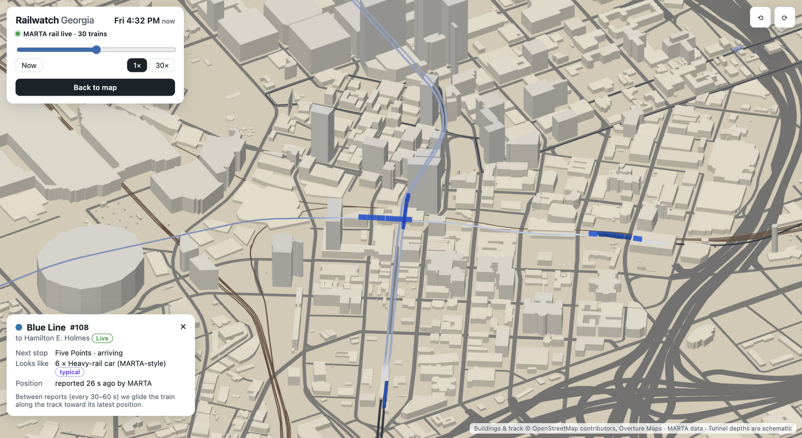

Also in this step:
- The live feed now polls every 30 s: one open tab uses ~2,900 of the free tier's 100k
  Worker requests a day.
- Trains expire by when MARTA *observed* them, and the Worker reports a missing observation
  time as `null` instead of quietly substituting the fetch time.
- Live fixes that can't be snapped to track are left out of the 3D view.

**Review fixes before calling it done:**
- **Trains popped up at the scene edges.** Profiles end at the scene boundary and returned 0
  beyond it, while cars draw a little past the edge. Profiles now hold their end value.
- **A level-0 "tunnel" is a covered cut at street level,** not a −6 m dip, so it's at grade.
- **A ~120 m "bridge" between two tunnels on Red/Gold** (a span over something inside the cut)
  would have surfaced trains for a block. Short positive spans between tunnels now stay
  underground at the shallower depth.
- **Removed the disclaimer footer** at Sam's request; it added noise. "Unofficial" now leads
  the small attribution line instead.

Known limitations in this slice:
- Scheduled vs live, and tunnel depth, are both shown as lightness, and there's no key in 3D yet.
- No nose taper on lead cars.
- Underground trains draw on top of towers by design (the cutaway). A fade near the
  selected train is an option if it reads as confusing.

## 2026-11-20 · Finding the look: colour isn't style

**First attempt: six "looks" on the same scene** (`?look=` / the `L` key in 3D): architect's
model, golden hour, night with procedural lit windows, toy town, pixel and the baseline.
Screenshots in `docs/log/looks/`. Sam's verdict: *these are colour treatments, not artwork.*
Correct. The references (the isometric pixel city, the low-poly train video) are made of
**detail and form**: modelled trains, trees, curbs, rooftop clutter, a ground with depth.
Recolouring grey boxes can't get there. (The looks code stays, since shadows and night
windows will be useful.)

**Second attempt: one small block, modelled properly.** Instead of styling all of downtown,
pick one 850 × 500 m patch and give it real detail: the **MARTA east portal** by Georgia
State, where the east–west line climbs out of its tunnel beside the freight main and
crosses the Downtown Connector on a viaduct.

- `pipeline/scripts/vignette.py` crops the Overture extract to the patch (64 buildings,
  streets with overpass flags, freight and subway track) → `vignette.json` (66 KB).
- `web/vignette.html` + `src/vignette/` build everything in the browser:
  - **A diorama board**: heightfield top, the cut edges showing topsoil → **Georgia red clay**
    → rock, on a walnut plinth.
  - **The Downtown Connector sunk into a trench** (it really runs below street level here);
    overpass streets keep their level and get concrete fascias.
  - **MARTA**: ballast, concrete ties, rails, third rail; an open cut with a portal
    headwall; a box-girder viaduct on piers over the highway. Elevations come from the same
    baked profile the main 3D view uses (−10 m → +7 m).
  - **Freight**: wooden ties, rusty rails, through-girder bridges over the trench.
  - **Buildings**: brick / stone / glass by height, with storefront glass at street level,
    punched, ribbon or curtain-wall windows (shader), parapets, rooftop HVAC and stair
    penthouses, white, gravel and green roofs.
  - **~1,500 trees** along streets and through open ground. It's November, so some oaks
    and maples are turning.
  - **A MARTA train after the CQ400**: stainless body, window band, line-colour stripe, and
    cab ends whose destination sign and light bar glow in the line colour (from the art
    backlog).
  - **Traffic**: instanced cars looping along lanes of the real streets and the Connector.
  - **Studio lighting**: soft shadows, GTAO ambient occlusion, a narrow-FOV camera and a
    **tilt-shift blur**. That last one does most of the "miniature" work.

Trains and traffic here run on an illustrative loop; this is a look study, not live data.

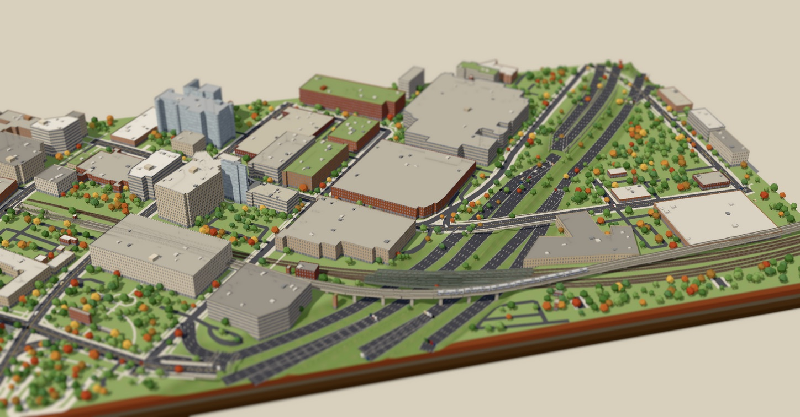

**Lessons:** a small patch you can afford to detail beats a big one you can only colour.
Most of the miniature feel came from three cheap things: tilt-shift, trees and visible cut
edges on the board.

## 2026-11-20 · Atlanta's clock: real traffic, sun and seasons

**Traffic from free federal data** (`pipeline/scripts/vignette_traffic.py` → `traffic.json`):
- **How busy each road is:** FHWA's national road inventory (HPMS) gives daily volume,
  truck volume, lanes and speed limit per segment. The Connector here carries 307k–372k
  vehicles a day on 12–13 lanes, about 9% of them trucks; Boulevard has 17,300 and Auburn
  Ave 4,400. 80 of 159 drivable runs matched by distance and bearing; the rest (alleys,
  service roads) get class defaults.
- **The shape of the day:** FHWA's 2023 hourly counts from Georgia station 000009, on the
  Connector just north of the board. On weekdays, 5.8% of the day's traffic passes in the
  7 am hour and 1.0% in the 3 am hour. Weekends are nearly as busy, just later.
- **The model:** vehicles per lane per hour = daily volume × the hour's share ÷ directions
  ÷ lanes; a curve slows traffic as a lane nears capacity; how many cars are on the lane =
  flow ÷ speed. Cars hold evenly spread slots and switch on or off only as they leave the
  board, so traffic thickens without popping. Trucks appear in proportion to each road's
  truck share. Labelled "typical for this hour", not live.
- **Caveat:** counts flatten when the Connector jams, because a jam lowers throughput.
  Live speeds from Georgia 511 (key pending) would show the real crawl.

**Sun and seasons:**
- Sun position is computed from the date, time and Atlanta's latitude. It drives the light
  colour, shadows and sky: golden at 4:55 pm in November, blue hour after 5:30.
- At night: lit windows (about a third of offices, most shopfronts), street lamps with
  pools of light, glowing head and tail lights, and lit MARTA windows.
- **Trees by date:** about a quarter evergreen (loblolly pines as stacked cones, magnolias).
  The rest turn by species (maple red, sweetgum burgundy, oak russet, poplar gold), each
  on its own few-week schedule, drop their leaves to bare branches by mid-December, and
  leaf out light green in early April.

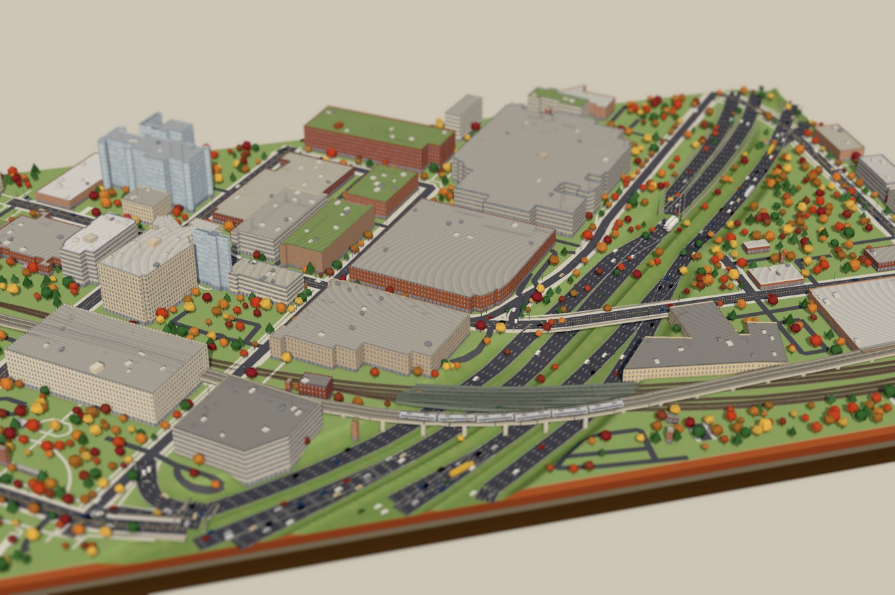

Not yet: live weather (Open-Meteo, so it needs no key). The published artifact can't call
outside services, so live weather will only work in the real app; the artifact would need a
weather picker.

## 2026-11-20 · Weather, real trees, smoother trains

- **Wobbly trains fixed.** The GTFS route shape is rounded to about 1 m with uneven point
  spacing, so cars twitched at every vertex. The alignment is now resampled every 2 m and
  smoothed (±24 m moving average, twice), elevation too. The largest heading change is now
  0.11° per half-metre of travel, and the largest height change 5 cm.
- **Weather** from Open-Meteo (free, no key): WMO code, cloud cover, rain, visibility and
  temperature, refreshed every 10 minutes. Clouds flatten the sun and soften shadows; rain
  draws shader-animated streaks (one draw call) and darkens wet surfaces; fog is relative to
  camera distance so the far side fades and the foreground stays crisp; storms flash.
  The published artifact can't call outside services, so it has a weather picker instead.
- **Real trees** from the Meta + WRI 1 m canopy height map (CC BY 4.0),
  `pipeline/scripts/vignette_trees.py`: crowns as local maxima ≥ 4 m tall, at least 5 m
  apart, with crown radius from the surrounding canopy area; roofs masked out. This patch
  has only **76 trees and about 4% canopy**: it really is highway, campus and parking. The
  imagery is probably about 2018, and small street trees are likely under-counted.

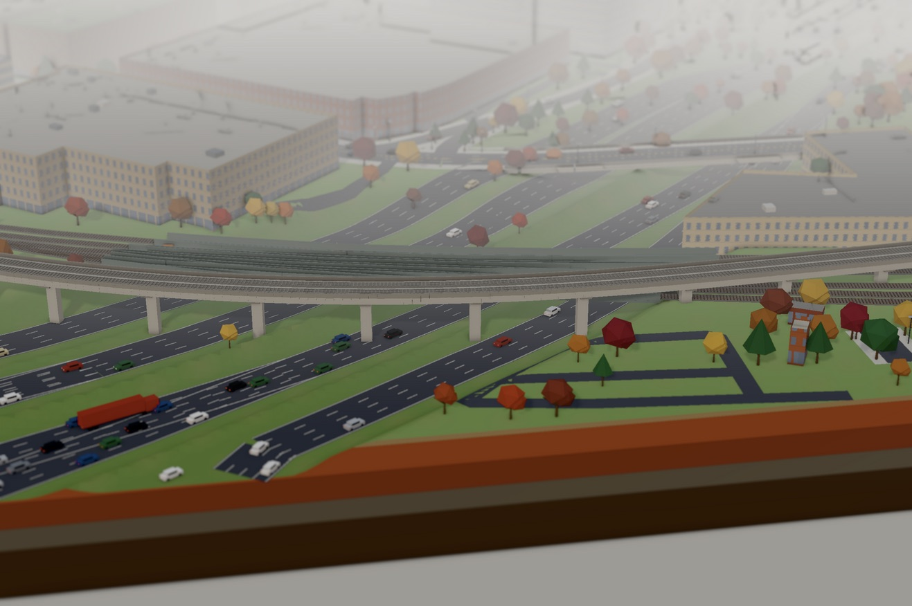

**Next truth gap:** the ground. Everything not a building or road is drawn as grass, but
downtown is mostly parking lots and plazas. Overture's land use and land cover layers (or
OSM `amenity=parking` / `landuse`) would fix that.

## 2026-11-20 · The ground is mostly parking

Everything that wasn't a building or a road used to be lawn. Overture's base theme knows
better: in this block there are **18 mapped parking lots**, 7 plazas, 5 sports pitches,
2 construction sites, **130 crosswalks** and **10 traffic signals**. Downtown-wide, the
infrastructure layer has 164 parking areas covering about 380,000 m².

- Lots are drawn as asphalt with **stalls laid out by rule** (2.6 × 5.4 m stalls either
  side of 6.5 m aisles, along the lot's longest edge) and filled with parked cars.
- **Occupancy follows a rule of thumb** for downtown commuter lots (illustrative): nearly
  full in weekday working hours, about a third in the evening, a few overnight, about
  half on weekend afternoons.
- **Unmapped lots are inferred:** Overture labels 220 service roads downtown as
  `parking_aisle`. Where an aisle isn't inside a mapped lot, stalls are paved and striped
  along both sides of it.
- Plazas get paving, pitches turf with touchlines, construction sites dirt, and every
  mapped crossing gets zebra stripes laid across the road it sits on.

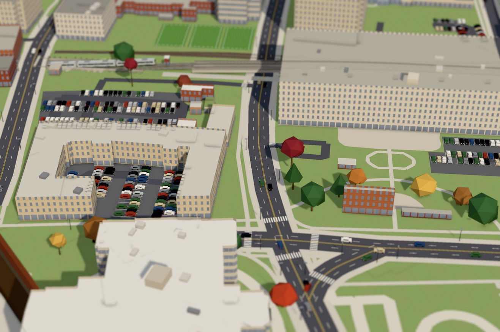

## 2026-11-20 · Cars that drive the street network, and better models

**Traffic is now a simulation on the real streets** instead of cars looping along each road:
- **The network:** Overture road runs join into a graph at shared vertices. In this block
  that's 68 intersections, 110 directed road edges and 28 board-edge entries, with 8 of
  the 10 mapped traffic signals matched to an intersection.
- **How many:** vehicles enter at the board edges at the hourly rate the federal counts
  give for that road.
- **Where they go:** at each intersection a vehicle picks an outgoing road weighted by that
  road's volume, with a mild preference for going straight. Nobody can know a given car's
  turn, but the mix matches the real volumes.
- **How they move:** the Intelligent Driver Model keeps gaps and speeds; turns curve along
  Bézier paths; vehicles stop on red and amber (signal timing is a guess, 84 s cycles);
  merging vehicles yield to whoever is closer to the merge.
- **Result:** about 55 vehicles flowing at 52 mph at 3 am, about 250 at 27–32 mph at 1 pm,
  and stop-and-go at 17–22 mph in the 8 am peak, which is what the Connector actually does.

**Bugs with lessons:**
- **Ramps matched the main line's HPMS record** because they run side by side, so they
  poured a whole highway's traffic into every merge. Ramps now get one lane and ramp-scale
  volume.
- **Some main-line segments matched ramp records instead**, so one direction of the
  Connector was nearly empty. Main-line segments under 150k a day fall back to the
  Connector's median.
- **Lane-index mapping** sent the ramp into the busiest left lane. Vehicles now continue
  into the geometrically nearest lane, or the emptier of the two nearest at a merge.
- **Turn paths capped speed even on straight-through joins**, making a bottleneck at the
  peak flow. Only real turns slow down now.

**Vehicle kit:** each model is a side profile extruded across its width, so hoods,
windscreens and roofs slope: sedans, hatchbacks, SUVs, pickups (with beds), vans, box
trucks, and **articulated semis** whose trailers swing behind the tractor through turns.
Trucks follow each road's truck share. Parked cars use the same kit.

**Train:** a CQ400-style car with a rounded roof, a raked cab and big windscreen,
individual windows between three door pairs a side, bogie side frames and axle boxes,
underfloor equipment, roof HVAC pods and gangway bellows. The line-colour light bar and
destination sign still glow.

## 2026-11-20 · Sam's feedback pass: lanes, turns, night, focus

Sam's notes after driving around: cars "drive in the middle of the lanes", are "a little
jumpy in intersections", night needs "more realistic lighting", and the tilt-shift blur is
"a little strong… hard to see what I'm trying to look at".

- **Lanes:** the painted dashes came from a road-class rule while the cars' lanes came from
  HPMS lane counts, so cars sat on the dashes. The traffic model now draws the dashes
  between its own lanes.
- **Turns:** a car's heading came from one point on its path, and a car straddling a lane
  and a turn path snapped onto the turn. Cars are now placed by their front and rear axles,
  looked up across the previous path segment too, so the body pivots through the turn.
- **Night:** the lamps' additive white discs are replaced by a baked **light map**: warm
  (~3000 K) pools from every street lamp and a faint shopfront spill, added to the ground,
  street and lot materials in proportion to darkness. The Connector gets high-mast lights
  every 50 m. Headlight beams lie on the road ahead of moving cars. Bloom (night only)
  makes lamps, windows and headlights glow; window brightness varies per window.
- **Tilt-shift:** three.js's shader ramps blur linearly from one focus line. A custom pass
  keeps a sharp band (±16% of the screen) and ramps softly to the edges, at a lower default
  strength. Double-click glides the camera's focus to that spot.
- A side note on GPU hashing: `fract(sin(dot(p, k)) * 43758.5)` with world coordinates in
  the hundreds turns into noise, which showed up as speckled walls. Hash the window cell
  index instead.

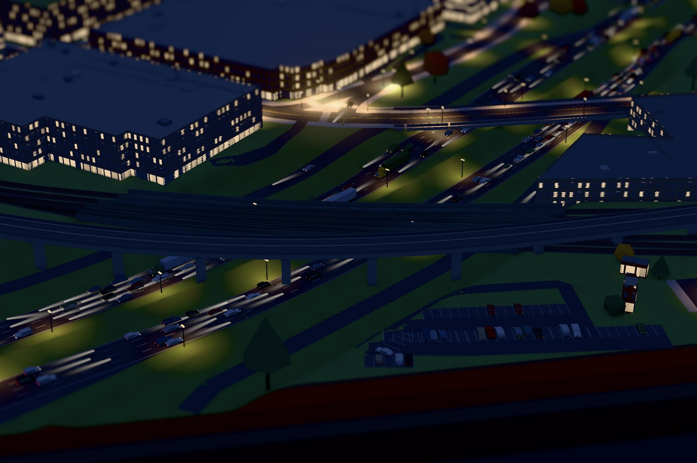
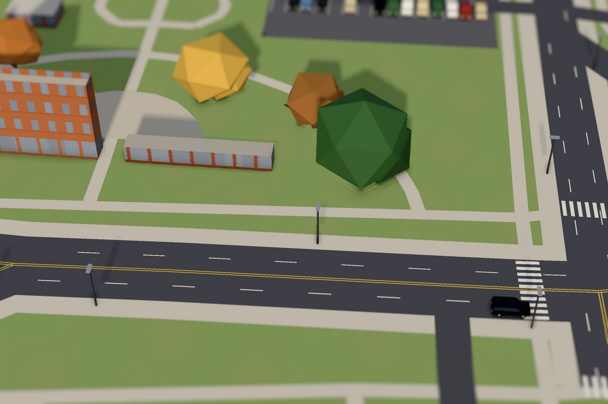

## 2026-11-20 — Live MARTA buses reach the map

At 7:28 p.m. Eastern, MARTA sent 163 bus positions in 13,319 bytes. Every
vehicle had an observation time and matched one of the 81 published bus routes,
but one fix was already over three minutes old and only 98 included speed.
The teal dots use the GPS coordinates directly. Tapping a bus shows its route
and the age of its position. Moving the clock away from the present clears them.

Repeating the source and observation time on each attribute turned those 13 KB
into 73,327 bytes of JSON. Sending the source once and the timestamp once per
bus brought the same snapshot down to 19,528 bytes. Local decoding and
normalization averaged 0.33 ms over 100 runs. The static short-name lookup is
1,081 bytes. Two consecutive local Worker requests with different query strings
returned the identical cached snapshot.

## 2026-11-20 · Painting the East Portal without moving the track

The viaduct over the Downtown Connector gave us a registration test. A six-car train has to round the curve on the rails, while a box truck underneath it disappears behind the deck. We baked the East Portal three ways through one orthographic camera. In the comparison, the roofs, the road crossing and the red-clay edge occupy the same pixels in every column. The Three.js column uses the scene's materials and lights with the comparison camera. The [ordinary vignette screenshot](log/art/studio-baseline.jpg) shows its regular perspective and tilt-shift.

The Studio rebuilt 64 buildings, 384 road runs, 13 rail runs and 76 canopy trees. At 0.25 m per image-plane pixel, the 850 × 500 m board needs a 4,352 × 2,560 canvas at this angle. The static GLB weighed 47.3 MB. Blender 5.3 took **3 minutes 12 seconds** with 12 Cycles samples on Metal. A warm sun casts the viaduct's shadow into the trench. A fine ink edge, derived from depth and surface normals, separates its concrete from the road below. Simple window panes stand in for the browser's facade shader. All 32 colours fit into a 623 KB full-resolution PNG.

The first SDXL redraw took **9.06 seconds** for a 1,024 px crop. At denoise 0.38, the model turned lane dashes into dark blocks and added what looks like a canopy to a low building. At 0.54, part of the highway started to look like another railway. We baked the board at **0.26**, with Pixel Art XL at 0.85, guidance 5.5 and 28 requested Euler steps. The foliage gained uneven edges and the bridge kept its curve. Individual lane dashes and parking stalls still softened. This is an **illustrative** base. At full scale, 11.9% of pixels inside the board changed by at least 32 levels in one RGB channel. The geometry mask preserved every pixel outside the board. [First redraw](log/art/first-redraw.jpg)

The full run took **54.29 seconds** on the M5 Ultra. Its 18 overlapping windows took a median **2.69 seconds** each after model load. We blended them across a nominal 256 px overlap and cut each base into 69 tiles across five zoom levels. The Blender pyramid weighs 0.94 MB and the SDXL pyramid 8.02 MB. They share a 1.04 MB surface-height PNG and five sprite models with 32 headings apiece, each rendered by day and by night. The viewer clips individual sprite pixels against the surface height. A truck can pass beneath the same bridge that carries the train without asking a server to draw either.

The experiment leaves an art decision. At a distance the two baked boards read almost alike. Up close, the redraw softens the geometry fastest exactly where a railway map needs precision. Keeping the aligned Blender base in the viewer makes that trade easy to inspect. [Factory settings, licences and build instructions](../pipeline/scripts/art/README.md)

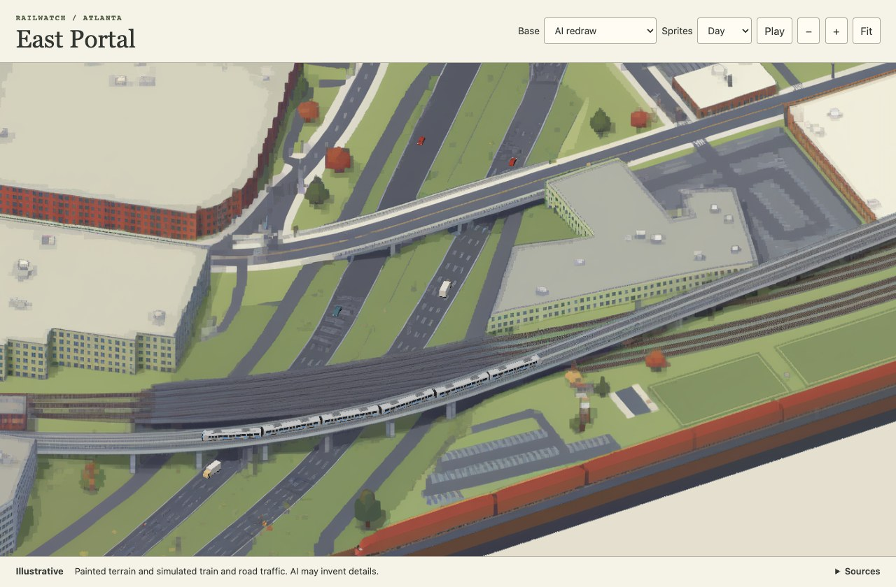

## 2026-11-20 · Ink, lighter bridges and the first real buses

After the art spike (PR #5), Sam compared full-resolution crops and preferred the live 3D
over both the Blender illustration and the SDXL redraw, which invented a red freight train
out of the board's clay edge. So the lessons go back into the 3D:

- **Ink outlines**, "outline once, after compositing": one screen-space pass reads the scene's
  depth and colour, draws silhouettes where depth jumps (using a second difference, so smooth
  slopes like roofs and lawns stay clean) and creases where colour steps, and fades with
  distance. On by default; `?ink=0` or `__v.setInk(false)` turns it off. One gotcha:
  EffectComposer gives each ping-pong target its own cloned depth texture, so the pass must
  read the *current read buffer's* depth, or every other frame uses stale depth.
- **Freight bridges** over the Connector were tall solid girder walls on each of the parallel
  tracks, which merged into one dark slab. They're now a slim deck with a girder underneath
  and a low railing, so you can see the individual tracks cross.
- **Real MARTA buses** from `/api/marta/bus` (PR #2's Worker endpoint): fixes on the board
  are snapped to the nearest street within 25 m, turned to the street direction nearest the
  reported bearing, kept in the right-hand lane, and glide between 30-second reports. They
  show only when the clock is the real present, and the readout says how many are live and
  how fresh they are. On the first try: 3 buses (routes 20, 42, 55) near Decatur St.

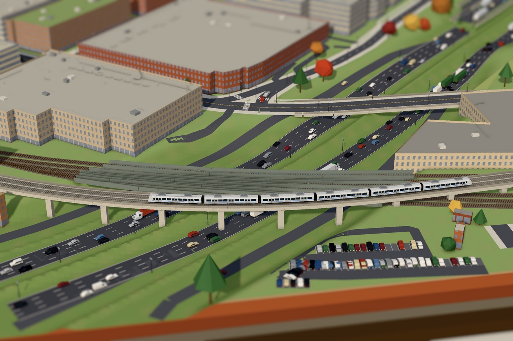

**Same day, Sam's next notes:** the headlights "look backwards" and cars "just go through
that bus".
- The headlight-beam texture was flipped one time too many, so the beam was brightest at its
  far end. Now it starts bright at the bumper and fades ahead.
- Live buses are now **obstacles** for the simulation: cars on the same lane brake and queue
  behind them. On multi-lane roads, a held-up car **changes lanes** when the next lane has a
  safe gap (a simple MOBIL-style rule), sliding across over about two seconds instead of
  jumping.
- Review catch: a bus snapped to the Decatur St bridge was drawn below the deck. Buses on
  overpasses now keep the bridge height, like the rest of the traffic.

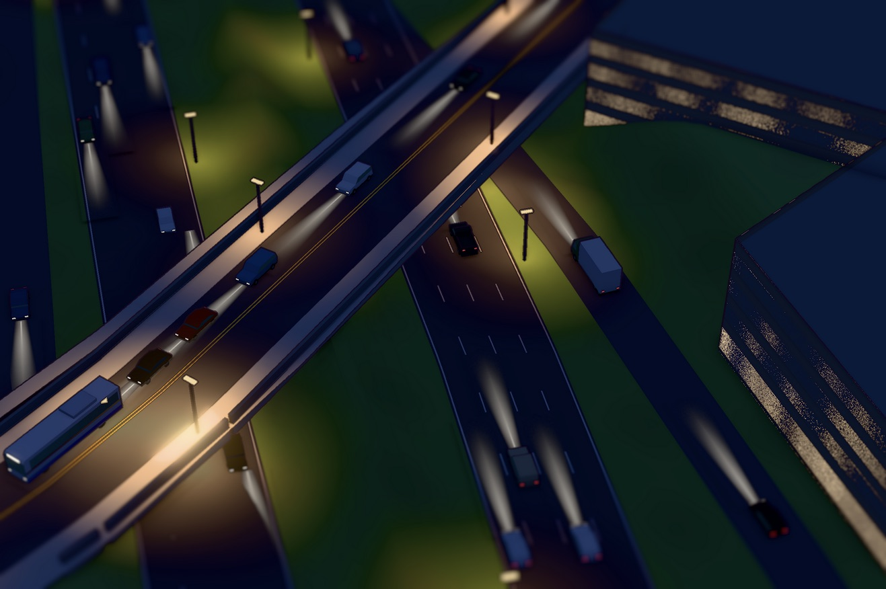

**Speckled, shimmering windows** (Sam, with a screenshot): the facade shader worked out each
wall's direction from screen-space derivatives of world position. At city-scale coordinates
(hundreds of metres) those derivatives are noisy, so neighbouring pixels disagreed about
which window they were in, and whether it was lit. That gave salt-and-pepper speckle that
shimmered as the camera moved, by day as well as night. Fixes: use the wall's real per-face
normal, swap the `sin`-based hash for a precision-safe one (Dave Hoskins' `hash12`), and fade
the window pattern to its average where windows get smaller than about 2 px.

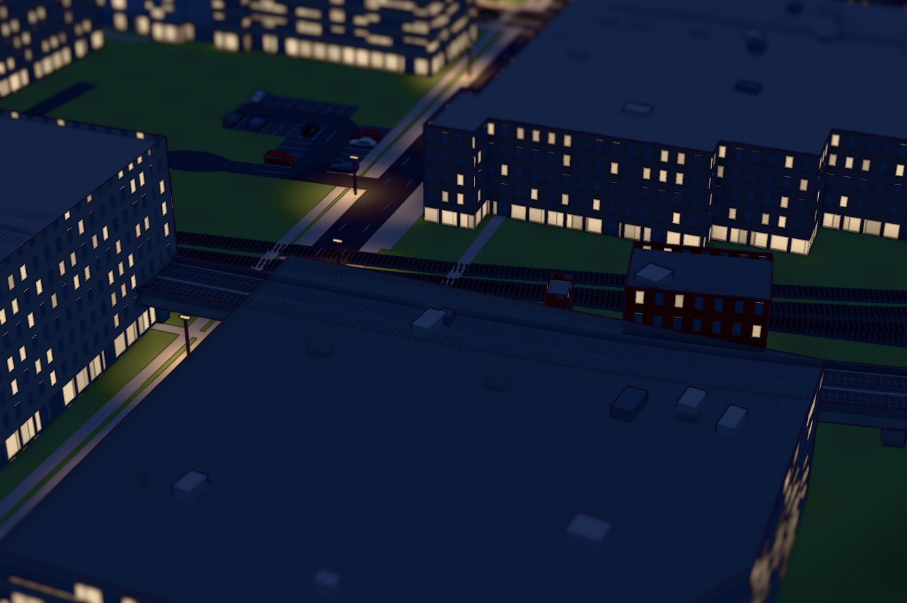

## 2026-11-20 · Adapting to a reference: a low-poly ravine railway

Sam found a much closer reference: a real-time low-poly railway through an autumn ravine
(a train-driving toy with its own Hour, Ink, Flora and Forest panels). Stills, pulled
from the video with ffmpeg because I can't watch video directly, show what gives it its look:
- **Foliage as clusters of small faceted leaf clumps,** each tinted slightly differently,
  plus tall tiered conifers. Our trees were one or two big gem-like blobs.
- **Thin dark ink, mostly on silhouettes**, not inside shapes.
- **Punchy light**: warm sun, cool blue-grey shade, saturated colour.
- **Film grain** over everything, so it never looks digitally clean.
- A perspective chase camera with a painted sky (parked for later: Sam wants more pieces
  in place before the ride-along camera).

What changed:
- **Trees:** each deciduous canopy is now ten dodecahedron clumps on a rounded crown,
  lighter on top and darker underneath, with per-clump hue, saturation and lightness
  jitter. Leaf drop removes clumps one by one. Loblolly pines have four narrowing tiers.
- **Ink:** silhouettes only, with colour creases at a fifth of the weight, a darker ink and
  1 px lines.
- **Grade and grain pass** (last, in display space): +12% contrast, +14% saturation, cool
  shadows and warm highlights, a soft vignette, and fine animated grain that's stronger in
  shadow. `?grade=0` turns it off.

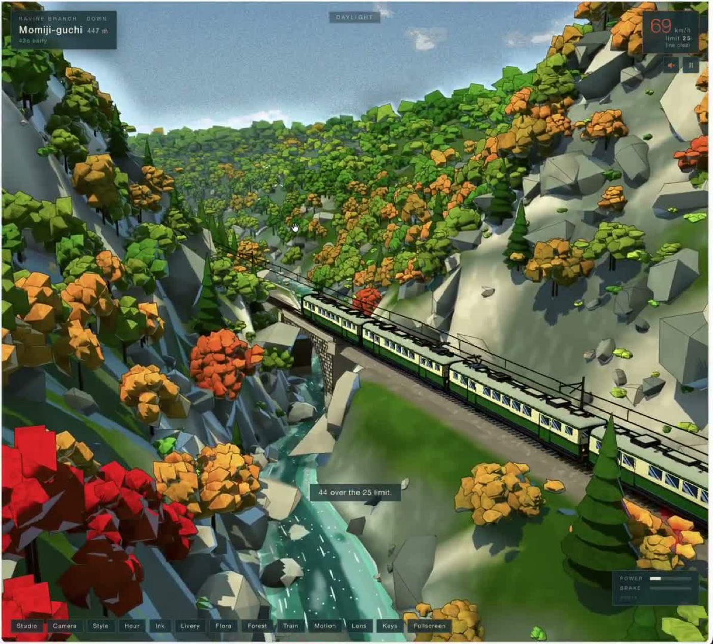
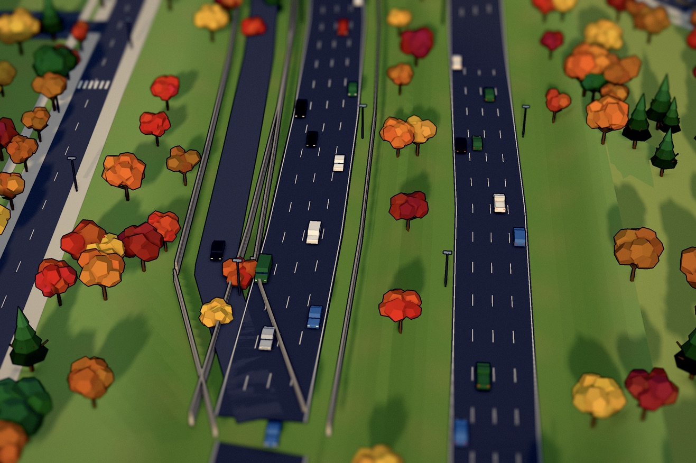

## 2026-11-21 · Modelling the CQ400 from photos

MARTA's new Stadler CQ400s start rolling out next year, so the diorama skips the old fleet
and models only the new train. The method: a **model lab** (`/models.html`) that shows the
model large in studio light, switches line colour, lead, tail or coupled lighting, and day
or night, and can lay a reference photo over the view. Sam critiqued it round by round from
photos; I adjusted the code. No Blender; the model is built in TypeScript
(`web/src/vignette/cq400.ts`).

What the photos taught, in roughly the order Sam caught it:
- **Matte grey, not champagne.** It only looks warm in sun.
- **The front is one dark mask** framed by grey that wraps the corners. The line colour is a
  **flush light**, not a raised rail: down both mask edges and in to a V under the
  windscreen, thicker toward the point. Simplified to one shield windscreen (no end door).
- **The nose is a straight rake,** upright at the bottom, not a rounded bullet. Its grey
  side panel has a triangular window, then one rectangular cab window, then the first door.
- **Bumpers are flush grey corners with vents,** not stuck-on boxes. The coupler is dark,
  since the "red" in photos is the tail sign reflecting.
- **Tail lights:** a red bar where the wordmark sits (we show no logos, only light), small
  red lights at the ends of the destination display and red under each corner cluster.
- **The livery:** short blue, yellow and orange chevrons on the nose side, then **every car**
  carries blue, yellow and orange from the end facing the cab, all slanting the same way.
- **Smooth roof:** only slight bumps over the roof equipment.

Bugs with lessons:
- **Floating features:** the mask was a flat fill between outline points while the lights
  sat on the curved surface, so they floated off it. The nose is now one continuous surface
  `z = F(x, y)`, and every feature is placed on that same function.
- **Ragged seams:** the nose surface wasn't sampled at the body section's chamfer heights,
  so its edge stepped across them. Sampling now includes those exact heights.
- **The chevron's notch at the point:** the two halves of its path never shared the centre
  point (one half was appended backwards). It's now one mitred ribbon, with each quad's
  winding fixed to face forward.

Consists: CQ400s run as fixed 4-car sets with open gangways. Green Line trains are drawn as one
set (4 cars) and Blue Line as two (8), with the inner cabs dark. MARTA's live feed doesn't say
which fleet a train is or how long it is, so lengths are typical for the line.

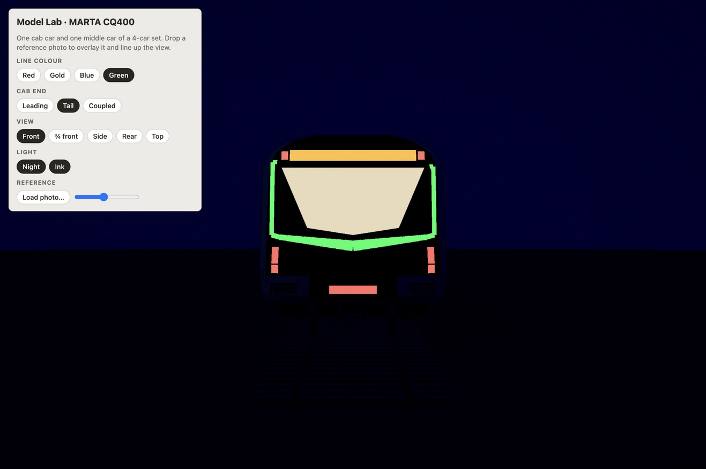

## 2026-11-21 · The MARTA bus, built to spec

The first bus was eyeballed from photos, and it showed: the wheels weren't even round. So the
second pass started from numbers instead. New Flyer publishes the Xcelsior 40-foot's
dimensions and a side elevation in its brochure: 12.24 m over the body (12.50 m over
bumpers), 2.6 m wide, 3.38 m over the CNG roof tanks, a 7.2 m wheelbase and 305/70R22.5
tyres (about 1 m across). Those set the body, the axle positions and the overhangs (about
2.2 m at the front and 2.9 m at the back). Photos then filled in what the drawing doesn't say.

- **Wheels:** arches are cut into the extruded side profile, so they are actually round.
  Tyres are an open tread band with ring sidewalls, so a dished steel rim with a dark hub can
  sit inside them. Duals at the rear.
- **The window line came from photos, not the drawing.** The brochure suggested a 1.42 m
  belt. In photos of MARTA's buses the windows are one continuous dark band, roughly
  1.2–2.3 m off the ground, which leaves the tall white strip that carries the livery.
- **Livery:** white, with three blue slashes that run up over the roof edge onto the CNG
  housing. The third flows into a long blue line, with yellow and orange dashes beneath it,
  their ends cut at the same angle. The giant slanted "marta" lettering at the rear becomes
  a plain light-grey band, darker where it crosses the glass. No wordmark, no fleet numbers.

Bugs with lessons:
- **A stray half-drum hid half of each wheel.** The wheel-well lining was a half-cylinder
  rotated the wrong way, so it filled the back half of the arch instead of the top, and its
  end caps covered the wheel. Now it's an open half-tube along the arch roof.
- **Decals under panels:** the side panels are thin 2 cm boxes, so their outer faces sit
  1 cm proud of their nominal offset. The grey band was drawn "above" the grille and the
  glass but actually sat under both, until its offset accounted for the box thickness.
- **Stripes that bent at the roof edge:** leaning the slashes by distance along the surface
  made them kink horizontally across the flat roof strip. Leaning them by true height keeps
  each slash a straight band when seen from the side.
- **Fine stripes all over the roof** were shadow acne: the model lab's sun had no shadow
  bias. The diorama already had one.

The live MARTA buses in the diorama now use this model. They were the only users of the old
generic bus, which is gone.

## 2026-11-21 · One shell over Map and City

Until today the site was three products that didn't know about each other: a grey dashboard
over a 2D map, a grey 3D downtown behind a button, and the East Portal diorama on its own
page. The direction now is "just a little model of Atlanta": City first, Map one tap away, and
both working back from the diorama's look.

- **Glass instead of panels.** The dashboard panel is gone. What's left is a status widget
  (neighbourhood, temperature with a weather icon, condition, date and time, and a live dot),
  a menu button and a Map · City switch. All three are frosted glass with a Liquid Glass-style
  lit edge: the rim is bright at two corners and fades between. On cream paper a white rim
  vanishes, so a 0.5 px dark hairline sits outside it to make the highlight read.
- **The glass picked up colour.** With `saturate(1.7)` in the backdrop filter, an orange
  freight line under the widget turned the whole card peach on the phone. 1.15 keeps the glass
  neutral.
- **The basemap is recoloured, not replaced.** OpenFreeMap's positron style is fetched at load
  and repainted to the diorama palette (cream land, sage parks, soft water, thin brown roads),
  so tile and glyph URLs stay current. Rail lines get a thin ink outline, as in the diorama.
- **The streetcar was pure #0000FF** in MARTA's GTFS. Next to the Blue Line (#0075B2) it read
  as a different hue entirely; it's now a softer cornflower, #5a86d6.
- **Neighbourhoods:** 248 City of Atlanta neighbourhood polygons (315 KB) name the place under
  the middle of the view; outside the city it says "Metro Atlanta" or "Georgia".
- **Weather now goes through the worker.** On the A16 the direct call to Open-Meteo timed out
  and the diorama said "live weather unavailable here". `/api/weather` makes one upstream call
  per edge location every 10 minutes, whoever's asking.
- **Keyboard:** WASD and the arrows move the camera in both views, `M`/`C` switch, `+`/`−`
  zoom. A key tap always nudges, because the first frame now counts from the key press (in a
  throttled tab that painted twice a second, the first frame's zero-length step was the only
  one).
- Phosphor icons (MIT), imported as raw SVG so only the 14 used ship. The system font, no web
  font. The time slider and 1×/30× are hidden, not deleted: `?controls=1`.

On the A16 in portrait, the Map runs at 58 fps with the glass over it. City is still the old
grey 3D until the diorama-style downtown replaces it.

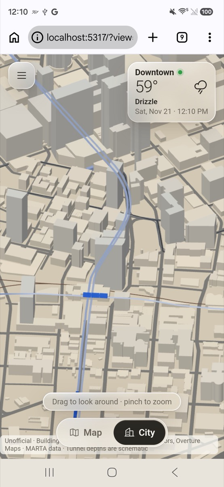

## 2026-11-21 · Weather and time of day on the Map

Time of day and weather aren't modes; a rainy dusk is both. So there's one atmosphere state
(sun elevation and azimuth from the clock, cloud/rain/snow/fog from Open-Meteo) and the Map
reads it in layers:

- **Time of day** blends the basemap continuously between four keyframe palettes by sun
  elevation (night −12°, dusk −4°, golden +3°, day +14°), in linear RGB with smoothstep, so
  there are no hard switches. A WebGL sky layer adds a warm wash on the sun's side and soft
  shade opposite; at 8 AM it sits bottom-right, at 4 PM bottom-left. At night: cool moonlight
  and a warm glow over downtown.
- **Weather** transforms whatever time of day gives. Cloud greys and flattens it (capped, so
  cloud + rain + fog can't stack into mud: Atlanta is overcast a lot, and that has to look
  pleasant), with cloud shadows anchored to the ground. Rain is fine slanted streaks plus a
  cool, wet tint; snow is drifting flakes and a paler ground.
- **Fog was the lesson.** As a colour wash it just made the map look faded. What reads as fog
  is the diorama's trick: a real blur toward the edges with a cloudy haze in it, and a sharp
  centre. That's a `backdrop-filter` layer over the map with a radial mask.
- Every effect is drawn above the basemap's fills and below our rail, stations and labels, and
  Atlanta's weather fades out as you zoom out to the state or pan away from the metro.
- After dusk the glass goes dark, like an OS night mode, and truth-tier chips get lifted
  colours for contrast.

**On the A16** the first cut cost almost half the frame rate: 58 → 34 fps on an ordinary
overcast day. Two fixes got it back above where it started. The shader only computes noise when
there's cloud or fog to draw (3 octaves, not 4). And the map's pixel ratio is capped at 2: the
phone reports 2.81, which meant 1.97× as many pixels for no visible gain. Clear day 74 fps,
overcast 65, rain with fog 40. Clouds don't drift on phones, to avoid constant repaints.

`?tune` is the playground: a Live switch, a time slider and cloud/rain/snow/fog sliders that
combine freely, plus the palette presets and pickers.

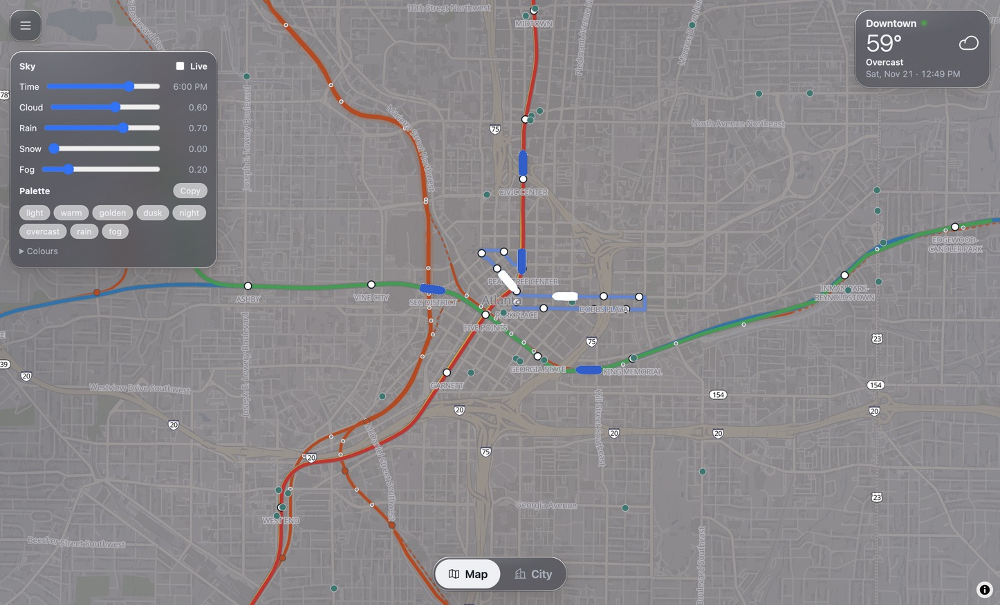

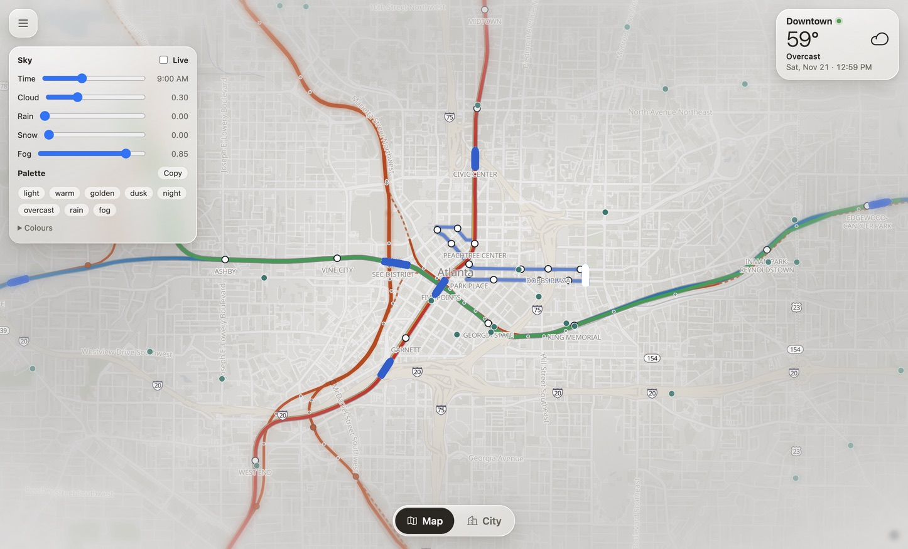

## 2026-11-21 · Downtown fits on the table

City now opens far enough back to read the Gulch, Five Points and the Peachtree Center
skyline together. The southwest camera moved from 3,000 to 5,500 scene metres; tilt-shift
strength dropped from 1.6 to 0.65 so the towers stay legible. Four Overture streetcar runs
now have embedded rails, and the city's buildings and streets stop cleanly at the walnut
board. A high-DPI bug had been making the canvas twice as large as its CSS container,
showing only its upper-left quarter; explicitly sizing both fixed that crop.

The surprise was startup, not polygons. A timed desktop load spent **33,481 ms** on ground
placement out of **35,984 ms** of construction. Parking stalls checked every building;
crosswalks checked every street. A conservative 64 m spatial grid now narrows those searches,
while the exact intersection tests still make the decisions. A fresh low-tier run built in
**730 ms** (ground 363 ms, streets 162 ms, rail 139 ms); high-tier runs under concurrent
browser/build load ranged around **2.4–2.7 s**. Those are CPU construction measurements,
not first-paint times or phone results. The broad-phase tests compare exact hits against
brute-force searches, including negative coordinates and cell boundaries.

The loading plate reports each build stage and yields between stages, so returning to Map
cancels the load. A held data request followed by Map left **zero canvases** behind; a forced
404 returned to Map with the recovery note. Switching views preserved the target at
**−84.392033, 33.756238**. The clock and neighbourhood widget now update independently of
remote basemap tiles. City has snow flurries as well as rain, and fog softens the edges.

The old `scene3d` renderer is gone. Shared rail profiles remain in `scene.json`; builds omit
its three unused binary meshes, saving **3.2 MB** of deployed static assets. No data rebuild
is needed for this refinement if the M2a City JSON already exists; a web rebuild is required.
A fresh checkout still needs the data commands. East Portal was checked in Orca after the
shared-world changes and still renders its viaduct, train and traffic.

Performance is deliberately **not signed off**. Orca's desktop animation callbacks were
throttled to about 1–2 fps, even with the City renderer disposed; that is not a useful GPU
benchmark. Sam asked us to leave the Galaxy A16 untouched. The ≥30 fps low-tier phone gate,
City as the default, and M2b motion remain pending. The baked western MARTA profiles also
stay below the daylight threshold by Dome/GWCC; the handoff's expected open track there
needs a source/profile audit, not guessed surface rails.

Claude's first review caught the fresh-checkout deployment hole: `pnpm data` did not build
City's new JSON. It now includes `data:city`, and the README calls out both fresh and existing
checkout instructions. The portal-at-board-edge concern did not reproduce in either supplied
board: all threshold crossings were inside the board (east x≈376–379, z≈289–291; south
x≈−373…−366, z≈554–564). It remains a possible case if future board bounds cut a shallow ramp.
Final warm high-tier construction also measured 704 ms; the slower 2.4–2.7 s runs above were
under concurrent load. The full suite passes: 16 Rust, 23 web and 5 Worker tests.

The final desktop check resolved the throttling: selecting the tab was insufficient; the
worktree itself had to be foregrounded. With one City tab at **1446×876 CSS pixels**, five-second
animation-frame samples measured **18.1 fps high** (render DPR 2, 63 draw calls, 2,795,709
triangles across all passes) and **32.4 fps low** (render DPR 1, 32 draw calls, 1,268,831
triangles). These are desktop results only; high-tier rendering still needs optimization,
and the A16 gate remains pending. Claude's second and final review reported no new findings.

## 2026-11-21 · Keep your bearings

Sam's first navigation check exposed a sign mismatch: the shell describes a content drag,
while City's camera API describes camera movement. The adapter now reverses that offset,
so A/D move left/right and W/S move forward/back relative to the viewing direction. A second
surprise was that a quick key tap could finish between animation frames and move nothing.
Each fresh press now nudges immediately, then held keys continue at the existing speed.
Keyboard movement also cancels any place-search glide.

Map and City now exchange their centre, clockwise bearing and horizontal ground scale in
CSS pixels. Map stays flat; City remembers its tilt. The conversion uses MapLibre's actual
Mercator scale at the current latitude, so a high-DPI canvas does not change the framing.
City still clamps to its downtown coverage and camera-distance limits. This makes the
remaining perspective change easier to read without adding a transition animation yet.

In Orca at high quality, the opening view survived a round-trip at **28°**, **2.44085 m/px**,
and target **(−40, −260) m**, with sub-millimetre numerical drift. Two more round-trips at
**−70° and 118°**, zoom **16**, retained their centre and a custom **40°** City tilt. All
**24** WASD/arrow direction checks passed across four quarter-turn headings, and an actual
Orca A keypress moved the camera left. A Map view outside downtown clamped to the northwest
board corner and showed the coverage note. The full suite passes **48 tests** (16 Rust,
27 web, 5 Worker), including four comparisons against MapLibre's own Mercator conversion;
the production build passes. This follow-up needs a web rebuild, with no new data bake.

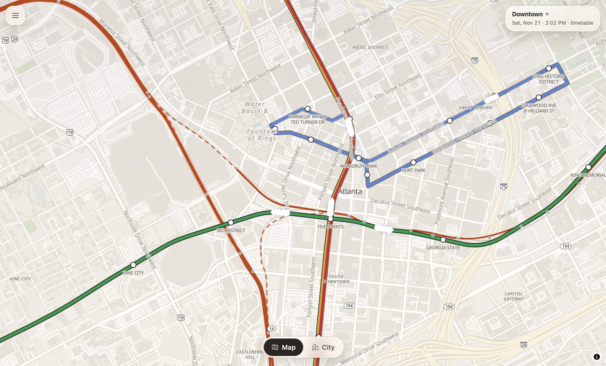

Navigation follow-up review (Claude, one round): no findings.

## 2026-11-21 · Rotation cadence and rendering are separate

Sam noticed Q/E felt choppy even after the direction fix. Held rotation was still driven
by OS keyboard repeat, applying a 3° jump each time. It now shares the WASD animation-frame
loop at 60°/s, with a 1° immediate tap and a 50 ms frame-delta cap. Auto-repeat adds no extra
step; opposing keys cancel, and releasing either resumes the other. Releasing the last key
or leaving the window stops the motion.

At Sam's closer camera pose, two six-second foreground Orca samples on high tier measured
**22.5 and 24.8 fps**, with **34 ms median** intervals and **83/67 ms p95** intervals. The
viewport was 1446×876 at DPR 2, with 63 draw calls and 2,795,709 triangles across all passes.
A separate system snapshot showed 66% CPU idle. These observations confirm uneven frame
delivery, but do not isolate GPU time, browser overhead or competing system work. No render
quality change was made, and the small difference between samples is not an optimization gain.

The Orca held-key check delivered 31 updates and 57.5° over about one second. Taps, repeat
suppression, keyup, blur, opposite keys, typing guards and simultaneous pan/turn all passed.
The original camera pose and high tier were restored. All 48 tests and the production build
pass. This change needs a web rebuild, with no data bake or server changes.

Held-rotation review (Claude, one round): no findings.

## 2026-11-21 · Merge readiness

Integrated main's project rename and deploy-command fix. The sole conflict was the README
deploy paragraph: it now retains City's data requirements and uses `pnpm run deploy`.
The combined branch passes all 48 tests, the production build and an Orca high-tier render
check. Claude's focused integration review found no issues. City remains optional; the A16
gate still controls making it the default and starting M2b.

## 2026-11-21 · Softer shading costs fewer pixels

On this Mac, City draws a 1446×876 Orca viewport into a 2892×1752 canvas. The soft
contact shadows around buildings also covered all five million pixels. Turning just
that effect off briefly took the opening view from 23.5 to 37.4 fps. Keeping it on and
rendering it at 1446×876 leaves the ink, façades and final image at display resolution.

At the same opening pose on high tier, alternating the two shading resolutions gave
22.3–23.5 fps before and 31.9–33.7 fps after. The 95th-percentile frame interval fell
from 83–84 ms to about 50 ms. These were 4.4-second foreground Orca samples on the
Nov 21 afternoon timetable. The scene still drew 63 calls and 2.80 million triangles.

Holding E for three seconds from the closer downtown pose gave a smaller gain. Two
samples at each resolution measured 20.1–22.3 fps before and 24.4–26.6 fps after.
The 95th-percentile interval stayed around 84 ms, so some turns still hitch. The
browser resize check confirmed a 2256-pixel canvas with 1128-pixel contact shading
at the narrower width. This is a desktop measurement. Shipping needs a web rebuild.

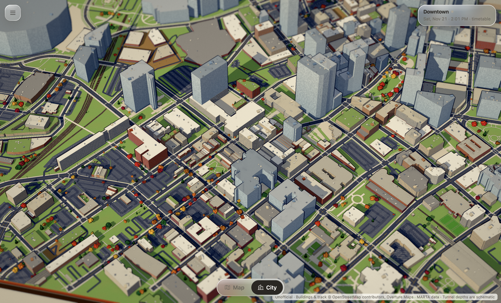

## 2026-11-21 · Drawing the turn we just asked for

City and the keyboard both had animation-frame callbacks. During a close-up turn the
renderer usually ran first, so it drew the previous camera angle. In a 4.5-second held-E
sample in Orca, the camera update waited a median **16.5 ms**, and **82.3 ms at the
95th percentile**, before the renderer submitted a draw with that angle.

City now advances the held keys before drawing. Both callbacks use the browser's frame
timestamp, so the second one sees zero elapsed time. At the same close-up pose on high
tier (1446×876, DPR 2), the update-to-draw delay measured **0.1 ms median and 0.2 ms
at the 95th percentile**. These measurements end at draw submission. The 95th-percentile
interval between frames was still **83 ms**. In a separate held turn, JavaScript spent
1.7 ms at the 95th percentile submitting the scene, and the WebGL GPU timer measured
19.3 ms at the 95th percentile. Neither measures the browser's final presentation.
In two alternating pairs of 3.2-second turns, even drawing just the final fullscreen
triangle gave 84 ms at the 95th percentile, against 83–84 ms for the full scene.
A separate 5.5-second run in the same focused Orca tab, drawing a moving square on
a plain 2D canvas, measured 35.8 fps and a 49.5 ms 95th-percentile interval.

Rain revealed a second cost. The weather timer could repaint the covered 2D Map about
30 times a second. City now suspends that timer, and Map picks up the latest weather on
return. Orca checks covered direct entry, switching, cancellation and failed loading.
The high-tier check also covered quick taps, repeat, opposing keys, simultaneous pan
and rotation, and release on blur. This change ships with a web rebuild.

## 2026-11-21 · The first half-minute on the Galaxy A16

The A16 can sustain the low-tier opening, but the first two visits fell just short of
30 fps. We ran the shipped City build (`1586558`) on a physical Galaxy A16 5G
(SM-S166V, Android 16) in mobile Chrome, in portrait with the real clock and overcast
Atlanta weather. At the untouched opening camera, a 384×692 CSS viewport used a
384×692 drawing buffer. The phone's device pixel ratio was 2.8125.

The phone loaded the release assets over USB from a local server. A page timing probe
waited for the City loading plate to clear and a further 4.5 seconds, then counted
animation-frame intervals in three consecutive eight-second windows. Combined fps is
total frames divided by elapsed time. The page stayed visible and focused throughout
the samples. These are browser frame callbacks; readiness includes loading from the
local server and cannot predict a public-network download time.

| Configuration, in test order | Window 1 (fps) | Window 2 | Window 3 | Combined fps |
| --- | ---: | ---: | ---: | ---: |
| Shipped 2048 px shadows, first visit | 25.00 | 29.37 | 32.62 | 29.00 |
| Shipped 2048 px shadows, second visit | 25.12 | 29.58 | 33.86 | 29.53 |
| Diagnostic, shadows off | 38.37 | 44.00 | 44.37 | 42.25 |
| Shipped 2048 px shadows, warm reload | 28.13 | 36.02 | 37.34 | 33.83 |
| Diagnostic, 1024 px shadows | 34.87 | 35.37 | 38.00 | 36.08 |
| Diagnostic, 1024 px shadows, fresh origin | 32.28 | 35.27 | 34.75 | 34.10 |
| Shipped 2048 px shadows, fresh origin | 28.84 | 34.25 | 34.23 | 32.43 |

The warm production reload reached **37.60 fps** over a further uninterrupted 24 seconds,
with a 55.6 ms 95th-percentile interval. On the first visit, scene construction took
2.44 seconds, including 1.28 seconds for ground, and the first ready frame arrived at
6.64 seconds. Startup and sustained rendering tell different stories on this phone.

Halving the shadow-map dimensions preserved visible building shadows. To check the
order effect, we returned the phone to Home and repeated the comparison with the
1024 px variant first. Each page used a fresh browser origin to avoid reusing the
previous origin's asset cache. Chrome and the phone were already warm.
The 1024 px setting cleared 30 fps in all six measured windows across its two visits.
Both diagnostic changes were confined to the local test server.

[Shipped opening](log/ui/2026-11-21-city-a16-low.png) · [1024 px shadow comparison](log/ui/2026-11-21-city-a16-shadow-1024.png)

City now uses the tested 1024 px shadow map on low tier. The six A16 samples ranged
from 32.28 to 38.00 fps, clearing the 30 fps gate for the static opening. This change
ships with a web rebuild.

## 2026-11-21 — A Blue Line train through Five Points

At 2:10:35 p.m. on the Friday timetable, an eastbound Blue Line train is in daylight in
the Gulch. At 2:11 it reaches Five Points underground. Twenty-five seconds later its cars
are visible again in the open cut between Peachtree and Pryor. We replayed the same trip
in Orca on high quality, combining the City motion branch with the rail accuracy agent’s
two corrected cuts. The building on the south side of the Gulch hides most of the
western cut from a low angle. Looking back from the north makes the passage legible.

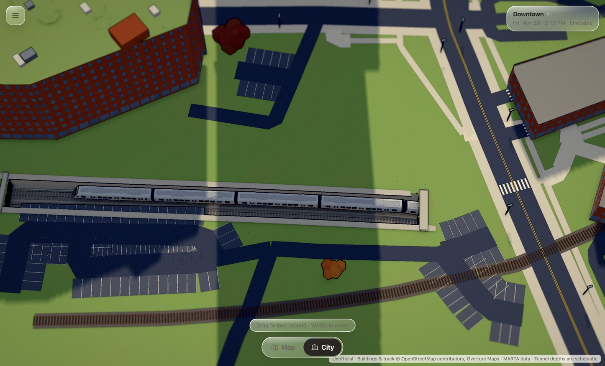
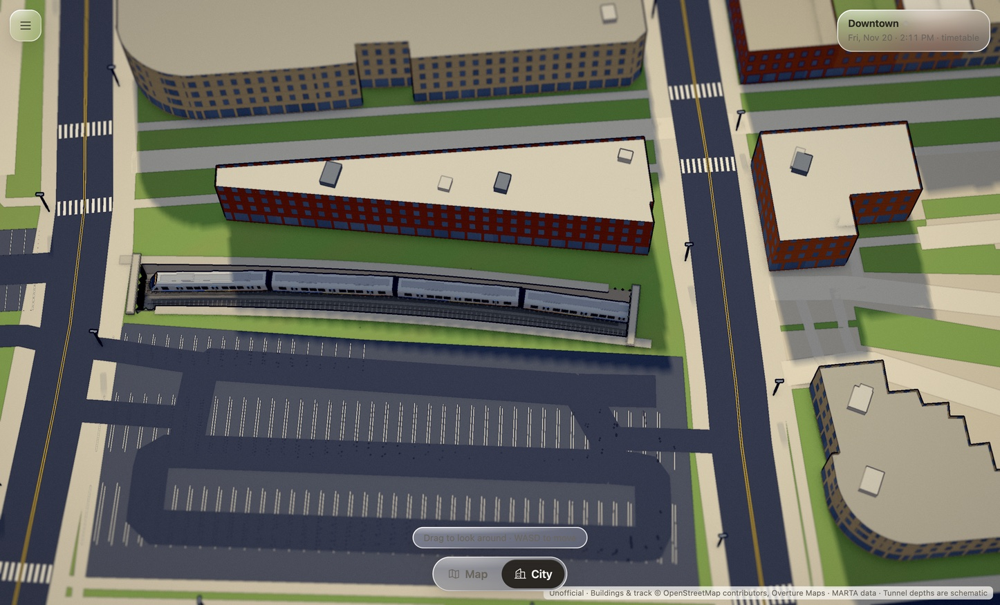

The Map and City read the same train positions. In City each car takes the direction and
height of the rendered track beneath it. A car stays in the scene until both ends have
passed under cover, so the front can disappear while the tail is still in daylight.
The timetable and live feed both use illustrative car counts and the CQ400-style model.
In Orca the real clock supplied 19 live heavy-rail positions across the system. Scrubbing
ten minutes back switched the City source to scheduled positions, and Now restored live
positions. The first check happened to have no cars in daylight on the downtown board.

Marlin’s ground-grid sample near the east cut was 311.15 m above NAVD88, compared with
319.52 m fifty metres north and 319.09 m fifty metres south. That supports a depression
there. It does not measure a railhead or the cover underneath Five Points. The trains
use the same schematic profile as the rendered rails.

On the Galaxy A16, the production build with motion and the previously shipped profiles
averaged 34.0 fps as the train moved east from Georgia State. With the two cuts included,
the Five Points replay at 2× averaged 31.9 fps (33.8, 33.3 and 28.8 across three
eight-second windows). The Georgia State run at 1× averaged 35.9 fps (36.1, 36.2 and
35.4). Both combined runs used a foreground 384 × 692 low-tier canvas at the opening
camera pose, with 4.5 seconds to warm up after the board appeared.

A repeat of the cut replay with temporary timing probes averaged 33.2 fps. Across the
three windows, looking up positions took at most 1.2 ms at the 95th percentile and placing
the cars took at most 0.7 ms. Between zero and eight cars were eligible to draw.

## 2026-11-21 · Where MARTA actually sees the sky downtown

The City handoff expected MARTA track to surface "by the Dome/GWCC". It doesn't. Before I
changed any geometry, I checked each stretch of the Blue/Green line from Vine City to Georgia
State against three primary sources: OSM way tags and edit history, USGS NAIP imagery
(2023-10-08, 0.6 m, public domain) and Vantor WorldView-2 imagery (2026-02-02, 0.5 m,
leaf-off) through Esri.

- **SEC District (Dome/GWCC) is covered.** MARTA's roof-replacement page says the station
  "sits underneath the Centennial Olympic Park Drive bridge overpass", and debris from the
  bridge was falling onto the station's own roof. The open slot you can see beside it in the
  imagery holds the Norfolk Southern freight tracks. MARTA tunnels under them at OSM layer −3.
- **The Gulch trench is open.** Just west of Five Points, OSM has left two short ways (111 m and
  141 m) without a tunnel tag since 2019. The leaf-off 2026 image shows a walled trench with a
  footbridge across it, and its ends sit within a few metres of the OSM ways.
- **So is a cut east of Five Points.** It runs beside a car park between Peachtree St and Pryor St,
  and the rails are visible in both images.
- **Vine City's open cut is real but off the board.** It sits at x ≈ −1,300 to −1,140 m, and
  the board's edge is at −1,000.

Two bugs had buried both open cuts. The first was in the profile builder. It fills untagged
gaps of 150 m or less between tunnels, a rule I wrote on day one because most gaps are mapping
seams. These two weren't. Even unfilled, its 150 m moving average blends a short gap with the
deep tunnels on either side, so its depth comes out of the smoothing, not the survey. The fix is an explicit `VERIFIED_OPEN` table
in `scene.rs`. It is keyed by the OSM ways' geometry, not by feed-generated path ids, and it pins
those samples at a schematic −4 m before and after the cleanup. Regenerating `scene.json` without
the change reproduced the old file byte for byte. With it, 249 samples are pinned, and 529
samples changed on 12 Blue/Green paths. All of them sit in or next to the two cuts, where the
ramps were re-smoothed. Nothing else moved, East Portal's ramp included.

The second bug was in City. Its flat board had never carved the ground for MARTA, so the first
render showed two portal headwalls with lawn between them. The board now leaves a slot over
every below-grade open stretch: 1 m sub-cells merged into row runs near a cut, then a concrete
floor and wall-top coping. The ground mesh grows from 60,000 to 64,914 vertices, and in Node the
board stage takes about 20–30 ms more (16–36 ms without cuts, 40–56 ms with them). Browser timings swung between 90 and 320 ms
from run to run, so I'm not quoting them.

A contract test runs the real `alignment()` smoothing and the portal threshold on every
Blue/Green path. It requires exactly these open runs near Five Points, each ending within 25 m of
the surveyed ends. With the fix the ends land 7–23 m away, and the old profiles fail the test.

What surprised me: the honest answer to "where's the open track by the Dome?" was "the trench
you'd walk past in the Gulch", and the evidence that settled it was the bare February trees, not
the leafy 2023 summer image. Centennial Yards plans to deck over the Gulch, so this entry carries
a re-check date.

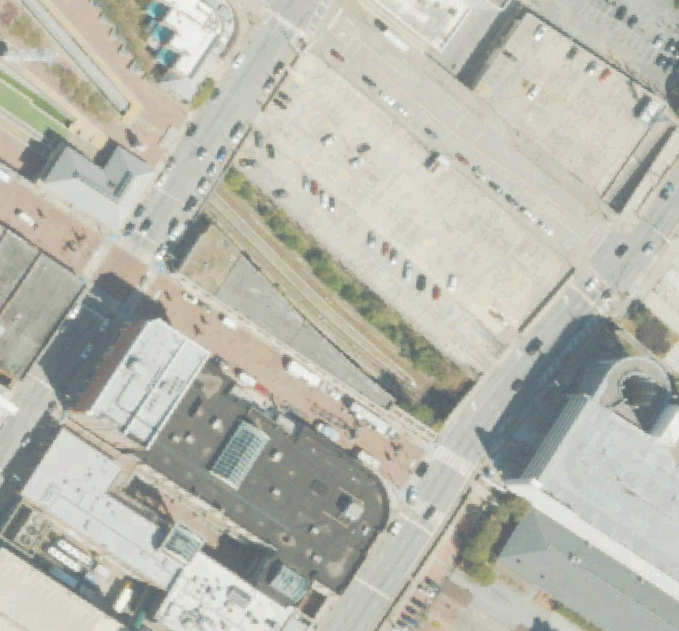

Sam also asked whether City should have an underground view, since tunnels hide most trains.
It's in the art backlog's Cutaway section. Deploying this needs `pnpm data:scene` (or
`pnpm data`) and a web rebuild.
## 2026-11-21 — What the ground can tell us at Five Points

The ground on the Blue/Green alignment about 200 m east of Five Points sits roughly eight metres below both sides of the corridor. A 5 m grid keeps that depression in a downtown board that takes 122.4 KiB gzipped, including its vertical reference. The surprise came farther east. Follow those heights across the Downtown Connector and the train would descend toward the freeway because the public bare-earth DEM removes bridge decks. At Five Points the grid gives us 323.8 m NAVD88 at the scene origin, while the station's stacked tracks remain a separate measurement. The pipeline prototype includes 18 GTFS ground checks and a 101-point test across the cut. [Terrain findings and reproduction](downtown-ground.md) · [Ground map and sections](log/2026-11-21-downtown-ground.png)

## 2026-11-21 — A static terrain pass before the trains

A camera at street-block scale makes the east cut easier to read than the skyline view. Two-metre contours climb both banks, about eight metres above the sampled alignment. Across the Connector, the same drawing follows the freeway floor at 303.9 m NAVD88 and climbs to 314.1 m on the eastern bank. We can now orbit either section in the desktop terrain preview, then bring the City buildings and trees back for context. The JavaScript decoder matches all 54 centre and flank readings in the pipeline CSV. The City data build copies the checked terrain assets without downloading the 318 MB source tile. [East cut in Orca](log/ui/2026-11-21-ground-preview-cut.jpg) · [Connector in Orca](log/ui/2026-11-21-ground-preview-connector.jpg)

## 2026-11-21 — A train stays level over the Downtown Connector

In the local terrain preview, the Blue Line crosses a freeway floor that sits about
10 m below the east bank. The 5 m USGS ground grid shapes the freeway and sets the
foot of each schematic pier. For this study we anchored the structural model once at
the east bank (314.1 m NAVD88), then used City's existing rail profile 7 m above that
anchor. The mapped order puts MARTA above the street and freight bridges. Their
clearances, the railhead elevation and the pier locations remain schematic.

[Replay the crossing on the local City server](http://localhost:5317/terrain-preview.html?at=crossing).
It opens on a scheduled Blue train at 2:12:49 p.m. Eastern on November 20. Replay
covers 28 seconds around that moment. The first render tipped the cars toward the sky:
the cars were aiming at a world-space target computed in track-local coordinates.
After the fix, the Orca replay measured zero pitch on the level span as the cars
crossed the freeway. A regression test translates the train group down 9.7 m and
checks the cab still points horizontally east.

The Galaxy A16 averaged 54.4 fps across three foreground eight-second windows during
the replay (54.0, 54.1 and 55.1 fps, 384 × 692 CSS pixels, render DPR 2). This is a
standalone crossing scene. Full City with its weather and post-processing needs a
separate measurement when the terrain reaches that renderer.

