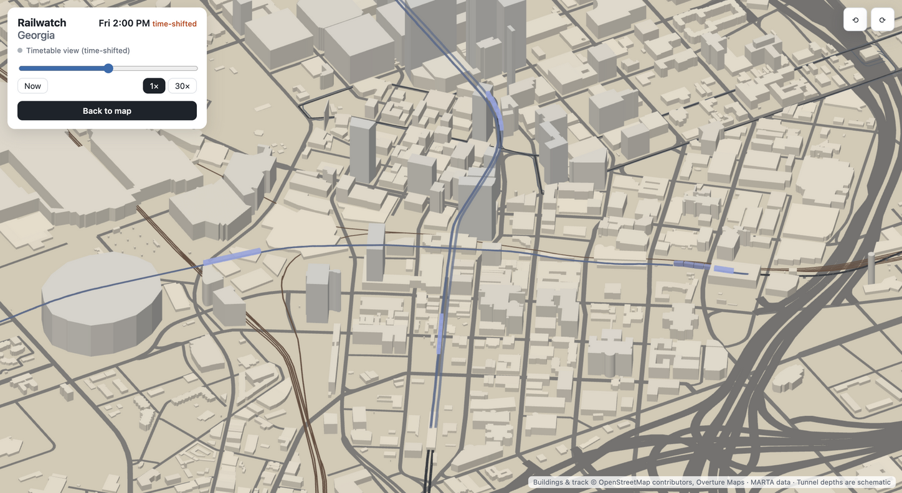
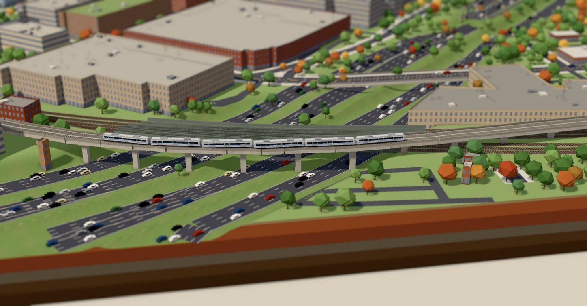
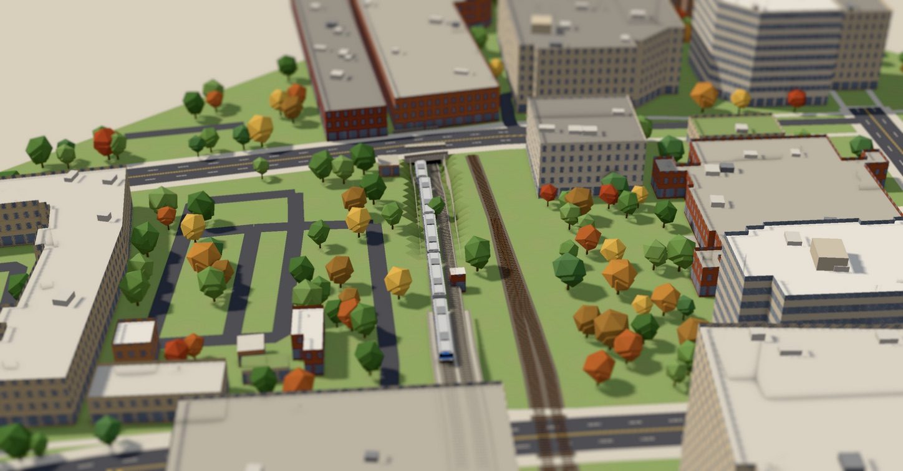

# Build log

A running record of how this was built, kept so it can become a blog post later. It
captures the decisions, the numbers, and the mistakes, and it explains why things changed.
Newest entries go at the bottom. Screenshots live in `docs/log/`.

---

## 2026-11-20: Where the idea came from

As a kid I'd drive around town with my dad trying to guess where we might catch a train.
The idea is to give someone else that experience: something like Flightradar24 for trains,
with a model railroad you can zoom into. A parent opens it on a Saturday and asks, "Where
nearby might we see a train, and what should we look for?"

Constraints: free for visitors, no paid data feeds, modest hosting. It must always be clear
what is **live**, what is **scheduled**, and what is **illustrative**.

## Data reality check (same day)

The first brainstorm considered Denver, because its transit agency (RTD) publishes live
vehicle positions under a license that allows redistribution. I checked the feed directly:

- 54 rail vehicles were reporting, all with a trip, a heading and a timestamp.
- 44 of the 54 moved more than 50 m in 90 seconds.

Atlanta is home, though, so we switched. What Atlanta actually offers:

| Rail | Source | What we can honestly show |
|---|---|---|
| MARTA subway | Rail REST API (free key) | Live |
| Atlanta Streetcar | Timetable only (absent from both live feeds) | Scheduled |
| Amtrak Crescent | Static GTFS, no realtime feed | Scheduled |
| Freight (NS, CSX) | FRA crossing inventory: railroad-reported trains/day | Reported average |

There is **no free live freight data in the US.** That single fact shapes the whole project.

The busiest reported crossings in metro Atlanta: Sawtell Ave in south Atlanta (51 trains a
day), Mableton/Austell (43) and Gainesville (44). Metro Denver's busiest freight crossing
reports only 28.

## Four truth tiers

Every fact on the map carries one of these labels: `live`, `scheduled`, `reported`,
`inferred` or `illustrative`. The label is stored per attribute, not per train. A train's
position can be live while its car count is illustrative. Later research showed the Swiss
geOps live maps use nearly the same ladder (planned → delay-adjusted → GPS), which was
reassuring.

## Stack: fast and nearly free

- **Rust** for an offline pipeline that turns the big public datasets into small static files.
- **TypeScript + Vite + MapLibre GL** for the map, on **OpenFreeMap** tiles (no API key).
- **One Cloudflare Worker** for anything that needs a secret.

Speed comes from small payloads and from the browser animating trains on the GPU, not from
the choice of language. Scheduled trains are computed *in the browser* from the
timetables, so they cost zero server requests.

The core data-model choice: **a train's position is "metres along a path", not a lat/lon.**
That makes smooth animation and on-track rendering easy. It also gives the future diorama
a natural coordinate system.

## The pipeline, by the numbers

- MARTA: 5,341 rail and streetcar trips collapse into 29 stopping patterns.
- Amtrak: the Crescent only, with 35 trips.
- Freight: 5,043 track segments from the North American Rail Network and 6,041 open public crossings.
- Total output: about 1.2 MB gzipped.

Gotchas worth writing about:

- MARTA's GTFS pads times with spaces (`" 8:17:00"`), and GTFS allows times like `25:30:00`.
- The crossing data says `CSX` where the rail network says `CSXT`. Every other railroad code matched.
- **I misread the rail network's `NET` codes.** I guessed `T` meant transit. The official
  list says `T` is a *rail-trail*, and `Z` is transit/museum.
- **Main-line counts were leaking into yards.** Traffic was "inferred" outward from crossings
  along the same railroad's track. Busy main-line numbers spread onto yards and industrial
  spurs: about 1,800 such segments inherited 40–50 trains a day. Restricting inference to
  main line and passing sidings cut the inferred segments from 3,040 to 1,007.
- A sanity check that looked like a bug: only 24 MARTA trains were scheduled at 2 pm on a
  Friday. That's right. Midday headways are about 15 minutes and trips run 9–46 minutes end to end.
- Four Crescents on the map at once is also right. The trip takes about 30 hours, so
  yesterday's and today's trains overlap in both directions.

## UI lessons

- Trains drawn in their line's colour vanish into the line. They needed a dark halo and a soft shadow.
- Bridges and underpasses drawn as white dots looked exactly like stations. Grade-separated
  crossings became small grey dots; street-level crossings, the ones you can watch from, stay prominent.
- MapLibre doesn't hit-test symbols drawn with `icon-ignore-placement`, so taps on trains
  did nothing. The fix was to find the nearest train in screen space ourselves.

## Colour has to mean the same thing everywhere

MARTA's Red/Gold/Blue/Green look great. But colour-by-agency doesn't scale: New York has
dozens of route colours, and freight railroads have none. The new rule:

- **Colour = kind of service:** city rail blue, intercity violet, freight rust. Freight
  width and glow scale with trains per day.
- **Style = how we know:** a solid train is live, an outlined train is scheduled.
- Agency colours appear as an accent only: in cards, and as a tint once you zoom into a city.

## Live MARTA

The MARTA rail API returns one row per *(train, upcoming station)* prediction, with a
latitude/longitude on each row. The open question was whether those are real GPS positions
or just station coordinates. Three snapshots 25 s apart answered it:

- Half the trains were 400–900 m from any station.
- 17 of 24 moved between snapshots, at up to about 1 km in 43 s (~55 mph).

So they're real positions, updated every 30–60 s. The Worker groups rows per train and
caches the result for 10 s. The browser snaps each fix onto the line: all 27 trains landed
within 55 m, most within 15 m. It then glides each train toward its latest fix over 8 s.

The key lives in 1Password. Locally it's written to a gitignored `.dev.vars`; in production
it's a Worker secret. It never appears in a response or a log, and I checked.

Two small bugs:
- The "don't poll more than every 5 s" guard started at `0`, which blocked the first poll during the page's first 5 seconds.
- Vite doesn't restart when you *create* a config file, so the API proxy silently served `index.html`.

## Can we know where freight trains are?

No free source gives positions or individual schedules. What *does* exist, enough to
simulate plausible trains honestly:

- **EIA-923 fuel receipts:** Plant Scherer gets about 4.7M tons a year of Wyoming coal and
  Plant Bowen about 4.8M tons from the Midwest and Appalachia, all by rail. That's roughly
  one loaded coal train a day into each plant, plus the empty one going back.
- **STB Public Use Waybill Sample:** the commodity and car-type mix between regions.
- **Norfolk Southern intermodal schedules:** cut-off and pickup times at Inman and Austell (Whitaker).
- **Ports:** Savannah's Mason Mega Rail handles about 42 trains a week; Brunswick autos run 5–10 a week.
- **STB weekly data:** average train speeds by type. **AAR:** a median Class I train of about 5,300 ft.

No public project turns crossing counts into a synthetic timetable, so that part would be
new ground. The idea: fixed flows first (coal, ports, intermodal), then split each segment's
remaining count by the waybill mix, using a published random seed so every viewer sees the same "day".

## Change of direction: an art project

Mini Tokyo 3D (a timetable-driven 3D Tokyo, open source) is the closest thing to the original
vision. Two visual references:

1. **Isometric pixel city** (yadongxie.com). Google Photorealistic 3D Tiles are rendered
   orthographically, then an image model (Qwen-Image + a style LoRA) redraws each 512 m tile
   as pixel art. That takes about 1.5–2 GPU-hours per 16k×10k block, and the result is
   served as a ~320 MB Deep Zoom pyramid. Cars, birds, trees and water are animated in
   overlays. It's gorgeous, but it's frozen in time, and it depends on Google tiles with restrictive terms.
2. **A low-poly, ink-outlined 3D train scene** with time-of-day ("blue hour") and a cab HUD
   ("54 s early", speed against the limit).

Decision: build a **real-time** low-poly 3D Atlanta from open data. Pixel art becomes a
*render style* of the same scene (render at low resolution, upscale with nearest-neighbour,
limit the palette) instead of an offline AI pipeline. Time of day follows the real sun, and
weather could too.

Scope: start at downtown (Five Points and the Gulch, where all four MARTA lines, the
streetcar, buses and freight meet). Grow toward the I-285 perimeter.

## Building heights: Atlanta is unusually well mapped

Before committing to a 3D skyline, I needed to know how many Atlanta buildings actually
have a height. I queried Overture Maps (release 2026-11-18) with DuckDB straight from its
public S3 bucket, using a bounding box around I-285. The download took 94 s and produced
a 60 MB parquet file. (The OpenStreetMap query service was unreachable, but Overture
carries OSM buildings and records the source of each.)

| Area | Buildings | Have a height | Large (>1,000 m²) with height or floors |
|---|---|---|---|
| Downtown 2×2 km (Five Points) | 822 | 78% (91% incl. floor counts) | 93% |
| Midtown core | 1,680 | 90% | 99% |
| I-285 box | 381,680 | 82% | 91% |

- 95% of the buildings come from OpenStreetMap. The rest are Microsoft's ML footprints,
  which come with a height. Esri adds a few dozen.
- **The heights look measured, not defaulted.** 97% are fractional (e.g. 5.3 m, 5.1 m), and
  small houses spread smoothly around 5–6 m. That points to a LiDAR-derived import, not a
  "one floor = 3 m" guess.
- Spot check: the tallest values match the real skyline: Bank of America Plaza (312 m),
  Truist/SunTrust Plaza (265 m), One Atlantic Center (250 m), and 191 Peachtree (235 m).
- Roof shapes are almost never tagged (0.9%). Roofs will have to be procedural: flat for
  large buildings, pitched for houses, chosen by footprint size.
- Mind the license: OSM-derived buildings are ODbL, which requires attribution and share-alike
  for the derived database.

Scale check: 381k buildings is a lot for a browser, but it's fine if they're split into tiles,
merged per tile and streamed by distance. The detailed downtown slice is only 822 buildings.

## Rail levels: tunnels and viaducts are in the open data

GTFS route shapes are flat 2D lines, so a 3D scene can't tell from them where MARTA runs
underground. Overture's transportation theme can, through its rail flags. In the downtown box
it has 59 rail segments:

- **12 subway tunnel segments** at level −1 or −3. (At Five Points itself the two lines sit
  on −1 and −2; see below.)
- **4 subway bridge segments** at level 3.
- Standard-gauge track flagged `is_freight`, tram (streetcar) track, and abandoned or
  disused spurs.

Plan: match GTFS path distance ranges to these segments to get a vertical profile for each
path, so trains dive into portals and ride the viaducts at the right places.

## A second opinion: Codex (gpt-6.2-astra)

Before building the 3D slice, I asked OpenAI's Codex CLI (`gpt-6.2-astra`, high reasoning,
read-only on the repo) for an independent plan. One gotcha: `codex exec` waits for stdin when
it isn't attached to a terminal, so it hung until rerun with `< /dev/null`.

Its main points:

- A Three.js scene inside the existing Vite app, opened from an "Explore in 3D" button.
  Orthographic camera with a fixed tilt and bounded pan and zoom, which suits a diorama and a
  later pixel mode. MapLibre stays as the regional map.
- **One transit model for both views:** pull the clock and the live-vs-scheduled selection
  out of `main.ts`, and give 3D a path sampler keyed by `(pathId, s)`.
- **Coordinates:** project to UTM 16N offline, subtract a Five Points origin, and emit local
  metres. Rust bakes one `.glb` for downtown plus a JSON manifest.
- **The first test isn't the skyline.** It's "watch a train enter Five Points and understand
  which level it's on." It flagged Five Points' stacked platforms as the riskiest geometry.
- **Free-tier maths:** every poll invokes the Worker even when its cache answers. Polling
  every 60 s, 100k requests/day covers about 69 continuously open tabs. Our 15 s poll covers
  about 17.
- **Honesty details:** a live fix that can't be snapped to track should show in 2D but not as
  an on-track 3D model. Freshness should follow the observation time, not the fetch time.

## 3D slice, step 1: do the route shapes line up with the subway data?

This was the riskiest assumption in the 3D plan. Train positions live on GTFS route shapes;
tunnel and viaduct levels live on Overture's rail segments. If the two didn't line up, the
level matching would pick the wrong track at Five Points, where two subway corridors cross on
different levels.

The matching rule:
- `class = subway` segments only. Freight track runs alongside and has no level.
- Within 15 m.
- Bearing within 30° of the route, so the crossing corridor is never picked.
- The level read *at that point* along the segment. Some Overture segments carry ten or more
  `between` ranges, e.g. `-3` for 0–16%, `1` for 17–20%, and so on.

Result: **every downtown sample on every MARTA path matched (100%), with a median offset of
about 1 m.** At Five Points itself, the east–west line (Blue/Green) is on level −1 and the
north–south line (Red/Gold) is on level −2 below it. I first wrote this the wrong way round
from a quick read of the spans, and caught it only when the 3D depth tint looked "wrong". The
east–west line reaches level −3 elsewhere downtown. The elevated runs are a ~770 m viaduct on
the east–west line **east** of downtown (toward King Memorial) and a ~810 m one on the
north–south line to the **southwest** (toward West End). I first wrote "a viaduct over the
Gulch", which was wrong; a review caught it. The hand-written fallback table wasn't needed.

One cleanup: short 70–130 m gaps between tunnel ranges come back as "level 0, no flags",
which would pop trains to the surface between tunnels. Gaps of 150 m or less between two
underground spans take the shallower depth.

Overture levels are stacking order, not depth, so heights are schematic:
−1 → −10 m, −2 → −16 m, −3 → −22 m, any bridge → +7 m.

## 3D slice, step 2: a miniature downtown that runs live

The downtown diorama is now a Three.js view inside the same app. It loads only when you
press "Explore downtown in 3D" (or open `?view=3d`), as a separate ~124 KB gzipped chunk.

**Data.** `pipeline/scripts/extract_overture.py` pulls downtown from Overture's S3 bucket with
DuckDB: 2,280 buildings, 73 rail segments and 7,940 road segments in under a minute. A new
`railprep scene` command (Rust) bakes:

- **Buildings:** footprints triangulated with `earcutr` (holes kept), then extruded.
  1,871 heights are measured, 165 come from floor counts × 3.5 m, and 211 fall back to 6 m.
- **Roads and static freight/streetcar track:** flat ribbons.
- **An elevation profile per MARTA path:** one value every 10 m (schematic).
- **Size:** 960 KB gzipped in total, assuming the host compresses `.bin` files (not verified until deploy). Footways and service alleys were dropped first; they
  were 1.7 MB of road geometry that adds nothing at diorama scale.

**Rendering.**
- An orthographic camera with a fixed 38° tilt, rotatable in 90° steps.
- About 10 draw calls and ~137k triangles. The CPU side of each frame takes well under a
  millisecond on a laptop. GPU time and real phones are not measured yet.
- Trains are two `InstancedMesh`es of boxes, one for surface cars and one for cars underground.
- Each car is placed by sampling the train's path at `s − i·(carLength + gap)`, so a six-car
  train bends round curves and dips into a portal one car at a time.
- Underground track and cars draw in a translucent "cutaway" pass with no depth test, tinted
  darker the deeper they are.

**Things that went wrong on the way**, all visible in the first screenshot:

1. **Hollow buildings.** Overture rings come in both windings, so back-face culling removed
   roofs and walls at random. The fix was a double-sided material.
2. **Track that vanished.** Ribbon winding depends on travel direction, so half the MARTA
   track faced downward and was culled from above. Same fix.
3. **Invisible trains.** A real MARTA car is 3 m wide, about 3 px at this zoom. Like Mini
   Tokyo 3D, trains are now drawn up to 3× wide/tall when zoomed out and true size up close.
   Length stays true, because length is what positions the cars.
4. **I had the Five Points levels backwards.** The depth tint showed the east–west line
   *above* the north–south line, the opposite of what I'd written in this log. The data
   was right (east–west −1, north–south −2) and my reading was wrong.
5. **Taps that did nothing,** for two reasons. A synthetic pointer made `setPointerCapture`
   throw before the tap start was recorded. And `InstancedMesh` raycasting culls against a
   cached bounding sphere computed when there were zero cars, so it needs recomputing every
   time the trains move.

**The headline test passed.** At 4:32 pm on a Friday, live Blue Line train #108 was "arriving"
at Five Points on the east–west level. A Red/Gold train crossed on the deeper level below it.
Tapping the train opened its live card ("reported 26 s ago by MARTA").

Also in this step:
- The live feed now polls every 30 s: one open tab uses ~2,900 of the free tier's 100k
  Worker requests a day.
- Trains expire by when MARTA *observed* them, and the Worker reports a missing observation
  time as `null` instead of quietly substituting the fetch time.
- Live fixes that can't be snapped to track are left out of the 3D view.

**Review fixes before calling it done:**
- **Trains popped up at the scene edges.** Profiles end at the scene boundary and returned 0
  beyond it, while cars draw a little past the edge. Profiles now hold their end value.
- **A level-0 "tunnel" is a covered cut at street level,** not a −6 m dip, so it's at grade.
- **A ~120 m "bridge" between two tunnels on Red/Gold** (a span over something inside the cut)
  would have surfaced trains for a block. Short positive spans between tunnels now stay
  underground at the shallower depth.
- **Removed the disclaimer footer** at Sam's request; it added noise. "Unofficial" now leads
  the small attribution line instead.

Known limitations in this slice:
- Scheduled vs live, and tunnel depth, are both shown as lightness, and there's no key in 3D yet.
- No nose taper on lead cars.
- Underground trains draw on top of towers by design (the cutaway). A fade near the
  selected train is an option if it reads as confusing.

## 2026-11-20 · Finding the look: colour isn't style

**First attempt: six "looks" on the same scene** (`?look=` / the `L` key in 3D): architect's
model, golden hour, night with procedural lit windows, toy town, pixel and the baseline.
Screenshots in `docs/log/looks/`. Sam's verdict: *these are colour treatments, not artwork.*
Correct. The references (the isometric pixel city, the low-poly train video) are made of
**detail and form**: modelled trains, trees, curbs, rooftop clutter, a ground with depth.
Recolouring grey boxes can't get there. (The looks code stays, since shadows and night
windows will be useful.)

**Second attempt: one small block, modelled properly.** Instead of styling all of downtown,
pick one 850 × 500 m patch and give it real detail: the **MARTA east portal** by Georgia
State, where the east–west line climbs out of its tunnel beside the freight main and
crosses the Downtown Connector on a viaduct.

- `pipeline/scripts/vignette.py` crops the Overture extract to the patch (64 buildings,
  streets with overpass flags, freight and subway track) → `vignette.json` (66 KB).
- `web/vignette.html` + `src/vignette/` build everything in the browser:
  - **A diorama board**: heightfield top, the cut edges showing topsoil → **Georgia red clay**
    → rock, on a walnut plinth.
  - **The Downtown Connector sunk into a trench** (it really runs below street level here);
    overpass streets keep their level and get concrete fascias.
  - **MARTA**: ballast, concrete ties, rails, third rail; an open cut with a portal
    headwall; a box-girder viaduct on piers over the highway. Elevations come from the same
    baked profile the main 3D view uses (−10 m → +7 m).
  - **Freight**: wooden ties, rusty rails, through-girder bridges over the trench.
  - **Buildings**: brick / stone / glass by height, with storefront glass at street level,
    punched, ribbon or curtain-wall windows (shader), parapets, rooftop HVAC and stair
    penthouses, white, gravel and green roofs.
  - **~1,500 trees** along streets and through open ground. It's November, so some oaks
    and maples are turning.
  - **A MARTA train after the CQ400**: stainless body, window band, line-colour stripe, and
    cab ends whose destination sign and light bar glow in the line colour (from the art
    backlog).
  - **Traffic**: instanced cars looping along lanes of the real streets and the Connector.
  - **Studio lighting**: soft shadows, GTAO ambient occlusion, a narrow-FOV camera and a
    **tilt-shift blur**. That last one does most of the "miniature" work.

Trains and traffic here run on an illustrative loop; this is a look study, not live data.

**Lessons:** a small patch you can afford to detail beats a big one you can only colour.
Most of the miniature feel came from three cheap things: tilt-shift, trees and visible cut
edges on the board.

## 2026-11-20 · Atlanta's clock: real traffic, sun and seasons

**Traffic from free federal data** (`pipeline/scripts/vignette_traffic.py` → `traffic.json`):
- **How busy each road is:** FHWA's national road inventory (HPMS) gives daily volume,
  truck volume, lanes and speed limit per segment. The Connector here carries 307k–372k
  vehicles a day on 12–13 lanes, about 9% of them trucks; Boulevard has 17,300 and Auburn
  Ave 4,400. 80 of 159 drivable runs matched by distance and bearing; the rest (alleys,
  service roads) get class defaults.
- **The shape of the day:** FHWA's 2023 hourly counts from Georgia station 000009, on the
  Connector just north of the board. On weekdays, 5.8% of the day's traffic passes in the
  7 am hour and 1.0% in the 3 am hour. Weekends are nearly as busy, just later.
- **The model:** vehicles per lane per hour = daily volume × the hour's share ÷ directions
  ÷ lanes; a curve slows traffic as a lane nears capacity; how many cars are on the lane =
  flow ÷ speed. Cars hold evenly spread slots and switch on or off only as they leave the
  board, so traffic thickens without popping. Trucks appear in proportion to each road's
  truck share. Labelled "typical for this hour", not live.
- **Caveat:** counts flatten when the Connector jams, because a jam lowers throughput.
  Live speeds from Georgia 511 (key pending) would show the real crawl.

**Sun and seasons:**
- Sun position is computed from the date, time and Atlanta's latitude. It drives the light
  colour, shadows and sky: golden at 4:55 pm in November, blue hour after 5:30.
- At night: lit windows (about a third of offices, most shopfronts), street lamps with
  pools of light, glowing head and tail lights, and lit MARTA windows.
- **Trees by date:** about a quarter evergreen (loblolly pines as stacked cones, magnolias).
  The rest turn by species (maple red, sweetgum burgundy, oak russet, poplar gold), each
  on its own few-week schedule, drop their leaves to bare branches by mid-December, and
  leaf out light green in early April.

Not yet: live weather (Open-Meteo, so it needs no key). The published artifact can't call
outside services, so live weather will only work in the real app; the artifact would need a
weather picker.

## 2026-11-20 · Weather, real trees, smoother trains

- **Wobbly trains fixed.** The GTFS route shape is rounded to about 1 m with uneven point
  spacing, so cars twitched at every vertex. The alignment is now resampled every 2 m and
  smoothed (±24 m moving average, twice), elevation too. The largest heading change is now
  0.11° per half-metre of travel, and the largest height change 5 cm.
- **Weather** from Open-Meteo (free, no key): WMO code, cloud cover, rain, visibility and
  temperature, refreshed every 10 minutes. Clouds flatten the sun and soften shadows; rain
  draws shader-animated streaks (one draw call) and darkens wet surfaces; fog is relative to
  camera distance so the far side fades and the foreground stays crisp; storms flash.
  The published artifact can't call outside services, so it has a weather picker instead.
- **Real trees** from the Meta + WRI 1 m canopy height map (CC BY 4.0),
  `pipeline/scripts/vignette_trees.py`: crowns as local maxima ≥ 4 m tall, at least 5 m
  apart, with crown radius from the surrounding canopy area; roofs masked out. This patch
  has only **76 trees and about 4% canopy**: it really is highway, campus and parking. The
  imagery is probably about 2018, and small street trees are likely under-counted.

**Next truth gap:** the ground. Everything not a building or road is drawn as grass, but
downtown is mostly parking lots and plazas. Overture's land use and land cover layers (or
OSM `amenity=parking` / `landuse`) would fix that.
