# Build log

A running record of how this was built, kept so it can become a blog post later. It
captures the decisions, the numbers, and the mistakes, and it explains why things changed.
Newest entries go at the bottom. Screenshots live in `docs/log/`.

---

## 2026-11-20: Where the idea came from

As a kid I'd drive around town with my dad trying to guess where we might catch a train.
The idea is to give someone else that experience: something like Flightradar24 for trains,
with a model railroad you can zoom into. A parent opens it on a Saturday and asks, "Where
nearby might we see a train, and what should we look for?"

Constraints: free for visitors, no paid data feeds, modest hosting. It must always be clear
what is **live**, what is **scheduled**, and what is **illustrative**.

## Data reality check (same day)

The first brainstorm considered Denver, because its transit agency (RTD) publishes live
vehicle positions under a license that allows redistribution. I checked the feed directly:

- 54 rail vehicles were reporting, all with a trip, a heading and a timestamp.
- 44 of the 54 moved more than 50 m in 90 seconds.

Atlanta is home, though, so we switched. What Atlanta actually offers:

| Rail | Source | What we can honestly show |
|---|---|---|
| MARTA subway | Rail REST API (free key) | Live |
| Atlanta Streetcar | Timetable only (absent from both live feeds) | Scheduled |
| Amtrak Crescent | Static GTFS, no realtime feed | Scheduled |
| Freight (NS, CSX) | FRA crossing inventory: railroad-reported trains/day | Reported average |

There is **no free live freight data in the US.** That single fact shapes the whole project.

The busiest reported crossings in metro Atlanta: Sawtell Ave in south Atlanta (51 trains a
day), Mableton/Austell (43) and Gainesville (44). Metro Denver's busiest freight crossing
reports only 28.

## Four truth tiers

Every fact on the map carries one of these labels: `live`, `scheduled`, `reported`,
`inferred` or `illustrative`. The label is stored per attribute, not per train. A train's
position can be live while its car count is illustrative. Later research showed the Swiss
geOps live maps use nearly the same ladder (planned → delay-adjusted → GPS), which was
reassuring.

## Stack: fast and nearly free

- **Rust** for an offline pipeline that turns the big public datasets into small static files.
- **TypeScript + Vite + MapLibre GL** for the map, on **OpenFreeMap** tiles (no API key).
- **One Cloudflare Worker** for anything that needs a secret.

Speed comes from small payloads and from the browser animating trains on the GPU, not from
the choice of language. Scheduled trains are computed *in the browser* from the
timetables, so they cost zero server requests.

The core data-model choice: **a train's position is "metres along a path", not a lat/lon.**
That makes smooth animation and on-track rendering easy. It also gives the future diorama
a natural coordinate system.

## The pipeline, by the numbers

- MARTA: 5,341 rail and streetcar trips collapse into 29 stopping patterns.
- Amtrak: the Crescent only, with 35 trips.
- Freight: 5,043 track segments from the North American Rail Network and 6,041 open public crossings.
- Total output: about 1.2 MB gzipped.

Gotchas worth writing about:

- MARTA's GTFS pads times with spaces (`" 8:17:00"`), and GTFS allows times like `25:30:00`.
- The crossing data says `CSX` where the rail network says `CSXT`. Every other railroad code matched.
- **I misread the rail network's `NET` codes.** I guessed `T` meant transit. The official
  list says `T` is a *rail-trail*, and `Z` is transit/museum.
- **Main-line counts were leaking into yards.** Traffic was "inferred" outward from crossings
  along the same railroad's track. Busy main-line numbers spread onto yards and industrial
  spurs: about 1,800 such segments inherited 40–50 trains a day. Restricting inference to
  main line and passing sidings cut the inferred segments from 3,040 to 1,007.
- A sanity check that looked like a bug: only 24 MARTA trains were scheduled at 2 pm on a
  Friday. That's right. Midday headways are about 15 minutes and trips run 9–46 minutes end to end.
- Four Crescents on the map at once is also right. The trip takes about 30 hours, so
  yesterday's and today's trains overlap in both directions.

## UI lessons

- Trains drawn in their line's colour vanish into the line. They needed a dark halo and a soft shadow.
- Bridges and underpasses drawn as white dots looked exactly like stations. Grade-separated
  crossings became small grey dots; street-level crossings, the ones you can watch from, stay prominent.
- MapLibre doesn't hit-test symbols drawn with `icon-ignore-placement`, so taps on trains
  did nothing. The fix was to find the nearest train in screen space ourselves.

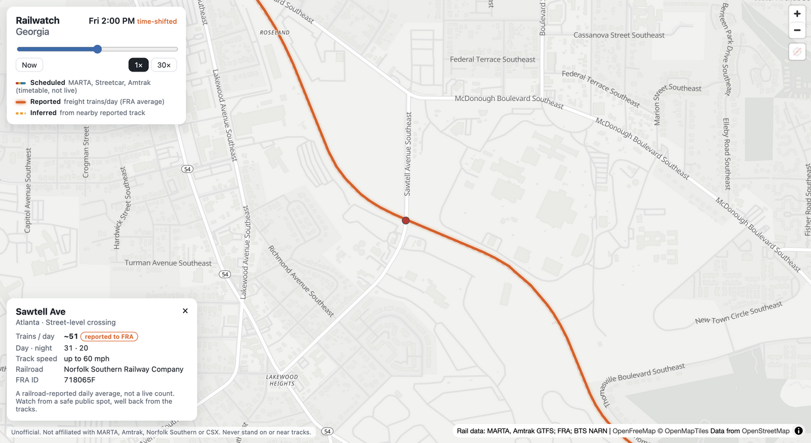

## Colour has to mean the same thing everywhere

MARTA's Red/Gold/Blue/Green look great. But colour-by-agency doesn't scale: New York has
dozens of route colours, and freight railroads have none. The new rule:

- **Colour = kind of service:** city rail blue, intercity violet, freight rust. Freight
  width and glow scale with trains per day.
- **Style = how we know:** a solid train is live, an outlined train is scheduled.
- Agency colours appear as an accent only: in cards, and as a tint once you zoom into a city.

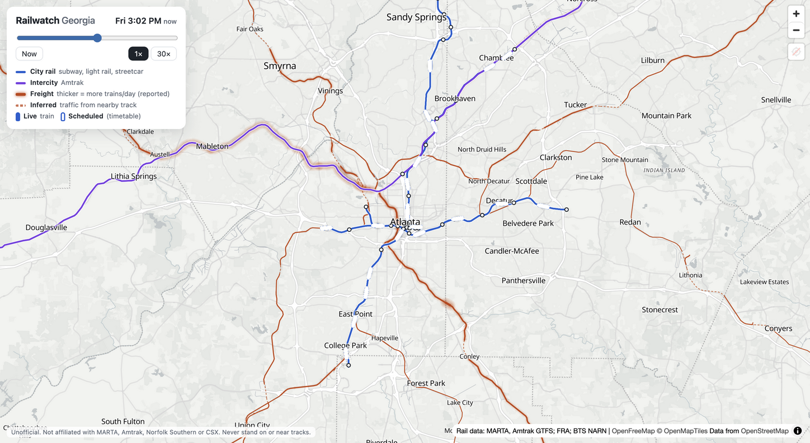

## Live MARTA

The MARTA rail API returns one row per *(train, upcoming station)* prediction, with a
latitude/longitude on each row. The open question was whether those are real GPS positions
or just station coordinates. Three snapshots 25 s apart answered it:

- Half the trains were 400–900 m from any station.
- 17 of 24 moved between snapshots, at up to about 1 km in 43 s (~55 mph).

So they're real positions, updated every 30–60 s. The Worker groups rows per train and
caches the result for 10 s. The browser snaps each fix onto the line: all 27 trains landed
within 55 m, most within 15 m. It then glides each train toward its latest fix over 8 s.

The key lives in 1Password. Locally it's written to a gitignored `.dev.vars`; in production
it's a Worker secret. It never appears in a response or a log, and I checked.

Two small bugs:
- The "don't poll more than every 5 s" guard started at `0`, which blocked the first poll during the page's first 5 seconds.
- Vite doesn't restart when you *create* a config file, so the API proxy silently served `index.html`.

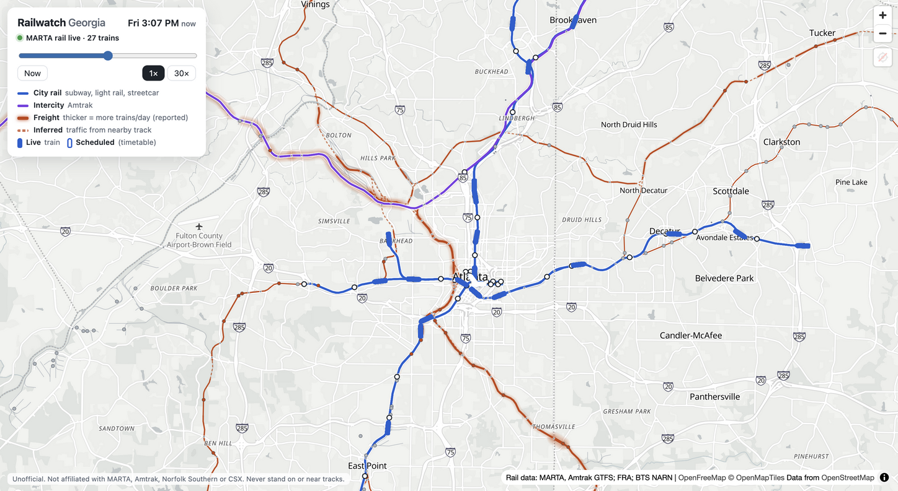

## Can we know where freight trains are?

No free source gives positions or individual schedules. What *does* exist, enough to
simulate plausible trains honestly:

- **EIA-923 fuel receipts:** Plant Scherer gets about 4.7M tons a year of Wyoming coal and
  Plant Bowen about 4.8M tons from the Midwest and Appalachia, all by rail. That's roughly
  one loaded coal train a day into each plant, plus the empty one going back.
- **STB Public Use Waybill Sample:** the commodity and car-type mix between regions.
- **Norfolk Southern intermodal schedules:** cut-off and pickup times at Inman and Austell (Whitaker).
- **Ports:** Savannah's Mason Mega Rail handles about 42 trains a week; Brunswick autos run 5–10 a week.
- **STB weekly data:** average train speeds by type. **AAR:** a median Class I train of about 5,300 ft.

No public project turns crossing counts into a synthetic timetable, so that part would be
new ground. The idea: fixed flows first (coal, ports, intermodal), then split each segment's
remaining count by the waybill mix, using a published random seed so every viewer sees the same "day".

## Change of direction: an art project

Mini Tokyo 3D (a timetable-driven 3D Tokyo, open source) is the closest thing to the original
vision. Two visual references:

1. **Isometric pixel city** (yadongxie.com). Google Photorealistic 3D Tiles are rendered
   orthographically, then an image model (Qwen-Image + a style LoRA) redraws each 512 m tile
   as pixel art. That takes about 1.5–2 GPU-hours per 16k×10k block, and the result is
   served as a ~320 MB Deep Zoom pyramid. Cars, birds, trees and water are animated in
   overlays. It's gorgeous, but it's frozen in time, and it depends on Google tiles with restrictive terms.
2. **A low-poly, ink-outlined 3D train scene** with time-of-day ("blue hour") and a cab HUD
   ("54 s early", speed against the limit).

Decision: build a **real-time** low-poly 3D Atlanta from open data. Pixel art becomes a
*render style* of the same scene (render at low resolution, upscale with nearest-neighbour,
limit the palette) instead of an offline AI pipeline. Time of day follows the real sun, and
weather could too.

Scope: start at downtown (Five Points and the Gulch, where all four MARTA lines, the
streetcar, buses and freight meet). Grow toward the I-285 perimeter.

## Building heights: Atlanta is unusually well mapped

Before committing to a 3D skyline, I needed to know how many Atlanta buildings actually
have a height. I queried Overture Maps (release 2026-11-18) with DuckDB straight from its
public S3 bucket, using a bounding box around I-285. The download took 94 s and produced
a 60 MB parquet file. (The OpenStreetMap query service was unreachable, but Overture
carries OSM buildings and records the source of each.)

| Area | Buildings | Have a height | Large (>1,000 m²) with height or floors |
|---|---|---|---|
| Downtown 2×2 km (Five Points) | 822 | 78% (91% incl. floor counts) | 93% |
| Midtown core | 1,680 | 90% | 99% |
| I-285 box | 381,680 | 82% | 91% |

- 95% of the buildings come from OpenStreetMap. The rest are Microsoft's ML footprints,
  which come with a height. Esri adds a few dozen.
- **The heights look measured, not defaulted.** 97% are fractional (e.g. 5.3 m, 5.1 m), and
  small houses spread smoothly around 5–6 m. That points to a LiDAR-derived import, not a
  "one floor = 3 m" guess.
- Spot check: the tallest values match the real skyline: Bank of America Plaza (312 m),
  Truist/SunTrust Plaza (265 m), One Atlantic Center (250 m), and 191 Peachtree (235 m).
- Roof shapes are almost never tagged (0.9%). Roofs will have to be procedural: flat for
  large buildings, pitched for houses, chosen by footprint size.
- Mind the license: OSM-derived buildings are ODbL, which requires attribution and share-alike
  for the derived database.

Scale check: 381k buildings is a lot for a browser, but it's fine if they're split into tiles,
merged per tile and streamed by distance. The detailed downtown slice is only 822 buildings.

## Rail levels: tunnels and viaducts are in the open data

GTFS route shapes are flat 2D lines, so a 3D scene can't tell from them where MARTA runs
underground. Overture's transportation theme can, through its rail flags. In the downtown box
it has 59 rail segments:

- **12 subway tunnel segments** at level −1 or −3. (At Five Points itself the two lines sit
  on −1 and −2; see below.)
- **4 subway bridge segments** at level 3.
- Standard-gauge track flagged `is_freight`, tram (streetcar) track, and abandoned or
  disused spurs.

Plan: match GTFS path distance ranges to these segments to get a vertical profile for each
path, so trains dive into portals and ride the viaducts at the right places.

## A second opinion: Codex (gpt-6.2-astra)

Before building the 3D slice, I asked OpenAI's Codex CLI (`gpt-6.2-astra`, high reasoning,
read-only on the repo) for an independent plan. One gotcha: `codex exec` waits for stdin when
it isn't attached to a terminal, so it hung until rerun with `< /dev/null`.

Its main points:

- A Three.js scene inside the existing Vite app, opened from an "Explore in 3D" button.
  Orthographic camera with a fixed tilt and bounded pan and zoom, which suits a diorama and a
  later pixel mode. MapLibre stays as the regional map.
- **One transit model for both views:** pull the clock and the live-vs-scheduled selection
  out of `main.ts`, and give 3D a path sampler keyed by `(pathId, s)`.
- **Coordinates:** project to UTM 16N offline, subtract a Five Points origin, and emit local
  metres. Rust bakes one `.glb` for downtown plus a JSON manifest.
- **The first test isn't the skyline.** It's "watch a train enter Five Points and understand
  which level it's on." It flagged Five Points' stacked platforms as the riskiest geometry.
- **Free-tier maths:** every poll invokes the Worker even when its cache answers. Polling
  every 60 s, 100k requests/day covers about 69 continuously open tabs. Our 15 s poll covers
  about 17.
- **Honesty details:** a live fix that can't be snapped to track should show in 2D but not as
  an on-track 3D model. Freshness should follow the observation time, not the fetch time.

## 3D slice, step 1: do the route shapes line up with the subway data?

This was the riskiest assumption in the 3D plan. Train positions live on GTFS route shapes;
tunnel and viaduct levels live on Overture's rail segments. If the two didn't line up, the
level matching would pick the wrong track at Five Points, where two subway corridors cross on
different levels.

The matching rule:
- `class = subway` segments only. Freight track runs alongside and has no level.
- Within 15 m.
- Bearing within 30° of the route, so the crossing corridor is never picked.
- The level read *at that point* along the segment. Some Overture segments carry ten or more
  `between` ranges, e.g. `-3` for 0–16%, `1` for 17–20%, and so on.

Result: **every downtown sample on every MARTA path matched (100%), with a median offset of
about 1 m.** At Five Points itself, the east–west line (Blue/Green) is on level −1 and the
north–south line (Red/Gold) is on level −2 below it. I first wrote this the wrong way round
from a quick read of the spans, and caught it only when the 3D depth tint looked "wrong". The
east–west line reaches level −3 elsewhere downtown. The elevated runs are a ~770 m viaduct on
the east–west line **east** of downtown (toward King Memorial) and a ~810 m one on the
north–south line to the **southwest** (toward West End). I first wrote "a viaduct over the
Gulch", which was wrong; a review caught it. The hand-written fallback table wasn't needed.

One cleanup: short 70–130 m gaps between tunnel ranges come back as "level 0, no flags",
which would pop trains to the surface between tunnels. Gaps of 150 m or less between two
underground spans take the shallower depth.

Overture levels are stacking order, not depth, so heights are schematic:
−1 → −10 m, −2 → −16 m, −3 → −22 m, any bridge → +7 m.

## 3D slice, step 2: a miniature downtown that runs live

The downtown diorama is now a Three.js view inside the same app. It loads only when you
press "Explore downtown in 3D" (or open `?view=3d`), as a separate ~124 KB gzipped chunk.

**Data.** `pipeline/scripts/extract_overture.py` pulls downtown from Overture's S3 bucket with
DuckDB: 2,280 buildings, 73 rail segments and 7,940 road segments in under a minute. A new
`railprep scene` command (Rust) bakes:

- **Buildings:** footprints triangulated with `earcutr` (holes kept), then extruded.
  1,871 heights are measured, 165 come from floor counts × 3.5 m, and 211 fall back to 6 m.
- **Roads and static freight/streetcar track:** flat ribbons.
- **An elevation profile per MARTA path:** one value every 10 m (schematic).
- **Size:** 960 KB gzipped in total, assuming the host compresses `.bin` files (not verified until deploy). Footways and service alleys were dropped first; they
  were 1.7 MB of road geometry that adds nothing at diorama scale.

**Rendering.**
- An orthographic camera with a fixed 38° tilt, rotatable in 90° steps.
- About 10 draw calls and ~137k triangles. The CPU side of each frame takes well under a
  millisecond on a laptop. GPU time and real phones are not measured yet.
- Trains are two `InstancedMesh`es of boxes, one for surface cars and one for cars underground.
- Each car is placed by sampling the train's path at `s − i·(carLength + gap)`, so a six-car
  train bends round curves and dips into a portal one car at a time.
- Underground track and cars draw in a translucent "cutaway" pass with no depth test, tinted
  darker the deeper they are.

**Things that went wrong on the way**, all visible in the first screenshot:

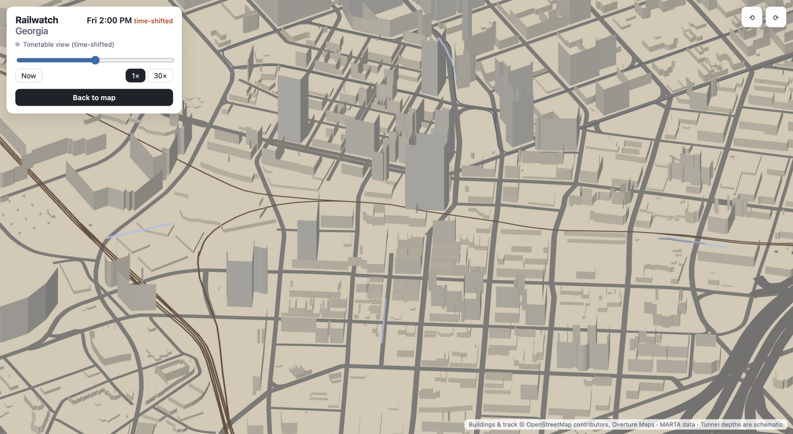

1. **Hollow buildings.** Overture rings come in both windings, so back-face culling removed
   roofs and walls at random. The fix was a double-sided material.
2. **Track that vanished.** Ribbon winding depends on travel direction, so half the MARTA
   track faced downward and was culled from above. Same fix.
3. **Invisible trains.** A real MARTA car is 3 m wide, about 3 px at this zoom. Like Mini
   Tokyo 3D, trains are now drawn up to 3× wide/tall when zoomed out and true size up close.
   Length stays true, because length is what positions the cars.
4. **I had the Five Points levels backwards.** The depth tint showed the east–west line
   *above* the north–south line, the opposite of what I'd written in this log. The data
   was right (east–west −1, north–south −2) and my reading was wrong.
5. **Taps that did nothing,** for two reasons. A synthetic pointer made `setPointerCapture`
   throw before the tap start was recorded. And `InstancedMesh` raycasting culls against a
   cached bounding sphere computed when there were zero cars, so it needs recomputing every
   time the trains move.

**The headline test passed.** At 4:32 pm on a Friday, live Blue Line train #108 was "arriving"
at Five Points on the east–west level. A Red/Gold train crossed on the deeper level below it.
Tapping the train opened its live card ("reported 26 s ago by MARTA").

Also in this step:
- The live feed now polls every 30 s: one open tab uses ~2,900 of the free tier's 100k
  Worker requests a day.
- Trains expire by when MARTA *observed* them, and the Worker reports a missing observation
  time as `null` instead of quietly substituting the fetch time.
- Live fixes that can't be snapped to track are left out of the 3D view.

**Review fixes before calling it done:**
- **Trains popped up at the scene edges.** Profiles end at the scene boundary and returned 0
  beyond it, while cars draw a little past the edge. Profiles now hold their end value.
- **A level-0 "tunnel" is a covered cut at street level,** not a −6 m dip, so it's at grade.
- **A ~120 m "bridge" between two tunnels on Red/Gold** (a span over something inside the cut)
  would have surfaced trains for a block. Short positive spans between tunnels now stay
  underground at the shallower depth.
- **Removed the disclaimer footer** at Sam's request; it added noise. "Unofficial" now leads
  the small attribution line instead.

Known limitations in this slice:
- Scheduled vs live, and tunnel depth, are both shown as lightness, and there's no key in 3D yet.
- No nose taper on lead cars.
- Underground trains draw on top of towers by design (the cutaway). A fade near the
  selected train is an option if it reads as confusing.

## 2026-11-20 · Finding the look: colour isn't style

**First attempt: six "looks" on the same scene** (`?look=` / the `L` key in 3D): architect's
model, golden hour, night with procedural lit windows, toy town, pixel and the baseline.
Screenshots in `docs/log/looks/`. Sam's verdict: *these are colour treatments, not artwork.*
Correct. The references (the isometric pixel city, the low-poly train video) are made of
**detail and form**: modelled trains, trees, curbs, rooftop clutter, a ground with depth.
Recolouring grey boxes can't get there. (The looks code stays, since shadows and night
windows will be useful.)

**Second attempt: one small block, modelled properly.** Instead of styling all of downtown,
pick one 850 × 500 m patch and give it real detail: the **MARTA east portal** by Georgia
State, where the east–west line climbs out of its tunnel beside the freight main and
crosses the Downtown Connector on a viaduct.

- `pipeline/scripts/vignette.py` crops the Overture extract to the patch (64 buildings,
  streets with overpass flags, freight and subway track) → `vignette.json` (66 KB).
- `web/vignette.html` + `src/vignette/` build everything in the browser:
  - **A diorama board**: heightfield top, the cut edges showing topsoil → **Georgia red clay**
    → rock, on a walnut plinth.
  - **The Downtown Connector sunk into a trench** (it really runs below street level here);
    overpass streets keep their level and get concrete fascias.
  - **MARTA**: ballast, concrete ties, rails, third rail; an open cut with a portal
    headwall; a box-girder viaduct on piers over the highway. Elevations come from the same
    baked profile the main 3D view uses (−10 m → +7 m).
  - **Freight**: wooden ties, rusty rails, through-girder bridges over the trench.
  - **Buildings**: brick / stone / glass by height, with storefront glass at street level,
    punched, ribbon or curtain-wall windows (shader), parapets, rooftop HVAC and stair
    penthouses, white, gravel and green roofs.
  - **~1,500 trees** along streets and through open ground. It's November, so some oaks
    and maples are turning.
  - **A MARTA train after the CQ400**: stainless body, window band, line-colour stripe, and
    cab ends whose destination sign and light bar glow in the line colour (from the art
    backlog).
  - **Traffic**: instanced cars looping along lanes of the real streets and the Connector.
  - **Studio lighting**: soft shadows, GTAO ambient occlusion, a narrow-FOV camera and a
    **tilt-shift blur**. That last one does most of the "miniature" work.

Trains and traffic here run on an illustrative loop; this is a look study, not live data.

**Lessons:** a small patch you can afford to detail beats a big one you can only colour.
Most of the miniature feel came from three cheap things: tilt-shift, trees and visible cut
edges on the board.

## 2026-11-20 · Atlanta's clock: real traffic, sun and seasons

**Traffic from free federal data** (`pipeline/scripts/vignette_traffic.py` → `traffic.json`):
- **How busy each road is:** FHWA's national road inventory (HPMS) gives daily volume,
  truck volume, lanes and speed limit per segment. The Connector here carries 307k–372k
  vehicles a day on 12–13 lanes, about 9% of them trucks; Boulevard has 17,300 and Auburn
  Ave 4,400. 80 of 159 drivable runs matched by distance and bearing; the rest (alleys,
  service roads) get class defaults.
- **The shape of the day:** FHWA's 2023 hourly counts from Georgia station 000009, on the
  Connector just north of the board. On weekdays, 5.8% of the day's traffic passes in the
  7 am hour and 1.0% in the 3 am hour. Weekends are nearly as busy, just later.
- **The model:** vehicles per lane per hour = daily volume × the hour's share ÷ directions
  ÷ lanes; a curve slows traffic as a lane nears capacity; how many cars are on the lane =
  flow ÷ speed. Cars hold evenly spread slots and switch on or off only as they leave the
  board, so traffic thickens without popping. Trucks appear in proportion to each road's
  truck share. Labelled "typical for this hour", not live.
- **Caveat:** counts flatten when the Connector jams, because a jam lowers throughput.
  Live speeds from Georgia 511 (key pending) would show the real crawl.

**Sun and seasons:**
- Sun position is computed from the date, time and Atlanta's latitude. It drives the light
  colour, shadows and sky: golden at 4:55 pm in November, blue hour after 5:30.
- At night: lit windows (about a third of offices, most shopfronts), street lamps with
  pools of light, glowing head and tail lights, and lit MARTA windows.
- **Trees by date:** about a quarter evergreen (loblolly pines as stacked cones, magnolias).
  The rest turn by species (maple red, sweetgum burgundy, oak russet, poplar gold), each
  on its own few-week schedule, drop their leaves to bare branches by mid-December, and
  leaf out light green in early April.

Not yet: live weather (Open-Meteo, so it needs no key). The published artifact can't call
outside services, so live weather will only work in the real app; the artifact would need a
weather picker.

## 2026-11-20 · Weather, real trees, smoother trains

- **Wobbly trains fixed.** The GTFS route shape is rounded to about 1 m with uneven point
  spacing, so cars twitched at every vertex. The alignment is now resampled every 2 m and
  smoothed (±24 m moving average, twice), elevation too. The largest heading change is now
  0.11° per half-metre of travel, and the largest height change 5 cm.
- **Weather** from Open-Meteo (free, no key): WMO code, cloud cover, rain, visibility and
  temperature, refreshed every 10 minutes. Clouds flatten the sun and soften shadows; rain
  draws shader-animated streaks (one draw call) and darkens wet surfaces; fog is relative to
  camera distance so the far side fades and the foreground stays crisp; storms flash.
  The published artifact can't call outside services, so it has a weather picker instead.
- **Real trees** from the Meta + WRI 1 m canopy height map (CC BY 4.0),
  `pipeline/scripts/vignette_trees.py`: crowns as local maxima ≥ 4 m tall, at least 5 m
  apart, with crown radius from the surrounding canopy area; roofs masked out. This patch
  has only **76 trees and about 4% canopy**: it really is highway, campus and parking. The
  imagery is probably about 2018, and small street trees are likely under-counted.

**Next truth gap:** the ground. Everything not a building or road is drawn as grass, but
downtown is mostly parking lots and plazas. Overture's land use and land cover layers (or
OSM `amenity=parking` / `landuse`) would fix that.

## 2026-11-20 · The ground is mostly parking

Everything that wasn't a building or a road used to be lawn. Overture's base theme knows
better: in this block there are **18 mapped parking lots**, 7 plazas, 5 sports pitches,
2 construction sites, **130 crosswalks** and **10 traffic signals**. Downtown-wide, the
infrastructure layer has 164 parking areas covering about 380,000 m².

- Lots are drawn as asphalt with **stalls laid out by rule** (2.6 × 5.4 m stalls either
  side of 6.5 m aisles, along the lot's longest edge) and filled with parked cars.
- **Occupancy follows a rule of thumb** for downtown commuter lots (illustrative): nearly
  full in weekday working hours, about a third in the evening, a few overnight, about
  half on weekend afternoons.
- **Unmapped lots are inferred:** Overture labels 220 service roads downtown as
  `parking_aisle`. Where an aisle isn't inside a mapped lot, stalls are paved and striped
  along both sides of it.
- Plazas get paving, pitches turf with touchlines, construction sites dirt, and every
  mapped crossing gets zebra stripes laid across the road it sits on.

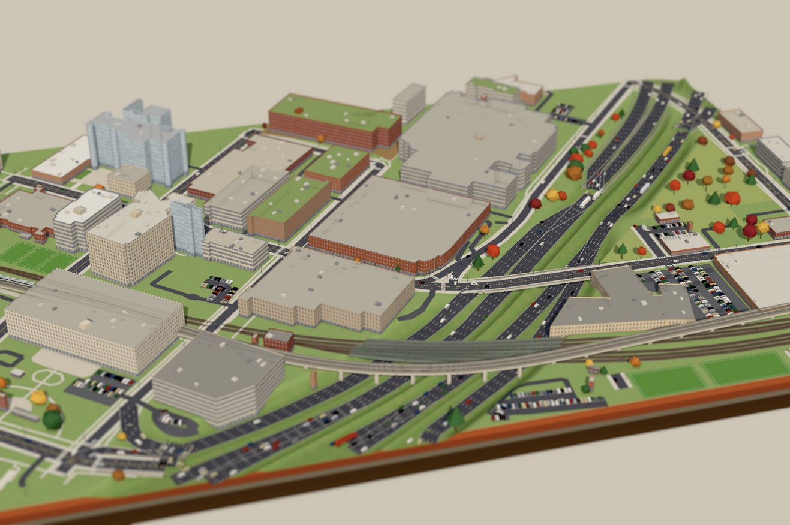

## 2026-11-20 · Cars that drive the street network, and better models

**Traffic is now a simulation on the real streets** instead of cars looping along each road:
- **The network:** Overture road runs join into a graph at shared vertices. In this block
  that's 68 intersections, 110 directed road edges and 28 board-edge entries, with 8 of
  the 10 mapped traffic signals matched to an intersection.
- **How many:** vehicles enter at the board edges at the hourly rate the federal counts
  give for that road.
- **Where they go:** at each intersection a vehicle picks an outgoing road weighted by that
  road's volume, with a mild preference for going straight. Nobody can know a given car's
  turn, but the mix matches the real volumes.
- **How they move:** the Intelligent Driver Model keeps gaps and speeds; turns curve along
  Bézier paths; vehicles stop on red and amber (signal timing is a guess, 84 s cycles);
  merging vehicles yield to whoever is closer to the merge.
- **Result:** about 55 vehicles flowing at 52 mph at 3 am, about 250 at 27–32 mph at 1 pm,
  and stop-and-go at 17–22 mph in the 8 am peak, which is what the Connector actually does.

**Bugs with lessons:**
- **Ramps matched the main line's HPMS record** because they run side by side, so they
  poured a whole highway's traffic into every merge. Ramps now get one lane and ramp-scale
  volume.
- **Some main-line segments matched ramp records instead**, so one direction of the
  Connector was nearly empty. Main-line segments under 150k a day fall back to the
  Connector's median.
- **Lane-index mapping** sent the ramp into the busiest left lane. Vehicles now continue
  into the geometrically nearest lane, or the emptier of the two nearest at a merge.
- **Turn paths capped speed even on straight-through joins**, making a bottleneck at the
  peak flow. Only real turns slow down now.

**Vehicle kit:** each model is a side profile extruded across its width, so hoods,
windscreens and roofs slope: sedans, hatchbacks, SUVs, pickups (with beds), vans, box
trucks, and **articulated semis** whose trailers swing behind the tractor through turns.
Trucks follow each road's truck share. Parked cars use the same kit.

**Train:** a CQ400-style car with a rounded roof, a raked cab and big windscreen,
individual windows between three door pairs a side, bogie side frames and axle boxes,
underfloor equipment, roof HVAC pods and gangway bellows. The line-colour light bar and
destination sign still glow.

## 2026-11-20 · Sam's feedback pass: lanes, turns, night, focus

Sam's notes after driving around: cars "drive in the middle of the lanes", are "a little
jumpy in intersections", night needs "more realistic lighting", and the tilt-shift blur is
"a little strong… hard to see what I'm trying to look at".

- **Lanes:** the painted dashes came from a road-class rule while the cars' lanes came from
  HPMS lane counts, so cars sat on the dashes. The traffic model now draws the dashes
  between its own lanes.
- **Turns:** a car's heading came from one point on its path, and a car straddling a lane
  and a turn path snapped onto the turn. Cars are now placed by their front and rear axles,
  looked up across the previous path segment too, so the body pivots through the turn.
- **Night:** the lamps' additive white discs are replaced by a baked **light map**: warm
  (~3000 K) pools from every street lamp and a faint shopfront spill, added to the ground,
  street and lot materials in proportion to darkness. The Connector gets high-mast lights
  every 50 m. Headlight beams lie on the road ahead of moving cars. Bloom (night only)
  makes lamps, windows and headlights glow; window brightness varies per window.
- **Tilt-shift:** three.js's shader ramps blur linearly from one focus line. A custom pass
  keeps a sharp band (±16% of the screen) and ramps softly to the edges, at a lower default
  strength. Double-click glides the camera's focus to that spot.
- A side note on GPU hashing: `fract(sin(dot(p, k)) * 43758.5)` with world coordinates in
  the hundreds turns into noise, which showed up as speckled walls. Hash the window cell
  index instead.

## 2026-11-20 — Live MARTA buses reach the map

At 7:28 p.m. Eastern, MARTA sent 163 bus positions in 13,319 bytes. Every
vehicle had an observation time and matched one of the 81 published bus routes,
but one fix was already over three minutes old and only 98 included speed.
The teal dots use the GPS coordinates directly. Tapping a bus shows its route
and the age of its position. Moving the clock away from the present clears them.

Repeating the source and observation time on each attribute turned those 13 KB
into 73,327 bytes of JSON. Sending the source once and the timestamp once per
bus brought the same snapshot down to 19,528 bytes. Local decoding and
normalization averaged 0.33 ms over 100 runs. The static short-name lookup is
1,081 bytes. Two consecutive local Worker requests with different query strings
returned the identical cached snapshot.

## 2026-11-20 · Painting the East Portal without moving the track

The viaduct over the Downtown Connector gave us a registration test. A six-car train has to round the curve on the rails, while a box truck underneath it disappears behind the deck. We baked the East Portal three ways through one orthographic camera. In the comparison, the roofs, the road crossing and the red-clay edge occupy the same pixels in every column. The Three.js column uses the scene's materials and lights with the comparison camera. The [ordinary vignette screenshot](log/art/studio-baseline.jpg) shows its regular perspective and tilt-shift.

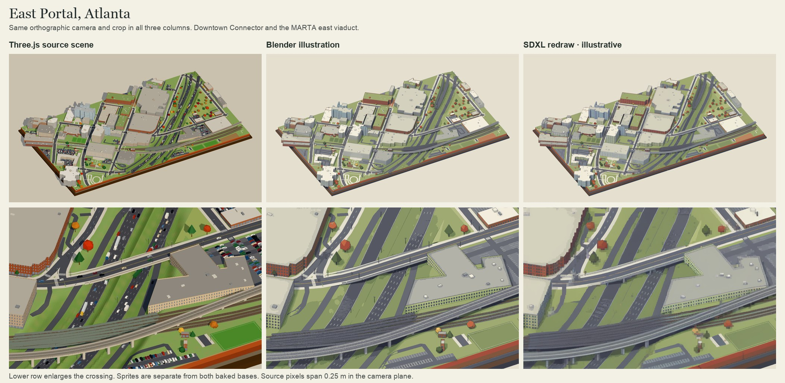

The Studio rebuilt 64 buildings, 384 road runs, 13 rail runs and 76 canopy trees. At 0.25 m per image-plane pixel, the 850 × 500 m board needs a 4,352 × 2,560 canvas at this angle. The static GLB weighed 47.3 MB. Blender 5.3 took **3 minutes 12 seconds** with 12 Cycles samples on Metal. A warm sun casts the viaduct's shadow into the trench. A fine ink edge, derived from depth and surface normals, separates its concrete from the road below. Simple window panes stand in for the browser's facade shader. All 32 colours fit into a 623 KB full-resolution PNG.

The first SDXL redraw took **9.06 seconds** for a 1,024 px crop. At denoise 0.38, the model turned lane dashes into dark blocks and added what looks like a canopy to a low building. At 0.54, part of the highway started to look like another railway. We baked the board at **0.26**, with Pixel Art XL at 0.85, guidance 5.5 and 28 requested Euler steps. The foliage gained uneven edges and the bridge kept its curve. Individual lane dashes and parking stalls still softened. This is an **illustrative** base. At full scale, 11.9% of pixels inside the board changed by at least 32 levels in one RGB channel. The geometry mask preserved every pixel outside the board. [First redraw](log/art/first-redraw.jpg)

The full run took **54.29 seconds** on the M5 Ultra. Its 18 overlapping windows took a median **2.69 seconds** each after model load. We blended them across a nominal 256 px overlap and cut each base into 69 tiles across five zoom levels. The Blender pyramid weighs 0.94 MB and the SDXL pyramid 8.02 MB. They share a 1.04 MB surface-height PNG and five sprite models with 32 headings apiece, each rendered by day and by night. The viewer clips individual sprite pixels against the surface height. A truck can pass beneath the same bridge that carries the train without asking a server to draw either.

The experiment leaves an art decision. At a distance the two baked boards read almost alike. Up close, the redraw softens the geometry fastest exactly where a railway map needs precision. Keeping the aligned Blender base in the viewer makes that trade easy to inspect. [Factory settings, licences and build instructions](../pipeline/scripts/art/README.md)

## 2026-11-20 · Ink, lighter bridges and the first real buses

After the art spike (PR #5), Sam compared full-resolution crops and preferred the live 3D
over both the Blender illustration and the SDXL redraw, which invented a red freight train
out of the board's clay edge. So the lessons go back into the 3D:

- **Ink outlines**, "outline once, after compositing": one screen-space pass reads the scene's
  depth and colour, draws silhouettes where depth jumps (using a second difference, so smooth
  slopes like roofs and lawns stay clean) and creases where colour steps, and fades with
  distance. On by default; `?ink=0` or `__v.setInk(false)` turns it off. One gotcha:
  EffectComposer gives each ping-pong target its own cloned depth texture, so the pass must
  read the *current read buffer's* depth, or every other frame uses stale depth.
- **Freight bridges** over the Connector were tall solid girder walls on each of the parallel
  tracks, which merged into one dark slab. They're now a slim deck with a girder underneath
  and a low railing, so you can see the individual tracks cross.
- **Real MARTA buses** from `/api/marta/bus` (PR #2's Worker endpoint): fixes on the board
  are snapped to the nearest street within 25 m, turned to the street direction nearest the
  reported bearing, kept in the right-hand lane, and glide between 30-second reports. They
  show only when the clock is the real present, and the readout says how many are live and
  how fresh they are. On the first try: 3 buses (routes 20, 42, 55) near Decatur St.

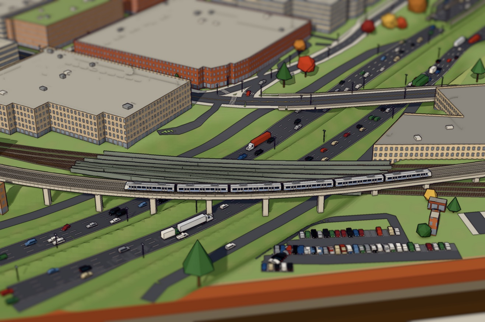

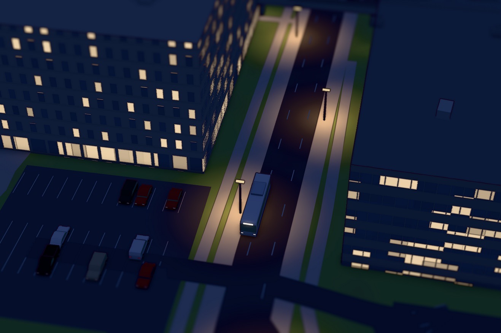

**Same day, Sam's next notes:** the headlights "look backwards" and cars "just go through
that bus".
- The headlight-beam texture was flipped one time too many, so the beam was brightest at its
  far end. Now it starts bright at the bumper and fades ahead.
- Live buses are now **obstacles** for the simulation: cars on the same lane brake and queue
  behind them. On multi-lane roads, a held-up car **changes lanes** when the next lane has a
  safe gap (a simple MOBIL-style rule), sliding across over about two seconds instead of
  jumping.
- Review catch: a bus snapped to the Decatur St bridge was drawn below the deck. Buses on
  overpasses now keep the bridge height, like the rest of the traffic.

**Speckled, shimmering windows** (Sam, with a screenshot): the facade shader worked out each
wall's direction from screen-space derivatives of world position. At city-scale coordinates
(hundreds of metres) those derivatives are noisy, so neighbouring pixels disagreed about
which window they were in, and whether it was lit. That gave salt-and-pepper speckle that
shimmered as the camera moved, by day as well as night. Fixes: use the wall's real per-face
normal, swap the `sin`-based hash for a precision-safe one (Dave Hoskins' `hash12`), and fade
the window pattern to its average where windows get smaller than about 2 px.

## 2026-11-20 · Adapting to a reference: a low-poly ravine railway

Sam found a much closer reference: a real-time low-poly railway through an autumn ravine
(a train-driving toy with its own Hour, Ink, Flora and Forest panels). Stills, pulled
from the video with ffmpeg because I can't watch video directly, show what gives it its look:
- **Foliage as clusters of small faceted leaf clumps,** each tinted slightly differently,
  plus tall tiered conifers. Our trees were one or two big gem-like blobs.
- **Thin dark ink, mostly on silhouettes**, not inside shapes.
- **Punchy light**: warm sun, cool blue-grey shade, saturated colour.
- **Film grain** over everything, so it never looks digitally clean.
- A perspective chase camera with a painted sky (parked for later: Sam wants more pieces
  in place before the ride-along camera).

What changed:
- **Trees:** each deciduous canopy is now ten dodecahedron clumps on a rounded crown,
  lighter on top and darker underneath, with per-clump hue, saturation and lightness
  jitter. Leaf drop removes clumps one by one. Loblolly pines have four narrowing tiers.
- **Ink:** silhouettes only, with colour creases at a fifth of the weight, a darker ink and
  1 px lines.
- **Grade and grain pass** (last, in display space): +12% contrast, +14% saturation, cool
  shadows and warm highlights, a soft vignette, and fine animated grain that's stronger in
  shadow. `?grade=0` turns it off.

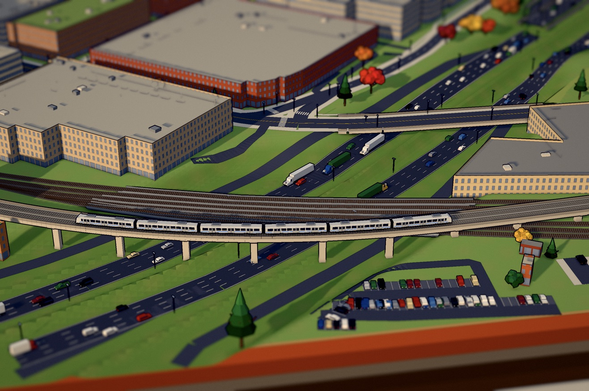

## 2026-11-21 · Modelling the CQ400 from photos

MARTA's new Stadler CQ400s start rolling out next year, so the diorama skips the old fleet
and models only the new train. The method: a **model lab** (`/models.html`) that shows the
model large in studio light, switches line colour, lead, tail or coupled lighting, and day
or night, and can lay a reference photo over the view. Sam critiqued it round by round from
photos; I adjusted the code. No Blender; the model is built in TypeScript
(`web/src/vignette/cq400.ts`).

What the photos taught, in roughly the order Sam caught it:
- **Matte grey, not champagne.** It only looks warm in sun.
- **The front is one dark mask** framed by grey that wraps the corners. The line colour is a
  **flush light**, not a raised rail: down both mask edges and in to a V under the
  windscreen, thicker toward the point. Simplified to one shield windscreen (no end door).
- **The nose is a straight rake,** upright at the bottom, not a rounded bullet. Its grey
  side panel has a triangular window, then one rectangular cab window, then the first door.
- **Bumpers are flush grey corners with vents,** not stuck-on boxes. The coupler is dark,
  since the "red" in photos is the tail sign reflecting.
- **Tail lights:** a red bar where the wordmark sits (we show no logos, only light), small
  red lights at the ends of the destination display and red under each corner cluster.
- **The livery:** short blue, yellow and orange chevrons on the nose side, then **every car**
  carries blue, yellow and orange from the end facing the cab, all slanting the same way.
- **Smooth roof:** only slight bumps over the roof equipment.

Bugs with lessons:
- **Floating features:** the mask was a flat fill between outline points while the lights
  sat on the curved surface, so they floated off it. The nose is now one continuous surface
  `z = F(x, y)`, and every feature is placed on that same function.
- **Ragged seams:** the nose surface wasn't sampled at the body section's chamfer heights,
  so its edge stepped across them. Sampling now includes those exact heights.
- **The chevron's notch at the point:** the two halves of its path never shared the centre
  point (one half was appended backwards). It's now one mitred ribbon, with each quad's
  winding fixed to face forward.

Consists: CQ400s run as fixed 4-car sets with open gangways. Green Line trains are drawn as one
set (4 cars) and Blue Line as two (8), with the inner cabs dark. MARTA's live feed doesn't say
which fleet a train is or how long it is, so lengths are typical for the line.

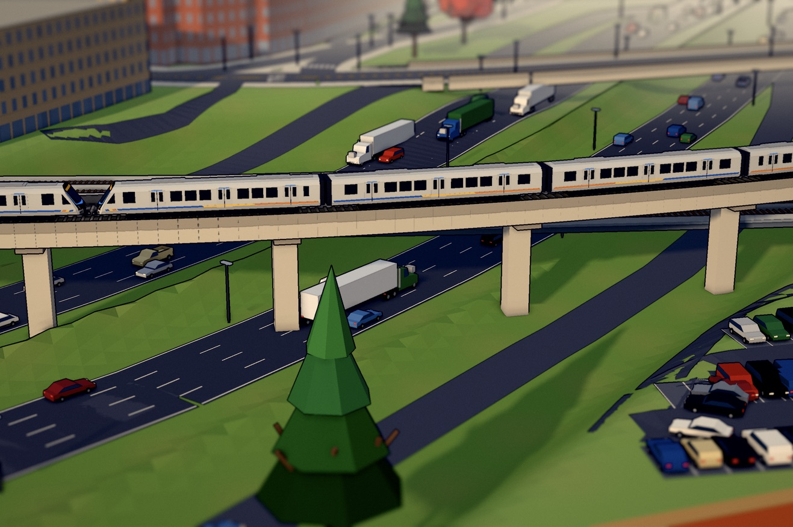

## 2026-11-21 · The MARTA bus, built to spec

The first bus was eyeballed from photos, and it showed: the wheels weren't even round. So the
second pass started from numbers instead. New Flyer publishes the Xcelsior 40-foot's
dimensions and a side elevation in its brochure: 12.24 m over the body (12.50 m over
bumpers), 2.6 m wide, 3.38 m over the CNG roof tanks, a 7.2 m wheelbase and 305/70R22.5
tyres (about 1 m across). Those set the body, the axle positions and the overhangs (about
2.2 m at the front and 2.9 m at the back). Photos then filled in what the drawing doesn't say.

- **Wheels:** arches are cut into the extruded side profile, so they are actually round.
  Tyres are an open tread band with ring sidewalls, so a dished steel rim with a dark hub can
  sit inside them. Duals at the rear.
- **The window line came from photos, not the drawing.** The brochure suggested a 1.42 m
  belt. In photos of MARTA's buses the windows are one continuous dark band, roughly
  1.2–2.3 m off the ground, which leaves the tall white strip that carries the livery.
- **Livery:** white, with three blue slashes that run up over the roof edge onto the CNG
  housing. The third flows into a long blue line, with yellow and orange dashes beneath it,
  their ends cut at the same angle. The giant slanted "marta" lettering at the rear becomes
  a plain light-grey band, darker where it crosses the glass. No wordmark, no fleet numbers.

Bugs with lessons:
- **A stray half-drum hid half of each wheel.** The wheel-well lining was a half-cylinder
  rotated the wrong way, so it filled the back half of the arch instead of the top, and its
  end caps covered the wheel. Now it's an open half-tube along the arch roof.
- **Decals under panels:** the side panels are thin 2 cm boxes, so their outer faces sit
  1 cm proud of their nominal offset. The grey band was drawn "above" the grille and the
  glass but actually sat under both, until its offset accounted for the box thickness.
- **Stripes that bent at the roof edge:** leaning the slashes by distance along the surface
  made them kink horizontally across the flat roof strip. Leaning them by true height keeps
  each slash a straight band when seen from the side.
- **Fine stripes all over the roof** were shadow acne: the model lab's sun had no shadow
  bias. The diorama already had one.

The live MARTA buses in the diorama now use this model. They were the only users of the old
generic bus, which is gone.

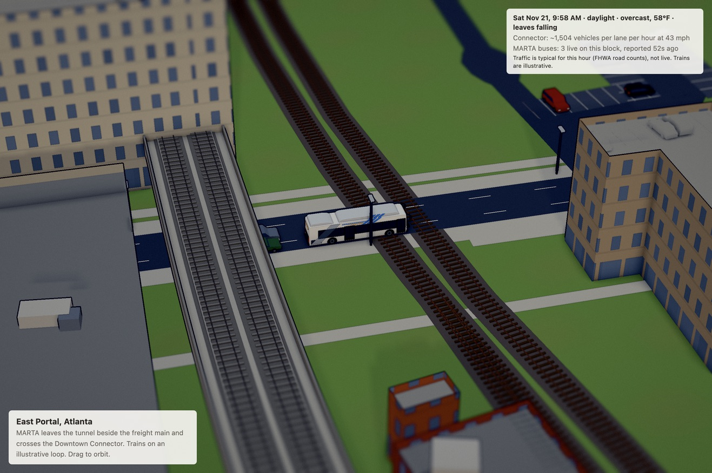

## 2026-11-21 · One shell over Map and City

Until today the site was three products that didn't know about each other: a grey dashboard
over a 2D map, a grey 3D downtown behind a button, and the East Portal diorama on its own
page. The direction now is "just a little model of Atlanta": City first, Map one tap away, and
both working back from the diorama's look.

- **Glass instead of panels.** The dashboard panel is gone. What's left is a status widget
  (neighbourhood, temperature with a weather icon, condition, date and time, and a live dot),
  a menu button and a Map · City switch. All three are frosted glass with a Liquid Glass-style
  lit edge: the rim is bright at two corners and fades between. On cream paper a white rim
  vanishes, so a 0.5 px dark hairline sits outside it to make the highlight read.
- **The glass picked up colour.** With `saturate(1.7)` in the backdrop filter, an orange
  freight line under the widget turned the whole card peach on the phone. 1.15 keeps the glass
  neutral.
- **The basemap is recoloured, not replaced.** OpenFreeMap's positron style is fetched at load
  and repainted to the diorama palette (cream land, sage parks, soft water, thin brown roads),
  so tile and glyph URLs stay current. Rail lines get a thin ink outline, as in the diorama.
- **The streetcar was pure #0000FF** in MARTA's GTFS. Next to the Blue Line (#0075B2) it read
  as a different hue entirely; it's now a softer cornflower, #5a86d6.
- **Neighbourhoods:** 248 City of Atlanta neighbourhood polygons (315 KB) name the place under
  the middle of the view; outside the city it says "Metro Atlanta" or "Georgia".
- **Weather now goes through the worker.** On the A16 the direct call to Open-Meteo timed out
  and the diorama said "live weather unavailable here". `/api/weather` makes one upstream call
  per edge location every 10 minutes, whoever's asking.
- **Keyboard:** WASD and the arrows move the camera in both views, `M`/`C` switch, `+`/`−`
  zoom. A key tap always nudges, because the first frame now counts from the key press (in a
  throttled tab that painted twice a second, the first frame's zero-length step was the only
  one).
- Phosphor icons (MIT), imported as raw SVG so only the 14 used ship. The system font, no web
  font. The time slider and 1×/30× are hidden, not deleted: `?controls=1`.

On the A16 in portrait, the Map runs at 58 fps with the glass over it. City is still the old
grey 3D until the diorama-style downtown replaces it.

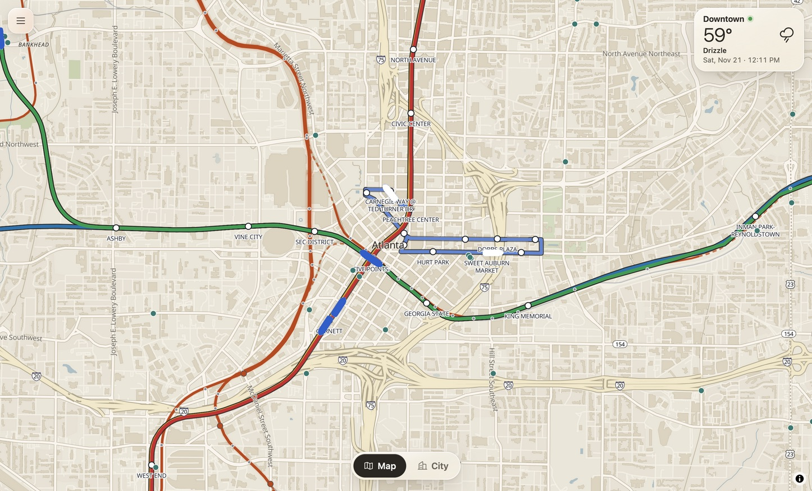

## 2026-11-21 · Weather and time of day on the Map

Time of day and weather aren't modes; a rainy dusk is both. So there's one atmosphere state
(sun elevation and azimuth from the clock, cloud/rain/snow/fog from Open-Meteo) and the Map
reads it in layers:

- **Time of day** blends the basemap continuously between four keyframe palettes by sun
  elevation (night −12°, dusk −4°, golden +3°, day +14°), in linear RGB with smoothstep, so
  there are no hard switches. A WebGL sky layer adds a warm wash on the sun's side and soft
  shade opposite; at 8 AM it sits bottom-right, at 4 PM bottom-left. At night: cool moonlight
  and a warm glow over downtown.
- **Weather** transforms whatever time of day gives. Cloud greys and flattens it (capped, so
  cloud + rain + fog can't stack into mud: Atlanta is overcast a lot, and that has to look
  pleasant), with cloud shadows anchored to the ground. Rain is fine slanted streaks plus a
  cool, wet tint; snow is drifting flakes and a paler ground.
- **Fog was the lesson.** As a colour wash it just made the map look faded. What reads as fog
  is the diorama's trick: a real blur toward the edges with a cloudy haze in it, and a sharp
  centre. That's a `backdrop-filter` layer over the map with a radial mask.
- Every effect is drawn above the basemap's fills and below our rail, stations and labels, and
  Atlanta's weather fades out as you zoom out to the state or pan away from the metro.
- After dusk the glass goes dark, like an OS night mode, and truth-tier chips get lifted
  colours for contrast.

**On the A16** the first cut cost almost half the frame rate: 58 → 34 fps on an ordinary
overcast day. Two fixes got it back above where it started. The shader only computes noise when
there's cloud or fog to draw (3 octaves, not 4). And the map's pixel ratio is capped at 2: the
phone reports 2.81, which meant 1.97× as many pixels for no visible gain. Clear day 74 fps,
overcast 65, rain with fog 40. Clouds don't drift on phones, to avoid constant repaints.

`?tune` is the playground: a Live switch, a time slider and cloud/rain/snow/fog sliders that
combine freely, plus the palette presets and pickers.

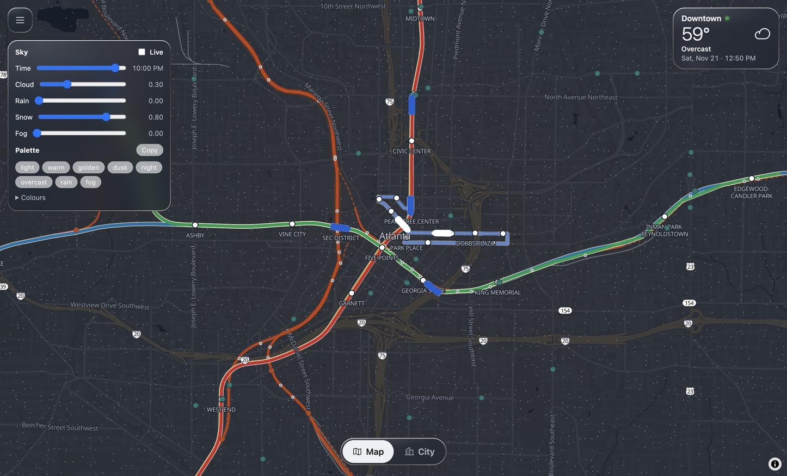

## 2026-11-21 · Downtown fits on the table

City now opens far enough back to read the Gulch, Five Points and the Peachtree Center
skyline together. The southwest camera moved from 3,000 to 5,500 scene metres; tilt-shift
strength dropped from 1.6 to 0.65 so the towers stay legible. Four Overture streetcar runs
now have embedded rails, and the city's buildings and streets stop cleanly at the walnut
board. A high-DPI bug had been making the canvas twice as large as its CSS container,
showing only its upper-left quarter; explicitly sizing both fixed that crop.

The surprise was startup, not polygons. A timed desktop load spent **33,481 ms** on ground
placement out of **35,984 ms** of construction. Parking stalls checked every building;
crosswalks checked every street. A conservative 64 m spatial grid now narrows those searches,
while the exact intersection tests still make the decisions. A fresh low-tier run built in
**730 ms** (ground 363 ms, streets 162 ms, rail 139 ms); high-tier runs under concurrent
browser/build load ranged around **2.4–2.7 s**. Those are CPU construction measurements,
not first-paint times or phone results. The broad-phase tests compare exact hits against
brute-force searches, including negative coordinates and cell boundaries.

The loading plate reports each build stage and yields between stages, so returning to Map
cancels the load. A held data request followed by Map left **zero canvases** behind; a forced
404 returned to Map with the recovery note. Switching views preserved the target at
**−84.392033, 33.756238**. The clock and neighbourhood widget now update independently of
remote basemap tiles. City has snow flurries as well as rain, and fog softens the edges.

The old `scene3d` renderer is gone. Shared rail profiles remain in `scene.json`; builds omit
its three unused binary meshes, saving **3.2 MB** of deployed static assets. No data rebuild
is needed for this refinement if the M2a City JSON already exists; a web rebuild is required.
A fresh checkout still needs the data commands. East Portal was checked in Orca after the
shared-world changes and still renders its viaduct, train and traffic.

Performance is deliberately **not signed off**. Orca's desktop animation callbacks were
throttled to about 1–2 fps, even with the City renderer disposed; that is not a useful GPU
benchmark. Sam asked us to leave the Galaxy A16 untouched. The ≥30 fps low-tier phone gate,
City as the default, and M2b motion remain pending. The baked western MARTA profiles also
stay below the daylight threshold by Dome/GWCC; the handoff's expected open track there
needs a source/profile audit, not guessed surface rails.

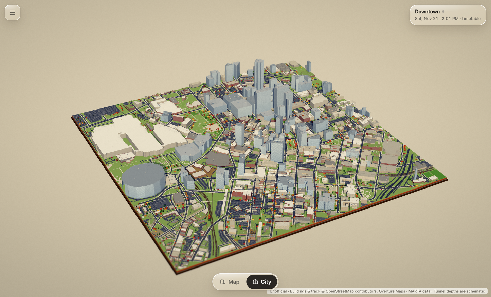
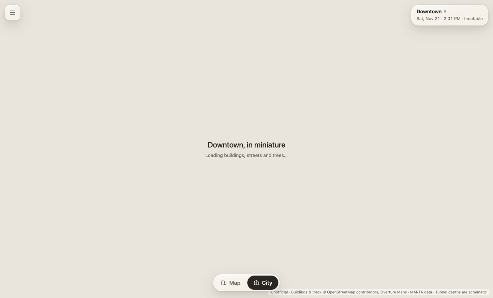
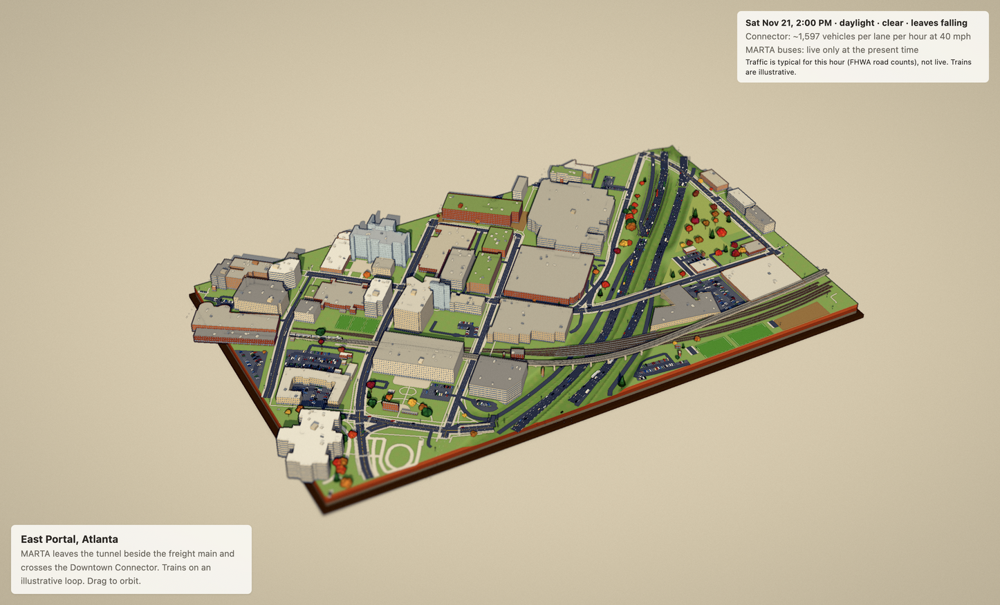

Claude's first review caught the fresh-checkout deployment hole: `pnpm data` did not build
City's new JSON. It now includes `data:city`, and the README calls out both fresh and existing
checkout instructions. The portal-at-board-edge concern did not reproduce in either supplied
board: all threshold crossings were inside the board (east x≈376–379, z≈289–291; south
x≈−373…−366, z≈554–564). It remains a possible case if future board bounds cut a shallow ramp.
Final warm high-tier construction also measured 704 ms; the slower 2.4–2.7 s runs above were
under concurrent load. The full suite passes: 16 Rust, 23 web and 5 Worker tests.

The final desktop check resolved the throttling: selecting the tab was insufficient; the
worktree itself had to be foregrounded. With one City tab at **1446×876 CSS pixels**, five-second
animation-frame samples measured **18.1 fps high** (render DPR 2, 63 draw calls, 2,795,709
triangles across all passes) and **32.4 fps low** (render DPR 1, 32 draw calls, 1,268,831
triangles). These are desktop results only; high-tier rendering still needs optimization,
and the A16 gate remains pending. Claude's second and final review reported no new findings.

## 2026-11-21 · Keep your bearings

Sam's first navigation check exposed a sign mismatch: the shell describes a content drag,
while City's camera API describes camera movement. The adapter now reverses that offset,
so A/D move left/right and W/S move forward/back relative to the viewing direction. A second
surprise was that a quick key tap could finish between animation frames and move nothing.
Each fresh press now nudges immediately, then held keys continue at the existing speed.
Keyboard movement also cancels any place-search glide.

Map and City now exchange their centre, clockwise bearing and horizontal ground scale in
CSS pixels. Map stays flat; City remembers its tilt. The conversion uses MapLibre's actual
Mercator scale at the current latitude, so a high-DPI canvas does not change the framing.
City still clamps to its downtown coverage and camera-distance limits. This makes the
remaining perspective change easier to read without adding a transition animation yet.

In Orca at high quality, the opening view survived a round-trip at **28°**, **2.44085 m/px**,
and target **(−40, −260) m**, with sub-millimetre numerical drift. Two more round-trips at
**−70° and 118°**, zoom **16**, retained their centre and a custom **40°** City tilt. All
**24** WASD/arrow direction checks passed across four quarter-turn headings, and an actual
Orca A keypress moved the camera left. A Map view outside downtown clamped to the northwest
board corner and showed the coverage note. The full suite passes **48 tests** (16 Rust,
27 web, 5 Worker), including four comparisons against MapLibre's own Mercator conversion;
the production build passes. This follow-up needs a web rebuild, with no new data bake.

Navigation follow-up review (Claude, one round): no findings.

## 2026-11-21 · Rotation cadence and rendering are separate

Sam noticed Q/E felt choppy even after the direction fix. Held rotation was still driven
by OS keyboard repeat, applying a 3° jump each time. It now shares the WASD animation-frame
loop at 60°/s, with a 1° immediate tap and a 50 ms frame-delta cap. Auto-repeat adds no extra
step; opposing keys cancel, and releasing either resumes the other. Releasing the last key
or leaving the window stops the motion.

At Sam's closer camera pose, two six-second foreground Orca samples on high tier measured
**22.5 and 24.8 fps**, with **34 ms median** intervals and **83/67 ms p95** intervals. The
viewport was 1446×876 at DPR 2, with 63 draw calls and 2,795,709 triangles across all passes.
A separate system snapshot showed 66% CPU idle. These observations confirm uneven frame
delivery, but do not isolate GPU time, browser overhead or competing system work. No render
quality change was made, and the small difference between samples is not an optimization gain.

The Orca held-key check delivered 31 updates and 57.5° over about one second. Taps, repeat
suppression, keyup, blur, opposite keys, typing guards and simultaneous pan/turn all passed.
The original camera pose and high tier were restored. All 48 tests and the production build
pass. This change needs a web rebuild, with no data bake or server changes.

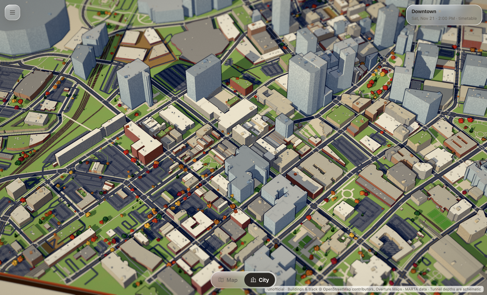

Held-rotation review (Claude, one round): no findings.

## 2026-11-21 · Merge readiness

Integrated main's project rename and deploy-command fix. The sole conflict was the README
deploy paragraph: it now retains City's data requirements and uses `pnpm run deploy`.
The combined branch passes all 48 tests, the production build and an Orca high-tier render
check. Claude's focused integration review found no issues. City remains optional; the A16
gate still controls making it the default and starting M2b.

## 2026-11-21 · Softer shading costs fewer pixels

On this Mac, City draws a 1446×876 Orca viewport into a 2892×1752 canvas. The soft
contact shadows around buildings also covered all five million pixels. Turning just
that effect off briefly took the opening view from 23.5 to 37.4 fps. Keeping it on and
rendering it at 1446×876 leaves the ink, façades and final image at display resolution.

At the same opening pose on high tier, alternating the two shading resolutions gave
22.3–23.5 fps before and 31.9–33.7 fps after. The 95th-percentile frame interval fell
from 83–84 ms to about 50 ms. These were 4.4-second foreground Orca samples on the
Nov 21 afternoon timetable. The scene still drew 63 calls and 2.80 million triangles.

Holding E for three seconds from the closer downtown pose gave a smaller gain. Two
samples at each resolution measured 20.1–22.3 fps before and 24.4–26.6 fps after.
The 95th-percentile interval stayed around 84 ms, so some turns still hitch. The
browser resize check confirmed a 2256-pixel canvas with 1128-pixel contact shading
at the narrower width. This is a desktop measurement. Shipping needs a web rebuild.

## 2026-11-21 · Drawing the turn we just asked for

City and the keyboard both had animation-frame callbacks. During a close-up turn the
renderer usually ran first, so it drew the previous camera angle. In a 4.5-second held-E
sample in Orca, the camera update waited a median **16.5 ms**, and **82.3 ms at the
95th percentile**, before the renderer submitted a draw with that angle.

City now advances the held keys before drawing. Both callbacks use the browser's frame
timestamp, so the second one sees zero elapsed time. At the same close-up pose on high
tier (1446×876, DPR 2), the update-to-draw delay measured **0.1 ms median and 0.2 ms
at the 95th percentile**. These measurements end at draw submission. The 95th-percentile
interval between frames was still **83 ms**. In a separate held turn, JavaScript spent
1.7 ms at the 95th percentile submitting the scene, and the WebGL GPU timer measured
19.3 ms at the 95th percentile. Neither measures the browser's final presentation.
In two alternating pairs of 3.2-second turns, even drawing just the final fullscreen
triangle gave 84 ms at the 95th percentile, against 83–84 ms for the full scene.
A separate 5.5-second run in the same focused Orca tab, drawing a moving square on
a plain 2D canvas, measured 35.8 fps and a 49.5 ms 95th-percentile interval.

Rain revealed a second cost. The weather timer could repaint the covered 2D Map about
30 times a second. City now suspends that timer, and Map picks up the latest weather on
return. Orca checks covered direct entry, switching, cancellation and failed loading.
The high-tier check also covered quick taps, repeat, opposing keys, simultaneous pan
and rotation, and release on blur. This change ships with a web rebuild.

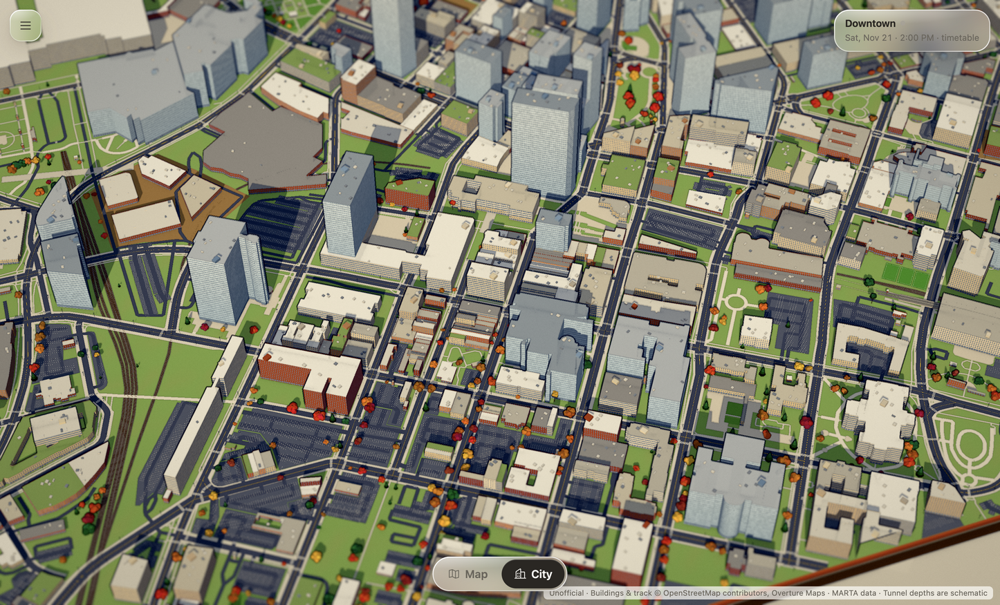

## 2026-11-21 · The first half-minute on the Galaxy A16

The A16 can sustain the low-tier opening, but the first two visits fell just short of
30 fps. We ran the shipped City build (`1586558`) on a physical Galaxy A16 5G
(SM-S166V, Android 16) in mobile Chrome, in portrait with the real clock and overcast
Atlanta weather. At the untouched opening camera, a 384×692 CSS viewport used a
384×692 drawing buffer. The phone's device pixel ratio was 2.8125.

The phone loaded the release assets over USB from a local server. A page timing probe
waited for the City loading plate to clear and a further 4.5 seconds, then counted
animation-frame intervals in three consecutive eight-second windows. Combined fps is
total frames divided by elapsed time. The page stayed visible and focused throughout
the samples. These are browser frame callbacks; readiness includes loading from the
local server and cannot predict a public-network download time.

| Configuration, in test order | Window 1 (fps) | Window 2 | Window 3 | Combined fps |
| --- | ---: | ---: | ---: | ---: |
| Shipped 2048 px shadows, first visit | 25.00 | 29.37 | 32.62 | 29.00 |
| Shipped 2048 px shadows, second visit | 25.12 | 29.58 | 33.86 | 29.53 |
| Diagnostic, shadows off | 38.37 | 44.00 | 44.37 | 42.25 |
| Shipped 2048 px shadows, warm reload | 28.13 | 36.02 | 37.34 | 33.83 |
| Diagnostic, 1024 px shadows | 34.87 | 35.37 | 38.00 | 36.08 |
| Diagnostic, 1024 px shadows, fresh origin | 32.28 | 35.27 | 34.75 | 34.10 |
| Shipped 2048 px shadows, fresh origin | 28.84 | 34.25 | 34.23 | 32.43 |

The warm production reload reached **37.60 fps** over a further uninterrupted 24 seconds,
with a 55.6 ms 95th-percentile interval. On the first visit, scene construction took
2.44 seconds, including 1.28 seconds for ground, and the first ready frame arrived at
6.64 seconds. Startup and sustained rendering tell different stories on this phone.

Halving the shadow-map dimensions preserved visible building shadows. To check the
order effect, we returned the phone to Home and repeated the comparison with the
1024 px variant first. Each page used a fresh browser origin to avoid reusing the
previous origin's asset cache. Chrome and the phone were already warm.
The 1024 px setting cleared 30 fps in all six measured windows across its two visits.
Both diagnostic changes were confined to the local test server.

[Shipped opening](log/ui/2026-11-21-city-a16-low.png) · [1024 px shadow comparison](log/ui/2026-11-21-city-a16-shadow-1024.png)

City now uses the tested 1024 px shadow map on low tier. The six A16 samples ranged
from 32.28 to 38.00 fps, clearing the 30 fps gate for the static opening. This change
ships with a web rebuild.

## 2026-11-21 — A Blue Line train through Five Points

At 2:10:35 p.m. on the Friday timetable, an eastbound Blue Line train is in daylight in
the Gulch. At 2:11 it reaches Five Points underground. Twenty-five seconds later its cars
are visible again in the open cut between Peachtree and Pryor. We replayed the same trip
in Orca on high quality, combining the City motion branch with the rail accuracy agent’s
two corrected cuts. The building on the south side of the Gulch hides most of the
western cut from a low angle. Looking back from the north makes the passage legible.

The Map and City read the same train positions. In City each car takes the direction and
height of the rendered track beneath it. A car stays in the scene until both ends have
passed under cover, so the front can disappear while the tail is still in daylight.
The timetable and live feed both use illustrative car counts and the CQ400-style model.
In Orca the real clock supplied 19 live heavy-rail positions across the system. Scrubbing
ten minutes back switched the City source to scheduled positions, and Now restored live
positions. The first check happened to have no cars in daylight on the downtown board.

Marlin’s ground-grid sample near the east cut was 311.15 m above NAVD88, compared with
319.52 m fifty metres north and 319.09 m fifty metres south. That supports a depression
there. It does not measure a railhead or the cover underneath Five Points. The trains
use the same schematic profile as the rendered rails.

On the Galaxy A16, the production build with motion and the previously shipped profiles
averaged 34.0 fps as the train moved east from Georgia State. With the two cuts included,
the Five Points replay at 2× averaged 31.9 fps (33.8, 33.3 and 28.8 across three
eight-second windows). The Georgia State run at 1× averaged 35.9 fps (36.1, 36.2 and
35.4). Both combined runs used a foreground 384 × 692 low-tier canvas at the opening
camera pose, with 4.5 seconds to warm up after the board appeared.

A repeat of the cut replay with temporary timing probes averaged 33.2 fps. Across the
three windows, looking up positions took at most 1.2 ms at the 95th percentile and placing
the cars took at most 0.7 ms. Between zero and eight cars were eligible to draw.

## 2026-11-21 · Where MARTA actually sees the sky downtown

The City handoff expected MARTA track to surface "by the Dome/GWCC". It doesn't. Before I
changed any geometry, I checked each stretch of the Blue/Green line from Vine City to Georgia
State against three primary sources: OSM way tags and edit history, USGS NAIP imagery
(2023-10-08, 0.6 m, public domain) and Vantor WorldView-2 imagery (2026-02-02, 0.5 m,
leaf-off) through Esri.

- **SEC District (Dome/GWCC) is covered.** MARTA's roof-replacement page says the station
  "sits underneath the Centennial Olympic Park Drive bridge overpass", and debris from the
  bridge was falling onto the station's own roof. The open slot you can see beside it in the
  imagery holds the Norfolk Southern freight tracks. MARTA tunnels under them at OSM layer −3.
- **The Gulch trench is open.** Just west of Five Points, OSM has left two short ways (111 m and
  141 m) without a tunnel tag since 2019. The leaf-off 2026 image shows a walled trench with a
  footbridge across it, and its ends sit within a few metres of the OSM ways.
- **So is a cut east of Five Points.** It runs beside a car park between Peachtree St and Pryor St,
  and the rails are visible in both images.
- **Vine City's open cut is real but off the board.** It sits at x ≈ −1,300 to −1,140 m, and
  the board's edge is at −1,000.

Two bugs had buried both open cuts. The first was in the profile builder. It fills untagged
gaps of 150 m or less between tunnels, a rule I wrote on day one because most gaps are mapping
seams. These two weren't. Even unfilled, its 150 m moving average blends a short gap with the
deep tunnels on either side, so its depth comes out of the smoothing, not the survey. The fix is an explicit `VERIFIED_OPEN` table
in `scene.rs`. It is keyed by the OSM ways' geometry, not by feed-generated path ids, and it pins
those samples at a schematic −4 m before and after the cleanup. Regenerating `scene.json` without
the change reproduced the old file byte for byte. With it, 249 samples are pinned, and 529
samples changed on 12 Blue/Green paths. All of them sit in or next to the two cuts, where the
ramps were re-smoothed. Nothing else moved, East Portal's ramp included.

The second bug was in City. Its flat board had never carved the ground for MARTA, so the first
render showed two portal headwalls with lawn between them. The board now leaves a slot over
every below-grade open stretch: 1 m sub-cells merged into row runs near a cut, then a concrete
floor and wall-top coping. The ground mesh grows from 60,000 to 64,914 vertices, and in Node the
board stage takes about 20–30 ms more (16–36 ms without cuts, 40–56 ms with them). Browser timings swung between 90 and 320 ms
from run to run, so I'm not quoting them.

A contract test runs the real `alignment()` smoothing and the portal threshold on every
Blue/Green path. It requires exactly these open runs near Five Points, each ending within 25 m of
the surveyed ends. With the fix the ends land 7–23 m away, and the old profiles fail the test.

What surprised me: the honest answer to "where's the open track by the Dome?" was "the trench
you'd walk past in the Gulch", and the evidence that settled it was the bare February trees, not
the leafy 2023 summer image. Centennial Yards plans to deck over the Gulch, so this entry carries
a re-check date.

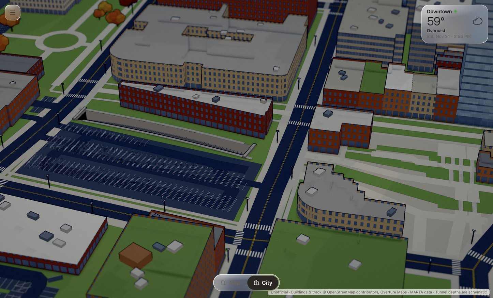

Sam also asked whether City should have an underground view, since tunnels hide most trains.
It's in the art backlog's Cutaway section. Deploying this needs `pnpm data:scene` (or
`pnpm data`) and a web rebuild.
## 2026-11-21 — What the ground can tell us at Five Points

The ground on the Blue/Green alignment about 200 m east of Five Points sits roughly eight metres below both sides of the corridor. A 5 m grid keeps that depression in a downtown board that takes 122.4 KiB gzipped, including its vertical reference. The surprise came farther east. Follow those heights across the Downtown Connector and the train would descend toward the freeway because the public bare-earth DEM removes bridge decks. At Five Points the grid gives us 323.8 m NAVD88 at the scene origin, while the station's stacked tracks remain a separate measurement. The pipeline prototype includes 18 GTFS ground checks and a 101-point test across the cut. [Terrain findings and reproduction](downtown-ground.md) · [Ground map and sections](log/2026-11-21-downtown-ground.png)

## 2026-11-21 — A static terrain pass before the trains

A camera at street-block scale makes the east cut easier to read than the skyline view. Two-metre contours climb both banks, about eight metres above the sampled alignment. Across the Connector, the same drawing follows the freeway floor at 303.9 m NAVD88 and climbs to 314.1 m on the eastern bank. We can now orbit either section in the desktop terrain preview, then bring the City buildings and trees back for context. The JavaScript decoder matches all 54 centre and flank readings in the pipeline CSV. The City data build copies the checked terrain assets without downloading the 318 MB source tile. [East cut in Orca](log/ui/2026-11-21-ground-preview-cut.jpg) · [Connector in Orca](log/ui/2026-11-21-ground-preview-connector.jpg)

## 2026-11-21 — A train stays level over the Downtown Connector

In the local terrain preview, the Blue Line crosses a freeway floor that sits about
10 m below the east bank. The 5 m USGS ground grid shapes the freeway and sets the
foot of each schematic pier. For this study we anchored the structural model once at
the east bank (314.1 m NAVD88), then used City's existing rail profile 7 m above that
anchor. The mapped order puts MARTA above the street and freight bridges. Their
clearances, the railhead elevation and the pier locations remain schematic.

[Replay the crossing on the local City server](http://localhost:5317/terrain-preview.html?at=crossing).
It opens on a scheduled Blue train at 2:12:49 p.m. Eastern on November 20. Replay
covers 28 seconds around that moment. The first render tipped the cars toward the sky:
the cars were aiming at a world-space target computed in track-local coordinates.
After the fix, the Orca replay measured zero pitch on the level span as the cars
crossed the freeway. A regression test translates the train group down 9.7 m and
checks the cab still points horizontally east.

The Galaxy A16 averaged 54.4 fps across three foreground eight-second windows during
the replay (54.0, 54.1 and 55.1 fps, 384 × 692 CSS pixels, render DPR 2). This is a
standalone crossing scene. Full City with its weather and post-processing needs a
separate measurement when the terrain reaches that renderer.

## 2026-11-21 — Ground through Georgia State, measured on the triangles

We sampled the eastbound Blue Line at 184 locations from Five Points through Georgia State and onto the Connector crossing. Over the 55 path metres between the west approach and freeway floor, the native 1 m DEM drops from 312.01 to 303.76 m NAVD88 (8.25 m). The 5 m grid interpolates 312.02 to 303.86 m (8.16 m). On the actual terrain triangles, both low and high detail give 312.05 to 303.77 m (8.28 m). Trees now use those same triangles and a street painted across a bank follows the slope. Rail beds and bridge decks still need structural heights.

Before clipping any rail slots, low detail used 98,390 vertices and 195,700 triangles on top of the board, versus 160,801 and 320,000 at high detail. Position, normal, UV and index buffers were 5,496,880 and 8,985,632 bytes respectively. The ground texture was 2048² versus 4096², with the same 122.4 KiB gzipped terrain payload. The two isolated desktop Orca views each went from 63 allocated geometries and one texture to zero after a season/night/wet change, disposal and an empty-scene draw. Control owns measurement with the open slots, trains and full City renderer. [Low detail in Orca](log/ui/2026-11-21-georgia-state-low.jpg) · [High detail in Orca](log/ui/2026-11-21-georgia-state-high.jpg) · [Section, costs and City interface](georgia-state-ground.md)

### 2026-11-21 — Putting freight across the Connector

The first freight span crosses the western freeway carriageway at 304.1 m of bare-earth elevation. The schematic deck passes overhead at 312.3 m. The surprising part was the length of the bridge. Overture marks only 10.8% of one railway feature as a bridge. Applying the flag to the whole railway lifted its approach too. Splitting the original way before cropping gives us six freight spans here, with the freeway still visible below. Downtown's transport adds two colour-pass draws and one more with directional shadows. The steep banks still show where a ground endpoint is a poor proxy for a surveyed abutment. [Connector](log/ui/2026-11-21-transport-connector.jpg) · [Embedded streetcar rails](log/ui/2026-11-21-transport-streetcar.jpg) · [Measurements and City attachment](terrain-transport.md)

## 2026-11-21 — Road, freight and Blue Line in the same crossing replay

At 2:12:49 p.m. Eastern on November 20, the scheduled eastbound Blue Line crosses the Downtown Connector. The replay now uses the same terrain triangles for the scenery and the lower surface transport. Overture's bridge limits split the elevated sections from their ground approaches. This replaces the earlier study's single bank height for every lower bridge. At one western carriageway, the ground reads 304.08 m NAVD88 and the model places the freight deck at 312.30 m. The scheduled train crosses on a separate MARTA structure about 25 m away in plan. The deck heights are illustrative. [Combined crossing in Orca](log/ui/2026-11-21-connector-scoped-crossing.jpg)

## 2026-11-21 · Cover is not depth: a rail contract for terrain

Real ground is coming to City: USGS 1 m bare earth, baked by the terrain agent. With it, a single
height number per 10 m of track stops being enough. The track's cover (sky, a street, a station
roof, a building) and its height relative to the ground are separate facts. Our old profile
blended them: deeper than −5.5 m meant "tunnel".

**Georgia State was the first fixture, and the old notes were wrong.** I had written that its
two untagged gaps "stay filled as tunnel". In fact the profile ramps from −10 m at the
Washington St portal to +7 m by −84.3859, so a flat-board renderer would draw the line climbing
through the platform canopies and straight through the Floyd "Twin Towers". Imagery from
2022-09-27 (Esri, 15 cm), 2023 (NAIP) and 2026-02-02 (WV02), together with OSM, gives four
honest stretches, eastbound:

- about 62 m open at grade beside the CSX/NS tracks;
- 73 m under the side-platform canopies (roofed, not a tunnel). The tracks between the two
  canopy roofs may be partly visible from above; none of the three images resolves it;
- 131 m under the Floyd Building (OSM `tunnel=building_passage`);
- then open, elevated structure, continuous into the layer-3 viaduct over the Connector. The
  second "gap" was only a seam between OSM ways.

**The contract.** `scene.json` gains an optional `rail` key and keeps `profiles` byte-identical.
Each path carries sorted, half-open spans in path metres, each with:

- cover: `open`, `covered` or `roofed`;
- form;
- a height base: local ground + rel, or hung from identified anchors;
- `height: schematic`;
- an evidence id with sources and edge precision.

Gaps mean unknown, so the old profile still applies there. The bake projects 6 lon/lat fixtures
onto all 12 Blue/Green paths in both directions. Span lengths agree within 15 m across paths, and
the westbound order is the exact reverse of the eastbound.

**A seam the coordinating agent caught.** Bedding the Floyd Building span on local ground while
hanging the viaduct from the east face + 7 m would make a car jump up to 7 m at the seam. The
canopy, building and viaduct spans now share one anchor chain:

- canopy west end, +0 m;
- station east face, +7 m;
- Connector east bank, +7 m.

A contract test samples ±1 cm either side of every seam with a synthetic ground surface, in both
directions. It measured a 2.65 m step with the old layout and passes with the chain. The 7 m
clearance remains a placeholder: no public record gives the MARTA deck height over the
freeway.

**What's still uncertain, with sources.** Edges are ±10–15 m along the path. They come from:

- OSM ways 702258813/816 (the tunnel ends at the Washington St bridge, 9245544);
- 78090747/742 (open, `level=2`);
- 539937961/962 (platforms);
- 702258821/822 (`building_passage`);
- 905944412–415 and 78090750/78380741 (structure and viaduct).

The imagery checks were Esri World Imagery 15 cm (Vantor, 2022-09-27) and WV02 (2026-02-02),
viewed only, and USGS NAIP `m_3308413_se_16_060_20231008` (2023-10-08, public domain, in
`docs/log/rail/`). In NAIP, tall-building lean hides the track under the towers, so the
building-cover edges rest on OSM and the 2026 imagery. Platform level relative to the bare-earth
surface inside the Floyd Building is unknown: the bed ramps from 0 to +7 m across the station
schematically. The deck clearance over the Connector is unknown; I checked FHWA NBI Georgia
2024/2025 and GDOT's public GIS.

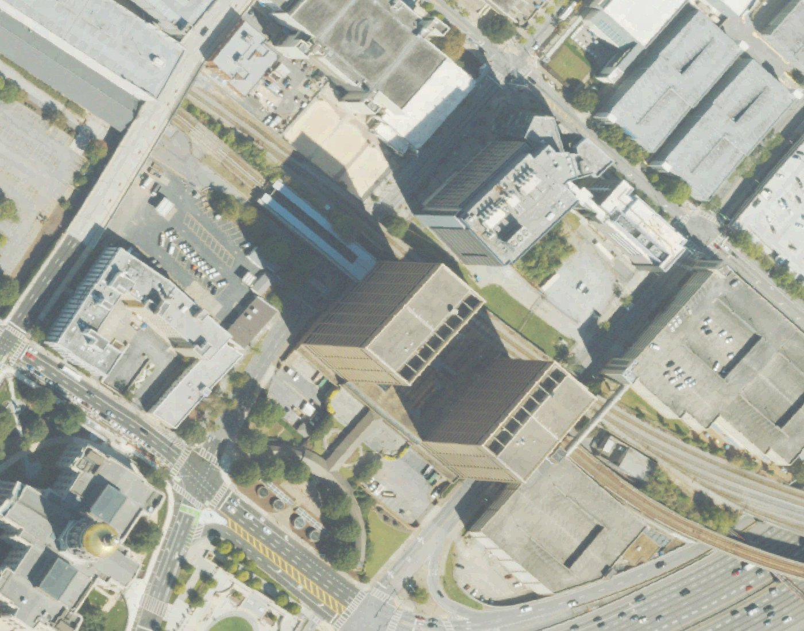

The integrated City release uses both `pnpm data:scene` and `pnpm data:city` (or the full
`pnpm data`), followed by a web build and Worker deployment.

## 2026-11-21 — The frame we saved before changing Georgia State

Freeze Friday, November 20 at 2:12:29 p.m. Eastern. The timetable puts the centre of an eastbound Blue Line train at 8,108 m along its route, about eight metres beyond the Floyd building’s east face. Map gives us the train’s position. Switch to City without moving the camera target and the question changes. Which cars should a person above the station actually see? The baseline City frame uses the flat board and the old elevation profile. In the 2023 aerial photograph, you can follow the open approach up to the white station canopies, then lose the tracks under the building. How much of the track between those canopies is visible remains uncertain.

[Map at the scheduled passage](log/ui/2026-11-21-georgia-state-map.jpg) · [City before the rail-cover change](log/ui/2026-11-21-georgia-state-before-cover.jpg) · [2023 USGS aerial photograph](log/rail/2026-11-21-naip-2023-georgia-state.jpg)

To recreate the pair, [open the paused Map](http://localhost:5317/?q=high&t=2026-11-20T14%3A12%3A29-05%3A00&speed=0#17.8/33.7497/-84.38526/-22), then select City. Both captures face 22° west of north. City tilts 57° and the view is centred on the building’s east face. The scheduled time and the camera are fixed for a later comparison with the terrain and rail-cover renderer.

Farther east, review caught another place where the ground could mislead us. Eleven road or pedestrian bridge runs meet the edge of the board. At one motorway ramp, the board cuts across the span where the ground lies 7.58 m below the support inside the scene. Making that crop point a support bent the deck down toward the freeway. The model now carries the in-board support height to the edge. [Ramp after the fix](log/ui/2026-11-21-transport-edge.jpg)

Two photographs by Bill Mahan for the *Atlanta Journal-Constitution* put a train back into the Georgia State reference material. On October 7, 1979 he photographed a train crossing the Downtown Connector on the east approach. On October 31 he photographed a train passing through the station with the skyline behind it. Georgia State University Library holds both prints. They document the railway in its opening year. Sam identified the dusk frame from @city_surreal as another angle looking into Georgia State Station. The illuminated entrance and the line of warm windows along the train give us a reference for how the approach reads after sunset. [October 7 approach photograph](https://dlg.usg.edu/record/gsu_planatl_10448) · [October 31 station photograph](https://dlg.usg.edu/record/gsu_planatl_10513)

Sam also shared *Waning Winter* by @br3nn3nfoto, taken during a rare Atlanta snowfall. The Georgia Capitol dome puts the sweeping rail curve in context. A red steel girder crosses below the MARTA deck, and the highway is visible beneath both. Snow picks out the edges of the deck and the curve of the car roofs. That makes the frame a useful check on the winter scene and on how the three levels read from a distance. The station is outside the frame. The two photographer-credited screenshots are kept with the local source references under `data/raw/photo-references/`.

Looking along the Downtown Connector in *Fast Lanes* by @4cn.shon, the order is easy to see. MARTA crosses at the top of the frame, two CSX locomotives occupy the red girder bridge below, and traffic fills several lanes beneath both trains. Sam pointed out that our preview reads as two skinny roads. We put the roadway footprint and traffic behaviour into the M2b traffic pass. The highway-level photograph gives us a repeatable visual comparison for that work. Local reference: `data/raw/photo-references/connector-fast-lanes.png`.

Rail Accuracy checked the photograph against the mapped bridges. OpenStreetMap assigns layer 1 to the Atlanta Terminal Subdivision freight crossing and layer 3 to the MARTA viaduct above it. These layer numbers describe the order of the decks. Their clearances remain unmeasured. [Freight bridge](https://www.openstreetmap.org/way/539939597) · [MARTA viaduct](https://www.openstreetmap.org/way/78090750)

For the post, the October 7 archive title identifies the Connector crossing. The catalog coordinates point to Georgia at large, and the clipping text on the back concerns energy policy. The October 31 print has a caption on the back that explicitly names Georgia State Station. Both records credit Bill Mahan and carry the rights label *In Copyright – Educational Use Permitted*. [October 7 catalog record](https://dlg.usg.edu/record/gsu_planatl_10448) · [October 31 catalog record](https://dlg.usg.edu/record/gsu_planatl_10513)

### 2026-11-21 — One set of downtown buildings, from daylight to dusk

Downtown's foundations span 39 whole-metre elevations. Each elevation used to require its own facade mesh and rooftop-equipment batch. Building the walls and roofs at their individual foundations brings those 78 batches down to two. Every wall still carries the elevation of its own ground floor, so the illuminated windows and shopfronts start at the right height on a slope.

In an Orca desktop view of the whole low-detail board, terrain, buildings and trees fell from 79 colour-pass draws and 508,434 submitted triangles to eight draws and 461,457 triangles at the same camera and season. Low detail keeps up to three rooftop units and three leaf clumps per canopy. The 195,700 ground triangles still resolve the 8.28 m descent into the Connector. Road markings, crossings, striped parking lots and mapped parks and facilities use the existing 2048² ground texture. In the integrated City dusk view, the street lights warm that same pavement beneath the lit facades. These counts cover the terrain and scenery layer. City's lights, transport, shadows and post-processing have their own costs. [Full City at noon](log/ui/2026-11-21-terrain-city-day.jpg) · [Full City at dusk](log/ui/2026-11-21-terrain-city-night.jpg)

At street-block range the first zebra stripes blended together on the low-detail texture. One texel covers 0.98 m. Giving stripe width and spacing a minimum in texels separated the crossing marks while keeping the same board memory and draw count. Parking dividers still soften at grazing angles. [Low-detail street markings near Five Points](log/ui/2026-11-21-terrain-city-paint.jpg)

## 2026-11-21 — The train disappears under the Floyd building

At 2:12:10 p.m. Eastern on November 20, the flat-board City renderer placed six cars beside Georgia State’s platform. In the same scheduled passage on the measured board, all six are under cover. At 2:12:29 four cars are visible as the train emerges at the Floyd building’s east face. Twenty seconds later all six are on the Connector viaduct. We held the Map centre, zoom, bearing, City tilt and timetable instant from the earlier photograph comparison. In Orca we also checked the train in the open Five Points east cut and followed it across the lower bridges. The shapes of the hills come from the USGS grid. The track-bed height through the station and over the freeway remains schematic.

[Flat-board station passage](log/ui/2026-11-21-georgia-state-before-cover.jpg) · [Same passage on terrain](log/ui/2026-11-21-georgia-state-after-cover.jpg) · [East cut](log/ui/2026-11-21-city-terrain-east-cut.jpg) · [Connector crossing](log/ui/2026-11-21-city-terrain-connector.jpg)

On the Galaxy A16 the low-tier production build drew the opening view at **51.26 fps** over three consecutive eight-second foreground windows (49.43, 52.37 and 51.98 fps). The board, rail, lights and surface transport took 1.13 seconds to construct. The ready frame appeared 3.44 seconds after navigation on local USB. The viewport and draw buffer were 384 × 692. The timetable ran at normal speed from 2:11:58 p.m. The flat-board fallback still opened when we tested with an older manifest, and current City and East Portal both rendered in Orca. [A16 opening frame](log/ui/2026-11-21-city-terrain-a16.jpg)

## 2026-11-21 — Reading a locomotive number from the highway

The clue in Sam’s Georgia State crossing photo was the four digits under the cab window. Number 7257 identifies a CM44AC, rebuilt from GE AC4400CW number 381. The long hood has room for a side walkway. Its flared radiator, low yellow nose and two three-axle trucks give the locomotive a different outline from a passenger car, even from above. The scale study pairs it with a ribbed boxcar. The boxcar and its paint are illustrative. [Photographs of 7257](https://rrpicturearchives.net/modelthumbs.aspx?Page=51&id=CSX&mid=1546) · [Wabtec on the CSX rebuilds](https://www.wabteccorp.com/newsroom/press-releases/wabtec-and-csx-extend-deal-to-modernize-over-200-locomotives) · [Model lab screenshot](log/ui/2026-11-21-cm44ac-model-lab.jpg)

The three lab selectors now name the vehicle you’re looking at. The bus is the 40-foot CNG variant, New Flyer Xcelsior XN40, with tanks on the roof and a 12.50 m length over the bumpers. The passenger train is the Stadler CQ400. Each selection has a shareable model-specific URL. [New Flyer dimensions](https://www.newflyer.com/site-content/uploads/2021/01/Xcelsior_CNG_Brochure.pdf) · [MARTA’s CQ400](https://itsmarta.com/newCQ400railcars.aspx)

### 2026-11-21 — How wide is the Connector beneath Georgia State?

City gives each side of the Downtown Connector a 14 m strip. On the county aerial, the striped lanes alone take about 24–25 m in each direction on both sides of the rail crossing. South of the MARTA deck, two northbound feeder lanes join a five-lane mainline. Treating both as painted centreline ribbons makes them overlap just where the traffic model needs distinct lanes. GDOT's nearest mainline record gives 253,000 vehicles a day in 2024 and a calculated 237,000 in 2025, counted across both directions. The dated aerial sections, ramp records and separate source of the lane count give M2b a way to check its lane geometry before animating traffic. [Two aerial cross-sections](log/2026-11-21-connector-footprint.png) · [Measurements and traffic records](connector-road-footprint.md)

## 2026-11-21 — A boxcar found the freeway floor

At 2:12:49 p.m. Eastern in our November 20 replay, two illustrative freight locomotives pass beneath the scheduled Blue Line. In the first render, a boxcar tipped nose-down at the Connector. At the two ends of the mapped freight bridge, the bare-earth grid read 308.8 and 306.9 m NAVD88. Along the intact track on either bank it read about 314 m. A still image of the empty track had let that mistake slip by. [First crossing](log/ui/2026-11-21-freight-bank-before.jpg) · [Same instant with the corrected grade](log/ui/2026-11-21-freight-bank-after.jpg)

The City model now follows that grade across three rail-over-road crossings. The same rendered track carries both trucks of each locomotive and boxcar. Four Overture source segments trace 2,634 m of the Atlanta Terminal main, from the east edge through the Gulch to the north edge. The clock drives an illustrative loop of two locomotives and five boxcars. Its timing, consist and structural heights are schematic. At the Five Points east cut, a conflict with the MARTA terrain opening leaves too little supported freight track to animate.

With moving freight, the Galaxy A16 opening view averaged **51.32 fps** across three eight-second windows on low quality (52.67, 52.62 and 48.68 fps) at 384 × 692. The two highway carriageways still look narrow in these screenshots. The separate roadway study measures what to change. [Connector cross-sections](connector-road-footprint.md)

Checking the two decks from the highway side turned up one more collision. Two of the regularly spaced MARTA support columns crossed the freight loading envelope near the east board edge. We tested column positions against the mapped lower tracks and moved or skipped conflicting supports. In the rendered model, rays from the locomotive roof to the deck above now measure 1.07–1.16 m at ten points across the crossing. These are model clearances. [Locomotive under the MARTA deck](log/ui/2026-11-21-freight-under-marta.jpg)

## 2026-11-21 · The freight line that runs under Five Points

For an illustrative freight train in City, I traced one continuous freight route through the
board, starting from the bridges over the Downtown Connector by Georgia State. It's the CSXT
Atlanta Terminal Subdivision. It enters from Hulsey Yard and crosses the Connector. It shares the
Five Points east cut with MARTA, then dives under Five Points. It surfaces in the Gulch and leaves
at the north edge beside Norfolk Southern.

The shipped bake already holds it as four Overture segments. They join end to end, giving 2,630 m
with no gaps. Railroads report train counts at a dozen grade-separated FRA crossings along it, and
those land on the route in order: 6 trains a day east of Georgia State, 13 under downtown, 14 at
Ivan Allen Blvd. They are averages for different stretches, not one number for the route.

What surprised me is how much of it is hidden: four covered stretches add up to 736 m. A
branch that looked important on the map, the Circle Connection through the Gulch, has no
reported traffic at all. Its count is inferred.

The cover for this route comes from OSM and Overture tunnel tags. Unlike MARTA's cuts, I haven't
checked it against imagery yet.

## 2026-11-21 — Seven lanes under the Georgia State approach

The aerial put about 24–25 m between the inside and outside stripes of each carriageway. City had allowed 14 m for each mainline. We painted the two measured sections 153 m apart, joined their edges under the bridges and tapered the pavement back into the mapped roads over 60 m at each end. Seven inferred lane centres per direction now give the pavement markings and future traffic a common set of coordinates. The two northbound feeder lanes peel away from the through lanes at the south end of the comparison. [Aerial and lane evidence](connector-road-footprint.md) · [Before](log/ui/2026-11-21-connector-before.jpg) · [After at the same instant](log/ui/2026-11-21-connector-after.jpg)

From above, the crossing looked ready. From 2.2 m above the northbound pavement, the new stripes ran straight into a MARTA bridge column. We checked the footprint of each schematic support against the travel lanes and found six street lights still standing on the old shoulders inside the new roadway. Keeping the old 26 m spacing would have left 103 m between piers. Searching along the deck found two clear sites, including the median, and reduced the longest of those three spans to about 42 m. These are distances in the model. This view records the geometry before the traffic animation. [South taper and feeder](log/ui/2026-11-21-connector-south-taper.jpg) · [View from the highway](log/ui/2026-11-21-connector-road-view.jpg)

The low-quality opening view on a physical Galaxy A16 averaged **50.18 fps** across three consecutive eight-second foreground windows (52.42, 48.25 and 49.86 fps) at 384 × 692. Both quality tiers use the same lane coordinates, painted into the existing ground texture when City opens.

## 2026-11-21 · Live buses in City

City now shows real MARTA buses, only at the real present and tagged `live`. They come from the
same 30 s cached feed the Map uses, through one shared `LiveBuses`. A new heartbeat runs outside
MapLibre's readiness, so City gets buses even when basemap tiles never load. It polls no more
often than before (once per 30 s; a fake-timer test checks this).

A sample of the live feed this evening explains the design:

- **Few buses are on the board.** Only 3–7 of about 150 fresh fixes fell inside it. Each new report
  is snapped once, through a spatial index; reports that can't be snapped (off the board, or away
  from a bus street) are cached by id and report time. That stops the frame loop re-snapping about
  144 rejected fixes every frame.
- **The first index accepted no fixes.** It used only the scoped terrain intervals. Ordinary
  at-grade streets come from `vd.roads`, and adding them accepted all three on-board fixes in
  Control's sample: route 49 on Courtland St NE at 18.0 m, route 20 on Decatur St SE at 2.7 m, and
  route A on MLK Jr Dr SW at 1.8 m. A test on the shipped data now fails without them.
- **Heights:** buses stand on the drawn surface. At-grade streets are painted onto the terrain,
  and street bridges use transport's exact tread sampler. An analytic deck I wrote first was off
  by up to 0.73 m at twisted abutments.
- **Crossings:** where a street passes under a bridge, the reported bearing picks the right level.
- **Glides:** a bus glides only along the same street, for under 150 m. A report that turned a
  corner is placed on its new street, never driven through a block.
- **Car traffic:** illustrative cars can ask `occupies()` to keep clear of buses, level by level.

In Orca at 7:55 pm in a drizzle, bus 4691 sat in its right-hand lane at a downtown intersection,
at 60 fps on the high tier.

Control's device and Orca gate ran on the PR build (5b16705):

- **Galaxy A16**, standalone bus build at the real present in drizzle: an average of 52.46 fps over
  three 8-second foreground windows (52.80, 52.42, 52.17) at 384 × 692.
- **Direct City entry in Orca:** one initial bus request, and two real buses drawn.
- **Timetable (time-shifted) City:** zero bus requests and zero buses.
- **Final street-glide fix (7670caf)**, on the A16 in drizzle: an average of 50.76 fps.

### 2026-11-21 — Four tracks between Pryor and Central

The freight track east of Five Points had almost disappeared in City. Near the middle of the opening, the passenger track drawn from the timetable geometry sits about 1.8 m from the mapped CSX centre. The two mapped centrelines are 5.4 m apart. Plotting all four ways also corrected the name of the block: Pryor Street to Shirley Clarke Franklin Boulevard, called Central Avenue in the bridge records. The Interline goes under cover about 10 m earlier than freight at the eastern end. A local four-track study recovered 102 m of drawable freight tread using the same City camera and clock. Its common bed is illustrative. The lidar resolves two banks around a trench but puts the CSX trace on a slope, where even a three-metre sideways shift changes the ground sample substantially. [Current City](log/rail/2026-11-21-east-trench-current.jpg) · [Mapped-track study](log/rail/2026-11-21-east-trench-mapped.jpg) · [Measurements and source dates](five-points-east-trench.md)

### 2026-11-21 — Cars follow the stripes below Georgia State

At 2:12:49 p.m. on the replay clock, the same scheduled Blue Line train and illustrative freight consist pass above both views of the Connector. The traffic prototype placed 92 illustrative road vehicles across the high-detail board and 40 on low. Five seconds later the vehicles had travelled about 90 m along their own lanes. The northbound feeder supplies the two outside positions at the crossing. The southbound option lane can continue or take I‑20. At the northern edge, one clipped tunnel way starts 43 m inside the board in the older road extract. Its scoped ground interval supplies the missing approach to the edge. A car can now disappear through that tunnel and resume on the same road without jumping to the neighbouring ramp. [High-detail crossing](log/ui/2026-11-21-connector-traffic-high-49.jpg) · [Five seconds later](log/ui/2026-11-21-connector-traffic-high-54.jpg) · [Low-detail crossing](log/ui/2026-11-21-connector-traffic-low-49.jpg) · [Traffic sources and integration](connector-traffic.md)

At road level, the same replay shows all three layers moving through the Georgia State crossing. The Blue Line is on the upper deck, freight is below it, and opposing streams of cars pass underneath. The measured road edges anchor the lane positions. The model uses the 2025 GDOT estimate of 237,000 vehicles a day across both directions, a typical hourly pattern from a different Atlanta counter and an illustrative speed of 18 m/s. At this instant City draws 92 road vehicles across the full high-tier board and 40 on low. The first A16 run with traffic and freight, before adding live buses, averaged **51.86 fps** at 384 × 692. [From the northbound lanes](log/ui/2026-11-21-connector-traffic-road-view.jpg) · [Traffic assumptions](connector-traffic.md)

The bridge approaches exposed a second problem. An arithmetic reconstruction of the road surface missed the rendered pavement by more than half a metre at 12 of 668 sample points. The worst error was 73 cm. One banked end of a deck twists relative to the other. The renderer divides that surface along a diagonal, and a vehicle using a different interpolation can visibly float. Buses and cars can now sample their own road's two rendered triangles. A vertical ray at each of the 668 points agreed to within a millimetre.

With live buses and illustrative traffic together, a real-time City opening in drizzle averaged **51.36 fps** on the A16 (51.50, 51.92 and 50.67 fps). The phone screenshot exposed a problem with the legend after dusk. Pale lettering on the daytime attribution panel was almost invisible, and the first-visit gesture hint sat on top of it. The attribution now uses the night palette and clears the hint. [A16 in drizzle](log/ui/2026-11-21-connector-traffic-a16.jpg)

### 2026-11-21 — The trains pick a side at Five Points

The ten scheduled Blue and Green shapes through the east cut trace almost the same line. The mapped route memberships put the five eastbound shapes on the southern rail and the five westbound shapes on the northern passenger rail. In the same-camera study a five-car test train could enter and leave either mouth with two full cars and half the middle car showing. Taking away one shape’s cut observation also took away the reconstructed bed. The supported freight tread fell from 106.23 m to 4.01 m and the locomotive stayed out of view. [Scheduled passenger](log/rail/2026-11-21-mapped-timetable.jpg) · [Illustrative freight](log/rail/2026-11-21-mapped-freight.jpg) · [Evidence and integration](five-points-east-trench.md#integration-and-verification)

The combined City build passed 133 tests. On the Galaxy A16 at 384 × 692 the same low-tier opening averaged **51.11 fps** in the daytime replay and **51.47 fps** at the real present in drizzle. Each run measured three eight-second foreground windows with the passenger, freight and Connector layers enabled. Regenerating the scene manifest changed two evidence strings naming the bridges. All 12 rail paths retained their geometry. [Passenger train between the two road bridges in City](log/ui/2026-11-21-five-points-mapped-city.jpg)

### 2026-11-21 — Cars on the downtown street grid

The first arterial bake matched 155 of 233 candidate road segments to FHWA’s 2024 highway inventory. Sixteen corridors passed the name, direction and geometry checks, including 21 drawn bridge runs. The renderer found 31 directed paths. It joins runs at unambiguous continuations and fades a trip at an interior endpoint where the evidence stops.

At 2:12:49 p.m. the high tier drew 42 arterial vehicles alongside 92 on the Connector. Low drew 17 and 40 respectively. At Decatur Street a white car approaches the bridge while the two freeway streams pass below it. Sampling 698 lane points on 34 primary and secondary bridge sections matched the deck triangles at every point. The hourly pattern comes from a separate freeway counter. Each car and its timing are illustrative. [Decatur Street bridge](log/ui/2026-11-21-decatur-arterial-bridge.jpg) · [Downtown streets](log/ui/2026-11-21-arterial-streets.jpg) · [Source and direction checks](arterials.md)

On the Galaxy A16 the combined opening averaged **52.29 fps** in daytime replay and **51.80 fps** at the real present in drizzle. Both runs used low tier at 384 × 692 and measured three eight-second foreground windows.

### 2026-11-21 — Tapping the train above the highway

At Georgia State, one tap on the upper viaduct opened the scheduled Blue Line to Indian Creek. A tap on the lower viaduct opened the illustrative freight loop. Both were visible at the same replay instant. The selector follows the drawn length of each car and trims it at the same portal planes as the renderer. The 24-pixel margin uses CSS pixels, so the phone’s lower render resolution keeps the same touch target. In the live scene, Route 55 bus 2360 showed the age of its MARTA report and identified the New Flyer Xcelsior XN40 body as illustrative. [Scheduled Blue Line](log/ui/2026-11-21-city-train-card.jpg) · [Live Route 49 bus on a later check](log/ui/2026-11-21-city-bus-card.jpg)

On the A16 the first card was readable over pale pavement but lost contrast against the freight deck in shadow. The card now uses the same light or dark surface as the attribution. The 44 × 44 px close control and view switch stayed accessible at 384 × 692 and 360 × 560. With arterial traffic and picking together, the low-tier opening averaged 47.39 fps over three foreground windows in live drizzle. [Blue Line card on the Galaxy A16](log/ui/2026-11-21-city-train-card-a16.jpg)

At 9:52 p.m. the Blue Line crossed the same viaduct with its windows lit. In the open card, the blue schedule label identifies the timetable and the violet model label identifies the illustrative consist. [Night crossing and train card](log/ui/2026-11-21-city-train-card-night.jpg)

## 2026-11-22 · Georgia State against Sam's three photographs

I put City's Georgia State beside three Instagram frames Sam found: @city_surreal's dusk approach,
@br3nn3nfoto's *Waning Winter* and @4cn.shon's *Fast Lanes*. I matched each with a pinned clock
and camera. The track plan, cover and three-level stack hold up:

- Freight runs 7.8–10 m above the Connector's floor, and MARTA 4.0–6.7 m above the freight.
- Freight and MARTA cross on separate parallel bridges 15–25 m apart. *Fast Lanes* only looks
  stacked because a telephoto lens compresses the distance.
- A moment of doubt about the westbound train's track turned out to be a trick of the oblique
  camera. Overheads confirm right-hand running, and a test now pins it.

Two things are wrong, and both are structures:

- **The Floyd building, the station's "Twin Towers", is drawn as a 25 m block.** The state calls
  it a 20-storey building. No published height in metres turned up, so any metre figure would be
  an estimate.
- **The station itself is missing.** The canopies aren't drawn, and the track under them is hidden.

The study recommends modelling those before refining track heights. Details:
[georgia-state-station-study.md](georgia-state-station-study.md)

### 2026-11-22 — City gets the front door

The downtown scene used to wait for the regional basemap style before it could show its loading message. City now paints that message first and creates the MapLibre map when someone opens Map. A bookmarked map coordinate still opens the regional view. Switching a 134° camera into Map and back kept its bearing, centre and 0.30 metres per pixel in Orca.

On the Galaxy A16, a fresh-origin visit to the previous build first painted text at 1.90 seconds and showed the city at 5.38 seconds. Two fresh origins on the new production build painted text at 0.78 and 0.38 seconds and showed the city at 4.92 and 2.85 seconds. These were local USB-served runs at the real clock in overcast weather. The new build averaged 52.00 and 50.80 fps across three eight-second foreground windows per visit. [Phone opening](log/ui/2026-11-22-city-default-a16.jpg) · [Desktop opening](log/ui/2026-11-22-city-default-desktop.jpg)

Using Wi-Fi on the A16, a screen recording of a returning visit to the public root showed downtown about 3.5 seconds after navigation.

Disabling only the City graphics context brought up the interactive regional map. Disabling both renderers revealed a shared dependency: MapLibre also needs WebGL. The fallback now draws the published MARTA rail shapes directly and labels seven stations. In Orca the labels cleared one another on both a 1446 × 876 desktop and a 360 × 560 phone viewport. Cancelling during either the timetable download or scene construction kept Map active after the late data arrived. [Rail overview with both graphics contexts unavailable](log/ui/2026-11-22-city-webgl-fallback.jpg)

### 2026-11-22 — Riding a Blue Line train from above

At 2:11:25 on the Friday timetable, a six-car eastbound Blue Line train fills the cut east of Five Points. Selecting it in the follow preview keeps the same trip in frame for the ride to Georgia State. At 2:12:02 the roof hides the whole consist. The card says “Under cover” while the streets move past, and by 2:12:32 the train has reappeared on the viaduct. In reduced motion the viewer decides when to recenter. [East cut](log/ui/2026-11-22-follow-east-cut.jpg) · [Under cover](log/ui/2026-11-22-follow-covered.jpg) · [Back in daylight](log/ui/2026-11-22-follow-viaduct.jpg) · [Replay the trip](blue-line-follow.md)

### 2026-11-22 — Making room for replay in portrait

At 384 × 692, tapping the middle of Now in a paused replay opened Map. The view switch intercepted all nine points we checked on Now and the left side of 1×. At 360 × 560, the icon-only switch still caught the edge of Now and part of the time slider. In the optional playback view, the switch now sits beside the time panel with an 8 px gap. Both groups stay within reach while following the night train. On a Galaxy A16, a rider could tap the Blue Line train, choose Follow train, then tap 1× to start the replay. [Galaxy A16](log/ui/2026-11-22-portrait-replay-a16.jpg) · [City at 384 × 692 in Orca](log/ui/2026-11-22-portrait-replay.jpg) · [Map at 360 × 560 in Orca](log/ui/2026-11-22-portrait-replay-map.jpg)

### 2026-11-22 — The roof that moved the station

Georgia State's platforms run under the 20-storey Floyd Building, so the station model needs the
building's openings to be in the right place. In imagery, the station's east end had looked like
a roof edge. Overlaying OSM on NAIP 2023 showed the error: the towers lean 10–25 m in aerial
photos, and their bases sit exactly on the OSM outline. Covered track had been running 10 m past
the building's real SE face.

The cover edges now come from the surveyed faces:
- 69 m open approach;
- 71 m under the canopies;
- 116 m under the building, down from 131 m.

A test walks all ten East Line paths in both directions and checks that each change of cover
lands within 1 m of the surveyed line.

The survey also found a lateral offset: the GTFS line runs 2.3 m north of the real track centre
through the station. That is half a track spacing, enough for a car to clip a platform. City will
ease its drawn line onto the surveyed axis inside the station. OSM also draws the platform edges
0.7 m from the rails, closer than half a car's width, so only the outer walls are taken from it.
[Survey](georgia-state-geometry.md)

### 2026-11-22 — The pair of towers above Georgia State

From the plaza, the Floyd Building has three window bays across the face of each tower. From the street corner, eight bays turn along the side. Both towers rise from the same low roof, with about 53 m of sky between them. In the old City frame, a single 25.2 m block occupied the whole footprint. In the integrated City preview, the train enters an 18 m model opening at the northeast edge of the base and passes beneath both towers. The twenty storeys are documented. The 78.4 m height is an unverified map tag, and the soffit is schematic. [Plaza before](log/ui/floyd/plaza-before.jpg) · [Plaza after](log/ui/floyd/plaza-after.jpg) · [Dusk approach](log/ui/floyd/dusk-after.jpg) · [Photographs, dimensions and camera comparisons](floyd-towers.md)

### 2026-11-22 — A train can enter Georgia State

In the old dusk view, six Blue Line cars headed for what looked like a solid office wall. A photograph taken on the platform gave us three details the aerial view couldn’t supply. The floor is red-brown brick, the boarding edge is pale, and recessed lights punctuate a low ceiling. From the opposite angle in Sam’s dusk photo, the same station reads as a warm rectangle above the viaduct. [Platform photograph by Gman197002](https://commons.wikimedia.org/wiki/File:MARTA_Georgia_State_Station.JPG) · [Before](log/ui/georgia-state-study/2026-11-22-gss-dusk-approach.jpg) · [After](log/ui/georgia-state-station/dusk-approach.jpg)

We brought the City track about two metres sideways onto the mapped passage and kept the timetable distances on their original vertices. That lets the train run along the brick platform, pass between the jambs and disappear behind the lit entrance bays. The opening uses the same track bed and ceiling height as the towers. The 12-metre view into each end and the lighting are artistic estimates. [Daylight arrival](log/ui/georgia-state-station/day-platform.jpg) · [Dusk entrance](log/ui/georgia-state-station/dusk-entrance.jpg)

On the physical Galaxy A16, the default low-tier opening averaged 51 fps. A moving dusk arrival averaged 60 fps in the closer station view, compared with 67 fps at the same camera on the previous release. Each measurement combines three foreground eight-second samples. [A16 at the station](log/ui/georgia-state-station/a16-dusk.jpg)

### 2026-11-22: Four tracks, two islands, and a timetable that won't say which track

Avondale is the second test case for the shared platform model. It has two island platforms and
four tracks:
- the Blue Line's two main tracks outside;
- two centre tracks between the islands, which lead to the yard.

The timetable says which platform a train calls at, since each island has its own GTFS stop id.
It never says which of that island's two tracks the train uses.

So the fixture keeps three things apart:
- the physical edges (tracks facing platforms);
- the scheduled platform;
- the track, which is a candidate set with a "usually the main" that is only inferred.

The Green Line turnbacks that OSM still maps on the centre tracks are absent from the current
feed and from MARTA's station page. They are kept as reported history, not as service.
[Layout and sources](avondale-layout.md)

### 2026-11-22 — Daylight on a night train

Sam wanted to see detail in a dark station while watching the same arrival. The place and weather widget now opens a scene preview with separate lighting and weather choices. A paused 8:41 pm Atlanta timetable frame stays at 8:41 pm while the user switches on daylight. The view keeps the same train positions. The widget labels the preview, and the report below it still describes the observed Atlanta weather when the clock is live. We checked City and Map, returning to automatic conditions and fitting the panel inside a 360 × 640 phone frame. [Night view](log/ui/scene-conditions/dusk.jpg) · [Same moment in daylight](log/ui/scene-conditions/daylight.jpg) · [Lighting chooser on the Galaxy A16](log/ui/scene-conditions/a16-lighting.jpg)

### 2026-11-22 — Which side faces the platform?

An eastbound Blue train at Georgia State has its south platform on the right. At Avondale the timetable can name the south island but still leave the door side open. From the main track the island is on the left. From the centre track it is on the right. City now models one physical slab with a boarding edge for each track it serves. At Georgia State the refactor reproduced all 2,664 triangles of the brick platforms, canopies, lit entrances and fittings. The timetable puts the eastbound train at the stop at 14:12:00 and gives it zero seconds of dwell. [Georgia State in Orca](log/ui/2026-11-22-platform-primitive.jpg) · [Platform model and schedule semantics](data-model.md#station-platforms-and-boarding-edges)

### 2026-11-22 — The stadium was in the data and missing from the scene

The downtown bake contains a Mercedes-Benz Stadium footprint about 300 m across. The camera showed an empty field. Its westernmost point is 5.5 m outside the terrain board, and the generic building renderer skips a foundation when even one sample falls outside. That changes the stadium modeling job. First give the part on the board a valid foundation, then add the eight roof petals. The Capitol and Westin are the first two skyline studies. [Stadium before](log/ui/downtown-landmarks/stadium-before.jpg) · [Six landmarks, references and camera notes](art-backlog.md#downtown-landmarks-from-the-train)

### 2026-11-22 — More room for downtown

City’s long source note crossed the whole bottom of the scene. We moved it into a 44 px info button in the lower-right corner. OpenStreetMap also gets a linked credit while downtown loads. The panel reads the mounted scene to say whether its terrain is measured and which traffic is illustrative. At 360 × 640, the button and open note both fit above the optional replay controls. [City at rest](log/ui/city-info/closed.jpg) · [Credits expanded](log/ui/city-info/open.jpg)

## 2026-11-22 — Finding the Westin inside its block

The old skyline gave all 125 metres of the Westin's hotel block the same 220-metre roof. The surprise was that the missing circle was already mapped separately. Its 39-metre glass drum sits on the west end of the seven-story podium, with a second, much smaller circle for the exterior elevator. Portman's park and oblique photographs showed where to put the dark Sun Dial band and where to let the neighbouring skyline break up the glass. The replacement takes two meshes. From the Gulch you can see the towers that the old slab hid. [Skyline before](log/ui/westin/gulch-before.jpg) · [Skyline after](log/ui/westin/gulch-after.jpg) · [Close night view](log/ui/westin/night-after.jpg) · [Source notes and camera poses](westin-peachtree-plaza.md)

### 2026-11-22 — What the Westin’s glass was reflecting

Sam spotted a second skyline stuck to the lower half of the hotel. We had copied a neighbouring tower’s reflection from a photograph into the window texture. The panes now share one silver finish, and the scene sun and camera supply the highlight. A broadcaster’s rooftop visit gave us a 113 ft mast to add above the Sun Dial. A night photo supplied the other detail we had missed in daylight, a row of amber-white lights around the crown. The mast shares the trim mesh and the lights share the window material, so the hotel still draws in two meshes. [Daylight](log/ui/westin/glass-day.jpg) · [The same view at night](log/ui/westin/glass-night.jpg) · [Reference notes](westin-peachtree-plaza.md)

### 2026-11-22 — Glass you can see by moving around it

The first silver finish on the Westin caught the sun, but next to the masonry towers it still looked like the same material. We kept the panes uniform and gave them something to reflect. A 128 × 64 panorama of nearby mapped walls takes 32 KiB before mipmaps. Orbit the hotel at the same afternoon time and the pale sky and darker rooflines slide across the shaft. At night the reflection cools and dims beneath the lit windows. The hotel still uses two meshes. [Before](log/ui/westin/glass-day.jpg) · [Same daylight camera](log/ui/westin/reflection-day.jpg) · [Around the corner](log/ui/westin/reflection-orbit.jpg)

### 2026-11-22 — Five metres hid a stadium

One corner of Mercedes-Benz Stadium extended 5.48 m beyond our terrain board. Losing the ground under that corner made the whole 300 m footprint disappear. Cutting the apron at the board produced a 46.78 m west face that we could bed into the measured ground. From across the Gulch the glass now sits between the silver folds of the shell. From above, the eight pale roof petals occupy only the middle of the much larger fixed roof. Each has its own overlap and cushion direction. [Gulch before](log/ui/stadium/gulch-before.jpg) · [Gulch after](log/ui/stadium/gulch-after.jpg) · [Roof and sources](mercedes-benz-stadium.md)

### 2026-11-22 — One curtain wall, three tints

We held the hotel, sunlight and camera fixed and changed one material colour. Silver, blue and bronze all picked up the same rooflines, while the adjacent masonry kept its own colour. The Westin uses silver. Future apartment towers can use the same glass with their own window spacing and interior lights. [Three matched Orca views](log/ui/westin/glass-tints.jpg)

### 2026-11-22 — The stadium looked long from above

Sam spotted an oblong roof in the City view. We checked its east–west span against its north–south span in Fulton County’s aerial. The ratio was about 1.12 in the photograph and 1.13 in the model. The part we had missed was the turn in the eave between each pair of main corners. Tracing those turns and the eight curved petals preserved the scale of the block. From the Gulch, the east glass now sits behind the silver folds, with a recessed entrance beneath it. [Roof in Orca](log/ui/stadium/refined-roof.jpg) · [East window](log/ui/stadium/refined-window.jpg) · [County aerial and architect’s photographs](mercedes-benz-stadium.md)

Sam also chose the public name **Sim Atlanta**. The city menu, About page and browser titles now use it.

### 2026-11-22 — Thirteen exhibit spaces under one map outline

The Congress Center appears in the bake as one 597 m footprint with one height. The floor plans put twelve numbered exhibit halls and the BC connector inside it, all within our board. From the tracks, the easiest way to read the campus is through its gaps. The railway passes between A and B and under their southern lobby; a 10,827 m² loading court runs between B and C. The new roof tiers follow the two original courtyard holes. Building C’s mapped footprint clears the west edge of the miniature by 10.9 m. [Across the tracks before](log/ui/congress-center/tracks-before.jpg) · [After](log/ui/congress-center/tracks-after.jpg) · [Daylight cameras and sources](georgia-world-congress-center.md)

### 2026-11-22: The gold dome, by the numbers

The Georgia State Capitol had been a 29 m beige extrusion. Seen from a Blue Line train, it was the
one downtown landmark that should catch the light, and it didn't.

The Historic American Buildings Survey drew the building in 1995–96: 52 public-domain sheets at
1:128. The dome section puts the top of Miss Freedom's torch at 259'-7" (79.1 m) above the lowest
grade, and the dome crown at 195'-9" (59.7 m).

One small trap: the height labels sit in the sheet's margin, not beside the features they mark.
Scaling the drawing put every label on a distinct feature. The 10.1 m rise from spring to crown
then matched a hemisphere almost exactly the size of the gold dome OSM had already mapped (19.8 m).

The model was placed from the footprint, not from aerial photos:
- the crossing of the cross plan lands 0.6 m from OSM's dome part, while the dome in the aerial
  imagery sits 15 m away;
- the portico faces Washington St, and a test fails if it's flipped;
- about 3,500 triangles in all.

At dusk the gilding is floodlit.

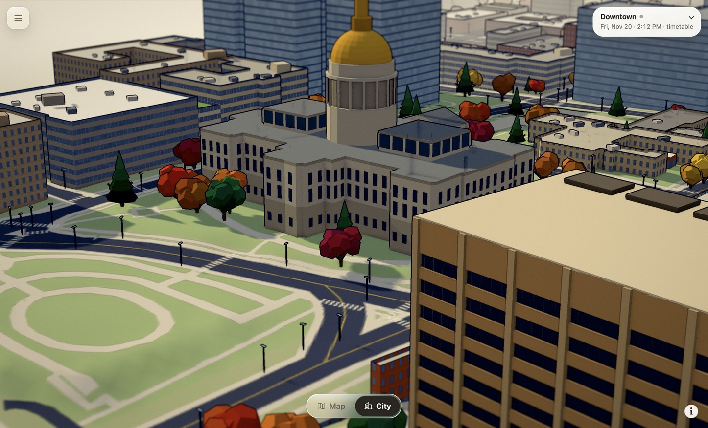

### 2026-11-22: A track bed fighting the floor

Sam saw the track bed under the Model Lab's CQ400 flicker at the default three-quarter view and
while orbiting. The ballast was a box whose top face sat exactly at y = 0, the same plane as the
ground disc, so the two surfaces z-fought for every pixel:
- the grey bed tore into stripes;
- the ink pass, which finds edges in the depth buffer, drew broken dashes along the sleepers.

Over four frames, nudging the camera 0.02° each time, 1,200 to 37,000 track-bed pixels changed
between consecutive frames. After the fix, about 120 did.

The fix moves the ballast top to 3 cm above the ground, still 2 cm below the sleepers, and sinks
its bottom below the ground. A test now fails if any track face lies within 2 cm of the ground
plane.

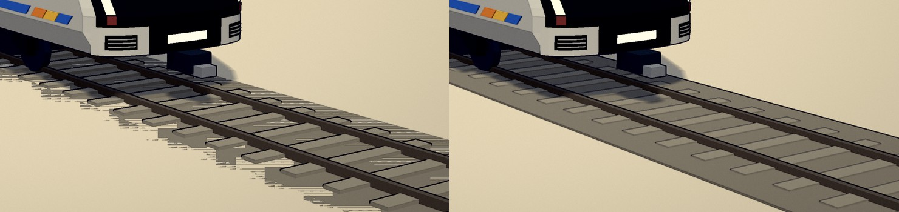

### 2026-11-22 — Walking to Georgia State

At 2:12:45 on the Friday timetable, two jacketed walkers pass one another on a sidewalk near Georgia State. Across town a helmeted rider pedals past a walker on the Westside Beltline Connector. The bake has nine pieces bearing that trail name, including a 242 m bridge. Three complete ground sections support seven illustrative walkers and seven cyclists. From the 390 px City opening, 103 visible walkers fit in a single draw. Zooming in reveals swinging arms, backpacks, handlebars and wheels. [Georgia State, the trail and the opening camera](log/ui/street-life/README.md)

### 2026-11-22 — Street figures on the inspection bench

The cyclists on the Westside Beltline Connector were only a few pixels tall in the opening view. Sam wanted to see what he was looking at. The Model Lab now holds the same cyclist and walker still while their limbs move through a full cycle. A test compares the lab model’s geometry, colours and local transforms with the City batches at four poses. On desktop, a fixed library separates the three vehicles from the two people and leaves the full canvas free for orbiting. At 390 × 844, the model stays visible above the controls while a grouped picker replaces the list. [Cyclist at quarter cycle](log/ui/model-lab/cyclist-library.jpg) · [Phone layout](log/ui/model-lab/cyclist-phone.jpg)

### 2026-11-22 — Whose backpack is that?

Pause the Model Lab walker mid-stride and select **Next look**. A mustard jacket and green daypack give way to a blue jacket with bare shoulders. On the cyclist, the same change trades an orange frame for a green one. Both figures keep their pose and camera. The Lab remembers a separate look for each figure while you switch between them. [Walker](log/ui/street-looks/walker-0.jpg) · [Next walker look](log/ui/street-looks/walker-1.jpg) · [Cyclist](log/ui/street-looks/cyclist-0.jpg) · [Next cyclist look](log/ui/street-looks/cyclist-1.jpg)

City assigns each illustrative traveller a stable choice from the same 64 looks. Skin, jacket, trousers, pack presence, pack colour and bicycle paint have independent draws. At 2:12:45 p.m. on the Friday timetable, four of the seven Westside Connector cyclists carried a bag and four frame colours appeared. At the 390 px opening, 103 distant walkers still took one draw and 4,120 triangles. A 1,536-byte colour texture lets a batch wear many outfits. The Lab and City share that palette and the models. A web rebuild and deployment pick up the change with the existing downtown bake. [Georgia State sidewalks](log/ui/street-looks/sidewalk.jpg) · [Connector trail](log/ui/street-looks/trail.jpg) · [Opening view](log/ui/street-looks/opening.jpg)

### 2026-11-22 — Grass beside a Connector cyclist

A local photograph of the Westside Beltline Connector showed long stretches of short turf between tufts. Our first attempt at the 36 m verge near Mangum Street looked like a row of dark pegs. Fourteen clumps in uneven groups read better beside a passing cyclist. Their feet stay on the ground while the tips bend up to 8.6 cm. On low quality the close view costs one draw and 181 triangles. From the matched overhead camera the grass costs zero draws. The study stays on this one ground section for inspection. [Before and after, motion and the trail photograph](log/ui/trail-planting/README.md)

### 2026-11-22 — Give the Connector its sidewalk

At walking height the first Mangum study put the cyclist beside what looked like one broad street. Looking back at Mangum in April 2026 Street View showed a planted strip with a curb ramp through it at each crossing. A north-up aerial put the concrete at about 2.9–3.3 m wide. City had used 2 m for the path and 11 m for each half of the boulevard. The revised 3.2 m concrete walk has transverse joints and the grass sits between the walk and traffic. Both sets of crosswalks still meet the trail. All 218 low-quality and 330 high-quality figures keep the same routes and poses. [Walking-height and overview comparisons with local photos](log/ui/trail-planting/path/README.md)

### 2026-11-22 — Two different drops at Mangum

With the little grass models gone, the pale sidewalk and green curb strip still separate the people from traffic. The ground north of the trail falls 4.0 m over 90 m toward the parking lot. Looking east along Ivan Allen reveals a different problem. The model follows bare earth down nearly 6 m in the last 10 m before its existing bridge deck, while an April 2026 photograph shows a smooth road onto the span. We kept the bridge geometry pending better height evidence. [Numbered City view, ground samples and west landing photograph](log/ui/mangum-ground/README.md)

### 2026-11-22 — Grady above the curve

From across the Connector, Grady used to look about as tall as its parking deck. Its 165 × 202 m footprint was right, but one 20.7 m extrusion hid the shape of the hospital. The lidar told the story in three steps. Both sets of wards reach roughly 376 m NAVD88, the inner setbacks reach 381 m, and the E-wing penthouse reaches 391 m. The ground underneath is around 304 m. From Jesse Hill, the street wall has a different rhythm again, with two roof pads above its pale facade and a curved glass lobby at the Gilmer end. Correll and the parking deck still have their own outlines. [Connector before](log/ui/downtown-landmarks/grady-before.jpg) · [Connector daylight](log/ui/grady/connector-day.jpg) · [Jesse Hill at dusk](log/ui/grady/jesse-dusk.jpg) · [Sources, dimensions and cameras](grady.md)

### 2026-11-22 — Two crowns beside the Westin

At the normal City opening, downtown’s second distinctive roof fits into about fourteen pixels between its crown centers. The old 191 Peachtree extrusion raised a whole block, entrance included, to 234.7 m. Mapped building parts place two square roof structures 39.5 m apart over a much narrower, recessed shaft. From the north, the granite piers lead up to two little open lanterns. At dusk a warm wash catches the stone and leaves the arched gaps dark. [Matched opening, daylight and dusk with the architectural photographs](log/ui/peachtree-191/README.md)

### 2026-11-22 — Which side of the stack?

The Corey Tower was already on the board. Its base clears the southern edge by 68.5 m, but City drew its whole 91.4 m height as a round office block. Lidar puts the shaft radius near 5.3 m at the foot and about 4 m at the rim. There’s one bright face. The sign company calls its 25 × 80 ft display north-facing. In the returns, the two edges point the panel about 40° east of north, straight into the curve. The Georgia State tracks swing from nearly edge-on west of the stack to a clear view of the letters on the eastern approach. Cross to the south and the tall white shaft is blank. [Connector daylight](log/ui/corey-tower/connector-day.jpg) · [Eastern tracks at dusk](log/ui/corey-tower/east-rail-dusk.jpg) · [Reverse view](log/ui/corey-tower/reverse-day.jpg) · [Photo references, dimensions and camera positions](corey-tower.md)

### 2026-11-22: A platform to check the train against

The Model Lab can now stop the CQ400 at an island or at two side platforms. Both layouts are built
from the same platform primitive City uses, at the car's own floor height, with a pale zone on the
platform beside each of the train's six door pairs.

The edge sits 75 mm from the car side, just inside the federal 3-inch level-boarding limit for
rapid rail. The panel reports the gap and the step, so a change to the car model that pushed a
door off its zone, or the body into the platform, would show at a glance. Tests fail on the same
conditions.

The layouts are illustrative. Only the 4.86 m side-platform track spacing comes from a surveyed
station (Georgia State). [Notes](model-lab-platforms.md)

### 2026-11-22 — Two garages on Decatur Street

From the Connector, the broad roof beside Grady belongs to Butler. The deck across Decatur, next to the Georgia State rail approach, is Pete Hackney. At street level, Hackney’s lighter concrete piers frame five rows of dark openings. Across the street, Butler has wider-spaced floor bands and a storefront on Jesse Hill. Look down from the tracks and two ramp slots cut through Hackney’s roof while Butler’s pale parking surface stretches almost a block. The first deck models added 17,480 submitted triangles at the City opening and held at 141 draws. [Labeled view from the board edge](log/ui/parking-decks/edge-key.jpg) · [On Decatur before](log/ui/parking-decks/decatur-before.jpg) · [On Decatur after](log/ui/parking-decks/decatur-after.jpg) · [Photographs, measurements and cameras](parking-decks.md)

### 2026-11-22 — A roof to stand on

The first cars on Butler looked half-buried from across the Connector. At roof level the reason was visible. The body floated 13 cm above the pavement, and the whole car stood only 1.06 m tall. The parking decks now use the moving sedan’s 32 cm sill and 1.42 m roof. A flat patch on each of four tires meets the concrete. Step outside Butler’s 1.10 m parapet and the wheels disappear behind it while the upper glass still shows. All 174 parked cars fit in the existing building draw. With the finished decks, the City opening submits 2.26% more triangles than the two original extrusions and stays at 141 draws. [Old stance](log/ui/parking-decks/cars-close-before.jpg) · [Same aisle with tires](log/ui/parking-decks/cars-close-after.jpg) · [From outside the parapet](log/ui/parking-decks/cars-parapet-after.jpg) · [Connector view](log/ui/parking-decks/connector-after.jpg)

### 2026-11-22 — The arena roof turns across the block

From the station, the old State Farm Arena looked like an extension of The CTR. The aerial showed why the buildings should read differently. The arena’s silver roof runs diagonally across its 156 m footprint, leaving pale lower roofs at the corners. The model gives it the shallow curved span, a glazed station-side elevation and the structural ATLANTA letters. Across the plaza, a row of deep windows breaks up the masonry. The heights between the mapped base and roof are estimates from exterior photographs. [Matched City views and sources](log/ui/state-farm-arena/README.md)

### 2026-11-22 — What fits in a phone opening?

At 2:12:45 p.m. on the Friday timetable, a MARTA train rounds the curve southeast of Georgia State. In the downtown overview I can pick out the skyline and the edge of the board, but I lose the train. At 0.60 metres per pixel the light car roofs stand out on the outside curve. At 2:20 p.m. the track is empty. It still leads the eye from the Connector to the station beneath the Floyd towers, with a parking deck alongside it. I’d try this camera for a railway-first portrait opening. Sam is choosing between the two views. [During the scheduled passage](log/ui/phone-opening/passing.jpg) · [Between trains](log/ui/phone-opening/between.jpg)

Both pairs were captured in Orca at 390 × 844 CSS pixels on the low tier, on the build with the Butler and Pete Hackney decks. The November 20, 2026 clock is paused at the same local time within each pair. The overview uses the ordinary opening at (−40, −260), bearing 28°, tilt 57°, 2.53 metres per pixel. The station camera uses (467, 407), bearing 289°, tilt 72°. These are desktop browser captures at phone dimensions.

### 2026-11-22 — Looking through Breuer’s concrete

At Atlanta Central Library the revealing detail was a patch of sky high in the Forsyth Street wall. It belongs to the fifth-floor terrace. The mapped 60.5 m street face gave us a scale for the renovation photograph, and the state survey explained the two upper floors that recede behind the big concrete facade. The model opens the slot into the terrace, recesses the glass at the entrance and adds the rooflight visible from above. The library reads best from Margaret Mitchell Square, where the nearby towers leave the front in view. [Two sides of the library, sources and estimates](log/ui/central-library/README.md)

### 2026-11-22 — Two sides of Piedmont Avenue

Stand at the Grady parking deck on Armstrong and you see metal screens two floors tall behind the concrete piers. Cross to Georgia State’s M Deck and the floor edges make long pale slots around a glazed corner. The roof returns put the Grady parking surface about 28 m above its low edge and M’s about 22 m. City had the taller garage on the opposite side. The aerial shows Piedmont busy and M mostly empty. We put 26 parked sedans on one and six on the other. Together they add 0.53% to the opening’s submitted triangles and keep its 141 draws. [Across Piedmont before](log/ui/campus-decks/piedmont-before.jpg) · [Across Piedmont after](log/ui/campus-decks/piedmont-after.jpg) · [Street photographs, lidar elevations and cameras](campus-decks.md)

### 2026-11-22 — Three roofs share one entrance on Gilmer

Georgia State gives drivers one address for S, K and N. A look down from Jesse Hill finds three separate steel frames. On S the two sides of the parking roof slope away from each other. On K and N the high point is in the middle, where a driver can look down into the lower ramps on opposite corners. In the lidar those drops measure about 2.6 and 2.7 m. At roof level on N, the tires follow the grade while the next row of cars rises into view. Sixteen parked cars and three steel frames add 0.60% to the City opening’s submitted triangles at the same 145 draws. [Three roofs before](log/ui/gsu-steel-decks/roofs-before.jpg) · [After](log/ui/gsu-steel-decks/roofs-after.jpg) · [From a sloping aisle](log/ui/gsu-steel-decks/slope.jpg) · [Photographs, lidar and City cameras](gsu-steel-decks.md)

### 2026-11-22 — The steps above Truist Plaza

The old extrusion carried the entrance arms to the roof. Portman’s photographs put them at the plaza, below a square glass shaft whose projecting office bays end at different heights. The Council’s measurements separate the 264.3 m architectural top from the 275 m tip. At dusk the model picks out the lips of the stepped glass crown. [Matched City openings, both approaches and source photographs](log/ui/truist-plaza/README.md)

### 2026-11-22 — Four missing pieces of the Georgia-Pacific skyline

The bake put a 50 m block at 133 Peachtree and a 207 m sliver against its north wall. The stepped tower was hiding in four mapped upper building parts. Across one row of lidar samples its terraces rise from 386 to 430 to 474 m above sea level, then reach a narrow shoulder below the main roof at 530 m. From the southeast the pink granite steps read across the window rows. Swing around to the east and the dark slots between the blades come into view. The north footprint survives as a low volume whose precise roof height is still uncertain. [Matched City cameras, source photos and repeatable lidar probes](log/ui/georgia-pacific/README.md)

### 2026-11-22 — Two ends of the Flatiron

From Luckie Street the Flatiron is one window wide. From Woodruff Park you can follow five projecting stacks of windows along Peachtree to the glass that wraps around Poplar. Both ends were already in the City footprint, down to the 4.37 m face at the tip. The old horizontal office bands made them hard to tell apart. The new model picks out the two-story entrance and the heavy cornice below the two-story cap. The measured roof sits about 44 m above the low sidewalk. At night the street lamps pick out the base, as they do in the park’s 2017 photograph. [Woodruff Park before](log/ui/flatiron/facade-before.jpg) · [After](log/ui/flatiron/facade-after.jpg) · [Same camera after dark](log/ui/flatiron/woodruff-night-after.jpg) · [Street photographs, measurements and cameras](log/ui/flatiron/README.md)

### 2026-11-22 — Light on the Georgia-Pacific terraces

From the Jackson Street Bridge the Georgia-Pacific Tower reads as two broad white faces with a dark grille between them. Our first night model showed six amber lines. Sam’s dusk photograph put the brightest patches at the terrace edges, where the light begins its climb up the stone. The revised model brings back the grille’s horizontal bars and gives the short crown its own pool of light. At full night the opening adds 2,656 submitted triangles on the existing draw calls. [Jackson Street photograph beside both models](log/ui/georgia-pacific/uplighting/reference-and-model.jpg) · [Day, dusk and full-night comparisons](log/ui/georgia-pacific/uplighting/README.md)

### 2026-11-22 — Where the Flatiron catches the light

The shadow across the Flatiron’s upper stories runs straight across five projecting window bays. Two stories higher, the parapet follows each bay out and back. That difference was easy to miss in our first model. A park photograph and Sam’s street details also showed how much pale stone sits between the paired sashes. The revised model sets the glass about 20 cm behind the jambs, a depth estimated from those photographs. From across Peachtree, morning sun catches the round entrance columns a full metre in front of the dark glazing. The park frame gains 1.70% in submitted triangles at the same 65 draws. [Photograph and matched City views](log/ui/flatiron-relief/comparison.jpg) · [Street detail](log/ui/flatiron-relief/street-revised.jpg) · [Sources, dimensions and night comparison](log/ui/flatiron-relief/README.md)

### 2026-11-22: Measuring the viaduct instead of guessing it

The first extension east of the board runs 512 m along the MARTA viaduct to King Memorial. We had
no published deck heights, so the plan was to draw ground only and leave the guideway as an
unknown.

Then the USGS lidar turned out to be the same April 2019 flight as our terrain model: its ground
returns match the bare-earth grid to a 1 cm median. Its returns off the top of the structure give
the guideway itself, in 5 m steps:
- 316 m beside the Floyd Building;
- 15.5 m above the Downtown Connector's lanes;
- a 325.5 m crest over the CSX yard;
- under King Memorial's roof, where the lidar can't see the deck and the study says so.

The measurement also showed our old 7 m placeholder running up to 3.9 m low east of the Connector.

The new ground strip shares the downtown grid's edge column node for node. It costs 9.9 KB
gzipped, against 1.44 MB for all of downtown.
[Study](king-memorial-corridor.md)

### 2026-11-22 — Six shop doors across from Woodruff Park

Five narrow footprints on Peachtree contain six street elevations. The giveaway is at Poplar, where the white shop turns the corner but its neighbor’s four red arches stop at a higher, darker cornice. A 2025 leasing plan puts two doors inside that single baked lot. Down the row, a shop with two tall arches faces the same park as a shop with a black canvas awning and two broad bands of glass. The model gives all six recessed glass in the existing building draw. At the daylight opening that adds 5,972 submitted triangles, about 0.27%. [Full block before and after](log/ui/woodruff-shopfronts/row-day.jpg) · [Wider park view](log/ui/woodruff-shopfronts/district-day.jpg) · [Night, sources and camera settings](log/ui/woodruff-shopfronts/README.md)

### 2026-11-22 — The narrow tower on Forsyth

The Healey parcel already had the right sixteen stories. City had given them to the low roofs behind the tower, too. The Forsyth edge measures 62.56 m long, but the tall slab runs only about 19 m back from the street. Its roof sits around 385.2 m above sea level. The rotunda roof behind it sits around 332.9 m. With that space open again, the Woodruff Park view picks out the narrow masonry tower, ten paired bays and the lift house with two stacks rising between the lower buildings. From below, the stonework continues above the straight window heads in a row of shallow carved arches. Small brackets cast separate shadows beneath the larger coping. [Photographs and matched cornice views](log/ui/healey/cornice-comparison.jpg) · [Photograph and matched models](log/ui/healey/comparison.jpg) · [Street views, point-cloud measurements and night comparison](log/ui/healey/README.md)

### 2026-11-22 — A second piece of Atlanta’s board

East of the Connector the old walnut edge cut across Decatur Street. The opt-in King Memorial board opens 360 m of that wall and carries the street onto another 800 m of measured ground. All 73 edge heights agree, even on the low-detail mesh. Downtown visitors fetched zero east data files at opening on either tier. Crossing the edge fetched 86,963 bytes of static terrain and neighborhood context. South of the station, the 2019 survey predates Marchon. An October 2023 aerial and November 2025 street photograph place five stories of apartments and street-level shops on the former parking lot. Two separate OSM ways had to be joined to recover the main building outline. [Before](log/ui/king-memorial-board/before.jpg) · [After](log/ui/king-memorial-board/after.jpg) · [Marchon aerial and City comparison](log/ui/king-memorial-board/marchon-comparison.jpg) · [Evidence, limits and cameras](log/ui/king-memorial-board/README.md)

### 2026-11-22: Replacing the 7 m placeholder with the measured viaduct

City had hung the viaduct east of Georgia State from a guess: 7 m above the ground at the station
face and at the Connector's east bank, then flat beyond. The lidar profile showed the guess was
nearly right at the station, 0.8 m low over the Connector, and 3.9 m low by the board edge, where
the real structure keeps climbing over the CSX yard.

Eight measured anchors now replace the guess, and they fit the 5 m lidar profile within 0.25 m.
They carry absolute NAVD88 heights rather than "metres above the ground here", because the ground
under a viaduct can drop 10 m in a few metres across the Connector.

### 2026-11-22 — Around the corner at Marchon

From Grant Street, Marchon reads as apartments over shops. Around the corner on Oakland Avenue, the nearest four-story wing meets the sidewalk with paired windows in dark masonry. The March 2025 street photograph gave City a second ground-floor treatment for the same building family. Three mapped apartment masses now share one facade layout, with palette, balcony spacing and ground-floor use chosen for each elevation. The five-story courtyard block and both four-story wings keep their recorded floor counts. City can reuse this style for identified four-to-six-story apartments and add another when a nearby example calls for one. In the matched desktop view, City gained 13,856 triangles and stayed at 67 draw calls. [Matched Oakland view before](log/ui/king-memorial-board/oakland-before.jpg) · [After](log/ui/king-memorial-board/oakland-after.jpg) · [Street photograph, courtyard evidence and camera](log/ui/king-memorial-board/README.md#marchon-from-oakland-avenue)

### 2026-11-22 — Parked cars on the Marchon roof

The rail-side rectangle at Marchon had picked up the same rooftop equipment as the apartments next door. The October 2023 aerial shows parking stripes and a driving aisle there. The turquoise shape farther south is a roughly 115 m² pool with a short bend at one end. City now shows seven illustrative cars on the garage and the traced waterline in its own courtyard. The completed-building obliques hide the deck behind the residential wrap, so the parking surface gets a schematic 3 m lift to 11 m above its foundation. The tires, stripes and parapet take their elevation from that same surface. [Matched rail-side before](log/ui/king-memorial-board/parking-before.jpg) · [After](log/ui/king-memorial-board/parking-after.jpg) · [Overhead](log/ui/king-memorial-board/parking-overhead.jpg) · [Aerial and height evidence](log/ui/king-memorial-board/README.md#garage-roof-and-courtyard-pool)

### 2026-11-22 — One tower above Five Points

Two Peachtree had a twin in City. Across a 63.4 m shared edge, the 2018 laser survey drops from a 484 m roof elevation to two station-side roofs at 328 and 330 m. What looked like a second skyscraper in the bake was a few metres of building above Broad Street. The 1966 tower now rises alone, with its silver ribs, dark mechanical belt and a recessed rooftop plant court. The neighboring seven-story building at 14 Marietta keeps its own footprint. The daylight opening gained four draw calls. [Matched opening and station comparison](log/ui/two-peachtree/comparison.jpg) · [Measured heights, dated photographs and night views](log/ui/two-peachtree/README.md)

### 2026-11-22 — A square of Sweet Auburn

The ground north of King Memorial extends for 800 m through Edgewood and Auburn avenues to Irwin Street. At its southwest corner three separate bakes meet at 305.4 m NAVD88. Keeping each of the 321 distinct shared samples on both rendering tiers let the walnut edge open in two directions. The King strip can still stand on its own. The second preview brings in 179 building footprints and 693 road and path runs for 56,809 compressed bytes of data on approach. From Hilliard, the March 2025 photographs explain the change in building type along Edgewood: shop windows at the street, a brick loft conversion behind them. [Seam and corner views](log/ui/sweet-auburn/joins.jpg) · [Street-eye view](log/ui/sweet-auburn/edgewood-street-eye.jpg) · [Aerial, photographs and integration notes](log/ui/sweet-auburn/README.md)

### 2026-11-22 — The two faces of Centennial Tower

From the Gulch, 101 Marietta looks like a flat-roofed glass tower with a silver V folded into its face. The other long wall has a second V, and the two spans differ by nearly 13 m. The 2018 lidar puts the roof deck at 457.8 m NAVD88, about 135 m above the sidewalk. That brought the 164 m generic tower down into the surrounding skyline. A night photograph from Centennial Olympic Park supplied the warm red fins and pale roof edge. The daylight opening gained six draw calls and 16,232 triangles. [Opening and Gulch comparison](log/ui/centennial-tower/comparison.jpg) · [Park and rail views, night photographs and survey notes](log/ui/centennial-tower/README.md)

### 2026-11-22: The first train to leave the board

At 2:01:01 p.m. on the Friday timetable, the 1:50 Blue Line train to Indian Creek crosses x = 1000,
the edge City had stopped at since the first downtown diorama. It keeps going on the measured
viaduct, past the Hulsey yard tracks, and stops under King Memorial's canopy at 2:02.

Only the roof under the canopy is measured; the deck and platform heights there are estimated, and
the study says so. The follow camera stays with the train across the seam.

### 2026-11-22 · Three porches on Irwin Street

Sweet Auburn had 32 mapped house footprints. Three on the south side of Irwin Street shared a raised porch, but the November 2024 street photographs showed three different rooflines. One porch fits beneath a gable with a small paired attic window, another sits under a broad shed roof, and the third has a hipped roof and a low red dormer. We matched their order and spacing to the October 2023 aerial before replacing their 8 m fallback envelopes. The middle lot explained a visual error on the first pass. Its street edge reaches 2.07 m above the level City uses for the building foundation, enough to bury part of a porch drawn from the rear grade. The final porch clears the drawn ground on both terrain quality settings. The opt-in block now has three readable fronts and twelve inspectable elevations. Side and rear openings remain illustrative. [Matched street and City views](log/ui/irwin-houses/comparison.jpg) · [Elevation sheet](log/ui/irwin-houses/elevations.jpg) · [Sources and footprint register](log/ui/irwin-houses/README.md)

### 2026-11-22 — The mast over Civic Center

On the northbound trip toward Civic Center, Twelve Centennial Park reads as stacked balconies. From the North Avenue bridge, the narrow mast stands out against Truist. The 2018 survey put the broad apartment roof at 429.2 m NAVD88, the pointed crown at 445.1 m and the east strip of podium at just 314.6 m. One 150 m extrusion had lifted all three surfaces together. City now draws the individual balcony bows and keeps the adjoining hotel separate. [Opening and Ivan Allen comparison](log/ui/twelve-centennial/comparison.jpg) · [Civic Center, night photographs and measured elevations](log/ui/twelve-centennial/README.md)

### 2026-11-22 — Looking up from Woodruff Park

The baked height at 100 Peachtree was already within about a metre of the laser survey. What gave the tower away from the park was the shape of its frame. Deep horizontal girders cross the dark glass, the columns continue past the recessed lobby, and the crown carries two 174-foot displays facing opposite streets. The historic Equitable letters appear in the earlier park photograph. The new model uses the blue Georgia’s Own treatment documented after the 2018–19 sign installation. A fixed pattern of illuminated offices and a shared sign texture add eight draw calls at the daylight opening. [Opening and park-level comparison](log/ui/100-peachtree/comparison.jpg) · [Survey, sources and night views](log/ui/100-peachtree/README.md)

### 2026-11-22 · Recovering a tower on Auburn Avenue

At 375 Auburn Avenue a missing height had turned a fourteen-story apartment tower into an 8 m block. The April 2019 lidar held 1,940 building-class returns inside the footprint. Their median put the main roof at 343.05 m NAVD88, with two distinct rooftop masses another 3.07 m and 5.69 m above it. From the street the surprise was how little glass shows on the end facing Auburn. A narrow stack of windows cuts a broad pale wall. Walking east brings the long grid of concrete and apartment windows into view. The two City terrain meshes now place both roof wings at the measured elevation and leave the entrance court open. [City and street comparison](log/ui/wheat-street-towers/comparison.jpg) · [Photographs and measurements](log/ui/wheat-street-towers/README.md)

## 2026-11-22 — The missing hotel behind Marquis One and Two

The downtown map gave the Marriott Marquis a three-story footprint. Its ballroom roof was present, but the guest-room tower was missing from the skyline. The 2018 lidar resolves an 85 × 32 m upper roof at 466.9 m NAVD88. Close to the podium the hotel swells another 18–19 m on each broad side to enclose the atrium. Look in from Courtland to see that curve, then around to Baker to see the long run of pale concrete fins. The two office towers still frame the separate entrance terrace. [Daylight before](log/ui/marriott-marquis/courtland-day-before.jpg) · [Daylight after](log/ui/marriott-marquis/courtland-day-after.jpg) · [Baker at dusk](log/ui/marriott-marquis/baker-dusk-after.jpg) · [Photographs, dimensions and camera settings](log/ui/marriott-marquis/)

## 2026-11-22 — 34 Peachtree from Woodruff Park

The aluminum spandrels on the former National Bank of Georgia tower catch more light than its windows. From Woodruff Park they make a stack of blue-gray bands. Around the Walton corner a single bronze-gray strip interrupts them from the lobby to the crown. The surprise is on top. The pale crown hides a roughly 7 m-deep equipment well at the street corner, while the surveyed penthouse rises another 10 m on the southwest half. [Woodruff daylight before](log/ui/34-peachtree/woodruff-day-before.jpg) · [Daylight after](log/ui/34-peachtree/woodruff-day-after.jpg) · [Walton at dusk](log/ui/34-peachtree/walton-dusk-after.jpg) · [Photo references, measurements and cameras](log/ui/34-peachtree/)

## 2026-11-22 — The parking deck that borrowed a skyscraper’s height

The eight-level garage against the south wall of 191 Peachtree was rendering as a 198.3 m glass tower. Of 2,593 USGS lidar returns in its footprint, the median was 351.2 m NAVD88. All 216 returns above 370 m fell within a 2.4 m strip next to the tower. The City foundation sits at 319.6 m, so the replacement puts the parking surface 31.6 m above it. Two distinct structures now read against one another in the skyline. The aerial shows short rows of parked cars on the open roof and the approach from the east shows a pale screen of vertical openings. The shared garage model draws both in the existing building batch. The number of parked cars, rooftop housing dimensions and bay spacing are illustrative. The source footprint and the tower retain their own identities. [Day before](log/ui/191-garage/day-before.jpg) · [Day after](log/ui/191-garage/day-after.jpg) · [Night before](log/ui/191-garage/night-before.jpg) · [Night after](log/ui/191-garage/night-after.jpg) · [Aerial](https://server.arcgisonline.com/ArcGIS/rest/services/World_Imagery/MapServer/export?bbox=-9393942.6551,3996373.4201,-9393782.6551,3996513.4201&bboxSR=3857&imageSR=3857&size=850,740&format=jpg&f=image) · [Street approach](https://www.google.com/maps/@?api=1&map_action=pano&viewpoint=33.7585765,-84.3859105&heading=280.12&pitch=8&fov=88) · [USGS 2018 Georgia point cloud](https://s3-us-west-2.amazonaws.com/usgs-lidar-public/GA_Statewide_B2_2018/ept.json)

### 2026-11-22 — Two church silhouettes on Auburn Avenue

From Auburn and Jackson, Ebenezer's paired brick towers and projecting neon sign identify the historic sanctuary long before its name is legible. At the other end of the Sweet Auburn board, Big Bethel's spire reaches 336.84 m NAVD88 in the 2019 lidar. All five returns in the tip sample fell outside the building class. A building-only pass would have lost the very part of the church you can see from blocks away. The two facades now follow their photographed street elevations. After dark, the pale Ebenezer sign picks out the entrance and Big Bethel's blue lettering sits above its warmly lit stone tower. The intensity and hours are illustrative. [Before and after](log/ui/sweet-auburn-churches/comparison.jpg) · [Day and night](log/ui/sweet-auburn-churches/night.jpg) · [Sources, survey and camera poses](log/ui/sweet-auburn-churches/README.md)

### 2026-11-22 — Four office towers, two rooflines

Look across the Peachtree Center promenade and the concrete fins line up, but the roofs step in different directions. North and South put their taller slabs along the courtyard. Harris and International put theirs between two lower wings. In 37,179 returns from the 2018 laser survey, the raised rims of the first pair reach about 417.7 m NAVD88 and the second pair reaches 431.5 m. Even the floor counts tell two stories. The district survey gives North and South 27 stories apiece, while the lender describes two 24-story office buildings and accounts for part of their ground floors in the mall. City now fits the panel rhythm to each pair and lets the survey set its silhouette. [Daylight before](log/ui/peachtree-center/promenade-day-before.jpg) · [Daylight after](log/ui/peachtree-center/promenade-day-after.jpg) · [Full night](log/ui/peachtree-center/baker-night-after.jpg) · [Photographs, footprint register and camera settings](log/ui/peachtree-center/README.md)

## 2026-11-22 — Polaris rises over the Hyatt again

One 8 m map extrusion had swallowed three generations of hotel buildings. The 2018 lidar separates the original Hyatt’s balcony wings from the rectangular International Tower and the bronze Radius drum. Above the central skylights the returns trace a 27.6 m saucer. Its blue dome reaches 417.2 m NAVD88, nearly 23 m above the atrium roof. From Baker Street it clears the surrounding roofs just far enough for its blue rings to show up at night. [Daylight before](log/ui/hyatt-polaris/baker-day-before.jpg) · [Daylight after](log/ui/hyatt-polaris/baker-day-after.jpg) · [Polaris at night](log/ui/hyatt-polaris/baker-night-after.jpg) · [Reference photographs, dimensions and cameras](log/ui/hyatt-polaris/)

## 2026-11-22 — Two roofs at the head of Woodruff Park

From the streetcar tracks, the Candler Building’s pale marble shaft ends in a row of arches and a deep, bracketed cornice. From the park, the narrow light court between its wings is almost as distinctive. The map had filled much of that view with a 65.4 m extrusion for the two-story building next door. Its median roof return is just 10 m above the street. The March 2025 photograph gives that shop a name at the curb, Rising Roll at 113 Peachtree, and three green-framed openings below its five upper windows. [Park before](log/ui/candler-hotel/park-day-before.jpg) · [Park after](log/ui/candler-hotel/park-day-after.jpg) · [Night](log/ui/candler-hotel/park-night-after.jpg) · [Photographs, independent measurements and cameras](log/ui/candler-hotel/)

### 2026-11-22 — Recovering the Odd Fellows tower at Bell Street

City had drawn the Odd Fellows office tower and its auditorium as a single low silhouette on Auburn Avenue. The surprise was in the names. The footprint labelled “Odd Fellows Hall” contains the six-story tower at Bell Street. Its Auburn-side roof measures 320.02 m NAVD88, over 17 m above the old City roof. Walk west and the storefront roof falls to 304.07 m, with the auditorium ridge tucked nearly 6 m higher behind it. The two mapped outlines now carry those roof changes and their own street fronts, from the tower's terracotta diamonds to the auditorium's projecting awning. [Before and after](log/ui/odd-fellows/comparison.jpg) · [At night](log/ui/odd-fellows/night.jpg) · [Measurements and photographs](log/ui/odd-fellows/README.md)

### 2026-11-22 — The leaning glass wall at Georgia Power

At the eastern edge of the board, a 100.2 m extrusion stood where Georgia Power’s low annex belongs. Its neighbor, the 24-story headquarters, had inherited the 11.7 m height of its curved base. The 2018 laser survey separated the three roofs at 301.7, 306.1 and 395.0 m NAVD88. The step on the south face came from a different source. Each floor projects 15 inches beyond the one below it, shading the glass. In City you can now look along the silver tubes from the southwest, then turn the corner to see the flat glass, low annex and brick section at the edge of the board. [Daylight before](log/ui/georgia-power/south-day-before.jpg) · [Daylight after](log/ui/georgia-power/south-day-after.jpg) · [Full night](log/ui/georgia-power/south-night-after.jpg) · [Survey, photographs and cameras](log/ui/georgia-power/README.md)

## November 22, 2026 — An evening walking from Five Points to Auburn Avenue

[Open the evening gallery](log/ui/evening-build/index.html) to revisit 16 locations and groups of buildings. At 191 Peachtree the parking garage had borrowed the height of its neighbor. At Georgia Power the error ran both ways. The source gave the big curved footprint only 11.7 metres of height and assigned 100.2 metres to the small east annex. The lidar separated the office roof, podium and annex at 395.0, 306.1 and 301.7 m NAVD88. Putting the tall mass back in the correct place changed the skyline before any glass was drawn. Around the Peachtree Center promenade the opposite lesson held. The four offices really do share one panel system, and their two mirrored plans give them different silhouettes.

East of downtown, a scheduled train can now carry the camera into King Memorial without a manual pan. The timetable gives the train the same arrival and departure time, so the captured sequence shows it reach the platform and continue. The station lamps, porch-front houses on Irwin and two Auburn Avenue church signs make different parts of the same journey legible at night and at street level. The extended board remains a preview. [King Memorial approach, stop and departure](log/ui/king-memorial/city-station-approach-stop-depart.jpg) · [Auburn Avenue at night](log/ui/sweet-auburn-churches/night.jpg)

## 2026-11-22 — Above the old Terminal Station tracks

On the Russell Building’s rail side, the office windows cross each floor in long rows. At night they pick out the tower against the parkway lights. On the opposite side, a curved white pavilion sits below those bands, only about 15 m above the plaza. Both sat inside one 116.7 m extrusion. The 14,991 lidar returns separated the pavilion roof near 339 m NAVD88 from the tower roof at 426.5 m and its recessed end terraces at 421.8 m. [From the tracks](log/ui/russell-building/tracks-day-after.jpg) · [Plaza side at dusk](log/ui/russell-building/spring-dusk-after.jpg) · [Reference photographs and cameras](log/ui/russell-building/)

### 2026-11-22 — Three hotel wings above Courtland Street

The old City model gave the low buildings beside Hilton Atlanta a 64 m wall. From Courtland Street it hid the point where the hotel’s three wings meet. In the 2018 lidar, the wings share a roof at 395.6 m NAVD88, the central roof reaches 411.8 m and the lowest eastern deck sits at 306.8 m. At night the concrete end wall catches light from the street while scattered rooms pick out the guest floors. Farther north, a different measurement settled a boundary question. Peachtree Summit extends 31.04 m past the current board. Its complete model awaits the north cap. [Courtland before](log/ui/hilton-atlanta/courtland-day-before.jpg) · [After](log/ui/hilton-atlanta/courtland-day-after.jpg) · [Full night](log/ui/hilton-atlanta/courtland-night-after.jpg) · [Footprints, photographs, heights and cameras](log/ui/hilton-atlanta/README.md)

## 2026-11-22 — The concrete ribbons at 40 Marietta

From the Forsyth sidewalk, the rounded floor bands of Five Points Plaza turn the corner and run straight into the columns. From above, the back of the building looks almost blank. A 1967 photograph shows the rear spine rising beside the inset roof, leaving a pale strip all around the main block. The 2,700 lidar returns put that strip at about 387.8 m NAVD88 and the inset roof at 392.3 m. Six pentagonal columns carry the frame around the recessed glass, a detail the old 72.8 m extrusion lost when seen from the square. [From Marietta](log/ui/five-points-plaza/marietta-day-after.jpg) · [Forsyth sidewalk at dusk](log/ui/five-points-plaza/corner-dusk-after.jpg) · [Photographs, dimensions and City cameras](log/ui/five-points-plaza/)

### 2026-11-22 — The rotunda above the museum entrance

From the Centennial Park sidewalk, the opening cut in the College Football Hall of Fame looks almost square. Step to one side and a different shape appears around it. The copper skin swells outward and turns back toward the field hall, leaving the forked concrete support visible below. The original City footprint stood 24 m high everywhere. The 2018 lidar separates the field roof near 330 m NAVD88 from the higher copper rim near 337 m. After sunset, the long strip of translucent glass and the name above the entrance are the easiest parts to pick out. [Before and after](log/ui/football-hall/comparison.jpg) · [Photographs, measurements and cameras](log/ui/football-hall/)

### 2026-11-22 — Where the tower ends on Baker Street

At 270 Peachtree, one baked height carried a 97-metre office building all the way across its attached garage. The lidar puts the garage roof near 328 metres NAVD88 and the tower roof near 405. Bringing the garage down opens the view of the pale, deep-set window bays from Baker. Next door at 260, the glass climbs almost continuously from the lobby lintel to the roof, another 24 metres higher. [Reference photographs and matched City views](log/ui/peachtree-offices/README.md)

### 2026-11-23 — Daylight between the Hurt Building wings

The round entrance is the first thing you see coming from Woodruff Park. From Hurt Park you can see something the old solid wedge hid completely: sky between two wings. At the inner end, the court drops more than 60 metres below the office roof. The model now follows that cut, the stepped lower roofs and the shallow dome over the western doors. [Street photographs, roof survey and matched City views](log/ui/hurt-building/README.md)

### 2026-11-22 — The steps between the arena and The Center

The former CNN Center looked like one tall wall from the Gulch. On the arena side the roof actually climbs in roughly 4.6 m steps. Inside the same footprint, 30,187 lidar returns pick out the office roofs at 375.4 m NAVD88 and the dark atrium roof at 382.6 m. From the opposite corner the steps disappear behind the offices, but the clerestory glass still catches the light above them. [Before and after](log/ui/the-center/comparison.jpg) · [Photographs, dimensions and City cameras](log/ui/the-center/)

### 2026-11-22 — A missing hotel above the fountain

City gave the Omni’s entire footprint a height of nine metres. From Centennial Olympic Park that erased the 27-story north tower. Its park-side guest wing rises above a low convention podium, with separate roof levels at 402.1, 407.4 and 409.2 m NAVD88. One small piece of the footprint needed the opposite treatment. The narrow strip across Marietta is a glazed bridge, and a view under it should still reach the other side of the street. [Before and after](log/ui/omni-atlanta/comparison.jpg) · [Survey, exterior photographs and cameras](log/ui/omni-atlanta/)

### 2026-11-22 — Counting bridges above Ted Turner Drive

From a map, the narrow shapes between the Gift and Merchandise marts look like separate walkways at one height. Looking north from the street tells a different story. One alignment has roof returns near 347, 357, 367 and 388 metres NAVD88. City now lets you see beneath all four. Across the road the Gift Mart's west wing drops 28.3 metres, while the Apparel Mart's fan-shaped skylight rises above a much quieter precast facade. [Photographs, measurements and three matched City views](log/ui/americasmart/README.md)

### 2026-11-22 — The three-metre ledge at 250 Piedmont

Altitude’s roof ends before its mapped footprint does. Along Piedmont, the 2018 laser returns fall from 387.85 m NAVD88 on the apartment slab to 306.8 m on a strip roughly 3.4 m wide. In the street photograph that strip is the lip of the low deck. From the Baker corner you can see the red-brown panels on the narrow end and the long pale grid turning south. At night, the building’s name lights up on both sides of the corner. [Baker before](log/ui/altitude-apartments/baker-day-before.jpg) · [After](log/ui/altitude-apartments/baker-day-after.jpg) · [Full night](log/ui/altitude-apartments/baker-night-after.jpg) · [Measurements, photographs and camera settings](log/ui/altitude-apartments/README.md)

## 2026-11-22 — Four buildings across Forsyth

The Sam Nunn tower looks like three frames of glass from across the Gulch. Walk around to the other end and the frames turn into two pale blades. The bake gave the rest of the campus a single 22.4 m extrusion, though the 2018 survey puts the Rich’s roof at 351.3 m NAVD88, the Forsyth bridge at 356.2 m and the glass mid-rise at 364.9 m. Separating them opened the street underneath the bridge and gave the old store its punched windows back. [Across the Gulch](log/ui/sam-nunn/gulch-day-after.jpg) · [Forsyth at dusk](log/ui/sam-nunn/forsyth-dusk-after.jpg) · [Photographs, heights and matched cameras](log/ui/sam-nunn/)

## November 22, 2026 — The last sixty metres south of King Memorial

King Memorial and Sweet Auburn brought the board to 2.8 km wide. Its northeast corner still needed 780 metres of ground, while just 60 metres were missing south of King. Filling those gaps and taking 400 metres at each end makes a square without losing a street already on the board. North adds about 157 KiB gzipped and south adds 96 KiB. The 401 heights across the old northern edge match exactly. Near the Connector, the street data tells a different story: the new map records a second carriageway 61 metres along the seam from the one named in both sources. The preview keeps that detail visible for the road artist. [Footprint diagram](log/ui/square-board/bounds.png) · [Before and after](log/ui/square-board/overview.jpg) · [Samples, sources and how to open the preview](log/ui/square-board/README.md)

### 2026-11-22 · Following a lane from Georgia State toward Midtown

Georgia State’s original 153 m strip had seven positions on each side. Following one northbound lane past the rail bridges showed where a blanket freeway width broke down. A separate entrance makes eight near Decatur. At Piedmont the managed lane leaves on the left. At Freedom an entrance brings six lanes back to seven. On the opposite carriageway at Edgewood, the HOV re-entry and a later right entrance occupy different sides of the road. The survey now has 88 additional transects and the cars follow the same stripes as the pavement. With the two east boards attached, that covers 2.19 km northbound and 2.29 km southbound before counting ramps. [Daylight driving view](log/ui/connector-corridor/driving-high.jpg) · [Northern approach](log/ui/connector-corridor/overview-high.jpg) · [Georgia State overview](log/ui/connector-corridor/georgia-state-high.jpg)

The surprise at Auburn Avenue was vertical. The old model put the southbound freeway almost level with the street. The lidar finds its deck about ten metres above the bare earth. Under the girders at Edgewood, the westbound left-turn pocket stays on the street and the illustrative cars cross above it. [Auburn in daylight](log/ui/connector-corridor/auburn-overview-day-high.jpg) · [Same view at night](log/ui/connector-corridor/auburn-overview-night-high.jpg) · [Lane measurements and sources](connector-traffic.md)

### 2026-11-22 — Following the Connector beneath Civic Center

With all seven boards attached, a car can follow the Connector for about 3.75 km in either direction. At Civic Center, the first overview showed a hill rising through the freeway. The lidar put the overhead structure at about 307.5 m NAVD88 and the exposed mainlines on either side at 293–296 m. Interpolating the lower grade between those openings keeps the upper street separate and lets traffic pass beneath it. The closed Capitol Gateway section farther south still hides vehicles until they emerge. [Northern survey](connector-north-survey.md) · [High detail](log/ui/connector-corridor/square-north-high.jpg) · [Low detail](log/ui/connector-corridor/square-north-low.jpg)

At I-20, a gap in the first square-board frame followed an internal map boundary right across a continuous bridge. The eastbound tread there is 311.1 m NAVD88 while the DEM below it is about 294 m. Measuring the upper roadway separately kept it continuous and preserved the curved ramp on its own lower deck. [Before](log/ui/connector-corridor/square-south-before.jpg) · [After at high detail](log/ui/connector-corridor/square-south-high.jpg) · [After at low detail](log/ui/connector-corridor/square-south-low.jpg) · [Southern survey](connector-south-survey.md)

### 2026-11-22 — A train on the square board

The seven pieces of the 2.8 km square now fit under the live City camera. Pan from Five Points toward the northern or southern edge and the next two terrain tiles arrive together. At King Memorial the 14:02 scheduled Blue train sits under the platform canopy with the downtown skyline still on the same board. One deliberately missing south tile left five areas open, including the station. A retry filled the gap without reopening City. The downtown opening made seven scene requests, and the complete square took 26. [Matched desktop overview](log/ui/city-square/board.jpg) · [King Memorial at 14:02](log/ui/city-square/station.jpg) · [Opening the preview](log/ui/square-board/README.md#orbit-the-square-in-city)

### 2026-11-23 — The roof behind the William-Oliver facade

From Five Points the William-Oliver reads as two uninterrupted walls of paired windows and pale brick. Its roof tells another story. Behind the street fronts, the lidar falls from about 379 to 327 metres NAVD88. One narrow bay rises through the low rear court and the rooftop pavilion reaches 387 metres. The returns above 430 metres belong to 34 Peachtree next door. [Photographs, roof measurements and matched City views](log/ui/william-oliver/README.md)

### 2026-11-23 — Two skylines at Atlanta City Hall

From Trinity Avenue, the foreground roof belongs to the 1989 annex. The bake had lifted it to the same height as the Gothic tower on Mitchell. In the 2018 lidar, the atrium ridges reach about 337 m NAVD88 and the 1930 crown reaches 376 m. Restoring that 39 m difference makes the glazed ridges visible from above and the marble porch legible from the sidewalk. At night an amber-and-cream wash follows the tall piers seen in the city’s lighting photograph. [Sources and matched City views](log/ui/atlanta-city-hall/README.md)
