# Georgia State Capitol landmark (2026-11-22)

`web/src/city/capitol.ts` replaces the Capitol's generic 29.2 m extrusion (Overture
`7c9beafb-…`, OSM [way 113041732](https://www.openstreetmap.org/way/113041732)) with a low-poly
model: the wings, the west portico and its entrance, the east front, the atrium clerestories, the drum, the gold dome, the lantern
and Miss Freedom. It is about 3,500 triangles in all. The tests are in `capitol.test.ts`.

The change is web-only: it touches no pipeline or data files, so it needs no regeneration.

## Sources

| Source | Use |
|---|---|
| **HABS GA-2109**, Library of Congress [ga0413](https://www.loc.gov/item/ga0413/): 52 measured drawings (1995–96), public domain | Heights and proportions. Sheet 34 is the transverse section through the dome; a half-resolution copy is in [`log/ui/capitol/`](log/ui/capitol/habs-ga-2109-sheet-34-section.png). Sheet 13 is the west elevation. Both are drawn at 1:128. |
| OSM way 113041732 (footprint) and [way 536753432](https://www.openstreetmap.org/way/536753432) (dome part, `roof:material=gold`) | Footprint, and a check on the dome's position and size |
| Wikipedia, *Georgia State Capitol* | It faces west on Washington St, with a six-column Corinthian portico on stone piers. It gives 105.99 m north–south and 83.02 m greatest depth; those figures are secondary. |
| Esri World Imagery, viewed only and not committed | Plan check only. The dome and roofs lean 10–20 m to the north-east in it, so the dome was not placed from imagery. |

## Dimensions and their status

Heights are above HABS's 0'-0" datum, which on sheet 34 is the lowest exterior grade, at the
east side.
- City anchors that datum to the lowest ground sample under the footprint. **This anchor is an
  estimate.**
- The walls run 1 m below it.

| Feature | Height (m) | Status |
|---|---|---|
| Drum colonnade top | 45.6 | **Dimensioned**, 149'-7" (sheet 34) |
| Dome spring | 49.6 | **Dimensioned**, 162'-9" |
| Dome crown | 59.7 | **Dimensioned**, 195'-9" |
| Lantern base | 63.3 | **Dimensioned**, 207'-7" |
| Lantern cornice | 68.9 | **Dimensioned**, 226'-2" |
| Lantern top / statue base | 71.3 | **Dimensioned**, 233'-10" |
| Top of Miss Freedom's torch | 79.1 | **Dimensioned**, 259'-7" |
| Rusticated ground storey | 10.2 | Scaled, sheet 13, ±0.5 m |
| Wing cornice and balustrade | 24.0 | Scaled, sheet 13 (the generic block was 29.2) |
| Portico capitals, entablature, pediment apex | 20.5, 22.6, 26.6 | Scaled, sheet 13 |
| Atrium clerestory roofs | 30.3 | Scaled, sheet 13. The 20 m spans are scaled; the 20 m depth is **estimated**. |
| Colonnade base | 35.5 | Scaled, sheets 13 and 34 |

**About the sheet-34 marks.** The labels are set in the margin, not beside the features. I matched
each one to a feature by scaling the drawing from 0'-0" to the statue top; that scale agrees with
the 1:128 bar within 1%. Each label then falls on a distinct feature.

**Plan:**
- **Footprint:** the mapped ring measures 84.9 × 107.5 m along its own axes, rotated 33.1°. HABS
  and Wikipedia give 83.0 × 106.0 m. The 1.5–1.9 m difference matches the steps and plinths. The
  model stays within 0.9 m of the ring, a test checks this, and the ring itself is unchanged.
- **Dome position:** the crossing of the cross plan, from the footprint's symmetric projections.
  The centroid of OSM's dome part is 0.6 m away; a test allows 1 m.
- **Dome diameter:** 20.0 m, scaled from both sheets; OSM's dome part is 19.8 m. The section's
  10.1 m rise from spring to crown agrees with a hemisphere of that size. The drum colonnade is
  about 22 m across. The often-quoted "75 ft dome" (22.9 m) is closer to the drum.
- **Front:** the portico faces Washington St (`vd.roads`), on the footprint's west projection. A
  test fails if the model is flipped.
- **West front (sheet 13), the main entrance:**
  - Six columns stand on six rusticated piers.
  - Between the piers are five arched bays. The middle three are doors, reached by a full-width
    flight of about 2.3 m (scaled) and a landing; the outer two are windows over panels.
  - Five tall arched windows sit between the columns above.
  - Column spacing is fitted to the mapped forward projection.
  - Sam's 2026-11-22 screenshot showed this elevation with a blank wall above three treads. It is
    now modelled from the sheet.
- **East front (sheet 20):** a central pediment over the mapped east projection, one arched door,
  and a five-tread stair of about 2.2 m (scaled). The stair runs past the mapped wall, and the
  footprint test allows for it.
- **End pavilions:** pediments on both fronts (sheets 13 and 20).
- **Windows:** three rows (ground, second and third floors), in bays of about 3.8 m fitted per
  wall. The rhythm follows sheet 13; this is a stylisation, not a window-by-window survey.
- **Gold:** HABS's significance note says gold leaf covered the dome and lantern from 1959 (the
  date is sometimes given as 1958).
  - The gilding uses a Phong material with a broad, warm specular lobe (shininess 9) from City's
    own lights. There is no environment map or reflection pass, and the stone stays matte Lambert.
  - At night the gilding is floodlit (`setNight`), and about 30% of the upper windows are lit.

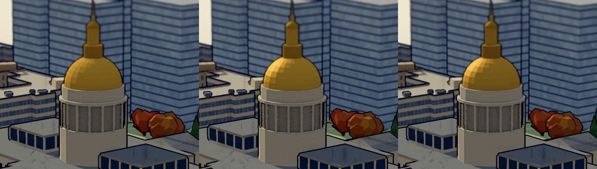

## Integration

`createCapitol(buildings, groundAt)` follows the Floyd and Westin contract. It returns null, and
the generic block stays, when:
- the footprint is missing;
- the footprint has moved more than 1.5 m (a different bake);
- any ground sample is missing.

In the terrain stage of `city.ts`, it takes Westin's filtered list (`floyd → westin → capitol`), and
its group is added after the plinth. The board without terrain is unchanged.

## Views

**Review frame, production path.** The whole dome and the Georgia State approach curve are both in
view.
- Open `/?t=2026-11-20T14:12:45-05:00&speed=0#17.54/33.74927/-84.38684/-110` and tap **City**.
- City lands on target (440, 515), bearing 250°, tilt 57° and 0.34 m/px. This was verified in Orca
  by reading the camera back.

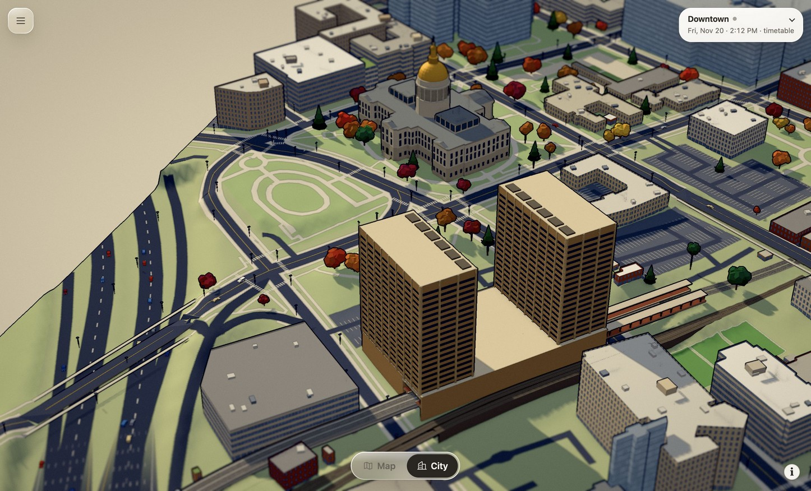

| View | URL `t` | `__city.lookAt` |
|---|---|---|
| West front, head-on | `…14:12:45…` / `…17:45:00…` | `(290, 520, { bearing: 123, metresPerPixel: 0.07, tilt: 66 })` |
| East front, head-on | same | `(345, 540, { bearing: 303, metresPerPixel: 0.07, tilt: 66 })` |
| From the train side, east, with the dome over the Floyd towers | `2026-11-20T14:12:45-05:00` | `(330, 540, { bearing: 262, metresPerPixel: 0.16, tilt: 72 })` |
| Wide, day and dusk | `…14:12:45…` / `…17:45:00…` | `(330, 535, { bearing: 252, metresPerPixel: 0.2, tilt: 74 })` |
| Close: portico and north wing, day and dusk | same | `(318, 545, { bearing: 75, metresPerPixel: 0.09, tilt: 64 })` |

The study's winter pose (`630, 492, bearing 235`) looks along the viaduct curve, and the Capitol
is outside that frame. To compare with R2 (*Waning Winter*), use the train-side view instead.

| | Before | After |
|---|---|---|
| Train side | 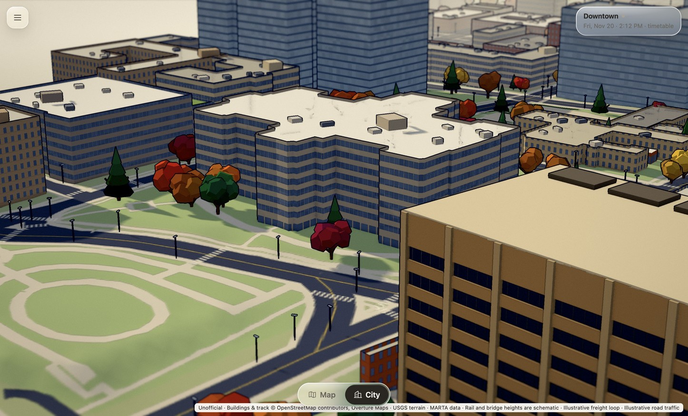 | 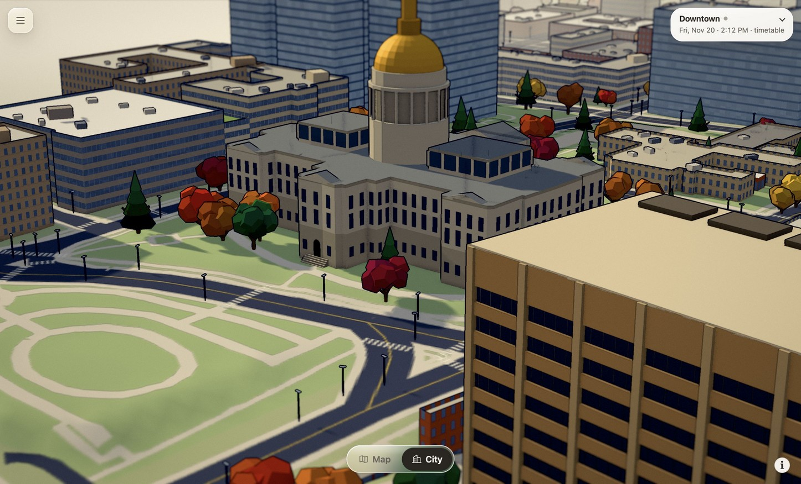 |
| Close | 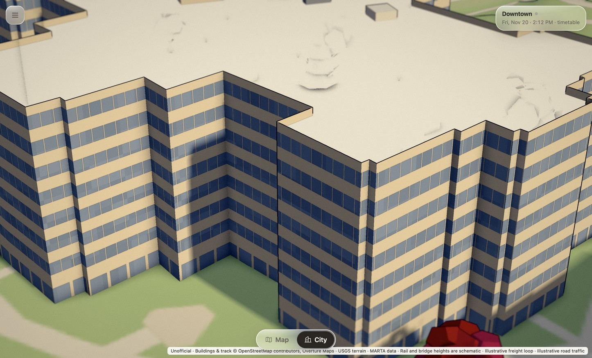 | 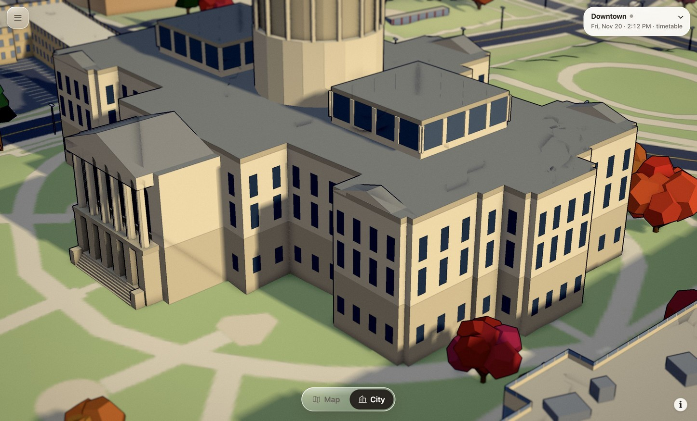 |

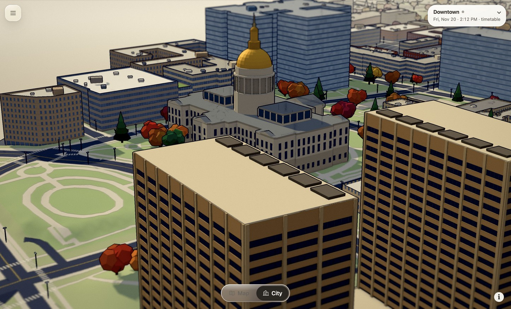
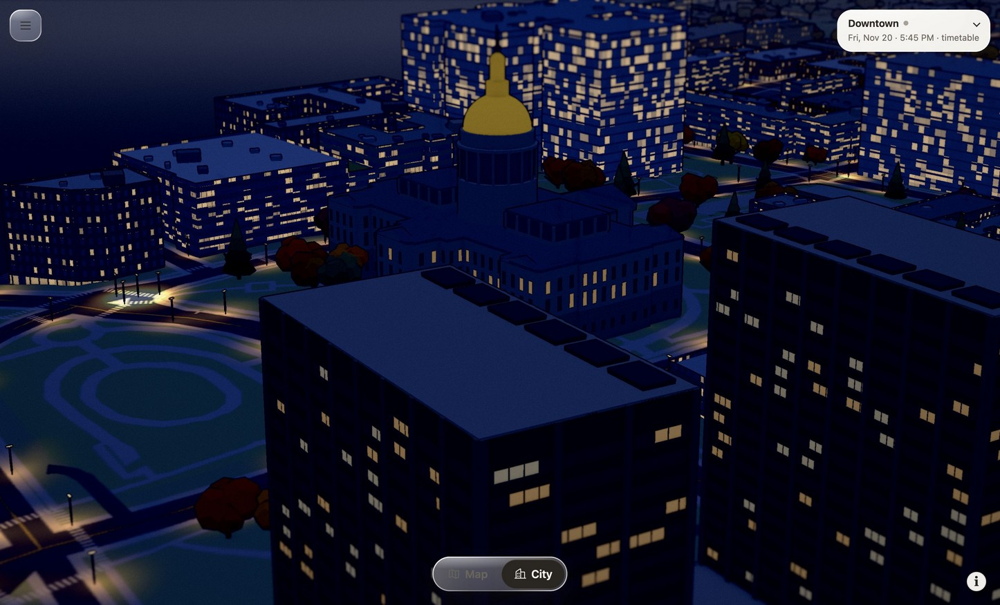
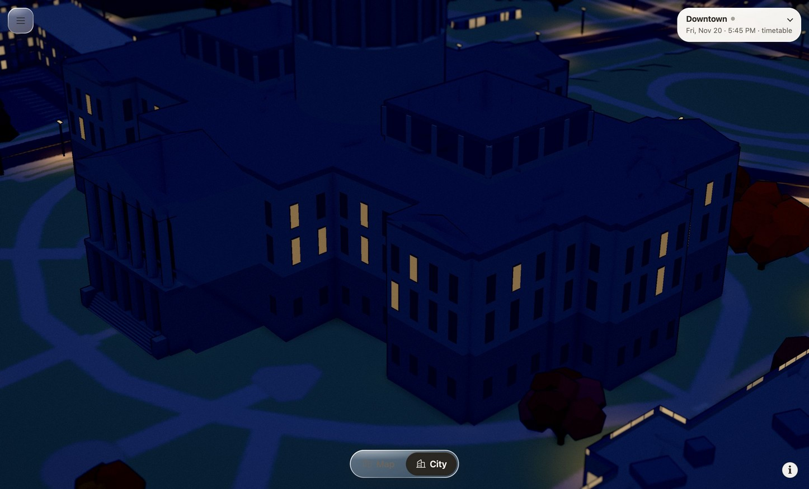

| | Day | Dusk |
|---|---|---|
| West front | 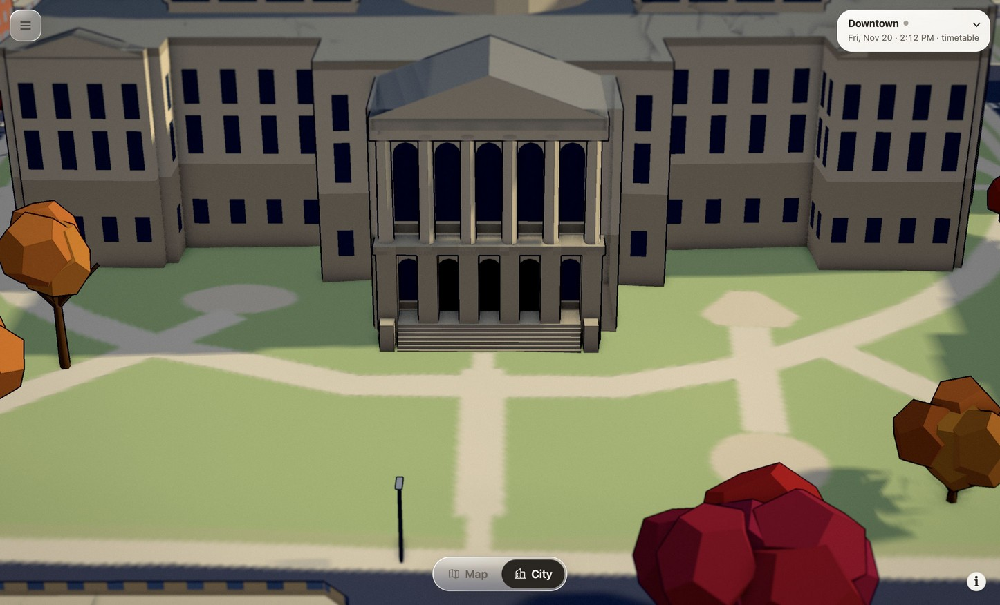 | 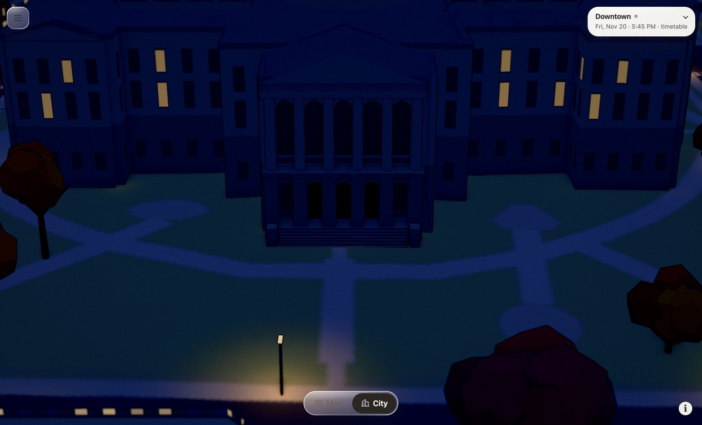 |
| East front | 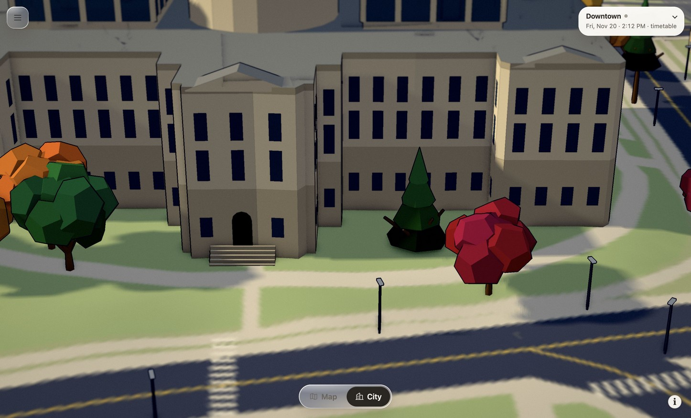 | 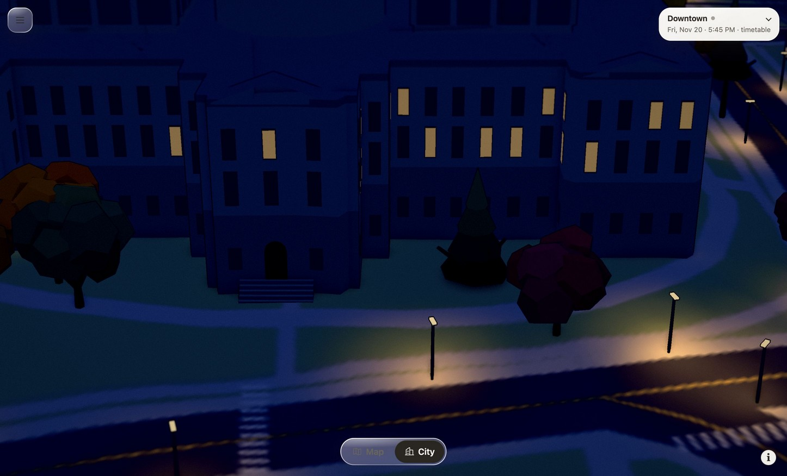 |

## Not modelled

The following are left out:
- the balustrades and the sculpture in the pediments;
- the dome's ribs and the drum's pedimented windows;
- the grounds' statuary and the Liberty Plaza monuments.

Window counts are stylised.
