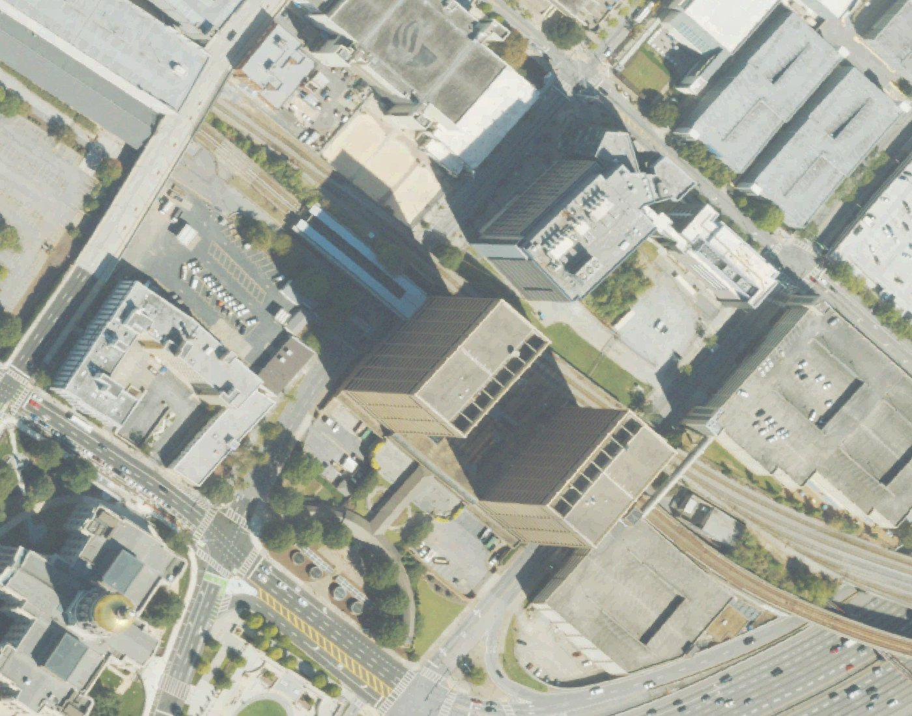

# Data model

The map shows *where trains are, or are likely to be, right now*. It must always be
honest about how it knows. The canonical types live in `web/src/model/types.ts`;
the Rust pipeline (`pipeline/`) emits static files that match them.

## Truth tiers

Every displayed fact carries a tier, per attribute (not per train). A train's
position can be `live` while its car count is `illustrative`.

| Tier | Meaning | Examples |
|---|---|---|
| `live` | A real-time feed reported it moments ago | MARTA rail (GPS fixes every 30–60 s) |
| `scheduled` | Derived from a published timetable | MARTA rail/streetcar, Amtrak Crescent |
| `reported` | An average an operator reported to a regulator | FRA crossing train counts |
| `inferred` | We filled it in from nearby `reported` values | Freight arcs with no crossing |
| `illustrative` | A typical example, not a real observation | Freight trains in the future diorama |

`Sourced<T> = { value, tier, source, asOf }` carries this on any value.

### Where tiers appear on screen

Sam set this rule on 2026-11-23. Every value keeps its tier in the data. The interface
shows the tier only where someone might take a value as fact:

- **Selections.** A selected train, bus, freight or traffic card shows a tier chip next to
  each attribute: position, consist, berth, track and so on. A simulated freight still says
  `illustrative`.
- **The scene clock.** One scene-wide word says whether the world is `Live`, only at the real
  present with the feed up, or on `Timetable`. A shifted clock never reads as live.
- **Not ambient scenery.** The Final subject card names weather confidence alongside train status (Sam, 2026-11-24). No on-screen tier labels for trees and species,
  building heights, landscaping, crowds or area notes. The Key and About explain these.
- **Weather.** At the real present, show the observed condition. If the fetch fails, show no
  condition rather than a guess. With a shifted clock, weather is a scene setting: show its
  control or icon, and name the sky illustrative.

## Identifiers

`<feed>:<kind>:<stable name>`, e.g. `marta:route:RED`, `marta:route:STREETCAR`,
`amtrak:route:Crescent`, `fra:crossing:718065F`, `narn:arc:451994`.
Feed-generated numeric ids (MARTA route `29226`) are mapped to stable names once,
in the pipeline, so the rest of the system never depends on them. Namespacing by
feed is what lets this grow to every US agency.

## Geometry: where a train can be

Positions are **distance along a path** (`s`, metres), not lat/lon. That gives
smooth interpolation, guaranteed on-track rendering, and a natural coordinate for
dropping trains into a diorama later.

- **Transit and Amtrak:** `Path` comes from the agency's GTFS `shapes.txt`, with
  cumulative metres per vertex (`cum`).
- **Freight:** `TrackArc` from the North American Rail Network (NARN) lines dataset,
  which is a node/arc graph with owner, trackage rights, subdivision, and track count.
- The basemap's own railway lines are decoration only. Snapping GTFS paths onto NARN
  arcs is a later problem.

## Rail elevation profiles (downtown)

`railprep scene` gives every MARTA heavy-rail path through downtown a height profile, with one
value every 10 m. Heights come from Overture's subway `level_rules` and `rail_flags`, which
derive from OSM `layer` and `tunnel`. They are **schematic stacking order, not depth**: −1 → −10 m,
−2 → −16 m, −3 → −22 m, and any bridge → +7 m. City and East Portal draw track only where the
smoothed profile is at or above `PORTAL_E` (−5.5 m), so anything deeper counts as tunnel.

`clean_profile` fills untagged gaps of 150 m or less between two tunnels, because most of them are
mapping seams. Some are real open cuts, though. `VERIFIED_OPEN` in `pipeline/src/scene.rs` pins the
ones checked against dated imagery at a schematic −4 m, so they survive the fill and the ramp. On a
flat board, City cuts a slot in the ground over each below-grade open stretch and gives it a floor.

### Open-air MARTA track downtown (checked 2026-11-21)

Primary evidence: OSM way tags and history (api.openstreetmap.org); USGS NAIP orthoimagery
`m_3308413_se_16_060_20231008` (2023-10-08, 0.6 m, public domain, via TNM
`USGSNAIPImagery`); Esri World Imagery, Vantor WorldView-2, 2026-02-02 (0.5 m, leaf-off,
viewed only, not redistributed). MARTA's SEC District roof page was also used
(itsmarta.com/gwccroof.aspx).

| Stretch | Status | Evidence | Precision |
|---|---|---|---|
| Five Points station (Blue/Green on the upper level) | Underground | OSM `tunnel=yes`, `location=underground` platform | — |
| **Gulch trench**, between Five Points and the Ted Turner Dr viaduct, about −84.3937 to −84.3924 | **Open cut** (pinned) | OSM ways 702258823 and 702258824 have had no tunnel tag since 2019. NAIP 2023 and WV02 2026 both show a walled trench with a footbridge across it. | The ends match the OSM ways to a few metres. The two tracks are 111 m and 141 m long. City's drawn run is 117–128 m, and its ends fall within 7–23 m of the surveyed ends after smoothing. |
| Ted Turner Dr → SEC District (Dome/GWCC) → Northside Dr, about 1 km | Covered | OSM way 702268368 is `tunnel=yes`, `layer=-3`. Imagery shows the line under the Gulch deck, the plaza and the Centennial Olympic Park Dr bridge. MARTA says the station "sits underneath the Centennial Olympic Park Drive bridge overpass" and has its own roof. The open slot visible beside the station carries the NS freight tracks, not MARTA. | The station is roofed and isn't open to the sky. |
| Vine City station's open cut, about −84.4064 to −84.4047 | Open, **off the board** | OSM ways 702268369 and 702268371 are untagged, and the trench is visible in NAIP 2023. Its x coordinate is about −1,300 to −1,140 m, west of the City board's edge at −1,000. | Not drawn. |
| **Five Points east cut**, between Pryor St SW and Shirley Clarke Franklin Blvd SW (Central Ave in the bridge inventory), about −84.3898 to −84.3889 | **Open cut** (pinned) | OSM ways 702258817 and 702258818 are untagged, and the Interline Connector way 1453238814 beside them is `cutting=yes`. Rails are visible in NAIP 2023 and WV02 2026. | Same method as the Gulch trench. |

| Georgia State west approach, from the tunnel mouth at the Washington St bridge to the canopies, about −84.38746 to the platform tips (−84.386895) | **Open**, at grade beside the CSX/NS tracks | OSM ways 78090747 and 78090742 have `level=2` and no tunnel tag. Two open tracks show in Esri 15 cm imagery (2022-09-27) and WV02 (2026-02-02). | ≈ 69 m on the paths, ±10 m at the west end |
| Georgia State side-platform canopies, from the platforms' west tips to the Floyd NW face (−84.386895 to −84.386311) | **Roofed** (not a tunnel mouth) | White canopy roofs over the side platforms (OSM 539937961 and 539937962) in 2022, NAIP 2023 and 2026. The tracks between the canopies may be partly visible; the imagery can't resolve it. Edges surveyed 2026-11-22 ([georgia-state-geometry.md](georgia-state-geometry.md)). | ≈ 71 m, ±5 m |
| Georgia State station under the Floyd Building ("Twin Towers"), NW to SE face (−84.386311 to −84.385359) | **Covered** by a building | OSM ways 702258821 and 702258822 are `tunnel=building_passage`. The faces come from the OSM outline; tower bases match it in NAIP 2023. Imagery roof edges lean about 10 m, and the earlier 131 m was read from them. | ≈ 116 m, ±4 m |
| From the Georgia State east face over the Downtown Connector and on east | **Open**, elevated structure | OSM ways 905944412–905944415, then the layer-3 viaduct (78090750, 78380741). The structure is continuous in imagery; the untagged "gap" at about −84.38515 to −84.38427 is only a seam between OSM ways. A narrow skywalk (539939605) crosses it. There is no public deck or clearance record: FHWA NBI GA 2024/2025 holds highway-carrying structures only, and GDOT GIS has none. | Height is schematic |

**Correction (2026-11-21):** an earlier version of this section said the Georgia State gaps
"stay filled as tunnel". They don't. The legacy profile ramps from −10 m at the Washington St
portal to +7 m by −84.3859, so a flat-board consumer of the profile alone draws the track
rising through the canopies and the Floyd Building. The `rail` spans below carry the observed
cover. Centennial Yards plans to build a platform over the Gulch tracks, so re-check the Gulch
trench against new imagery before trusting this entry after 2026.

### Rail cover and terrain-relative height (`scene.json` → `rail`, version 1)

The legacy `profiles` stay unchanged. The optional `rail` key adds observed spans for each path.
The types and lookups (`railSpanAt`, `railBedY`) live in `web/src/core/scene-data.ts`, and the
fixtures and evidence live in `RAIL_FIXES` and `RAIL_EVIDENCE` in `pipeline/src/scene.rs`.

- **Spans** are half-open `[s0, s1)` in metres along each GTFS path. Each direction and each
  Blue/Green path is projected separately from lon/lat edges, so nothing depends on a path id.
  Spans are sorted and don't overlap. A gap, or s outside every span, means **unknown**: fall
  back to the legacy profile against `PORTAL_E`.
- **Cover** (`open`, `covered` or `roofed`) describes only the sky, and it's independent of
  height. `roofed` is a station canopy or roof, not a tunnel mouth.
- **Form**: `tunnel`, `cut`, `grade`, `station` or `viaduct`.
- **Height** is the **track bed**, the same level as the legacy `z`. Rails and cars add their
  own +0.55 m once. Every height is `schematic` for now.
  - `base: ground` puts the bed at local bare earth + `rel`. Open cuts have `rel` 0, because the
    DEM already samples the cut floor.
  - `base: anchors` hangs the bed from identified anchor points (each with its own s, x, z,
    description and `rel`). The height is piecewise-linear between anchors and flat beyond the
    ends. Viaducts always use anchors, so a track never follows the DEM down into the freeway.
- **Georgia State chain.** The canopy, Floyd Building and Connector viaduct spans share three
  anchors:
  - the canopies' west end, at rel 0;
  - the station's east face, at rel +7;
  - the Connector's east bank (USGS 3DEP 314.1 m), at rel +7.

  This keeps the bed continuous through the seams in both directions. The +7 m is a placeholder
  clearance, not a measurement.
- **Example**, the scheduled Blue trip eastbound to Indian Creek that leaves Five Points at 14:11
  on Nov 20 (`marta:path:155177`; Five Points at s = 7,367.8 m):

  | Span | s0–s1 |
  |---|---|
  | Gulch trench | 7,116.6–7,246.7 |
  | Five Points east cut | 7,560.9–7,663.2 |
  | Georgia State open | 7,834.7–7,896.3 |
  | Georgia State canopy (roofed) | 7,896.3–7,969.2 |
  | Floyd Building (covered) | 7,969.2–8,100.3 |
  | Connector viaduct (open) | 8,100.3–8,900.0, the profile's end |

  The anchors are at s = 7,896.3, 8,100.3 and 8,364.0.

## Freight traffic

FRA crossings carry railroad-reported daily train counts but no link to a track arc.
The pipeline attaches each open crossing to the nearest arc owned by the same railroad
within 50 m. An arc's `tpd` (trains per day) is the median of its attached crossings
(`reported`). Arcs with none inherit from connected same-owner arcs through the graph
(`inferred`), up to 6 hops, but **only along main line (`NET=M`) and passing sidings
(`S`)**. Yards and industry leads see a fraction of a main line's trains, so they stay
unknown unless a crossing on them reports a count.

NARN `NET` codes (from the dataset's coded values): M main, I major industrial lead,
O other/minor industrial, S passing siding over 4,000 ft, Y yard, F rail ferry,
X out of service, A abandoned, R removed, T rail-trail, Z transit-only/museum.
We drop X, A, R, T and Z. Identical counts on neighbouring crossings suggest
these are per-segment estimates, so the UI always says "reported average, not live".

## Timetables

Compact, computed in the browser so scheduled trains cost zero server requests:

- `Pattern`: route + path + stops, each with metres-along-path and arrival/departure
  offsets in seconds from trip start.
- `Trip`: `[patternIndex, serviceIndex, startSeconds, shortName]`. `startSeconds` may
  exceed 86 400 (GTFS allows `25:30:00`).
- `Service`: weekday bitmask + date range + `calendar_dates` additions/removals.

## Normalized train state

All four source kinds become one `TrainState` (`id, routeId, pathId, s, heading,
lon/lat, lengthM, vehicleType, headsign, nextStop`):

1. **Position fixes** (GTFS-RT VehiclePositions): snap lat/lon to the path → `s`.
2. **MARTA rail REST**: each prediction row repeats the train's GPS fix (verified
   2026-11-20: half the trains were 400–900 m from any station, and 17 of 24 moved
   between 25 s snapshots). The Worker groups rows by train. The browser snaps each fix
   to the nearest path of that line and direction (all fixes within 55 m), then glides
   between fixes over 8 s. Next stop and ETA come from the soonest realtime row.
3. **Timetables**: interpolate `s` between stops, dwelling at each stop.
4. **Aggregate counts** (FRA): no trains, only `TrackArc.tpd`.

## GTFS gotchas we handle

- Times past midnight (`25:30:00`) and leading spaces (` 8:17:00` in MARTA's feed).
- `calendar_dates.txt` exceptions, not just `calendar.txt`.
- Service day is evaluated in the feed's timezone (both feeds: America/New_York).

## Colour

Colour means the kind of service, the same in every city: city rail is blue, intercity
passenger is violet, and freight is rust, with width and glow scaling with trains per day.
Agency line colours (MARTA Red/Gold/Blue/Green) are an accent. They appear in train
cards, and as a tint on city rail above zoom 12.5. Train style shows the truth tier:
a solid train is live, an outlined one is scheduled.

## Vehicles and art

`VehicleType` holds length, an `art` key, and "can carry" text. Liveries are generic
look-alikes (MARTA-ish silver car, generic freight locomotive), no operator logos.

## Live buses

`GET /api/marta/bus` returns a full snapshot with `source: "marta-bus-rt"`,
`fetched` (epoch milliseconds), and `buses`. Each bus has a vehicle-descriptor ID
(`marta:bus:<vehicle_id>`) and `at` (vehicle observation time in epoch milliseconds,
or null). The wire format carries `lon` and `lat` rounded to five decimal places,
optional `bearing` in whole degrees clockwise from north, and optional `speed`
in whole metres per second. Each attribute inherits the feed source and the
vehicle timestamp. The client expands those into individual live-tier values.

The Worker uses `data/ga/bus-routes.json` to translate the feed's raw GTFS
route ID into `marta:route:<public short name>` (for example, `marta:route:1`).
It omits the assignment when the static edition has no matching bus route. The 2D
map draws teal GPS dots for fixes up to three minutes old, at the real clock only.
The endpoint retains older and undated fixes so other consumers can apply their
own freshness rules.

### Station platforms and boarding edges

A station layout lists its physical tracks and platforms. Each boarding edge belongs to one platform and names the adjacent track. Its side is measured looking along the station’s declared positive axis. Reversing travel swaps the side of the train facing the same edge. A track may have platforms on both sides, and an island can serve two tracks. [Platform types and queries](../web/src/model/platforms.ts)

| Station and normal travel | Physical platform | Possible boarding edges |
|---|---|---|
| Georgia State eastbound | South side platform | ER, doors facing right |
| Georgia State westbound | North side platform | EL, doors facing right |
| Avondale eastbound Blue | South island, GTFS stop 908438 | ER, left, or EB, right |
| Avondale westbound Blue | North island, GTFS stop 908691 | EL, left, or WB, right |

Georgia State fits its boarding lips to the drawn track centres at ±2.10 m, plus the 1.60 m half-car width and a 0.13 m model gap. Each canopy or hall bay gets one slab, with a warning strip at each boarding edge. Avondale’s service evidence identifies the mains as the inferred usual tracks. Its GTFS stop IDs locate the islands. A particular trip’s track and actual door operation remain unknown. [Georgia State geometry](georgia-state-geometry.md) · [Avondale source fixture](avondale-layout.md)

`Schedule.trainsAt()` supplies the train’s existing position, heading and optional `scheduledStop` from the same timetable calculation. A positive dwell occupies the arrival-inclusive, departure-exclusive interval. Equal arrival and departure times identify a call only at that exact instant. For example, on November 20, 2026, the eastbound Blue call at Georgia State is 14:12:00 ET, at 8,025.0 m along its trip path. The westbound call is 14:10:00 ET at 16,066.3 m on its own path. Both are zero-duration calls in this feed. The train continues on the existing interpolation. Its stop coordinate represents the timetable’s path location. An exact stopping marker would require another source.

Use `boardingChoices(layout, travel, candidateTrackIds?)` to enumerate compatible physical edges. For a timetable train, `scheduledBoardingChoices(layout, axisBearingDegrees, train, platformsByStop?)` joins the current call to its platform(s) and uses the train’s heading. Pass a stop-to-platform mapping when their IDs differ, as at Georgia State. A live prediction naming the next station provides no current scheduled call or track assignment.

In the Models catalogue, vehicle swatches use the service palette. Buses use the bus colour. People, trees, landscape studies, houses and materials use a neutral swatch because they have no transport service.
