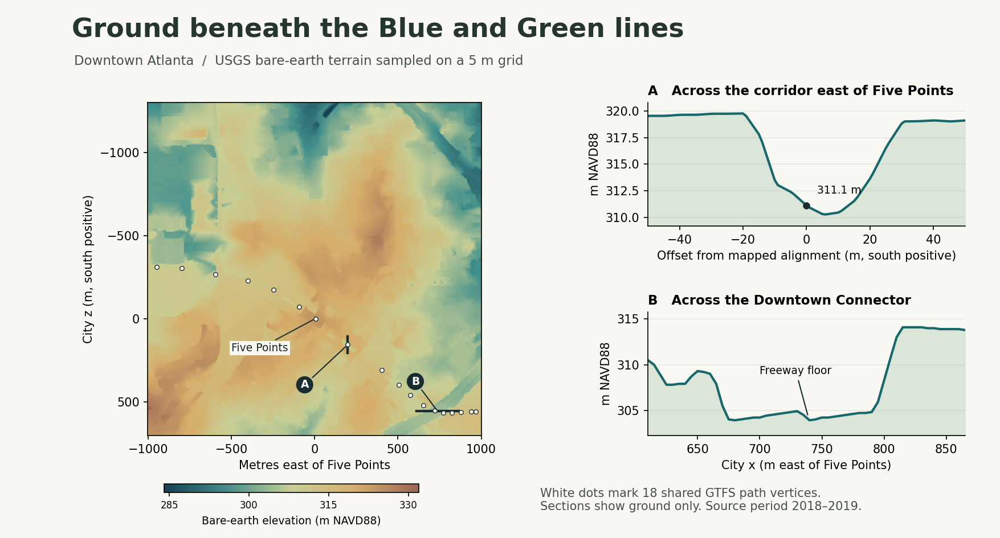

# Ground elevation for the downtown City board

The pipeline prototype bakes one ground surface from a public USGS lidar-derived digital elevation model (DEM). Its inputs are the downtown board bounds and the elevation tile. MARTA geometry enters only in the checks on the finished grid.

## Reproduce the bake

From the repository root, use a Python environment with NumPy, Rasterio and pyproj (the raster packages used elsewhere in the pipeline). The pinned tile is 317,814,444 bytes. The script streams its SHA-256 before reading the board-sized window. A changed or partial download fails the bake. The checked-in prototype lets the City and rail owners inspect the result offline.

```sh
python3 -m venv .venv
.venv/bin/python -m pip install numpy rasterio pyproj

project=GA_Statewide_2018_B18_DRRA
tile="USGS_1M_16_x74y374_${project}.tif"
mkdir -p data/raw/terrain
curl -fL --retry 3 -o "data/raw/terrain/$tile" \
  "https://prd-tnm.s3.us-west-2.amazonaws.com/StagedProducts/Elevation/1m/Projects/$project/TIFF/$tile"
.venv/bin/python -B pipeline/scripts/downtown_terrain.py "data/raw/terrain/$tile"
.venv/bin/python -B pipeline/scripts/test_downtown_terrain.py
git diff --exit-code -- pipeline/prototypes/downtown-ground
```

The optional `--out DIR` writes the same files to a scratch directory. The reference bake is opt-in. The City data build stages the binary and manifest from this checked-in copy. Visitors make zero upstream elevation requests.

## Reference and binary layout

- **Input.** USGS 3DEP standard 1 m bare-earth DEM, tile `16 x74y374`, public domain. The tile metadata gives a project time range of 2018-11-27 through 2019-04-24 and a publication date of 2022-05-31. Subsequent downtown construction can change the surface. [Tile metadata](https://prd-tnm.s3.us-west-2.amazonaws.com/StagedProducts/Elevation/1m/Projects/GA_Statewide_2018_B18_DRRA/metadata/USGS_1M_16_x74y374_GA_Statewide_2018_B18_DRRA.xml) · [USGS collection](https://data.usgs.gov/datacatalog/data/USGS:77ae0551-c61e-4979-aedd-d797abdcde0e)
- **Horizontal.** The GeoTIFF is NAD83 / UTM zone 16N (EPSG:26916), easting and northing in metres. The output uses City's local spherical projection centred on Five Points at WGS84 longitude −84.3916°, latitude 33.7539°. With angular differences in radians and radius 6,371,008.8 m, `x = R cos(lat0) Δlon` and `z = −R Δlat`. The bake inverts these equations and treats the resulting lon/lat as NAD83 before projecting into the TIFF. This metre-scale horizontal datum approximation is suitable for the 5 m board. Sharp walls can shift relative to mapped features.
- **Coverage.** Both endpoints are vertices. Columns run east from x = −1,000 to +1,000 m. Rows run south from z = −1,300 to +700 m. The northwest node is at row 0, column 0. Each axis has 401 nodes at 5 m spacing. There is no half-cell offset.
- **Vertical.** Orthometric metres above NAVD88 (EPSG:5703), positive up. Each vertex takes the containing native 1 m pixel, rounded to the nearest decimetre. This point sampling preserves local lows but can miss a narrow ditch or wall between nodes. The 0.1 m encoding contributes up to 0.05 m of rounding at a node. Interpolation, source age, ground classification and horizontal alignment contribute separate errors.
- **Decode.** Check the version, byte length (`2 × rows × cols`) and binary hash in [ground.json](../pipeline/prototypes/downtown-ground/ground.json). At byte `2 × (row × cols + col)`, read a signed little-endian 16-bit integer. A valid value times 0.1 gives absolute NAVD88 metres. Bilinearly interpolate enclosing nodes in local x/z. Subtract `vertical.sceneZeroNavd88M` once to get scene y. This common vertical zero is the packed terrain at the exact City origin.
- **Unknown ground.** The input mask, source sentinel −999999, non-finite values and out-of-raster reads map to −32768. Check this before scaling. Return unknown outside the inclusive board or if any node with nonzero interpolation weight is unknown. Exact edge and corner nodes remain sampleable. Skip mesh triangles that need a missing vertex. A valid DEM value may itself be interpolated under a structure. The mask cannot identify those locations.

## Measured ground on the Blue/Green approaches

The board spans approximately 84.402417° W to 84.380783° W and 33.747605° N to 33.765591° N. All **160,801 nodes** contain values, from **284.2 to 331.4 m NAVD88**. The exact City origin is **323.8 m**, so the ground mesh would span scene y = −39.6 to +7.6 m.

The 18 probes are common vertices of `marta:path:155177` (Blue) and `marta:path:155214` (Green). Their downtown vertices coincide in the app's 2026-11-21 routes snapshot (SHA-256 `5385af7996d155dde14b199eaffb941fc807b577663af57cf1f014e40edde625`). The sampler fixes these lon/lat coordinates so later GTFS editions can be checked against the same ground. The table gives a selection, west to east. The CSV includes all vertices, the native 1 m DEM value, and two lateral checks. North and south offsets are in City z at constant x. [All 18 samples](../pipeline/prototypes/downtown-ground/samples.csv) · [MARTA GTFS](https://itsmarta.com/google_transit_feed/google_transit.zip) · [App routes](https://atlanta.solomon.io/data/ga/routes.json)

| Location | City x, z (m) | Ground on alignment (m NAVD88) | 50 m north | 50 m south |
|---|---:|---:|---:|---:|
| Western approach toward SEC District/GWCC | −949, −311 | 310.16 | 303.89 | 310.10 |
| West of SEC District station | −597, −267 | 309.19 | 302.81 | 307.98 |
| Gulch, approaching Five Points | −249, −177 | 313.80 | 313.46 | 313.72 |
| Five Points, near the origin | +5, −2 | 323.80 | 314.51 | 321.48 |
| East toward Alabama Street | +199, +155 | 311.15 | 319.52 | 319.09 |
| Near Georgia State station | +505, +397 | 308.38 | 306.54 | 310.54 |
| West side of Connector crossing | +722, +552 | 304.60 | 311.19 | 305.75 |
| East of Connector crossing | +823, +565 | 313.94 | 303.45 | 313.70 |



- **The cut east of Five Points.** At x = +198.77 m, the north–south section through the shared alignment has banks 8.37 m and 7.94 m above its centre. The 1 m source at the centre reads 311.17 m. This terrain depression survives the 5 m bake. It supports modelling relief at the corridor. Structure records or surveys are still needed to identify the track level, any overhead street or plaza, and the extent of open sky.
- **The Connector.** The east–west section at z = +555 m crosses the freeway low. At x = +680 and +790 m the ground reads 303.9 and 304.8 m, then rises to 314.1 m at +820 m. At the mapped rail vertices over the crossing, the DEM follows the lower surface. A train following those heights would drop toward the freeway. USGS specifies bridge removal and terrain interpolation beneath decks. Clearance and deck elevation need independent evidence. [USGS DEM surface treatments](https://www.usgs.gov/ngp-standards-and-specifications/lidar-base-specification-digital-elevation-model-surface)
- **The western approach and Five Points.** At x = −597 m, lower ground lies about 6.4 m **north** of the mapped alignment. Near x = −249 m all three samples are within 0.4 m. Neither observation determines where the train becomes visible. At Five Points a single DEM value describes the modelled surface over multiple station levels. Lidar-derived ground supplies no tunnel crown or railhead ordinate. Cover requires the surface and the crown on the same vertical datum, plus evidence of the material or structure between them. An interpolated cell beneath a removed deck can have a valid value even when the surface was occluded.

## Payload and choice of spacing

The signed 16-bit grid occupies **321,602 bytes**, or **124,498 bytes** with gzip level 9. The manifest adds **1,592 bytes** raw or **836 bytes** gzipped. Together that is **323,194 bytes raw / 125,334 bytes gzipped** (122.4 KiB). The CSV and figure are inspection artifacts. The gzip figures measure local compression of each asset independently. Actual HTTP transfer depends on the static host's encoding.

To choose a spacing, the bake also samples the 100 m north–south section at x = +198.77 m every metre, including both endpoints. It compares bilinear ground to the containing native 1 m pixel at each of the 101 positions. The coarser options retain every second or fourth node of the 5 m lattice, keeping the board edges fixed.

| Node spacing | Grid alone, gzip bytes | Mean absolute difference from native DEM | Largest difference |
|---|---:|---:|---:|
| **5 m** | **124,498** | **0.21 m** | **1.48 m** |
| 10 m | 40,034 | 0.43 m | 2.62 m |
| 20 m | 12,156 | 1.02 m | 3.58 m |

The 5 m spacing retains more of the banks for about 84 kB more compressed than the 10 m option. Even the 5 m section differs from the native DEM by nearly 1.5 m on a steep edge. These are resampling differences on this section. Field accuracy at an individual rail or structure remains unknown. The reference bake used NumPy 2.0.2, Rasterio 1.4.3 and pyproj 3.6.1.

## Desktop terrain preview

Run `pnpm data:city` to prepare the downtown assets. If the board and trees are already baked, `pnpm data:terrain` stages just the checked-in grid and manifest, verifies the binary checksum and needs no GeoTIFF or Python environment. Run `pnpm dev` and open `/terrain-preview.html?at=cut` on that server. The other camera stops are `?at=downtown` and `?at=connector`. The preview is a development entry point. Only the staged assets are included in a subsequent production build.

The drawing uses true vertical scale. Two-metre contours follow the triangulated 5 m mesh. The teal points and line identify the sampled section. The readout uses the same bilinear interpolation as the pipeline. The near views open with scenery hidden. Enable the checkbox to see which blocks enclose the cut. Buildings use City's existing facade geometry placed at the lowest sampled footprint vertex, rounded down to whole metres, and trees use their individual ground samples. These foundations are illustrative. At-grade road and land-cover polygons are painted onto the terrain. Rail profiles, tunnel cover and bridge decks belong to the separate rail/structure work. Scenery comes from Overture Maps (including © OpenStreetMap contributors) and the Meta/WRI high-resolution canopy map. [Five Points](log/ui/2026-11-21-ground-preview-downtown.jpg) · [East cut](log/ui/2026-11-21-ground-preview-cut.jpg) · [Downtown Connector](log/ui/2026-11-21-ground-preview-connector.jpg)

## Handoff before motion

1. **City terrain.** The City data build now stages both static assets at `data/scene/downtown/`. The renderer owner can reuse `web/src/terrain/grid.ts` and its reference data tests. Check the x/z registration and a few decoded elevations against the CSV. For scene y, use `H_NAVD88 − 323.8` uniformly for the terrain and any independently surveyed structure. Sample building foundations, trees and at-grade streets from the same ground function. Mesh resolution can be chosen independently of the sampling grid. Keep enough ground vertices at the cut and Connector banks to retain their relief.
2. **MARTA accuracy.** Join the horizontal path to the terrain to ask “what ground is here?” Supply rail height, bridge clearance, covered/open state and portal extent from the rail investigation. The current scene manifest's height numbers come from schematic Overture stacking rules. Adding those numbers to every terrain sample would propagate the freeway dip into the viaduct and local surface rises into a tunnel. Draw track or animate trains through a section once the rail owner has resolved its vertical reference and visibility.
3. **Provenance and rollout.** Label a displayed interpolated elevation as `inferred` from the USGS 2018–2019 bare-earth DEM. Train position keeps its own source and clock tier. To ship integrated City rendering, run `pnpm data:city` (or `pnpm data:terrain` on a populated board), rebuild `web/dist` and redeploy the assets together. No Worker endpoint or visitor-side elevation service is needed.

The reusable board, surface scenery, slot clipping, lifecycle and low/high geometry measurements are documented with the [Georgia State approach fixture](georgia-state-ground.md#board-module-for-city).
