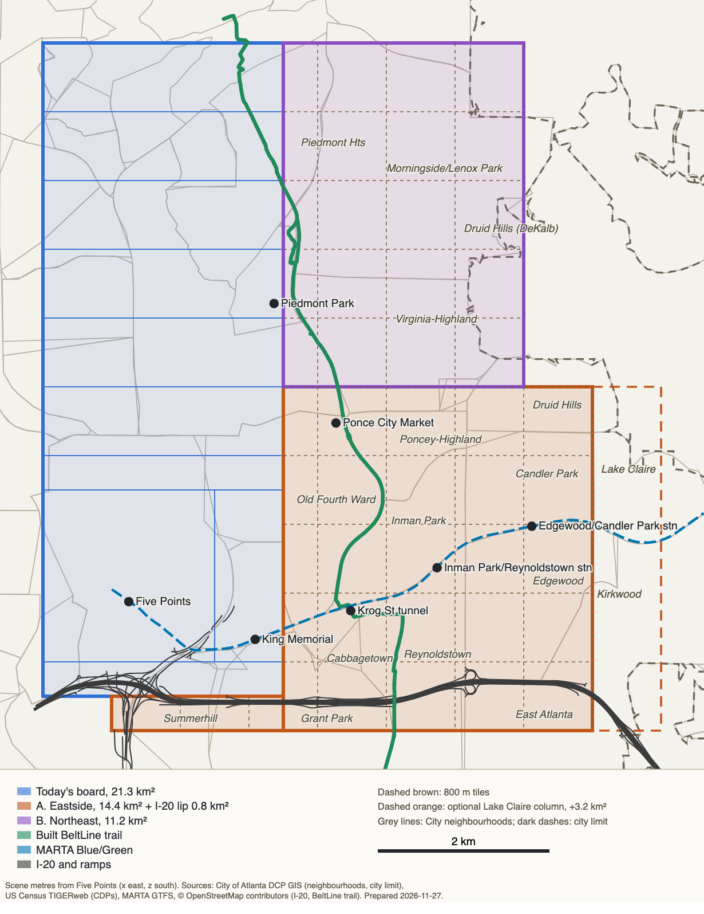

# East extension plan

Draft for Sam, 2026-11-27. This is a plan only, with no City code. It follows your decisions of
2026-11-27:
- east first;
- tiles underneath, neighbourhoods on top;
- never an empty square;
- road and rail as a gate.

Numbers are tagged **M** (measured, with source) or **E** (estimate). The parent plan is
[scaling plan v2](https://github.com/samsolomon/sim-atlanta/blob/samsolomon/scaling-plan-v2/docs/scaling-plan.md),
still on its branch. "Increment n" refers to its §5.

## Summary

1. **Extent.** Two rectangles east of today's board, plus a thin strip for I-20, add up to
   **26.4 km²**. The board grows from 21.3 to 47.7 km². The east edge is x 5400
   (lon −84.3332), which takes in Candler Park and the Edgewood/Candler Park station. Lake
   Claire would need one more column (+3.2 km²).
2. **Tiles.** The grid is 800 m tiles on the existing lattice: **47 tiles** (35 full, 12
   clipped). Today's areas stay as they are and load as units of their own size.
3. **Memory decides the order.** Low has 1.9 MB left before its reserve (M). Just showing the
   east as white costs about +4.5 MB (E). So freed near houses and area unload come before any
   east tile.
4. **Road and rail first.** Two things must land before any east tile: road kit parts 1–3, and
   road and crossing checks that run on main. After that, I-20, the MARTA east line and the
   CSX/BeltLine corridor get a phase of their own behind a flag. You sign off a still sheet
   before the east opens.
5. **Six releases.** Each is no worse than live on phones. The total is about 310–490
   agent-hours (§8).

*Today's board (blue), A. Eastside (orange), B. Northeast (purple), the I-20 strip, and an
optional Lake Claire column (dashed). [SVG](log/east-extension/extent.svg).*

## 1. Extent

Scene metres are measured from Five Points (lon −84.3916, lat 33.7539). x points east and z
points south.

| Block | Scene x | Scene z | Lon | Lat | km² | Tiles |
|---|---|---|---|---|---:|---:|
| A. Eastside | 1800 … 5400 | −2500 … 1500 | −84.3721 … −84.3332 | 33.7764 … 33.7404 | 14.4 | 25 |
| B. Northeast | 1800 … 4600 | −6500 … −2500 | −84.3721 … −84.3418 | 33.8124 … 33.7764 | 11.2 | 20 |
| I-20 strip | −200 … 1800 | 1100 … 1500 | −84.3938 … −84.3721 | 33.7440 … 33.7404 | 0.8 | 2 + part of 1 |
| **Total** | | | | | **26.4** | **47** |
| Option: Lake Claire | 5400 … 6200 | −2500 … 1500 | to −84.3245 | | +3.2 | +5 |

| Edge | Why there |
|---|---|
| East, x 5400 | It holds the Edgewood/Candler Park platforms (x 4694, z −878, from the MARTA GTFS stops) and Candler Park, whose polygon ends at x 5419 |
| B stops at x 4600 | Above z −2500, the strip from x 4600 to 5400 is 79% unincorporated DeKalb (the Druid Hills and North Druid Hills CDPs), with no City neighbourhoods |
| South, z 1500 | It holds I-20 and every ramp at Hill Street, Boulevard, Memorial/Glenwood and Moreland. All of them sit at z 760–1235 in OSM |
| The I-20 strip | I-20 leaves today's board between x 400 and 800. The Connector register lists 8 ramps that run past the south band's z 1100 edge ([connector-interchanges.md](connector-interchanges.md) §E) |
| North, z −6500 | It matches R16. The Northeast trail leaves today's board through its *north* edge near x 1380, so an east step can't complete it (§9, question 3) |

**Neighbourhoods.** These come from the City of Atlanta DCP GIS neighbourhood layer, with km²
from a 50 m raster ([tools](log/east-extension/tools/)).

| Coverage | Neighbourhoods (km² added; NPU) |
|---|---|
| All or nearly all | Morningside/Lenox Park 5.6 of 5.9 (F), Virginia-Highland 2.7 (F), Edgewood 2.1 of 2.2 (O), Candler Park 1.7 (N), Reynoldstown 1.6 (N), Inman Park 1.6 (N), Poncey-Highland 1.0 (N), Cabbagetown 0.5 (N), Atkins Park, Edmund Park |
| Completed with today's board | Old Fourth Ward 2.0 (M), Midtown 0.6 (E) |
| Part | Grant Park 1.2 of 4.5 (W), Druid Hills (City part) 0.9 of 1.4 (N), East Atlanta 0.8 of 4.1 (W), Piedmont Heights 0.8 (F; its north tip passes z −6500), Kirkwood 0.6 of 3.9 (O), Ormewood Park 0.4 of 2.0 (W), Summerhill 0.4 (V), Lindridge/Martin Manor 0.2 of 1.8 (F) |
| Outside the city | Druid Hills CDP 0.8 and North Druid Hills CDP 0.5 (US Census TIGER, DeKalb) |
| Not reached | Lake Claire starts at x 5413. The option column adds 0.87 of its 1.24 km² |
| Already on the board | Ansley Park (east edge x 1916) and Sherwood Forest (x 1253) |

## 2. Tile grid

- **Lattice.** Tiles are 800 m on #435's lattice, with `i = (minX + 1000) / 800` and
  `j = (minZ + 5700) / 800`. A tile is 0.64 km², about one Midtown row's height.
- **Files.** Each tile has `ground.i16`, `lod.bin` and `context.json`, plus a shared
  `index.json` (#435's layout). That makes 141 files, under 1% of the host's 20,000-file cap.
- **Rows line up.** The Midtown rows and R16 are tile rows `j = −1 … 4`, so block B meets them
  edge to edge.
- **Columns don't.** Today's board is 3.5 tiles wide. The lattice column x 1400–2200 is cut at
  x 1800, so its east half becomes 10 clipped tiles (400 × 800 m). Their manifests record the
  cell and a clip rectangle.
- **Downtown, King and Sweet Auburn coexist.** They keep their hand-built bounds and load as
  units. One east tile can meet up to three of them along x 1800. Tile (3,7) meets Sweet
  Auburn, King and south-corner.
- **Seams need work.** Today's boards have no east join. `verifySeam` demands identical 5 m
  samples and assumes one neighbour per edge. So every tile is cut from the same pinned DEM, and
  the seam code learns to handle several boards along one edge (increment 6).
- **Per-tile shares.** Each tile's clip rectangles and neighbourhood shares are in
  [`tiles.json`](log/east-extension/tiles.json).

## 3. Neighbourhood layer

**Sources.**
- **Names.** City DCP GIS neighbourhoods, already shipped as `data/ga/neighborhoods.json`
  (323 KB) and read by `places.ts`.
- **Grouping.** The same service's NPU layer.
- **Outside the city.** TIGER places, shown as "Druid Hills (DeKalb)".
- **Gaps.** About 0.2 km² inside the city has no neighbourhood polygon, mostly park edges. It
  takes the OSM park name, or else the nearest neighbourhood.

**How tiles map.** The pipeline writes each tile's shares into the tile index. A tile belongs to
every neighbourhood with at least 5% of it, so the mapping is many-to-many. Inverting it gives
each neighbourhood's tile list.

| Use | Rule |
|---|---|
| Corner label | Unchanged: the neighbourhood under the camera target |
| Search | Unchanged results. Picking an unloaded neighbourhood flies there and raises its priority |
| Key | Lists the board's neighbourhoods and what white means. Tiles never appear in the interface |
| Load priority | The neighbourhood under the target loads first, nearest tile first, then its neighbours by distance. A shared tile loads once, for whoever asks first |
| Reveal | A neighbourhood's tiles dissolve from white together when all are ready, or one at a time after 2 s. People see neighbourhoods arrive, not squares |
| Seams | A stippled band of about 60 m (world-space dither, no blending) wherever loaded meets white. It adds 0 programs |
| Work passes | One pass per neighbourhood. Each feature belongs to the polygon holding its centroid, so two passes can share a tile without conflict. Each pass is accepted with [`expansion-checklist.md`](expansion-checklist.md) |

## 4. Prerequisites, in order

| # | Item | Increment | Status, 2026-11-27 |
|---:|---|---|---|
| 1 | **Road and crossing tooling on main** | — | `lint:roads` exists only on draft #710 (about 40 min a run). The crossing checker (`check.py`, the 439abf84 limits) lives only on `study/crossing-check-calibration` and `samsolomon/crossing-check-lid`, branches `next-steps.md` lists as deletable. On main there is just its evidence test, `test_gate_sites.py`, which reads JSON. I ran it: 2 tests pass in 0.06 s. I didn't run the lint or the checker |
| 2 | **Road kit parts 1–3** | — | Part 1 is draft #710, with an open-edge regression (+299 m at Sweet Auburn) still open. Parts 2 and 3 aren't started |
| 3 | Device A/B | 0 | Draft #709 |
| 4 | Boot slicing | 1 | In part: #705 (`stage:terrain` 2.3 s median at 6×, M) |
| 5 | Night windows | 2a | **Done:** #721, High night 629 → 486 calls, ceiling now 535 |
| 6 | Budget reserves | — | **Done:** #708 |
| 7 | White placeholder | — | **Done:** #726, with `show`, `appear`, `reveal` and `hide` hooks |
| 8 | Programs phase A | 2b | Not started. High is at 94/100, 4 inside its reserve |
| 9 | **Free near houses, pack buildings** | 2c | Not started. `house-lod.ts` hides near groups and never frees them. The east is mostly houses |
| 10 | Per-view budgets, growth check, boot gate | 2d | Not started |
| 11 | **Area unload** | 3 | Not started. Five undo paths are missing (scaling plan §3.2) |
| 12 | **Tiles and ring manager** | 6 | Prototype #435, held, to be rebased |
| 13 | Neighbourhood index and reveal, stippled seam, one white draw | new | Not started |
| 14 | Coarse levels L1–L3 | 7 | Not needed for the east (all within 6 km). Needed before Buckhead |

## 5. Budgets

The baseline is `test:perf` on 16110fa6, 2026-11-27: default view, 12 areas, R16 white (M, from
#726's A/B). About 30 building-skin merges have landed since, and none is re-measured.

| Currency | Low | Low ceiling | High | High ceiling |
|---|---:|---:|---:|---:|
| Geometry MB | 163.1 | 190 (165 after reserve) | 274.5 | 300 |
| Calls | 338 | 435 | 432 day / 480 night | 475 / 535 (night reserve 40) |
| Programs | 80 | 86 | 94 | 100 (reserve 10) |
| Triangles | 1.69M | 2.06M | 6.50M | 6.85M |
| Texture MB | 108.7 | 125 | 772 | 890 |

| Cost | Value |
|---|---|
| Full detail, seen from a distance | 7.6–7.9 MB/km² of Low geometry (M, R16). That is a campus and freeway row, not houses |
| Close street view | Midtown street measured 209.5 MB on Low. Houses add about 60 MB per neighbourhood in view and are never freed (M) |
| White model | 0.17 MB/km² resident, 8.3k triangles/km² drawn, 13 KiB/km² download (M, #726) |
| High ground maps | 21.8 MB/km² of texture (M), so High has room for about 5 km² before it also needs unload |
| Download per tile | Ground 52 KB, plus context 150–250 KB raw (about 60 KB gz), plus `lod.bin` at most 40 KB (E, #435). Bungalow tiles run higher. About 12 MB hosted for all 47 |

**Projected Low geometry (E):**

| View | Resident | Geometry |
|---|---|---|
| Default (Five Points) | Today's board, plus 26.4 km² of white | 163.1 + 4.5 = **167.6 MB, inside the reserve**. With 2c (about −18 MB) it's about 150 |
| BeltLine (target over Ponce City Market, ~1.5 km orbit), with unload | ~18 km² at full detail, the rest white | 13 fixed + 18 × 7.9 + 30 × 0.17 ≈ **160 MB** |
| The same, if houses and canopy cost 10 MB/km² | | ≈ 198 MB, over the ceiling. The window shrinks to ~15 km² |

**What follows (E):**
- **The window size isn't assumed.** The first east tile's measured MB/km² sets it, and that
  measurement is a gate in E4.
- **One white draw.** One draw plus a shadow per white tile would add up to 94 calls. High has
  43 left by day and 15 above the night reserve. So white tiles batch into one draw, with the
  index rebuilt on each load or unload.
- **Triangles.** All-white east adds about 220k triangles on Low (1.91M of 2.06M). Past about
  6 km, a coarser white is worth having.
- **Programs.** East tiles, the trail and the seam stipple add 0.
- **Fetching and building.** A visitor at the BeltLine view fetches about 2–4 MB of east tiles.
  Every tile mount keeps its longest task at or under 300 ms at 6× (sliced rows today: 185–335 ms,
  M).

## 6. Content per neighbourhood

Every tile uses the same data:
- **Ground.** USGS 3DEP lidar at 5 m on the pinned DEM.
- **Buildings and streets.** OSM ways and land cover, plus Overture footprints and heights, each
  carrying its truth tier.
- **Trees.** Atlanta's 2023 tree canopy (UTC) with Meta/WRI heights.

UTC is a City layer. Whether it covers the 1.3 km² of DeKalb cells is unchecked. If it doesn't,
those cells use the Meta/WRI heights as their canopy mask.

| Group (NPU) | Landmarks worth doing | Roads and Connector touch points | Rail and MARTA |
|---|---|---|---|
| Old Fourth Ward (M) | **Ponce City Market** (x 2413, z −2079); Historic Fourth Ward Park | Freedom Parkway (already on the board to x 1800, continues to x 3941), Ponce de Leon (z ≈ −2160 to −2360), North Ave (z ≈ −1915), Boulevard, Ralph McGill, Highland Ave, Edgewood Ave | **The Eastside Trail** on the old rail corridor |
| Inman Park, Poncey-Highland, Reynoldstown, Cabbagetown, Candler Park (N) | **Inman Park/Reynoldstown station**; **Krog Street tunnel** (x 2567–2608, z 49–165; generic colour fields, no copied art); Carter Center; Little Five Points | DeKalb Ave (z −960 to 134), North Highland, Moreland (x ≈ 3915), Memorial Dr (z 700–820), Decatur St, I-20 at Boulevard and Memorial/Glenwood | MARTA viaduct over the CSX tracks at Hulsey yard; CSX mains; the trail south to Memorial |
| Edgewood, Kirkwood (O) | **Edgewood/Candler Park station** | Moreland's I-20 interchange, DeKalb Ave, Memorial Dr | Blue/Green east of Inman Park |
| Grant Park, Summerhill, East Atlanta, Ormewood (W, V) | — (the Zoo and Oakland Cemetery lie just outside or on the edge) | **I-20** mainline and ramps (Hill, Boulevard, Moreland), the interchange's south legs, Boulevard SE | — |
| Virginia-Highland, Morningside, Piedmont Heights (F) | The N. Highland and Virginia commercial node; Piedmont Park's east edge | Monroe Dr, Piedmont Ave, Briarcliff Rd, Cheshire Bridge Rd, Ponce | The Eastside Trail's north end; the Northeast trail toward the north edge |

## 7. Road and rail: the gate

**Known open defects on today's Connector.** The counts come from the road-kit audit on cf83c531
(High, all 13 boards, M), in
[road-kit.md](https://github.com/samsolomon/sim-atlanta/blob/samsolomon/road-kit-1-overlaps/docs/road-kit.md),
plus [connector-interchanges.md](connector-interchanges.md) and the
[Connector handoff](handoffs/studio-connector-repairs.md).

| Defect | Size | Fixed by |
|---|---|---|
| Elevated edge with no wall (S2) | 47.9 km at 1,297 sites, 83% of elevated edge | Part 2 |
| Stacked treads (A5) | 5,316 m² at 243 sites | Part 1 |
| Paint drawn over paint (J3, Freedom Parkway) | 5,238 m² in 58 pairs; #710's WIP takes it to 103 m² | Part 1 |
| Steps and open deck ends | 3.8 km at ~210 sites, including Ellis Street's 2.2 m step at z −520 | Part 3 |
| I-20 profile joints | +0.22 m and −0.11 m steps | Part 3 |
| Washington Street (E1) | Drawn 4.5–7.5 m below its lidar surface | After part 3 ([research](https://github.com/samsolomon/sim-atlanta/blob/samsolomon/connector-e2-joints/docs/washington-street-bridge.md)) |
| Abrupt lane changes; unbalanced merges | 43; 34 | Part 4 |
| Decks with no supports (K1) | 214,669 m²; 27 pier meshes city-wide | Part 5 |
| Ellis side walls; Capitol tunnel nits | Uneven pieces; bank slab shelf and nubs | Parts 1–3 |
| "Road underneath stops at the carve" (Auburn and Edgewood) | Never reproduced | Needs your exact view |

**East scope:**

| Piece | What gets built | Survey tasks |
|---|---|---|
| I-20 | Mainline from the interchange to Moreland; ramps at Hill (x 1218–1552), Boulevard (1770–2505), Memorial/Glenwood (2738–3124) and Moreland (3378–4300); street bridges and walls from NBI records and lidar | Cut, fill and wall heights |
| MARTA Blue/Green | King Memorial (x 1472, z 439), Inman Park/Reynoldstown (3591, −395), Edgewood/Candler Park (4694, −878). Both stations are landmark models. Schedule and live data as now, and follow-a-train still works | Elevated over the CSX tracks at Hulsey yard with 9.6–12.6 m clearance (M, [king-memorial-corridor.md](king-memorial-corridor.md)). Grade, embankment or cut further east is unknown |
| CSX and the BeltLine corridor | CSX mains from OSM and the rail network, with freight kept `illustrative`; the Eastside Trail past Ponce City Market and the Krog Street tunnel | The yard's current use; the trail's bridges and grade |

**The bar before the east opens:**
1. `lint:roads` reads zero on every east tile for parts 1–3, plus parts 4–5 for I-20. Today's 13
   boards don't regress.
2. The crossing check passes on every east structure.
3. You approve a **matched still sheet**: day and night, Low and High, every camera saved. It
   covers:
   - I-20 at Boulevard and at Moreland;
   - the interchange's south legs;
   - the MARTA viaduct over Hulsey and both stations;
   - the Krog Street tunnel;
   - the trail at Ponce City Market;
   - Freedom Parkway at x 1800;
   - a follow-train run from King Memorial to Edgewood.

## 8. Phasing

Each release ships only when it is no worse than live on phones (`test:perf` plus a device run).
East content stays behind `?east=1` until its release opens it.

| Release | What ships | Visible | Owner(s) | Agent-h (E) |
|---|---|---|---|---:|
| **E0. Gate** (in parallel) | Road tooling on main (6–10); road kit 1 finished (8–12), 2 (12–20), 3 (10–16); Washington Street (6–10). 2c (6–10) and 2d (6–10). 2b (8–12). Increment 0 (2–3, plus device time). Boot slicing (6–10) | Better Connector | Roads, streaming, materials, coordinator, integrator | 70–113 |
| **E1. Unload** | Increment 3 on today's board: far rows drop to white. A never-empty test; growth check within ±10% | Far rows go white after travel | Streaming | 20–30 |
| **E2. Tiles** | Ring manager (25–35); legacy units and multi-board seams (8–12); neighbourhood index, priority, reveal and Key (8–12); stippled seam and one white draw (6–10); tile pipeline (15–25) | None without the flag | Streaming, ground | 62–94 |
| **E3. Road and rail** (behind the flag) | I-20 survey (6–10) and build with the strip (30–45); road kit 4–5 (20–30); I-20 traffic (4–8); MARTA east and two stations (20–30); CSX and trail corridor (12–20). **Your still sheet** | None without the flag | Roads, rail, skins | 92–143 |
| **E4. Eastside opens** | Block A plus the strip, 15.2 km²: seven neighbourhood passes (25–35); the Eastside Trail as a feature (8–12); Ponce City Market (10–16); Krog Street tunnel (4–6). **Gate:** the first tile's MB/km² | Inman Park to Candler Park | Ground, skins, streaming | 47–69 |
| **E5. Northeast opens** | Block B, 11.2 km²: five passes (15–25); one landmark pass (8–12) | Virginia-Highland, Morningside | Ground, skins | 23–37 |
| | | | **Total** | **314–486** |

- **Deploy.** E2–E5 change pipeline output, so each needs `pnpm data`, a `web/dist` rebuild and
  a redeploy. E0 and E1 need a rebuild only.
- **Landmark rules.** Every landmark follows the AGENTS.md photo, dimension and night rules, and
  adds 0 programs.

## 9. Risks and open questions

**Questions for you:**
1. **The trail as a feature.** Is the surface and lamps enough for E4? People on the trail would
   be ambient (`illustrative`, Key only) and cost triangles and calls. I'd hold them until E4's
   measurements are in.
2. **How far east.** I recommend x 5400. x 6200 adds 70% of Lake Claire (+3.2 km², 5 tiles).
   x 7000 adds all of it, but East Lake station (x 7272) would still be outside.
3. **North and south.** I recommend z −6500 … 1500. Completing the Northeast trail toward
   Lindbergh is a north step, not an east one.
4. **The I-20 strip.** It is 0.8 km² under today's south band. Without it, I-20 west of x 1800
   stays undrawn. Is it in scope?
5. **Buckhead next?** Lenox is about 3.7 km past the north edge and needs coarse levels
   (increment 7). I'd do Lindbergh and the Northeast trail first.
6. **White as the far form.** Making white the far form of loaded areas saves 9 MB on Low. It's
   worth more once the east exists.

**Risks:**
- **Memory.** The east's cost per km² is unmeasured, and it is heavy on houses and canopy.
  Without 2c and unload, a phone tab can run out of memory and be killed.
- **Stale baseline.** The baseline predates about 30 merges. Re-measure before E1.
- **Seams.** A seam shared with several boards (at x 1800) has no precedent in the code.
- **The road lint.** At 40 min a run it stays off CI. If it isn't brought down, road
  regressions surface late.
- **The crossing checker.** It lives only on branches marked deletable. Recover it before
  cleanup.
