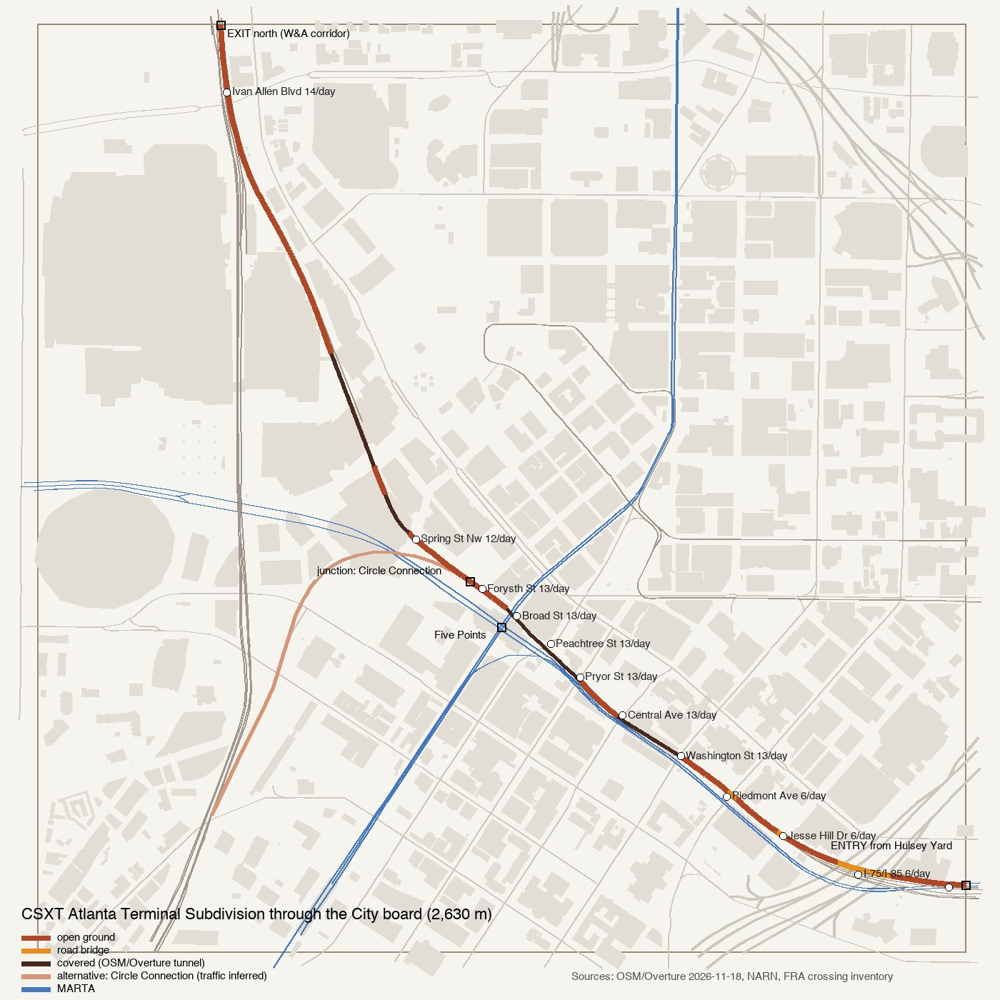

# Freight route through the City board (evidence, 2026-11-21)

This is evidence for an **illustrative** freight animation in City. A train drawn on this route
is a typical example, not a real observation, so it must say `illustrative`
(see `docs/data-model.md`).

## The route

The route is the **CSXT Atlanta Terminal Subdivision**, a double-track main line ("Atlanta Terminal A"
in NARN, all arcs `net=M`, `tracks=2`). Westbound, it enters at the board's east edge from Hulsey Yard
and crosses over the Downtown Connector. It runs beside MARTA past Georgia State and shares the Five
Points east cut with MARTA. It passes under Five Points and through the Gulch, then leaves at the
north edge alongside the NS lines toward the Western & Atlantic corridor. **It does continue through
the Gulch.**

Baked geometry is the shipped `scene/downtown/vignette.json`: the `rail` index, plus the
`terrainTransport.rail` pieces for open ground and bridges. Stable ids are Overture `2026-11-18.0` GERS segment ids. The chain is
endpoint-exact, with no gaps. Run in this order, westbound: **47 → 35 → 30 (reversed) → 8 (reversed)**.

| Run | Overture id (prefix) | Source endpoints (lon, lat), as stored |
|---|---|---|
| 47 | `c10339f4-274d` | −84.380786, 33.748896 → −84.387029, 33.751152 |
| 35 | `2ecfc011-adbf` | −84.387029, 33.751152 → −84.387360, 33.751351 |
| 30 | `425c2519-3178` | −84.392327, 33.754778 → −84.387360, 33.751351 |
| 8 | `e87db0cb-36d2` | −84.398144, 33.765574 → −84.392327, 33.754778 |

The second main track is run 46 (`a7b702db-9d84`) east of Georgia State and run 3 (`12048280-8df7`)
north of z ≈ −718.

## Ordered intervals

`s` is metres westbound from the east board edge at scene (1000, 556), sampled every 2 m. An
`open` or `bridge` sample lies within 2.5 m of a `terrainTransport.rail` piece of that `kind`. A
`covered` sample lies on the baked run with no piece nearby, because the bake
(`pipeline/scripts/terrain_transport.py`) leaves out tunnel-flagged stretches entirely. Since the run
itself is continuous there, a missing piece means covered track, not missing geometry. The four
covered stretches total **736 m**.

| s (m) | Kind | Scene x, z | What's there |
|---|---|---|---|
| 0–164 | open | (1000, 556) → (837, 536) | **Entry** from Hulsey Yard. The MARTA viaduct crosses over at s ≈ 36. |
| 166–282 | bridge | → (723, 508) | Over I-75/85, the Downtown Connector |
| 284–402 | open | → (615, 456) | |
| 404–428 | bridge | → (593, 441) | Over Jesse Hill Jr Dr |
| 430–542 | open | → (505, 370) | |
| 544–566 | bridge | → (487, 354) | Over Piedmont Ave |
| 568–686 | open | → (390, 282) | Beside MARTA's open approach to Georgia State |
| 688–852 | covered | → (250, 193) | Washington St to Central Ave |
| 854–962 | open | → (171, 118) | Five Points east cut, shared with MARTA. Pryor St bridge at s ≈ 970. |
| 964–1184 | covered | → (12, −38) | Under Peachtree St and Five Points. Broad St at s ≈ 1160. |
| 1186–1454 | open | → (−201, −203) | Gulch east. Forsyth St at s ≈ 1254. **Junction** at (−67, −98), s ≈ 1284. Spring St at s ≈ 1433. |
| 1456–1550 | covered | → (−250, −285) | Under a Gulch viaduct or deck |
| 1552–1616 | open | → (−274, −346) | |
| 1618–1876 | covered | → (−366, −589) | Under the Gulch deck and arena block, the same cover as MARTA's tunnel |
| 1878–2630 | open | → (−605, −1296) | Beside NS. Ivan Allen Blvd at s ≈ 2485. **Exit** north at −84.398143, 33.765557. |

**Cover is from OSM and Overture tags, not imagery.** `covered` means a `tunnel` flag on the source
segment. I have not imagery-checked these freight intervals the way I checked MARTA's (dated
imagery, in `docs/data-model.md`). Their edges are good to about ±10 m along the track. The
`is_tunnel` and `is_bridge` flags on a whole baked run are lumped together, so derive cover from
where the `terrainTransport` pieces are present or absent along the run, never from the run's flags.

## Traffic (FRA crossing inventory, via NARN)

Each count belongs to the crossing where the railroad reported it. They are averages, not live
data, and they cover **different stretches**, so they are not one train count for the route.

| Location | FRA id | Trains per day (day + night) | Max mph |
|---|---|---|---|
| I-75/85 (rail over), MARTA (rail under) | 279970E, 643082K | 3 + 3 | 10 |
| Jesse Hill Jr Dr, Piedmont Ave (rail over) | 279971L, 279972T | 3 + 3 | 10 |
| Washington St, Central Ave, Pryor St, Peachtree St, Broad St, Forsyth St (rail under) | 279973A, 279974G, 340311N, 340312V, 340313C, 340314J | 7 + 6 | 10 |
| Spring St NW | 340316X | 6 + 6 | 10 |
| Ivan Allen Blvd (beside NS) | 340321U | 7 + 7 | 30 |

The 6 per day east of Georgia State and the 13 per day downtown are reported separately. The
difference may come from yard moves or from per-segment estimates. The data doesn't say.

## Alternative and nearby tracks

- **Circle Connection** (CSXT "Atlanta Terminal D", NARN 455849 and 455848). Baked runs 23
  (`f2adc99d-d4df`) and 14 (`d410c639-e442`) are open ground. It runs 956 m from the junction at
  (−67, −98) to the NS Griffin District at (−624, 405), and leaves at the south edge on the NS runs.
  Its 13 trains per day is **inferred**: no crossing reports a count. NARN draws it about 22 m off
  run 23, because NARN is generalised.
- The **NS Atlanta South District and Griffin District** (x ≈ −560, north–south) are a separate and
  busier NS corridor (18–36 trains per day reported). They aren't part of this route.
- Runs 39 and 42–45 (unnamed, NARN 455784 `net=Y`) are Hulsey Yard leads and sidings parallel to
  the main. Run 19 is the CSXT/NS crossover. Runs 17 and 22 are disused (one is a tunnel), and run
  20 is abandoned.

