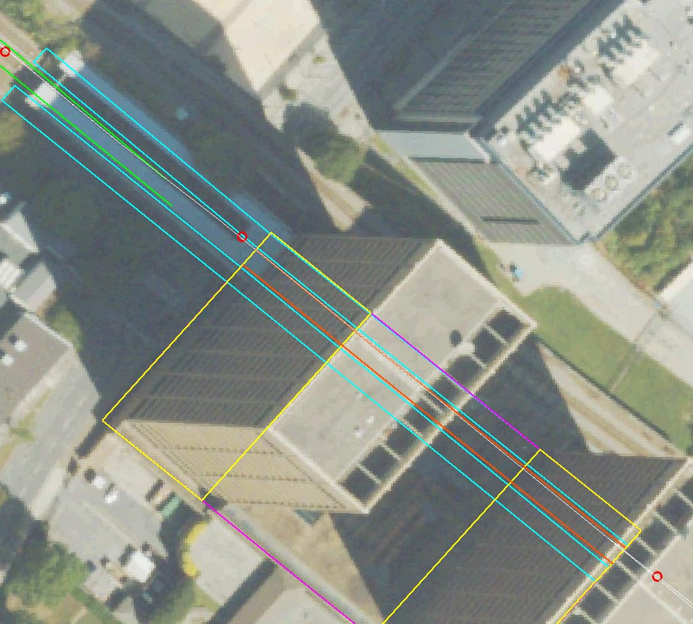
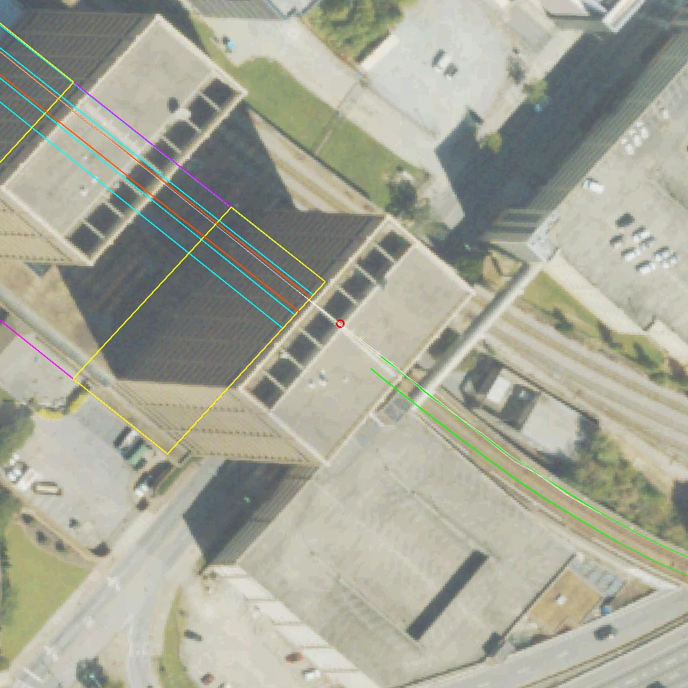
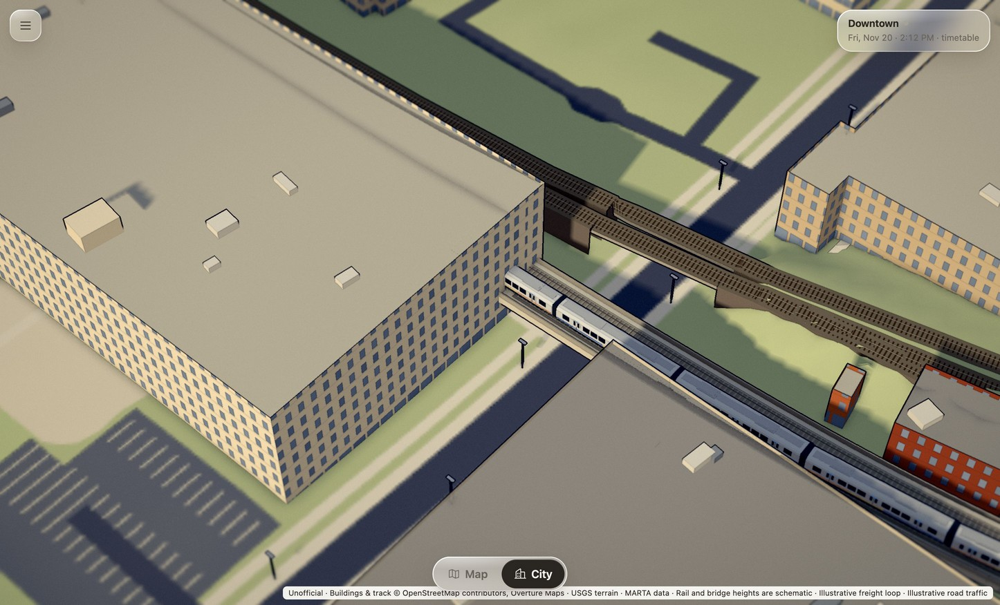

# Georgia State station geometry (surveyed, 2026-11-22)

Where the two side platforms, their canopies, and the Floyd Building's track openings are. The
module is `web/src/city/georgia-state-geometry.ts`, and its tests, including directed cover
checks against the baked rail spans, are in `georgia-state-geometry.test.ts`.

This is surveyed input for the station model: Control draws the canopies and lighting, and Marlin
draws the Floyd towers, base and aperture. Heights are not part of it; the station bed is still
schematic (see [data-model.md](data-model.md), "Rail cover and terrain-relative height").

## Sources

| What | Source | Checked against |
|---|---|---|
| Platforms | OSM [way 539937961](https://www.openstreetmap.org/way/539937961) (south, beside ER) and [539937962](https://www.openstreetmap.org/way/539937962) (north, beside EL). Both are `railway=platform`, `shelter=yes`, `level=2`, v6 of 2022-03-17, and members of stop area [relation 4439511](https://www.openstreetmap.org/relation/4439511). | Canopy roofs in NAIP 2023 and Esri World Imagery (Vantor 2022-09-27, 15 cm) start at the platforms' west tips. |
| Floyd Building outline | OSM [way 287320828](https://www.openstreetmap.org/way/287320828), with towers [537007595](https://www.openstreetmap.org/way/537007595) (NW) and [537007597](https://www.openstreetmap.org/way/537007597) (SE). | In NAIP 2023 (USGS, public domain), both towers' SW facade bases sit on the OSM corners. |
| Track openings | The ends of OSM `tunnel=building_passage` ways [702258821](https://www.openstreetmap.org/way/702258821) (ER) and [702258822](https://www.openstreetmap.org/way/702258822) (EL). The end nodes lie on the building outline. | The tracks emerge from under the SE tower toward the Connector viaduct in Esri and NAIP. |
| Station interior | Wikimedia Commons: [MARTA Georgia State Station.JPG](https://commons.wikimedia.org/wiki/File:MARTA_Georgia_State_Station.JPG) (Gman197002, 2015-09-07, CC BY-SA 4.0), [GA State Station.JPG](https://commons.wikimedia.org/wiki/File:GA_State_Station.JPG), and [Capitol Building from MARTA Georgia State Station Platform.JPG](https://commons.wikimedia.org/wiki/File:Capitol_Building_from_MARTA_Georgia_State_Station_Platform.JPG) (Gman197002, CC BY-SA 4.0). Linked, not committed. | Two side platforms with both tracks between them, under a deep flat roof with a slot of daylight over the trackway. Brick parapets and perforated brick screens form the outer walls. The platform stands above street level, with a view down the street toward the Capitol. |

**Roof edges in imagery are not ground positions.** The Floyd towers are about 78 m tall (OSM
`height=78.4`, 20 levels; the source of the metre figure is unverified, though the storey count
matches Georgia DCA). In NAIP and Esri their roofs lean 10–25 m from their bases. The edges baked
before 2026-11-22 were read from roof edges, which put the east face 10 m too far east.




*Overlay legend:*
- cyan: platforms
- magenta: the Floyd Building
- yellow: the towers
- orange: the building-passage tracks
- green: the adjacent track ways
- white: the GTFS line
- red circles: the old edges

NAIP imagery from USGS, public domain; outlines © OpenStreetMap contributors, ODbL.

## The station frame

`georgiaStateScene(origin)` returns the station in scene metres, in a frame aligned with the OSM
track axis, which runs midway between the ER and EL passage nodes:

- **u** is along the track: 0 at the NW face, positive toward the SE face (eastbound).
- **v** is across the track: positive to the right of eastbound, which is the south side, with ER.

| Feature | u (m) | v (m) | Precision |
|---|---|---|---|
| Canopy west end, the farther platform tip | −71.0 (north), −70.6 (south) | | ±5 m |
| NW face: canopies end, building starts | 0 | | ±4 m |
| SE face: building ends, viaduct starts | 115.7 | | ±4 m |
| ER / EL centrelines | | +2.43 / −2.43 (4.86 m apart) | ±1.5 m |
| South platform, inner / outer edge | | +3.14 / +8.40 | inner unusable, see below; outer ±1.5 m |
| North platform, inner / outer edge | | −3.08 / −8.78 | inner unusable; outer ±1.5 m (it is the building's NE wall, within 0.6 m) |
| Opening in each face | | −8.78 to +8.40 | ±1.5 m |

- Each platform is about 186 m long: about 71 m under its own canopy, then 116 m under the Floyd
  Building. Both platforms end at the SE face.
- Each face is a 62.1 m wall, square to the track within 1°.

**Inner platform edges as drawn are unusable.** OSM puts them only about 0.7 m from each track
centre, inside half a car's width (about 1.6 m). Fit the inner edges to the running track, and
keep the surveyed outer edges.

## Against City's drawn line

The baked cover edges (`RAIL_FIXES` / `GSU_CHAIN` in `pipeline/src/scene.rs`) now sit on the
surveyed u = −71.0, 0 and 115.7, projected onto each GTFS path. On path 155177:

| Edge | Before | Now | Change |
|---|---|---|---|
| West tip: open → roofed | s 7896.3 | 7903.2 | +6.9 m |
| NW face: roofed → covered | 7969.2 | 7973.9 | +4.7 m |
| SE face: covered → open viaduct | 8100.3 | 8090.1 | −10.2 m |

The spans are now 69 m open, 71 m roofed and 116 m covered; they were 62, 73 and 131 m.
- The test checks all ten through paths in travel order: eastbound open → roofed → covered → open,
  and the reverse westbound. Each edge must lie within 1 m of the surveyed line.
- The schematic bed anchors moved with the edges: rel 0 at the west tip, 7 m at the SE face.

**Lateral residual.** Through the station, the GTFS line runs 1.7–2.5 m north of the OSM track
axis:
- 2.1 m at the west tip;
- 2.5 m at the NW face;
- 1.7–1.8 m at the SE face.

City offsets each track ±2.1 m from the GTFS line. So drawn ER lies on about the OSM axis, and
drawn EL is about 2 m north of the real EL. Before platforms are placed, the station model needs a
single frame: either shift the corridor south by about 2.3 m here, or fit the station to the drawn
line and accept a 2.3 m northward shift.
- The building wall, the platforms and both passage nodes agree with the OSM axis.
- GTFS shapes are not surveyed track.

**Decision (Control, 2026-11-22):** City brings its drawn line onto the surveyed axis within the
station, easing in from the GTFS approach. It fits the platforms' door edges to the cars and
keeps the mapped outer edges.

In City (Orca, `?view=city&q=high&t=2026-11-20T14:12:31-05:00&speed=0`, then
`__city.lookAt(575, 460, { bearing: 0, metresPerPixel: 0.12, tilt: 40 })`), the eastbound train's
lead car comes out of the drawn building wall with no gap.



## Regenerating

Only `web/public/data/scene/downtown/scene.json` changes, and only its `rail` section.
`buildings.bin`, `roads.bin` and `track.bin` are byte-identical. With `data/raw/overture_downtown_*`
present, run:

```sh
cargo run --release --manifest-path pipeline/Cargo.toml -- scene
```

The staged file must be in place before `pnpm build`.
