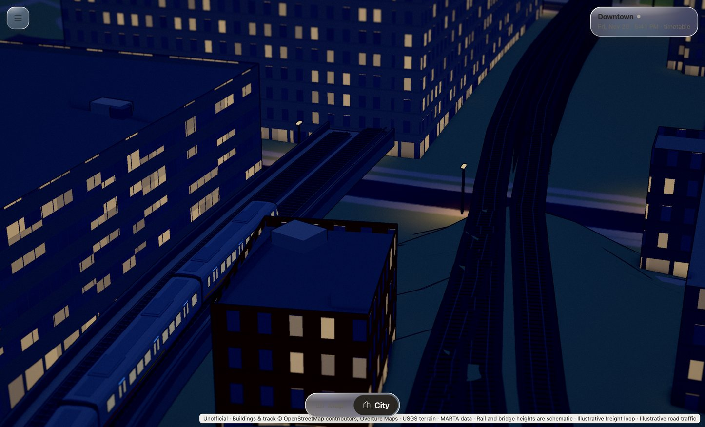
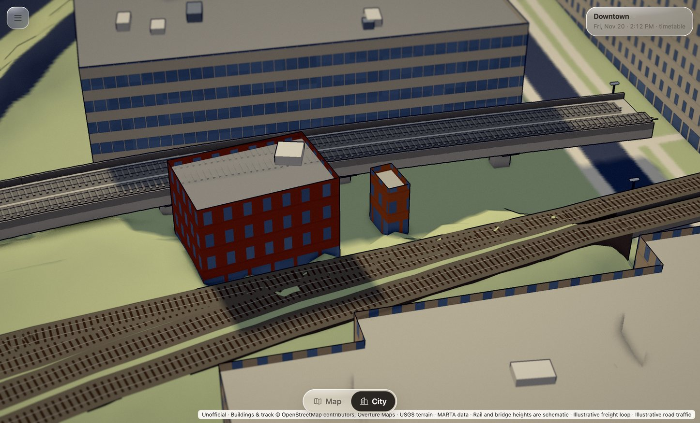
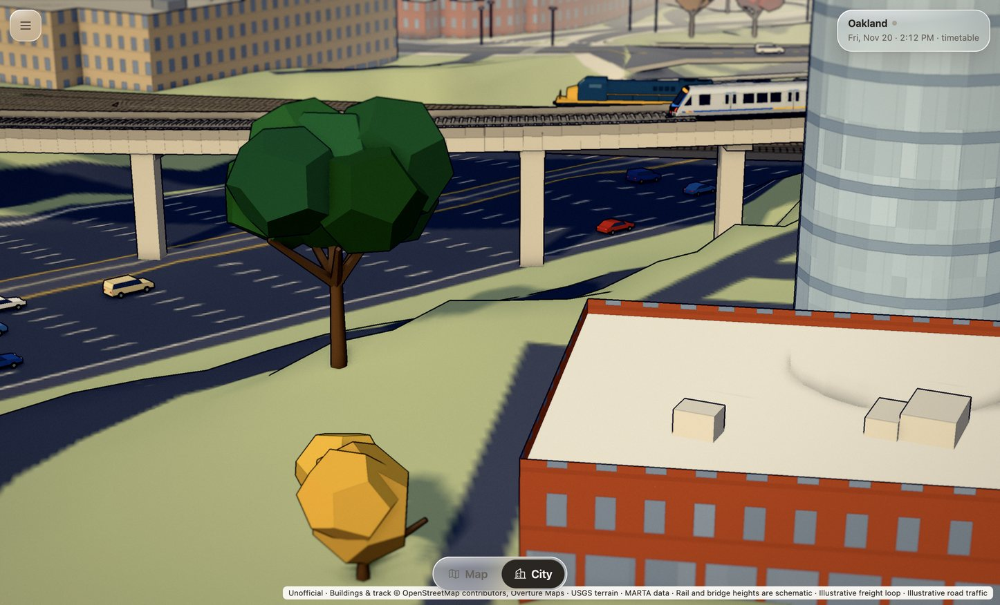
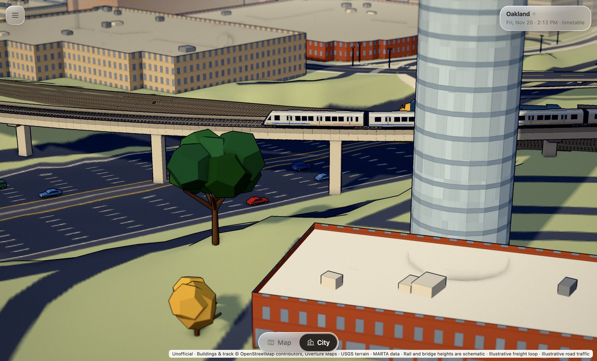
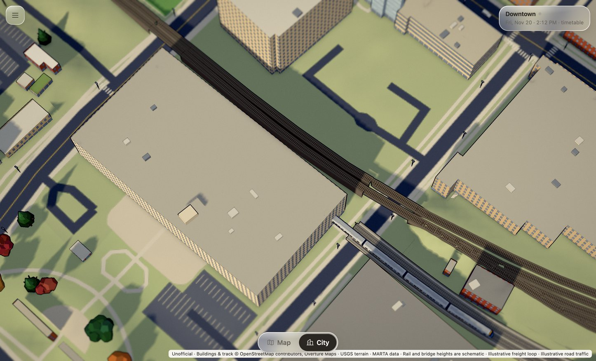
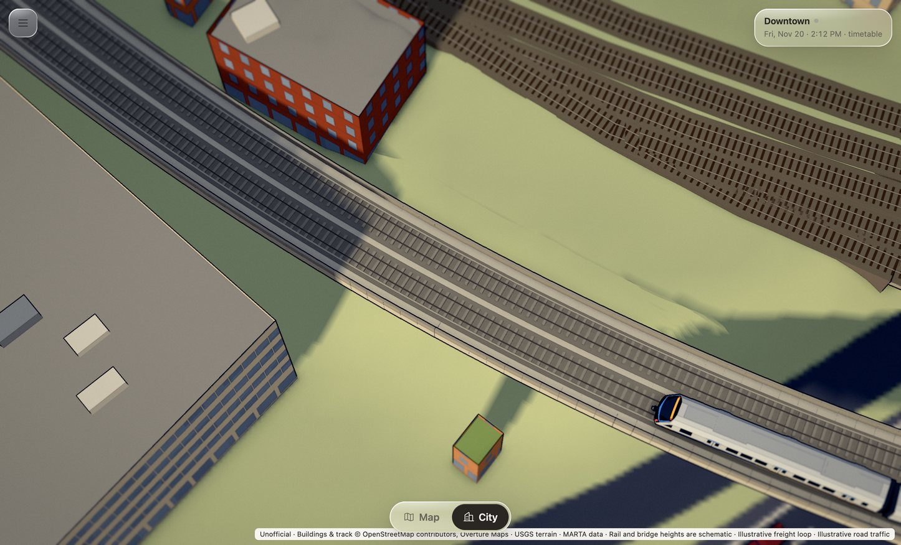
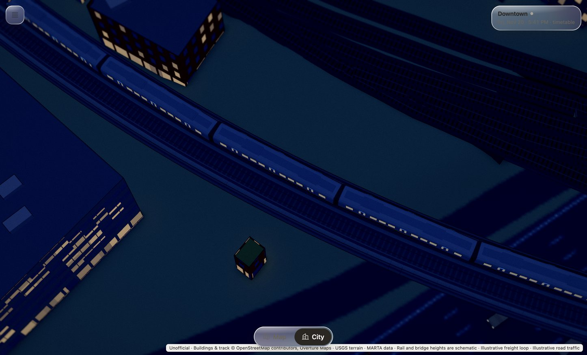

# Georgia State Station: City against the real approach (study, 2026-11-22)

**Question:** how close is City's Georgia State, from the west portal through the station to the
Downtown Connector crossing, to the real station and its approach, and what should we model next?

This study compares City (main at 022c307, high tier, timetable clock) with Sam's three photo
references and the archive photographs. It uses fixed, reproducible cameras. Numbers are pinned
to data in `web/src/city/georgia-state-study.test.ts`, and the evidence trail is in
[data-model.md](data-model.md) ("Rail cover and terrain-relative height") and
[georgia-state-ground.md](georgia-state-ground.md).

## References

The photographs are **not committed**: they are other people's copyrighted work, and Sam's local
screenshots stay outside git. Each is credited and described here; the City frames below are ours.

| Ref | Credit | What it shows | What it settles |
|---|---|---|---|
| R1, dusk | @city_surreal, Instagram (screenshot shared by Sam, 2026-11-21) | From above and behind the double-track viaduct, looking west along it toward the lit station structure, with the downtown skyline beyond. A train with red tail lights heads away, into the station. | Two tracks on concrete decks on single-column piers. The station end reads as a lit enclosure. The westbound train is on the right (north) track. |
| R2, *Waning Winter* | @br3nn3nfoto, Instagram | Snow, looking southwest across the curve east of the station toward the Georgia Capitol dome. A tan high-rise of the Floyd building is at the right edge. | The sweeping curve on structure, a red steel freight girder crossing beneath the MARTA deck, and the highway below both. |
| R3, *Fast Lanes* | @4cn.shon, Instagram | Telephoto from freeway level, looking along the Connector. A MARTA train is on the concrete box-girder deck, CSX locomotive 7257 is on the graffitied steel freight bridge, and traffic is below. | The three-level order: freeway, then freight, then MARTA. Depth is compressed (see the stack below). |
| A1 | Bill Mahan, *Atlanta Journal-Constitution*, 1979-10-07, DLG [gsu_planatl_10448](https://dlg.usg.edu/record/gsu_planatl_10448) | Per its catalogue title: a train on the east line, crossing the Connector near Georgia State. | The crossing has existed since 1979. In copyright, educational use permitted; not reproduced. |
| A2 | Bill Mahan, AJC, 1979-10-31, DLG [gsu_planatl_10513](https://dlg.usg.edu/record/gsu_planatl_10513) | Caption on the back: "MARTA train passes through Ga. State Station. Atlanta skyline in background." | The station in its opening year. |
| A3 | @martatransit #ThrowbackThursday (1979), shared by Sam | An eastbound train approaching Georgia State at grade, under street bridges, with a dark tunnel mouth and red signals behind. | The open, at-grade west approach between the tunnel mouth and the station. |

## Reproducible cameras

1. Run `pnpm dev`. Open `http://localhost:5173/?view=city&q=high&t=<TIME>&speed=0`. City opens
   directly, with the clock paused at that instant.
2. Once it has loaded, run `__city.lookAt(x, z, { bearing, metresPerPixel, tilt })` in the console.
   `__city` exists in dev builds only. The dusk frame was re-checked this way on main 50e83cf and
   reproduced identically.

Bearings are degrees clockwise from north, as in MapLibre. All times are on Fri 2026-11-20.

| Frame | `t` | `lookAt` x, z | bearing | m/px | tilt | Compare with |
|---|---|---|---:|---:|---:|---|
| `gss-dusk-approach` | 17:41:20−05:00 | 600, 474 | 292 | 0.06 | 68 | R1 |
| `gss-winter-curve` | 14:12:45−05:00 | 630, 492 | 235 | 0.07 | 56 | R2 |
| `gss-fast-lanes-stack` | 14:12:52−05:00 | 762, 585 | 8 | 0.035 | 84 (clamped to 72) | R3 |
| `gss-connector-crossing` | 14:12:50−05:00 | 760, 552 | 0 | 0.10 | 74 (clamped to 72) | A1 |
| `gss-station-plan` | 14:12:29−05:00 | 560, 440 | 0 | 0.20 | 10 (clamped to 20) | plan / NAIP 2023 |
| `gss-overhead-eastbound` / `-westbound` | 14:12:45 / 17:41:20 | 660, 520 / 670, 525 | 0 | 0.06 / 0.07 | 8 | direction check |

Screenshots are in `docs/log/ui/georgia-state-study/2026-11-22-gss-*.jpg`. They were captured in the
Orca desktop browser on main 022c307; City's rendering of this area hasn't changed since. The frame rates shown there come from a background tab and are not
measurements.

## Comparison

**R1 (dusk):**
- **Matches:** two tracks on one deck, single-column piers, and the 17:41 westbound Blue Line to
  H. E. Holmes heading into the station.
- **Missing:**
  - There is no station structure at the end of the viaduct. R1's lit enclosure, the station's east
    end, becomes an unlit gap under a low block in City.
  - The skyline framing differs, because the Floyd building in front is drawn as a 25 m block
    rather than 20-storey towers.

**R2 (*Waning Winter*):**
- **Matches:** the curve on structure, freight crossing beneath the MARTA deck, and the freeway
  beyond.
- **Differences:**
  - City's freight bridges are drawn as concrete-coloured treads with dark fascias. R2 and R3 both
    show a red/rust steel through-girder.
  - The Floyd tower that frames R2 is far too low in City.
  - Snow can't be pinned: weather follows the atmosphere for that date.

**R3 (*Fast Lanes*) and A1:**
- **Matches:** the three levels are present and ordered correctly. Measured on the rendered data
  (pinned in the test), at x 700–800:
  - the freight tread is 7.8–10 m above the freeway floor, the lower figure where the east bank rises;
  - the MARTA rails are **4.0–6.7 m** above the freight tread.
- **Plan geometry:** OSM puts them on **separate, parallel bridges**. The nearest freight track lies
  about 15–25 m north of the MARTA deck (OSM ways 9260365 and 539939597–604 against 78090750 and
  78380741).
- **Why they look stacked:** R3's telephoto compresses that gap. In City's low camera the farther,
  lower freight bridge can look level with MARTA. Both effects are perspective, not geometry.

**Direction check (a concern raised by R1, resolved):** the test builds the real `CityTrains`
renderer for this train and asserts its drawn cars sit on the north track. It fails if the side
sign is reversed.
- From the R1 camera, the westbound train first appeared to be on the south track. I checked this
  directly.
- The scheduled train `marta:trip:7-62400-20261120` (Blue westbound, path 155188) is at x 677,
  z 532 at 17:41:20. Its heading is 301° and its actual motion is 299°. City snaps it with
  `dir −1` and offsets it to the **north** track, right of travel.
- At 14:12:45 the eastbound train is on the south track. Both overheads confirm right-hand running,
  matching OSM's tagged directions in the Five Points east cut.
- So this isn't a defect. The first impression came from the oblique camera. The test pins this
  check.

## Supported against schematic

| Element | City now | Evidence | Status |
|---|---|---|---|
| Track plan and both directions | GTFS shape, smoothed. Right-hand offsets of ±2.1 m. | OSM ways, GTFS, the direction check above | **Supported** |
| Cover: open west approach → canopies (roofed) → Floyd building (covered) → open structure | `rail` spans of 62 / 73 / 131 m, then the viaduct | OSM; Esri imagery 2022-09-27 and 2026-02-02; NAIP 2023 | **Supported**, edges ±10–15 m |
| Track under the canopies | Hidden: `roofed` counts as not visible, and no canopy geometry is drawn | Canopies are visible in all imagery; R1 shows a lit station end | **Gap**: visibility between the canopies is unresolved |
| Floyd building (the "Twin Towers") | One block, **25.2 m** (OSM height, `floors: 2`) | **Verified:** Georgia DCA, *Modern Downtown Atlanta*, printed page 82, documents two red-brick-veneer 20-storey towers joined by a flat-roofed base adjoining the rail station ([PDF](https://dca.georgia.gov/document/document/modern-downtown-atlanta/download)). The State of Georgia (team.georgia.gov) also says 20 storeys, opened 1980. R2 shows a tower. **Not found:** a published height in metres | **Wrong**: 20 storeys can't fit in 25 m; the real height is unmeasured |
| MARTA bed through the station | Ramps 0 → +7 m between the anchors | No survey or plan found | **Schematic** |
| MARTA deck over the Connector | +7 m above the bank anchors, box girder, piers every 26 m | No public clearance record (FHWA NBI 2024/2025, GDOT GIS checked) | **Schematic** |
| Freight grade and bridges | Interpolated between banks, concrete treads | OSM bridges (layer 1); FRA `RR Over` at Piedmont Ave and Jesse Hill Jr Dr; R2/R3 show red steel girders | Order **supported**; heights schematic; material **wrong** |
| Stacking freeway < freight < MARTA | Gaps 7.8–10 m and 4.0–6.7 m | OSM layers 0/1/3; R2 and R3 | **Supported** order; gaps schematic |
| Ground | USGS 3DEP 1 m bare earth, on a 5 m grid | [georgia-state-ground.md](georgia-state-ground.md) | **Supported** (2018–19 source) |

## Next modeling decision

**Recommendation: model the Georgia State station structure before refining any heights.** Every
reference reads the station by its structure (R1's lit end, R2's tower), and the two biggest visible
errors are structural, not about track height:

1. **Floyd building:** replace the 25 m single block with two 20-storey towers on a flat-roofed
   base, as Georgia DCA documents. The storey count
   is verified; any metre height derived from it (for example, storeys × a typical floor height)
   is an estimate and must be labelled schematic until a measured height turns up. Use the two tower footprints visible in
   imagery, with the station and tracks passing beneath, as OSM `tunnel=building_passage` records.
   It's a data fix (an override of the building height), with no renderer change.
2. **Station canopies and enclosure:** draw the two side-platform canopies from OSM platform areas
   539937961 and 539937962, plus a lit enclosure at the east end. Treat `roofed` track as visible
   from the side and under the canopy edges, instead of hidden. That needs a small rule change in
   the renderer: roofed means drawn under a roof, not culled.
3. **Defer:** the deck clearance, and the steel freight-girder material. Both are lower impact.
   The clearance needs GDOT GeoPI plan sheets or a MARTA records request.

Decision for Control: approve items 1 and 2 as the next City chunk (data override plus the canopy
rule), or keep the station schematic and spend the time on the deck clearance instead.
