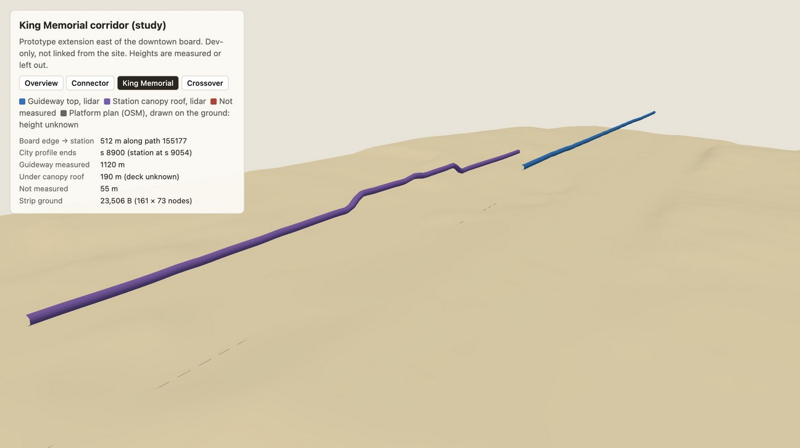

# King Memorial corridor: the first extension east of the board (study, 2026-11-22)

**Question:** what would it take to extend City from the downtown board's east edge along the
MARTA Blue/Green alignment to King Memorial station? The aim is to learn how to add the next
neighbourhood toward the regional board without making every visitor load the whole region.

**Status:** this is milestone 1, the corridor and its terrain. It is an isolated prototype:
- a ground-strip bake;
- an evidence pack;
- a dev-only preview page (`/corridor.html`, not in the production build).

Downtown's default data, its bake and City are unchanged. The station's boarding layout is
milestone 2.

## Current coverage

The downtown board ends at x = 1000 (about −84.3808). King Memorial station (OSM
[node 4172458489](https://www.openstreetmap.org/node/4172458489)) is at x ≈ 1493, so it is
**512 m along the track beyond the board edge**.

| Path (MARTA GTFS) | Board edge s | City profile s | King Memorial s |
|---|---|---|---|
| 155177 Blue eastbound | 8541.6 | 5950–8900 | 9053.6 |
| 155181 Blue eastbound | 1281.6 | 0–1640 | 1793.6 |
| 155185 Blue westbound | 15622.4 | 15270–16840 | 15110.5 |
| 155214 Green eastbound, terminating at King Memorial | 5974.6 | 3380–6330 | 6486.6 |

`corridor.json` lists all ten through paths.

**Coverage findings:**
- City's baked profile and the `connector-viaduct` span end at s 8900 on 155177, **154 m short of
  the station**.
- 305 Green trips a day terminate at King Memorial: path 155214 arrives and 155221 departs.
  - Their trips end and begin at the King Memorial stop.
  - Their shapes do not stop there: each carries a single straight 799 m chord from mid-platform
    (x 1439) to x 2192, east of the crossover. The chord cuts across Hulsey yard, so it is a shape
    artefact, not track. City should not draw a train along it.
  - The turnback move itself is unscheduled. It uses the OSM *King Memorial Crossover* (ways
    78090745 and 78380740, layer 3), 110–170 m east of the platforms, or track beyond it; GTFS
    doesn't say which.

## Evidence and method

| Source | Use |
|---|---|
| USGS 3DEP 1 m DEM, the same pinned tile as downtown (`x74y374`, `GA_Statewide_2018_B18_DRRA`) | Ground strip, x 1000–1800 and z 280–640 at 5 m (161 × 73 nodes) |
| **USGS 3DEP lidar, EPT `GA_Statewide_B2_2018`** (`s3://usgs-lidar-public`) | Guideway-top, roof and ground profile in 5 m bins along 155177 (370,772 points within 25 m of the path) |
| OSM API (cached in `data/raw/osm_king_memorial.json`) | Track ways and tags, platforms, the crossover, crossing roads and rail |
| Staged MARTA GTFS | Paths, the stop and the Green terminal pattern |
| Wikimedia Commons: *King Memorial.JPG* (Keizers, 2012, CC BY-SA 3.0); *MARTA King Memorial Station.JPG* and *Looking Westbound from MARTA King Memorial Station.JPG* (Gman197002, 2015, CC BY-SA 4.0). Linked, not committed. | An elevated station on columns with stair towers. Two side platforms with both tracks under one deep trussed roof. An open double-track viaduct with parapets to the west. |

**Datum check:**
- The lidar's GPS times put the flight in April 2019, inside the DEM's acquisition window.
- Its ground returns (class 2) match the pinned DEM at 2,945 points near the board edge: median
  +0.01 m, p10 −0.04, p90 +0.06.
- So the point cloud's Z is NAVD88 and comparable to the DEM.

**Guideway top:**
- The lowest dense horizontal surface 2.5 m or more above ground, within 4.5 m of the path. The
  lidar classifies it as building (class 6).
- A continuity walk accepts a 5 m bin only within 0.6 m of the last accepted value, widening at 4 %
  across unresolved bins. A surface 4 m or more above, or continuing a known roof, is recorded as
  roof.
- Nothing is interpolated: a bin without an accepted value has no guideway height.
- **This is the top of the structure as seen from above.** Rail top and deck surface are not
  separated, and deck depth and clearance are unknown.

**Ground strip:**
- `downtown_terrain.py --box king-memorial` reads the same pinned tile over HTTP range requests.
- The tile's SHA-256 can't be checked that way. Instead the bake must reproduce the SHA-pinned
  downtown grid node for node on the shared x = 1000 column (73 nodes); the web test checks this
  too.
- A downtown rebake through the same path reproduces `497158…` byte for byte.
- Scene zero (323.8 m) comes from downtown.

## Profile


| Stretch (s on 155177) | Length | Status |
|---|---|---|
| 8090–8130, beside the Floyd SE face | 40 m | Unresolved: tower returns, too close to tell |
| 8130–8935, Floyd to Grant St | 805 m | **Measured** (one 5 m gap at s 8190), rising from 316.4 to a 325.5 m crest near s 8500, then 324.2 |
| 8945–9135, King Memorial | 190 m | **Under the canopy roof**: roof measured at 330.2–330.8 (a raised section to 333.4), deck unknown |
| 9135–9450, the crossover and east | 315 m | **Measured**, 323.4 to 322.3 (the last 5 m bin is a gap) |

In total: 1,120 m measured, 190 m under the roof, and 55 m unknown.

**Preview** (`/corridor.html`, dev only). It shows the two ground meshes joined at the x = 1000
seam, the measured guideway (blue), the canopy roof (purple), red marks where nothing was measured, and the
OSM platform plans as grey dashes on the ground, because their height is unknown:




## Crossings under the alignment

The guideway top is measured. "Above ground" is the guideway top minus the median ground
under the line; it is **not** a clearance.

| s | Feature | OSM | Tags | Guideway top / ground (NAVD88 m) | Above ground |
|---|---|---|---|---|---|
| 8104 | Jesse Hill Jr Dr SE | way 278887740 | — | unresolved / 307.5 | — |
| 8226–8337 | Downtown Connector and both ramps | ways 9236952, 316454382, 119686423, 9235923 | — | 318.8–322.2 / 304.0–314.1 | 15.5 m over the main carriageways |
| 8385–8519 | Six CSX tracks: Hulsey yard 1–3 and 6, the Atlanta Terminal Subdivision | ways 539939595, 539939602, 539939596, 905879528, 973262182, 973262183 | — | 323.8–325.4 / 312.9–314.3 | 9.6–12.6 m |
| 8655 | Hill St SE, in an underpass | way 367768991 | `tunnel=yes`, layer −1 | 325.1 / 308.7 | 16.4 m |
| 8935 | Grant St SE | way 9262397 | — | 324.2 / 307.6 | 16.5 m |
| 8978–9117 | Station service drives | ways 1279442785, 1279442782, 1279442783 | layer −1 on two | under roof | — |

## Station facts (input to milestone 2)

- **Platforms:** two side platforms, OSM ways 319512574 and 319512585, `covered=yes`, level and
  layer 3. They are drawn as lines, not areas, about 178 m long (s 8951–9129). They lie at lateral
  +7.8 m (south) and −6.2 m (north) of the GTFS line.
- **Tracks:** ER (eastbound) is about +3.9 m and EL about −0.5 m from the GTFS line. So **GTFS runs
  on the EL side, about 2.2 m north of the axis between the two tracks**, as it does at Georgia
  State.
- **Stops:** GTFS stops 908436 and 908693 (KING MEMORIAL STATION), and OSM stop positions
  493182803 and 3259302133.
- **Heights:** the roof height is measured. The platform and deck heights are **unknown** (under the
  roof).

## Discrepancies and unknowns

1. **City's schematic guideway is up to 3.9 m low past the Connector.**
   - City's rails (`GSU_CHAIN` +7 m, plus 0.55 m) are within 0.13 m of the measured top at s 8132
     and 0.8 m low at s 8257.
   - Past the last anchor (s 8364), City holds flat at 321.5 m while the real guideway climbs. City
     is 3.9 m low at the board edge (s 8542) and 2.9 m low at s 8892.
   - **Corrected** in a follow-up PR (`samsolomon/gsu-measured-anchors`). East of the Floyd face,
     `GSU_CHAIN` now carries eight lidar anchors with absolute NAVD88 beds (`navd88`; the bed is
     0.55 m below the guideway top). They fit every measured bin within 0.25 m (RMS 0.10 m).
   - City uses the absolute bed whenever it has the ground grid's scene zero, so the ground under
     the viaduct no longer moves it.
   - The 42 m from the Floyd face stays schematic.
   - There is no anchor under the King Memorial canopy, so City's bed there is an estimate.
   - **Release:** `scene.json` is gitignored, so this needs `cargo run --release --manifest-path
     pipeline/Cargo.toml -- scene` (or `pnpm data:scene`) before `pnpm build` and a deploy. Only the
     `rail` section changes, and the `.bin` files are byte-identical.


2. **Deck under the station canopy (190 m): unknown.** The values either side are 324.13 (s 8942)
   and 323.38 (s 9137). They are not joined.
3. **40 m beside the Floyd SE face, including the Jesse Hill Jr Dr crossing: unresolved.**
4. **Clearances are unknown everywhere.** Only the guideway top is measured. No deck depth or
   underside was found; FHWA NBI does not list MARTA's structures.
5. **OSM tags tracks 905944414 and 905944415 (s 8114–8213) with neither `bridge` nor `layer`.**
   Lidar shows the guideway 6–9 m above the ground there.
6. **GTFS runs about 2.2 m north of the track axis.** Lateral offsets matter for platforms, as at
   Georgia State.
7. **Platform height and canopy edges:** the canopy plan extent comes only from OSM platform lines
   and the roof footprint in the lidar.
8. **Vintage:** the lidar and DEM date from April 2019. Changes since then (for example around
   Hulsey yard) are not captured.

## Data size

| File | Bytes | gzip -9 |
|---|---|---|
| `king-memorial/ground/ground.i16`, 0.288 km² | 23,506 | 9,895 |
| `king-memorial/ground/ground.json` | 1,743 | 934 |
| `king-memorial/corridor.json`, evidence and profile | 56,720 | 8,237 |
| Downtown pack today, 4.0 km² (all 10 files) | 5,123,297 | 1,444,686 |

- **Ground alone** costs about 82 KB raw (34 KB gzipped) per km².
- **A full downtown-style pack** (buildings, roads, trees, traffic, ground) costs about 1.28 MB raw
  (0.36 MB gzipped) per km² at downtown density. A neighbourhood like King Memorial would be
  smaller, because it is less built up.

## Integration options

City today assumes one pack:
- `city.ts` fetches `scene/downtown/*`;
- `terrain/model.ts` throws unless the City and ground extents match;
- the board's edge walls are built on min/max X and Z;
- the rail profile and spans are baked only inside the board.

Three ways forward:

1. **Grow the downtown box.** It's the simplest code change, but every visitor pays for the new
   area. That is fine for one corridor and does not scale to the region.
2. **Adjacent packs, loaded on demand (recommended).** Each neighbourhood is its own
   `scene/<name>/` pack, sharing the 5 m lattice, scene zero and NAVD88. They join on shared edge
   columns, verified node for node as here. City would:
   - load a pack when the camera or a followed train nears its bounds;
   - skip plinth walls on shared edges;
   - extend the rail profile from the pack's own `rail` spans and measured anchors.

   Visitors who stay downtown load nothing more.
3. **Corridor-only strips.** A thin terrain-and-guideway strip along the line, without buildings,
   joining packs. It is cheap, but it reads as a gap unless styled as such.

**Recommended next steps:**
- Adopt option 2, starting with this pack.
- First, swap the `GSU_CHAIN` placeholder for measured anchors (discrepancy 1), so the existing
  viaduct is right before it is extended.

## Reproduce

```sh
.venv/bin/pip install "laspy[lazrs]"   # once, for the lidar reader
.venv/bin/python pipeline/scripts/downtown_terrain.py \
  https://prd-tnm.s3.us-west-2.amazonaws.com/StagedProducts/Elevation/1m/Projects/GA_Statewide_2018_B18_DRRA/TIFF/USGS_1M_16_x74y374_GA_Statewide_2018_B18_DRRA.tif \
  --box king-memorial
pnpm data:corridor   # evidence pack and profile, then stage for /corridor.html
pnpm dev             # open http://localhost:5173/corridor.html
```
