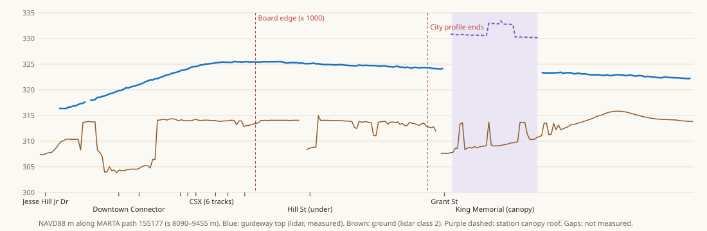
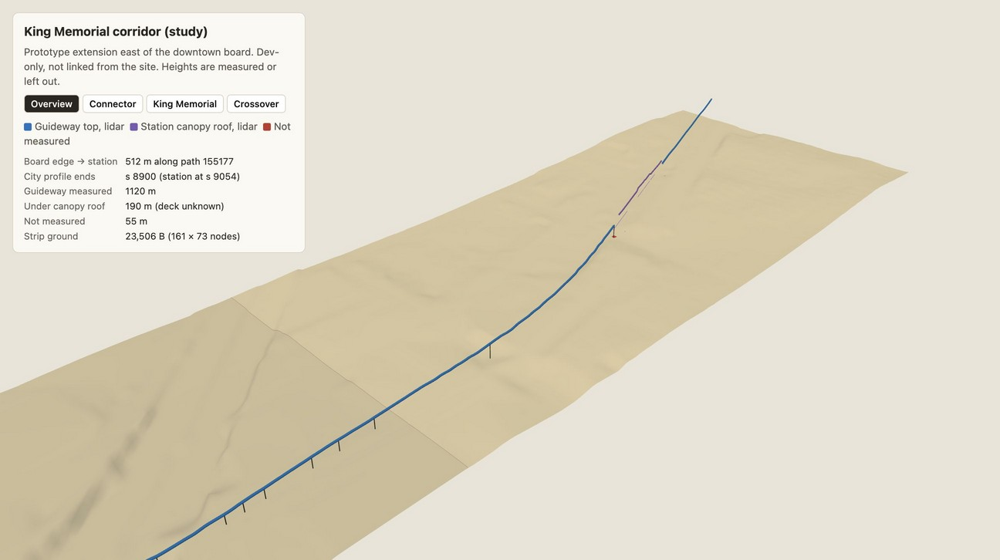
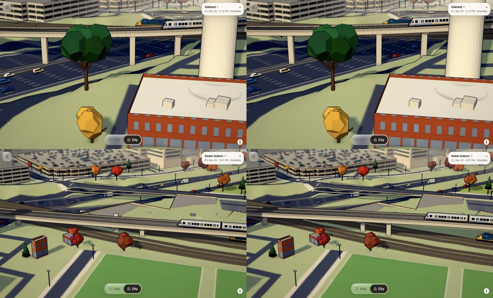
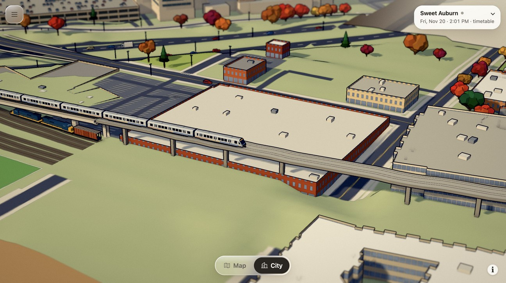
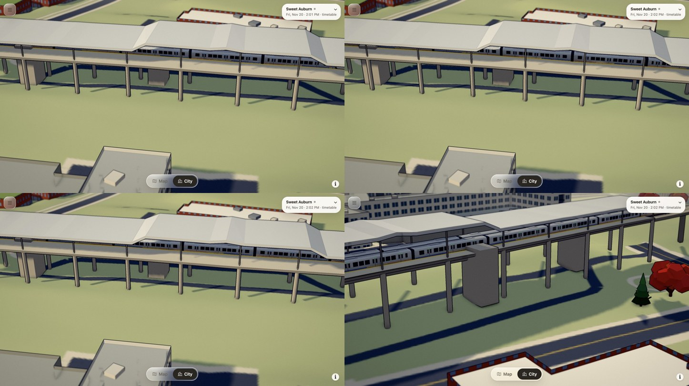
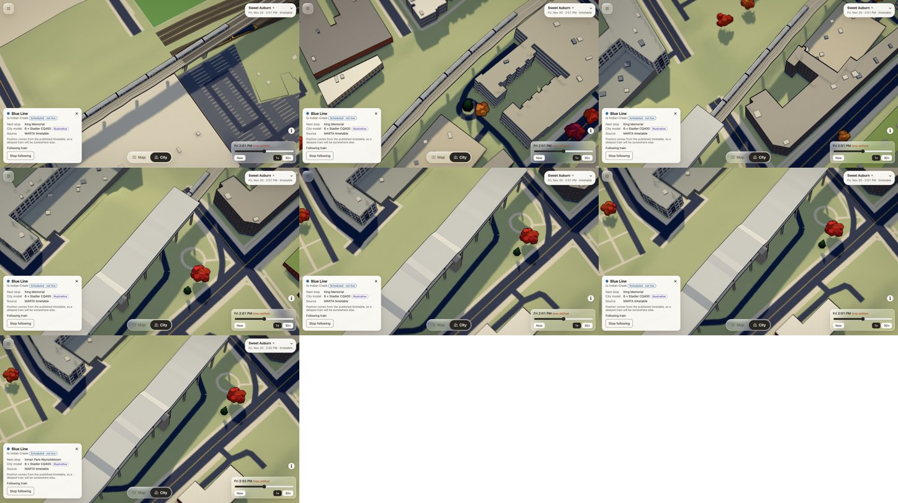
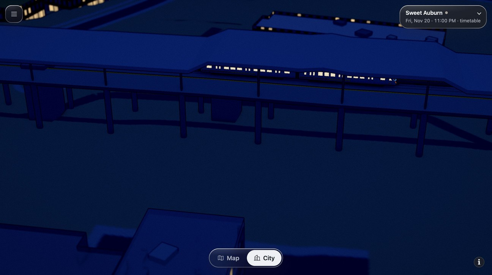
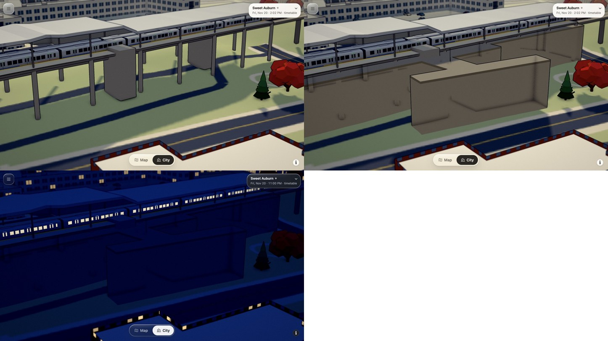

# King Memorial corridor: the first extension east of the board (study, 2026-11-22)

**Question:** what would it take to extend City from the downtown board's east edge along the
MARTA Blue/Green alignment to King Memorial station? The aim is to learn how to add the next
neighbourhood toward the regional board without making every visitor load the whole region.

**Status:** this is milestone 1, the corridor and its terrain. It is an isolated prototype:
- a ground-strip bake;
- an evidence pack;
- a dev-only preview page (`/corridor.html`, not in the production build).

Downtown's default data, its bake and City are unchanged. The station's boarding layout is
milestone 2.

## Current coverage

The downtown board ends at x = 1000 (about −84.3808). King Memorial station (OSM
[node 4172458489](https://www.openstreetmap.org/node/4172458489)) is at x ≈ 1493, so it is
**512 m along the track beyond the board edge**.

| Path (MARTA GTFS) | Board edge s | City profile s | King Memorial s |
|---|---|---|---|
| 155177 Blue eastbound | 8541.6 | 5950–8900 | 9053.6 |
| 155181 Blue eastbound | 1281.6 | 0–1640 | 1793.6 |
| 155185 Blue westbound | 15622.4 | 15270–16840 | 15110.5 |
| 155214 Green eastbound, terminating at King Memorial | 5974.6 | 3380–6330 | 6486.6 |

`corridor.json` lists all ten through paths.

**Coverage findings:**
- City's baked profile and the `connector-viaduct` span end at s 8900 on 155177, **154 m short of
  the station**.
- 305 Green trips a day terminate at King Memorial: path 155214 arrives and 155221 departs.
  - Their trips end and begin at the King Memorial stop.
  - Their shapes do not stop there: each carries a single straight 799 m chord from mid-platform
    (x 1439) to x 2192, east of the crossover. The chord cuts across Hulsey yard, so it is a shape
    artefact, not track. City should not draw a train along it.
  - The turnback move itself is unscheduled. It uses the OSM *King Memorial Crossover* (ways
    78090745 and 78380740, layer 3), 110–170 m east of the platforms, or track beyond it; GTFS
    doesn't say which.

## Evidence and method

| Source | Use |
|---|---|
| USGS 3DEP 1 m DEM, the same pinned tile as downtown (`x74y374`, `GA_Statewide_2018_B18_DRRA`) | Ground strip, x 1000–1800 and z 280–640 at 5 m (161 × 73 nodes) |
| **USGS 3DEP lidar, EPT `GA_Statewide_B2_2018`** (`s3://usgs-lidar-public`) | Guideway-top, roof and ground profile in 5 m bins along 155177 (370,772 points within 25 m of the path) |
| OSM API (cached in `data/raw/osm_king_memorial.json`) | Track ways and tags, platforms, the crossover, crossing roads and rail |
| Staged MARTA GTFS | Paths, the stop and the Green terminal pattern |
| Wikimedia Commons: *King Memorial.JPG* (Keizers, 2012, CC BY-SA 3.0); *MARTA King Memorial Station.JPG* and *Looking Westbound from MARTA King Memorial Station.JPG* (Gman197002, 2015, CC BY-SA 4.0). Linked, not committed. | An elevated station on columns with stair towers. Two side platforms with both tracks under one deep trussed roof. An open double-track viaduct with parapets to the west. |

**Datum check:**
- The lidar's GPS times put the flight in April 2019, inside the DEM's acquisition window.
- Its ground returns (class 2) match the pinned DEM at 2,945 points near the board edge: median
  +0.01 m, p10 −0.04, p90 +0.06.
- So the point cloud's Z is NAVD88 and comparable to the DEM.

**Guideway top:**
- The lowest dense horizontal surface 2.5 m or more above ground, within 4.5 m of the path. The
  lidar classifies it as building (class 6).
- A continuity walk accepts a 5 m bin only within 0.6 m of the last accepted value, widening at 4 %
  across unresolved bins. A surface 4 m or more above, or continuing a known roof, is recorded as
  roof.
- Nothing is interpolated: a bin without an accepted value has no guideway height.
- **This is the top of the structure as seen from above.** Rail top and deck surface are not
  separated, and deck depth and clearance are unknown.

**Ground strip:**
- `downtown_terrain.py --box king-memorial` reads the same pinned tile over HTTP range requests.
- The tile's SHA-256 can't be checked that way. Instead the bake must reproduce the SHA-pinned
  downtown grid node for node on the shared x = 1000 column (73 nodes); the web test checks this
  too.
- A downtown rebake through the same path reproduces `497158…` byte for byte.
- Scene zero (323.8 m) comes from downtown.

## Profile



| Stretch (s on 155177) | Length | Status |
|---|---|---|
| 8090–8130, beside the Floyd SE face | 40 m | Unresolved: tower returns, too close to tell |
| 8130–8935, Floyd to Grant St | 805 m | **Measured** (one 5 m gap at s 8190), rising from 316.4 to a 325.5 m crest near s 8500, then 324.2 |
| 8945–9135, King Memorial | 190 m | **Under the canopy roof**: roof measured at 330.2–330.8 (a raised section to 333.4), deck unknown |
| 9135–9450, the crossover and east | 315 m | **Measured**, 323.4 to 322.3 (the last 5 m bin is a gap) |

In total: 1,120 m measured, 190 m under the roof, and 55 m unknown.

**Preview** (`/corridor.html`, dev only). It shows the two ground meshes joined at the x = 1000
seam, the measured guideway (blue), the canopy roof (purple), red marks where nothing was measured, and the
OSM platform plans as grey dashes on the ground, because their height is unknown:




## Crossings under the alignment

The guideway top is measured. "Above ground" is the guideway top minus the median ground
under the line; it is **not** a clearance.

| s | Feature | OSM | Tags | Guideway top / ground (NAVD88 m) | Above ground |
|---|---|---|---|---|---|
| 8104 | Jesse Hill Jr Dr SE | way 278887740 | — | unresolved / 307.5 | — |
| 8226–8337 | Downtown Connector and both ramps | ways 9236952, 316454382, 119686423, 9235923 | — | 318.8–322.2 / 304.0–314.1 | 15.5 m over the main carriageways |
| 8385–8519 | Six CSX tracks: Hulsey yard 1–3 and 6, the Atlanta Terminal Subdivision | ways 539939595, 539939602, 539939596, 905879528, 973262182, 973262183 | — | 323.8–325.4 / 312.9–314.3 | 9.6–12.6 m |
| 8655 | Hill St SE, in an underpass | way 367768991 | `tunnel=yes`, layer −1 | 325.1 / 308.7 | 16.4 m |
| 8935 | Grant St SE | way 9262397 | — | 324.2 / 307.6 | 16.5 m |
| 8978–9117 | Station service drives | ways 1279442785, 1279442782, 1279442783 | layer −1 on two | under roof | — |

## Station facts (input to milestone 2)

- **Platforms:** two side platforms, OSM ways 319512574 and 319512585, `covered=yes`, level and
  layer 3. They are drawn as lines, not areas, about 178 m long (s 8951–9129). They lie at lateral
  +7.8 m (south) and −6.2 m (north) of the GTFS line.
- **Tracks:** ER (eastbound) is about +3.9 m and EL about −0.5 m from the GTFS line. So **GTFS runs
  on the EL side, about 2.2 m north of the axis between the two tracks**, as it does at Georgia
  State.
- **Stops:** GTFS stops 908436 and 908693 (KING MEMORIAL STATION), and OSM stop positions
  493182803 and 3259302133.
- **Heights:** the roof height is measured. The platform and deck heights are **unknown** (under the
  roof).

## Discrepancies and unknowns

1. **City's schematic guideway is up to 3.9 m low past the Connector.**
   - City's rails (`GSU_CHAIN` +7 m, plus 0.55 m) are within 0.13 m of the measured top at s 8132
     and 0.8 m low at s 8257.
   - Past the last anchor (s 8364), City holds flat at 321.5 m while the real guideway climbs. City
     is 3.9 m low at the board edge (s 8542) and 2.9 m low at s 8892.
   - **Corrected** in a follow-up PR (`samsolomon/gsu-measured-anchors`). East of the Floyd face,
     `GSU_CHAIN` now carries eight lidar anchors with absolute NAVD88 beds (`navd88`; the bed is
     0.55 m below the guideway top). They fit every measured bin within 0.25 m (RMS 0.10 m).
   - City uses the absolute bed whenever it has the ground grid's scene zero, so the ground under
     the viaduct no longer moves it.
   - The 42 m from the Floyd face stays schematic.
   - There is no anchor under the King Memorial canopy, so City's bed there is an estimate.
   - **Release:** `scene.json` is gitignored, so this needs `cargo run --release --manifest-path
     pipeline/Cargo.toml -- scene` (or `pnpm data:scene`) before `pnpm build` and a deploy. Only the
     `rail` section changes, and the `.bin` files are byte-identical.


2. **Deck under the station canopy (190 m): unknown.** The values either side are 324.13 (s 8942)
   and 323.38 (s 9137). They are not joined.
3. **40 m beside the Floyd SE face, including the Jesse Hill Jr Dr crossing: unresolved.**
4. **Clearances are unknown everywhere.** Only the guideway top is measured. No deck depth or
   underside was found; FHWA NBI does not list MARTA's structures.
5. **OSM tags tracks 905944414 and 905944415 (s 8114–8213) with neither `bridge` nor `layer`.**
   Lidar shows the guideway 6–9 m above the ground there.
6. **GTFS runs about 2.2 m north of the track axis.** Lateral offsets matter for platforms, as at
   Georgia State.
7. **Platform height and canopy edges:** the canopy plan extent comes only from OSM platform lines
   and the roof footprint in the lidar.
8. **Vintage:** the lidar and DEM date from April 2019. Changes since then (for example around
   Hulsey yard) are not captured.

## Data size

| File | Bytes | gzip -9 |
|---|---|---|
| `king-memorial/ground/ground.i16`, 0.288 km² | 23,506 | 9,895 |
| `king-memorial/ground/ground.json` | 1,743 | 934 |
| `king-memorial/corridor.json`, evidence and profile | 56,720 | 8,237 |
| Downtown pack today, 4.0 km² (all 10 files) | 5,123,297 | 1,444,686 |

- **Ground alone** costs about 82 KB raw (34 KB gzipped) per km².
- **A full downtown-style pack** (buildings, roads, trees, traffic, ground) costs about 1.28 MB raw
  (0.36 MB gzipped) per km² at downtown density. A neighbourhood like King Memorial would be
  smaller, because it is less built up.

## Integration options

City today assumes one pack:
- `city.ts` fetches `scene/downtown/*`;
- `terrain/model.ts` throws unless the City and ground extents match;
- the board's edge walls are built on min/max X and Z;
- the rail profile and spans are baked only inside the board.

Three ways forward:

1. **Grow the downtown box.** It's the simplest code change, but every visitor pays for the new
   area. That is fine for one corridor and does not scale to the region.
2. **Adjacent packs, loaded on demand (recommended).** Each neighbourhood is its own
   `scene/<name>/` pack, sharing the 5 m lattice, scene zero and NAVD88. They join on shared edge
   columns, verified node for node as here. City would:
   - load a pack when the camera or a followed train nears its bounds;
   - skip plinth walls on shared edges;
   - extend the rail profile from the pack's own `rail` spans and measured anchors.

   Visitors who stay downtown load nothing more.
3. **Corridor-only strips.** A thin terrain-and-guideway strip along the line, without buildings,
   joining packs. It is cheap, but it reads as a gap unless styled as such.

**Recommended next steps:**
- Adopt option 2, starting with this pack.
- First, swap the `GSU_CHAIN` placeholder for measured anchors (discrepancy 1), so the existing
  viaduct is right before it is extended.

## Reproduce

```sh
.venv/bin/pip install "laspy[lazrs]"   # once, for the lidar reader
.venv/bin/python pipeline/scripts/downtown_terrain.py \
  https://prd-tnm.s3.us-west-2.amazonaws.com/StagedProducts/Elevation/1m/Projects/GA_Statewide_2018_B18_DRRA/TIFF/USGS_1M_16_x74y374_GA_Statewide_2018_B18_DRRA.tif \
  --box king-memorial
pnpm data:corridor   # evidence pack and profile, then stage for /corridor.html
pnpm dev             # open http://localhost:5173/corridor.html
```

## Milestone 2: King Memorial in City (opt-in, `?east=king-memorial`)

Marlin's east board mounts when the camera nears the seam (#79). Its mount then calls
`attachEastRail` in `city.ts` (Rail's hook). That fetches `scene/king-memorial/corridor.json` and
dynamically imports `web/src/city/east-rail.ts`. **Without the flag, nothing here is fetched,
built or changed.**

| Piece | How | Tier |
|---|---|---|
| Guideway east of x 1000 | The measured `GSU_CHAIN` anchors (#80), drawn as a deck on City's drawn tracks, with piers every 26 m clear of the mapped crossings | Bed **measured**; deck depth and piers **illustrative** |
| Rail spans | `extendRail` copies the manifest and splits `connector-viaduct` into measured viaduct → `king-memorial-canopy` (`roofed`, `schematic`) → measured viaduct, per path and direction | — |
| Deck and bed under the canopy (s 8945–9135) | Interpolated between the measured anchors either side | **Estimated**: not measured (the lidar sees only the roof) |
| Canopy roof | Lidar roof height per 5 m, plan from lidar laterals (−8.8 to +13.0 m from the GTFS line), with the raised centre section | **Measured** |
| Platforms | Two side platforms, s 8951–9129 (OSM length). Lips fitted to City's drawn tracks with the 75 mm level-boarding gap; outer edges just inside the roof; floor at car-floor level on the estimated bed | Plan **inferred**; height **estimated** |
| Station columns, roof posts, stair towers | At the OSM subway entrances toward Decatur St SE (nodes 11877267661 and 11877267665); the photos show columns and open stair towers | **Illustrative** |
| Trains | `martaAlignments` rebuilt on the joined bounds with a composite ground sampler, then swapped into `CityTrains` (`setTracks`). Trains get their own copy of the board clip planes; only that copy's east plane moves to x 1800. Georgia State's `visibleInStation` carries over, and cars stay visible under the open-sided King Memorial canopy. Follow uses the joined bounds and rail. | Scheduled (timetable) |

**Downtown is unchanged west of the seam.**
- A test rebuilds 155177 both ways. On observed spans, line and bed match within 1 cm.
- On legacy schematic stretches the bed differs by up to 4 cm. `alignment()` indexes the legacy
  profile by one ratio over the whole smoothed line, and a longer line shifts it slightly.

**Reproducible frames** (Fri 2026-11-20, `?view=city&east=king-memorial&q=high&speed=0`):
- **The trip:** pattern 4 on path 155177, Blue to Indian Creek. It departs Georgia State at 14:00:00,
  crosses the seam (x 1000, s 8542) at 14:01:01, and stops at King Memorial at 14:02:00.
- **The seam crossing,** at 14:01:01:
  `__city.lookAt(1060, 520, { bearing: 330, metresPerPixel: 0.18, tilt: 66 })`.

  
- **Approach, stop and departure** (14:01:45, 14:02:00, 14:02:15), plus the Decatur St view.
  - Platform view: `lookAt(1480, 445, { bearing: 330, metresPerPixel: 0.09, tilt: 62 })`.
  - Decatur St pedestrian view: `lookAt(1455, 440, { bearing: 200, metresPerPixel: 0.035, tilt: 82 })`.

  
- **Follow across the seam:** `&follow=1&controls=1`, starting at 14:00:50. Tap the train at the
  Connector, choose **Follow train**, then **1×**. The card keeps the same Blue Line trip,
  "Scheduled · not live". Following stays active across x 1000 and into the station, and the next
  stop advances to Inman Park–Reynoldstown.

  

**Evidence gaps:**
- **Zero dwell:** the timetable gives arrival = departure at King Memorial, so the "stop" is the
  easing curve's momentary halt.
- **Deck and platform heights under the canopy** are estimated.
- **Columns, posts and stair towers** are illustrative.
- **The station has no lighting at night.** It reads as an unlit silhouette; the trains' windows are lit. 
- **City draws both tracks about 2.2 m north of the real axis**, as at Georgia State.
- **Green terminators** (155214 arriving, 155221 departing): their trips end and begin at the King
  Memorial stop, and the schedule never advances them past it. So no position falls on the 799 m
  chord. I have not checked a terminating train visually.

### Station correction: the street-level building (2026-11-22)

| Reference | What it shows |
|---|---|
| MARTA *King Memorial Station TOD profile* (rev. 2017-11-03), [PDF](https://itsmarta.com/uploadedFiles/More/Transit_Oriented_Development/Station%20Profile%20Rev%202017-11-03%20King%20Memorial.pdf) | "The only station entrance can be accessed from Decatur Street." Its entrance photo shows a concrete stair tower at the Decatur St corner. Its aerial outlines the station building beneath and along the platforms. |
| Commons *King Memorial.JPG* (Keizers, 2012, CC BY-SA 3.0) | Elevated platforms on columns above an enclosed street-level building, with a stair tower and the sculpture at the corner. |
| OSM [way 270494115](https://www.openstreetmap.org/way/270494115) (v7, 2025-11-15) | `building=train_station`, a 26-vertex footprint from x 1389 to 1573 under and north of the tracks. |

**The most visible gap.** City drew open ground and columns under the platforms. Marlin's
context deliberately leaves out this OSM building, so the real enclosure was missing from every
street and Decatur St view.

**The correction:** `east-rail.ts` now draws the building on its OSM footprint.
- **Walls** run from the lowest perimeter ground up to 0.3 m below the platform underside, with a
  darker band at the top.
- **Footprint:** sourced (OSM).
- **Wall height:** inferred (ground to the platform underside).
- **Stair towers:** still illustrative.
- **Lighting:** none at night (no station lighting yet).



### When the joined board could become the default

Measured in Orca on desktop, at the same station camera, at 14:01:30 on 2026-11-20. "Mounted" is
after the camera reaches the station and the east area and rail attach.

| | High tier | Low tier |
|---|---|---|
| Draw calls at the station camera, downtown only → with east mounted | 79 → 95 (+16) | 36 → 48 (+12) |
| Triangles in view, same comparison | 2.03 M → 2.19 M (+0.16 M) | 0.68 M → 0.75 M (+0.07 M) |
| Time from the camera reaching the area to rail attached | 0.25 s | 0.26 s |
| JS heap after mount (noisy) | +19 MB | +35 MB |

The fps readings came from a background tab and are not measurements.

**Bytes for the east area:**
- **Data:** 143,755 raw and 32,467 gzipped, across `ground.i16`, `ground.json`, `context.json` and
  `corridor.json`.
- **Code:** two lazy chunks, `king-memorial-board` (2.9 KB gzipped) and `east-rail` (3.1 KB gzipped).
- **For comparison:** downtown's data is 1.44 MB gzipped, so the east area adds about 2.2 % plus about
  6 KB of code. It loads only near the seam.

**Recommendation:**
- **Ready for the default, kept lazy.** The cost is small and is paid only by visitors who pan or
  follow a train toward x 1000. No change is needed to the initial download.
- **Before switching:**
  1. Merge #86 and this station building.
  2. Light the station: it is an unlit silhouette at night.
  3. Check a phone (low tier) on a real device. These numbers are desktop Orca.
  4. Keep the opening camera and bounds on downtown. The east area should mount on approach and
     never change the first frame.
  5. Make follow trigger the east mount as well as the camera target. Today a followed train mounts
     it because the camera follows, but a "Train out of view" state off the board could leave it
     unmounted.
- **Phone gate (2026-11-22, not run):** Sam freed the Galaxy A16 and Control assigned it to Rail,
  but when tested it was not connected to this Mac. `adb devices`, run again after an adb server
  restart, listed no devices, and the USB device list showed no Samsung or Android device. No
  forwarding, tabs or servers were left open.
  - **To run:** reconnect it (serial R5GL82A4SHR in the earlier benchmark) and use the existing
    method: production preview, low tier, three foreground eight-second windows. Compare the
    current default with `?east=king-memorial` at the opening view, the board-edge seam
    (14:01:01) and the King Memorial station camera.
  - **Pass:** at least 30 fps, the existing low-tier gate.
- **Don't:** add an illustrative dwell to the timetable. King Memorial's zero dwell is the published
  schedule.
