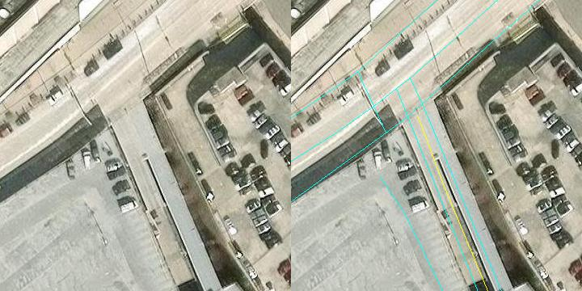
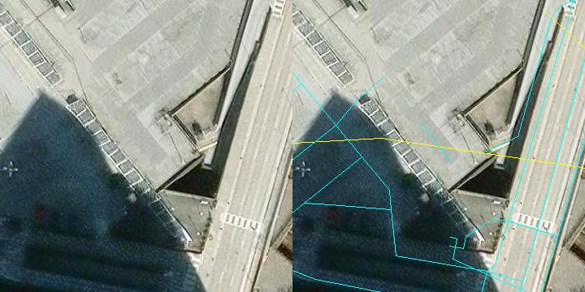

# Gulch bridge review · 24 November 2026

The minimum sampled clearance from a drawn freight tread to an overhead structure downtown is **7.24 m** at both tiers. On the merge base, 166 five-metre cells fell below 7 m and 47 intersected the running envelope. Both counts are now zero. One mapped ground footway crosses a rail at grade near (−247, −162).

## Two service structures

The aerial at Mitchell shows a paved ramp joining the viaduct. The mapped rail runs under that pavement lengthwise. At the Circle Connection the mapped rail crosses the paved deck diagonally. Moving either edge sideways would move the deck away from its visible footprint. The overlays show the inferred alignment in yellow and bridge ways in cyan. Google Street View could not be verified at either point. [Mitchell imagery](https://www.arcgis.com/apps/mapviewer/index.html?center=-84.39450,33.75692&level=20&basemap=satellite) · [Circle imagery](https://www.arcgis.com/apps/mapviewer/index.html?center=-84.39409,33.75534&level=20&basemap=satellite)

## Deck profiles

96 of 533 sampled runs changed. Grades compare neighbouring centreline tread samples every 2 m, including a last interval of at least 0.5 m. Positions are rounded to a millimetre and run lengths to 0.1 m. The final column locates the largest local grade increase above both the previous grade and 8% by more than two percentage points, measured from the listed start. That occurs on 25 runs.

Clearance is the minimum sampled freight mesh to this run's underside, using the roadway or footway slab depth. Samples follow the rail every metre at the centre and 1.6 m either side. A dash means no shared sample. The board-wide check independently intersects all rendered structural triangles. Heights and grades are inferred.

| Downtown run | Class | Start x, z (m) | Old max grade (%) | New max grade (%) | Old clearance (m) | New clearance (m) | Steeper segment starts |
|---|---|---|---:|---:|---:|---:|---:|
| downtown tt1 | footway | -658, 447 | 116.8 | 8.4 | 2.59 | 8.70 | — |
| downtown tt9 | footway | -574, -1144 | 83.9 | 8.0 | 7.45 | 7.95 | — |
| downtown tt12 | footway | -648, -1106 | 50.4 | 54.3 | 6.92 | 7.24 | 80 m |
| downtown tt25 | tertiary | -705, -326 | 18.5 | 19.1 | — | — | — |
| downtown tt26 | footway | -598, -195 | 10.6 | 7.6 | — | — | — |
| downtown tt30 | footway | -612, -178 | 45.8 | 8.8 | — | — | — |
| downtown tt34 | footway | -783, -44 | 15.1 | 8.0 | — | — | — |
| downtown tt37 | footway | -665, -57 | 31.3 | 33.4 | — | — | 116 m |
| downtown tt39 | secondary | -647, -71 | 126.8 | 126.8 | — | — | — |
| downtown tt41 | tertiary | -647, -71 | 63.1 | 63.1 | — | — | 16 m |
| downtown tt44 | footway | -671, 25 | 62.0 | 62.0 | — | — | — |
| downtown tt46 | footway | -659, -83 | 8.7 | 1.8 | — | — | — |
| downtown tt47 | footway | -661, -84 | 15.1 | 1.4 | — | — | — |
| downtown tt48 | footway | -636, -59 | 2.6 | 5.4 | — | — | — |
| downtown tt49 | footway | -659, -83 | 226.8 | 8.0 | — | — | — |
| downtown tt51 | footway | -651, 28 | 62.4 | 8.1 | — | — | — |
| downtown tt52 | footway | -670, 434 | 25.5 | 8.2 | 7.08 | 8.08 | — |
| downtown tt54 | footway | -626, -83 | 91.4 | 8.7 | — | — | — |
| downtown tt55 | tertiary | -593, -175 | 16.4 | 9.2 | — | — | — |
| downtown tt56 | footway | -611, -179 | 88.2 | 8.3 | — | — | — |
| downtown tt57 | footway | -598, -195 | 56.8 | 27.3 | — | — | 2 m |
| downtown tt58 | footway | -581, -180 | 21.7 | 33.5 | — | — | 16 m |
| downtown tt59 | footway | -581, -180 | 13.3 | 10.9 | — | — | — |
| downtown tt60 | footway | -491, 86 | 22.4 | 22.4 | 7.17 | 7.93 | — |
| downtown tt61 | footway | -585, 47 | 15.4 | 8.1 | 7.21 | 8.19 | — |
| downtown tt63 | secondary | -572, 43 | 136.0 | 164.1 | -0.96 | 7.36 | 6 m |
| downtown tt64 | footway | -636, -59 | 188.4 | 33.7 | 7.32 | 7.99 | — |
| downtown tt65 | secondary | -420, -41 | 58.1 | 38.2 | 6.39 | 7.36 | — |
| downtown tt67 | pedestrian | -566, 178 | 52.8 | 58.1 | 6.95 | 7.33 | 120 m |
| downtown tt69 | footway | -491, 86 | 26.4 | 8.0 | 7.19 | 8.36 | — |
| downtown tt70 | secondary | -484, 99 | 14.6 | 17.4 | -0.96 | 7.40 | 110 m |
| downtown tt72 | service | -454, -264 | 72.6 | 8.2 | 6.81 | 7.38 | — |
| downtown tt73 | service | -430, 29 | 45.5 | 8.8 | -0.77 | 7.39 | — |
| downtown tt74 | secondary | -420, -41 | 23.2 | 8.0 | -0.96 | 7.36 | — |
| downtown tt76 | footway | -475, 94 | 199.3 | 8.3 | 5.83 | 7.93 | — |
| downtown tt78 | footway | -625, -84 | 15.3 | 8.2 | 7.37 | 8.01 | — |
| downtown tt79 | footway | -491, 85 | 1.6 | 1.4 | — | — | — |
| downtown tt80 | footway | -365, -312 | 11.7 | 8.0 | — | — | — |
| downtown tt82 | footway | -539, -242 | 35.6 | 50.3 | 7.12 | 8.04 | 70 m |
| downtown tt83 | footway | -353, -297 | 45.4 | 18.1 | 6.69 | 7.95 | — |
| downtown tt87 | tertiary | -191, -433 | 34.8 | 9.4 | 5.87 | 7.39 | — |
| downtown tt93 | service | -530, -311 | 15.0 | 4.4 | — | — | — |
| downtown tt94 | footway | -522, -317 | 4.2 | 97.8 | — | — | 66 m |
| downtown tt96 | footway | -541, -241 | 4.1 | 13.6 | — | — | 76 m |
| downtown tt105 | secondary | -572, -1132 | 72.3 | 82.4 | 6.82 | 7.37 | 78 m |
| downtown tt117 | footway | -195, -132 | 95.6 | 8.0 | 6.94 | 8.06 | — |
| downtown tt119 | footway | -210, -137 | 106.0 | 8.0 | 7.18 | 7.88 | — |
| downtown tt121 | service | -226, -402 | 8.7 | 23.6 | — | — | 0 m |
| downtown tt126 | footway | -322, -339 | 7.5 | 9.1 | — | — | — |
| downtown tt127 | footway | -353, -297 | 8.2 | 9.5 | — | — | — |
| downtown tt128 | service | -364, -301 | 1.1 | 10.5 | — | — | 10 m |
| downtown tt129 | service | -339, -257 | 3.0 | 11.5 | — | — | 18 m |
| downtown tt130 | service | -323, -240 | 0.8 | 6.6 | — | — | — |
| downtown tt131 | footway | -329, -264 | 1.9 | 8.9 | — | — | — |
| downtown tt132 | service | -357, -193 | 0.8 | 6.8 | — | — | — |
| downtown tt133 | footway | -292, -359 | 5.6 | 0.9 | — | — | — |
| downtown tt137 | service | -297, -241 | 44.8 | 35.7 | — | — | — |
| downtown tt139 | service | -253, -286 | 1.5 | 29.3 | -0.94 | 7.39 | 68 m |
| downtown tt141 | service | -247, -288 | 1.1 | 25.6 | -0.54 | 7.38 | 68 m |
| downtown tt143 | footway | -199, -444 | 9.7 | 8.0 | — | — | — |
| downtown tt145 | footway | -183, -428 | 15.0 | 26.1 | — | — | 132 m |
| downtown tt146 | service | -236, -167 | 207.5 | 8.3 | 3.10 | 7.39 | — |
| downtown tt147 | service | -303, -134 | 39.1 | 39.1 | 6.05 | 7.39 | 60 m |
| downtown tt149 | service | -245, -140 | 0.8 | 2.9 | — | — | — |
| downtown tt150 | service | -287, -130 | 4.0 | 1.6 | — | — | — |
| downtown tt151 | footway | -294, 25 | 35.7 | 8.0 | — | — | — |
| downtown tt152 | footway | -280, 34 | 15.2 | 8.0 | — | — | — |
| downtown tt153 | footway | -280, 34 | 47.3 | 8.0 | — | — | — |
| downtown tt156 | secondary | -192, 103 | 73.0 | 55.1 | — | — | — |
| downtown tt157 | footway | -289, 48 | 139.9 | 8.0 | — | — | — |
| downtown tt159 | footway | -289, 48 | 131.1 | 0.1 | — | — | — |
| downtown tt160 | footway | -295, 56 | 29.8 | 8.0 | — | — | — |
| downtown tt161 | footway | -294, 25 | 49.9 | 6.6 | — | — | — |
| downtown tt162 | service | -245, -140 | 41.0 | 11.1 | 6.27 | 7.39 | — |
| downtown tt163 | service | -283, -191 | 1.6 | 4.4 | — | — | — |
| downtown tt164 | service | -321, -139 | 31.4 | 8.0 | 5.55 | 7.39 | — |
| downtown tt165 | service | -332, -172 | 0.9 | 4.3 | — | — | — |
| downtown tt166 | service | -315, -230 | 61.1 | 11.4 | 6.81 | 7.39 | 90 m |
| downtown tt167 | service | -303, -216 | 0.6 | 3.7 | — | — | — |
| downtown tt168 | secondary | -293, 40 | 99.1 | 87.9 | — | — | — |
| downtown tt169 | footway | -298, 27 | 20.1 | 210.7 | — | — | 0 m |
| downtown tt171 | tertiary | -300, 50 | 320.5 | 318.5 | — | — | — |
| downtown tt174 | service | -205, -118 | 3.2 | 1.2 | — | — | — |
| downtown tt175 | pedestrian | -228, -129 | 2.3 | 6.0 | — | — | — |
| downtown tt176 | footway | -210, -137 | 6.3 | 0.0 | — | — | — |
| downtown tt177 | service | -216, -158 | 54.0 | 9.6 | -0.86 | 7.34 | — |
| downtown tt178 | tertiary | -293, 40 | 189.7 | 187.8 | 6.58 | 7.24 | 390 m |
| downtown tt184 | primary | -524, 374 | 376.5 | 376.5 | 5.99 | 7.40 | — |
| downtown tt196 | footway | 12, -149 | 86.8 | 8.0 | 7.24 | 8.23 | — |
| downtown tt198 | footway | 21, -136 | 40.2 | 39.4 | 7.39 | 8.15 | 98 m |
| downtown tt201 | tertiary | 16, -142 | 13.2 | 8.0 | 6.63 | 7.46 | — |
| downtown tt204 | footway | 161, 135 | 83.6 | 88.2 | 7.45 | 7.94 | 32 m |
| downtown tt206 | secondary | 169, 108 | 3.1 | 269.3 | — | — | 2 m |
| downtown tt245 | footway | 197, 80 | 2.6 | 1.4 | — | — | — |
| downtown tt250 | footway | 284, 151 | 32.4 | 32.4 | — | — | — |
| downtown tt389 | footway | 599, 490 | 83.6 | 8.0 | 6.99 | 7.95 | — |

## Traffic

The low-tier, 14:00 full-lane sweep compares fbf396d1 and 9fdc7b86 with the same height cache. On 465,704 conditioned wheel samples the largest finite difference between the cache and the drawn road was 0.0050 m in both builds. Distinct five-metre crack cells rose from 80 to 82, missing-surface mismatches from 99 to 102. Both builds had 28 dips above 3 cm, with the same 13.092 m maximum. These totals include the historical 72 sites and the remainder of the lanes.

| New downtown arterial cell | Query (x, z) | Course distance | Exact road height | Cached height | Misses |
|---|---|---:|---|---:|---:|
| (−420, −45) | (−418.6, −42.6) | 149.89 m | missing | −1.65374 m | 1 |
| (−485, 100) | (−484.8, 100.7) | 275.21 m | missing | −0.34423 m | 2 |

The mitre leaves the second gap open. Both sites are on the road-height fallback list. Rail clearance and traffic continuity are measured independently.

Imagery credits: Esri, Vantor, Earthstar Geographics and the GIS User Community. [World Imagery service](https://server.arcgisonline.com/ArcGIS/rest/services/World_Imagery/MapServer)
