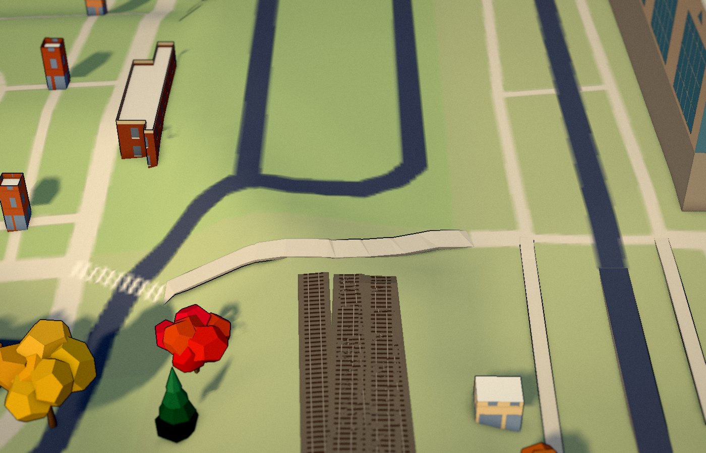
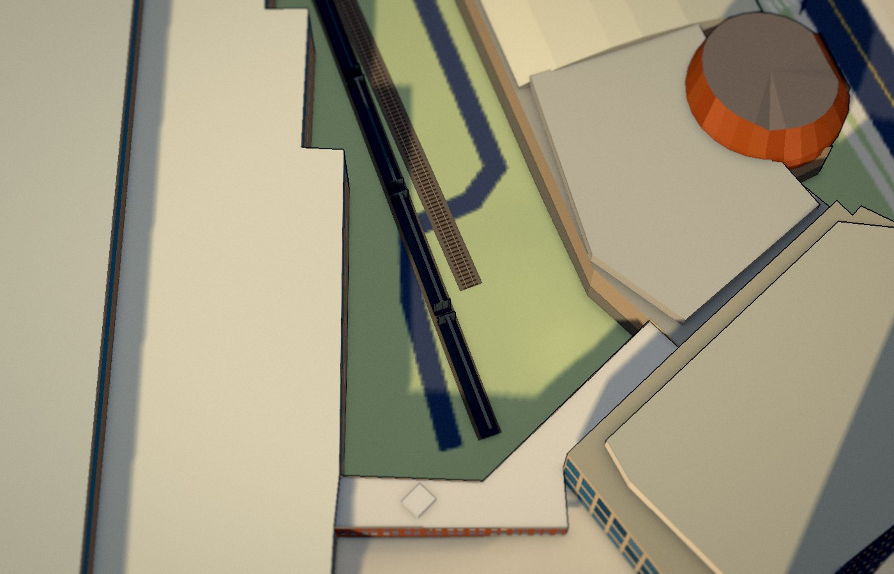
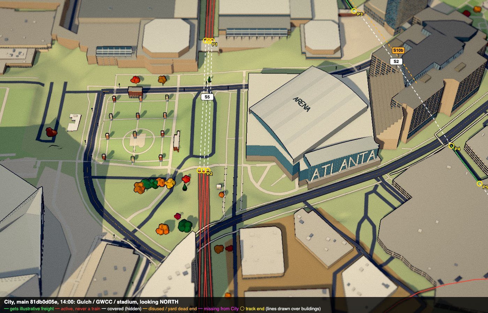
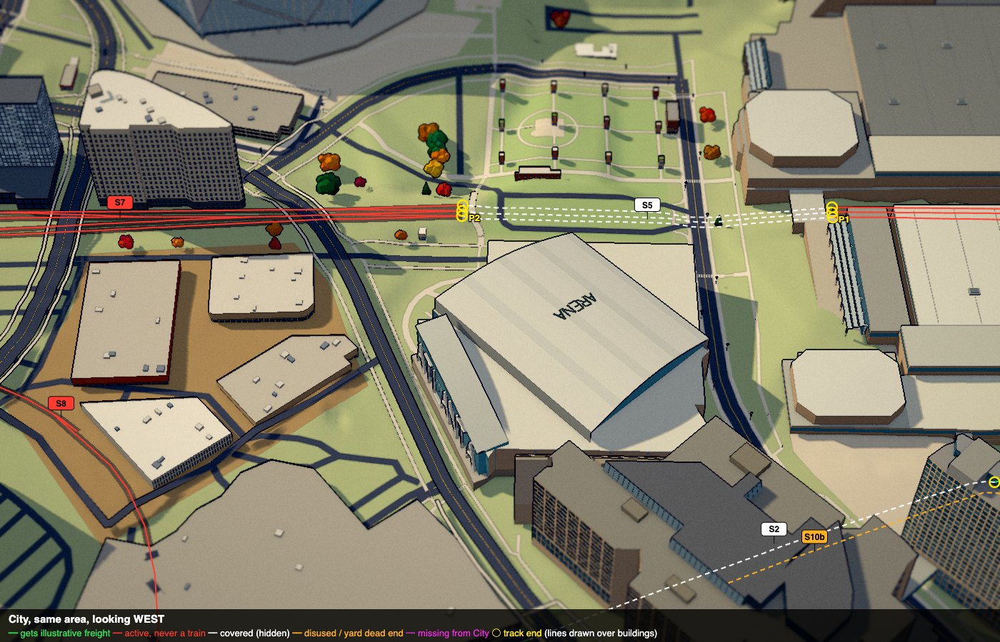
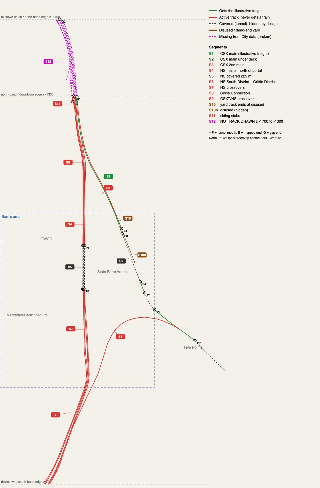
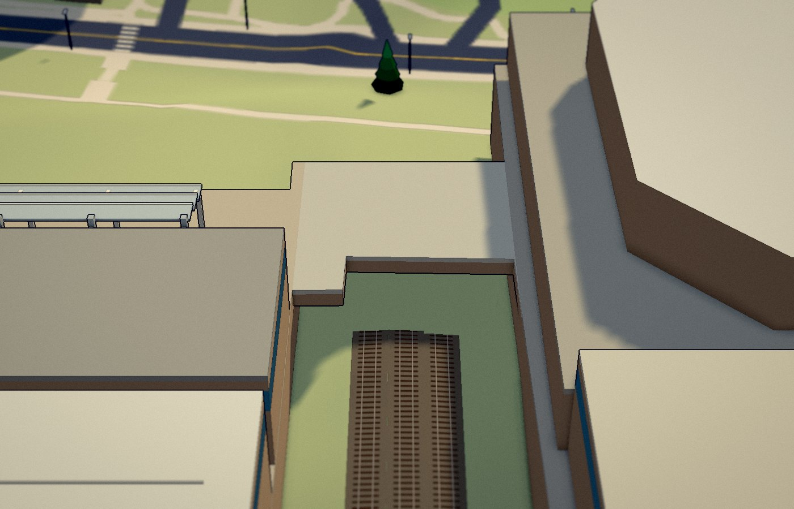
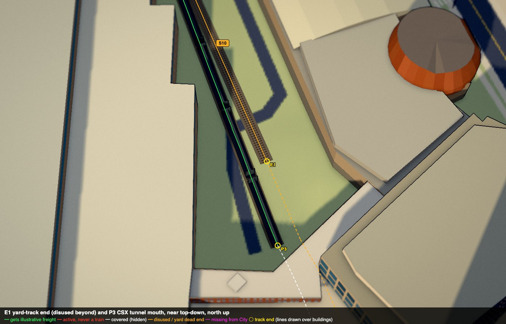
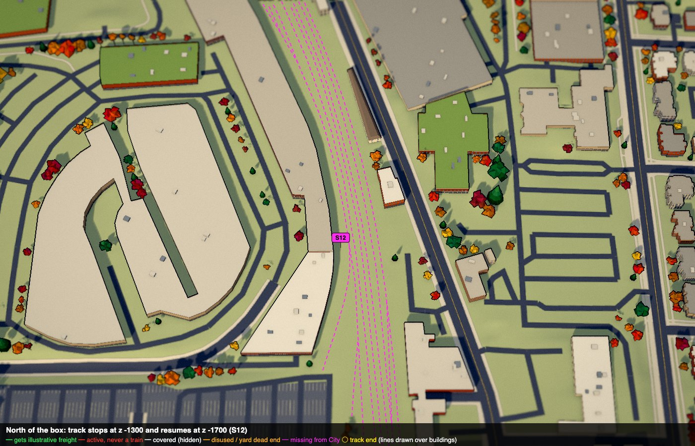
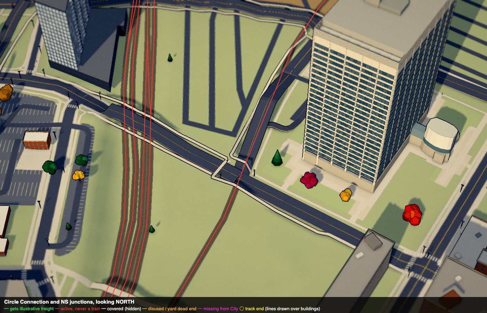
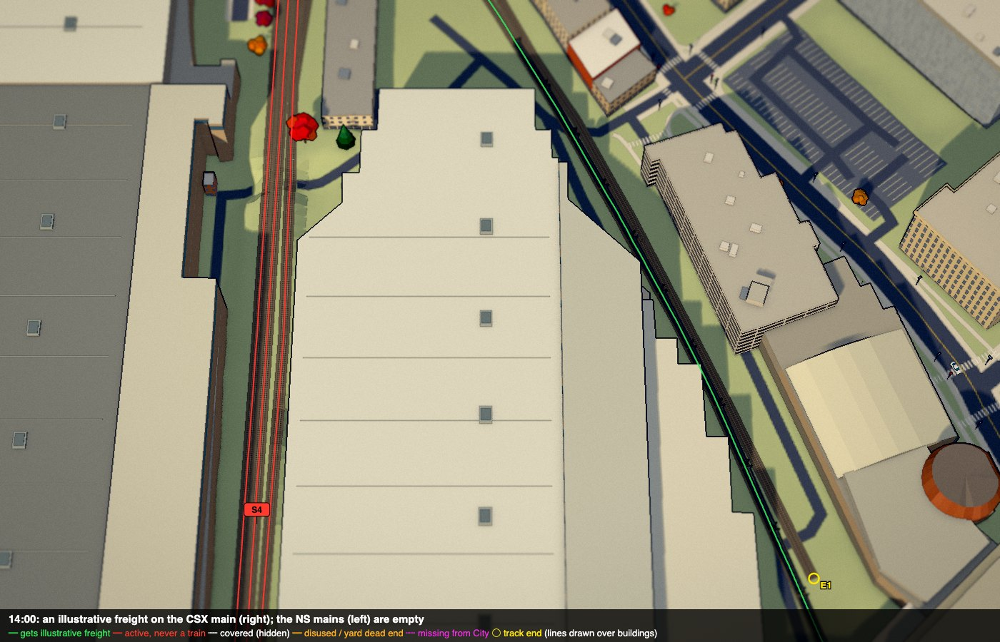

# Gulch tracks: why they go nowhere and stay empty (2026-11-27)

Sam asked about the tracks around the Georgia World Congress Center (GWCC) and the stadium,
west of the Gulch (scene x −1000…−200, z −700…+200). Checked on main `81db0d05e`, whose
`downtown/vignette.json` is byte-identical to production's. Nothing was fixed.

## Answer

- **Almost all of it is active railroad that City never puts a train on.** City has one downtown
  freight route, the CSX Atlanta Terminal main. The Norfolk Southern (NS) mains beside the GWCC
  have the higher reported counts and get nothing.
- **The abrupt ends in the box are mostly tunnel mouths with no portal drawn.** The data is
  right: OSM maps 225 m of NS track as tunnel. At the south mouth, three tracks stop on open lawn,
  and at the north CSX mouth the freight runs out onto grass the same way.
- **There are no broken joins inside the box.** Every drawn end there is a tunnel mouth or a
  mapped yard track running into a disused one. The south board seam matches to the centimetre.
- **One real break lies just north of it:** City draws no track at all from z −1700 to −1300.

## Findings

Classes: **a** real but idle or a stub, **b** active and never routed, **c** broken, **d** other.
`T` numbers index `terrainTransport.rail` in `downtown/vignette.json`. Way numbers are
OpenStreetMap ways, read on 2026-11-27. Coordinates are scene metres (x, z).

| ID | Segment and place | Class | Source and evidence | Fix | Effort |
|---|---|---|---|---|---|
| S1 | CSX main, T9–T11, T21: z −1300 to Five Points | has trains | The only `FREIGHT_MAIN` chain; ways 973262177, 111663205, 54032237 | None | — |
| S2, P3–P7 | CSX under the deck: (−368,−592)→(−274,−345), (−251,−288)→(−199,−202), east of (10,−41) | d: covered; P3 not drawn as a mouth | Ways 9254104, 1051329139, 54032238 `tunnel=yes`. `intervals()` drops tunnel spans. At P3 track and train stop on grass short of the deck. P4–P5 sit between garage decks and read acceptably | Portal face at P3, with S5 | in S5 |
| S3 | CSX second main, T4: (−414,−718)→(−601,−1300) | b | Ways 973262178, 484019200 `usage=main`. Has no `freightS`, so no treads | Optional: run one direction on it | 0.5 day |
| S4 | NS Atlanta South District, three tracks, T0–T2: z −1300→−532 | b | Ways 471970102, 484036316, 886365915 `usage=main` | NS illustrative route (below) | 1.5–2 days for all NS |
| S5, P1, P2 | NS covered: z −532→−307, x −571…−562 | d: mouths not drawn | Ways 40741534, 471970103, 471970104 `tunnel=yes`, `layer=-1`. P1 (z −532) stops short of the deck edge on grass; P2 (z −307) stops on lawn | Portal headwall and dark opening at P1, P2 and P3, schematic, merged into the existing mesh. Check imagery first: [data-model.md](../data-model.md) records an open slot beside SEC District station that carries the NS tracks, so one mouth may need a wider open slot instead | 0.5–1 day |
| S6 | NS Atlanta South and Griffin Districts, T5–T8, T29, T30: z −307→700 | b | Ways 874501032/33, 54032227, 471970106/07 `usage=main`. All meet the south band | NS route | in S4 |
| S7, S9 | NS crossovers T3, T13, T14, T17; CSXT/NS crossover T18 | b: normal | Ways 971353160/61, 471970105, 874501034, 471970100. Both ends connect | None | — |
| S8 | Circle Connection, T15, T20 | b | Ways 54032232–34 `usage=main`. OSM operator NS; NARN calls it CSXT "Atlanta Terminal D" | Leave, or route later | 0.5 day after S4 |
| S10, E1 | Yard track T16 ending at (−371,−620) | a | Way 973262179 `railway=rail`, `service=yard`, continues as 1051329138 `railway=disused` (27 m) and 973262180 disused tunnel. City hides disused | Leave; optionally draw the 27 m rusty | 1–2 h |
| S11, E2 | Siding ends T12, T19: x −626…−612, z −1300→−1231 | a, exaggerated by S12 | Way 874501025 ends 40 m past its switch at (−624,−1275) onto way 874501026; both continue north, undrawn | Fixed by S12 | — |
| **S12** | **No track from z −1700 to −1300.** Downtown ends at x −626…−601; midtown-south resumes at x −710…−676 | **c** | `pipeline/scripts/square_board.py` `bake_patch` writes `rail=[]` and adds rail only for `south-band`. `web/src/square-board/sections.ts` falls back to `web/src/city/fixtures/midtown-rail.json`, which has no `north-band` key, because `midtown_rail.py` loops over the Midtown rows only. The pinned OSM source has the CSX and NS mains. King Memorial had the same gap on 2026-11-23; its coverage test (`king-rail.test.ts`) checks only that board | Add north-band `rail` ways to the fixture (standard gauge only), check both seams and the ground audit, extend the coverage test to this row | 0.5–1 day |
| MARTA | Blue/Green under the box | d: covered | No path is above `PORTAL_E` inside the box, so no track is drawn | None | — |

## Routing: why NS stays empty

- `pipeline/scripts/terrain_transport.py` stamps `freightS` only on the four Overture ids in
  `FREIGHT_MAIN`. `createSurfaceTransport` builds `freightTreads` only from runs that have it, and
  City makes one `CityFreight` from them (`web/src/city/city.ts`). The Brookwood freight is a
  separate NS-like train on the north rows.
- That CSX train runs every 15 minutes of City time and is clipped to downtown's bounds, so it
  also vanishes at z −1300 with the full board loaded.
- Amtrak is not involved: the nearest Crescent GTFS path is 3.6 km from the NS tracks here, and
  every FRA crossing listed below reports zero passenger trains.

## Real traffic

FRA crossing inventory, day plus night trains, as retrieved 2026-11-26 (`crossings.geojson`).
These are railroad-reported averages (`reported`), per crossing, and don't add up along a line.

| Railroad | Crossing (FRA id) | Trains per day |
|---|---|---:|
| NS | International Blvd (718041S) | 36 |
| NS | Ivan Allen Blvd (718036V) | 31 |
| NS | Olympic Park Dr, MLK Jr Dr, Mitchell St, Nelson St, Peters St (718042Y, 718043F, 718044M, 718045U, 718047H) | 20 |
| CSX | Ivan Allen Blvd (340321U) | 14 |
| CSX | Forsyth St, Spring St (340314J, 340316X) | 13, 12 |

NARN gives the Circle Connection 13 a day, `inferred`: no crossing reports on it. So illustrative
freight should plausibly show NS trains here, at least as often as CSX ones.
Sources: [FRA crossing inventory](https://data.transportation.gov/d/m2f8-22s6),
[BTS rail network lines](https://geodata.bts.gov/datasets/usdot::north-american-rail-network-lines).

## Recommendation, in order

1. **S12, add the missing row's track.** The only real break. The fixture ships in the bundle, so
   a web rebuild and redeploy; no `pnpm data`.
2. **S4/S6, an NS illustrative route.** Overture `93cbb978` and `2d29ca7a` share the endpoint
   (−562,−307), so they chain from the north edge to the south edge through the covered stretch.
   It needs a per-line version of `freightS`, a second `CityFreight` with the existing
   `NORCROSS_PROFILE`, and bridge clearance checks. To avoid trains appearing at a seam, continue
   it across the north and south rows. Cards stay `illustrative`. Cadence is Sam's call: any slot
   under 40 minutes is busier than the highest NS report, and the CSX train already runs about
   seven times its reported 13 a day. `pnpm data` and a redeploy.
3. **S5 and S2, portal mouths at P1–P3.** Illustrative geometry; a web rebuild only.
4. Keep the stubs. They're real track, so don't hide or fade active lines.

Both 1 and 2 add geometry, so run `pnpm test:perf` and check the Low geometry reserve first.

## Views

Add a camera to `https://atlanta.solomon.io/?view=city&q=high&t=2026-11-20T14:00:00-05:00&speed=0&weather=clear&cam=`.
Production holds the orbit at 150 m or more; the dev server takes `&dev&mindist=20`.

- [North over the box](https://atlanta.solomon.io/?view=city&q=high&t=2026-11-20T14:00:00-05:00&speed=0&weather=clear&cam=-520,-330,0,40,950) (shot 01)
- [West over the box](https://atlanta.solomon.io/?view=city&q=high&t=2026-11-20T14:00:00-05:00&speed=0&weather=clear&cam=-520,-330,270,40,950) (shot 02)

| Shot | `cam=` |
|---|---|
| 03 north row gap | `-640,-1500,0,25,850` |
| 05 NS north mouth | `-566,-515,180,52,170` |
| 06 NS south mouth | `-566,-320,0,52,170` |
| 09 Circle Connection | `-480,80,0,40,520` |
| 10 CSX train, NS empty | `-480,-720,0,24,620` |
| 11 yard end and CSX mouth | `-375,-620,0,22,260` |

## Limits

- Cover comes from OSM and Overture tags. I didn't check these mouths against imagery, or view P6
  and P7 close up.
- Screenshots are High tier, pinned to 2026-11-20 14:00, in daylight, from a dev server. Marked
  lines are projected over buildings. No phone tier or night views.
- Overture ids and `T` indices belong to the `2026-11-18.0` bake.
