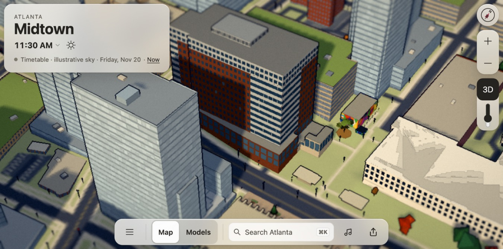
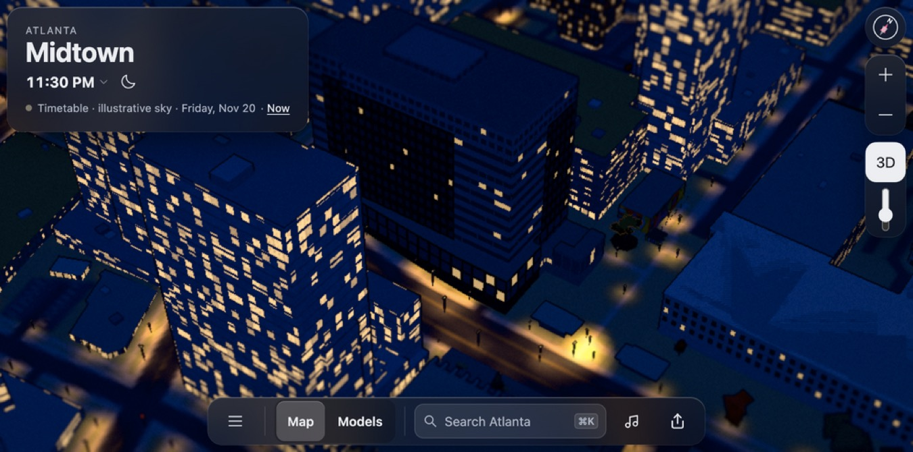
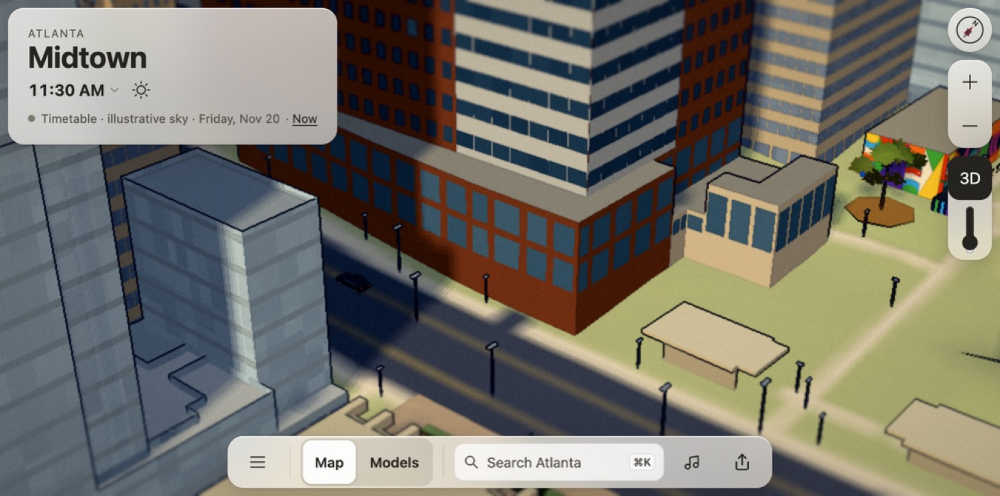

# 10 10th

City replaces the generic mesh for `osm:way:235006974`, the 14-storey office building completed in 2001 on 10th Street east of the Midtown MARTA plaza. The mapped tower parts are inferred at 42.9 and 46.2 m, but the April 2019 lidar puts the main roof at 64.6 m (median return) and the penthouse at about 68.4 m (95th percentile). City uses the lidar heights. The 10.8 m podium along 10th Street and the two low plaza pavilions keep their mapped parts.

The aerial listing photograph shows a red-brown brick shaft with punched windows on every floor. A silver bay with continuous window ribbons wraps the southeast corner above the plaza, a narrow silver return closes the west end, and the top two floors are silver panel. A mechanical penthouse sits on the roof. The two-storey podium in front has brick piers and tall storefront glass. The street photograph from the southeast corner shows the same silver ribbon bay and brick shaft from street level. Estimated details: the 3.1 m window bay, the extent of the silver bay (east of x = +12 m on the south face and the southern half of the east face), the 56.2 m start of the silver top floors, and the penthouse footprint (about 28 × 18 m). The street photo shows the silver corner standing on columns at grade. City keeps the podium under it.

Sources, consulted in a fresh Orca tab:
- [LoopNet listing aerial photograph](https://www.loopnet.com/Listing/10-10th-St-Atlanta-GA/33380016): south face, silver ribbon bay, podium, plaza and penthouse.
- [Midtown Alliance building page, street photograph](https://www.midtownatl.com/view/10-10th-street): the silver ribbon corner and brick shaft from the street.

**Lighting:** No full-night photograph was found. City shows an office at 23:30 with most windows dark, lit storefronts in the podium, and no decorative lighting.

| Review view | City query |
|---|---|
| Day, from the southeast over the plaza | `?view=city&q=low&t=2026-11-20T11:30:00-05:00&cam=414,-3104,325,48,420` |
| Full night, matched | `?view=city&q=low&t=2026-11-20T23:30:00-05:00&cam=414,-3104,325,48,420` |
| Closer southeast corner and podium | `?view=city&q=low&t=2026-11-20T11:30:00-05:00&cam=430,-3090,320,62,180` |

The survey's starting camera (`414,-3104,32,60,300`) looks between two taller neighbours and only shows the upper south face, so the review views come from the southeast.

