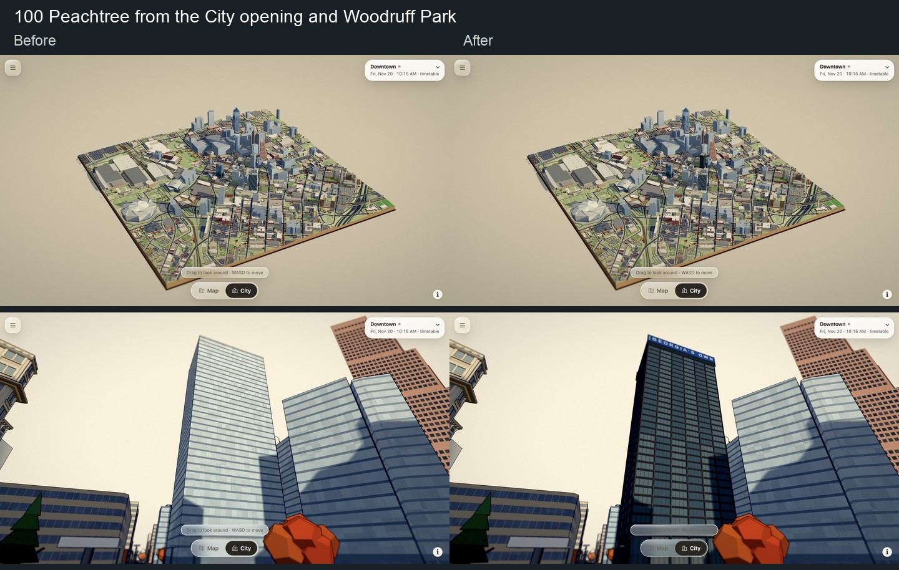

# 100 Peachtree from Woodruff Park

The Equitable Building at 100 Peachtree is the dark rectangular tower above the north end of Woodruff Park. Its named 138 m bake is already close to the survey height. The identifying features are the exposed steel grid, recessed lobby glazing and dark mechanical band with a long display on each broad face. Its neighbors each keep their own footprints. The Society of Architectural Historians describes a 32-story tower and records the change from the original Equitable lettering to electronic signs. The bake lists 35 floors. The model’s visible window rows follow the photographs. [Architectural history](https://sah-archipedia.org/buildings/GA-01-121-0083) · [Park view with the earlier lettering](https://commons.wikimedia.org/wiki/File:Atlanta%27s_Equitable_Building_seen_from_Woodruff_Park.jpg)

## Dimensions and references

| Feature | Evidence and treatment |
| --- | --- |
| Plan | Four corners on feature `e14e24d5-1e78-423b-baec-0529477c10a2` give a 51.2 × 34.9 m outline. The screens face southeast and northwest along the two long elevations. |
| Main roof | Of 4,252 USGS 2018 returns within the footprint, the median was 459.9 m NAVD88 and the 90th percentile was 460.0 m. Ground at the four corners is 322.5–323.3 m. The deck is about 137 m above the adjacent terrain. Roof-equipment outlines are estimated from the high returns. |
| Paired displays | The operator gives a length of 174 ft. Formetco’s installation account gives 174 × 20 ft (53.04 × 6.10 m) for each panel, beginning about 432 ft above ground. The screens project slightly beyond the mapped office shaft and display a fixed illustrative version of the photographed blue identity. |
| Frame and glass | March 2025 frontage and November 2018 reverse-side panoramas show the dark horizontal girders and regular vertical columns. Six broad-face bays, four end bays, member widths and lobby setbacks are photo estimates. The window light pattern is illustrative. |

[USGS Georgia B2 lidar](https://s3-us-west-2.amazonaws.com/usgs-lidar-public/GA_Statewide_B2_2018/ept.json) · [Sign operator](https://www.georgiasownsign.com/about-the-georgias-own-sign/) · [Installation dimensions reported by Formetco](https://graphics-pro.com/article/featured-project-formetco-led-signs-make-their-mark-on-atlanta-skyline/) · [March 2025 Peachtree frontage](https://www.google.com/maps/@?api=1&map_action=pano&pano=xmeSGRHHW_5r7_UTzh9ePw&heading=300.96&pitch=32) · [November 2018 reverse angle](https://www.google.com/maps/@?api=1&map_action=pano&pano=IkgyQZYE54Hup8Fanp5Lvw&heading=127.06&pitch=22)

The park-side dusk photograph shows the sign above a few bright horizontal office floors. Adrenaline’s nighttime photograph from above the plaza shows the illuminated broad face meeting an unlit end. Both angles informed the display brightness. The real screen carries changing messages. [Park-side dusk photograph](https://www.atlantasublease.com/wp-content/uploads/2024/10/100-Peachtree-Georgias-Own.jpg) · [Night photograph from the sign launch](https://www.adrenalinex.com/news/atlantas-skyline-has-new-beacon/)

## City captures

High quality, 1296 × 726, locked to November 20, 2026. Day is 10:15 EST, dusk 17:22 and night 20:15.

| View | Camera | Before | After |
| --- | --- | --- | --- |
| Opening | Target (−40, −260), bearing 28°, tilt 57°, 2.945 m/px | [Day](opening-before.jpg) | [Day](opening-after.jpg) |
| Above Woodruff Park | (274, −338), 336°, 63°, 0.50 m/px | [Day](woodruff-before.jpg) · [Dusk](woodruff-dusk-before.jpg) · [Night](woodruff-night-before.jpg) | [Day](woodruff-after.jpg) · [Dusk](woodruff-dusk-after.jpg) · [Night](woodruff-night-after.jpg) |
| Forsyth side | (275, −333), 139°, 58°, 0.54 m/px | [Day](forsyth-before.jpg) · [Night](forsyth-night-before.jpg) | [Day](forsyth-after.jpg) · [Night](forsyth-night-after.jpg) |
| Park level | Eye x/z (314, −224), height 4 m above City datum, target (277, −329) at 68 m, FOV 64° | [Day](park-eye-before.jpg) · [Night](park-eye-night-before.jpg) | [Day](park-eye-after.jpg) · [Night](park-eye-night-after.jpg) |

Daylight opening cost goes from 155 to 163 draw calls and 2,290,091 to 2,305,307 triangles (+15,216). Both signs share a small generated texture. The scene uses the existing bake.
