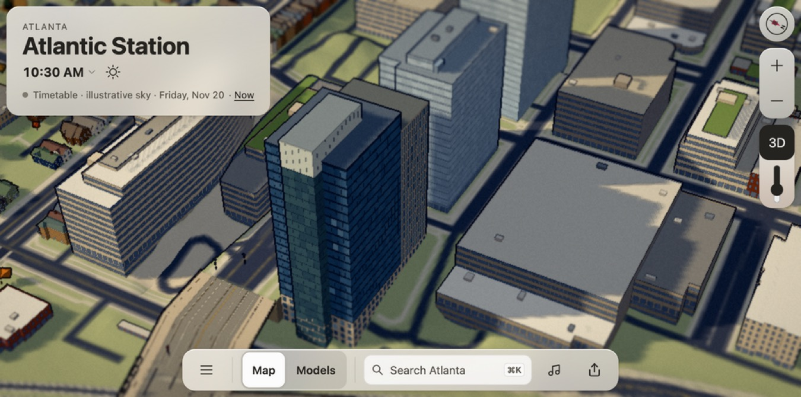
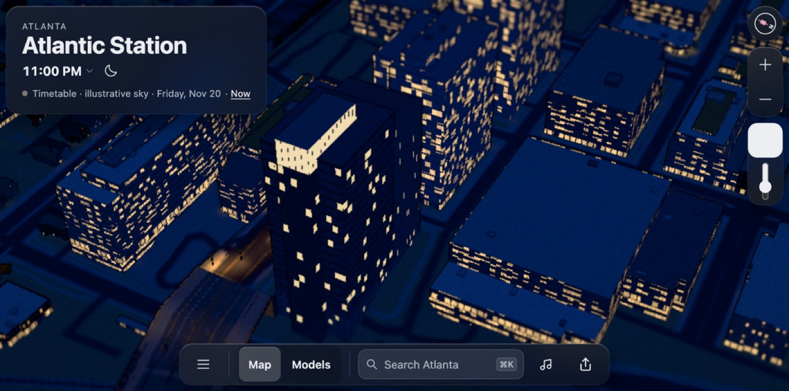
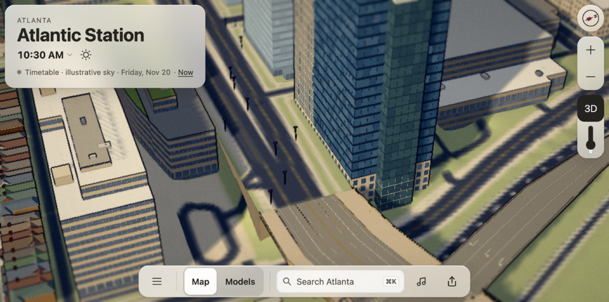

# 171 Seventeenth

City replaces the generic mesh for `osm:way:269542125` on the Brookwood South row. The 71 × 36 m plan has three mapped parts. The west wing, main shoulder, and crown use inferred roof elevations 89, 98, and 106 m above the local ground datum, preserving the mapped height differences. The crown spans about 35 × 15 m in plan. Its backlit cladding begins an estimated 4 m below the shoulder. The stone base is estimated at 16.5 m and the office glass module at about 2.8 × 4.2 m.

The architect’s daylight view shows the dark horizontal spandrels, the projecting vertical glass return and its lighter cap, and the closely spaced stone piers of the west wing. The architect’s dusk view from the opposite approach shows the long curtain-wall elevation and the lightwell above the 17th Street bridge. [Smallwood daylight and dusk gallery](https://smallwood-us.com/projects/171-17th-street/)

The full-night view shows a warm backlit crown, intermittent office windows, and separate bridge lighting. City draws the crown as one even glass panel per face with thin mullions, light glass by day and a single warm glow at night. The stone base reads as pale stone with smaller openings, and the west wing carries narrow windows between stone piers at about 1.7 m. The window pattern in City illustrates partial occupancy. The full extent of the crown lighting on the concealed faces is inferred. [Night exterior by Julian Waters](https://www.skydb.net/file/162451671/171-17th-street-atlanta/)

| Review view | City query |
|---|---|
| Day, Connector approach | `?view=city&q=low&t=2026-11-20T10:30:00-05:00&cam=-255,-4181,-118,50,490` |
| Full night, matched | `?view=city&q=low&t=2026-11-20T23:00:00-05:00&cam=-255,-4181,-118,50,490` |
| Closer return | `?view=city&q=low&t=2026-11-20T10:30:00-05:00&cam=-200,-4158,-68,53,330` |

