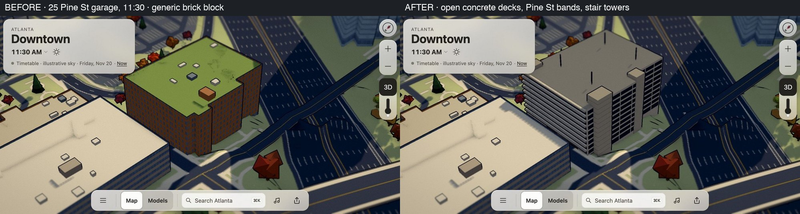
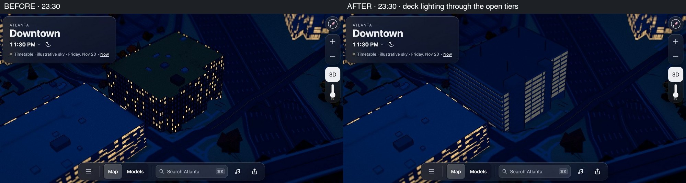
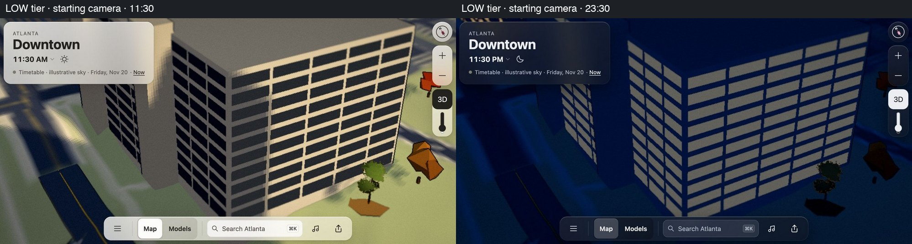
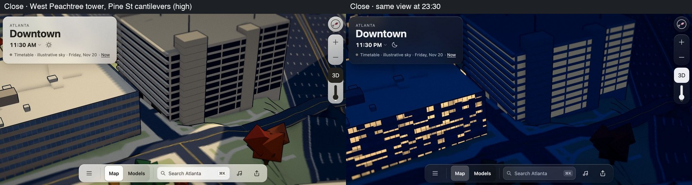

# 25 Pine Street NE parking garage

`osm:way:270470130` was drawn as a generic brick block with a green roof. It is a ten-tier precast concrete deck between Pine Street (north), West Peachtree Street (west) and the Downtown Connector ramps. The skin follows the mapped outline.

| Element | Plan (City m) | Height above grade | Basis |
|---|---|---|---|
| Deck and parapet | the mapped 54 × 64 m outline | deck 32.4, parapet 33.6 | 3DEP lidar, 22 April 2019. Grade is the 302.8 m NAVD88 median outside the footprint. |
| West stair and lift tower on West Peachtree | x 395–402.5, z −1486.5…−1476.3 (the mapped 3 m projection) | 38.5 | lidar maximum |
| Pine Street stair tower, north-east corner | x 443.5–449, z −1490.6…−1480.5 | 36.0 | lidar |
| Small stair core at the West Peachtree step | x 397.6–404.2, z −1455.5…−1448.6 | 35.9 | lidar |

A 2 m lidar raster located the three towers, and the deck rises 1.5 m along its ramps (31.0–32.5 m). The ten tiers are 3.24 m each, which is the deck height divided by the open levels in the photographs.

## Facade

Three daylight photographs on SKYDB show the corner of Pine and West Peachtree and the long open elevations. [SKYDB building page and photos](https://www.skydb.net/building/222518734/pine-street-parking-deck/)

- **Pine Street (north):** deep horizontal spandrels cantilevered past the frame, about 1.1 m tall and an estimated 1.4 m projection (high tier). The low tier draws them flush.
- **Vehicle portals:** two openings on Pine Street at the mapped service drives (x 410 and 427), each about 9 m wide and 4.2 m tall (estimated).
- **Other faces:** an open frame of light concrete columns about 8.2 m apart, matching eight bays along the 64 m west elevation. Dark decks sit between the spandrel beams. The photographed cable rails are omitted.
- **West tower:** solid precast panels. Its horizontal joints every 3 m are drawn on the high tier.
- **Roof:** four light poles (high tier, positions estimated).

## Night

No night photograph was found. The daylight photographs show ceiling lights burning inside the decks, so City lights every open tier with a dim, even, neutral glow (intensity 0.24, below the window glow of neighbouring towers). There are no signs or decorative lighting.

## Measurements

Low tier, starting camera `424,-1460,32,60,150`, 11:30, same build with the skin on and off: **+204 triangles** (1,907,117 → 1,907,321), **+2 draws** (132 → 134: the body and the deck-light mesh), programs unchanged (42).

## Review views

| View | City query |
|---|---|
| Day, from Pine and West Peachtree (high) | `?view=city&q=high&t=2026-11-20T11:30:00-05:00&cam=422,-1458,135,52,300` |
| Full night, matched | `?view=city&q=high&t=2026-11-20T23:30:00-05:00&cam=422,-1458,135,52,300` |
| Starting camera, low, day and night | `?view=city&q=low&t=2026-11-20T11:30:00-05:00&cam=424,-1460,32,60,150` (23:30 for night) |
| Close: tower and Pine Street bands | `?view=city&dev&mindist=20&q=high&t=2026-11-20T11:30:00-05:00&cam=418,-1478,120,60,200` |

The building north of Pine Street blocks a street-level view of the portals in City.

