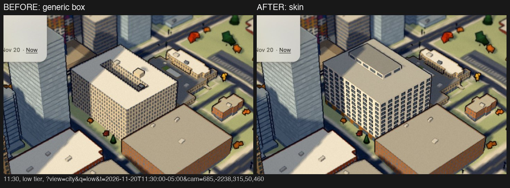
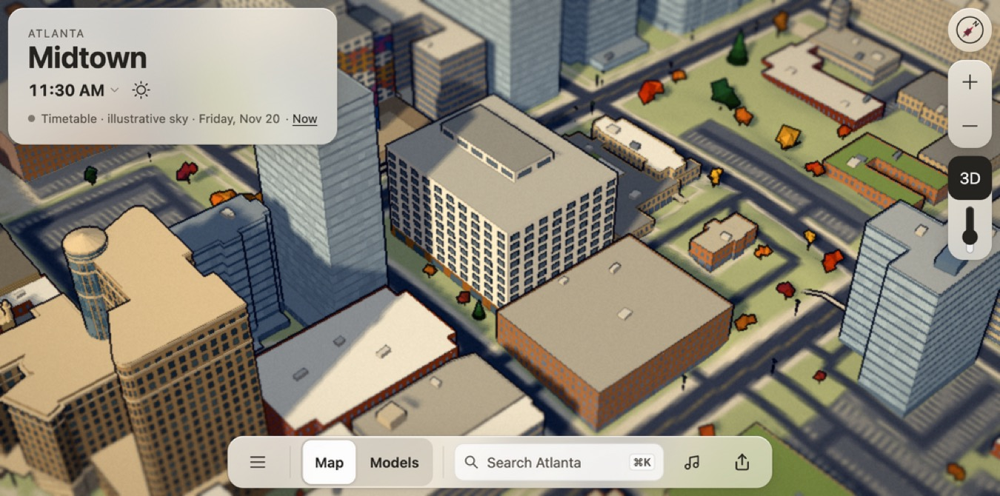
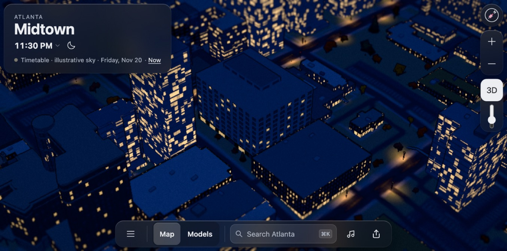
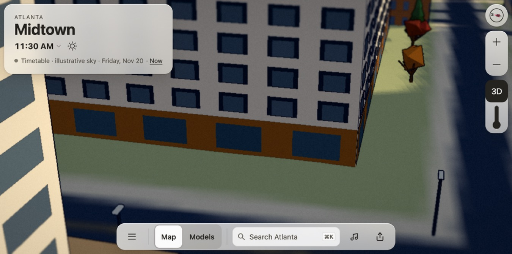
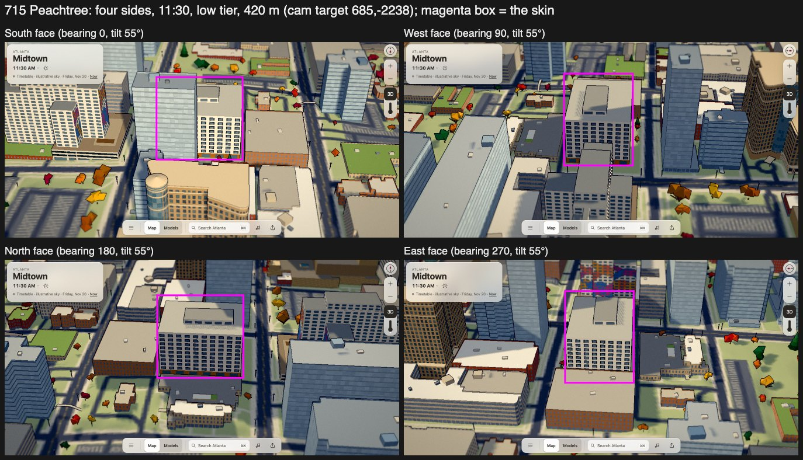

# 715 Peachtree

City replaces the generic mesh for `osm:way:234938708`, 715 Peachtree at Peachtree and 3rd Street, a 10-storey office building from 1972 that Carter renovated in 2016. **Height basis: lidar 2019.** An 8 m grid of 90th-percentile returns over 309.7 m ground puts the main roof at 40 m, with a 44–45 m penthouse over the middle. The mapped 8 m interior part (illustrative tier) sits inside the cube and isn't drawn.

**Identifying features** (from Carter's leasing photographs, confirmed with the lead):
1. A clean white precast egg-crate frame, a step brighter than the generic beige, with square windows set deep in it so they read dark. City draws the frame as `#f4f3ef` and each window as a dark reveal around a smaller pane.
2. A warm wood-clad retail base with storefront glass and outdoor seating on Peachtree and 3rd.

The penthouse block is a third marker. Estimated details: the 5 m base, nine office floors at about 3.7 m, the 3.2 m window bay, the reveal and pane proportions, the wood colour, and the penthouse footprint. Signage isn't drawn.

Sources, consulted in a fresh Orca tab:
- [Carter office listing](https://www.carterusa.com/office/715peachtree): corner exterior from Peachtree, and the wood-clad retail entrance with outdoor seating.

**Lighting:** No full-night photograph was found. City treats it as an office, mostly dark at 23:30 (10%) through the shared lit-pane hash, with lit storefronts.

| Review view | City query |
|---|---|
| Day, from the south-east | `?view=city&q=low&t=2026-11-20T11:30:00-05:00&cam=685,-2238,315,50,460` |
| Full night, matched | `?view=city&q=low&t=2026-11-20T23:30:00-05:00&cam=685,-2238,315,50,460` |
| Close: Peachtree base (dev server) | `?view=city&dev&mindist=40&q=low&t=2026-11-20T11:30:00-05:00&cam=660,-2230,80,66,90` |

