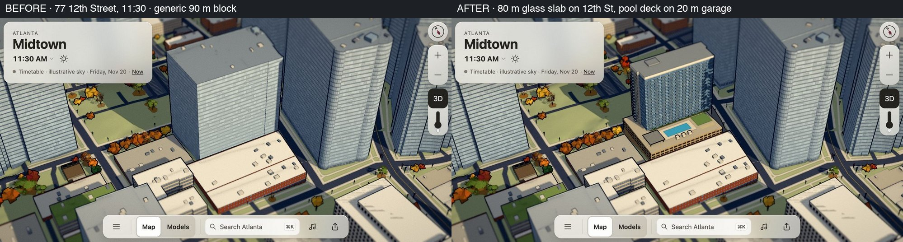
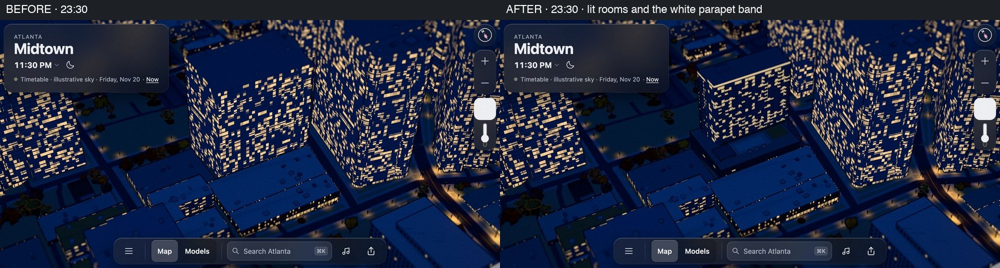
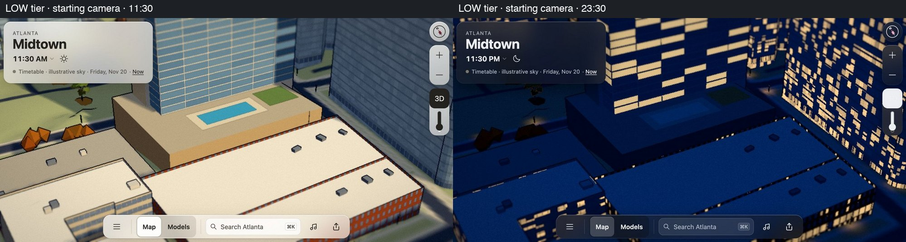
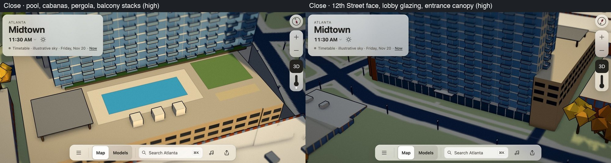

# 77 12th Street

`osm:way:536895716` was drawn as one generic 90 m block over its whole 91 × 59 m lot. City now splits it into the three mapped OSM parts:

| Part | OSM way | Plan (City m) | Height above grade | Basis |
|---|---|---|---|---|
| Residential slab, 23 floors | 536895715 | about 74 × 26, along 12th Street, x 573.6–648.1 | roof 78.4, white parapet 80.8, penthouse 82.4 | 3DEP lidar, 22 April 2019 (median and 95th percentile of returns inside the part) |
| Garage and pool deck | 1464967898 | 74 × 58, south of the slab | deck 19.7 | lidar median |
| Crescent Avenue frontage | 1464967899 | about 16 × 56, east edge | 9.5 | lidar median |
| 12th Street entrance canopy | 1429394390 | 9 × 3 | about 4.6 | estimated from the twilight street photo |

A lidar profile along the slab found a flat roof with no step. In the photographs, what looks like a second, lower wing is the same roof seen in perspective across a small notch in the plan. The mapped 90.1 m is the OSM `height` tag; the lidar roof is lower.

## Facade

The architect's photographs (Rule Joy Trammell Rubio) show both long faces in floor-to-ceiling reflective blue-grey glass with thin light slab edges, and about ten stacks of cantilevered balconies with glass rails on each face. The end walls are cream precast with punched windows, a glass corner and a central balcony stack. A tan precast and brick garage podium carries arched shop windows on Crescent Avenue. The pool deck holds a rectangular pool, a timber-and-metal pergola, cabanas and a lawn with a bocce court. [Architect's project gallery](https://rjtrdesign.com/77-12th-street/) · [Builder's completion notice, 330 units, 2013](https://www.brasfieldgorrie.com/brasfield-gorrie-announces-completion-of-77-12th-street/)

- **Floors:** a 5.2 m lobby, then 22 floors at 3.33 m (the lidar roof divided by the floor count).
- **Bays:** high tier uses 3.1 m glass bays on the long faces, 2.6 m punched windows on the cream ends and 3.6 × 1.75 m balconies. The bay width and balcony spacing are estimated from the photographs.
- **Low tier:** no balconies, penthouse, canopy, garage openings or deck furniture. It uses 12.4 m glass panes on the long faces and plain cream end walls.
- **Pool deck layout:** estimated from two deck photographs and the lidar returns from the pergola and cabanas (22–29 m above grade).

## Night

Two blue-hour photographs (`Building-Eve-05`, `77-12th18`) show warm, scattered apartment lights. The parapet band glows white along the whole roof edge, and the deck has some lighting. City lights a stable pattern of about 38% of the room windows, along with shop frontage and the parapet band. **Gap:** no full-night exterior was found. Deck lighting is omitted until there is evidence of it at full night.

## Measurements

Low tier, starting camera `608,-3369,32,60,270`, 11:30, same build with the skin on and off: **+530 triangles** (1,834,509 → 1,835,039), **+2 draws** (118 → 120: the body and the night-window mesh), programs unchanged (47). `pnpm test:perf` on the whole board: low 90/90 programs, 568/600 calls. High 105/140 programs, 1,191/1,250 calls.

## Review views

| View | City query |
|---|---|
| Day, south-west over the pool deck (high) | `?view=city&q=high&t=2026-11-20T11:30:00-05:00&cam=611,-3375,30,50,560` |
| Full night, matched | `?view=city&q=high&t=2026-11-20T23:30:00-05:00&cam=611,-3375,30,50,560` |
| Starting camera, low, day and night | `?view=city&q=low&t=2026-11-20T11:30:00-05:00&cam=608,-3369,32,60,270` (23:30 for night) |
| Close: pool deck | `?view=city&dev&mindist=20&q=high&t=2026-11-20T11:30:00-05:00&cam=611,-3378,20,48,150` |
| Close: 12th Street face | `?view=city&dev&mindist=20&q=high&t=2026-11-20T11:30:00-05:00&cam=611,-3385,150,62,170` |

