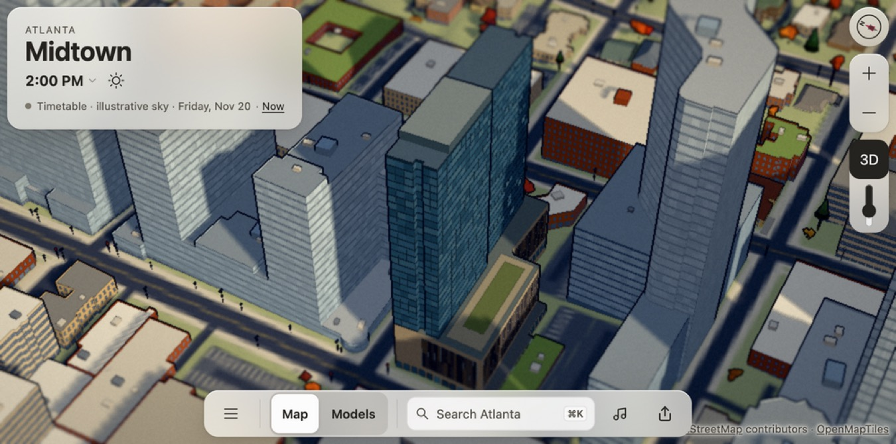
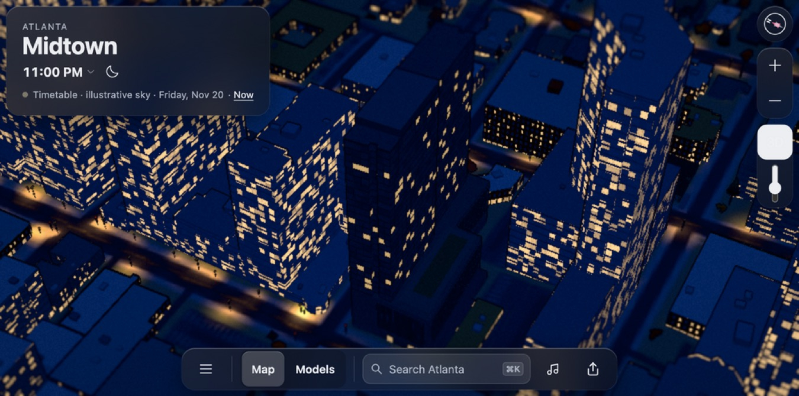
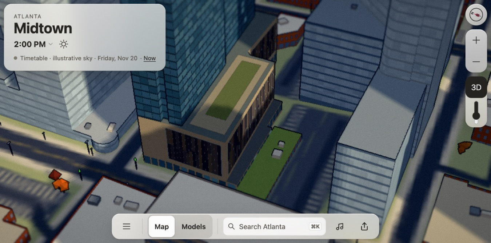

# 903 Peachtree

The `osm:way:1284487937` skin follows the mapped 90 × 44 m parent, with an approximately 83 × 20 m glazed shaft over the integrated garage. It retains the 24.4 m deck edge, 104.5 m shoulder, and 108 m mechanical height from the mapped parts. These heights and the street datum are inferred. The retail glazing is about 4.5 m tall and the tower’s visible floor bands pitch about 3.1 m. The west and south deck screens use staggered bronze and charcoal fields inside an aluminum border, with field widths and breaks estimated from the photographs.

Henry’s daylight photographs compare the north and east approach with the opposite south and west corner. The corner close-up shows glazed ground frontage below a projecting glass corner and metal soffit, and the motor court elevation shows the screens framed by pale stone. The leasing flyer confirms the glazing continues around the Peachtree storefront. [Façade contractor’s exterior photographs](https://henryinc.com/portfolio/decorative_facades_at_903_peachtree/) · [Retail leasing flyer](https://www.cartelproperties.com/wp-content/uploads/2023/08/903-Peachtree-Retail-Flyer.pdf)

The property’s twilight aerial shows scattered warm apartments and warm terrace and entry lighting. The garage screen reads as a dark panel field. City uses an illustrative window pattern and simplified ambient terrace and entry lighting. A reliable full-night exterior photograph was unavailable. [Property twilight aerial](https://resource.rentcafe.com/image/upload/q_auto%2Cf_auto/s3/2/102852/903%20peachtree%20midtown_2024_twilight_drone%20aerials_155%281%29.jpg)

| Review view | City query |
|---|---|
| Day, Peachtree approach | `?view=city&q=low&t=2026-11-20T14:00:00-05:00&cam=780,-2860,64,47,500` |
| Full night, matched | `?view=city&q=low&t=2026-11-20T23:00:00-05:00&cam=780,-2860,64,47,500` |
| Closer deck return | `?view=city&q=low&t=2026-11-20T14:00:00-05:00&cam=733,-2812,69,49,270` |

