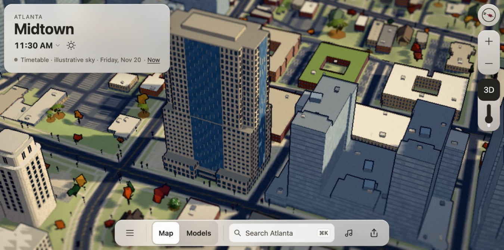
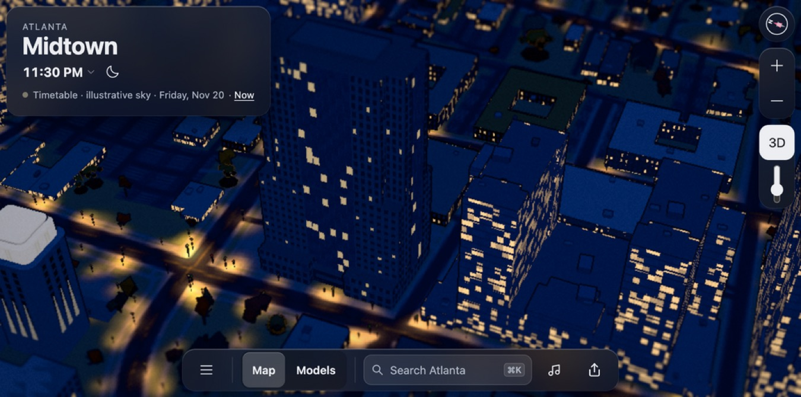
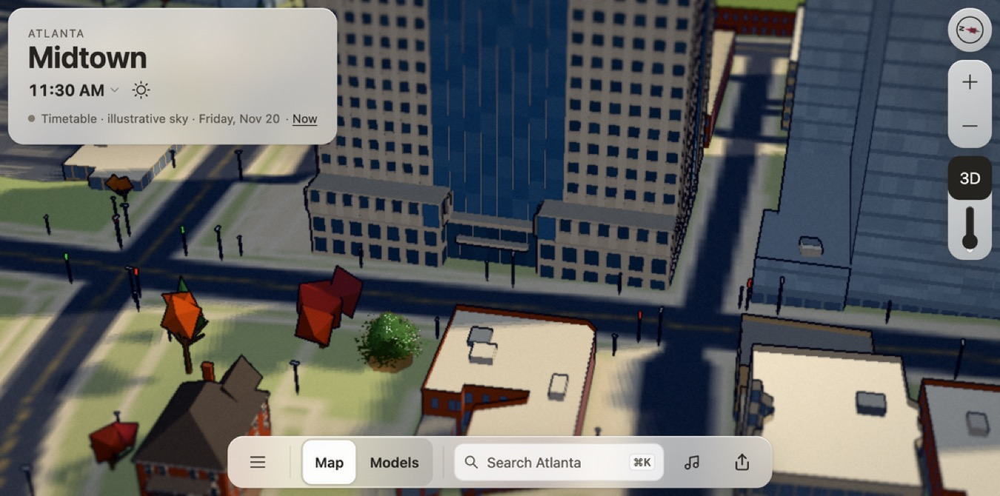

# 999 Peachtree

City replaces the generic mesh for `osm:way:886036475` at Peachtree and 10th with a skin built on the mapped parent (about 70 × 46 m) and its eight parts. Heights come from the mapped parts (reported tier): the 9.3 m recessed Peachtree entrance, the 14.2 m side masses, the 54.6 m stone frames, the 117.6 m shaft and the 120.4 m crown. The CTBUH lists 121 m and 28 floors (Heery, 1987). The street datum is inferred from the lowest grade around the footprint.

Every elevation in the photographs has the same scheme. A full-height blue curtain wall fills the centre of each face between pale stone wings with punched windows, and the wings step back at the shoulder of the lower frame. City draws the curtain wall as continuous glass with thin pale mullions. It is about 25 m wide on the long faces and 14 m on the short ones, centred under the mapped crown, with the stone wings standing about 0.6 m proud of it. Estimated details are the 3.2 m window bays, the roughly 1.5 m stone piers, the 4.05 m floor pitch, and the entrance canopy, set at 5.3 m and 1.8 m deep. Faces hidden inside a taller adjoining part are skipped.

Sources, all consulted in a fresh Orca tab:
- [Colliers sublease brochure, entrance close-up](https://listingsprod.blob.core.windows.net/ourlistings-usa/029c3a00-fd72-436f-91a8-cb5d39ad3af0/e1d2df09-f24c-44d2-9da5-7b8e1e474e7b): travertine-like stone piers, recessed glass and the curved entrance canopy. City does not draw the address sign.
- [South face over the Margaret Mitchell House (Wikimedia Commons)](https://commons.wikimedia.org/wiki/File:999_Peachtree_in_the_background_towers_over_the_Margaret_Mitchell_House_in_Midtown,_Atlanta.jpg): the central curtain wall between the stone wings, and the wing setback at the lower frame.
- [Second angle from the side street (Wikimedia Commons)](https://commons.wikimedia.org/wiki/File:999_Peachtree_Street.jpg): the same central glass on an adjacent face, and the white stone wings in full daylight.
- [CBRE dusk oblique](https://www.cbre.com/press-releases/chamberlain-hrdlicka-inks-30773-sf-lease-in-midtown-atlanta): the Peachtree face, the lower frame block with its dark central slot above the entrance, scattered lit offices and the pale rounded crown.

**Lighting:** The dusk photograph shows scattered lit office floors. Its warm crown cap appears to be sunset light, and nothing shows that the crown is floodlit. A search of the Wikimedia Commons category and the web turned up no reliable full-night photograph. City therefore draws sparse office windows at night, with an illustrative pattern, a lit entrance and no crown lighting.

| Review view | City query |
|---|---|
| Day, Peachtree approach | `?view=city&q=low&t=2026-11-20T11:30:00-05:00&cam=782,-3018,70,50,520` |
| Full night, matched | `?view=city&q=low&t=2026-11-20T23:30:00-05:00&cam=782,-3018,70,50,520` |
| Closer entrance | `?view=city&q=low&t=2026-11-20T11:30:00-05:00&cam=716,-3026,80,60,240` |

