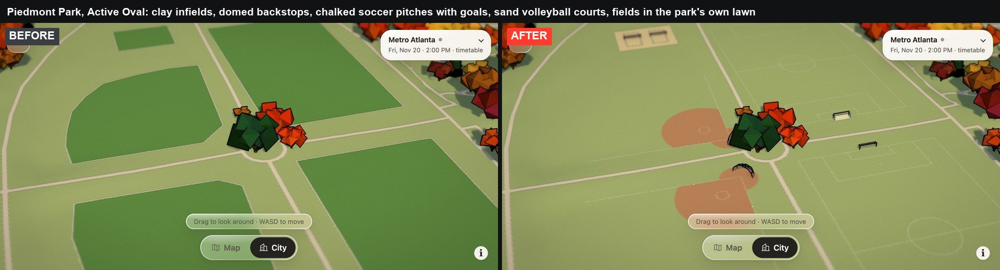

# Piedmont Park: the Active Oval

The Active Oval is the big gravel loop in the middle of Piedmont Park. Inside it, City drew four dark-green rectangles. It now shows what is actually there: two softball fields with skinned clay infields and domed backstops by the central tree circle, two full-size soccer pitches with goals, and the sand volleyball courts at the north end. The fields now share the park's own lawn colour, per the calm-ground standard (#248).

**What is reported and what is illustrative**
- **Reported (OSM):** the field outlines (ways 182313883/884 softball, 182313890/891 soccer, 182313888 volleyball), the hub circle (226119775) and the two west retaining walls (182543449, 182543451). They are baked to `pipeline/prototypes/piedmont-edge/details.json` by `pipeline/scripts/piedmont_edge.py`.
- **Illustrative:** the infield shape, chalk lines, backstops, goals, nets and court tapes.
  - Home plate is where the two long edges of each mapped softball outline meet. The bases are at 60 ft (18.3 m), and the pitcher's circle is at 43 ft (13.1 m).
  - Soccer markings are standard: a 9.15 m centre circle, 16.5 m and 5.5 m boxes, and 7.32 × 2.44 m goals.
  - The beach courts are 16 × 8 m.

**Photo research**
- **Day:** aerial views at 260 m and 75 m (Google Maps satellite, viewed in an Orca tab, not copied) show the skinned infields wrapping the backstops beside the hub, and goals on both soccer pitches. Atlanta Area Parks' Active Oval page ([atlantaareaparks.com/?p=1446](https://www.atlantaareaparks.com/?p=1446)) has ground photos of the softball fields, which show round, domed chain-link backstops about 4–5 m tall. Its volleyball photo shows red-bordered nets on steel posts over blue boundary tapes.
- **Night:** the same listing says the softball fields and volleyball courts have **no lights**, so no floodlights were added. Reliable night photographs of the oval were not found, a gap that is noted here. The 11 pm render keeps the fields dark.
- **Estimated:** backstop radius 4.6 m, centred 1.2 m behind the plate, and net heights at the standard 2.43 m.

**Cost**
- High tier: 1,666 triangles in two draws, one opaque (frames, walls) and one see-through (chain link, nets).
- Low tier: nothing added. Infields, sand and chalk are painted into the existing ground texture on both tiers, at no triangle or draw cost.

## Views (captioned BEFORE | AFTER)

- [Overview](oval-compare.jpg): `/?view=city&cam=1440,-3600,30,55,260`
- [West edge, close](oval-edge-compare.jpg): `/?view=city&cam=1360,-3560,60,66,60`
- [Low tier](oval-low-compare.jpg) · [11 pm](oval-night-compare.jpg)

Park Tavern sits at 10th Street and Monroe Drive, about x ≈ 2200, outside the board's east edge at x = 1800, so it is not part of this work. Publishing needs a web rebuild only.
