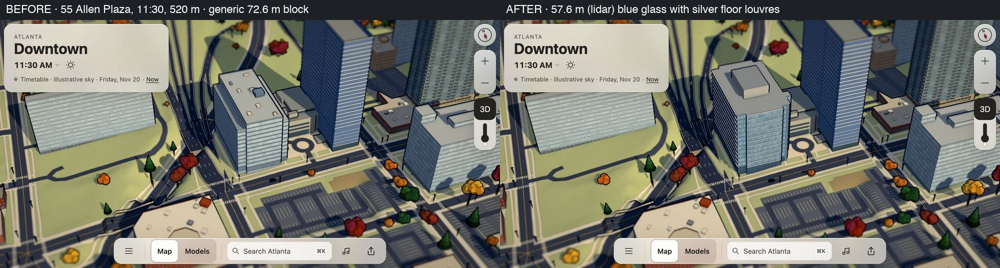
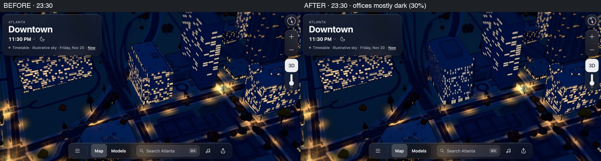
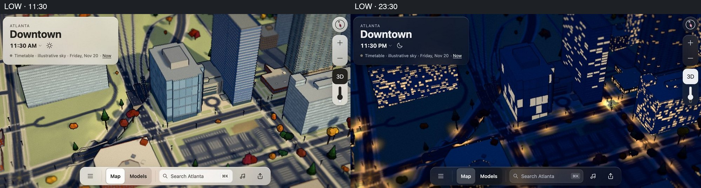
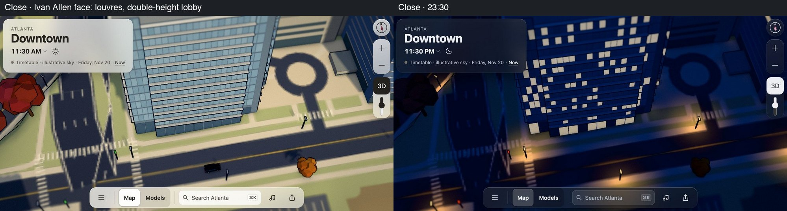
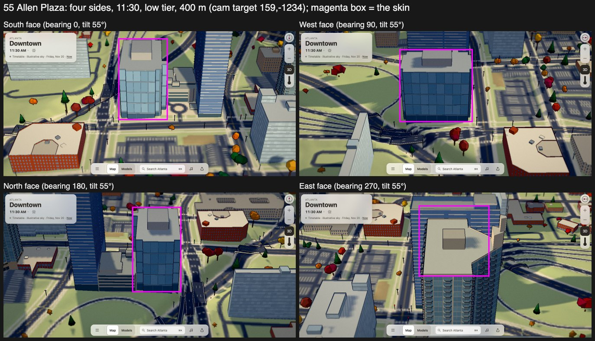

# 55 Allen Plaza

Overture `72b58249-8c4d-40a5-8f5a-7731b8e0e4d1` (unnamed, "commercial", 72.6 m) is **55 Allen Plaza** at 55 Ivan Allen Jr Boulevard (OSM way 479142878: 14 levels, built 2007). It is a Class A LEED office tower. City drew a generic 72.6 m block; it now draws the tower at its lidar height.

| Element | Height | Basis |
|---|---|---|
| Tower, full outline | roof 57.6 m above the 299.3 m NAVD88 grade | 3DEP lidar, 22 April 2019: median 57.6 (4,989 of 6,855 returns between 50 and 60 m). The mapped 72.6 m is about 15 m too tall. |
| Rooftop mechanical screen, centred 20 × 28 m (estimated) | 66 m | lidar 90th percentile (65.9; max 67.0) |

## Identifying features
From Street View: 55 Ivan Allen Jr Boulevard (Mar 2025), the west side (Feb 2026) and 110 Ivan Allen (Apr 2026); cited, not committed.
- A blue reflective curtain wall, `#8fb0c8` (S 29%, V 78%).
- Silver horizontal sunshade louvres at every floor (`#d8dde0`). They project about 0.9 m on the high tier and are flush bands on the low tier.
- A double-height glazed lobby.

## Night
No night photograph exists. As an office tower it is mostly dark at 23:30: litHash 30%.

## Views
| View | Query |
|---|---|
| Money shot, 520 m, day and night | `?view=city&q=high&t=2026-11-20T11:30:00-05:00&cam=151,-1242,20,50,520` (23:30 for night) |
| Close, Ivan Allen face | `?view=city&dev&mindist=20&q=high&t=2026-11-20T11:30:00-05:00&cam=151,-1215,10,30,170` |
| Four-side | `node scripts/four-side-sheet.mjs --id 72b58249-8c4d-40a5-8f5a-7731b8e0e4d1 --ground 299.3 --top 57.6 --dist 400` |

## Deploy
This is bundled City code, so visitors see it after a `web/dist` rebuild and worker redeploy. No `pnpm data` is needed.
