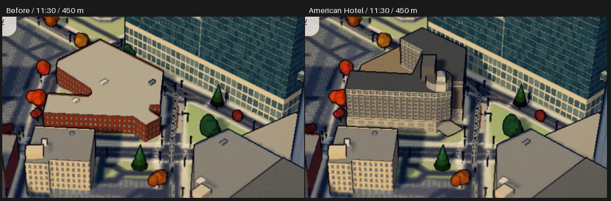
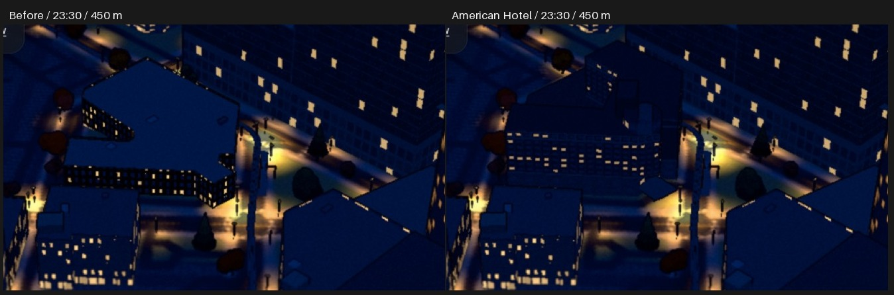
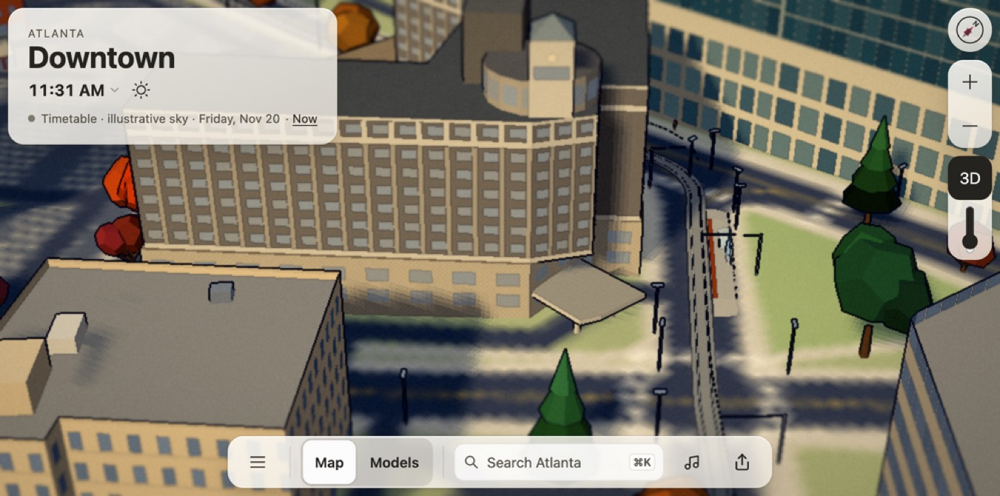
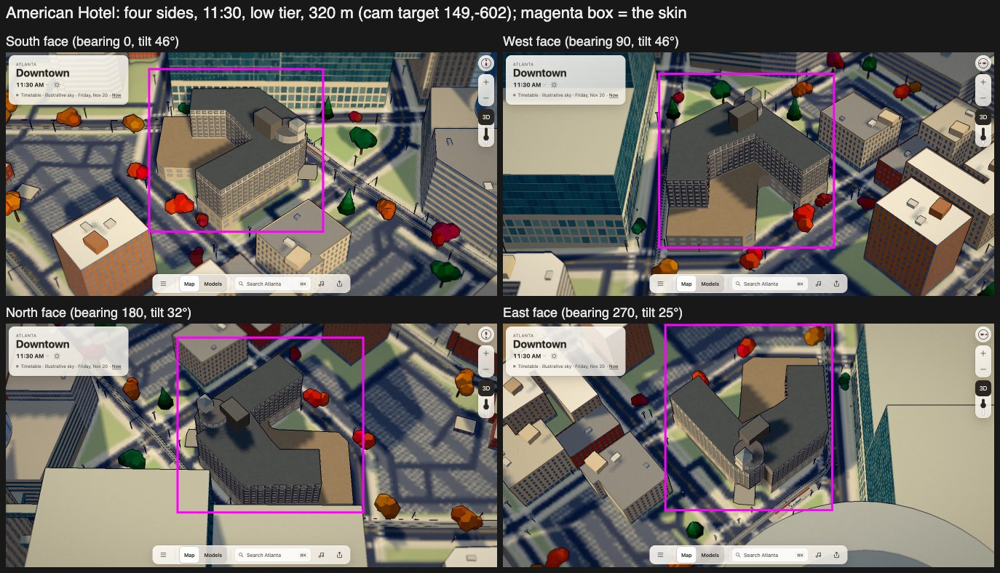

# American Hotel

The generic block on Ted Turner Drive stood 14.8 m tall across the entire parcel, including the entry drive. The 2019 USGS point cloud gives the main hotel roof a median of 344.67 m NAVD88 across 1,016 returns in a representative roof patch. The lower west wing sits at 325.84 m (1,270 returns), the round upper room at 348.83 m (107 returns), and the drive canopy at 322.03 m (91 returns). Points around the top of the clock turret reach 356.39 m. The sidewalk east of the canopy is close to 318.1 m, making the main roof about 26.6 m above the street. The northwest wing's outer edge and the split with the west terrace follow the lidar roof break. [USGS Georgia Statewide B2 point cloud](https://s3-us-west-2.amazonaws.com/usgs-lidar-public/GA_Statewide_B2_2018/ept.json)

The entrance photograph shows pale masonry below six guest-room rows, vertical piers and a simpler top-floor band. A round rooftop room sits behind the clock turret. The aerial confirms the two wings and the low west terrace between them. The width of each pier, the curve of the canopy, the clock face and the canopy support positions are visual estimates. [Hotel exterior, daylight](https://americanhotelatlanta.com/wp-content/uploads/2024/07/ATLSS_exterior_05.jpg) · [Esri aerial](https://server.arcgisonline.com/ArcGIS/rest/services/World_Imagery/MapServer/export?bbox=-9394327.59,3996466.75,-9394195.14,3996599.21&bboxSR=3857&imageSR=3857&size=700,700&format=jpg&f=image)

The hotel's night photograph shows warm guest-room light, canopy downlights, and a dark façade. The model uses a stable illustrative room-light pattern and warm light underneath the canopy. The scene has no hotel signs or logos. [Hotel exterior, night](https://americanhotelatlanta.com/wp-content/uploads/2024/07/ATLSS_exterior_06.jpg)

The day and night pair uses the same Low-tier camera at `142,-612,315,55,450`, at 11:30 and 23:30 Eastern. The close-up shows the open drive below the canopy. The footprint test checks the mapped outline to 30 cm, checks for detached parts, and probes the surveyed roof levels and the clear drive. City uses the staged downtown data already in the project. Deploy with a fresh web build.

The hotel is identifiable at 450 m by the split roof, pale fascia, round corner room and clock above the drive. In the 175 m day view (`157,-605,315,60,175`), 24 sunlit guest-room pane centres measured S 7–16 and V 56–60 on the rendered JPEG (HSV percentages). The surrounding towers partially screen the north and east façades, so the four-side sheet uses steeper angles for those views.

