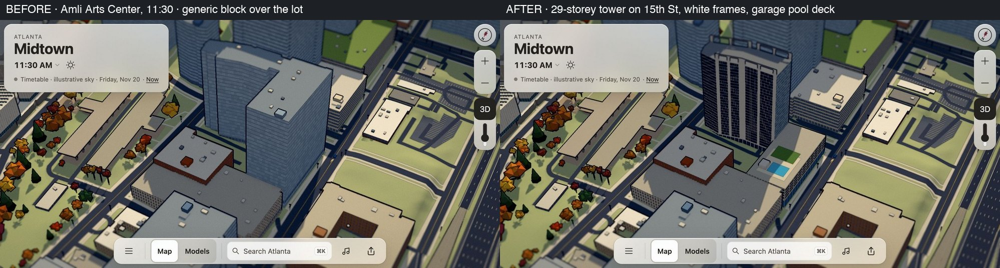
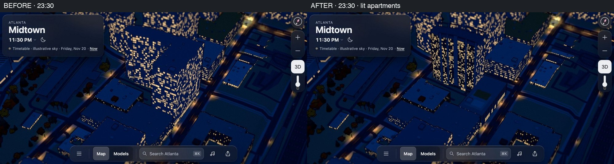
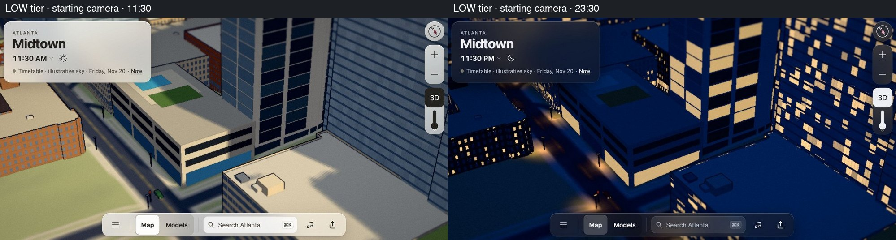
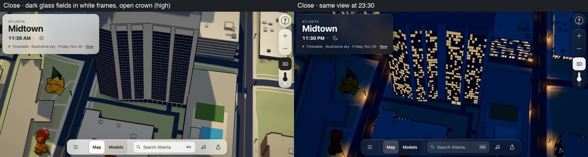

# Amli Arts Center

`osm:way:885667868` (1240 West Peachtree, on 15th Street at Spring Street) was drawn as one generic block over the whole L-shaped lot. JE Dunn's project notes describe a 29-storey, 350-unit tower above a 552-space precast garage, with a rooftop lounge and a pool deck. City now draws the tower where the lidar puts it, beside the garage.

| Element | Plan (City m) | Height above grade | Basis |
|---|---|---|---|
| Tower along 15th Street | x 263–339.5, z −3892.5…−3860.5 (the footprint's 15th Street band) | roof 89.9, white crown frame 96.5 | 3DEP lidar, 22 April 2019: median 89.9, 90th percentile 96.5, max 97.2. Grade is the 274.4 m NAVD88 median of ground returns. |
| Precast garage and pool deck on Spring Street | x 225–263.6, z −3937.5…−3859 | 19.7 | lidar median (25th percentile 17.4) |

A 3 m lidar raster separated the tower from the garage strip. The garage's shared edge sits inside the tower wall, so the deck meets the tower with no slit (tested).

## Facade

JE Dunn's aerial photograph shows the broad faces as dark, reflective glass fields set in thick white frames. The frames rise past the roof as an open crown frame. The narrow ends are lighter glass with balconies. The precast garage holds the pool deck, an amenity pavilion and planted beds, and blue glass lines its Spring Street base. [JE Dunn project page and photographs](https://jedunn.com/projects/amli-arts-center-residential-tower/) · [AIA Atlanta design award](https://aiaatl.org/design-award/amli-arts-center/)

- **Floors:** a 6 m lobby, then 28 floors at 3.0 m (the lidar roof divided by the floor count).
- **Faces:** the east–west runs are the dark broad faces. White fins about 3.2 m wide (2.6 m in the middle), proud of the glass by 0.35 m, run from the lobby to the crown, with a white beam at the top. Fin widths are estimated from the aerial.
- **High tier:** 1.6 m glass bays on the broad faces, 2.4 m on the ends, pale balcony slabs on alternate floors, garage tiers at 7.5 m bays and the deck pavilion.
- **Low tier:** 14 m panes, one row per two floors, the fins and crown beam, and coarse garage bands.

## Night

No night photograph was found. City lights a stable pattern of about 40% of the rooms and the glazed shop base. The garage decks stay dark (no evidence), and the crown is unlit.

## Measurements

Low tier, starting camera `266,-3890,32,60,288`, 11:30, same build with the skin on and off: **+416 triangles** (1,772,123 → 1,772,539), **+2 draws** (81 → 83), programs unchanged (37).

## Review views

| View | City query |
|---|---|
| Day, looking south over the pool deck (high) | `?view=city&q=high&t=2026-11-20T11:30:00-05:00&cam=290,-3885,150,48,600` |
| Full night, matched | `?view=city&q=high&t=2026-11-20T23:30:00-05:00&cam=290,-3885,150,48,600` |
| Starting camera, low, day and night | `?view=city&q=low&t=2026-11-20T11:30:00-05:00&cam=266,-3890,32,60,288` (23:30 for night) |
| Close: frames and crown | `?view=city&dev&mindist=20&q=high&t=2026-11-20T11:30:00-05:00&cam=300,-3870,170,35,330` |

