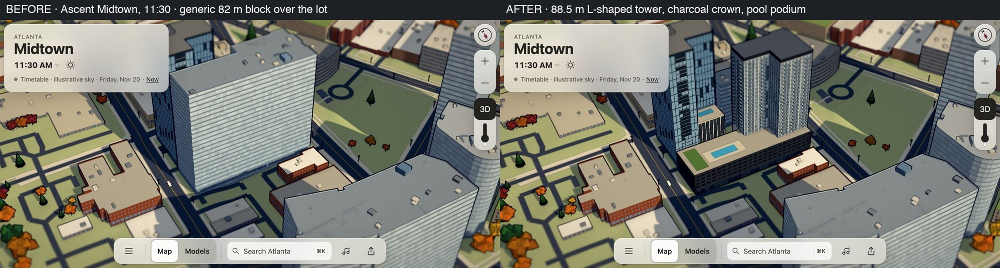
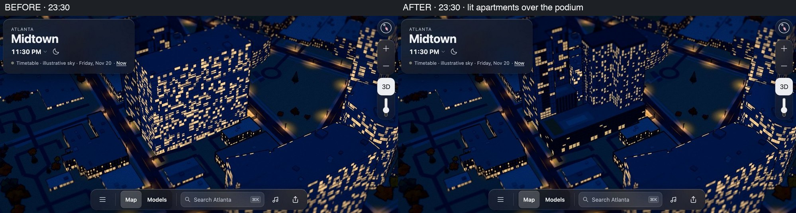
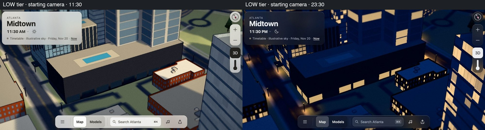
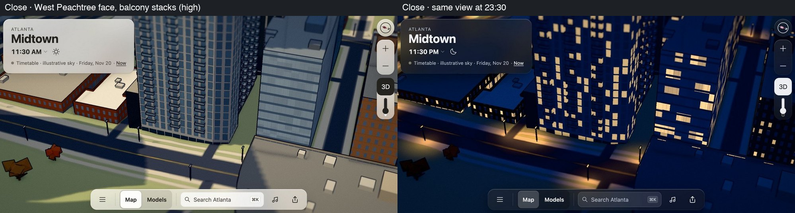

# Ascent Midtown

`osm:way:884939412` (1400 West Peachtree) was drawn as one generic 82 m block over the whole 103 × 43 m lot. The architect describes it as one of two towers on a shared podium. The other is the Hilton Canopy Midtown, a separate OSM building to the north that this change leaves alone. City now draws the tower where the lidar puts it, over a lower podium.

| Element | Plan (City m) | Height above grade | Basis |
|---|---|---|---|
| Tower: an L, with a slab on the north edge and a wing down West Peachtree | x 290–339, z −4344…−4322, plus x 312–339, z −4322…−4307 | roof 88.5, charcoal crown 91.4 | 3DEP lidar, 22 April 2019: tower median 88.5, 90th percentile 90.6, max 91.7. Grade is the 275.1 m NAVD88 median of ground returns. |
| Podium and pool deck | the rest of the lot, x 236–339 | 20 | lidar median 19.6–20.3 |

A 2 m lidar raster traced the L. The lot slopes steeply, as the architect notes, so the podium sits low on Spring Street and high on West Peachtree. City carries one roof height across it.

## Facade

The architect's photographs show a silver-grey panel tower with tall glass bays, stacked balconies with glass rails, a dark charcoal frame around the rooftop sky lounge, and a dark brick podium with glazed shopfronts and the pool deck. [R2L Architects project page](https://r2l-architects.squarespace.com/work/ascent-midtown)

- **Floors:** 3.3 m, with a 5 m lobby on the street faces.
- **High tier:** 2.9 m glass bays with 0.62 fill (grey panel between) and balcony stacks about 9 m apart on faces over 18 m. Bay and stack spacing are estimated from the photographs.
- **Low tier:** 16 m panes, one row per two floors, with no balconies or garage openings. The short jogs are plain.
- **Podium:** dark brick, garage levels on the high tier, and the pool and lawn on the deck (layout estimated from the roof-deck photograph).

## Night

The dusk photograph of the east elevation shows warm, scattered apartment lights, a vertical strip of lit balconies and a lit sky lounge. City lights a stable pattern of about 40% of the rooms, plus the shop frontage. **Gap:** no full-night exterior was found. The sky-lounge glow and the balcony strip are omitted until night evidence exists.

## Measurements

Low tier, starting camera `292,-4319,32,60,248`, 11:30, same build with the skin on and off: **+275 triangles** (1,732,565 → 1,732,840) and **+2 draws** (84 → 86: the body and the night-window mesh). Programs compiled at that camera rose from 38 to 39, because it is the first landmark material in view. The board-wide count is in the PR's test:perf result.

## Review views

| View | City query |
|---|---|
| Day, from the south-west over the podium (high) | `?view=city&q=high&t=2026-11-20T11:30:00-05:00&cam=300,-4330,30,50,520` |
| Full night, matched | `?view=city&q=high&t=2026-11-20T23:30:00-05:00&cam=300,-4330,30,50,520` |
| Starting camera, low, day and night | `?view=city&q=low&t=2026-11-20T11:30:00-05:00&cam=292,-4319,32,60,248` (23:30 for night) |
| Close: West Peachtree face | `?view=city&dev&mindist=20&q=high&t=2026-11-20T11:30:00-05:00&cam=320,-4325,250,55,220` |

