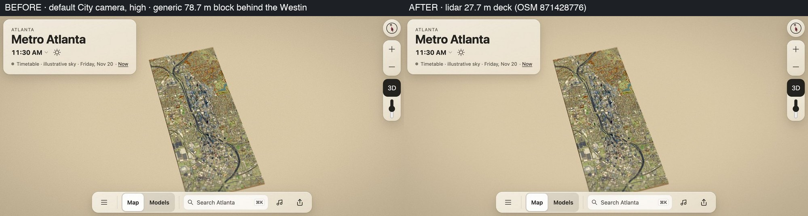
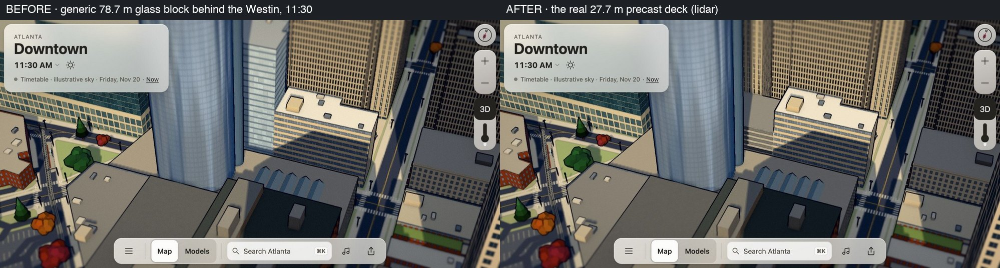
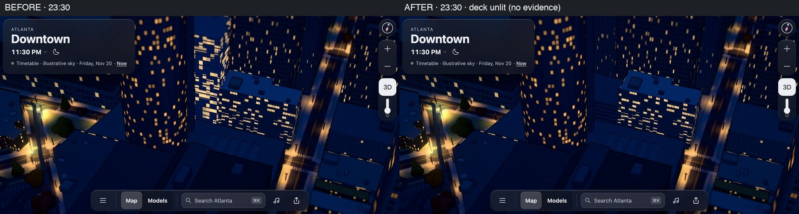
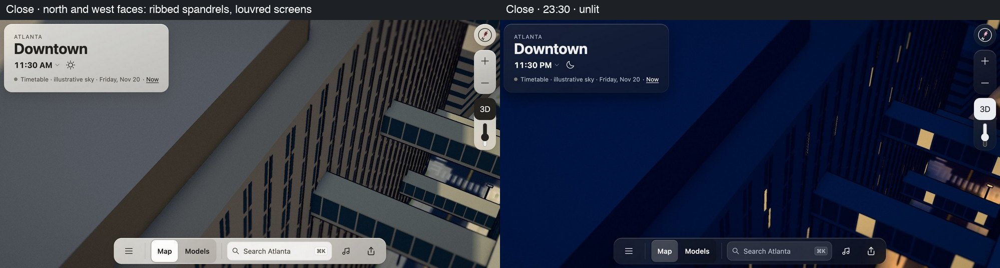
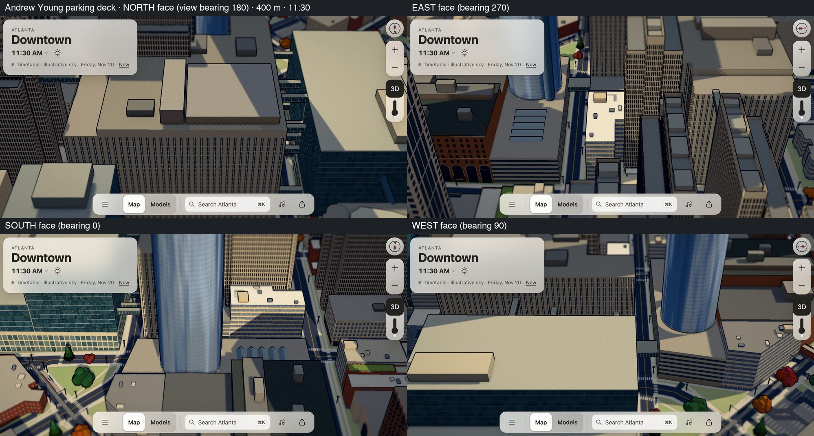

# Andrew Young International Boulevard parking deck

Overture building `d56f2678-0f2c-474d-90b6-d61574d9a15c`, near Five Points between AmericasMart Building 1 and the Westin Peachtree Plaza, was drawn as a generic 78.7 m block. It looked like a tower behind the Westin from the default City camera. OSM maps the same outline as way 871428776, a multi-storey public parking deck with no name.

| Element | Plan | Height | Basis |
|---|---|---|---|
| Deck | the mapped 37 × 30 m outline | 27.7 m above the 319.3 m NAVD88 boulevard grade (median of returns inside the outline); 90th percentile 28.4 m | 3DEP lidar, 22 April 2019 |

The 78.7 m figure had no lidar support: the returns over the outline are flat at 26–28 m. The 57.9 m maximum comes from the Westin's edge.

## Evidence
- OSM way 871428776: `amenity=parking`, `parking=multi-storey`, `building=parking`.
- Street View in a fresh Orca tab, April 2026: Ted Turner Drive and Andrew Young International Boulevard, plus 15 Andrew Young International Boulevard looking north. Cited, not committed. It shows pale grey precast spandrels and louvred screens on the levels, next to the Westin's base.

## Model
Pale grey precast (`#cfcdc7`), with eight levels at about 3.4 m. Each level has a ribbed spandrel and a mid-grey louvred screen band (`#8d8e8c`). These are the same on both tiers; the mesh is under 400 triangles. Night: no lighting is drawn, since there's no evidence. The lamp mesh is empty.

## Views
| View | Query |
|---|---|
| Default City camera (high), the money shot | `?view=city&q=high&t=2026-11-20T11:30:00-05:00` |
| Hero, day and night | `?view=city&q=high&t=2026-11-20T11:30:00-05:00&cam=288,-671,340,50,380` (23:30 for night) |
| Close | `?view=city&dev&mindist=20&q=high&t=2026-11-20T11:30:00-05:00&cam=288,-671,150,45,170` |
| Four-side check | `&dev&mindist=20&cam=288,-671,{180,270,0,90},50,400` |

