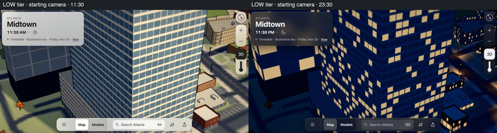
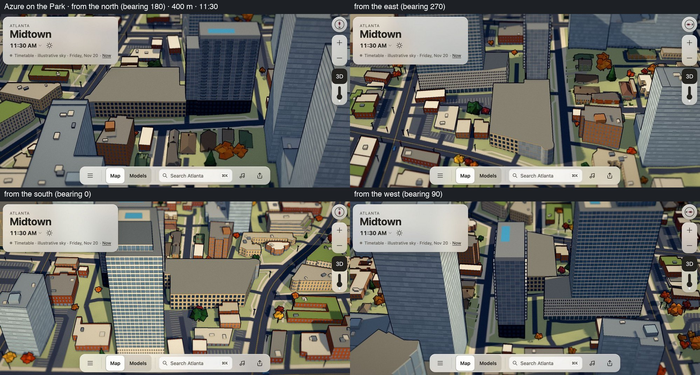

# Azure on the Park

`osm:way:536885864` (1020 Piedmont Avenue, between 10th and 11th Streets by Piedmont Park; 25 storeys, 329 units, completed February 2017) was drawn as one generic 98 m block over its whole lot. City now draws the tower and its podium separately, at their lidar heights.

| Element | Plan (City m) | Roof, NAVD88 | Basis |
|---|---|---|---|
| Tower on 11th Street, at the west end of the lot | x 911–956, z −3225…−3205 | roof 358.5 (about 79 m above the 279.7 m grade), parapet 361 | 3DEP lidar, 22 April 2019: median 358.5, 90th percentile 361.0, max 364.0 |
| East step of the tower | x 956–966 | 348.9 | lidar median |
| Four-storey podium to Piedmont Avenue, with the rounded corner at 11th | x 966–1052 | 297.5 (about 17 m) | lidar median |

The mapped 98 m is the OSM tag.

## Evidence

- **Contractor's exterior photographs** (Brasfield & Gorrie): the tan precast podium with the rounded blue-glass corner on Piedmont, and the tower's floor-to-ceiling glazing and rooftop pool, which is cantilevered off the 23rd floor. [Brasfield & Gorrie project page](https://www.brasfieldgorrie.com/projects/azure-on-the-park/)
- **Street View, dated and cited, not copied:** March 2025 from 11th Street looking south shows the tower's blue curtain glass, cantilevered balconies with glass rails and dark-brick lower floors. March 2025 from Piedmont Avenue looking west shows the podium's rounded glass corner.

## Model

- **Tower:** blue-grey glass at 3.2 m bays with 0.92 fill. Balcony stacks about 10 m apart on the 11th Street and south faces, high tier only. Dark brick up to the podium line. The pool sits on the roof, high tier only.
- **Podium:** tan precast with punched windows. The rounded north-east corner is glazed blue.
- **Glass:** base `#9aa7b3` (S 14%, V 70%). Rendered at 11:30 on the high tier: sunlit face S 6 / V 56, which passes. Shaded faces read S 35–36 / V 29–31, against generic shaded glass at S 10 / V 39 in the same frame. A first base, `#8fa6bd` (S 24), shaded to S 45, so it was desaturated.
- **Low tier:** one pane row per three floors on the tower, and two pane rows on podium faces over 20 m.

## Geometry

The high tier was thinned (3.2 m bays and 10 m balcony spacing, down from 1.6 m and 7.5 m) because high-tier geometry is close to its ceiling. Same-session `pnpm test:perf` figures are in the PR.

## Shade legibility

At 11:30 the north and west faces are in shade, and the grid and balconies nearly disappeared there (coordinator note on #546). Balcony soffits are now `#c2c4c4` instead of `#9b9d9e`, a bright 0.3 m slab nosing (`#f2f3f2`) runs along each balcony front, and the spandrel bands between floors are wider (glass vertical fill 0.78 instead of 0.86). [Before and after in shade](az-shade.jpg)

## Night

No night photograph was found. Lit rooms come from the shared `litHash(seedOf(id), face, floor, bay)` at 45%, and the podium shopfronts at 40%. The pool and crown are unlit.

## Review views

| View | City query |
|---|---|
| Day, from the north-west over 11th Street (high) | `?view=city&q=high&t=2026-11-20T11:30:00-05:00&cam=980,-3205,150,45,480` |
| Full night, matched | `?view=city&q=high&t=2026-11-20T23:30:00-05:00&cam=980,-3205,150,45,480` |
| Starting camera, low, day and night | `?view=city&q=low&t=2026-11-20T11:30:00-05:00&cam=990,-3206,32,60,240` (23:30 for night) |
| Close: balconies, brick base and pool | `?view=city&dev&mindist=20&q=high&t=2026-11-20T11:30:00-05:00&cam=945,-3215,170,38,250` |
| Glass check, sunlit face | `?view=city&dev&mindist=20&q=high&t=2026-11-20T11:30:00-05:00&cam=938,-3200,330,35,220` |

## Strengthening (recognition audit, 2026-11-24)

The audit rated #546 BORDERLINE: "Tower glass matches neighbours". Two photos show what makes Azure itself, and the skyline lead confirmed both features before the build:

- [11th Street, Street View, March 2025](https://www.google.com/maps/@?api=1&map_action=pano&viewpoint=33.78325,-84.38120&heading=120&pitch=32&fov=105): looking up the north-west corner at blue reflective curtain glass over the charcoal brick base, with cantilevered balconies stacked at the corner.
- [Piedmont House rooftop photosphere, October 2019](https://www.google.com/maps/@?api=1&map_action=pano&viewpoint=33.78340,-84.38020&heading=200&pitch=40&fov=110): a second angle from the north-east, showing the same blue glass, clearly bluer than the towers beside it, and balcony stacks running full height along the corners.

Changes:

- **Glass:** base `#86a0c0` (S 30%, V 75%), up from `#9aa7b3` (S 14%). Rendered at 11:30 on the high tier from the glass-check camera, the sunlit face reads **S 29 / V 65**, inside the V ≥ 62 → S ≤ 30 rule. Shaded faces read S 68 / V 40, against generic shaded glass at S 29–35 / V 43–46 in the same frame. This is the advisory shade reading, so the skin carries no per-building lift. [Glass check](strengthen-glass.jpg)
- **Balconies:** the stacks move from mid-face (10 m spacing) to the main tower's four corners, one stack at each end of every face, so each corner is wrapped from both sides. Each has a white slab, a soffit, a dark rail and a bright nosing. The noses now draw on the low tier too, so the corners read there.
- **Unchanged:** lidar heights, brick base, podium, pool and night lighting.

Low tier: 709 triangles (was about 560), well under the lead's 2,400 guide. [Before and after](strengthen-compare.jpg) · [four sides](strengthen-four-sides.jpg) · [close](strengthen-close.jpg) · [low](strengthen-low.jpg)
