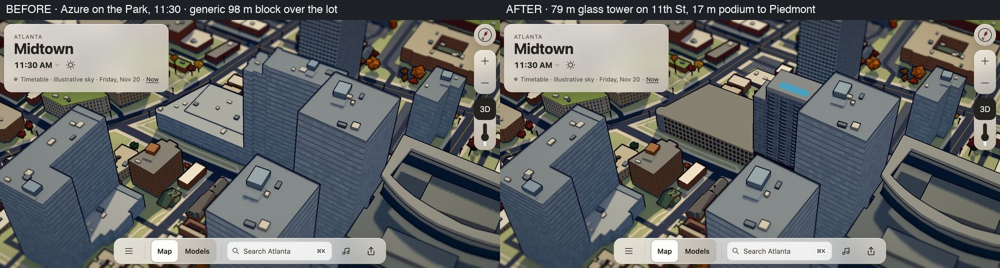
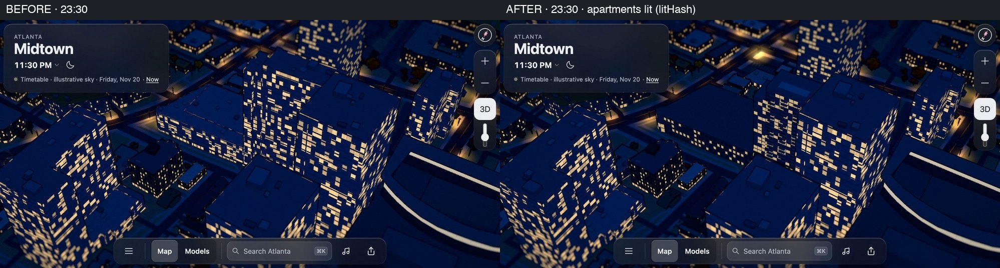
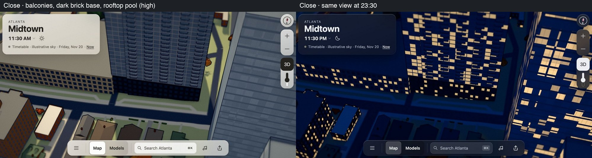

# Azure on the Park

`osm:way:536885864` (1020 Piedmont Avenue, between 10th and 11th Streets by Piedmont Park; 25 storeys, 329 units, completed February 2017) was drawn as one generic 98 m block over its whole lot. City now draws the tower and its podium separately, at their lidar heights.

| Element | Plan (City m) | Roof, NAVD88 | Basis |
|---|---|---|---|
| Tower on 11th Street, at the west end of the lot | x 911–956, z −3225…−3205 | roof 358.5 (about 79 m above the 279.7 m grade), parapet 361 | 3DEP lidar, 22 April 2019: median 358.5, 90th percentile 361.0, max 364.0 |
| East step of the tower | x 956–966 | 348.9 | lidar median |
| Four-storey podium to Piedmont Avenue, with the rounded corner at 11th | x 966–1052 | 297.5 (about 17 m) | lidar median |

The mapped 98 m is the OSM tag.

## Evidence

- **Contractor's exterior photographs** (Brasfield & Gorrie): the tan precast podium with the rounded blue-glass corner on Piedmont, and the tower's floor-to-ceiling glazing and rooftop pool, which is cantilevered off the 23rd floor. [Brasfield & Gorrie project page](https://www.brasfieldgorrie.com/projects/azure-on-the-park/)
- **Street View, dated and cited, not copied:** March 2025 from 11th Street looking south shows the tower's blue curtain glass, cantilevered balconies with glass rails and dark-brick lower floors. March 2025 from Piedmont Avenue looking west shows the podium's rounded glass corner.

## Model

- **Tower:** blue-grey glass at 3.2 m bays with 0.92 fill. Balcony stacks about 10 m apart on the 11th Street and south faces, high tier only. Dark brick up to the podium line. The pool sits on the roof, high tier only.
- **Podium:** tan precast with punched windows. The rounded north-east corner is glazed blue.
- **Glass:** base `#9aa7b3` (S 14%, V 70%). Rendered at 11:30 on the high tier: sunlit face S 6 / V 56, which passes. Shaded faces read S 35–36 / V 29–31, against generic shaded glass at S 10 / V 39 in the same frame. A first base, `#8fa6bd` (S 24), shaded to S 45, so it was desaturated.
- **Low tier:** one pane row per three floors on the tower, and two pane rows on podium faces over 20 m.

## Geometry

The high tier was thinned (3.2 m bays and 10 m balcony spacing, down from 1.6 m and 7.5 m) because high-tier geometry is close to its ceiling. Same-session `pnpm test:perf` figures are in the PR.

## Night

No night photograph was found. Lit rooms come from the shared `litHash(seedOf(id), face, floor, bay)` at 45%, and the podium shopfronts at 40%. The pool and crown are unlit.

## Review views

| View | City query |
|---|---|
| Day, from the north-west over 11th Street (high) | `?view=city&q=high&t=2026-11-20T11:30:00-05:00&cam=980,-3205,150,45,480` |
| Full night, matched | `?view=city&q=high&t=2026-11-20T23:30:00-05:00&cam=980,-3205,150,45,480` |
| Starting camera, low, day and night | `?view=city&q=low&t=2026-11-20T11:30:00-05:00&cam=990,-3206,32,60,240` (23:30 for night) |
| Close: balconies, brick base and pool | `?view=city&dev&mindist=20&q=high&t=2026-11-20T11:30:00-05:00&cam=945,-3215,170,38,250` |
| Glass check, sunlit face | `?view=city&dev&mindist=20&q=high&t=2026-11-20T11:30:00-05:00&cam=938,-3200,330,35,220` |

