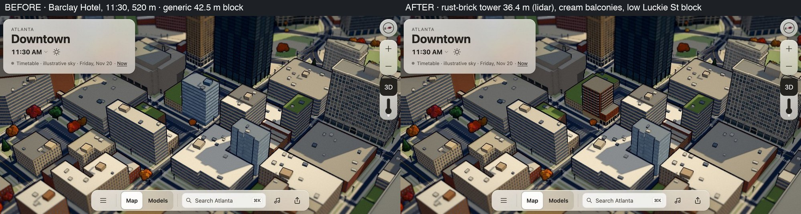
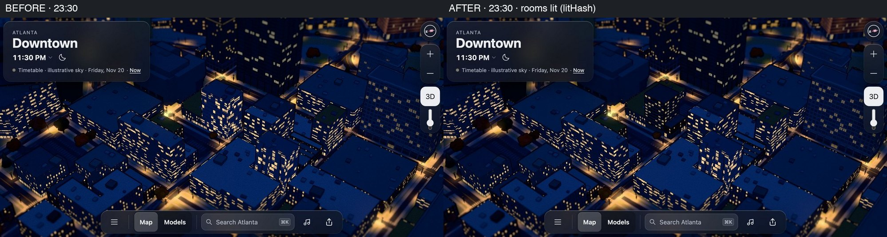
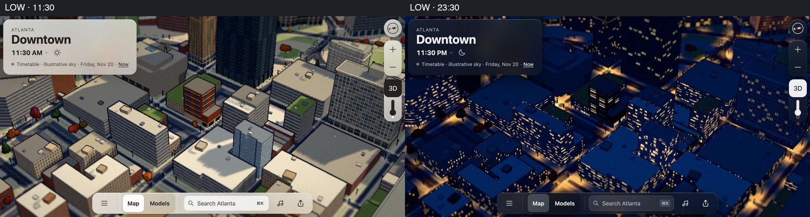
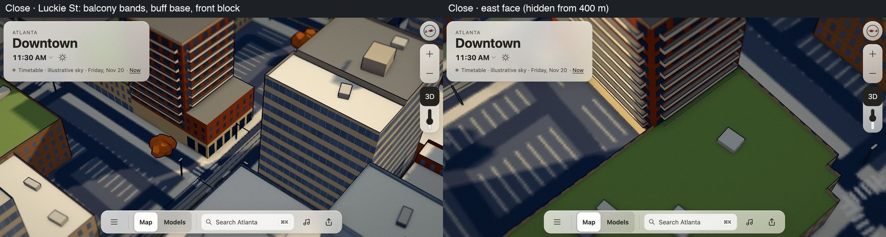
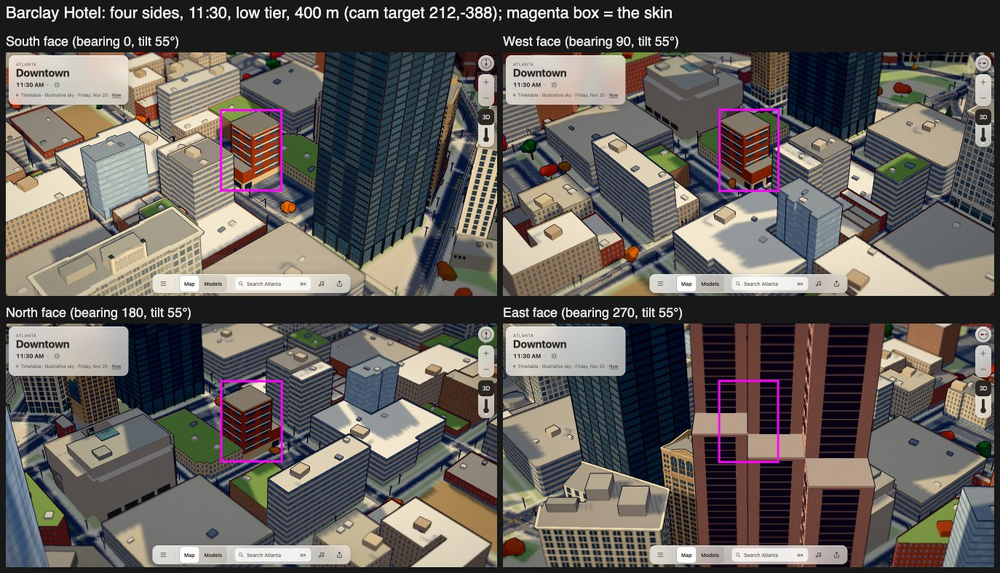

# Barclay Hotel Atlanta Downtown

Overture `b1de136a-283a-4674-8b5d-9d354d59c6fa` is the Barclay Hotel at 89 Luckie Street, formerly Quality Inn Downtown. City drew a generic 42.5 m block. It now draws the hotel as the lidar and photographs show it.

| Element | Plan | Height | Basis |
|---|---|---|---|
| Tower | the east 75% of the outline's long axis | 36.4 m roof (parapet peaks to 41.2) | 3DEP lidar, 22 April 2019: median 36.4 over the outline. The 321.0 m NAVD88 grade is the median of ground returns 3–20 m around it. |
| Low front block on Luckie Street | the remaining 25% | 12.9 m | lidar 25th percentile (the low returns cluster at that corner) |

The split position along the long axis is estimated from where the low returns cluster.

## Identifying features
From Street View: 93 Luckie Street (Dec 2025), 123 Fairlie Street (Mar 2025) and the Rialto side (Apr 2017), cited, not committed.
- Rust-red brick (`#a4553f`) over a buff stone base (`#d6c4a2`), with a stone cornice.
- Cream balcony bands (`#ece4d2`) stacked on every floor of the tower's long faces.
- A lower brick block on Luckie Street with an arched, buff-trimmed entrance.
- The vertical hotel-name blade sign is left out under the no-logos rule.

## Night
No night photograph exists. Rooms are lit from the shared litHash at 50%, and the entrance and lobby glazing too.

## Views
| View | Query |
|---|---|
| Money shot, 520 m, day and night | `?view=city&q=high&t=2026-11-20T11:30:00-05:00&cam=212,-388,100,52,520` (23:30 for night) |
| Close, Luckie Street | `?view=city&dev&mindist=20&q=high&t=2026-11-20T11:30:00-05:00&cam=205,-380,100,45,170` |
| Close, east face (hidden behind a taller neighbour from 400 m) | `&dev&mindist=20&cam=225,-392,270,30,110` |
| Four-side | `node scripts/four-side-sheet.mjs --id b1de136a-283a-4674-8b5d-9d354d59c6fa --ground 321.0 --top 36.4 --dist 400` |

