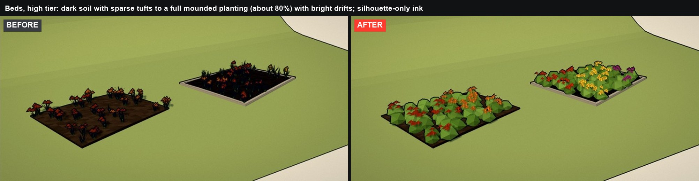

# Planted beds

Sam's review of #263: the beds read almost black, as if the soil took over. The cause was coverage, not soil colour.

- **Fill.** Planting covers about 80 % of each bed (`cover`, default 0.8) as a mounded mass of mid-green foliage. On high it is packed single-lump mounds on a jittered 0.7 m grid; soil shows only in a 0.2 m margin and small gaps.
- **Blooms.** Larger clusters (five 0.15–0.21 m petals) ride on top in drifts of two or three of the season's colours. Late season is brighter mums, pansies and ornamental-cabbage tones.
- **Ink.** Planting is its own child mesh, registered with the tree agent's `inkFoliageMesh` (mode 1: silhouette only). There are no outlines inside the planting, only around the bed. That costs one more draw per landscape mesh that has beds.
- **Low tier.** Each bed is a single draped, mounded mass, foliage with bloom in smooth drift patches. It never reads as an empty dark rectangle. ([low](beds-low.jpg))
- **Unchanged.** Both soils (brown default and opt-in rich-black) stay as they were; they simply show much less. `flowers: 0` beds, such as the High's ginkgo mulch mound, stay bare unless `cover` is set.

Views use the same lab camera as #263: [high](beds-high.jpg) · [low](beds-low.jpg) · [night, high](beds-night.jpg) · [night, low](beds-low-night.jpg). Planting and colour are `illustrative`. Publishing needs a web rebuild only.
