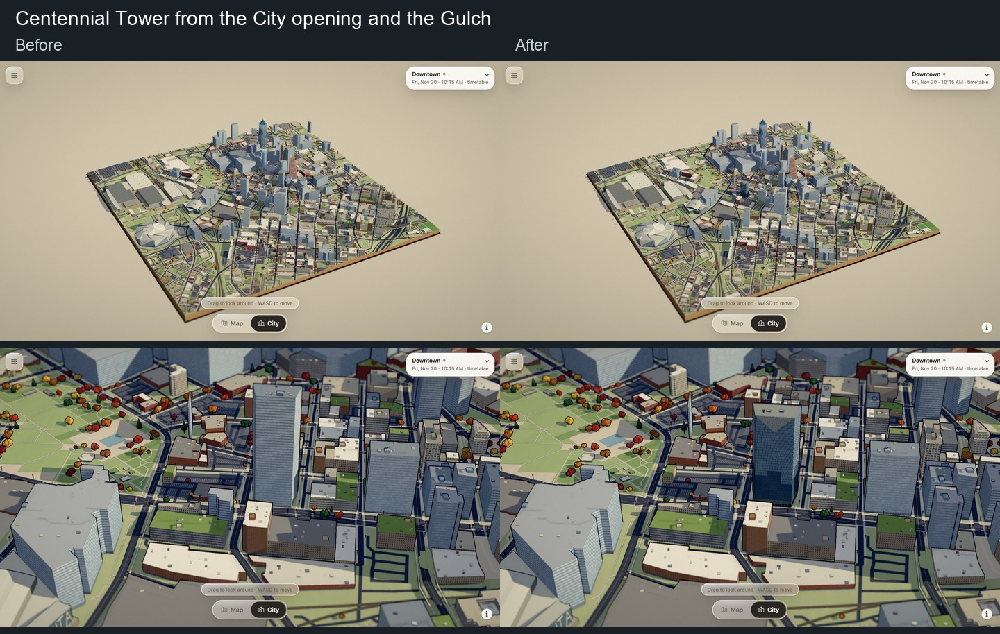

# Centennial Tower, 101 Marietta

## What is on the skyline

The four-corner building at 101 Marietta Street has a trapezoidal plan. Its opposing broad faces measure 48.1 and 60.7 m along the baked outline, about 32.8 m apart. Each carries a downward-pointing fan of silver fins. The narrow faces continue straight up to a level rim. Elevations in the signage application show which faces carry the triangles. Its existing-condition photographs distinguish the storefront and adjoining garage from proposals for digital advertising. City replaces only the office-tower feature. [Four elevations, exhibits 4–5](https://ctycms.com/ga-atlanta/docs/ncept-agreement-package---101-marietta---small.pdf#page=3) · [July 2018 park photograph](https://commons.wikimedia.org/wiki/File:101_Marietta_from_Centennial_Park,_Atlanta,_GA_July_2018_2.jpg) · [Q2 2026 exterior, first property on page 3](https://www.lee-associates.com/atlanta/wp-content/uploads/sites/77/2026/07/Atlanta-Office-Market-Report_2026_Q2.pdf#page=3)

| Height or dimension | Evidence | City treatment |
| --- | --- | --- |
| 164 m, 36 floors | Existing baked record, id `0f60407e-dc16-401f-8371-d8daed2807f1` | Retain the footprint and replace the generic extrusion. |
| 140 m architectural height | Council on Tall Buildings and Urban Habitat | Independent published height with its own reference point. |
| 457.8 m NAVD88 roof deck | 5,425 USGS 2018 returns within the footprint. Median 457.8 m, 90th percentile 458.0 m. | About 135 m above adjacent terrain around 322–323 m. |
| 459.0 m NAVD88 typical rim | Upper edge returns on all four faces cluster around 458.9–459.0 m. Small roof equipment reaches 460.7 m in the survey. | Use the measured rim and place three equipment groups. Their exact outlines are estimates. |
| 48.1 and 60.7 m long faces | Measured on the mapped quadrilateral. Drawings give the longer face as 199 ft 7 in (60.83 m). | Follow the four surveyed corners, including the unequal parallel sides. |

The west elevation drawing gives 442 ft 6 in (134.9 m) for the building face. Survey elevation and architectural height use different references. Subtracting the ground samples at the four corners (321.8–323.7 m) gives approximately 135–137 m to the typical rim. The architectural-height listing does not identify the entrance elevation used for its 140 m figure. City uses the measured roof for alignment with the other towers. [USGS Georgia B2 point cloud](https://s3-us-west-2.amazonaws.com/usgs-lidar-public/GA_Statewide_B2_2018/ept.json) · [CTBUH tower record](https://www.skyscrapercenter.com/atlanta/centennial-tower/4332)

The rail-deck panorama shows the tower beyond the parking levels. At Marietta Street, light-colored stone piers frame two bands of glazing under the mirror-glass shaft. The park photograph shows the thin joints and darker reflections near the foot. Fin spacing and depth, the triangles’ drop, window spacing, reflected colors and storefront dimensions are visual estimates. The evening treatment takes its warm red fins and lit roof edge from a June 18, 2010 photograph. Color and office occupancy are illustrative. [2017 rail-deck panorama](https://www.google.com/maps/@?api=1&map_action=pano&pano=CIHM0ogKEICAgIDqi4CYcg&heading=73.12&pitch=14) · [April 2026 at 72 Marietta](https://www.google.com/maps/@?api=1&map_action=pano&pano=SB2LbJV1LMxu27DjyOV4Jg&heading=357.77&pitch=25) · [June 2010 night photograph](https://www.flickr.com/photos/gaensler/5456144186)

## City cameras

Orca at 1296 × 726, high quality, November 20, 2026, clock stopped. Day is 10:15 EST, dusk is 17:24 EST and night is 20:15 EST. Orbit target is City x/z, bearing and tilt are degrees, scale is metres per pixel. Perspective eye and target give x/z and height above the City datum.

| View | Camera | Before | After |
| --- | --- | --- | --- |
| Opening | Target (−40, −260), 28°, 57°, 2.945 | [Day](opening-before.jpg) · [Night](opening-night-before.jpg) | [Day](opening-after.jpg) · [Night](opening-night-after.jpg) |
| Gulch | Target (−55, −377), 42°, 55°, 0.53 | [Day](gulch-before.jpg) · [Dusk](gulch-dusk-before.jpg) · [Night](gulch-night-before.jpg) | [Day](gulch-after.jpg) · [Dusk](gulch-dusk-after.jpg) · [Night](gulch-night-after.jpg) |
| Centennial Olympic Park approach | Eye (−200, −660, 14) to (−48, −336, 65), FOV 46° | [Day](park-before.jpg) · [Night](park-night-before.jpg) | [Day](park-after.jpg) · [Night](park-night-after.jpg) |
| From the rail deck | Eye (−372, −239, 13) to (−50, −339, 55), FOV 47° | [Day](bridge-before.jpg) | [Day](bridge-after.jpg) |

At the daylight opening, draw calls go from 145 to 151 and triangles from 2,252,931 to 2,269,163 (+16,232). This is client geometry using the existing bake.
