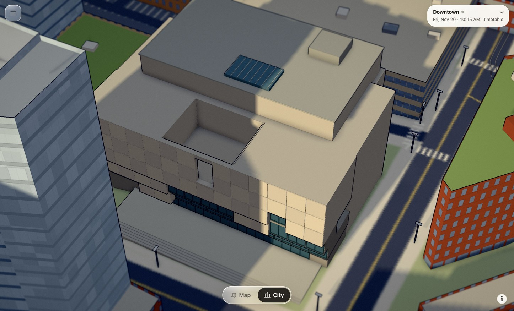

# Atlanta Central Library at Margaret Mitchell Square



| Camera | Before | Daylight | Dusk |
| --- | --- | --- | --- |
| City opening | [Before](opening-before.jpg) | [Day](opening-day.jpg) | [Dusk](opening-dusk.jpg) |
| Forsyth Street | [Before](street-before.jpg) | [Day](street-day.jpg) | [Dusk](street-dusk.jpg) |
| Fairlie side | [Before](rear-before.jpg) | [Day](rear-day.jpg) | [Dusk](rear-dusk.jpg) |

The library occupies a small patch at the ordinary opening. The Forsyth angle brings the terrace and plaza into view between the surrounding towers.

## Footprint and photographs

The named Overture polygon `9578af9e-4715-40b8-822a-047b4cf16d9a` has a 60.5 m edge parallel to Forsyth, a 38.8 m return toward Fairlie and an additional back section reaching 49.5 m. The inferred envelope retains the hotel across Carnegie and the garages on the adjoining blocks. City previously applied the bake’s six-floor, 21.45 m height to the entire footprint.

- The 2018 Georgia Historic Preservation Division nomination summary describes eight above-grade floors, two below, a recessed main entrance on Forsyth, and the seventh and eighth floors set back from the sixth. Fulton County records the fifth-floor outdoor space and the renovation completed in 2021. Only the exterior above ground is modeled. [State architectural survey](https://gadnr.org/sites/default/files/hpd/pdf/National_Register/Atlanta-Fulton%20Central%20Library_summary.pdf) · [Fulton County Library System history](https://www.fulcolibrary.org/central-library/special-collections/Central-History/)
- Cooper Carry’s renovated Forsyth elevation shows the open slot high in the concrete screen, a smaller inset window nearer Carnegie, and two groups of lower glazing at different depths above the lobby. Two oblique views establish which parts of the concrete project beyond the glazing. The side toward Williams has long sections of uninterrupted concrete. [Forsyth elevation](https://www.coopercarry.com/wp-content/uploads/2021/12/atlanta-fulton-county-library-architecture-4.jpg) · [Carnegie corner](https://www.coopercarry.com/wp-content/uploads/2021/12/atlanta-fulton-county-library-architecture.jpg) · [Williams corner](https://www.coopercarry.com/wp-content/uploads/2021/12/atlanta-fulton-county-library-architecture-2.jpg)
- The aerial resolves the recessed area behind the Forsyth screen, a glazed rooflight and a compact service enclosure. The upper tiers are inset. The Fairlie Street photograph supplies the broad service-door treatment. [Esri overhead](https://server.arcgisonline.com/ArcGIS/rest/services/World_Imagery/MapServer/export?bbox=-84.38922,33.75709,-84.38776,33.75845&bboxSR=4326&imageSR=3857&size=900,980&format=jpg&f=image) · [Fairlie view](https://www.google.com/maps/@?api=1&map_action=pano&viewpoint=33.75804,-84.38875&heading=135&pitch=12&fov=88)

## Measurements and estimates

The 60.5 m frontage provides the scale for the front photograph. Its broad concrete face rises about 27 m, with a modeled 32.7 m setback roof and a 35.2 m service enclosure above the ground sampled at the middle of the Forsyth entrance. These heights, the opening depths, panel spacing, colors and rooflight size are estimates. The high slot opens into a roughly 15 m deep terrace in the model. The library documents the terrace independently. The night light behind the recessed windows is illustrative.

The daylight opening goes from 141 to 145 draw submissions and from 2,143,907 to 2,149,759 submitted triangles on the comparison build. Two static meshes use City’s existing ground and night controls. Missing terrain or an incompatible building outline keeps the standard extrusion. This change needs the usual web rebuild and deployment using the existing downtown bake.

## Reproducing the views

Before frames use `4c2f0aa`. In desktop Orca use a 1120 × 840 viewport and `/?view=city&q=high&t=2026-11-20T14:12:45-05:00&speed=0`. Change the clock to `17:45:00` for dusk. Leave the camera untouched for the ordinary opening.

```js
// Framed Forsyth view above the table, with the clock at 10:15:00.
window.__city.lookAt(283, -434, { bearing: -68, metresPerPixel: .092, tilt: 44 })
// Matched views.
window.__city.lookAt(283, -439, { bearing: -52, metresPerPixel: .105, tilt: 45 })
window.__city.lookAt(298, -423, { bearing: 125, metresPerPixel: .13, tilt: 38 })
```
