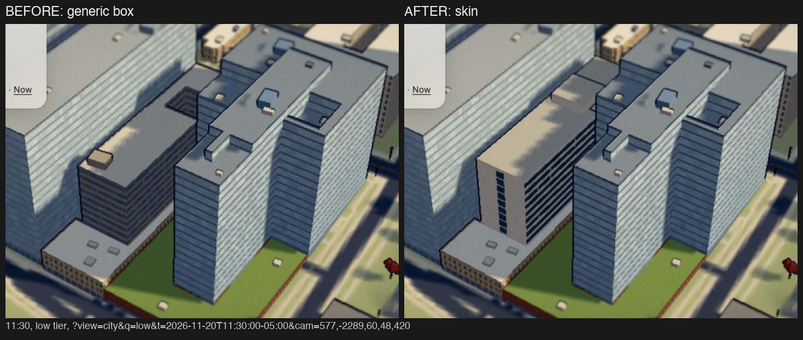
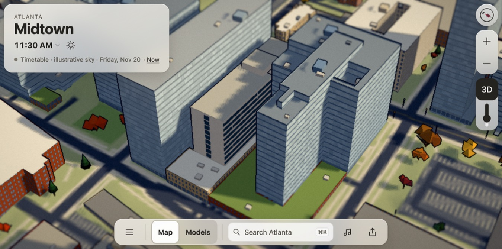
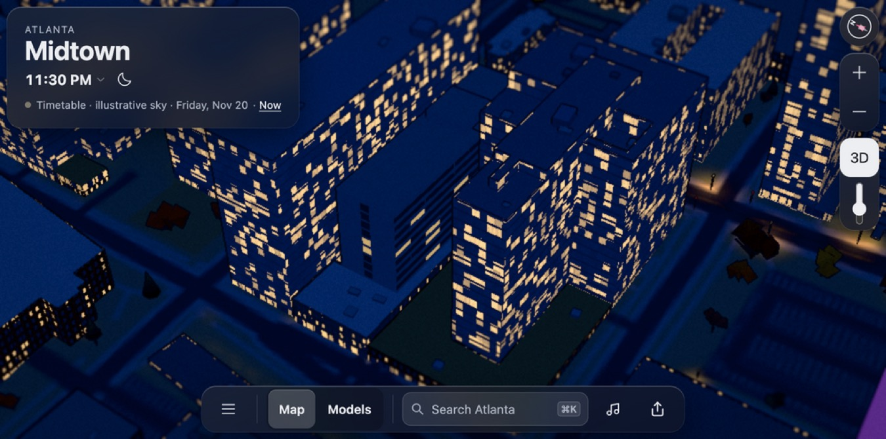
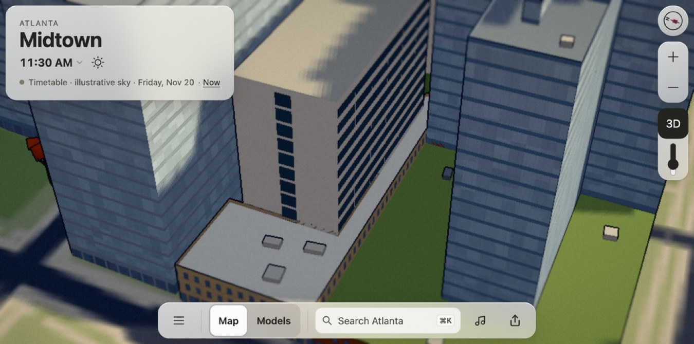
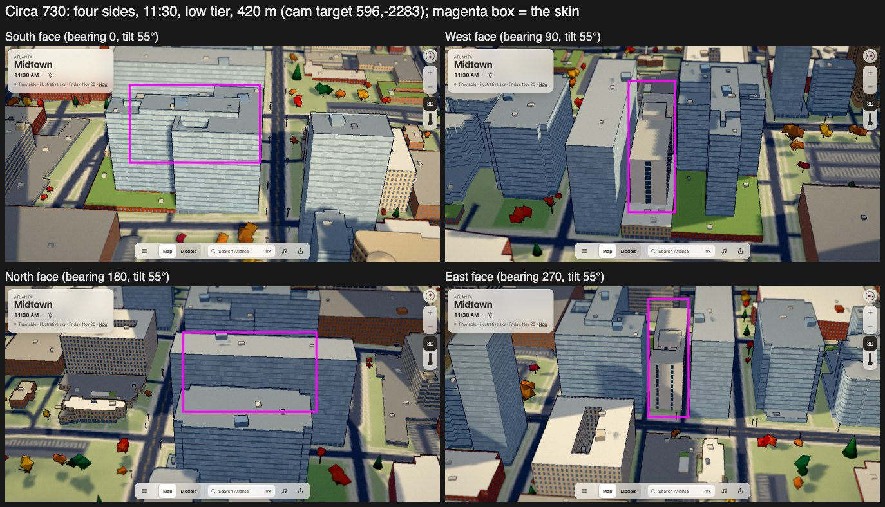

# Circa 730

City replaces the generic mesh for `osm:way:234938413`, Circa 730 at 730 Peachtree Street, a 1960s 11-storey office slab repositioned in 2019 for tech and creative tenants. **Height basis: lidar 2019.** An 8 m grid of 90th-percentile returns over 305.2 m ground puts the slab at 44 m, a central rooftop core at 48–49 m, the low wing on Peachtree (now an amenity roof with swings) at about 8 m, and the east strip at a single storey.

**Identifying features** (from the owner's photographs, confirmed with the lead):
1. Continuous horizontal ribbon windows between white precast bands on the long faces. City draws the ribbons dark (`#4f6670`, `#566d77`) against bright white bands (`#f3f2ee`) so the stripe reads at 500 m against the generic pale grids.
2. Solid white end walls with a single central glazed slot.
3. A glass lobby recessed under the slab at the street.

Estimated details: the 5.2 m lobby, the ten office floors at about 3.8 m, the ribbon height (55% of each floor), the slot width (16% of each end), and the core footprint.

Sources, consulted in a fresh Orca tab:
- [Circa 730 owner's site](https://circa730.squarespace.com): exterior from Peachtree, lobby, and amenity roof.
- [LoopNet listing](https://loopnet.com/Listing/730-Peachtree-St-NE-Atlanta-GA/13159968): aerial of the slab and its Peachtree wing.

**Lighting:** No full-night photograph was found. City treats it as an office: mostly dark ribbons at 23:30 (10% lit) through the shared lit-pane hash, with a lit lobby and wing.

**Views:** Circa is 44 m between taller neighbours. Taller towers hide its long faces from due north and due south, so the review views look from the west-south-west, where the sunlit west end and the south ribbons show. In November at 11:30 the generic box at Crest's site still shades part of the south face.

| Review view | City query |
|---|---|
| Day, from the west-south-west | `?view=city&q=low&t=2026-11-20T11:30:00-05:00&cam=577,-2289,60,48,420` |
| Full night, matched | `?view=city&q=low&t=2026-11-20T23:30:00-05:00&cam=577,-2289,60,48,420` |
| Closer west end and wing | `?view=city&q=low&t=2026-11-20T11:30:00-05:00&cam=560,-2289,70,50,220` |

