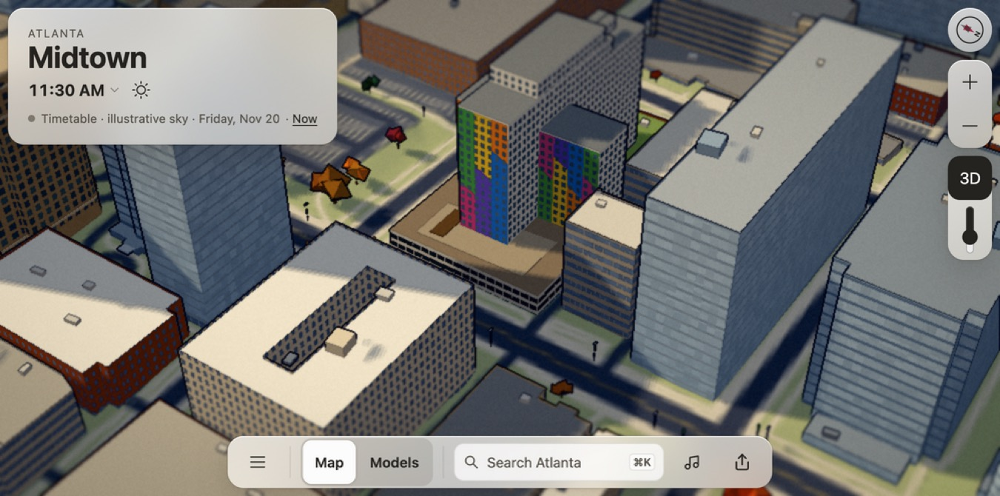
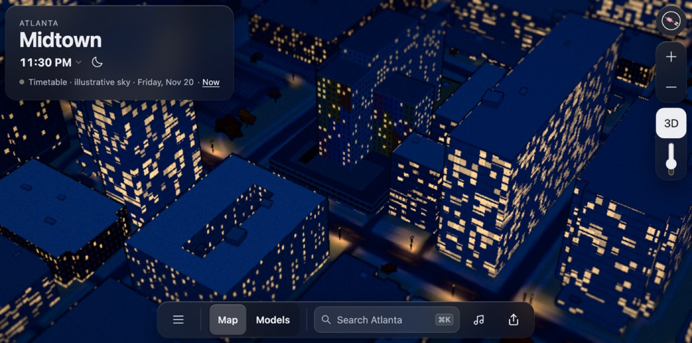
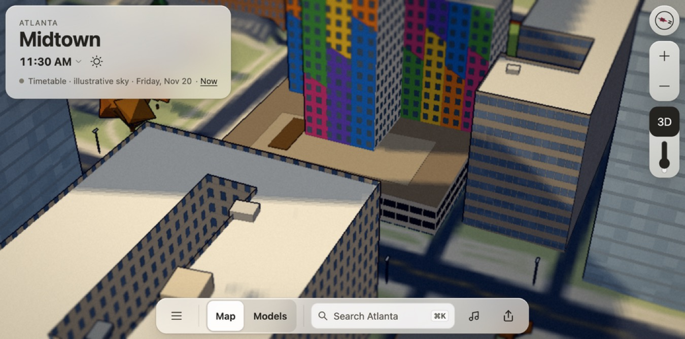

# Crest on Peachtree

City replaces the generic mesh for `osm:way:234938416`, Crest on Peachtree at 710 Peachtree Street, an 18-storey white apartment tower over a garage. **Height basis: lidar 2019.** skins-6 measured each part, and an 8 m grid of 90th-percentile returns over 307.2 m ground confirms it:

| Mass | Height | Replaces |
|---|---|---|
| Main slab | 58 m, with a 64 m centre section | 68.4 m (inferred) |
| North and south wings | 46 m | 57.6 m (inferred) |
| West block | 52 m | the 64.8 m "podium" (inferred) |
| East garage podium | 11.5 m | — |

The garage roof is the residents' deck.

The photographs show a plain white tower with tight punched windows. Street View on Peachtree shows white façades, a dark garage screen at the base and a small lobby. The listing photograph taken from the roof deck shows a large abstract mural in sweeping pink, orange, yellow, green, blue and purple shapes, covering the walls that rise above the deck. City paints those deck-facing east walls (the slab end and the two wings above the 11.5 m deck) in broad slanted colour bands behind the windows. **Inferred:** the exact extent of the mural, the shapes of the bands, and which walls beyond the two in the photograph are painted. No source names the artist or describes the mural. Estimated details: the 2.6 m window bay and 3 m floor pitch, the deck layout, and the 4.2 m lobby glass.

Sources, consulted in a fresh Orca tab:
- [Apartments.com listing photographs](https://www.apartments.com/crest-on-peachtree-atlanta-ga/2mpprxb/): the mural above the deck, and the deck itself.
- [Google Street View on Peachtree (via Zillow)](https://www.zillow.com/apartments/atlanta-ga/crest-on-peachtree/5Xhtvp/): white façades, garage screen and lobby.

**Lighting:** No full-night photograph was found. City treats Crest as residential, with about a third of units lit at 23:30 through the shared lit-pane hash, a lit lobby, and the mural unlit.

| Review view | City query |
|---|---|
| Day, over the deck from the east | `?view=city&q=low&t=2026-11-20T11:30:00-05:00&cam=600,-2242,240,50,420` |
| Full night, matched | `?view=city&q=low&t=2026-11-20T23:30:00-05:00&cam=600,-2242,240,50,420` |
| Closer mural and deck | `?view=city&q=low&t=2026-11-20T11:30:00-05:00&cam=605,-2240,250,55,220` |

