# Midtown culture: before and after

Each image shows BEFORE on the left and AFTER on the right, taken from the same production camera. A yellow ring marks the subject. BEFORE is main at 6538ae2, before this workstream's Mitchell, Varsity and High changes. All views are clear weather, high tier, on November 20, 2026.

1. **High Museum ramp** (#195). Camera `/?view=city&cam=595,-4012,-45,55,150`, 13:00.
   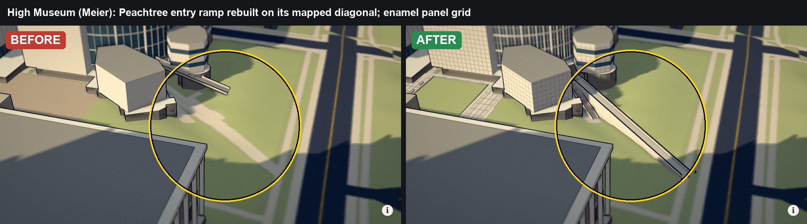
2. **High Museum atrium and enamel grid** (#195). Camera `/?view=city&cam=555,-4022,-40,62,150`, 13:00.
   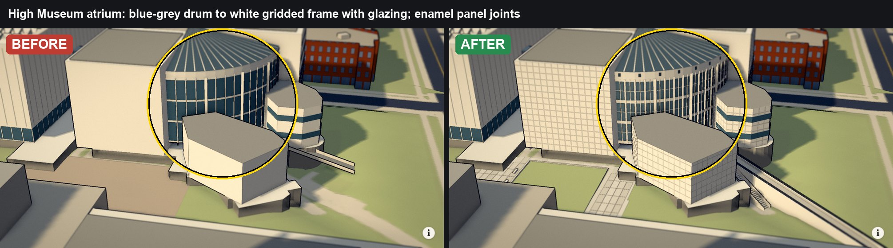
3. **Sifly Piazza** (#198). Camera `/?view=city&cam=540,-3972,150,45,150`, 13:00.
   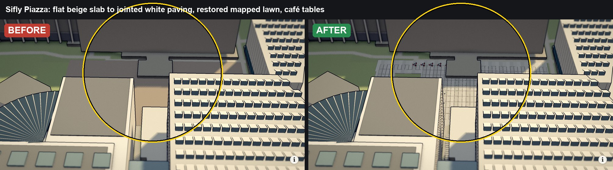
4. **The Varsity, day** (#184). Camera `/?view=city&cam=205,-1965,20,55,150`, 13:00.
   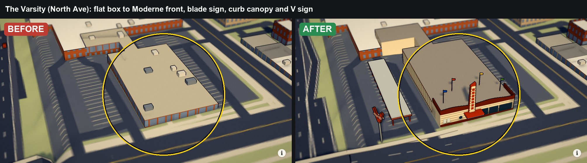
5. **The Varsity, night** (#184). Same camera, 23:00.
   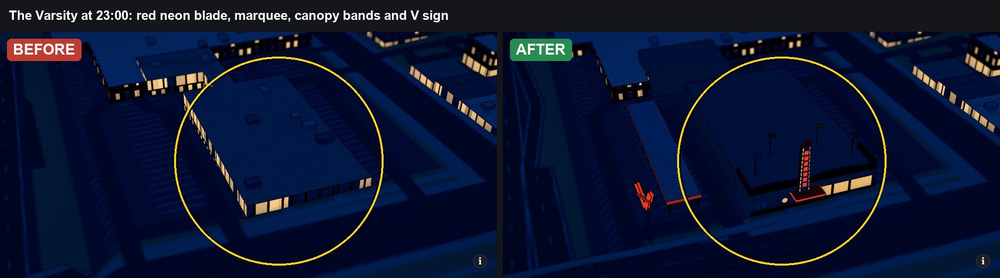
6. **Margaret Mitchell House** (#177). Camera `/?view=city&cam=648,-3062,-113,49,150`, 13:00.
   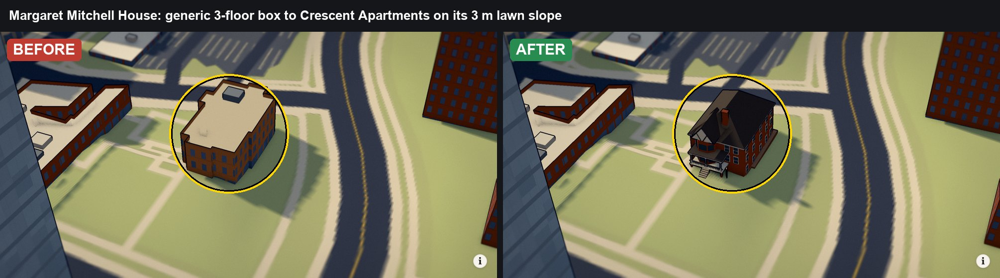
7. **Woodruff Arts Center rear, day** (#206). Camera `/?view=city&cam=570,-3914,70,55,150`, 13:00.
   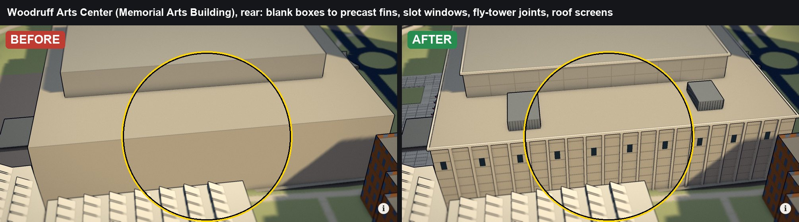
8. **Woodruff Arts Center rear, night**. Same camera, 23:00.
   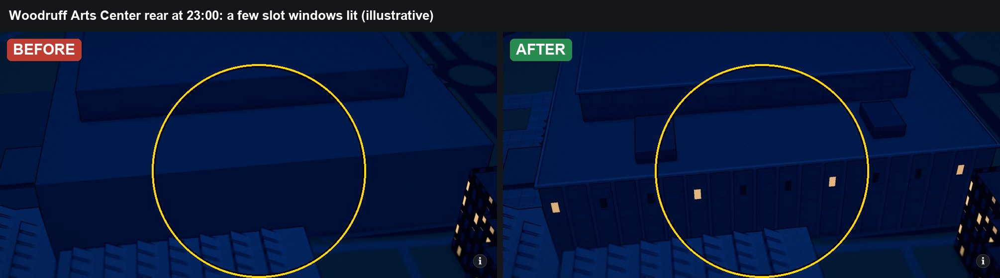
9. **High Museum entry plaza** (entry gap). Camera `/?view=city&cam=577,-4017,0,5,150`, top-down, 13:00.
   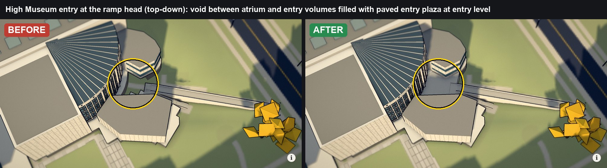
10. **High Museum Peachtree lawn**. Camera `/?view=city&cam=612,-4002,-70,50,150`, 13:00.
   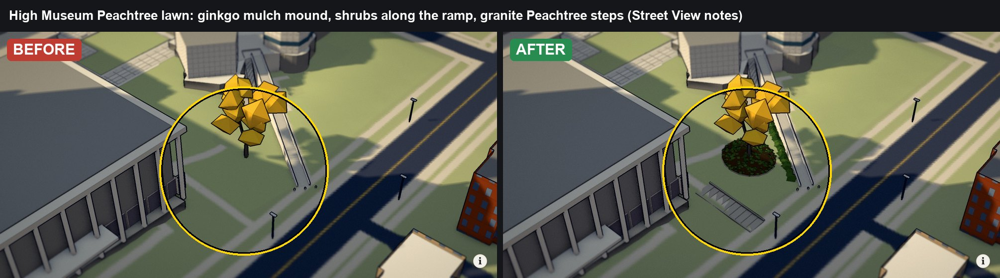
11. **High Museum Peachtree turf**. Camera `/?view=city&cam=612,-4002,-70,50,150`, 14:00.
   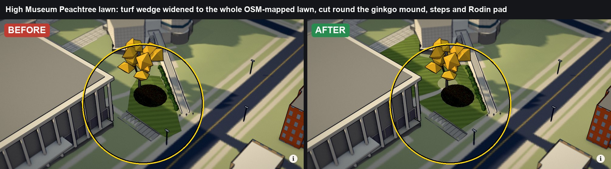
12. **High Museum Peachtree lawn, manicured**. Camera `/?view=city&cam=612,-4002,-70,50,150`, 14:00.
   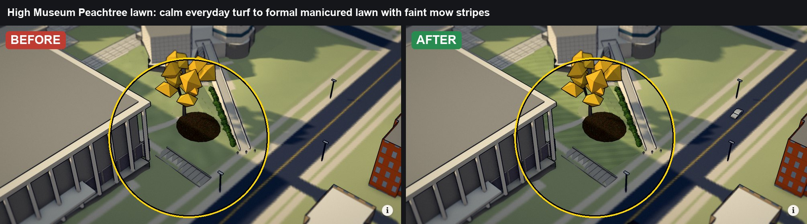
