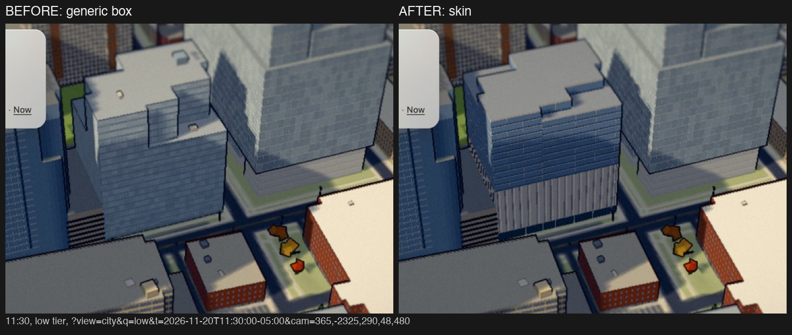
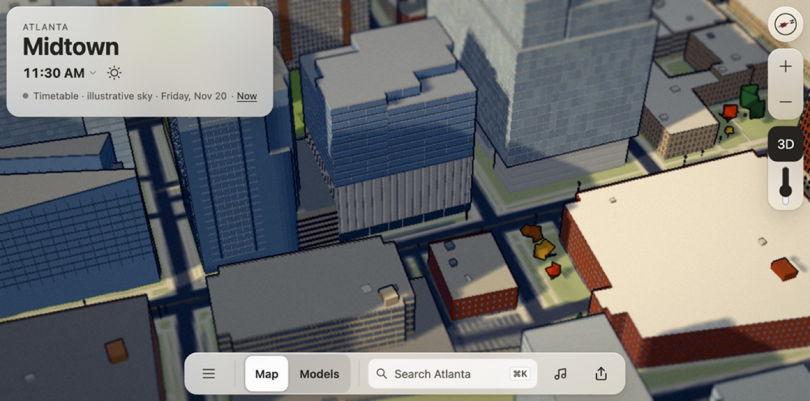
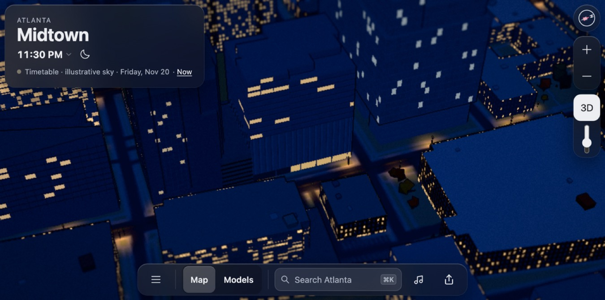
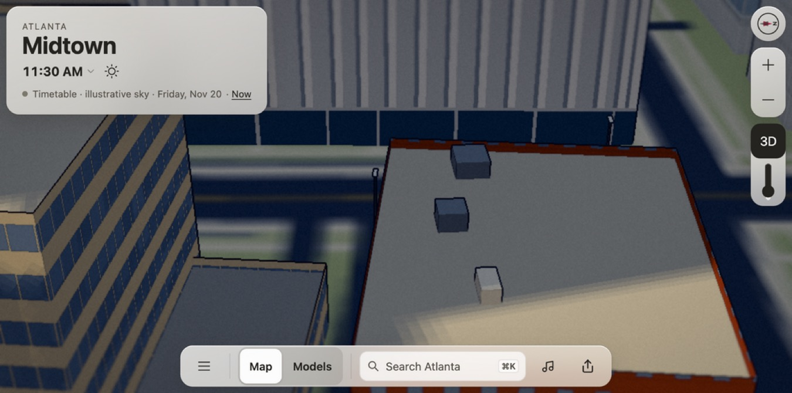
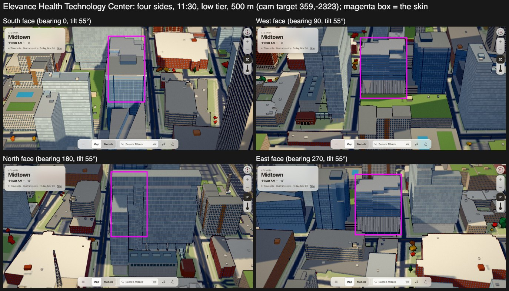

# Elevance Health Technology Center

City replaces the generic mesh for `osm:way:996610148`, the Elevance Health (formerly Anthem) Technology Center at 740 West Peachtree (John Portman & Associates, 2020, 21 storeys). **Height basis: lidar 2019.** An 8 m grid of 90th-percentile returns over 297.1 m ground puts the central tower at 76 m and the two wings at 68–73 m (City uses 70 m); the wings are the mapped "podium" parts, inferred at 54 m. A 104 m return at the north-west corner appears in no photograph and is treated as a construction crane (the April 2019 flight predates the opening).

**Identifying features** (AIA Atlanta award photographs, two angles):
1. A glass-walled lobby under a cantilevered base.
2. The parking floors above it, wrapped in a pale silver vertical-fin metal screen with a large triangular fold near the West Peachtree corner.
3. A blue reflective glass tower above the screen, with horizontal spandrel bands, stepping back in tiers.

The silver screen against the blue glass is what tells it apart from the generic curtain walls. Estimated details: the 7 m lobby, the screen from 7 to 34 m, the 1.6 m fin spacing (4 m on low tier), the 3.95 m floor pitch, and the fold's position and size.

**Not drawn yet:** the 16th-floor sky bridge to 712 West Peachtree. It spans 12.3 m beyond this footprint, past the skin footprint audit's 2.5 m allowance, so it waits for a per-part allowance in the audit. 712's skin draws no bridge stub.

Sources, consulted in a fresh Orca tab:
- [AIA Atlanta design award entry](https://aiasar.secure-platform.com/a/gallery/rounds/43/details/17104): corner exterior with the fin screen and fold, and an aerial rendering of the tiers.
- [Epsten Group project page](https://epstengroup.com/project/740-west-peachtree): the blue glass tower from West Peachtree.
- [Henry Inc. project page](https://henryinc.com/portfolio/anthem-technology-center/): glass and metallic finishes, and the 15 ft cantilever.

**Lighting:** No full-night photograph was found. City treats it as an office, mostly dark at 23:30 through the shared lit-pane hash, with a lit lobby.

**Views:** taller towers hide it from the north. The review views look from the east, where the morning sun is on the fin screen.

| Review view | City query |
|---|---|
| Day, from the east | `?view=city&q=low&t=2026-11-20T11:30:00-05:00&cam=365,-2325,290,48,480` |
| Full night, matched | `?view=city&q=low&t=2026-11-20T23:30:00-05:00&cam=365,-2325,290,48,480` |
| Close, the screen and lobby (dev server) | `?view=city&dev&mindist=40&q=low&t=2026-11-20T11:30:00-05:00&cam=395,-2320,270,60,120` |

