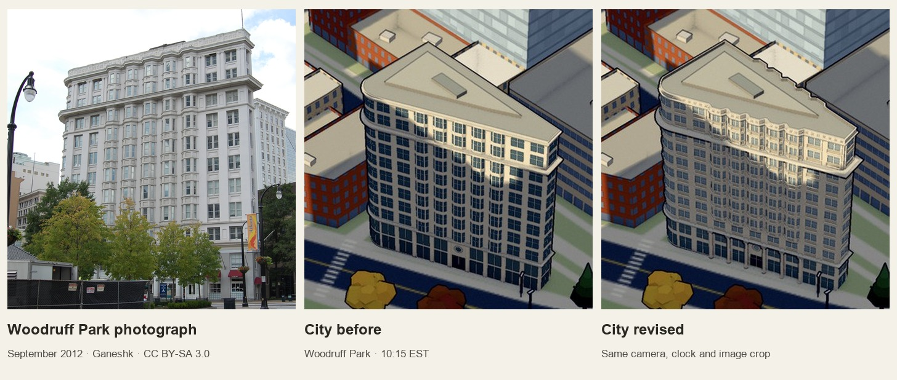

# Stone and glass on the Flatiron

The photograph shows two different cornices. The wide lower one throws a continuous shadow across Peachtree. Above it, the parapet steps forward over each of the five window bays. In the revised City view, watch the light catch those turns above the shadow line. Each projecting bay has a pair of front sashes, narrower side windows and a framed stone panel below the sill. The straight outer bays sit further back. [Full previous park view](facade-current.jpg) · [Full revised park view](facade-revised.jpg)

The left panel uses Ganeshk’s *Atlanta English-American Building 2012 09 15 01 6139*, September 15, 2012, cropped and resized under CC BY-SA 3.0. The comparison image is distributed under the same license. The two City panels use identical crops. [Original photograph and attribution](https://commons.wikimedia.org/wiki/File:Atlanta_English-American_Building_2012_09_15_01_6139.JPG) · [License](https://creativecommons.org/licenses/by-sa/3.0/)

## What the street view adds

The March 2025 Peachtree panorama shows a plain story immediately above the portico. The canted windows begin in the next story. Sam’s two close photographs show the dark head of each sash recess, a shallow rectangular field below each sill and a continuous cap above the entrance columns. From across the street, morning light catches the shafts and flared capitals while the glazing sits in shadow behind them. [March 2025 Peachtree panorama](https://www.google.com/maps/@?api=1&map_action=pano&pano=d0zL4yhYhgkAde4_b5XFTA&heading=329.42&pitch=52&fov=47) · [Park photograph from the Poplar side](https://commons.wikimedia.org/wiki/File:Atlanta%E2%80%99s_Flatiron_Building_viewed_from_Woodruff_Park.jpg) · [Street detail before](street-current.jpg) · [Street detail after](street-revised.jpg)

The original 12-vertex footprint has 38.22 m and 39.61 m long faces. The 44 m roof datum comes from the City bake and the earlier lidar check. The two-story limestone base, seven-story shaft and two-story cap are documented. The relief dimensions are **photo-based estimates**. The model projects the main bays 1.03 m from the wall and the upper bays 0.86 m. It sets sash glass 0.205 m behind its surround and the stone tablets 0.14 m behind their frames. The principal cornice projects 1.48 m. Storefront glass sits about 0.55 m behind the wall plane, with about 1.25 m from glass to shaft front. The parapet’s four-petal relief simplifies the photographed ornament. [Footprint and lidar measurements](../flatiron/README.md) · [National Register description, p. 2](https://npgallery.nps.gov/GetAsset/bf869059-2885-4fba-8b18-906de121b4d4#page=2)

At night the lower stone picks up the warmth of the sidewalk. The cornices receive ambient light. The office-window pattern is illustrative. The 2017 blue-hour park photograph and the owner’s 2018 event photograph informed that treatment. [Downtown Counts, p. 10](https://ctycms.com/ga-atlanta/docs/downtown-counts_2017-reduced.pdf#page=10) · [Owner’s evening photograph](https://images.squarespace-cdn.com/content/v1/611fd546857f6c1cf9a3c938/1642792960214-6LDCCHF85NNYY7EKYGRQ/20181025_AHC_Party_With_The_Past_23.jpg)

## Matched City cameras

Desktop Orca at 1446 × 876, high quality and a paused clock. The before model comes from commit `6bbf14c`. Orbit settings give City target x/z, bearing, metres per pixel and tilt. The street cameras give eye → target in City x/y/z metres, with a 0.10 m near plane.

| Camera | Local time and settings | Before | Revised |
| --- | --- | --- | --- |
| Woodruff Park | Nov 20, 2026, 10:15 EST · (225, −221), 274°, 0.19, 48° | [Park](facade-current.jpg) | [Park](facade-revised.jpg) |
| Woodruff Park at night | Nov 20, 20:15 EST · same orbit | [Night](woodruff-night-current.jpg) | [Night](woodruff-night-revised.jpg) |
| Peachtree entrance in morning sun | Jun 12, 2026, 10:30 EDT · (273, −0.48, −208) → (256, 7.9, −221), 55° vertical FOV | [Street](street-current.jpg) | [Street](street-revised.jpg) |
| Peachtree looking up the bays | Nov 20, 10:15 EST · (261, −0.65, −204) → (250, 12.7, −220), 76° vertical FOV | [Elevation](peachtree-current.jpg) | [Elevation](peachtree-revised.jpg) |

The daylight park view goes from 1,991,415 to 2,025,219 submitted triangles, an increase of 33,804 (1.70%), at 65 draw calls in both frames. Counts include shadow passes. The production change requires a web rebuild with the existing City data.
