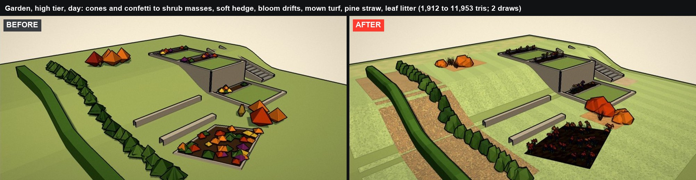

# Garden primitive polish

Sam's review of the first landscape kit: diamond "flowers", brown mulch, conical shrubs and flat green lawn. This pass, at the same lab camera (`/models.html?v=garden`, ¾ front), changes:

- **Flowers.** Each clump is now a tuft of blades with blooms on top. A blade is one triangle with two fixed feet on the ground, leaning outward at varied heights, following the trail-planting study's grouped blades. Small crossed-petal blooms cluster above the foliage. Each bed takes two or three colours from the season's palette and lays them out in drifts along a seeded axis, not as confetti. The low tier keeps 3 blades and 2 blooms per tuft. There is no gust animation yet. The trail study's motion was never merged, so this stays static, which also respects reduced motion.
- **Beds.** Dark, almost black soil in four tones with per-triangle speckle. It is slightly mounded (0.12 m by default) and has a clean spade-cut edge where the turf meets it. `edge: 'stone'` (or a `curb` height) keeps the stone curb. The soil now drapes the bed's exact outline, subdivided to 0.5 m (1.2 m on low).
- **Shrubs and hedges.** Shrubs are rounded masses of up to three jittered icosahedra, with flattened undersides and leafy per-face speckle. Clipped hedges have chamfered shoulders and a softly irregular top. Ornamental grasses are tall blade fountains.
- **Ground covers**, new in `web/src/landscape/ground-cover.ts`: mown turf (mow stripes and blade speckle), meadow grass, worn earth, mulch, pine straw and leaf litter. Patches drape exactly to a ring at 2 cm, subdivided to 1 m (2 m on low). Every patch shares one shader material, so all covers are **one draw**. Fine texture fades with distance, so nothing shimmers. No board-wide repaint yet.

| | Before | After |
| --- | ---: | ---: |
| Demo garden, high | 1 draw, 1,912 tris | 2 draws, 11,953 tris (about 5,600 of them are the 32 × 32 m turf, meadow and litter covers) |
| Demo garden, low | 1 draw, 1,184 | 2 draws, 3,470 |
| Flower bed, high / low | 366 / 140 | 948 / 229 |
| Hedges, high / low | 444 / 254 | 1,460 / 380 |
| Ground swatches, high / low | — | 1 draw, 2,028 / 588 |

## First consumer: the High Museum's Peachtree lawn

It inherits the dark mounded soil around the ginkgo and the rounded shrubs along the ramp without any code change. A mown-turf patch now covers the open lawn between the ramp, Peachtree, the steps and the museum. That outline is estimated from the City view and the tree agent's Street View notes, and is illustrative.

- [High lawn by day, before and after](high-lawn.jpg) and [at night](high-lawn-night.jpg): `/?view=city&cam=615,-4002,-60,40,90`

## Other views

- [Garden, low tier](garden-low-day.jpg) · [high tier at night](garden-high-night.jpg) · [low tier at night](garden-low-night.jpg)
- [Flower bed](bed.jpg) · [hedges](hedge.jpg)
- [Ground cover swatches by day, high and low](ground-day.jpg) · [at night](ground-night.jpg): `/models.html?v=ground`

The API is unchanged apart from new options (`edge` on `flowerBed`) and the new `GroundCover`, `drapeRing` and exported `clump`. Publishing needs a web rebuild only.
