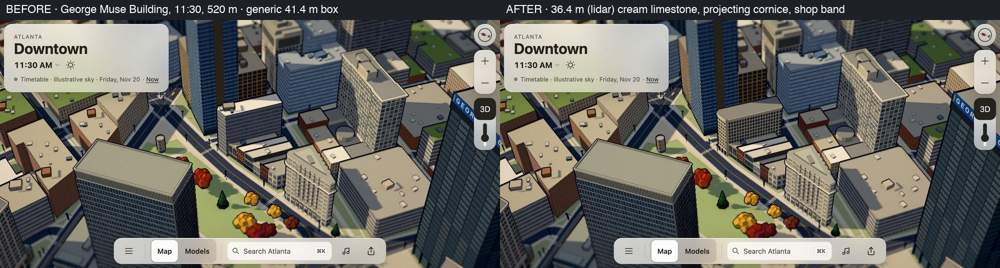
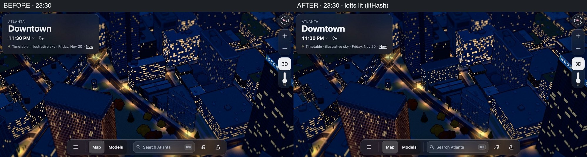
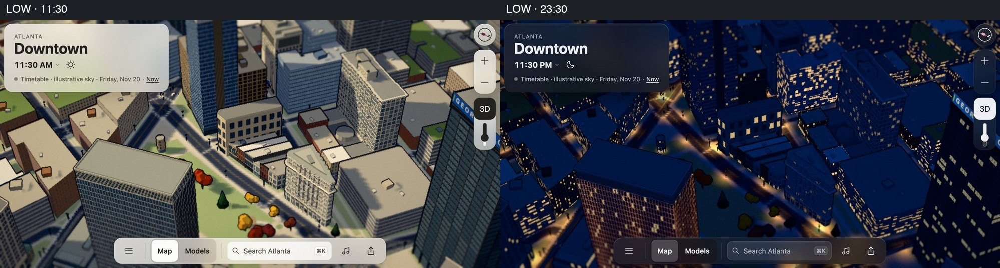
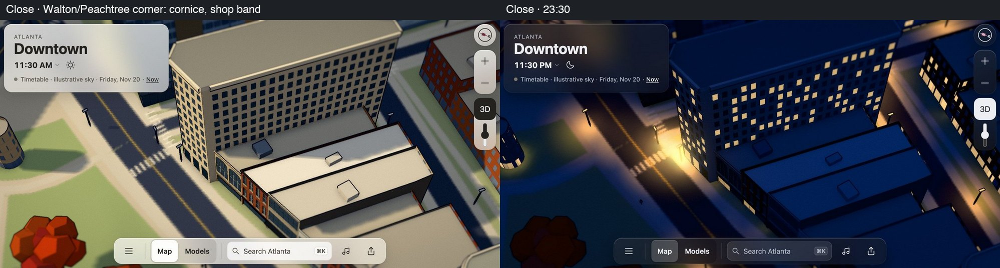
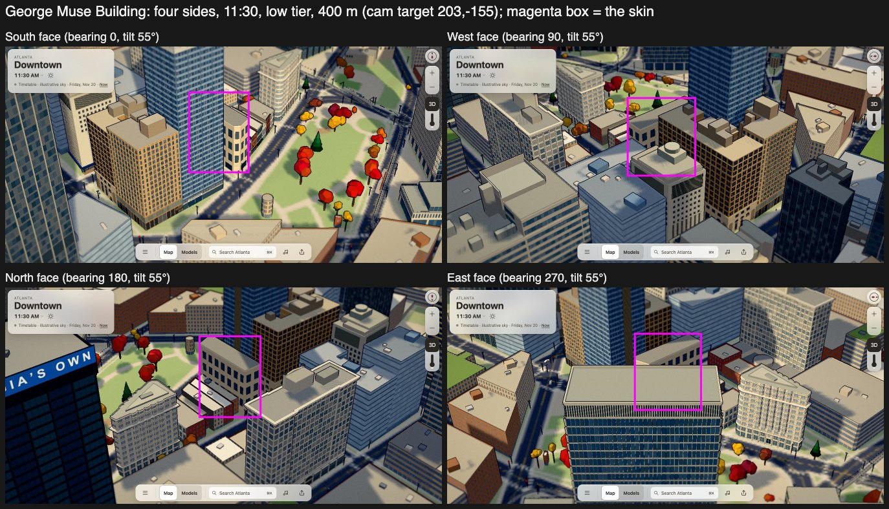

# George Muse Building

Overture `e4493636-7af5-4028-8ff9-ea2261057bdd` ("Geo Muse Building", 41.4 m) is the former George Muse Clothing Company store at 50 Peachtree Street and Walton Street, now the Lofts at Muse's. City drew a generic box; it now draws the building at its lidar height.

| Element | Height | Basis |
|---|---|---|
| Building, full outline | roof 36.4 m above the 320.6 m NAVD88 grade; cornice and parapet to 37.6 m | 3DEP lidar, 22 April 2019: median 36.4 (1,263 of 1,344 returns at 35–40 m), 90th percentile 38.8 |

## Identifying features
From Street View: 36 Peachtree Street, 17 Walton Street and 51 Broad Street (all Mar 2025); cited, not committed. The GSU "History of Our Streets" page confirms the George Muse name engraved over the lofts entrance.
- Cream limestone (`#e0d6bf`) with paired punched windows.
- A projecting cornice and a stone band over the shopfronts (`#ece6d6`).
- The engraved name is left out (no lettering). The tall arched shop bays on Peachtree are not modelled; the shopfronts are rectangular.

## Night
No night photograph exists. Lofts are lit from the shared litHash at 45%, and the shopfronts at 50%.

## Views
| View | Query |
|---|---|
| Money shot, 520 m, day and night | `?view=city&q=high&t=2026-11-20T11:30:00-05:00&cam=200,-157,250,48,520` (23:30 for night) |
| Close, Walton and Peachtree corner | `?view=city&dev&mindist=20&q=high&t=2026-11-20T11:30:00-05:00&cam=205,-150,250,35,170` |
| Four-side | `node scripts/four-side-sheet.mjs --id e4493636-7af5-4028-8ff9-ea2261057bdd --ground 320.6 --top 37.6 --dist 400`. The south face is hidden behind a glass tower from 400 m. |

## Deploy
This is bundled City code, so visitors see it after a `web/dist` rebuild and worker redeploy. No `pnpm data` is needed.
