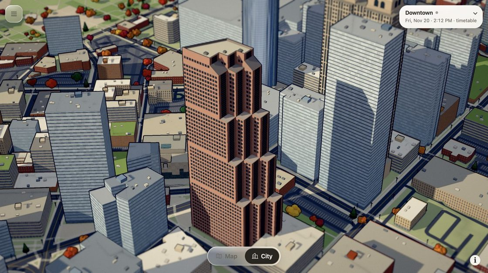

# Georgia-Pacific Tower at 133 Peachtree



The subsequent lighting study compares the merged model with a full-night photograph and the revised terrace uplights. [Night reference and matched City renders](uplighting/README.md)

| City camera | Before, day | After, day | Before, dusk | After, dusk |
| --- | --- | --- | --- | --- |
| Ordinary opening | [Before](opening-before.jpg) | [After](opening-day.jpg) | [Before](opening-before-dusk.jpg) | [After](opening-dusk.jpg) |
| East, looking across the slots | [Before](east-before.jpg) | [After](east-day.jpg) | [Before](east-before-dusk.jpg) | [After](east-dusk.jpg) |
| Southeast, across the punched windows | [Before](corner-before.jpg) | [After](corner-day.jpg) | [Before](corner-before-dusk.jpg) | [After](corner-dusk.jpg) |

From the southeast the window rows run to the edge of each granite wall. From due east the setbacks break into three narrow blades, each with a dark recess. The state historic survey identifies the stepped profile and pink granite as elements of SOM’s built design. The tower owner's reroofing account documents the reflective roof membrane, parapets and rooftop equipment. Daylight photographs guided the window spacing, grille widths and granite color. The district records changeable lighting on the east face. City approximates the east floodlighting with a warm wash that fades toward the top of each rise. The color and the office lights are illustrative. [Exterior photograph](https://commons.wikimedia.org/wiki/File:Georgia_pacific_building_atlanta_01.jpg) · [Georgia historic survey](https://dca.georgia.gov/document/resources/modern-downtown-atlanta-multiple-properties-form/download) · [Georgia-Pacific roof project](https://images.hw.net/gp/New_Roof_On_GPCenter.pdf) · [Downtown district](https://www.downtownatl.com/news/georgia-pacific-center-sap-approved-2025)

## How the footprint and the heights fit together

The named Overture polygon `15576641-5f10-4b9b-b977-994a51489be1` matches the 50 m, 14-floor mapped base. Four nested OpenStreetMap building parts share its diagonal Peachtree wall. Each successively pulls the three east-facing strips back by about 9 m. The City bake had the base alone. The model uses the five plan outlines and the 212.5 m architectural height in the height register. The sloping site puts the low eastern frontage near City (500, −370) at approximately 319 m NAVD88. This is the model’s reference for height above grade. The exact architectural entrance datum is unknown. [Base](https://www.openstreetmap.org/way/479134200) · [First upper part](https://www.openstreetmap.org/way/479134201) · [Second](https://www.openstreetmap.org/way/479134202) · [Third](https://www.openstreetmap.org/way/479134203) · [Uppermost](https://www.openstreetmap.org/way/479134204) · [Council height register](https://www.skyscrapercenter.com/building/id/1404)

A line across the south strip cuts every roof step. These values are medians of first returns in 4 × 4 m squares from USGS statewide lidar tile e1065n1253. The tile uses NAD83(2011) / Conus Albers horizontally and NAVD88, Geoid12B, vertically, both in metres. The samples locate roof surfaces. They carry no floor numbers. For the narrow shoulder, the model approximates the slope between returns. The main roof sits behind a raised granite parapet. [USGS point cloud](https://rockyweb.usgs.gov/vdelivery/Datasets/Staged/Elevation/LPC/Projects/GA_Statewide_2018_B18_DRRA/GA_Statewide_B2_2018/LAZ/USGS_LPC_GA_Statewide_2018_B18_DRRA_e1065n1253.laz)

| City x at z = −382 m | 390 | 402 | 411 | 421 | 430 | 440 |
| --- | ---: | ---: | ---: | ---: | ---: | ---: |
| First returns | 61 | 66 | 47 | 80 | 62 | 47 |
| Roof elevation, m NAVD88 | 529.54 | 529.50 | 523.30 | 473.54 | 429.56 | 385.61 |

## The narrow volume on the north

The unnamed 207 m bake record `84f5c9e9-115a-4d7c-ba20-332260a2b85e` follows a **separate** 9.45 × 23.36 m footprint near (409, −425). It shares a short edge with the tower and abuts the six-level garage. Its OSM way carries no height. In the Ellis Hotel street panorama the tower has a continuous north elevation rising behind a low foreground. The aerial shows the stepped roof ending at that north wall. [Northern footprint](https://www.openstreetmap.org/way/881692610) · [Parking footprint](https://www.openstreetmap.org/way/536725714) · [Ellis exterior panorama](https://www.google.com/maps/@33.7581793,-84.3874565,3a,90y,178h,122t/data=!3m4!1e1!3m2!1sCIHM0ogKEICAgIDEkMfy8gE!2e10) · [Esri aerial](https://server.arcgisonline.com/ArcGIS/rest/services/World_Imagery/MapServer/export?bbox=-84.38806,33.7567,-84.38586,33.75836&bboxSR=4326&imageSR=3857&size=1200,1100&format=jpg&f=image)

The statewide tile has **zero** first returns in the three 4 × 4 m probes centered on x = 409 at z = −417, −425 and −432. A second flight, Fulton County 2006, has three first returns within the inset search bounds north of z = −416. They lie near opposite edges at 326.77, 334.87 and 341.91 m after converting survey feet to metres. For comparison the statewide flight gives 341.70 m on the garage and 529.50 m on the tower. The sparse northern returns and photographs support removing the false spike. They leave the small roof’s profile unresolved. City keeps its footprint and approximates it at 10 m above local grade. This correction applies only to the specific 207 m record. The separate garage, neighboring buildings and corrected future height records keep their source values. [2006 USGS point cloud](https://rockyweb.usgs.gov/vdelivery/Datasets/Staged/Elevation/LPC/Projects/legacy/GA_FULTONCO_2006/LAZ/USGS_LPC_GA_FULTONCO_2006_000407.laz) · [2006 tile metadata](https://prd-tnm.s3.amazonaws.com/StagedProducts/Elevation/LPC/Projects/legacy/GA_FULTONCO_2006/metadata/USGS_LPC_GA_FULTONCO_2006_000407.xml)

## Reproduce the measurements and the views

Download the two LAZ tiles above. In a Python environment with numpy, rasterio and laspy with the lazrs backend, run the following from this directory. The script transforms each flight independently into City’s local x-east, z-south metre frame at 33.7539° N, 84.3916° W.

```sh
python sample-roofs.py USGS_LPC_GA_Statewide_2018_B18_DRRA_e1065n1253.laz USGS_LPC_GA_FULTONCO_2006_000407.laz
```

The before images use `ca582d7`, with Truist Plaza and the steel decks present. In desktop Orca, use 1296 × 726 and `/?view=city&q=high&t=2026-11-20T14:12:45-05:00&speed=0`. Change the time to `17:45:00` for dusk. Leave the opening untouched. Use these calls for the east and southeast cameras respectively.

```js
window.__city.lookAt(290, -415, { bearing: -86, metresPerPixel: .45, tilt: 55 })
window.__city.lookAt(318, -537, { bearing: -38, metresPerPixel: .46, tilt: 55 })
```

The matched daylight opening goes from 155 to 159 draw submissions and 2,184,181 to 2,205,263 submitted triangles (+0.97%). The landmark ships in the web bundle. Rebuild and deploy it with the existing generated City data.
