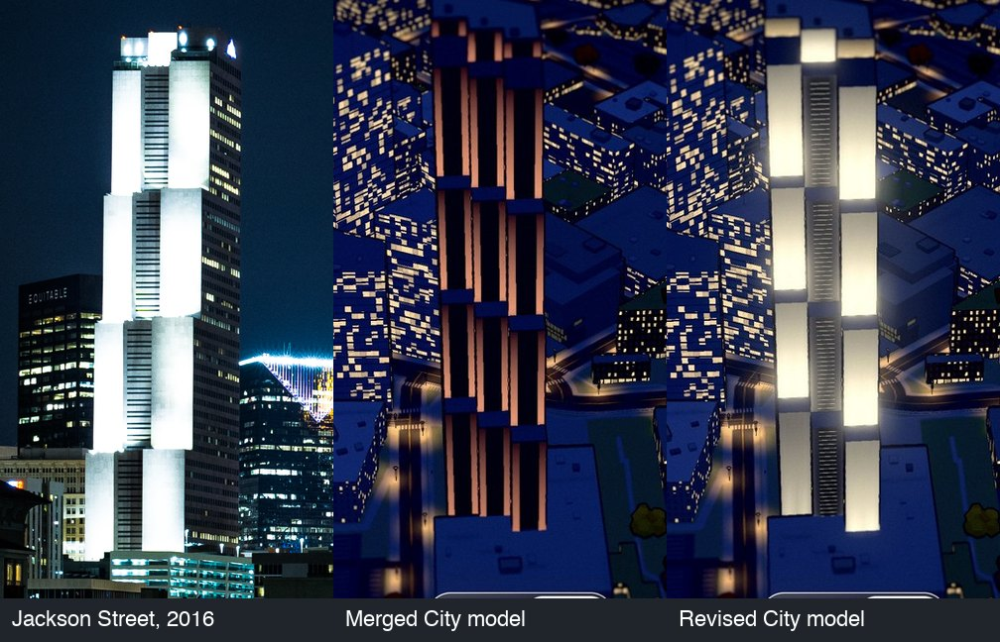

# Georgia-Pacific after dark



The left panel is a crop of Joey Kyber’s 2016 photograph from the Jackson Street Bridge (CC0). The other two panels use identical crops of the east City camera at 21:15. The photographer’s 15-second exposure makes the faces very bright. The position of the bright stone and the horizontal bands across the dark grille are clearer evidence than the absolute brightness. [Original photograph and exposure](https://commons.wikimedia.org/wiki/File:Jackson_Street_Bridge_and_Atlanta_Night_Skyline_(Unsplash).jpg)

Sam’s dusk photograph shows the warmest, brightest pools at the foot of each rise. Light spreads up the two broad stone faces, with a darker grille between them. The windows on the side wall remain individually visible. The short central crown face is bright above the last shoulder, and the adjacent caps look warmer. Kyber’s night photograph shows the two light faces are still distinct at skyline scale. A photograph of the 2021 Pride display also shows how the same faces can carry different colors. City depicts the warm-white appearance in Sam’s reference. [Pride lighting photograph](https://secretatlanta.co/georgia-pacific-center-pride-lights/) · [Daylight exterior](https://commons.wikimedia.org/wiki/File:Georgia_pacific_building_atlanta_01.jpg)

The merged model put two narrow amber strips on each of three east-facing planes. City now spreads the terrace light over the two outer planes. Light catches the horizontal edges of the central louvers, and the crown pools begin above the sloping covers. The wash fades with height. Beam widths, fixture placement, relative brightness, color and office occupancy are illustrative estimates. The static model makes no claim about tonight’s lighting program.

## Matched City cameras

| Atlanta time | Camera | Evidence |
| --- | --- | --- |
| 14:12:45 | East | [Daylight facade, before and after](day.jpg) |
| 17:45 | East | [Terrace light at dusk, before and after](dusk.jpg) |
| 21:15 | Southeast | [Full night, before and after](night.jpg) |
| 21:15 | Wider skyline from the east | [Tower in the district](district-night.jpg) |

The comparison starts at merged commit `64288b2`. In desktop Orca, use a 1296 × 726 viewport with `/?view=city&q=high&t=2026-11-20T21:15:00-05:00&speed=0`. Substitute the clock times above for day or dusk. These calls reproduce the east, southeast and wider skyline cameras in table order.

```js
window.__city.lookAt(290, -415, { bearing: -86, metresPerPixel: .45, tilt: 55 })
window.__city.lookAt(318, -537, { bearing: -38, metresPerPixel: .46, tilt: 55 })
window.__city.lookAt(230, -520, { bearing: -63, metresPerPixel: 1.18, tilt: 66 })
```

At the ordinary daylight opening both versions submit 159 draws and 2,205,263 triangles. At 21:15 the opening uses 165 draws in both versions, with 2,180,704 triangles before and 2,183,360 after (+0.12%). The change uses the existing night overlay and needs a web rebuild and deployment with the current City data.
