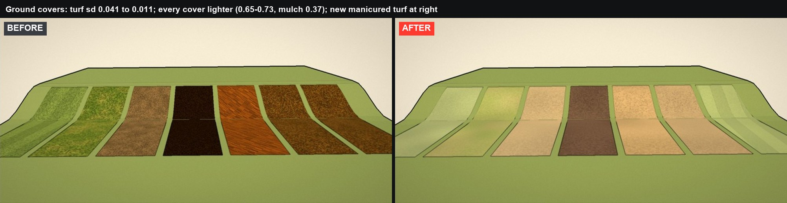

# Calm ground covers

Sam's art direction (2026-11-23): the ground is a quiet, light-valued backdrop for buildings, trains and trees, with "a whisper of variation, not a pattern". Strong mow stripes belong only on manicured lawns.

- **`turf`, the default lawn,** is now a soft tonal variation with no stripes. Its base sits in the board ground's own colour family: grass `#b7c298`, park `#adbe90`, meadow `#a5b46e`.
- **`manicured`** is new: faint mow stripes, about ±2.5 %, for formal landmark lawns, stadium fields and golf only. It is appended last, so existing cover indices don't move.
- **Meadow, earth, mulch, pine straw and leaf litter** read as light colour patches with faint grain. Pine straw and leaf litter are less orange.
- **Bed soil** stays dark, but dark brown rather than black (`#4a3a2e`–`#574535`). It's never black-heavy across large areas.
- **Detail** fades to flat colour with distance (by pixel footprint), and the low tier halves the variation (`mesh({ quality: 'low' })`).

## Measured

Display luminance (0–1) inside each swatch in the lab's Ground-covers view, high tier, day. The values are a 17 × 13-pixel box mean and its standard deviation. For reference, the lab's flat test plot reads 0.584 ± 0.005.

| Cover | Before: mean ± sd | After: mean ± sd |
| --- | ---: | ---: |
| turf (default) | 0.509 ± 0.041 | **0.689 ± 0.011** |
| meadow | 0.543 ± 0.091 | 0.655 ± 0.016 |
| worn earth | 0.467 ± 0.212 | 0.725 ± 0.028 |
| mulch | 0.477 ± 0.152 | 0.373 ± 0.015 |
| pine straw | 0.358 ± 0.160 | 0.677 ± 0.029 |
| leaf litter | 0.397 ± 0.161 | 0.663 ± 0.024 |
| manicured (new) | — | 0.673 ± 0.015 |

The default turf's variation is now about 1.6 % of its value. Every cover's spread is a fifth to a seventh of what it was.

## Views

Lab, same camera before and after:

- [Garden, high](garden-high.jpg) · [garden, low](garden-low.jpg)
- [Front yard, high](yard-high.jpg) · [front yard, low](yard-low.jpg): new lab entry `/models.html?v=yard`
- [Park edge, high](park-high.jpg) · [park edge, low](park-low.jpg): new lab entry `/models.html?v=park`
- [Swatches, high vs low](ground-tiers.jpg) · [garden and yard at night](night.jpg)

The High Museum's lawn (#244) uses `turf`, so it becomes the calm lawn. As a formal landmark lawn it can opt into `manicured`. No board-wide repaint has been done. Publishing needs a web rebuild only.
