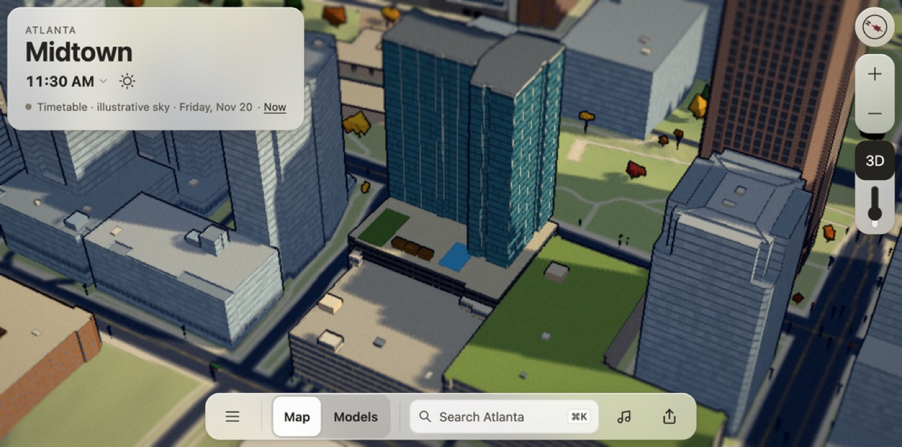
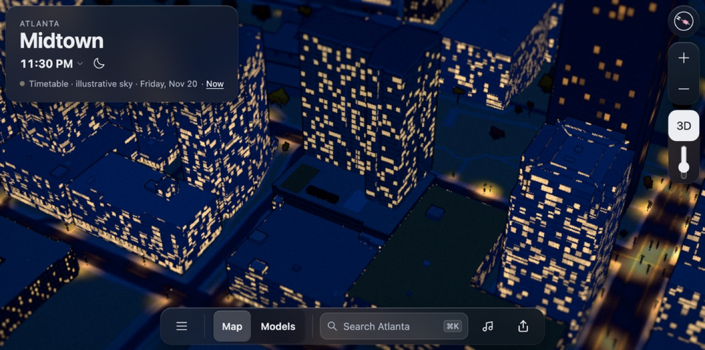
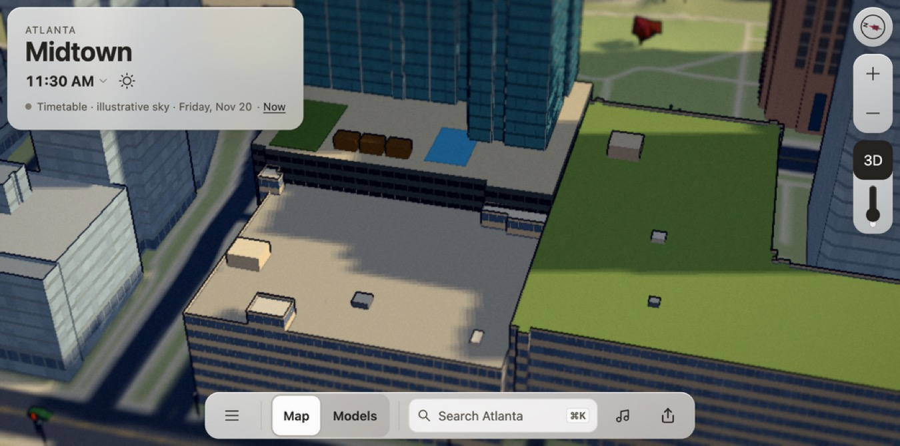

# Hanover Midtown

City replaces the generic mesh for `osm:way:505421514`, the 31-storey Hanover Midtown apartments at 1230 West Peachtree (Solomon Cordwell Buenz, completed 2024). The building is newer than the 2019 lidar. City keeps the mapped parts: an L-shaped tower at 108 m and 111.6 m along the east and north sides, the 25.2 m podium (its outer ring, which covers courtyard holes under the tower), three 28.8 m deck pavilions, and the 3.6 m entrance strip.

The daytime listing aerial from the west shows the L of blue-green glass with slender white vertical fins, white slab edges at the crown, and the podium's amenity deck in front: a pool, lawn and cabanas on pale paving. The dusk and night photographs taken on the pool deck show the inside corner of the L from below. They show the same glass with white fins and many warmly lit apartments. Estimated details: the 8.5 m fin spacing, the 3.3 m floor pitch, the pool (about 16 × 10 m), the lawn, the cabana heights, and the podium's dark parking screens.

Sources, consulted in a fresh Orca tab:
- [Property photo gallery](https://www.livehanovermidtown.com/atlanta/hanover-midtown/photos/): the "High-Rise Exterior" daytime aerial and the "Nighttime Pool View".
- [Apartments.com listing photos](https://www.apartments.com/hanover-midtown-atlanta-ga/jtbq9z4/): dusk views from the pool deck toward the tower.
- [Midtown Alliance project page](https://midtownatl.com/view/hanover-midtown): renderings, used only to confirm the massing.

**Lighting:** The night pool photograph shows many lit apartments and a lit deck. City treats it as residential, with about a third of units lit at 23:30 and a lit entrance. The pool is not drawn as a light source.

| Review view | City query |
|---|---|
| Day, from the southwest over the deck | `?view=city&q=low&t=2026-11-20T11:30:00-05:00&cam=335,-3815,60,50,540` |
| Full night, matched | `?view=city&q=low&t=2026-11-20T23:30:00-05:00&cam=335,-3815,60,50,540` |
| Closer pool deck | `?view=city&q=low&t=2026-11-20T11:30:00-05:00&cam=300,-3790,75,55,300` |

