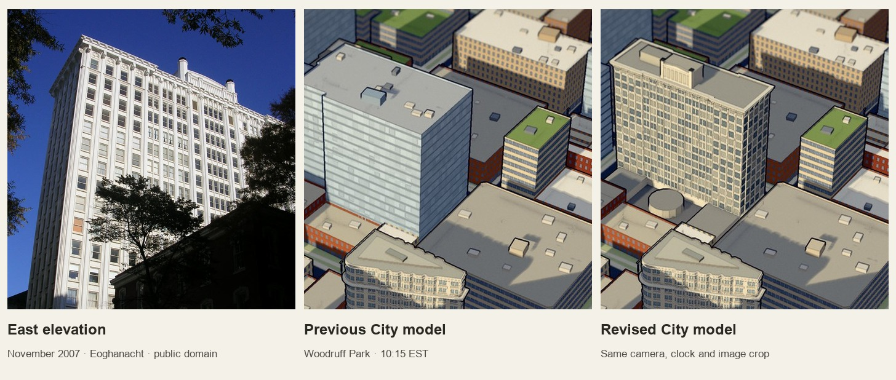
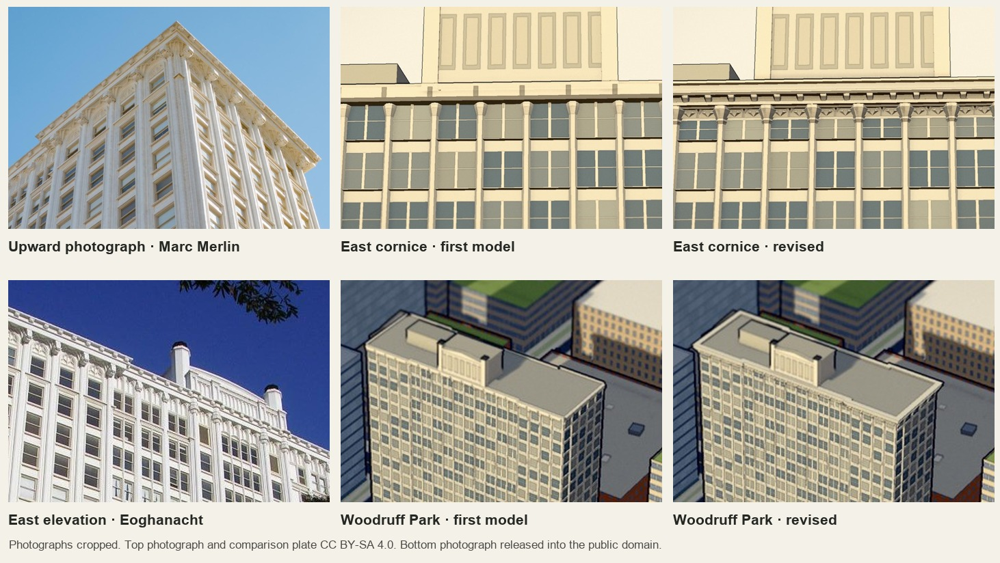

# The Healey Building above Woodruff Park

The 1914 tower runs along Forsyth between Poplar and Walton. From the park, its lift house rises between two stacks above the east cornice. At sidewalk level, the glass display bays project beyond the ground-floor shops. The Forsyth entrance has a round-headed fanlight over a brass-framed doorway. [East elevation photographed by Eoghanacht](https://commons.wikimedia.org/wiki/File:Healey-Bldg-Atlanta-01.jpg) · [Forsyth and Walton street panorama](https://commons.wikimedia.org/wiki/File:Vertical_panorama_of_the_Healey_Building_in_cylindrical_perspective.jpg) · [Entrance detail](https://commons.wikimedia.org/wiki/File:Entrance,_Healey_Building,_Atlanta,_GA_(47474421191).jpg)

The reference photograph in the comparison shows the east elevation, photographed by Eoghanacht, November 20, 2007, released into the public domain. Both City panels use the same camera and crop. In the full park frames the Flatiron stands in the foreground. [Previous park view](park-before.jpg) · [Revised park view](park-after.jpg)

## The cornice from below

Look above the straight heads of the top-floor windows. The upward photograph shows shallow carved arches there, flared capitals at the pier heads, and a finer row of brackets beneath the top lip. The revised cornice returns around the corners and follows the setbacks in the long elevation. A projecting coping casts a shadow over the brackets. City estimates a 1.54 m coping projection, compared with 0.83 m in the first model. The 1.29 m noses of the brackets and the paired leaf forms simplify the observed relief. The change adds 6,536 submitted triangles to the first model at the same 75 park draw calls.

The top photograph is a cropped and resized detail of Marc Merlin’s February 27, 2016 cylindrical panorama. The photograph and the cornice comparison plate are licensed CC BY-SA 4.0. Eoghanacht’s public-domain east photograph is cropped in the lower row. Each pair of City crops uses one camera and clock. [Merlin’s original panorama](https://commons.wikimedia.org/wiki/File:Vertical_panorama_of_the_Healey_Building_in_cylindrical_perspective.jpg) · [CC BY-SA 4.0](https://creativecommons.org/licenses/by-sa/4.0/) · [Eoghanacht’s original](https://commons.wikimedia.org/wiki/File:Healey-Bldg-Atlanta-01.jpg)

| Cornice check, Nov 20 at 10:15 EST | First model | Revised cornice |
| --- | --- | --- |
| Woodruff Park at ordinary zoom, same orbit as below | [Park](park-first.jpg) | [Park](park-after.jpg) |
| Upper east elevation · (218, 40, −183) → (169, 60, −235), 22° vertical FOV | [Roofline](roofline-first.jpg) | [Roofline](roofline-after.jpg) |
| Looking up from Forsyth · (142, 0.4, −262) → (156, 60, −246), 23° vertical FOV | [Underside](underside-first.jpg) | [Underside](underside-after.jpg) |

## Reading the roof heights

City already recorded **16 floors and 62.7 m** for the named ten-vertex parcel, ID `eeb07e5a-dbed-4900-9314-e478769493ca`. Its generic facade took the glass style used for buildings at least 42 m tall. The old silhouette also carried that height across the low roofs toward Broad. The historic plan called for twin towers joined by a rotunda. Only the Forsyth tower was built. [City landmark designation](https://www.atlantaga.gov/government/departments/city-planning/historic-preservation/property-district-information/healey-building)

The Forsyth edge of the baked polygon measures 62.56 m. From 7,093 sampled 2018 lidar returns inside the footprint and the perimeter terrain grid, the sidewalk runs from 321.6 to 323.3 m NAVD88. Heights below are absolute elevations. The sample uses EPT levels 7–10. In plan, distances run from Poplar toward Walton along Forsyth, then inward toward Broad. [USGS Georgia B2 lidar](https://s3-us-west-2.amazonaws.com/usgs-lidar-public/GA_Statewide_B2_2018/ept.json) · [USGS 1 m terrain metadata](https://prd-tnm.s3.us-west-2.amazonaws.com/StagedProducts/Elevation/1m/Projects/GA_Statewide_2018_B18_DRRA/metadata/USGS_1M_16_x74y374_GA_Statewide_2018_B18_DRRA.xml)

| Roof sample | Lidar result, metres NAVD88 | City interpretation |
| --- | --- | --- |
| First 1–6 m inside Forsyth | Median 385.2 | Main roof 63.6 m above the low sidewalk, slab about 19.3 m deep |
| Eastern lift house, 26–36 m along and 10–17 m in | Median 392.6, 90th percentile 393.3 | Raised paneled headhouse, shallow gable and end stacks |
| Secondary roof plant, 42–55 m along and 8–12 m in | Median 389.7 | Set-back service block |
| Rear roofs, 22–34 m in | Roof groups around 328.4 and 332.6–332.9 | Lower connecting roof, two higher side roofs and the round rotunda roof |

The National Register describes a two-story base and fourteen stories above it. Ten central bays on each long elevation have paired narrow sash windows. Wider singles finish the ends. Continuous piers terminate in arches below a projecting cornice. The two photographs resolve the flared pier heads, sloping sills and stacks. Sash sizes, the 0.66 m setback of the paired bays, molding depths, shopfront projection, interior roof outlines and stack cap heights are visual estimates. Ground-floor businesses and room occupancy are illustrative. [National Register nomination, exterior description](https://npgallery.nps.gov/NRHP/GetAsset/5b5edb3d-e001-4f7b-8c14-a60fdbaaad2a/)

## After dark

The Atlanta History Center catalogs the Healey in L. E. Wallace Jr.’s 1948 night skyline photograph. The 2017 park photograph records the changing light on surrounding buildings at blue hour. Neither source establishes a current permanent lighting scheme for the Healey. The City model leaves the crown under ambient light and gives a fixed, illustrative selection of window panes and the lobby a warm interior glow. [1948 skyline, Atlanta History Center](https://dlg.usg.edu/record/geh_athpc_826) · [2017 Downtown Counts, p. 10](https://ctycms.com/ga-atlanta/docs/downtown-counts_2017-reduced.pdf#page=10) · [Matched park view after dark](park-night-after.jpg)

## Matched City cameras

Orca desktop at 1296 × 726, high quality, clock paused. Both versions include the revised Flatiron from commit `ee3da9b`. The orbit specifies City target x/z, bearing, metres per pixel and tilt. Street views give eye → target in City x/y/z metres with a 0.10 m near plane.

| Camera | Date, local time and settings | Before | After |
| --- | --- | --- | --- |
| Woodruff Park | Nov 20, 2026, 10:15 EST · (165, −236), 285°, 0.29, 52° | [Park](park-before.jpg) | [Park](park-after.jpg) |
| Same park orbit after dark | Nov 20, 20:15 EST | [Night](park-night-before.jpg) | [Night](park-night-after.jpg) |
| Entrance across Forsyth | Jun 12, 2026, 18:10 EDT · (139.2, 0.35, −250.75) → (154.7, 6.8, −249.3), 64° vertical FOV | [Entrance](entrance-before.jpg) | [Entrance](entrance-after.jpg) |
| Walton approach | Jun 12, 18:10 EDT · (118.5, 0.20, −231.6) → (150, 23, −239), 76° vertical FOV | [Corner](walton-before.jpg) | [Corner](walton-after.jpg) |

The matched park daylight frame rises from 2,066,857 submitted triangles at 71 draws to 2,093,297 at 75 draws. The difference is 26,440 triangles (1.28%), including shadow passes. Rebuild the web bundle with the existing City data.
