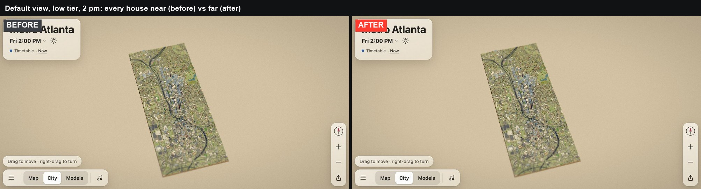

# Houses by distance (phone performance)

Phone performance is the priority. On a Galaxy A16 at `q=low`, the default wide view runs at about 13 fps against a 30 fps target, and the GPU is bound by triangles. Houses were about 637k of the 4.74M triangles in that view: 3,300-odd Midtown houses with full eaves, porches, windows and chimneys, none of which resolve from kilometres away.

Each house is now drawn in one of two versions, tile by tile (800 m tiles, `web/src/city/house-lod.ts`):

- **Far:** the same walls, colours and roof planes, with no overhang, fascia, soffit, windows, porch, chimney or trim. It costs 16 triangles, against about 154 for the full house on low.
- **Near:** the full house, unchanged. It is **built only when the camera first comes within about 1.1 km of its tile**, so the wide view never holds it in memory.

The switch is at 1 km, where a 0.5 m eave is about a pixel with City's 22° lens, so it doesn't pop. A 10 % band either side stops it flickering. Far houses keep siding styles 7–10, so their day colour matches. They lose their lit windows, which at the default view's distance were already sub-pixel (see the 11 pm comparison).

**Measured in the browser** (renderer counts, default view, Nov 20 2 pm):

| Tier | Before | After | Change |
| --- | --- | --- | --- |
| low triangles | 4,737,989 | 4,234,536 | −503,453 (−10.6 %) |
| low draws | 480 | 534 | +54 (one per far tile, twice with shadows) |
| high triangles | 17,259,899 | 15,621,133 | −1,638,766 (−9.5 %) |

The Ansley camera at a 1,150 m orbit, where foreground tiles have already switched to near, saves 160k.

**Dev switch:** `?houses=near` or `?houses=far` pins every tile, for before-and-after checks (dev server only).

## Views

- [Default view, 2 pm](default-day-compare.jpg) · [11 pm](default-night-compare.jpg): forced near vs the new default, indistinguishable
- [Just past the switch](switch-compare.jpg): `/?view=city&cam=1280,-3950,40,58,1150`, near vs far

Publishing needs a web rebuild only.
