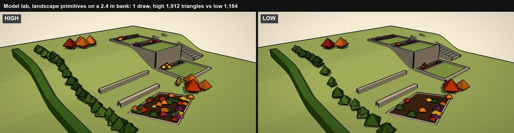

# Landscape primitives

Flat green lawns read wrong around landmarks. `web/src/landscape/primitives.ts` provides parameterised, cheap landscape pieces in City's low-poly, ink-lined style. Each piece appends to one vertex-coloured `Builder`, so a whole garden is **one draw call**. Each follows a ground sampler in scene metres. The model lab has a **Landscape** section (`/models.html?v=garden`, with `?tier=low` and `?night=1`) that shows each piece on a test plot: two lawns joined by a 2.4 m bank (about 22°).

| Primitive | What it draws | Lab triangles, high / low |
| --- | --- | ---: |
| `flowerBed(b, ring, ground, { doy, quality?, curb?, density?, mound?, flowers?, seed? })` | Curbed edge, draped mulch (optionally domed as a raised mound), and seasonal flower and leaf clumps. `bloom(doy)` gives the palette. | 366 / 140 |
| `hedge(b, line, ground, { height?, width?, clipped?, quality?, seed? })` | Clipped box hedge following grade, or a loose row of shrub mounds | 444 / 254 (both together) |
| `retainingEdge(b, line, ground, { reveal?, width?, quality? })` | Wall from the low side to the high side plus a reveal, capped | in "walls" |
| `seatWall(b, line, ground, { height?, width?, quality? })` | Level-topped bench wall, 0.45 m above its highest ground | in "walls" |
| `stairRun(b, from, to, width, ground, { riser?, cheeks?, fromY?, toY? })` | Treads at a 0.16 m riser between the ground (or surveyed `fromY` and `toY`) at each end, with cheek walls | 294 / 258 (with the walls) |
| `terraces(b, from, to, width, levels, ground, { doy?, quality?, surface?, fromY?, toY? })` | Level lawns stepping down a slope, with capped risers and side walls. With `fromY` and/or `toY` the levels step evenly between surveyed elevations (a missing end uses its level's ground). | 966 / 582 (4 levels) |
| `ornamentals(b, centre, radius, ground, { doy, count?, quality?, seed? })` | Multi-stem shrubs and grasses with seasonal tint. Trees stay with the tree-species module. | 232 / 136 |
| `landscapeMesh(b)` | Builds the single mesh: `{ mesh, triangles, draws: 1, dispose }` | |

The whole demo garden is 1 draw: **1,912 triangles at high, 1,184 at low**. A null ground sample (off the board) reuses the sampler's last valid height. Corners are mitred. Degenerate input (a zero-length run, riser 0, zero levels) draws nothing. Low tier uses coarser mulch cells, about a third of the flower clumps, half the ornamentals and longer wall segments.

**Tiers.** The caller supplies positions and elevations, with their own tiers. Rings and lines are in world scene coordinates (Five Points metres, x east, z south). Elevations are scene metres: NAVD88 minus `sceneZeroNavd88M`. Planting, materials and seasonal colour are `illustrative`. Beds read November mums in the November views.

**Consumers.** First, the High Museum's Peachtree lawn (studio-midtown-culture), then the Ansley parks and residential yards.

## Views

The lab shows each primitive, ¾ front.

- [Garden by day and at night](garden-day-night.jpg) · [garden at night, low tier](garden-low-night.jpg)
- [Flower bed](bed.jpg) · [hedges](hedge.jpg) · [terraces](terraces.jpg) · [retaining edge, seat wall and stairs](walls.jpg) · [ornamentals](ornamentals.jpg)

Publishing needs a web rebuild only. Nothing in City uses the primitives yet.
